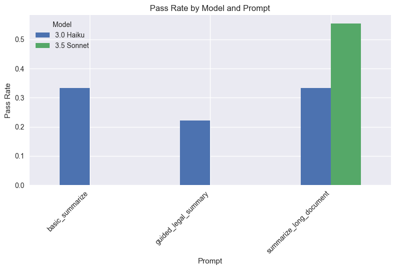

# 用 Claude 做摘要

> 原文：[capabilities/summarization/guide.ipynb](https://github.com/anthropics/claude-cookbooks/blob/main/capabilities/summarization/guide.ipynb)

用法律文件當範例的完整摘要指南，包含評估方法和進階技巧。

## 這篇在做什麼

拿一份 SEC 公開的轉租合約當素材，從最簡單的摘要 prompt 開始，一步步加上 multi-shot、guided summarization、長文件的 meta-summarization，再到 summary-indexed 的 RAG。最後用 ROUGE 和 Promptfoo 評估摘要品質，並說明怎麼迭代改進。

## 學完你會

- 寫出會輸出 `<summary>` XML 標籤並用 stop sequence 收尾的摘要 prompt，再用 few-shot 範例固定輸出格式。
- 針對特定文件類型（例如轉租合約）設計 guided prompt，把各段摘要解析成結構化欄位。
- 用 chunking 做長文件的 meta-summarization，並用 Promptfoo 跑 eval 比較不同模型和 prompt。

## 開跑前

- 需要 Claude API key。
- 需要安裝 anthropic、pypdf、pandas、matplotlib、sklearn、numpy、rouge-score、nltk、seaborn。
- 評估那節要用 [promptfoo](https://www.promptfoo.dev/)，需要 Node.js 環境。

## 簡介

摘要是自然語言處理裡很重要的任務，把大量文字濃縮成更短、更好消化的形式，同時保留關鍵資訊。在資訊爆炸的今天，能快速從冗長文件抓出重點，在各行各業都很有價值。

這份指南聚焦在用 Claude 做摘要，特別是法律文件。法律文件常常又長又難讀，尤其是有一堆小字和法律術語的時候。我們會探討怎麼有效地摘要這類文件、怎麼評估摘要品質，以及怎麼系統性地改進摘要表現。

主要涵蓋的內容：
- 設計有效的摘要 prompt
- 從文件中抽取特定的 metadata
- 處理超過一般 token 上限的長文件
- 用自動化方法評估摘要品質（例如 ROUGE 分數和 [Promptfoo](https://www.promptfoo.dev/) 的自訂方法）
- 迭代改進摘要表現
- 最佳化摘要工作流程的整體建議

讀完這份指南，你會對怎麼用 Claude 實作和改進摘要任務有扎實的理解，也有一套可以套用到自己情境的框架。

開始之前，先談談這份指南裡的評估。評估摘要品質是出了名的困難。跟很多其他 NLP 任務不同，摘要評估常常缺乏明確、客觀的指標，過程可能很主觀，不同讀者看重摘要的不同面向。像 ROUGE 分數這種傳統的實證方法雖然有用，但在捕捉連貫性、事實正確性和相關性這些細微面向上有限。而且「最好」的摘要會隨使用情境、目標讀者和需要的詳細程度而不同。儘管有這些挑戰，我們還是探索了幾種可以用的方法，結合自動化指標、正規表達式和任務專屬的標準。這份指南認為，最有效的做法通常是針對手上的摘要任務量身組合多種技巧。

## 目錄

1. [環境設定](#setup)
2. [資料準備](#data-preparation)
3. [基本摘要](#basic-summarization)
4. [Multi-shot 基本摘要](#multi-shot-basic-summarization)
5. [進階技巧](#advanced-techniques)
    - [Guided 摘要](#guided-summarization)
    - [特定領域的 Guided 摘要](#domain-specific-guided-summarization)
    - [Meta-summarization](#including-the-context-of-the-entire-document-meta-summarization)
6. [Summary Indexed Documents：進階 RAG 做法](#summary-indexed-documents-an-advanced-rag-approach)
    - [摘要式 RAG 的最佳實務](#best-practices-for-summarization-rag)
7. [評估](#evaluations)
8. [迭代改進](#iterative-improvement)
9. [結論與最佳實務](#conclusion-and-best-practices)

## 環境設定

要完成這份指南，你需要安裝以下套件：
- anthropic 
- pypdf
- pandas
- matplotlib
- sklearn
- numpy
- rouge-score
- nltk
- seaborn
- [promptfoo](https://www.promptfoo.dev/)（評估用）

你也需要一把 Claude API key。

先來安裝需要的套件並設定環境：

```python
# install packages
%pip install anthropic pypdf pandas matplotlib numpy rouge-score nltk seaborn --quiet
```

```python
import re

import anthropic
import matplotlib.pyplot as plt
import numpy as np
import pandas as pd
import seaborn as sns

# Set up Anthropic client
# You can set up a .env file with your API key to keep it private, and import it like so:
# from dotenv import load_dotenv
# load_dotenv()

# or add your key directly
api_key = "ANTHROPIC_API_KEY"  # Replace ANTHROPIC_API_KEY with your actual API key
client = anthropic.Anthropic(api_key=api_key)


def get_text(response):
    """Concatenate the text blocks of a response.

    Current models may return a leading thinking block, so don't index content[0].
    Raises if there is no text at all (e.g. the whole max_tokens budget went to thinking).
    """
    text_blocks = [block.text for block in response.content if block.type == "text"]
    if not text_blocks:
        raise ValueError(
            f"No text block in response (stop_reason={response.stop_reason}); "
            "if stop_reason is 'max_tokens', raise max_tokens."
        )
    return "".join(text_blocks)


print("Setup complete!")
```

??? note "輸出"

    ```text
    Setup complete!
    ```

## 資料準備
在開始摘要文件之前，要先準備資料。這包括從 PDF 抽出文字、清理文字，確保可以餵給語言模型。這個示範用的是我們從 sec.gov 網站取得的[公開轉租合約](https://www.sec.gov/Archives/edgar/data/1045425/000119312507044370/dex1032.htm)。

如果你有想測試的 PDF，可以把它放進這個目錄，再改下面的檔案路徑。**如果你只想貼一段文字，就跳過這步，直接定義 `text = <text blob>`**。

這裡有一組處理這個流程的函式：

```python
import re

import pypdf

pdf_path = "data/Sample Sublease Agreement.pdf"


def extract_text_from_pdf(pdf_path):
    with open(pdf_path, "rb") as file:
        reader = pypdf.PdfReader(file)
        text = ""
        for page in reader.pages:
            text += page.extract_text() + "\n"
    return text


def clean_text(text):
    # Remove extra whitespace
    text = re.sub(r"\s+", " ", text)
    # Remove page numbers
    text = re.sub(r"\n\s*\d+\s*\n", "\n", text)
    return text.strip()


def prepare_for_llm(text, max_tokens=180000):
    # Truncate text to fit within token limit (approximate)
    return text[: max_tokens * 4]  # Assuming average of 4 characters per token


def get_llm_text(path):
    extracted_text = extract_text_from_pdf(path)
    cleaned_text = clean_text(extracted_text)
    llm_ready_text = prepare_for_llm(cleaned_text)
    return llm_ready_text


# You can now use get_llm_text in your LLM prompt
text = get_llm_text(pdf_path)
print(text[:500])
```

??? note "輸出"

    ```text
    EX-10.32 7 dex1032.htm SUBLEASE AGREEMENT Exhibit 10.32 SUBLEASE AGREEMENT THIS SUBLEASE AGREEMENT (“Sublease ”), is dated as of April 1, 2006, by and between COHEN BROTHERS, LLC d/b/a COHEN & COMP ANY (“Sublessor ”) and TABERNA CAPIT AL MANAGEMENT , LLC (“Sublessee ”), collectively , the “ Parties ” and each a “ Party ”. WHEREAS, Sublessor is the lessee under a written lease agreement dated June 22, 2005 wherein Brandywine Cira, L.P ., a Delaware limited partnership (“ Lessor ”), leased Suite N
    ```

這樣的設定讓我們可以輕鬆處理 PDF 文件並準備好做摘要。下一節我們先從基本的摘要做法開始，再逐步加上更進階的技巧。

## 基本摘要

先用 Claude 寫一個簡單的摘要函式。這是用 Claude 摘要上面那份文件文字的簡單嘗試。隨著指南進行，我們會逐步改進這個方法。

要注意的是，雖然看起來很基本，但我們其實已經用到 Claude 一些重要的功能，其中值得一提的是 XML 標籤和 stop sequence。Prompt 要求 Claude 把輸出包在 `<summary></summary>` 標籤裡，這樣我們可以把開頭 `<summary>` 標籤之前的東西去掉，而 stop sequence `</summary>` 會讓 Claude 在摘要一寫完就停止生成。這個模式在整份指南裡會一直用到。

```python
def basic_summarize(text, max_tokens=8192):
    # Prompt the model to summarize the text
    prompt = f"""Summarize the following text in bullet points. Focus on the main ideas and key details:
    {text}

    Wrap your entire summary in <summary></summary> tags.
    """

    response = client.messages.create(
        model="claude-sonnet-5-5",
        max_tokens=max_tokens,
        system="You are a legal analyst known for highly accurate and detailed summaries of legal documents.",
        messages=[{"role": "user", "content": prompt}],
        stop_sequences=["</summary>"],
    )

    # The reply is wrapped in <summary> tags (the stop sequence trims the closing one);
    # drop anything up to and including the opening tag.
    return get_text(response).split("<summary>", 1)[-1].strip()
```

```python
basic_response = basic_summarize(text, max_tokens=8192)

print(basic_response)
```

??? note "輸出"

    ```text


    Key Points:
    •Between parties: COHEN BROTHERS, LLC d/b/a COHEN & COMPANY (Sublessor) and TABERNA CAPITAL MANAGEMENT, LLC (Sublessee).
    •Signed on April 1, 2006.
    •Premises: 2,000 square feet of office space in Suite 1703 in the Cira Center at 2929 Arch Street, Philadelphia.

    Major Terms:
    •Term: 5 years starting April 1, 2006
    •Payment: Fixed rent increases annually from $34.50/sf to $37.34/sf over the term.
    •Utilities: Tenant pays for electricity and pro rata share of building expenses.
    •Use: General office use only.
    •Assignment/Subletting: Requires prior written consent of landlord.

    Key Obligations:
    •Tenant must maintain insurance including liability and property insurance.  
    •Tenant responsible for interior maintenance/condition of the premises.
    •Tenant must comply with all building rules and regulations.
    •Tenant must maintain premises in good order and repair.

    Notable Provisions:
    •Sublessor can recapture premises if tenant tries to assign/sublet without proper consent.
    •Default provisions give sublessor multiple remedies including termination and accelerated rent.  
    •Tenant must indemnify landlord for claims related to tenant's use or actions.
    •Tenant responsible for maintaining and repairing interior of premises.

    This appears to be a fairly standard commercial office sublease with typical provisions regarding tenant obligations, insurance requirements, default remedies, etc. The sublessor retains significant control and remedies while the sublessee has standard obligations for an office tenant.
    ```

這個基本做法會給出簡單的摘要，但可能抓不到法律或財務文件需要的所有細節。你也會發現，重跑上面的 cell 時輸出沒有標準、固定的格式。我們拿到的是一份基本的摘要，沒什麼結構化的輸出可以解析。這讓它更難讀，也更難信任（怎麼知道它沒漏掉東西？），在真實場景裡就不好用。

來看看能不能調整 prompt，讓摘要更有結構。

## Multi-shot 基本摘要

能這麼快摘要大份文件很酷，但我們還能做得更好。試著在 prompt 裡加幾個範例，看能不能改善輸出，並在進入更進階的技巧之前，讓輸出有一點結構。

注意，這裡我們並沒有真的改變 request 的格式，只是多加了兩個東西：

1. 我們告訴模型「不要寫開場白（do not preamble）」。這通常是個好主意，可以把模型輸出限制在我們要的答案，不要有你用過 Claude 可能熟悉的那種一開始的客套對話。當 prompt 裡沒有用其他「instructions」時（像這份指南後面會做的），這點特別重要。
2. 我們附上 3 份已摘要文件的範例。這叫 few-shot 或 multi-shot learning，可以幫模型理解我們要什麼。

來看輸出有什麼變化：

```python
# We import from our data directory to save space in our notebook
from data.multiple_subleases import document1, document2, document3, sample1, sample2, sample3


def basic_summarize_multishot(text, max_tokens=8192):
    # Prompt the model to summarize the text
    prompt = f"""Summarize the following text in bullet points. Focus on the main ideas and key details:
        {text}

    Do not preamble. Wrap your entire summary in <summary></summary> tags.

    Use these examples for guidance in summarizing:

    <example1>
        <original1>
            {document1}
        </original1>

        <summary1>
            {sample1}
        </summary1>
    </example1>

    <example2>
        <original2>
            {document2}
        </original2>

        <summary2>
            {sample2}
        </summary2>
    </example2>

    <example3>
        <original3>
            {document3}
        </original3>

        <summary3>
            {sample3}
        </summary3>
    </example3>
    """

    response = client.messages.create(
        model="claude-sonnet-5-5",
        max_tokens=max_tokens,
        system="You are a legal analyst known for highly accurate and detailed summaries of legal documents.",
        messages=[{"role": "user", "content": prompt}],
        stop_sequences=["</summary>"],
    )

    # The reply is wrapped in <summary> tags (the stop sequence trims the closing one);
    # drop anything up to and including the opening tag.
    return get_text(response).split("<summary>", 1)[-1].strip()
```

```python
basic_multishot_response = basic_summarize_multishot(text, max_tokens=8192)

print(basic_multishot_response)
```

??? note "輸出"

    ```text


    Description: This is a sublease agreement between Cohen Brothers, LLC (Sublessor) and Taberna Capital Management, LLC (Sublessee) for office space in Philadelphia.

    <parties involved>
    Sublessor: Cohen Brothers, LLC d/b/a Cohen & Company
    Sublessee: Taberna Capital Management, LLC
    Original lessor: Brandywine Cira, L.P.
    </parties involved>

    <property details> 
    Address: 2929 Arch Street, Suite 1703, Philadelphia, PA
    Description: 2,000 square feet of office space with access to file space, printers, copiers, kitchen, conference rooms
    Permitted use: General office use
    </property details>

    <term and rent>
    Start date: April 1, 2006
    End date: 5 years from start date
    Monthly rent:
    • Months 1-12: $5,750
    • Months 13-24: $5,865
    • Months 25-36: $5,981.67
    • Months 37-48: $6,101.67
    • Months 49-60: $6,223.33
    </term and rent>

    <responsibilities>
    Utilities: Not explicitly specified
    Maintenance: Not explicitly specified
    Repairs: Tenant responsible for damage repairs
    Insurance: Tenant required to maintain liability insurance with $3M limit and workers compensation insurance
    </responsibilities>

    <special provisions>
    Default: Detailed events of default and remedies specified
    Holdover: Double rent for unauthorized holdover period
    Assignment/Subletting: Not permitted without landlord consent
    Alterations: Require landlord consent
    Access to services: Includes file space, copiers, conference rooms, receptionist services
    ... (省略 1 行)
    ```

看我們提供的範例，會發現上面輸出的格式跟它們一樣*（去 data/ 底下任何一個 .txt 檔看）*。有意思的是，我們並沒有明確告訴 Claude 要照範例的格式，它卻似乎自己學起來了。這說明了 few-shot learning 的威力，以及 Claude 怎麼從幾個範例推廣到新的輸入。

## 進階摘要技巧

### Guided 摘要

Guided 摘要是明確定義一個框架讓模型遵守。我們可以全靠 prompt 來做，調整 prompt 的細節，引導 Claude 寫得更詳細或更簡短、用更多或更少的專業術語，或是給出更高階或更低階的內容摘要。對法律文件，我們可以引導摘要聚焦在特定面向。

注意，下面呈現的格式化輸出，很可能也能用我們前面探索過的範例做到！

```python
def guided_legal_summary(text, max_tokens=8192):
    # Prompt the model to summarize the text
    prompt = f"""Summarize the following legal document. Focus on these key aspects:

    1. Parties involved
    2. Main subject matter
    3. Key terms and conditions
    4. Important dates or deadlines
    5. Any unusual or notable clauses

    Provide the summary in bullet points under each category. Wrap your entire summary in <summary></summary> tags.

    Document text:
    {text}

    """

    response = client.messages.create(
        model="claude-sonnet-5-5",
        max_tokens=max_tokens,
        system="You are a legal analyst known for highly accurate and detailed summaries of legal documents.",
        messages=[{"role": "user", "content": prompt}],
        stop_sequences=["</summary>"],
    )

    # The reply is wrapped in <summary> tags (the stop sequence trims the closing one);
    # drop anything up to and including the opening tag.
    return get_text(response).split("<summary>", 1)[-1].strip()
```

```python
# Example usage
legal_summary = guided_legal_summary(text)
print(legal_summary)
```

??? note "輸出"

    ```text


    1. Parties Involved
    - Sublessor: Cohen Brothers, LLC d/b/a Cohen & Company
    - Sublessee: Taberna Capital Management, LLC
    - Original Landlord: Brandywine Cira, L.P. (Master Lease landlord)

    2. Main Subject Matter
    - Sublease agreement for Suite 1703 at Cira Centre, 2929 Arch Street, Philadelphia, PA
    - 2,000 square feet of office space within the Master Premises of 13,777 rentable square feet
    - Includes furniture, file space, printers, copiers, kitchen, conference room facilities and receptionist/secretarial services

    3. Key Terms and Conditions
    - Initial Term: 5 years from April 1, 2006 
    - Fixed Rent: Escalating annual rent schedule starting at $34.50/sq ft in Year 1 ($69,000 annually) up to $37.34/sq ft in Year 5 ($74,680 annually)
    - Pro rata share of operating expenses and utilities
    - No assignment or subletting without Sublessor's prior written consent
    - Sublessee takes premises "AS IS"
    - Sublessee must maintain required insurance coverage
    - Default provisions for non-payment, breach of lease terms, bankruptcy, etc.

    4. Important Dates/Deadlines  
    - Commencement Date: April 1, 2006
    - Expiration Date: 5 years from Commencement Date
    - Fixed Rent payable monthly in advance on 1st of each month
    - 5-day grace period for late payments before default

    5. Notable Clauses
    - Indemnification requirements for both parties
    - Holdover rent at 2x monthly rate if Sublessee remains after term ends
    - Sublessor not liable for utilities/services interruption
    - Sublessee responsible for any construction liens
    - Confession of judgment provision
    - Waiver of jury trial provision
    ```

這確實讓我們更容易找出文件最相關的章節，也更容易理解特定條目和重要條款的含意。

### 特定領域的 Guided 摘要

上面的 guided 摘要 prompt 可以給任何類型的文件用，但針對特定文件類型量身調整，可以更強大。例如，如果我們知道要處理的是轉租合約，就可以引導模型聚焦在那種文件最相關的法律術語和概念。這在我們用 Claude 處理特定使用情境、而且明確知道最想抽取哪些值的時候最有用。

下面是我們怎麼修改 guided 摘要函式來處理轉租合約的範例。注意我們也加了 `model` 當額外參數，這樣可以依任務更方便地挑不同的模型來做摘要：

```python
def guided_sublease_summary(text, model="claude-sonnet-5-5", max_tokens=8192):
    # Prompt the model to summarize the sublease agreement
    prompt = f"""Summarize the following sublease agreement. Focus on these key aspects:

    1. Parties involved (sublessor, sublessee, original lessor)
    2. Property details (address, description, permitted use)
    3. Term and rent (start date, end date, monthly rent, security deposit)
    4. Responsibilities (utilities, maintenance, repairs)
    5. Consent and notices (landlord's consent, notice requirements)
    6. Special provisions (furniture, parking, subletting restrictions)

    Provide the summary in bullet points nested within the XML header for each section. For example:

    <parties involved>
    - Sublessor: [Name]
    // Add more details as needed
    </parties involved>

    If any information is not explicitly stated in the document, note it as "Not specified". Do not preamble. Wrap your entire summary in <summary></summary> tags.

    Sublease agreement text:
    {text}

    """

    response = client.messages.create(
        model=model,
        max_tokens=max_tokens,
        system="You are a legal analyst specializing in real estate law, known for highly accurate and detailed summaries of sublease agreements.",
        messages=[{"role": "user", "content": prompt}],
        stop_sequences=["</summary>"],
    )

    # The reply is wrapped in <summary> tags (the stop sequence trims the closing one);
    # drop anything up to and including the opening tag.
    return get_text(response).split("<summary>", 1)[-1].strip()
```

```python
# Example usage
sublease_summary = guided_sublease_summary(text)
print(sublease_summary)
```

??? note "輸出"

    ```text


    <parties involved>
    - Sublessor: Cohen Brothers, LLC (d/b/a Cohen & Company) 
    - Sublessee: Taberna Capital Management, LLC
    - Original Lessor: Brandywine Cira, L.P. (Master Lease holder)
    </parties involved>

    <property details>
    - Address: 2929 Arch Street, Suite 1703, Philadelphia, PA
    - Description: 2,000 square feet of office space in Suite 1703 
    - Permitted Use: General office use
    - Includes: Access to file space, printers, copiers, kitchen, conference rooms, receptionist/secretarial services
    </property details>

    <term and rent>
    - Start Date: April 1, 2006
    - End Date: 5 years from commencement
    - Monthly Rent: Escalating schedule starting at $5,750 in year 1 up to $6,223.33 in year 5
    - Security Deposit: Not specified
    </term and rent>

    <responsibilities>
    - Utilities: Sublessee pays proportional share of utilities and operating expenses
    - Maintenance: Sublessor responsible for base building maintenance
    - Repairs: Sublessee responsible for repairs due to its use
    - Insurance: Sublessee must maintain general liability and property insurance
    </responsibilities>

    <consent and notices>
    - Landlord's Consent: Required for assignment/subletting
    - Notice Requirements: All notices must be in writing and delivered to specified addresses
    - Sublessor's Consent: Required for alterations, improvements, signage
    </consent and notices>

    <special provisions>
    - Furniture: Included in lease
    - Parking: Not included
    - Assignment: No assignment/subletting without Sublessor's consent
    - Default Remedies: Specified remedies including termination and accelerated rent
    ... (省略 1 行)
    ```

因為我們決定用 XML 標籤輸出摘要的每一段，現在可以像這樣把它們各自解析出來（也可以用 JSON 或其他格式做到）：

```python
import re


def parse_sections_regex(text):
    pattern = r"<(.*?)>(.*?)</\1>"
    matches = re.findall(pattern, text, re.DOTALL)

    parsed_sections = {}
    for tag, content in matches:
        items = [item.strip("- ").strip() for item in content.strip().split("\n") if item.strip()]
        parsed_sections[tag] = items

    return parsed_sections


# Parse the sections
parsed_sections = parse_sections_regex(sublease_summary)

# Check if parsing was successful
if isinstance(parsed_sections, dict) and "parties involved" in parsed_sections:
    print("Parties involved:")
    for item in parsed_sections["parties involved"]:
        print(f"- {item}")
else:
    print("Error: Parsing failed or 'parties involved' section not found.")
    print("Parsed result:", parsed_sections)
```

??? note "輸出"

    ```text
    Parties involved:
    - Sublessor: Cohen Brothers, LLC (d/b/a Cohen & Company)
    - Sublessee: Taberna Capital Management, LLC
    - Original Lessor: Brandywine Cira, L.P. (Master Lease holder)
    ```

### 納入多份文件的 context（Meta-summarization）

如果同一個客戶有很多相關文件怎麼辦？可以用 chunking 的方法處理。這個技巧是把文件拆成較小、好處理的 chunk，分別處理每個 chunk，再把各 chunk 的摘要組合起來，做出整份文件的 meta-summary。當我們要摘要大量文件，或是要摘要單一份非常長的文件時，這特別有幫助。

下面是怎麼做的範例：

```python
from data.multiple_subleases import document1, document2, document3


def chunk_text(text, chunk_size=2000):
    return [text[i : i + chunk_size] for i in range(0, len(text), chunk_size)]


def summarize_long_document(text, max_tokens=8192):
    chunks = chunk_text(text)

    # Iterate over chunks and summarize each one
    # We use guided_legal_summary here, but you can use basic_summarize or any other summarization function
    # Note that we'll also use Haiku for the interim summaries, and Sonnet for the final summary
    chunk_summaries = [
        guided_sublease_summary(chunk, model="claude-haiku-5-5", max_tokens=max_tokens)
        for chunk in chunks
    ]

    final_summary_prompt = f"""

    You are looking at the chunked summaries of multiple documents that are all related. Combine the following summaries of the document from different truthful sources into a coherent overall summary:

    {"".join(chunk_summaries)}

    1. Parties involved (sublessor, sublessee, original lessor)
    2. Property details (address, description, permitted use)
    3. Term and rent (start date, end date, monthly rent, security deposit)
    4. Responsibilities (utilities, maintenance, repairs)
    5. Consent and notices (landlord's consent, notice requirements)
    6. Special provisions (furniture, parking, subletting restrictions)

    Provide the summary in bullet points nested within the XML header for each section. For example:

    <parties involved>
    - Sublessor: [Name]
    // Add more details as needed
    </parties involved>

    If any information is not explicitly stated in the document, note it as "Not specified". Wrap your entire summary in <summary></summary> tags.

    Summary:
    """

    response = client.messages.create(
        model="claude-sonnet-5-5",
        max_tokens=max_tokens,
        system="You are a legal expert that summarizes notes on one document.",
        messages=[{"role": "user", "content": final_summary_prompt}],
        stop_sequences=["</summary>"],
    )

    # The reply is wrapped in <summary> tags (the stop sequence trims the closing one);
    # drop anything up to and including the opening tag.
    return get_text(response).split("<summary>", 1)[-1].strip()


# Example usage
# combine 3 documents (all related) together
text = document1 + document2 + document3
long_summary = summarize_long_document(text)
print(long_summary)
```

??? note "輸出"

    ```text

    <parties involved>
    - Sublessor: Apex Innovations, Inc. (Delaware corporation) later identified as TechHub Enterprises, LLC
    - Sublessee: NanoSphere Solutions, Inc. and Quantum Dynamics, LLC (California LLC)
    - Original Lessor: Innovate Properties, LLP
    </parties involved>

    <property details>
    - Address: 9876 Innovation Park, Building C, San Francisco, CA 94107
    - Description: Approximately 15,000-25,000 square feet of office and laboratory space
    - Permitted Use: General office purposes, research and development, and laboratory uses consistent with BSL-2 facility requirements
    </property details>

    <term and rent>
    - Start Date: September 1, 2023
    - End Date: August 31, 2026 (with option to extend for 3-5 additional years)
    - Monthly Rent: Starting at $75,000/month with annual 3% increases
    - Security Deposit: $450,000-$787,500
    </term and rent>

    <responsibilities>
    - Utilities: Sublessee responsible for all utilities and services, including electricity, gas, water, sewer, telephone, internet, and janitorial
    - Maintenance: Sublessee responsible for interior maintenance, repairs and replacements, including walls, floors, ceilings, doors, windows, fixtures
    - Repairs: Sublessee responsible for repairs except building structure, exterior walls, roof which are Sublessor's responsibility
    </responsibilities>

    <consent and notices>
    - Landlord's Consent: Required for assignments, subletting, alterations
    - Notice Requirements: 30 days written notice for defaults, insurance changes; 9-12 months notice for term extensions
    </consent and notices>

    <special provisions>
    - Furniture: Right to install furniture/equipment 15-30 days before commencement
    - Parking: Non-exclusive right to use common parking facilities
    - Subletting Restrictions: No assignment/subletting without prior written consent, except to affiliated entities
    - Additional: Hazardous materials restrictions, OFAC compliance requirements, jury trial waiver
    </special provisions>
    ```

## Summary Indexed Documents：進階 RAG 做法

Summary Indexed Documents 是一種在文件層級運作的進階 Retrieval-Augmented Generation (RAG) 做法。

這個方法比傳統 RAG 技巧有幾個優勢，特別是在處理大型文件或需要精確檢索資訊的情境。

#### 運作方式

1. 文件摘要：為語料中的每份文件產生精簡的摘要（對文字的一個子集做查詢並快速摘要）。
2. Context window 最佳化：確保所有摘要都放得進語言模型的 context window。
3. 相關性評分：請模型對每份摘要跟所問問題的相關性排名。
4. 重新排序（選用）：套用 reranking 技巧進一步精煉並壓縮 top-K 結果。
5. 回答手上的問題。

這個做法有幾個明顯的優點：
- 用比傳統 RAG 更少的 context，更有效率地對文件排序做檢索。
- 在特定任務上表現更好：勝過其他 RAG 方法，穩定地把正確的文件排在第一。
- 最佳化的資訊檢索：reranking 幫忙壓縮結果，確保呈現給模型的是最精簡、最相關的資訊。

```python
class LegalSummaryIndexedDocuments:
    def __init__(self, client):
        self.client = client  # Claude client
        self.documents: list[dict[str, str]] = []  # List of docs to store
        self.summaries: list[str] = []

    def add_document(self, doc_id: str, content: str):
        # Adds a document to the index
        self.documents.append({"id": doc_id, "content": content})

    def generate_summaries(self):
        # Generates summaries for all documents in the index
        for doc in self.documents:
            summary = self._generate_legal_summary(doc["content"])
            self.summaries.append(summary)

    def _generate_legal_summary(self, content: str) -> str:
        # Note how we constrain the content to a maximum of 2000 words. We do this because we don't need that much information for the intial ranking.
        prompt = f"""
        Summarize the following sublease agreement. Focus on these key aspects:

        1. Parties involved (sublessor, sublessee, original lessor)
        2. Property details (address, description, permitted use)
        3. Term and rent (start date, end date, monthly rent, security deposit)
        4. Responsibilities (utilities, maintenance, repairs)
        5. Consent and notices (landlord's consent, notice requirements)
        6. Special provisions (furniture, parking, subletting restrictions)

        Provide the summary in bullet points nested within the XML header for each section. For example:

        <parties involved>
        - Sublessor: [Name]
        // Add more details as needed
        </parties involved>

        If any information is not explicitly stated in the document, note it as "Not specified". Wrap your entire summary in <summary></summary> tags.

        Sublease agreement text:
        {content[:2000]}...

        Summary:
        """

        response = client.messages.create(
            model="claude-sonnet-5-5",
            max_tokens=8192,
            messages=[{"role": "user", "content": prompt}],
            stop_sequences=["</summary>"],
        )
        # Drop anything up to and including the opening <summary> tag
        return get_text(response).split("<summary>", 1)[-1].strip()

    def rank_documents(self, query: str, top_k: int = 3) -> list[tuple[str, float]]:
        """
        Rank documents based on their relevance to the given query.
        We use Haiku here as a cheaper, faster model for ranking.
        """
        ranked_scores = []
        for summary in self.summaries:
            prompt = f"Legal document summary: {summary}\n\nLegal query: {query}\n\nRate the relevance of this legal document to the query on a scale of 0 to 10. Only output the numeric value:"

            response = client.messages.create(
                model="claude-haiku-5-5",
                max_tokens=1024,
                output_config={"effort": "low"},
                messages=[{"role": "user", "content": prompt}],
            )
            match = re.search(r"\d+(?:\.\d+)?", get_text(response))
            ranked_score = float(match.group()) if match else 0.0
            ranked_scores.append(ranked_score)

        ranked_indices = np.argsort(ranked_scores)[::-1][:top_k]
        return [(self.documents[i]["id"], ranked_scores[i]) for i in ranked_indices]

    def extract_relevant_clauses(self, doc_id: str, query: str) -> list[str]:
        """
        Extracts relevant clauses from a document based on a query.
        """
        doc_content = next(doc["content"] for doc in self.documents if doc["id"] == doc_id)

        prompt = f"""
        Given the following legal query and document content, extract the most relevant clauses or sections and write the answer to the query.
        Provide each relevant clause or section separately, preserving the original legal language:

        Legal query: {query}

        Document content: {doc_content}...

        Relevant clauses or sections (separated by '---'):"""

        response = client.messages.create(
            model="claude-sonnet-5-5",
            max_tokens=8192,
            messages=[{"role": "user", "content": prompt}],
        )

        clauses = re.split(r"\n\s*---\s*\n", get_text(response).strip())
        return [clause.strip() for clause in clauses if clause.strip()]
```

```python
from data.multiple_subleases import document1, document2, document3

lsid = LegalSummaryIndexedDocuments(client=client)

# Add documents
lsid.add_document("doc1", document1)
lsid.add_document("doc2", document2)
lsid.add_document("doc3", document3)

# Generate summaries - this would happen at ingestion
lsid.generate_summaries()

# Rank documents for a legal query
legal_query = "What contract is for the sublessor Apex Innovations, LLC?"
ranked_results = lsid.rank_documents(legal_query)

print("Initial ranking:", ranked_results)

# Extract relevant clauses from the top-ranked document
top_doc_id = ranked_results[0][0]
relevant_clauses = lsid.extract_relevant_clauses(top_doc_id, legal_query)

print("\nRelevant clauses from the top-ranked document:")
for i, clause in enumerate(relevant_clauses[1:], 1):
    print(f"Clause {i}: {clause}")
```

??? note "輸出"

    ```text
    Initial ranking: [('doc1', 8.0), ('doc3', 0.0), ('doc2', 0.0)]

    Relevant clauses from the top-ranked document:
    Clause 1: COMMERCIAL SUBLEASE AGREEMENT

    THIS COMMERCIAL SUBLEASE AGREEMENT (hereinafter referred to as the "Sublease") is made and entered into on this 15th day of August, 2023 (the "Effective Date"), by and between:

    SUBLESSOR: Apex Innovations, Inc., a Delaware corporation with its principal place of business at 1234 Tech Boulevard, Suite 5000, San Francisco, CA 94105 (hereinafter referred to as the "Sublessor")
    Clause 2: WHEREAS, Sublessor is the Tenant under that certain Master Lease Agreement dated January 1, 2020 (hereinafter referred to as the "Master Lease"), wherein Innovate Properties, LLP (hereinafter referred to as the "Master Lessor") leased to Sublessor those certain premises consisting of approximately 50,000 square feet of office space located at 9876 Innovation Park, Building C, Floors 10-12, San Francisco, CA 94107 (hereinafter referred to as the "Master Premises");
    Clause 3: Answer: There appears to be an error in the legal query. The query refers to "Apex Innovations, LLC" but the document shows that the sublessor is actually "Apex Innovations, Inc.", a Delaware corporation. The contract for Apex Innovations, Inc. is:

    1. A Commercial Sublease Agreement dated August 15, 2023, where they are the Sublessor
    2. A Master Lease Agreement dated January 1, 2020, where they are the Tenant under Innovate Properties, LLP
    ```

### 摘要式 RAG 的最佳實務

- 最佳摘要長度：試不同的摘要長度，找到精簡和資訊量的平衡。
- 迭代 reranking：考慮做多輪 reranking 讓結果更精確，尤其是文件集比較大的時候。
- Caching：對摘要和初始排名實作 cache，提升重複查詢的效能。
Summary Indexed Documents 是一個強大的 RAG 做法，特別適合大型文件或需要精確檢索資訊的情境。藉由文件摘要、log probability 評分和選用的 reranking，這個方法提供了一個有效率又有效果的方式，把相關資訊檢索出來並呈現給語言模型。

## 評估

如同這份 cookbook 簡介裡提過的，評估摘要品質是很辛苦的工作。因為有很多種方式可以摘要一份文件，不同的摘要可能同樣有效。依使用情境，摘要的不同面向可能比較重要或比較不重要。

你可以在[這裡](https://docs.claude.com/en/docs/prompt-engineering)讀更多我們對 prompt engineering 的實證方法。用 Jupyter Notebook 是開始做 prompt engineering 的好方法，但當資料集變大、prompt 變多，就需要能跟著你一起擴大的工具。

這一節我們會探索用 [Promptfoo](https://www.promptfoo.dev/)，一個開源的 LLM 評估工具。開始之前，先到 `./evaluation` 目錄看 `./evaluation/README.md`。

成功跑完一次評估後再回來看結果。產生一些結果之後，你也可以用指令 `npx promptfoo@latest view` 以動態的方式查看結果。

```python
import re

import matplotlib.pyplot as plt
import pandas as pd
import seaborn as sns

%matplotlib inline
plt.style.use("seaborn-v0_8")

# Load the data
df = pd.read_csv("data/results.csv")


# Function to extract PASS/FAIL and score
def extract_result(text):
    match = re.search(r"\[(PASS|FAIL)\]\s*\((\d+\.\d+)\)", str(text))
    if match:
        return match.group(1), float(match.group(2))
    return "UNKNOWN", 0.0


# Apply the extraction to relevant columns
for col in df.columns[2:]:
    df[f"{col}_result"], df[f"{col}_score"] = zip(*df[col].apply(extract_result), strict=False)

# Prepare data for grouped accuracy score
# These labels match the provider columns in the checked-in data/results.csv, which is a recorded
# run of Claude 3.5 Sonnet vs Claude 3 Haiku. If you re-run the promptfoo eval, change them to
# match the provider labels in evaluation/promptfooconfig.yaml ("Sonnet", "Haiku").
models = ["3.5 Sonnet", "3.0 Haiku"]
prompts = ["basic_summarize", "guided_legal_summary", "summarize_long_document"]

results = []
for model in models:
    for prompt in prompts:
        col = f"[{model}] prompts.py:{prompt}_result"
        if col in df.columns:
            pass_rate = (df[col] == "PASS").mean()
            results.append({"Model": model, "Prompt": prompt, "Pass Rate": pass_rate})

result_df = pd.DataFrame(results)

# 1. Grouped bar chart for accuracy scores
plt.figure(figsize=(12, 6))
result_pivot = result_df.pivot(index="Prompt", columns="Model", values="Pass Rate")
result_pivot.plot(kind="bar")
plt.title("Pass Rate by Model and Prompt")
plt.ylabel("Pass Rate")
plt.legend(title="Model")
plt.xticks(rotation=45, ha="right")
plt.tight_layout()
plt.show()

# 2. Box plot of scores
plt.figure(figsize=(8, 8))
score_cols = [col for col in df.columns if col.endswith("_score")]
score_data = df[score_cols].melt()
sns.boxplot(x="variable", y="value", data=score_data)
plt.title("Distribution of Scores")
plt.xticks(rotation=90)
plt.xlabel("Model and Prompt")
plt.ylabel("Score")
plt.tight_layout()
plt.show()

# Display summary statistics
summary_stats = df[[col for col in df.columns if col.endswith("_score")]].describe()
display(summary_stats)
```

??? note "輸出"

    ```text
    /var/folders/c8/rjj6d5_15tj4qh_zhlnz9xxr0000gp/T/ipykernel_58010/2701104606.py:7: MatplotlibDeprecationWarning: The seaborn styles shipped by Matplotlib are deprecated since 3.6, as they no longer correspond to the styles shipped by seaborn. However, they will remain available as 'seaborn-v0_8-<style>'. Alternatively, directly use the seaborn API instead.
      plt.style.use('seaborn')
    ```

    ```text
    <Figure size 1200x600 with 0 Axes>
    ```

    

    ```text
           [3.0 Haiku] prompts.py:basic_summarize_score  \
    count                                      9.000000   
    mean                                       1.423333   
    std                                        0.135647   
    min                                        1.190000   
    25%                                        1.400000   
    50%                                        1.440000   
    75%                                        1.510000   
    max                                        1.600000   

           [3.0 Haiku] prompts.py:guided_legal_summary_score  \
    count                                           9.000000   
    mean                                            1.443333   
    std                                             0.146969   
    min                                             1.270000   
    25%                                             1.300000   
    50%                                             1.450000   
    75%                                             1.490000   
    max                                             1.660000   

           [3.0 Haiku] prompts.py:summarize_long_document_score  \
    count                                           9.000000      
    mean                                            1.522222      
    std                                             0.092030      
    min                                             1.440000      
    25%                                             1.460000      
    50%                                             1.460000      
    75%                                             1.630000      
    max                                             1.660000      

           [3.5 Sonnet] prompts.py:basic_summarize_score  \
    count                                       9.000000   
    mean                                        1.088889   
    std                                         0.535547   
    min                                         0.000000   
    25%                                         1.210000   
    50%                                         1.290000   
    75%                                         1.400000   
    max                                         1.490000   

    ... (省略 19 行)
    ```

在 `data/results.csv` 裡有已經跑好、一併提交的紀錄（Claude 3.5 Sonnet 對 Claude 3 Haiku），表現最好的是 3.5 Sonnet，所有 eval 的 pass rate 是 66%，45 個測試只有 3 個失敗（只要一個 prompt 有一個測試失敗，就算失敗）。而這只是開始，我們用的全是虛構的資料，不是 Claude 產生的，就是從 SEC 網站取來的。有真實資料時我們可以做得更好，因為我們對手上的問題集了解更多。

## 迭代改進

仔細看評估結果，會發現還有持續改進的空間。這就是 prompt engineering 裡「迭代」的部分。我們可以採取這些步驟來改善結果：

1. 分析 Promptfoo 的結果，找出強項和弱點。例如我們的 contains eval 常常失敗，可能是因為有些文件並沒有包含 XML 標籤裡所需要的資訊。要準確評估表現，就該修正這個 eval（不過這只是示範！）。
2. 針對具體問題調整 prompt（例如改善精簡度或完整度）。我們看到 multi-shot 是一個很好的初步嘗試，應該把它跟一些進階技巧結合起來進一步提升表現。
3. 試不同的 chunking 策略來處理長文件。
4. 調整 `max_tokens` 參數（目前的 Claude 模型不支援 `temperature` 這類 sampling 參數）。
5. 加入後處理步驟來提升摘要品質。

## 結論與最佳實務

在這份指南裡，我們介紹了一系列用 Claude 摘要文件的技巧，重點放在法律文件。要建出完美的摘要系統和評估框架是一門藝術，需要結合這些方法才能成功。如同一開始提到的，摘要是很主觀的主題，但我們仍然很努力地找到了可行的評估方式，並對結果有信心。也要記得，你不是拿結果去對照 100% 準確，而是對照你自己做這個複雜任務能做得多好。有了這份指南展示的 Claude 的速度和效率，你就會開始體會到這種有條理的做法的真正好處，讓你把時間花在真正的決策上。

總結一下，這裡列出一些要記住的最佳實務：

1. 寫清楚、具體的 prompt。用像「don't preamble」這種指示來限制輸出。
2. 至少用 2 個範例。
3. 針對特定領域的文件用 guided 摘要。
4. 對長文件實作有效的進階策略。
5. 定期評估並改進你的做法。
6. 考慮 AI 生成摘要的倫理影響和限制。

## 重點整理

- 用 XML 標籤包住輸出再搭配 stop sequence，是控制摘要邊界、方便解析的基本模式。
- Few-shot 範例和「不要開場白」這類指示，能不靠明說就固定輸出格式。
- 知道文件類型時，guided prompt 加 XML 分段輸出，可以直接抽出需要的欄位。
- 長文件靠 chunking 加 meta-summarization，大量文件的檢索可以先摘要再讓模型排序相關性。
- 摘要沒有單一標準答案，要組合 ROUGE、規則檢查和 Promptfoo 之類的工具，再迭代改進。

## 練習

1. 把基本摘要 prompt 裡的 `<summary>` 標籤和 stop sequence 拿掉，重跑幾次，比較輸出多出了哪些開場白或格式差異。
2. 改寫 guided 摘要的 prompt，把轉租合約的欄位換成你關心的條款（例如押金、違約條款），用 XML 標籤解析出來並印出。
3. 把 meta-summarization 的 chunk 大小改成一半，比較最後 meta-summary 的長度和遺漏的重點，再用 ROUGE 算分數對照。
