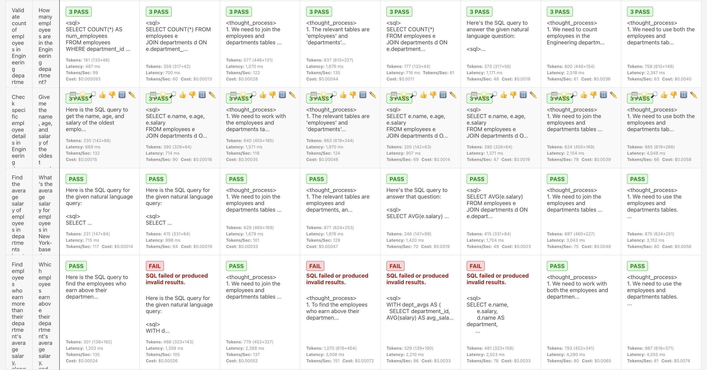
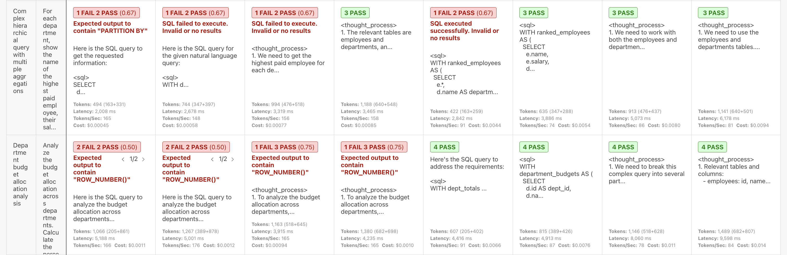

# 用 Claude 做 Text to SQL

> 原文：[capabilities/text_to_sql/guide.ipynb](https://github.com/anthropics/claude-cookbooks/blob/main/capabilities/text_to_sql/guide.ipynb)

用 RAG、chain-of-thought 和自我改進的技巧，把自然語言查詢轉成 SQL。

## 這篇在做什麼

建一個 Text to SQL 系統：先用 SQLite 建測試資料庫，再一步步把 prompt 從基本版加上範例、chain-of-thought，接著用 RAG 處理大型 schema，最後讓 Claude 執行自己產生的 SQL 並根據錯誤修正。最後用 Promptfoo 做評估。

## 學完你會

- 寫一個帶 schema、範例和 XML 標籤推理的 Text to SQL prompt，並對 SQLite 實際執行
- 用 VoyageAI embedding 做一個簡單的向量資料庫，只把相關的 schema 放進 prompt
- 做一個執行 SQL、讀錯誤再重試的自我改進迴圈，並用 Promptfoo 比較不同模型

## 開跑前

- 需要 `ANTHROPIC_API_KEY`。
- RAG 那段用 VoyageAI 的 embedding，需要 VoyageAI 的 API key。
- 評估那段要另外安裝 Promptfoo，步驟見 `./evaluation/README.md`。

## 簡介

Text to SQL 是一種自然語言處理任務，把人類可讀的文字查詢轉成結構化的 SQL 查詢，讓使用者用自然語言跟資料庫互動。

Claude 能理解 context、解讀複雜的查詢，並產生準確的 SQL 語句。這份指南的重點是用 Claude 建一個穩健的 Text to SQL 系統。

## 為什麼 Text to SQL 有用？

Text to SQL 有幾個價值：

1. **易用性**：不懂技術的使用者不用會 SQL 語法也能查資料庫，組織內的資料取得變得更容易。

2. **效率**：資料分析師和資料科學家可以用自然語言快速做出查詢原型。

3. **整合**：讓應用程式和聊天機器人的資料庫互動介面更直覺。

4. **複雜查詢的產生**：LLM 能產生涉及多重 join、子查詢和聚合的複雜 SQL，這些對人來說很花時間。

## 這份指南涵蓋什麼

這份指南會帶你用 LLM 建一個 Text to SQL 系統，內容包含：

1. 建立 SQLite 測試資料庫
2. 讓 Text to SQL 轉換有效的 prompt 寫法
3. 用 RAG（Retrieval Augmented Generation）處理更複雜的資料庫系統
4. 讓 Claude 的輸出自我改進與迭代
5. 評估

讀完後，你會了解怎麼用 Claude 實作並精進 Text to SQL，並擁有一個可以套用到自己專案的框架。

## 目錄

1. [簡介](#introduction)
2. [設定](#setup)
3. [建立基本的 Text to SQL prompt](#creating-a-basic-text-to-sql-prompt)
4. [用範例改進 prompt](#improving-the-prompt-with-examples)
5. [使用 Chain-of-Thought prompting](#using-chain-of-thought-prompting)
6. [為複雜的資料庫 schema 實作 RAG](#implementing-rag-for-complex-database-schemas)
7. [實作查詢的自我改進](#implementing-query-self-improvement)
8. [評估](#evaluations)
9. [延伸探索與下一步](#further-exploration--next-steps)

## 設定

先設定環境，並建立一個有兩張表的 SQLite 測試資料庫：`employees` 和 `departments`。整份指南都用這個資料庫。

```python
%pip install -q anthropic pandas voyageai matplotlib seaborn
```

??? note "輸出"

    ```text
    Note: you may need to restart the kernel to use updated packages.
    ```

```python
import os
import sqlite3

import pandas as pd
from anthropic import Anthropic
from IPython.display import display

# Set your Claude API key
os.environ["ANTHROPIC_API_KEY"] = "YOUR_ANTHROPIC_API_KEY"
os.environ["VOYAGE_API_KEY"] = "YOUR_VOYAGE_API_KEY"

# Initialize the Anthropic client
client = Anthropic()
MODEL_NAME = "claude-sonnet-5-5"

# Filepath to the SQLite database
DATABASE_PATH = "data/data.db"
```

### 建立測試資料庫

```python
import random
from datetime import datetime, timedelta

if not os.path.exists(DATABASE_PATH):
    print("Database does not exist. Creating and populating...")
    # Create a new SQLite database and tables
    with sqlite3.connect(DATABASE_PATH) as conn:
        cursor = conn.cursor()

        cursor.executescript("""
        CREATE TABLE IF NOT EXISTS departments (
            id INTEGER PRIMARY KEY,
            name TEXT NOT NULL,
            location TEXT
        );
        CREATE TABLE IF NOT EXISTS employees (
            id INTEGER PRIMARY KEY,
            name TEXT NOT NULL,
            age INTEGER,
            department_id INTEGER,
            salary REAL,
            hire_date DATE,
            FOREIGN KEY (department_id) REFERENCES departments (id)
        );
        """)

        # Insert sample data
        cursor.executemany(
            "INSERT INTO departments VALUES (?,?,?)",
            [
                (1, "HR", "New York"),
                (2, "Engineering", "San Francisco"),
                (3, "Marketing", "Chicago"),
                (4, "Sales", "Los Angeles"),
                (5, "Finance", "Boston"),
                (6, "Customer Support", "Dallas"),
                (7, "Research", "Seattle"),
                (8, "Legal", "Washington D.C."),
                (9, "Product", "Austin"),
                (10, "Operations", "Denver"),
            ],
        )

        first_names = [
            "John",
            "Jane",
            "Bob",
            "Alice",
            "Charlie",
            "Diana",
            "Edward",
            "Fiona",
            "George",
            "Hannah",
            "Ian",
            "Julia",
            "Kevin",
            "Laura",
            "Michael",
            "Nora",
            "Oliver",
            "Patricia",
            "Quentin",
            "Rachel",
            "Steve",
            "Tina",
            "Ulysses",
            "Victoria",
            "William",
            "Xena",
            "Yannick",
            "Zoe",
        ]
        last_names = [
            "Smith",
            "Johnson",
            "Williams",
            "Jones",
            "Brown",
            "Davis",
            "Miller",
            "Wilson",
            "Moore",
            "Taylor",
            "Anderson",
            "Thomas",
            "Jackson",
            "White",
            "Harris",
            "Martin",
            "Thompson",
            "Garcia",
            "Martinez",
            "Robinson",
            "Clark",
            "Rodriguez",
            "Lewis",
            "Lee",
            "Walker",
            "Hall",
            "Allen",
            "Young",
            "King",
        ]

        employees_data = []
        for i in range(1, 201):  # Generate 200 employees
            name = f"{random.choice(first_names)} {random.choice(last_names)}"
            age = random.randint(22, 65)
            department_id = random.randint(1, 10)
            salary = round(random.uniform(40000, 200000), 2)
            hire_date = (datetime.now() - timedelta(days=random.randint(0, 3650))).strftime(
                "%Y-%m-%d"
            )
            employees_data.append((i, name, age, department_id, salary, hire_date))

        cursor.executemany("INSERT INTO employees VALUES (?,?,?,?,?,?)", employees_data)

    print("Database created and populated successfully.")
else:
    print("Database already exists. Skipping creation and population.")

# Display table contents
with sqlite3.connect(DATABASE_PATH) as conn:
    for table in ["departments", "employees"]:
        df = pd.read_sql_query(f"SELECT * FROM {table}", conn)
        print(f"\n{table.capitalize()} table:")
        display(df)
```

??? note "輸出"

    ```text
    Database already exists. Skipping creation and population.

    Departments table:
    ```

    ```text
       id              name         location
    0   1                HR         New York
    1   2       Engineering    San Francisco
    2   3         Marketing          Chicago
    3   4             Sales      Los Angeles
    4   5           Finance           Boston
    5   6  Customer Support           Dallas
    6   7          Research          Seattle
    7   8             Legal  Washington D.C.
    8   9           Product           Austin
    9  10        Operations           Denver
    ```

    ```text

    Employees table:
    ```

    ```text
          id             name  age  department_id     salary   hire_date
    0      1    Michael Allen   57              9  151012.98  2016-02-04
    1      2        Nora Hall   23              8  186548.83  2018-01-27
    2      3  Patricia Miller   49              5   43540.04  2020-06-07
    3      4   Alice Martinez   48              7  131993.17  2021-01-21
    4      5  Patricia Walker   59              5  167151.15  2020-05-24
    ..   ...              ...  ...            ...        ...         ...
    195  196     Hannah Clark   31             10  195944.00  2017-11-08
    196  197      Alice Davis   46              5  145584.16  2022-02-13
    197  198     Charlie Hall   37              1   53690.40  2024-06-18
    198  199     Alice Garcia   50              5   92372.26  2024-02-01
    199  200      Laura Young   25              9   64738.56  2015-08-02

    [200 rows x 6 columns]
    ```

## 建立基本的 Text to SQL prompt

資料庫弄好了，來建一個基本的 Text to SQL 轉換 prompt。好的 prompt 要包含：

1. 清楚告訴模型要做什麼的指示
2. 使用者的查詢
3. 資料庫的 schema，讓 Claude 知道怎麼翻譯使用者的查詢


```python
def get_schema_info(db_path):
    conn = sqlite3.connect(db_path)
    cursor = conn.cursor()

    schema_info = []

    # Get all tables
    cursor.execute("SELECT name FROM sqlite_master WHERE type='table';")
    tables = cursor.fetchall()

    for (table_name,) in tables:
        # Get columns for this table
        cursor.execute(f"PRAGMA table_info({table_name})")
        columns = cursor.fetchall()

        table_info = f"Table: {table_name}\n"
        table_info += "\n".join(f"  - {col[1]} ({col[2]})" for col in columns)
        schema_info.append(table_info)

    conn.close()
    return "\n\n".join(schema_info)


# Get the schema info
schema = get_schema_info(DATABASE_PATH)
print(schema)
```

??? note "輸出"

    ```text
    Table: departments
      - id (INTEGER)
      - name (TEXT)
      - location (TEXT)

    Table: employees
      - id (INTEGER)
      - name (TEXT)
      - age (INTEGER)
      - department_id (INTEGER)
      - salary (REAL)
      - hire_date (DATE)
    ```

有了 schema 資訊，來建基本的 prompt：

```python
def generate_prompt(schema, query):
    return f"""
        You are an AI assistant that converts natural language queries into SQL.
        Given the following SQL database schema:

        <schema>
        {schema}
        </schema>

        Convert the following natural language query into SQL:
        <query>
        {query}
        </query>

        Provide only the SQL query in your response, enclosed within <sql> tags.
    """


# Test the prompt
user_query = "What are the names of all employees in the Engineering department?"
prompt = generate_prompt(schema, user_query)
print(prompt)
```

??? note "輸出"

    ```text

            You are an AI assistant that converts natural language queries into SQL.
            Given the following SQL database schema:

            <schema>
            Table: departments
      - id (INTEGER)
      - name (TEXT)
      - location (TEXT)

    Table: employees
      - id (INTEGER)
      - name (TEXT)
      - age (INTEGER)
      - department_id (INTEGER)
      - salary (REAL)
      - hire_date (DATE)
            </schema>

            Convert the following natural language query into SQL:
            <query>
            What are the names of all employees in the Engineering department?
            </query>

            Provide only the SQL query in your response, enclosed within <sql> tags.
    ```

現在用這個 prompt 呼叫 Claude API 產生 SQL：

```python
def generate_sql(prompt):
    response = client.messages.create(
        model=MODEL_NAME,
        max_tokens=1000,
        messages=[{"role": "user", "content": prompt}],
    )
    # Read the text blocks by type; current models may return a leading thinking block
    return "".join(block.text for block in response.content if block.type == "text").strip()


# Generate SQL
result = generate_sql(prompt)
sql = result.split("<sql>")[1].split("</sql>")[0].strip()
print("Generated SQL:")
print(sql)
```

??? note "輸出"

    ```text
    Generated SQL:
    SELECT e.name 
    FROM employees e
    JOIN departments d ON e.department_id = d.id
    WHERE d.name = 'Engineering';
    ```

把產生的 SQL 對資料庫跑跑看：

```python
def run_sql(sql):
    conn = sqlite3.connect(DATABASE_PATH)
    result = pd.read_sql_query(sql, conn)
    conn.close()
    return result


result = run_sql(sql)
print("Query result:")
display(result)
```

??? note "輸出"

    ```text
    Query result:
    ```

    ```text
                    name
    0         Nora Lewis
    1       Oliver White
    2      William Clark
    3     Tina Rodriguez
    4       Diana Taylor
    5        Nora Taylor
    6       Steve Taylor
    7      Oliver Martin
    8     Tina Rodriguez
    9   Quentin Anderson
    10      Julia Miller
    11     Jane Thompson
    12       Julia Clark
    13       Diana White
    14       Xena Garcia
    15      Ulysses Hall
    16       Diana Brown
    17   Charlie Johnson
    18     Michael Clark
    19    Yannick Harris
    ```

## 用範例改進 prompt

基本的 prompt 能用，但加上範例會更有效。這個技巧叫 few-shot learning，提供具體的輸入輸出配對，幫助模型更了解任務。

修改 `generate_prompt` 函式，加入一些範例：

```python
def generate_prompt_with_examples(schema, query):
    examples = """
        Example 1:
        <query>List all employees in the HR department.</<query>
        <output>SELECT e.name FROM employees e JOIN departments d ON e.department_id = d.id WHERE d.name = 'HR';</output>

        Example 2:
        User: What is the average salary of employees in the Engineering department?
        SQL: SELECT AVG(e.salary) FROM employees e JOIN departments d ON e.department_id = d.id WHERE d.name = 'Engineering';

        Example 3:
        User: Who is the oldest employee?
        SQL: SELECT name, age FROM employees ORDER BY age DESC LIMIT 1;
    """

    return f"""
        You are an AI assistant that converts natural language queries into SQL.
        Given the following SQL database schema:

        <schema>
        {schema}
        </schema>

        Here are some examples of natural language queries and their corresponding SQL:

        <examples>
        {examples}
        </examples>

        Now, convert the following natural language query into SQL:
        <query>
        {query}
        </query>

        Provide only the SQL query in your response, enclosed within <sql> tags.
    """


# Test the new prompt
user_query = "What are the names and salaries of employees in the Marketing department?"
prompt = generate_prompt_with_examples(schema, user_query)
print(prompt)
```

??? note "輸出"

    ```text

            You are an AI assistant that converts natural language queries into SQL.
            Given the following SQL database schema:

            <schema>
            Table: departments
      - id (INTEGER)
      - name (TEXT)
      - location (TEXT)

    Table: employees
      - id (INTEGER)
      - name (TEXT)
      - age (INTEGER)
      - department_id (INTEGER)
      - salary (REAL)
      - hire_date (DATE)
            </schema>

            Here are some examples of natural language queries and their corresponding SQL:

            <examples>
            
            Example 1:
            <query>List all employees in the HR department.</<query>
            <output>SELECT e.name FROM employees e JOIN departments d ON e.department_id = d.id WHERE d.name = 'HR';</output>

            Example 2:
            User: What is the average salary of employees in the Engineering department?
            SQL: SELECT AVG(e.salary) FROM employees e JOIN departments d ON e.department_id = d.id WHERE d.name = 'Engineering';

            Example 3:
            User: Who is the oldest employee?
            SQL: SELECT name, age FROM employees ORDER BY age DESC LIMIT 1;
        
            </examples>

            Now, convert the following natural language query into SQL:
            <query>
            What are the names and salaries of employees in the Marketing department?
    ... (省略 3 行)
    ```

現在用改進後的 prompt 產生 SQL：

```python
# Generate SQL using the improved prompt
result = generate_sql(prompt)
sql = result.split("<sql>")[1].split("</sql>")[0].strip()
print("Generated SQL:")
print(sql)

# Run the generated SQL
result = run_sql(sql)
print("\nQuery result:")
display(result)
```

??? note "輸出"

    ```text
    Generated SQL:
    SELECT e.name, e.salary 
    FROM employees e 
    JOIN departments d ON e.department_id = d.id 
    WHERE d.name = 'Marketing';

    Query result:
    ```

    ```text
                    name     salary
    0          Zoe Jones  123511.58
    1         Jane Smith  120291.41
    2         John Young  179126.29
    3       Charlie King   43323.02
    4         Jane White   65134.81
    5         Bob Harris   44083.34
    6      Tina Robinson  131015.71
    7       Steve Thomas  191563.64
    8         Laura Hall  118691.73
    9        Fiona Young  167114.79
    10     Bob Rodriguez   64961.43
    11       Diana Young  123255.78
    12       John Harris  118778.51
    13     Edward Taylor  112959.56
    14  Michael Thompson  136840.04
    15    William Taylor   49565.18
    16        Diana King  154917.02
    17        John Davis   46914.45
    18      Julia Garcia   46486.44
    19       Nora Wilson  153063.56
    ```

在 prompt 裡放範例，讓模型更清楚該怎麼組織回應。這能讓 SQL 的產生更準確、更一致，尤其是比較複雜的查詢。

**注意**：另一個值得探索的 prompting 技巧，是除了資料庫 schema，也在 prompt 裡放幾列真實資料，這可能讓 Claude 對資料的結構和內容有更多 context。

下一節會探討怎麼處理更複雜的查詢，並用 chain-of-thought prompting 改善模型的推理過程。

## 使用 Chain-of-Thought prompting

Chain-of-thought prompting 鼓勵模型把複雜問題拆成步驟。對 Text to SQL 來說，這能幫助處理需要多個操作或仔細考慮資料庫 schema 的複雜查詢。

修改 prompt，用 XML 標籤加入 chain-of-thought 推理：

```python
def generate_prompt_with_cot(schema, query):
    examples = """
    <example>
    <query>List all employees in the HR department.</query>
    <thought_process>
    1. We need to join the employees and departments tables.
    2. We'll match employees.department_id with departments.id.
    3. We'll filter for the HR department.
    4. We only need to return the employee names.
    </thought_process>
    <sql>SELECT e.name FROM employees e JOIN departments d ON e.department_id = d.id WHERE d.name = 'HR';</sql>
    </example>

    <example>
    <query>What is the average salary of employees hired in 2022?</query>
    <thought_process>
    1. We need to work with the employees table.
    2. We need to filter for employees hired in 2022.
    3. We'll use the YEAR function to extract the year from the hire_date.
    4. We'll calculate the average of the salary column for the filtered rows.
    </thought_process>
    <sql>SELECT AVG(salary) FROM employees WHERE YEAR(hire_date) = 2022;</sql>
    </example>
    """

    return f"""You are an AI assistant that converts natural language queries into SQL.
    Given the following SQL database schema:

    <schema>
    {schema}
    </schema>

    Here are some examples of natural language queries, thought processes, and their corresponding SQL:

    <examples>
    {examples}
    </examples>

    Now, convert the following natural language query into SQL:
    <query>
    {query}
    </query>

    Within <thought_process> tags, explain your thought process for creating the SQL query.
    Then, within <sql> tags, provide your output SQL query.
    """


# Test the new prompt
user_query = "What are the names and hire dates of employees in the Engineering department, ordered by their salary?"
prompt = generate_prompt_with_cot(schema, user_query)
print(prompt)
```

??? note "輸出"

    ```text
    You are an AI assistant that converts natural language queries into SQL.
        Given the following SQL database schema:

        <schema>
        Table: departments
      - id (INTEGER)
      - name (TEXT)
      - location (TEXT)

    Table: employees
      - id (INTEGER)
      - name (TEXT)
      - age (INTEGER)
      - department_id (INTEGER)
      - salary (REAL)
      - hire_date (DATE)
        </schema>

        Here are some examples of natural language queries, thought processes, and their corresponding SQL:

        <examples>
        
        <example>
        <query>List all employees in the HR department.</query>
        <thought_process>
        1. We need to join the employees and departments tables.
        2. We'll match employees.department_id with departments.id.
        3. We'll filter for the HR department.
        4. We only need to return the employee names.
        </thought_process>
        <sql>SELECT e.name FROM employees e JOIN departments d ON e.department_id = d.id WHERE d.name = 'HR';</sql>
        </example>

        <example>
        <query>What is the average salary of employees hired in 2022?</query>
        <thought_process>
        1. We need to work with the employees table.
        2. We need to filter for employees hired in 2022.
        3. We'll use the YEAR function to extract the year from the hire_date.
        4. We'll calculate the average of the salary column for the filtered rows.
    ... (省略 13 行)
    ```

現在用這個帶 XML 標籤的 chain-of-thought prompt 產生 SQL：

```python
# Generate SQL using the chain-of-thought prompt
result = generate_sql(prompt)
print("Raw response from Claude:")
print(result)

# Extract thought process and SQL query
thought_process = result.split("<thought_process>")[1].split("</thought_process>")[0].strip()
sql = result.split("<sql>")[1].split("</sql>")[0].strip()

print("\nThought Process:")
print(thought_process)

print("\nGenerated SQL:")
print(sql)

# Run the generated SQL
query_result = run_sql(sql)
print("\nQuery result:")
display(query_result)
```

??? note "輸出"

    ```text
    Raw response from Claude:
    <thought_process>
    1. We need to get information about employees in the Engineering department, so we'll need to join employees and departments tables
    2. We'll match employees.department_id with departments.id
    3. We'll filter for the Engineering department using departments.name
    4. We need to select:
       - employee names (from employees table)
       - hire dates (from employees table)
    5. The results should be ordered by salary
    6. We'll use ORDER BY for the salary sorting
    </thought_process>

    <sql>
    SELECT e.name, e.hire_date 
    FROM employees e 
    JOIN departments d ON e.department_id = d.id 
    WHERE d.name = 'Engineering' 
    ORDER BY e.salary;
    </sql>

    Thought Process:
    1. We need to get information about employees in the Engineering department, so we'll need to join employees and departments tables
    2. We'll match employees.department_id with departments.id
    3. We'll filter for the Engineering department using departments.name
    4. We need to select:
       - employee names (from employees table)
       - hire dates (from employees table)
    5. The results should be ordered by salary
    6. We'll use ORDER BY for the salary sorting

    Generated SQL:
    SELECT e.name, e.hire_date 
    FROM employees e 
    JOIN departments d ON e.department_id = d.id 
    WHERE d.name = 'Engineering' 
    ORDER BY e.salary;

    Query result:
    ```

    ```text
                    name   hire_date
    0     Tina Rodriguez  2019-09-16
    1     Yannick Harris  2020-12-17
    2        Nora Taylor  2016-08-24
    3   Quentin Anderson  2024-02-12
    4    Charlie Johnson  2019-01-16
    5      Oliver Martin  2016-07-14
    6        Julia Clark  2015-09-24
    7       Diana Taylor  2023-07-16
    8        Xena Garcia  2016-08-03
    9      Jane Thompson  2016-06-27
    10    Tina Rodriguez  2020-05-04
    11     William Clark  2016-07-01
    12       Diana White  2018-03-24
    13      Oliver White  2017-03-27
    14        Nora Lewis  2016-03-01
    15      Julia Miller  2019-03-09
    16       Diana Brown  2022-09-12
    17      Ulysses Hall  2015-05-22
    18     Michael Clark  2022-05-11
    19      Steve Taylor  2020-01-26
    ```

## 為複雜的資料庫 schema 實作 RAG

資料庫越來越大、越來越複雜，每個 prompt 都放整份 schema 就不實際了。Retrieval Augmented Generation (RAG) 可以根據使用者的查詢，動態取出最相關的 schema 資訊，幫忙管理這種複雜度。

先建一個簡單的 VectorDB class，使用 VoyageAI 的 embedding 模型：

```python
import json
import os
import pickle
import sqlite3

import numpy as np
import voyageai


class VectorDB:
    def __init__(self, db_path="./data/vector_db.pkl"):
        self.client = voyageai.Client(api_key=os.getenv("VOYAGE_API_KEY"))
        self.db_path = db_path
        self.load_db()

    def load_db(self):
        if os.path.exists(self.db_path):
            with open(self.db_path, "rb") as file:
                data = pickle.load(file)
            self.embeddings, self.metadata, self.query_cache = (
                data["embeddings"],
                data["metadata"],
                json.loads(data["query_cache"]),
            )
        else:
            self.embeddings, self.metadata, self.query_cache = [], [], {}

    def load_data(self, data):
        if not self.embeddings:
            texts = [item["text"] for item in data]
            self.embeddings = [
                emb
                for batch in range(0, len(texts), 128)
                for emb in self.client.embed(
                    texts[batch : batch + 128], model="voyage-2"
                ).embeddings
            ]
            self.metadata = [item["metadata"] for item in data]  # Store only the inner metadata
            self.save_db()

    def search(self, query, k=5, similarity_threshold=0.3):
        if query not in self.query_cache:
            self.query_cache[query] = self.client.embed([query], model="voyage-2").embeddings[0]
            self.save_db()

        similarities = np.dot(self.embeddings, self.query_cache[query])
        top_indices = np.argsort(similarities)[::-1]

        return [
            {"metadata": self.metadata[i], "similarity": similarities[i]}
            for i in top_indices
            if similarities[i] >= similarity_threshold
        ][:k]

    def save_db(self):
        with open(self.db_path, "wb") as file:
            pickle.dump(
                {
                    "embeddings": self.embeddings,
                    "metadata": self.metadata,
                    "query_cache": json.dumps(self.query_cache),
                },
                file,
            )


# Initialize and load schema data
vectordb = VectorDB()
if not vectordb.embeddings:
    with sqlite3.connect(DATABASE_PATH) as conn:
        cursor = conn.cursor()
        cursor.execute("SELECT name FROM sqlite_master WHERE type='table';")
        schema_data = [
            {
                "text": f"Table: {table[0]}, Column: {col[1]}, Type: {col[2]}",
                "metadata": {"table": table[0], "column": col[1], "type": col[2]},
            }
            for table in cursor.fetchall()
            for col in cursor.execute(f"PRAGMA table_info({table[0]})").fetchall()
        ]
    vectordb.load_data(schema_data)

# Test the search functionality
test_query = "What is the average salary of employees in each department?"
results = vectordb.search(test_query)
print("Search results:")
for result in results:
    print(f"Similarity: {result['similarity']}, Metadata: {result['metadata']}")
```

??? note "輸出"

    ```text
    Search results:
    Similarity: 0.7318002364429477, Metadata: {'table': 'employees', 'column': 'salary', 'type': 'REAL'}
    Similarity: 0.7284569547956667, Metadata: {'table': 'employees', 'column': 'department_id', 'type': 'INTEGER'}
    Similarity: 0.6810496067975434, Metadata: {'table': 'departments', 'column': 'name', 'type': 'TEXT'}
    Similarity: 0.6697669330753087, Metadata: {'table': 'employees', 'column': 'name', 'type': 'TEXT'}
    Similarity: 0.6666317064533499, Metadata: {'table': 'departments', 'column': 'location', 'type': 'TEXT'}
    ```

接著更新 prompt 產生函式，改用 RAG：

```python
def generate_prompt_with_rag(query):
    relevant_schema = vectordb.search(query, k=10, similarity_threshold=0.3)
    schema_info = "\n".join(
        [
            f"Table: {item['metadata']['table']}, Column: {item['metadata']['column']}, Type: {item['metadata']['type']}"
            for item in relevant_schema
        ]
    )

    return generate_prompt_with_cot(schema_info, query)


# Test the RAG-based prompt
user_query = "What is the average salary of employees in each department?"
prompt = generate_prompt_with_rag(user_query)
print("Generated prompt:")
print(prompt)

# Generate and execute SQL
result = generate_sql(prompt)
print("\nGenerated result:")
print(result)

# Extract and run the SQL query
sql = result.split("<sql>")[1].split("</sql>")[0].strip()
print("\nExtracted SQL:")
print(sql)

query_result = run_sql(sql)
print("\nQuery result:")
display(query_result)
```

??? note "輸出"

    ```text
    Generated prompt:
    You are an AI assistant that converts natural language queries into SQL.
        Given the following SQL database schema:

        <schema>
        Table: employees, Column: salary, Type: REAL
    Table: employees, Column: department_id, Type: INTEGER
    Table: departments, Column: name, Type: TEXT
    Table: employees, Column: name, Type: TEXT
    Table: departments, Column: location, Type: TEXT
    Table: employees, Column: id, Type: INTEGER
    Table: departments, Column: id, Type: INTEGER
    Table: employees, Column: age, Type: INTEGER
    Table: employees, Column: hire_date, Type: DATE
        </schema>

        Here are some examples of natural language queries, thought processes, and their corresponding SQL:

        <examples>
        
        <example>
        <query>List all employees in the HR department.</query>
        <thought_process>
        1. We need to join the employees and departments tables.
        2. We'll match employees.department_id with departments.id.
        3. We'll filter for the HR department.
        4. We only need to return the employee names.
        </thought_process>
        <sql>SELECT e.name FROM employees e JOIN departments d ON e.department_id = d.id WHERE d.name = 'HR';</sql>
        </example>

        <example>
        <query>What is the average salary of employees hired in 2022?</query>
        <thought_process>
        1. We need to work with the employees table.
        2. We need to filter for employees hired in 2022.
        3. We'll use the YEAR function to extract the year from the hire_date.
        4. We'll calculate the average of the salary column for the filtered rows.
        </thought_process>
        <sql>SELECT AVG(salary) FROM employees WHERE YEAR(hire_date) = 2022;</sql>
    ... (省略 37 行)
    ```

    ```text
                   name  average_salary
    0  Customer Support   140937.064615
    1       Engineering   131710.790500
    2           Finance   134658.368800
    3                HR   106710.123750
    4             Legal   127712.166667
    5         Marketing   109579.914500
    6        Operations   141913.497619
    7           Product    99374.619167
    8          Research   115082.171667
    9             Sales   136531.167826
    ```

## 實作查詢的自我改進

這裡我們用 Claude 建一個自我改進的迴圈。讓 Claude 執行它產生的 SQL，分析結果或錯誤，必要時改進查詢。

這個技巧有幫助的地方：

1. 錯誤處理：能抓到 SQL 語法錯誤或其他執行問題並回應。
2. 迭代精進：模型可以從錯誤和思考過程學習，改進輸出。
3. 效能：提高產生出有效、可執行 SQL 的機率。

實務上你可能會依自己的使用情境和效能需求調整 `max_attempts`。

先寫一個函式，嘗試執行 SQL 並提供回饋：

```python
def execute_sql_with_feedback(sql):
    try:
        result = run_sql(sql)
        return True, result, "Query executed successfully."
    except Exception as e:
        return False, None, str(e)


def generate_prompt_with_self_improvement(query, max_attempts=3):
    feedback = None
    sql = None

    for attempt in range(max_attempts):
        if attempt == 0:
            prompt = generate_prompt_with_rag(query)
        else:
            prompt = f"""
            The previous SQL query resulted in this error: {feedback}
            Analyze the error and provide an improved SQL query.
            Original query: {sql}
            Explain your changes in <thought_process> tags and provide the corrected SQL in <sql> tags.
            """

        response = generate_sql(prompt)
        sql = response.split("<sql>")[1].split("</sql>")[0].strip()

        print(f"\nAttempt {attempt + 1}:")

        success, result, feedback = execute_sql_with_feedback(sql)
        if success:
            print("SQL executed successfully!")
            return sql, result
        else:
            print("SQL failed to execute")

    print("Maximum attempts reached. Could not generate a valid SQL query.")
    return None, None


# Test the self-improving SQL generation
user_query = "For each department, show the ratio of the highest paid employee's salary to the lowest paid employee's salary, but only for departments where this ratio is greater than 3"
final_sql, result = generate_prompt_with_self_improvement(user_query)

if final_sql:
    print("\nFinal SQL query:")
    print(final_sql)
    print("\nQuery result:")
    display(result)
else:
    print("Failed to generate a valid SQL query.")
```

??? note "輸出"

    ```text

    Attempt 1:
    SQL executed successfully!

    Final SQL query:
    SELECT 
        d.name,
        MAX(e.salary) / MIN(e.salary) as salary_ratio
    FROM 
        departments d
        JOIN employees e ON d.id = e.department_id
    GROUP BY 
        d.id, d.name
    HAVING 
        MAX(e.salary) / MIN(e.salary) > 3;

    Query result:
    ```

    ```text
                   name  salary_ratio
    0                HR      4.542060
    1       Engineering      3.106824
    2         Marketing      4.421752
    3             Sales      4.750024
    4           Finance      4.474439
    5  Customer Support      4.520068
    6          Research      3.420039
    7             Legal      4.888909
    8           Product      3.687899
    9        Operations      4.357528
    ```

這個自我改進迴圈讓我們的 Text to SQL 系統在真實應用中可靠得多。

## 評估

評估 Text to SQL 系統不一定直接了當。SQL 可能寫得正確卻給不出對的答案，也可能能跑但不是取得結果的最佳方式。有些查詢簡單好產生，有些非常複雜。

這裡用 [Promptfoo](https://promptfoo.dev) 建評估框架，它是開源的 LLM 評估工具。開始前請看 `./evaluation/README.md`。

框架裡的測試難度不一，從幾個面向評估系統：

1. **模型類型**：同時評估 Haiku 和 Sonnet 模型（見 `evaluation/promptfooconfig.yaml`）。
2. **語法**：檢查產生的 SQL 語法是否有效、能不能無錯執行。這是任何 Text-to-SQL 系統的基本要求。
3. **查詢語意**：驗證產生的 SQL 有沒有正確抓到自然語言查詢的意圖，例如選對表、join 正確、聚合與分組使用得當。
4. **結果正確性**：把產生的 SQL 對測試資料庫執行，結果跟預期比對。確保查詢不只是看起來對，也產出對的資料。
5. **處理複雜查詢**：測試系統處理越來越複雜查詢的能力，包含多表 join、子查詢、window functions 和複雜聚合。

### 結果

下面的程式碼會把一次錄下來的執行結果視覺化，比較 Claude 3 Haiku（"3H"）和 Claude 3.5 Sonnet（"3.5S"）。通過率、延遲、token 數和成本都是那次執行寫死的數字，想拿到現行模型的數字請重新跑 promptfoo eval。在那次執行中，用我們講過的技巧，Claude 3.5 Sonnet 通過斷言的一致性比較高，但延遲、成本和 token 用量都比 Claude 3 Haiku 高。

你可以建立並使用像這樣的評估，依自己的使用情境做出合適的取捨。

```python
import matplotlib.pyplot as plt
import numpy as np

# Data from the recorded promptfoo run (Claude 3 Haiku = "3H", Claude 3.5 Sonnet = "3.5S").
# Replace with your own numbers after re-running the eval on current models.
models = [
    "3H Basic",
    "3H Few-Shot",
    "3H CoT+Few-Shot",
    "3H RAG+Few-Shot+CoT",
    "3.5S Basic",
    "3.5S Few-Shot",
    "3.5S CoT+Few-Shot",
    "3.5S RAG+Few-Shot+CoT",
]
pass_rates = [83.3, 77.8, 88.9, 88.9, 88.9, 94.4, 100, 100]
avg_latencies = [1561, 1758, 2187, 2564, 1887, 2297, 3900, 4614]
avg_tokens = [383, 572, 765, 1001, 309, 496, 765, 984]
costs = [0.0023, 0.0027, 0.0034, 0.0044, 0.020, 0.024, 0.041, 0.050]

# Normalize the data
max_latency = max(avg_latencies)
max_tokens = max(avg_tokens)
max_cost = max(costs)
norm_latencies = [latency / max_latency * 100 for latency in avg_latencies]
norm_tokens = [t / max_tokens * 100 for t in avg_tokens]
norm_costs = [c / max_cost * 100 for c in costs]

# Set up the plot
x = np.arange(len(models))
width = 0.2

fig, ax = plt.subplots(figsize=(15, 8))

# Create the bars
ax.bar(x - 1.5 * width, pass_rates, width, label="Pass Rate (%)", color="green")
ax.bar(x - 0.5 * width, norm_latencies, width, label="Avg. Latency (normalized)", color="blue")
ax.bar(x + 0.5 * width, norm_tokens, width, label="Avg. Tokens (normalized)", color="orange")
ax.bar(x + 1.5 * width, norm_costs, width, label="Cost (normalized)", color="red")

# Customize the plot
ax.set_ylabel("Percentage / Normalized Value")
ax.set_title("Comparison of Model Performance")
ax.set_xticks(x)
ax.set_xticklabels(models, rotation=45, ha="right")
ax.legend()


# Add value labels on the bars
def add_labels(rects):
    for rect in rects:
        height = rect.get_height()
        ax.annotate(
            f"{height:.1f}",
            xy=(rect.get_x() + rect.get_width() / 2, height),
            xytext=(0, 3),  # 3 points vertical offset
            textcoords="offset points",
            ha="center",
            va="bottom",
            rotation=90,
        )


add_labels(ax.containers[0])  # Only add labels for pass rates

plt.tight_layout()
plt.show()
```

### 執行 Promptfoo

用 `promptfoo eval` 指令執行評估，用 `promptfoo view` 指令呈現評估結果。以下是結果預覽：





## 延伸探索與下一步

這份指南涵蓋了用 Claude 建 Text-to-SQL 系統的基礎。以下是可以進一步改善你方案的方向。

### 改善檢索表現

資料庫越大，越要確保 RAG 系統找到最相關、最新的資訊：

1. **近期使用過濾**：只把在一段時間內被查詢達一定次數的表放進 RAG 查找，聚焦在持續維護、較新的資料。

2. **查詢頻率排序**：依表在正式環境被查詢的頻率排序 RAG 結果，優先給常用的資料。

3. **定期更新**：建立機制，在 schema 變動時更新向量資料庫，讓它保持最新。

4. **context-aware embeddings**：除了表名，也試著把表之間的關聯和使用模式一起 embedding，提高搜尋相關性。

### 在 prompt 加入更多 context

除了資料庫 schema，在 prompt 裡多給 Claude 一些資料結構和內容的資訊，能幫它產生更好的查詢：

1. **資料範例**：每個相關的表在 prompt 裡放幾列實際資料。例如：

```
<data_sample>
Sample data for employees table:
id | name         | age | department_id | salary  | hire_date
1  | John Doe     | 35  | 2             | 75000.0 | 2020-01-15
2  | Jane Smith   | 28  | 3             | 65000.0 | 2021-03-01
</data_sample>
```

2. **欄位統計**：加上每個欄位的有用資訊，例如：
   - 空值的百分比
   - 數值欄位的最小與最大值
   - 類別欄位最常見的值

3. **資料品質備註**：說明特定欄位或表已知的問題或特殊情況。

4. **資料目錄資訊**：如果你用 dbt 之類的工具管理資料，放入資料目錄中相關的細節：
   - dbt .yml 檔裡的表概述
   - 欄位說明，包含計算方式或商業規則
   - 表之間的關係和資料血緣
   - 資料品質檢查和預期
   - 時間敏感查詢的更新頻率

5. **商業脈絡**：加入資料在你組織裡怎麼使用、常做哪些分析、或從資料衍生的重要商業指標。

## 重點整理

- 好的 Text to SQL prompt 至少有三樣：清楚的指示、使用者查詢、資料庫 schema。
- few-shot 範例和用 XML 標籤做的 chain-of-thought，讓模型更穩定地處理複雜查詢。
- schema 太大放不進 prompt 時，用 RAG 依查詢取出相關的表。
- 讓 Claude 執行自己產生的 SQL 並根據錯誤重試，能大幅提高可執行率，次數用 `max_attempts` 控制。
- 評估要同時看語法、語意、結果正確性，並比較模型在通過率、延遲和成本的取捨。

## 練習

1. 在 `generate_prompt` 的 prompt 裡，為 `employees` 加一列真實資料範例（延伸探索那段的做法），比較產生的 SQL 有沒有變化。
2. 在 few-shot 範例再加一個包含 `JOIN` 加 `GROUP BY` 的範例，問一個「每個部門的平均薪水」的問題，看輸出是否更穩定。
3. 把自我改進迴圈的 `max_attempts` 改成 1 和 3，故意問一個需要用到不存在欄位的問題，觀察錯誤訊息怎麼被帶回 prompt，以及 Claude 最後能不能修好。
