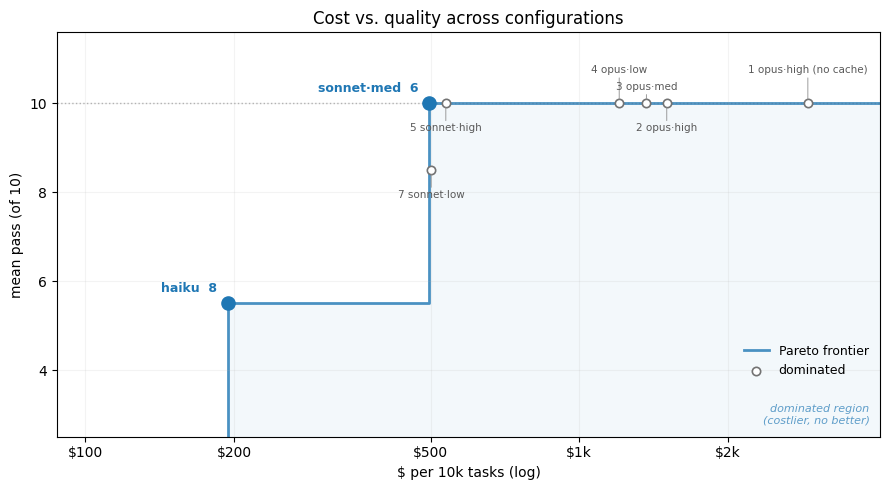

# Claude API 成本優化

> 原文：[cost_optimization/cost_optimization.ipynb](https://github.com/anthropics/claude-cookbooks/blob/main/cost_optimization/cost_optimization.ipynb)

用 eval 驅動的方式，把 Claude API 的成本槓桿一個一個套上去，讓跑在前沿模型上的 agent 也能壓到可上線的成本。

## 這篇在做什麼

拿一個保險理賠 agent 當例子，先量出 baseline 的 pass rate 和每個任務的成本，再依序試 prompt caching、input/output token 管理、agent loop 瘦身、Batch API、換模型和調 effort。每個槓桿都用同一組 eval 驗證，看它到底有沒有真的省錢又不掉品質。

## 學完你會

- 用 `usage` 算出每個任務的真實成本，並建立 pass rate 加 cost per task 的 eval 當基準。
- 判斷什麼時候該用 auto caching、explicit breakpoint、context editing、compaction、subagent、Batch API 或 advisor tool。
- 看懂 Pareto frontier 圖，找出「品質門檻內最便宜」的設定。

## 開跑前

- 需要 Anthropic API key，放在 `.env` 的 `ANTHROPIC_API_KEY`。
- 整本從頭跑到尾大約要 40 美元的 API 額度，建議只挑想實驗的 cell 跑。
- 需要原 repo 的 `assets/` 目錄跟 notebook 放在同一層。

AI 的導入現在有個常見的走向：為了站在智能前沿，你把產品蓋在最強的模型上，但規模一大，token 成本就撐不住。業界把這個現象叫做從「tokenmaxxing」轉向「budgetmaxxing」。可是站得住腳的解法不是降級模型，也不是縮小 AI 的使用範圍。成功的團隊是去優化模型周邊的架構，讓智能跟成本落在 Pareto frontier 上。

這份 cookbook 整理的是 Anthropic Applied AI 團隊帶開發者做成本調整時的檢查清單，目標是在不犧牲產品品質的前提下把 API 花費壓下來。整體流程如下：

1. **開始優化之前**：先在夠強的模型上跑通，建立 eval，量出 baseline
2. **Prompt caching**：後續回合重用 token，不要重複處理
3. **Input token 管理**：讓模型透過 tool 自己去找 context
4. **Agent loop 效率**：避免多輪 context 越滾越大
5. **Output token 管理**：給模型更緊的生成限制
6. **Batch API**：把不需要即時回應的工作丟到非同步佇列
7. **模型選擇與 effort**：找出仍然達標的最便宜等級

注意模型選擇排在最後。這是最容易調的槓桿，但會直接限制產品的智能上限。這份 cookbook 的目標是守住智能天花板，只把對產品表現沒有實質幫助的那部分花費省下來。

## 先決條件

> **注意**：整本從頭跑到尾大約要花 \$40 的 API 額度。建議只在想實驗不同輸入時才跑 cell。

要跑這個 notebook 需要：

- **Anthropic API key** 用來呼叫 Claude API（[取得 API key](https://platform.claude.com/settings/keys)）
- **Python 3.10+**，並安裝 `anthropic`、`matplotlib`、`pillow`、`python-dotenv`
- **`assets/` 目錄**，跟 notebook 放在同一個位置，可以從 [cookbooks repo](https://github.com/anthropics/claude-cookbooks) 拿到

## 環境設定

先在這個目錄建一個 `.env`，寫入 `ANTHROPIC_API_KEY=your-anthropic-api-key`。接著安裝並 import 需要的套件，包含 [Anthropic 的 Python SDK](https://platform.claude.com/docs/en/cli-sdks-libraries/sdks/python)。

```python
%%capture
%pip install --upgrade anthropic matplotlib pillow python-dotenv
```

```python
import base64
import copy
import csv
import io
import json
import textwrap
import time
from datetime import datetime
from functools import partial
from pathlib import Path

import anthropic
import matplotlib.pyplot as plt
from dotenv import load_dotenv
from IPython.display import HTML, display
from PIL import Image

load_dotenv()
client = anthropic.Anthropic()
```

設定好之後，定義基礎模型和價格表。這份 notebook 預設用 Opus 當主力，但你的情境可能需要不同的智能上限，下一節的 baseline eval 會幫我們判斷該從哪裡起步。這裡先載入一些 helper，讓 eval 結果好讀。

要*優化*成本，就得在每一輪都*量測*成本。Anthropic API 回傳的 `usage` 區塊帶有 input、output 和 cache 的 token 數。下面定義 `usage_cost()`，用[目前每百萬 token 的價格](https://platform.claude.com/docs/en/about-claude/pricing)把這些原始數字換成金額。注意下面的 `PRICING` 表和 cache 倍率是寫文當下牌價的硬編碼快照，新模型上線或優惠到期時單價會變。

```python
FABLE = "claude-fable-5"
OPUS = "claude-opus-5"
SONNET = "claude-sonnet-5"
HAIKU = "claude-haiku-4-5"

# Our default model for this notebook
MODEL = OPUS

# $/M tokens
PRICING = {
    FABLE: {"in": 10.00, "out": 50.00},
    OPUS: {"in": 5.00, "out": 25.00},
    SONNET: {"in": 2.00, "out": 10.00},
    HAIKU: {"in": 1.00, "out": 5.00},
}


def usage_cost(usage, model=MODEL, batch=False):
    p = PRICING[model]
    m = 1_000_000
    # Cache-write tokens may be split by TTL; fall back to the aggregate
    cc = getattr(usage, "cache_creation", None)
    w5m = getattr(cc, "ephemeral_5m_input_tokens", 0) or 0
    w1h = getattr(cc, "ephemeral_1h_input_tokens", 0) or 0
    if not (w5m or w1h):
        w5m = usage.cache_creation_input_tokens or 0
    cost = (
        (usage.input_tokens or 0) * p["in"] / m
        + w5m * p["in"] * 1.25 / m
        + w1h * p["in"] * 2.00 / m
        + (usage.cache_read_input_tokens or 0) * p["in"] * 0.10 / m
        + (usage.output_tokens or 0) * p["out"] / m
    )
    # Advisor iterations bill at the advisor model's rate, separately
    for it in getattr(usage, "iterations", None) or []:
        if getattr(it, "type", None) == "advisor_message":
            cost += usage_cost(it, model=it.model)
    return cost * (0.5 if batch else 1.0)


_hdr_printed = False


def print_usage(label, usage, model=MODEL, batch=False, cache=True):
    global _hdr_printed
    cw = f" {'cache_w':>8s} {'cache_r':>8s}" if cache else ""
    if not _hdr_printed:
        print(f"{'':32s} {'in':>7s}{cw} {'out':>7s} {'cost':>10s}")
        _hdr_printed = True
    c = usage_cost(usage, model, batch)
    cv = (
        (f" {usage.cache_creation_input_tokens or 0:>8d} {usage.cache_read_input_tokens or 0:>8d}")
        if cache
        else ""
    )
    print(
        f"{label:32s} {usage.input_tokens or 0:>7d}{cv} "
        f"{usage.output_tokens or 0:>7d} {f'${c:.4f}':>10s}"
    )
    return c


def reset_usage_header():
    global _hdr_printed
    _hdr_printed = False


print(f"{'model':<18s} {'$/M in':>8s} {'$/M out':>9s}")
for m, p in PRICING.items():
    tag = "  <- our default" if m == MODEL else ""
    print(f"{m:<18s} {p['in']:>8.2f} {p['out']:>9.2f}{tag}")
```

??? note "輸出"

    ```text
    model                $/M in   $/M out
    claude-fable-5        10.00     50.00
    claude-opus-5          5.00     25.00  <- our default
    claude-sonnet-5        2.00     10.00
    claude-haiku-4-5       1.00      5.00
    ```

```python
# Shared eval output format
def results_table(rows, *, numbered=False, ref="baseline"):
    """rows: [(label, trials)], each trial {"correct", "n", "per_task", "turns"}.
    The first row is the cost baseline"""
    base = sum(t["per_task"] for t in rows[0][1]) / len(rows[0][1])
    head = [
        "config",
        "trials (pass/n)",
        "mean pass",
        "requests",
        "$ / task",
        "$ / 10k tasks",
        f"vs {ref}",
    ]
    if numbered:
        head.insert(0, "#")
    body = []
    for i, (label, trials) in enumerate(rows, 1):
        n = trials[0]["n"]
        passes = [t["correct"] for t in trials]
        mean = sum(passes) / (len(passes) * n)
        cost = sum(t["per_task"] for t in trials) / len(trials)
        turns = sum(t["turns"] for t in trials) / len(trials)
        delta = "—" if i == 1 else f"{cost / base - 1:+.0%}"
        vals = ([f"[{i:2d}]"] if numbered else []) + [
            label,
            " · ".join(f"{p}/{n}" for p in passes),
            f"{mean:.0%}",
            f"{turns:.0f}",
            f"${cost:.4f}",
            f"${cost * 10_000:,.0f}",
            delta,
        ]
        tds = "".join(
            f'<td style="white-space:pre;text-align:{"left" if j <= 1 + numbered else "right"}">{v}</td>'
            for j, v in enumerate(vals)
        )
        body.append(f"<tr>{tds}</tr>")
    ths = "".join(f"<th>{h}</th>" for h in head)
    return HTML(f"<table><thead><tr>{ths}</tr></thead><tbody>{''.join(body)}</tbody></table>")


_TRIAL_COLS = "{cfg:<34}{trial:>6}{passed:>9}{turns:>10}{ptask:>11}{p10k:>15}   {misses}"


def trial_header():
    print(
        _TRIAL_COLS.format(
            cfg="config",
            trial="trial",
            passed="pass/n",
            turns="requests",
            ptask="$ / task",
            p10k="$ / 10k tasks",
            misses="misses",
        ),
        flush=True,
    )


def trial_row(label, trial, res, note=""):
    """res: one trial dict — {"correct", "n", "per_task", "turns", "misses"}"""
    misses = ", ".join(res.get("misses") or []) or "—"
    print(
        _TRIAL_COLS.format(
            cfg=label,
            trial=trial,
            passed=f"{res['correct']}/{res['n']}",
            turns=res["turns"],
            ptask=f"${res['per_task']:.4f}",
            p10k=f"${res['per_task'] * 10_000:,.0f}",
            misses=misses,
        )
        + (f"   ({note})" if note else ""),
        flush=True,
    )


def context_header(width=44):
    print(
        f"{'':<32s} {'context window':<{width}s}  {'cache_w':>10s} {'cache_r':>10s}  tokens in context",
        flush=True,
    )


def context_bar(label, seen, prev=None, cache_w=None, cache_r=None, *, full=180_000, width=44):
    """Per-turn context size: solid bar for tokens the model saw. `prev` shows
    the turn-over-turn delta; cache_w/cache_r log how much of the turn was a
    cache write vs a cache read."""
    solid = min(width, round(seen / full * width))
    bar = "█" * solid
    delta = f" ({seen - prev:+,})" if prev is not None else ""
    cache = f"{cache_w:>10,} {cache_r:>10,} " if cache_w is not None else ""
    print(f"{label:<32s} {bar:<{width}s}  {cache}{seen:>8,}{delta}", flush=True)
```

為了讓這個成本優化練習貼近現實，我們用 Applied AI 團隊在現場可能遇到的情境：Acme Insurance（虛構的汽車保險公司）的理賠審核 agent。下面的 cell 會從 `assets/` 載入合成資料，當作 agent 的環境 context，等於在不蓋整套後端的情況下模擬真實的 production 後端。

agent 的 system prompt 和 tool schema（也就是它的「prefix」）定義在下一個 cell。system prompt 指定 agent 的角色、期望的回覆格式，並把 `assets/policy_manual.md` 約 12K token 的完整核保手冊塞進去。agent 有八個調查動作可以用 tool 呼叫（調出理賠單、保單、詐欺分數、維修估價、照片），另外有四個終結判決（`approve_claim`、`deny_claim`、`route_to_supervisor`、`refer_to_siu`），loop 會盯著這幾個。最後的 `count_tokens` 會顯示在還沒加任何使用者輸入前，這個固定 prefix 有多重。

```python
# Load in mock data from CSVs in the Cookbook's assets/ directory
with open("assets/claims.csv") as f:
    CLAIMS = {r["id"]: r for r in csv.DictReader(f)}

with open("assets/repair_parts.csv") as f:
    PARTS = list(csv.DictReader(f))

PHOTOS = {}
with open("assets/damage_photos.csv") as f:
    for r in csv.DictReader(f):
        PHOTOS.setdefault(r["claim_id"], []).append(r)

PRIORS = {}
with open("assets/prior_claims.csv") as f:
    for r in csv.DictReader(f):
        PRIORS.setdefault(r["policyholder_id"], []).append(
            {k: r[k] for k in ("prior_ref", "loss_date", "type", "amount_usd", "shop", "flagged")}
        )

# Each tool projects a slice of the wide claims row so payloads stay scoped
_CLAIM_COLS = (
    "id",
    "policyholder_id",
    "loss_date",
    "reported_date",
    "loss_state",
    "description",
    "other_parties",
    "estimate_usd",
)
_POLICY_COLS = (
    "policyholder_id",
    "collision",
    "comprehensive",
    "deductible_usd",
    "status",
    "inception_date",
    "exclusions",
    "excluded_drivers",
)
_HIST_COLS = (
    "policyholder_id",
    "prior_claims_12mo",
    "prior_claims_5yr",
    "tenure_years",
    "on_watch_list",
)
_FRAUD_COLS = ("siu_score", "indicators", "fraud_note")


def _slice(cid, cols):
    return json.dumps({k: CLAIMS.get(cid, {}).get(k, "") for k in cols})


def _estimate_text(cid):
    """Fallback itemized estimate: catalog parts filtered to the claim's damage
    area (and tier-1 only for minor damage), apportioned to sum to estimate_usd"""
    c = CLAIMS.get(cid, {})
    total = float(c.get("estimate_usd", 0))
    areas = set((c.get("damage_area") or "front").split(";"))
    parts = [
        p
        for p in PARTS
        if p["area"] in areas and (c.get("severity") == "major" or p["tier"] == "1")
    ] or PARTS
    hrs = [float(p["labor_hrs"]) for p in parts]
    rows, remaining = [], total
    for i, (p, h) in enumerate(zip(parts, hrs, strict=True), 1):
        amt = round(total * h / sum(hrs), 2) if i < len(parts) else round(remaining, 2)
        remaining -= amt
        rows.append(
            f"{i:02d}  {p['part']:22s}  R&R   labor {p['labor_hrs']}h "
            f"@ ${p['rate_per_hr']}/hr   part OEM #{p['oem_no']}   ${amt:>9,.2f}"
        )
    return (
        f"CERTIFIED COLLISION CENTER — ESTIMATE OF RECORD\n"
        f"Claim {cid} · prepared {CLAIMS.get(cid, {}).get('reported_date', '')}\n\n"
        + "\n".join(rows)
        + f"\n\nSUBTOTAL PARTS+LABOR ${total:,.2f}\n"
        "Notes: OEM where available; supplements pending teardown; "
        "photos on file; labor rates per §3.4 regional caps."
    )


def _photo_metadata(cid):
    return "\n".join(
        f"IMG_{cid[-3:]}_{r['seq']:>02s}.jpg  3024x4032  {r['timestamp']}  appraiser: {r['note']}"
        for r in PHOTOS.get(cid, [])
    )


def _manual_section(query):
    """Slice the manual by section number ('6', '5.2') or title keyword; unmatched queries get the contents"""
    q = str(query).lower().replace("section", "").strip(" .:#")
    lines = POLICY_MANUAL.split("\n")
    heads = [
        (i, len(ln) - len(ln.lstrip("#")), ln.lstrip("# ").removeprefix("Section "))
        for i, ln in enumerate(lines)
        if ln.startswith(("## ", "### "))
    ]
    for k, (i, level, head) in enumerate(heads):
        num, title = head.replace(":", "").split(" ", 1)
        if q and (q == num or q in title.lower()):
            end = next((j for j, lv, _ in heads[k + 1 :] if lv <= level), len(lines))
            return "\n".join(lines[i:end])
    return "No matching section. Contents:\n" + "\n".join(h for _, lv, h in heads if lv == 2)


def execute_tool(name, args):
    cid = args.get("claim_id", "")
    ph = args.get("policyholder_id", "")
    if ph and not cid:
        cid = next((k for k, v in CLAIMS.items() if v["policyholder_id"] == ph), "")
    if name in TERMINAL:
        return json.dumps({"recorded": name, **args})
    if name == "get_claim":
        return _slice(cid, _CLAIM_COLS)
    if name == "get_policy":
        return _slice(cid, _POLICY_COLS)
    if name == "get_customer_history":
        hist = {k: CLAIMS.get(cid, {}).get(k, "") for k in _HIST_COLS}
        hist["prior_claims"] = PRIORS.get(hist.get("policyholder_id", ""), [])
        return json.dumps(hist)
    if name == "check_fraud_signals":
        return _slice(cid, _FRAUD_COLS)
    if name == "lookup_repair_estimate":
        doc = Path(f"assets/estimates/{cid}.txt")
        return doc.read_text() if doc.exists() else _estimate_text(cid)
    if name == "get_damage_photos":
        return _photo_metadata(cid) or "No photos on file."
    if name == "read_manual":
        return _manual_section(args.get("section", ""))
    if name == "calculate_payout":
        c = CLAIMS.get(cid, {})
        est, ded = float(c.get("estimate_usd", 0)), float(c.get("deductible_usd", 0))
        return json.dumps(
            {"claim_id": cid, "estimate": est, "deductible": ded, "payout": max(est - ded, 0)}
        )
    return json.dumps({"tool": name, "args": args, "result": "ok"})
```

```python
POLICY_MANUAL = Path("assets/policy_manual.md").read_text()

SYSTEM_PROMPT = (
    "You are a Senior Adjuster in Acme Insurance's auto claims unit; your payment "
    "and denial authority is set out in Section 6 of the underwriting manual below. "
    "Standard investigation on every claim: retrieve the claim record, the policy, "
    "the policyholder's claim history, and the SIU fraud-indicator score before "
    "deciding; pull the estimate, photos, or additional documents only when the "
    "decision turns on them. Adjudicate strictly per the manual: decide claims within "
    "your authority yourself, and escalate only where the manual requires it: "
    "`route_to_supervisor` for the supervisor review or higher-authority approval the "
    "manual specifies, `refer_to_siu` for the manual's mandatory SIU referrals. Conclude "
    "every adjudication by calling exactly one of `approve_claim`, `deny_claim`, "
    "`route_to_supervisor`, or `refer_to_siu`.\n\n"
    "=== UNDERWRITING MANUAL ===\n"
    f"{POLICY_MANUAL}\n"
    "=== END MANUAL ==="
)


def _tool(name, description, params):
    return {
        "name": name,
        "description": description,
        "input_schema": {
            "type": "object",
            "properties": {k: {"type": "string", "description": v} for k, v in params.items()},
            "required": list(params),
        },
    }


TOOLS = [
    _tool("get_claim", "Retrieve the full claim record.", {"claim_id": "Claim ID, e.g. CLM-001"}),
    _tool("get_policy", "Retrieve the policy bound to a claim.", {"claim_id": "Claim ID"}),
    _tool(
        "get_customer_history",
        "List the policyholder's prior claims.",
        {"policyholder_id": "Policyholder ID"},
    ),
    _tool(
        "lookup_repair_estimate",
        "Get the itemized repair estimate for a claim.",
        {"claim_id": "Claim ID"},
    ),
    _tool(
        "check_fraud_signals",
        "Run SIU fraud-indicator scoring on a claim.",
        {"claim_id": "Claim ID"},
    ),
    _tool(
        "get_damage_photos", "Retrieve damage-photo metadata for a claim.", {"claim_id": "Claim ID"}
    ),
    _tool(
        "calculate_payout",
        "Compute payout after deductible and depreciation.",
        {"claim_id": "Claim ID"},
    ),
    _tool(
        "request_docs",
        "Request additional documentation from the insured.",
        {"claim_id": "Claim ID", "docs": "Comma-separated doc types"},
    ),
    _tool(
        "approve_claim",
        "Record an APPROVE decision.",
        {"claim_id": "Claim ID", "amount": "Payout in USD"},
    ),
    _tool(
        "deny_claim",
        "Record a DENY decision with an exclusion code.",
        {"claim_id": "Claim ID", "code": "Exclusion code"},
    ),
    _tool(
        "route_to_supervisor",
        "Send the claim up for the supervisor review or higher-authority approval the manual "
        "requires (fraud-indicator score in the 3-5 band; payment above your authority).",
        {"claim_id": "Claim ID", "reason": "Why"},
    ),
    _tool(
        "refer_to_siu",
        "File the mandatory referral to the fraud unit (SIU, form SIU-REF-1) when the manual requires it: "
        "fraud-indicator score of 6 or higher, or any Section 5.2 mandatory trigger.",
        {"claim_id": "Claim ID", "reason": "Why"},
    ),
]

TERMINAL = {
    "approve_claim": "APPROVE",
    "deny_claim": "DENY",
    "route_to_supervisor": "SUPERVISOR",
    "refer_to_siu": "FRAUD",
}

n_tokens = client.messages.count_tokens(
    model=MODEL,
    system=SYSTEM_PROMPT,
    tools=TOOLS,
    messages=[{"role": "user", "content": "hi"}],
).input_tokens

print(f"--- system prompt ({len(SYSTEM_PROMPT):,} chars) ---\n")
print(SYSTEM_PROMPT[:280] + "...\n")
print(f"--- tools ({len(json.dumps(TOOLS)):,} chars) ---\n")
print(textwrap.fill(", ".join(t["name"] for t in TOOLS), 84))
print(f"\nStatic prefix (system + tools): {n_tokens:,} tokens")
```

??? note "輸出"

    ```text
    --- system prompt (30,395 chars) ---

    You are a Senior Adjuster in Acme Insurance's auto claims unit; your payment and denial authority is set out in Section 6 of the underwriting manual below. Standard investigation on every claim: retrieve the claim record, the policy, the policyholder's claim history, and the SIU ...

    --- tools (3,342 chars) ---

    get_claim, get_policy, get_customer_history, lookup_repair_estimate,
    check_fraud_signals, get_damage_photos, calculate_payout, request_docs,
    approve_claim, deny_claim, route_to_supervisor, refer_to_siu

    Static prefix (system + tools): 13,027 tokens
    ```

## 開始優化之前

先確認 agent 真的能用，先不管單位成本能不能撐住規模。如果連*一個*能解決問題的 agent 都做不出來，就更不可能做出成本最佳的版本。一開始用 Opus 或 Fable 跑，維持高智能天花板，先拉其他成本槓桿，最後才動到 agent 的推理能力。

要判斷 agent 到什麼程度算能用，需要一個同時量 **pass rate** 和 **cost per task** 的 eval。我們量的是每個任務的成本，不是每個 token 的成本，因為標價較高的模型如果用比較少的回合完成工作，反而可能比較便宜。Pass rate 則是用來設定品質門檻，確保降成本的同時 agent 本身不會變差。

eval 不用很複雜，幾個有標準答案的代表性任務就足以抓到退步。想知道怎麼建 eval 可以看[這篇部落格](https://www.anthropic.com/engineering/demystifying-evals-for-ai-agents)。這份 cookbook 就單純用 `claims.csv` 裡十筆有人工標註正確判決的理賠案。

```python
with open("assets/eval_set.csv") as f:
    EVAL_CLAIMS = list(csv.DictReader(f))

print(f"Eval set: {len(EVAL_CLAIMS)} claims")
for c in EVAL_CLAIMS:
    print(f"  {c['id']} → expected {c['expected']}")
```

??? note "輸出"

    ```text
    Eval set: 10 claims
      CLM-001 → expected APPROVE
      CLM-002 → expected DENY
      CLM-003 → expected APPROVE
      CLM-004 → expected FRAUD
      CLM-005 → expected DENY
      CLM-006 → expected APPROVE
      CLM-007 → expected SUPERVISOR
      CLM-008 → expected SUPERVISOR
      CLM-009 → expected FRAUD
      CLM-010 → expected FRAUD
    ```

下面的 `adjudicate()` 定義了 agent 的設定。我們先在沒優化的狀態下跑 baseline，假設這就是我們接手時的樣子：Opus 搭 `effort=high`，完整 tool loop，沒有 caching，也沒有 context 管理。Opus High 應該能把所有 eval 理賠案判對，而且還有餘裕應付更難的題目。`run_eval()` 會把十筆理賠案全跑一遍並印出成績單。

```python
def adjudicate(
    claim,
    *,
    model=MODEL,
    effort="high",
    tools=None,
    betas=None,
    cache=False,
    cache_system=False,
    system_prompt=None,
    system_suffix=None,
    max_turns=6,
):
    """Agentic loop: investigate with tools, conclude via a terminal tool call.
    Returns (verdict, total_cost, n_turns)"""
    create = client.beta.messages.create if betas else client.messages.create
    system = (
        f"[trial {getattr(run_eval, 'nonce', 0)}]\n\n"
        + (system_prompt or SYSTEM_PROMPT)
        + (f"\n\n{system_suffix}" if system_suffix else "")
    )
    extra = {}
    # Haiku takes neither thinking nor effort
    if model != HAIKU:
        extra |= {"thinking": {"type": "adaptive"}, "output_config": {"effort": effort}}
    if cache:
        extra["cache_control"] = {"type": "ephemeral"}
    # Explicit breakpoint so later claims read the static prefix instead of rewriting it
    if cache_system:
        system = [{"type": "text", "text": system, "cache_control": {"type": "ephemeral"}}]
    if betas:
        extra["betas"] = betas
    messages = [{"role": "user", "content": f"Adjudicate claim {claim['id']}: {claim['summary']}"}]
    cost, verdict, turns = 0.0, None, 0
    for turns in range(1, max_turns + 1):  # noqa: B007
        r = create(
            model=model,
            max_tokens=4096,
            system=system,
            tools=(tools if tools is not None else TOOLS),
            messages=messages,
            **extra,
        )
        cost += usage_cost(r.usage, model)
        messages.append({"role": "assistant", "content": r.content})
        calls = [b for b in r.content if b.type == "tool_use"]
        for tu in calls:
            if tu.name in TERMINAL:
                verdict = TERMINAL[tu.name]
        if verdict or not calls:
            break
        messages.append(
            {
                "role": "user",
                "content": [
                    {
                        "type": "tool_result",
                        "tool_use_id": tu.id,
                        "content": execute_tool(tu.name, tu.input),
                    }
                    for tu in calls
                ],
            }
        )
    return verdict or "NONE", cost, turns


def run_eval(adjudicate_fn, label, *, quiet=False, trial=1):
    """One pass over the eval set. Verbose mode traces every claim (used once,
    for the baseline); quiet mode prints a single trial_row(). Either way the
    trial's numbers land in run_eval.last for the summary tables"""
    # Reset the cache on each trial for a fair comparison
    run_eval.nonce = time.time_ns()
    if not quiet:
        print(label, flush=True)
    total, correct, turns, misses = 0.0, 0, 0, []
    for claim in EVAL_CLAIMS:
        decision, cost, n = adjudicate_fn(claim)
        ok = decision == claim["expected"]
        total += cost
        turns += n
        correct += ok
        if not ok:
            misses.append(claim["id"])
        if not quiet:
            exp = f"(exp {claim['expected']})"
            print(
                f"  {'✓' if ok else '✗'} {claim['id']}  {decision:<10} {exp:<16} "
                f"{n} turns  ${cost:.4f}",
                flush=True,
            )
    per_task = total / len(EVAL_CLAIMS)
    run_eval.last = {
        "correct": correct,
        "n": len(EVAL_CLAIMS),
        "per_task": per_task,
        "turns": turns,
        "misses": misses,
    }
    if quiet:
        trial_row(label, trial, run_eval.last)
    else:
        print(
            f"  → {correct}/{len(EVAL_CLAIMS)} correct · {turns} turns · "
            f"${per_task:.4f}/task · ${total:.4f} total\n",
            flush=True,
        )
    return per_task


# Baseline run on Opus High
run_eval(
    lambda c: adjudicate(c),
    "baseline (opus · effort=high)",
)
BASELINE_TRIAL = dict(run_eval.last)
```

??? note "輸出"

    ```text
    baseline (opus · effort=high)
      ✓ CLM-001  APPROVE    (exp APPROVE)    4 turns  $0.2844
      ✓ CLM-002  DENY       (exp DENY)       3 turns  $0.2355
      ✓ CLM-003  APPROVE    (exp APPROVE)    4 turns  $0.3117
      ✓ CLM-004  FRAUD      (exp FRAUD)      3 turns  $0.2444
      ✓ CLM-005  DENY       (exp DENY)       3 turns  $0.2451
      ✓ CLM-006  APPROVE    (exp APPROVE)    4 turns  $0.3001
      ✓ CLM-007  SUPERVISOR (exp SUPERVISOR) 4 turns  $0.3305
      ✓ CLM-008  SUPERVISOR (exp SUPERVISOR) 5 turns  $0.4194
      ✓ CLM-009  FRAUD      (exp FRAUD)      3 turns  $0.2643
      ✓ CLM-010  FRAUD      (exp FRAUD)      3 turns  $0.2709
      → 10/10 correct · 36 turns · $0.2906/task · $2.9063 total
    ```

Baseline 跑出來是 **10/10 全對**，每個任務約 **\$0.29**。一年一百萬件理賠的話，每省一分錢大約省下 \$10K 的年支出。但我們的品質門檻很高，保險理賠標錯的代價比省下來的推理費用大，所以門檻設在接近 100% 的準確率。也就是說，優化時我們要找的是每個任務低於約 **\$0.29**，同時 10 個 eval 案例都答對。

> **注意**：模型輸出是不確定的，同樣的設定每次跑的 pass rate 和成本都可能不一樣。你在 notebook 裡跑出來的結果可能跟文字裡寫死的數字不同。替自己的 agent 做成本稽核時，記得平行跑很多次試驗，用有代表性的分佈來做決定，不要只看單一樣本。

## Prompt caching

第一個要用的成本策略是 prompt caching。目前我們的 system prompt 加 tool schema 大約 13K token，每個理賠案的每一輪都要付全額 input 價格重新處理。但這些內容根本不會變，為什麼要一直付全價？

這就是 [prompt caching](https://platform.claude.com/docs/en/build-with-claude/prompt-caching) 的用途。它把已處理過的 prefix 暫存在伺服器端，讓 Claude 在多次呼叫間重用。快取五分鐘的寫入費是一般 input 價的 1.25 倍，快取一小時是 2 倍，之後只要 prefix 區塊沒變，重新處理這些 token 只要 input 價的一小部分。在這裡用的模型上是 0.1 倍，較新的模型更低。你用「breakpoint」放在靜態 prefix 後面來宣告它。Prompt caching 在多輪對話裡特別省，而且不會犧牲輸出品質，所以我們通常第一個拉這個槓桿。

最簡單的起手式是頂層的 [**auto caching**](https://platform.claude.com/docs/en/build-with-claude/prompt-caching#automatic-caching)。在 request 上帶 `cache_control={"type": "ephemeral"}`，API 就會在最後一個可快取的區塊後面放一個 breakpoint，隨著對話成長往後滑。下面對同一筆理賠案問兩個追問，分別開和不開 auto caching。看 `cache_r` 欄：沒有 caching 時它一直是零，每次呼叫都重新付 system prompt 和 tool 定義的錢；有 caching 時，第 1 次呼叫付一點寫入加成，第 2 次呼叫以這些模型上十分之一的價格讀回整個 prefix。

```python
claim = EVAL_CLAIMS[0]
followups = [
    "Is this loss covered under the policy?",
    "What payout amount would you recommend?",
]


def converse(label, *, cache=False):
    """Ask each follow-up in a growing conversation. A fresh nonce per run keeps
    the prefix cold"""
    run_nonce = f"(cache demo session {time.time_ns()})\n\n"
    messages = [{"role": "user", "content": f"Claim {claim['id']}: {claim['summary']}"}]
    total = 0.0
    for i, q in enumerate(followups, 1):
        prefix = run_nonce
        messages.append({"role": "user", "content": q})
        r = client.messages.create(
            model=MODEL,
            max_tokens=512,
            system=prefix + SYSTEM_PROMPT,
            tools=TOOLS,
            tool_choice={"type": "none"},  # keep tools in the (cached) prefix; answer in prose
            messages=messages,
            **({"cache_control": {"type": "ephemeral"}} if cache else {}),
        )
        total += print_usage(f"{label} · claim A · call {i}", r.usage)
        messages.append({"role": "assistant", "content": r.content})
    return total


# BEFORE — no cache_control, every turn re-processes the full manual + tools
reset_usage_header()
t1 = converse("no caching")
print(f"→ total ${t1:.4f}\n")

# AFTER — top-level auto caching
reset_usage_header()
t2 = converse("auto cache", cache=True)
print(f"→ total ${t2:.4f}")
print(f"→ {(1 - t2 / t1):.0%} cheaper vs no caching")
```

??? note "輸出"

    ```text
                                          in  cache_w  cache_r     out       cost
    no caching · claim A · call 1      13099        0        0      17    $0.0659
    no caching · claim A · call 2      13129        0        0     126    $0.0688
    → total $0.1347

                                          in  cache_w  cache_r     out       cost
    auto cache · claim A · call 1          2    13097        0      13    $0.0822
    auto cache · claim A · call 2          2       26    13097      82    $0.0088
    → total $0.0910
    → 32% cheaper vs no caching
    ```

Auto caching 只有在 prefix 真的穩定時才有用。最常見的「打破 cache」原因，是在 system prompt 或 tool 描述裡放了會變的東西（時間戳、request ID、使用者名稱）。prefix 在你看來一樣，但每次呼叫的 cache key 都不同，你會看到 `cache_read` 一直是零。

解法是**讓靜態 prefix 在 byte 層級保持穩定**，把任何會變的東西推到 breakpoint 後面。下面的 cell 裡，「前」的那次把 `datetime.now()` 塞進 system prompt，永遠沒有命中；「後」的那次在 system 區塊放明確的 `cache_control` 標記把它凍結，再把時間戳搬到 user turn。模型拿到的資訊一樣，但靜態內容現在只需要付一次錢。

```python
# Both variants build off the same base, the only delta is where the timestamp goes
STABLE_PREFIX = f"(byte-stable demo {time.time_ns()})\n\n" + SYSTEM_PROMPT

reset_usage_header()


# Anti-pattern: a dynamic timestamp at the top of the system prompt
def ask_unstable(question):
    stamped = f"Current adjuster session started: {datetime.now().isoformat()}\n\n" + STABLE_PREFIX
    return client.messages.create(
        model=MODEL,
        max_tokens=512,
        tools=TOOLS,
        system=[{"type": "text", "text": stamped, "cache_control": {"type": "ephemeral"}}],
        messages=[
            {"role": "user", "content": f"Claim {claim['id']}: {claim['summary']}\n\n{question}"}
        ],
    )


t1 = 0.0
for i, q in enumerate(followups, 1):
    t1 += print_usage(f"unstable · claim A · call {i}", ask_unstable(q).usage)
print(f"→ total ${t1:.4f}\n")

reset_usage_header()


# Fix: freeze the system prompt; move volatile context into the user turn
def ask_stable(question):
    return client.messages.create(
        model=MODEL,
        max_tokens=512,
        tools=TOOLS,
        system=[{"type": "text", "text": STABLE_PREFIX, "cache_control": {"type": "ephemeral"}}],
        messages=[
            {
                "role": "user",
                "content": (
                    f"[session_started={datetime.now().isoformat()}]\n"
                    f"Claim {claim['id']}: {claim['summary']}\n\n{question}"
                ),
            }
        ],
    )


t2 = 0.0
for i, q in enumerate(followups, 1):
    t2 += print_usage(f"byte-stable · claim A · call {i}", ask_stable(q).usage)
print(f"→ total ${t2:.4f}")
print(f"→ {(1 - t2 / t1):.0%} cheaper vs unstable prefix")
```

??? note "輸出"

    ```text
                                          in  cache_w  cache_r     out       cost
    unstable · claim A · call 1          132    12995        0     179    $0.0864
    unstable · claim A · call 2          131    12995        0     120    $0.0849
    → total $0.1712

                                          in  cache_w  cache_r     out       cost
    byte-stable · claim A · call 1       154    12969        0     177    $0.0863
    byte-stable · claim A · call 2       153        0    12969     124    $0.0103
    → total $0.0966
    → 44% cheaper vs unstable prefix
    ```

Auto caching 只給你一個會滑動的 breakpoint。有時你需要更多控制，通常是 prefix 的不同層變動速度不同的時候。[**Explicit breakpoints**](https://platform.claude.com/docs/en/build-with-claude/prompt-caching#explicit-cache-breakpoints) 讓你自己放最多四個 `cache_control` 標記，這樣上游那層（system prompt 裡的核保手冊）可以一直命中，就算下游那層（每筆理賠的 context）一直在變。

下面的 cell 對三筆不同的理賠案問同一個問題。第一輪把動態的每案受理資料放在 system 區塊最前面，所以 prefix 從第一個 token 就開始分歧。第二輪手冊放前面、breakpoint 放在它後面，每案資料則是沒快取的尾巴，所以手冊在第 1 案寫入一次，第 2、3 案直接讀取。

```python
# One question about three claims
MANUAL = f"(intake session {time.time_ns()})\n\n" + SYSTEM_PROMPT
claim_ids = ["CLM-001", "CLM-002", "CLM-003"]


def intake_packet(cid):
    """Full per-claim intake context (~1.1K tokens)"""
    return "\n\n".join(
        [
            f"=== CLAIM {cid} INTAKE ===",
            execute_tool("get_claim", {"claim_id": cid}),
            execute_tool("get_policy", {"claim_id": cid}),
            execute_tool("get_customer_history", {"claim_id": cid}),
            execute_tool("check_fraud_signals", {"claim_id": cid}),
            execute_tool("get_damage_photos", {"claim_id": cid}),
            execute_tool("lookup_repair_estimate", {"claim_id": cid}),
        ]
    )


def run(label, system_for):
    reset_usage_header()
    total = 0.0
    for i, cid in enumerate(claim_ids, 1):
        r = client.messages.create(
            model=MODEL,
            max_tokens=512,
            tools=TOOLS,
            tool_choice={"type": "none"},
            system=system_for(cid),
            messages=[{"role": "user", "content": followups[0]}],
        )
        total += print_usage(f"{label} · claim {i}", r.usage)
    print(f"→ total ${total:.4f}")
    return total


# BEFORE — variable content first, bytes diverge from the start of the system block
t1 = run(
    "variable-first",
    lambda cid: [
        {
            "type": "text",
            "text": intake_packet(cid) + "\n\n" + MANUAL,
            "cache_control": {"type": "ephemeral"},
        }
    ],
)
print()

# AFTER — stable manual first with the breakpoint after it
t2 = run(
    "stable-first",
    lambda cid: [
        {"type": "text", "text": MANUAL, "cache_control": {"type": "ephemeral"}},
        {"type": "text", "text": intake_packet(cid)},
    ],
)
print(f"→ {(1 - t2 / t1):.0%} cheaper vs variable-first")
```

??? note "輸出"

    ```text
                                          in  cache_w  cache_r     out       cost
    variable-first · claim 1              86    14062        0     226    $0.0940
    variable-first · claim 2              86    14036        0     191    $0.0929
    variable-first · claim 3              86    13925        0     163    $0.0915
    → total $0.2784

                                          in  cache_w  cache_r     out       cost
    stable-first · claim 1              1181    12965        0     101    $0.0895
    stable-first · claim 2              1155        0    12965     247    $0.0184
    stable-first · claim 3              1044        0    12965     310    $0.0195
    → total $0.1273
    → 54% cheaper vs variable-first
    ```

Explicit breakpoint 也適合用在要混用 [**TTL**](https://platform.claude.com/docs/en/build-with-claude/prompt-caching#1-hour-cache-duration) 的時候（像核保手冊這種常駐內容用 1 小時快取，對話歷史這種短暫內容用 5 分鐘），或是忙碌的 agent loop 在兩次呼叫間追加超過約 20 個 content block 的時候，因為 cache 查找只會從 breakpoint 往回掃那麼遠。

如果你有多輪 agent，或是在不同對話間重複使用相同的 prompt 和 tool，prompt caching 能省下可觀的成本。要讓命中率最大化，記住這些常見的破壞 cache 的情況：

- **把動態內容放在 breakpoint 上方**：任何 byte 的改變，像時間戳或新的 tool 組合，都會產生一次新的 cache 寫入，所以動態內容要推到最新的 user turn，前面的回合照原樣送出。
- **對話中途換模型**：cache 是依模型分開的，把某一輪送到不同的模型字串就會重置。
- **對話中途改頂層 `effort`**：effort 等級會被渲染進 prompt，所以在 request 之間改 `output_config.effort` 會讓 cache 失效。在同一場對話內保持不變，或在支援的模型上用[單則訊息的 effort 變更](https://platform.claude.com/docs/en/build-with-claude/effort#change-effort-mid-conversation-beta)（beta），那樣會保留 cache。
- **每一輪都 compact**：改寫歷史會讓該點之後的 cache 全部失效，所以舊訊息應該少修剪（細節在 [§Agent loop 效率](#agent-loop-efficiency)）。如果你的模型會跑 [preserved thinking](https://platform.claude.com/docs/en/build-with-claude/preserved-thinking) 檢查，改寫歷史也會讓之後每個 thinking block 失效。

建議在成本優化期間和之後都追蹤 cache 命中率，確保沒有引入破壞性的改動。[Claude Console](https://platform.claude.com/usage) 會顯示 cache 讀寫的 token 比例，你也可以在每個 response 上記錄 `usage.cache_read_input_tokens` 和 `usage.cache_creation_input_tokens`，自己看比例。

<a id="input-token-management"></a>
## Input token 管理

Caching 讓重複的 token 變便宜，但我們真的需要把這些 token 送給模型嗎？理想上模型一開始只拿到必要的 context，其他的放在伸手可及的地方，需要時再取。這叫 **progressive disclosure**，就像你交接工作給同事，只給做這個決定剛好夠用的資訊，不會把他淹沒在 context 裡。

我們的 baseline agent 一開始就把所有 context 全部送上去：system prompt 裡塞完整的核保手冊、重複敘述的 tool 定義，以及載入的十二個 tool schema。接下來把它精簡，讓模型只用到絕對需要的 token。我們會呼叫 [`count_tokens`](https://platform.claude.com/docs/en/build-with-claude/token-counting) 來量 prefix 的肥大程度怎麼變化。

```python
tool_recap = "\n\nAVAILABLE TOOLS:\n" + "\n".join(
    f"- {t['name']}: {t['description']}" for t in TOOLS
)
bloated = client.messages.count_tokens(
    model=MODEL,
    system=SYSTEM_PROMPT + tool_recap,
    tools=TOOLS,
    messages=[{"role": "user", "content": f"Claim {claim['id']}: {claim['summary']}"}],
)
print(f"{'bloated prefix':30s} {bloated.input_tokens:>6,} tokens")
```

??? note "輸出"

    ```text
    bloated prefix                 13,462 tokens
    ```

首先，**把很少用到的參考資料放到 tool 後面**。核保手冊約 11K token，每個 prefix 都帶著。我們改成透過 `read_manual` tool 提供，讓 Claude 只在某個理賠案真的牽涉特定規則時才去拉需要的章節。代價是需要手冊時多一個 tool 回合。如果大多數呼叫都會查手冊，放在（有快取的）system prompt 裡比較便宜；參考資料很大又很少用到時，檢索才划算。

```python
SYSTEM_LEAN = (
    "You are a Senior Adjuster in Acme Insurance's auto claims unit; your payment "
    "and denial authority is set out in Section 6 of the underwriting manual, which "
    "you can consult via `read_manual` when you need a specific rule. "
    "Standard investigation on every claim: retrieve the claim record, the policy, "
    "the policyholder's claim history, and the SIU fraud-indicator score before "
    "deciding; pull the estimate, photos, or additional documents only when the "
    "decision turns on them. Adjudicate strictly per the manual: decide claims within "
    "your authority yourself, and escalate only where the manual requires it: "
    "`route_to_supervisor` for the supervisor review or higher-authority approval the "
    "manual specifies, `refer_to_siu` for the manual's mandatory SIU referrals. Conclude "
    "every adjudication by calling exactly one of `approve_claim`, `deny_claim`, "
    "`route_to_supervisor`, or `refer_to_siu`."
)
read_manual = _tool(
    "read_manual",
    "Look up a section of the underwriting manual.",
    {"section": "Section number or heading, e.g. '4.2' or 'Exclusions'"},
)

retrieval = client.messages.count_tokens(
    model=MODEL,
    system=SYSTEM_LEAN + tool_recap,
    tools=TOOLS + [read_manual],
    messages=[{"role": "user", "content": f"Claim {claim['id']}: {claim['summary']}"}],
)
print(
    f"{'manual → read_manual tool':30s} {retrieval.input_tokens:>6,} tokens "
    f"(+{bloated.input_tokens - retrieval.input_tokens:,} tokens saved)"
)
```

??? note "輸出"

    ```text
    manual → read_manual tool       2,517 tokens (+10,945 tokens saved)
    ```

接著**把 system prompt 裡的 tool 摘要拿掉**。Tool schema 本來就會被渲染進 request，在 system prompt 裡再寫一次「以下是你可用的工具」只會讓 prefix 變肥。如果模型沒呼叫對 tool，應該從源頭修，把 tool 名稱取得更清楚、描述寫得互不重疊。這通常能解決混淆，而且不用多花任何 token。

```python
clean = client.messages.count_tokens(
    model=MODEL,
    system=SYSTEM_LEAN,
    tools=TOOLS + [read_manual],
    messages=[{"role": "user", "content": f"Claim {claim['id']}: {claim['summary']}"}],
)
print(
    f"{'drop tool prose recap':30s} {clean.input_tokens:>6,} tokens "
    f"(+{retrieval.input_tokens - clean.input_tokens:,} tokens saved)"
)
```

??? note "輸出"

    ```text
    drop tool prose recap           2,125 tokens (+392 tokens saved)
    ```

要進一步減少 tool 的負擔，可以**延後載入不是每輪都需要的 tool**。[**tool search tool**](https://platform.claude.com/docs/en/agents-and-tools/tool-use/tool-search-tool) 讓你把 tool 標上 `defer_loading: True`，prefix 裡就只會渲染 `tool_search` 加上你沒延後的 tool。Claude 需要時再依名稱載入其他的，同時保留你的 cache。這個例子只有十幾個 tool，所以省得不多，但當你的 schema 超過約 10K token（MCP server 很容易就到），tool search 通常就會回本。

```python
tool_search = {"type": "tool_search_tool_regex_20251119", "name": "tool_search_tool_regex"}
always_on = {"get_claim", "approve_claim", "deny_claim", "route_to_supervisor", "refer_to_siu"}
tools_full = TOOLS + [read_manual]
deferred_tools = [tool_search] + [
    ({**t, "defer_loading": True} if t["name"] not in always_on else t) for t in tools_full
]

# count_tokens rejects server tools like tool_search, so read billed input off a 1-token request
lean = client.messages.create(
    model=MODEL,
    max_tokens=1,
    system=SYSTEM_LEAN,
    tools=deferred_tools,
    messages=[{"role": "user", "content": f"Claim {claim['id']}: {claim['summary']}"}],
).usage
print(
    f"{'defer tools via tool_search':30s} {lean.input_tokens:>6,} tokens "
    f"(+{clean.input_tokens - lean.input_tokens:,} tokens saved)"
)
```

??? note "輸出"

    ```text
    defer tools via tool_search     1,696 tokens (+429 tokens saved)
    ```

記得 prefix 變小不一定代表每個任務變便宜。把 context 延後、逐步揭露之後，模型可能花更多 token 去找那些 context，比一開始就直接讀還貴。prefix 省下多少取決於 agent 軌跡的形狀，要用你自己的 eval 驗證。這些改動對理賠 agent 的影響可以在 [§整合起來](#putting-it-all-together) 看到。

接下來看 artifact 怎麼讓 input context 膨脹。[圖片](https://platform.claude.com/docs/en/build-with-claude/vision)和 [PDF](https://platform.claude.com/docs/en/build-with-claude/pdf-support) 是依像素面積做 tokenize，大約每 28×28 的 patch 一個 token，所以成本跟解析度成正比，不是跟資訊量成正比。你應該先把圖縮到任務真正需要的最低解析度。1280×720 是安全的預設值，每張圖最多約 1,200 token。下面的 cell 裡，原始的理賠照片要約 4,000 token，但縮小 4 倍之後模型一樣能回答「保險桿有沒有凹」。

```python
# https://commons.wikimedia.org/wiki/File:Car_crash_1.jpg (public domain)
photo = Image.open("assets/damage_photo.jpg")
thumb = photo.copy()
thumb.thumbnail((1280, 720))


def image_tokens(img):
    buf = io.BytesIO()
    img.save(buf, format="JPEG")
    return client.messages.count_tokens(
        model=MODEL,
        messages=[
            {
                "role": "user",
                "content": [
                    {
                        "type": "image",
                        "source": {
                            "type": "base64",
                            "media_type": "image/jpeg",
                            "data": base64.standard_b64encode(buf.getvalue()).decode(),
                        },
                    },
                    {"type": "text", "text": "Describe the visible damage."},
                ],
            }
        ],
    ).input_tokens


# Side-by-side at a common display height
H = 300


def at_height(img, h):
    return img.resize((int(img.width * h / img.height), h))


a, b = at_height(photo, H), at_height(thumb, H)
canvas = Image.new("RGB", (a.width + b.width, H))
canvas.paste(a, (0, 0))
canvas.paste(b, (a.width, 0))
display(canvas)
print("Car_crash_1.jpg by Thue · public domain via Wikimedia Commons\n")

for label, img in [("native", photo), ("downscaled", thumb)]:
    print(f"{label:11s} {img.width}x{img.height}  {image_tokens(img):>5,} tokens")
```

??? note "輸出"

    ```text
    Car_crash_1.jpg by Thue · public domain via Wikimedia Commons

    native      2048x1536  4,088 tokens
    downscaled  960x720    928 tokens
    ```

更好的做法是把大型 artifact 完全擋在 context window 之外，給 Claude 一個查詢它的方法。下面 agent 需要從 5,000 筆的賠付帳本拿一個彙總數字。把 CSV 直接貼進去超過 100K token，但透過 [**Files API**](https://platform.claude.com/docs/en/build-with-claude/files) 上傳、再掛載到 [**code execution tool**](https://platform.claude.com/docs/en/agents-and-tools/tool-use/code-execution-tool)，Claude 就會在 sandbox 裡對它跑 pandas，只有答案會進 context。

```python
LEDGER = Path("assets/claims_ledger.csv")
QUESTION = "What was the total paid_usd on collision claims with a 2024 loss_date?"

reset_usage_header()

# BEFORE — paste the whole CSV into context and let the model read it
r = client.messages.create(
    model=MODEL,
    max_tokens=256,
    messages=[
        {
            "role": "user",
            "content": (
                f"claims_ledger.csv:\n{LEDGER.read_text()}\n\n{QUESTION} Answer in one line."
            ),
        }
    ],
)
before = print_usage("CSV pasted in context", r.usage, cache=False)

# AFTER — upload once, mount into the code-execution sandbox, and let Claude run pandas against it
uploaded = client.beta.files.upload(
    file=(LEDGER.name, LEDGER.read_bytes(), "text/csv"),
)
r = client.messages.create(
    model=MODEL,
    max_tokens=2048,
    extra_headers={"anthropic-beta": "files-api-2025-04-14"},
    tools=[{"type": "code_execution_20260120", "name": "code_execution"}],
    messages=[
        {
            "role": "user",
            "content": [
                {"type": "container_upload", "file_id": uploaded.id},
                {
                    "type": "text",
                    "text": (
                        f"{QUESTION} Write a single pandas snippet that reads the mounted CSV, "
                        "filters, and prints only the numeric total. Do not preview, describe, "
                        "or print any rows or columns of the data itself."
                    ),
                },
            ],
        }
    ],
)
after = print_usage("CSV via code_execution", r.usage, cache=False)
print(f"→ {(1 - after / before):.0%} cheaper vs in-context CSV")
```

??? note "輸出"

    ```text
                                          in     out       cost
    CSV pasted in context             135201     256    $0.6824
    CSV via code_execution             19764    1790    $0.1436
    → 79% cheaper vs in-context CSV
    ```

上面的比較只算 token。Code execution 還會按每小時費率收 sandbox container 時間，超過每月免費額度才計費（見[價格頁](https://platform.claude.com/docs/en/about-claude/pricing#code-execution-tool)），這個規模下可以忽略，但如果大量依賴這個 tool 就該算進帳裡。

PDF 也適用同樣的處理。與其把每一頁都轉成圖塞進 context，不如上傳檔案讓 Claude 只抽出需要的頁面或段落。同樣的想法也延伸到你自己的 tool：偏好像 `get_policy(claim_id)` 這種窄的存取函式，少用像 `get_all_policies()` 這種整包倒出的，並加上範圍參數（`limit`、`fields`、`date_range`），讓模型在結果進入 context window 之前就能先裁切。

有時候大量 context 倒進去對任務的幫助，不值得它佔的 token。[token counting endpoint](https://platform.claude.com/docs/en/build-with-claude/token-counting) 不用跑推論就能回傳 request 精確的 input token 數，讓你在付費處理之前先擋掉、截斷或拒絕過大的 payload。

<a id="agent-loop-efficiency"></a>
## Agent loop 效率

在多輪 agent 裡，大多數 token 只是手段，例如為了決定下一步點哪裡而截的螢幕畫面，或是推理出 tool 呼叫的 thinking block。放著不管的話，這些中間 token 會在之後每一輪的 input 裡累積，成本也跟著複利成長。這一節講的就是怎麼讓這種成長有上限。

我們的 eval 是每筆理賠一個 agent，通常不超過五輪，所以接下來的 cell 改成假設一個 agent 在同一條軌跡裡處理多筆理賠。其中一筆需要我們剛用 code execution 處理過的 5,000 行帳本，但這次 agent 要讀那些先例來權衡，不是算彙總數字，所以完整 payload 會在下面的第二輪進到 context。

```python
# Claims ledger stands in as a bulky tool result that accumulates in long-running agents
LEDGER_TEXT = Path("assets/claims_ledger.csv").read_text()

PRECEDENTS = _tool(
    "search_precedents",
    "Return the historical claims ledger for the given state and loss type.",
    {"state": "Loss state", "type": "Loss type"},
)


def exec_plus(name, args):
    return LEDGER_TEXT if name == "search_precedents" else execute_tool(name, args)


def call(prefix, messages, **kw):
    """One agent turn; `prefix` is a per-variant nonce so each starts cold"""
    create = client.beta.messages.create if "betas" in kw else client.messages.create
    return create(
        model=MODEL,
        max_tokens=2048,
        thinking={"type": "adaptive"},
        output_config={"effort": "high"},
        system=prefix + SYSTEM_PROMPT,
        tools=TOOLS + [PRECEDENTS],
        messages=messages,
        **kw,
    )


QUEUE = EVAL_CLAIMS[:3]


def run_queue(tag, *, opener=None, pre_send=None, print_total=True, header=True, **call_kw):
    """Run the 3-claim queue as a real agent loop. `pre_send(messages)` may
    rewrite the message array at each claim boundary after the first.
    Returns (total_cost, per_turn_seen_tokens)."""
    prefix = f"({tag} {time.time_ns()})\n\n"
    if header:
        context_header()
    messages, turn, prev, total, seen_list = [], 0, None, 0.0, []
    for i, cl in enumerate(QUEUE):
        if i > 0 and pre_send:
            messages[:] = pre_send(messages)
        ask = f"Adjudicate claim {cl['id']}: {cl['summary']}"
        if i == 0:
            ask += "\n\n" + (
                opener
                if opener is not None
                else "First call search_precedents (state CA, type collision) on its "
                "own, then proceed with the standard investigation."
            )
        messages.append({"role": "user", "content": ask})
        for _ in range(6):
            turn += 1
            r = call(prefix, messages, **call_kw)
            total += usage_cost(r.usage)
            u = r.usage
            seen = (
                (u.input_tokens or 0)
                + (u.cache_read_input_tokens or 0)
                + (u.cache_creation_input_tokens or 0)
            )
            seen_list.append(seen)
            context_bar(
                f"{tag} · {cl['id']} · t{turn}",
                seen,
                prev=prev,
                cache_w=u.cache_creation_input_tokens or 0,
                cache_r=u.cache_read_input_tokens or 0,
            )
            prev = seen
            messages.append({"role": "assistant", "content": r.content})
            calls = [b for b in r.content if b.type == "tool_use"]
            if not calls:
                break
            messages.append(
                {
                    "role": "user",
                    "content": [
                        {
                            "type": "tool_result",
                            "tool_use_id": tu.id,
                            "content": (
                                "Recorded." if tu.name in TERMINAL else exec_plus(tu.name, tu.input)
                            ),
                        }
                        for tu in calls
                    ],
                }
            )
            if any(tu.name in TERMINAL for tu in calls):
                break
    if print_total:
        print(f"→ total ${total:.4f}")
    return total, seen_list


# Unmanaged: work three claims in one conversation, caching on throughout
before_total, unmanaged_in = run_queue("unmanaged", cache_control={"type": "ephemeral"})
```

??? note "輸出"

    ```text
                                     context window                                   cache_w    cache_r  tokens in context
    unmanaged · CLM-001 · t1         ███                                               13,237          0   13,239
    unmanaged · CLM-001 · t2         ████████████████████████████████████             135,244     13,237  148,483 (+135,244)
    unmanaged · CLM-001 · t3         ████████████████████████████████████                 547    148,481  149,030 (+547)
    unmanaged · CLM-001 · t4         ████████████████████████████████████                 148    149,028  149,178 (+148)
    unmanaged · CLM-001 · t5         █████████████████████████████████████                168    149,176  149,346 (+168)
    unmanaged · CLM-002 · t6         █████████████████████████████████████              1,160    149,344  150,506 (+1,160)
    unmanaged · CLM-002 · t7         █████████████████████████████████████                510    150,504  151,016 (+510)
    unmanaged · CLM-002 · t8         █████████████████████████████████████                207    151,014  151,223 (+207)
    unmanaged · CLM-003 · t9         █████████████████████████████████████              1,695    151,221  152,918 (+1,695)
    unmanaged · CLM-003 · t10        ██████████████████████████████████████               563    152,916  153,481 (+563)
    unmanaged · CLM-003 · t11        ██████████████████████████████████████             1,029    153,479  154,510 (+1,029)
    → total $1.7945
    ```

注意帳本一直留在 context window 裡佔大量空間，即使我們早就從中取得需要的資訊。這時可以用 [**context editing**](https://platform.claude.com/docs/en/build-with-claude/context-editing) 清掉在 agent loop 裡逗留的過期內容（像這份帳本）。有兩種編輯負責清除：

- `clear_tool_uses` 移除較舊的 tool 結果，留下一個簡短的佔位符，讓模型還知道那次呼叫發生過。設定它的 `clear_tool_inputs` 選項可以連呼叫的輸入參數也一起丟掉。
- `clear_thinking` 移除前幾輪的 thinking block

這裡需要的是 tool 清除。它是觸發式的，你設定一個 token 門檻，對話一超過，API 就會在 request 送到模型前清掉較舊的符合區塊。每次清除都會讓編輯點之後的 prompt cache 失效，所以門檻要設得夠高，讓清除不要太頻繁。下面用 150K 的觸發門檻對同一條佇列跑 `clear_tool_uses`。帳本進來之後會在 context 裡停留幾輪，直到累積的結果把總量推過門檻，編輯才會觸發。

```python
# Tool use clearing enabled at a 150K trigger
total, _ = run_queue(
    "context editing",
    betas=["context-management-2025-06-27"],
    context_management={
        "edits": [
            {
                "type": "clear_tool_uses_20250919",
                "trigger": {"type": "input_tokens", "value": 150_000},
                "keep": {"type": "tool_uses", "value": 1},
            },
        ]
    },
    cache_control={"type": "ephemeral"},
)
print(f"→ {(1 - total / before_total):.0%} cheaper vs unmanaged")
```

??? note "輸出"

    ```text
                                     context window                                   cache_w    cache_r  tokens in context
    context editing · CLM-001 · t1   ███                                               13,235          0   13,237
    context editing · CLM-001 · t2   ████████████████████████████████████             135,245     13,235  148,560 (+135,323)
    context editing · CLM-001 · t3   ████████████████████████████████████                 516    148,480  149,076 (+516)
    context editing · CLM-001 · t4   █████████████████████████████████████                646    148,996  149,722 (+646)
    context editing · CLM-002 · t5   █████████████████████████████████████                128    149,642  149,850 (+128)
    context editing · CLM-002 · t6   ████                                              14,797          0   14,799 (-135,051)
    context editing · CLM-002 · t7   ████                                              15,070          0   15,072 (+273)
    context editing · CLM-002 · t8   ████                                                 242     15,070   15,314 (+242)
    context editing · CLM-003 · t9   ████                                              16,053          0   16,055 (+741)
    context editing · CLM-003 · t10  ████                                                 563     16,053   16,618 (+563)
    context editing · CLM-003 · t11  ████                                                 510     16,616   17,128 (+510)
    → total $1.5722
    → 12% cheaper vs unmanaged
    ```

Context editing 是在內容過期後把它*丟掉*，但有時我們只是想在對話太長時把整段縮短。[**Compaction**](https://platform.claude.com/docs/en/build-with-claude/compaction) 則是*壓縮*仍然相關、但太笨重不能原文保留的內容。把 `{"type": "compact_20260112"}` 加進同一個 `context_management.edits` 陣列，對話超過你設的門檻後，API 就會就地把較舊的回合做摘要。你也可以用 `instructions` 字串引導摘要要保留什麼，這個字串會取代預設的摘要 prompt，不是附加在它後面。Compaction 也有[隨選版本](https://platform.claude.com/docs/en/build-with-claude/compaction-on-demand)（beta），由你自己要求產生摘要，不用等觸發。預設觸發門檻是 150K input token，下限 50K，所以 server 端 compaction 最適合 computer use 或 deep research 這類長時程的 loop。

下面的 cell 維持預設的觸發門檻。跟上面的 tool 清除一樣，它在累積結果把歷史推過 150K 時觸發，但不是丟掉舊的回合，而是把它們摘要起來，模型就保有對已決定的理賠案的壓縮紀錄。

```python
# Agent loop with server-side compaction at the default 150K trigger
total, _ = run_queue(
    "compaction",
    betas=["context-management-2025-06-27", "compact-2026-01-12"],
    context_management={"edits": [{"type": "compact_20260112"}]},
    cache_control={"type": "ephemeral"},
)
print(f"→ {(1 - total / before_total):.0%} cheaper vs unmanaged")
```

??? note "輸出"

    ```text
                                     context window                                   cache_w    cache_r  tokens in context
    compaction · CLM-001 · t1        ███                                               13,277          0   13,279
    compaction · CLM-001 · t2        ████████████████████████████████████             135,244     13,277  148,523 (+135,244)
    compaction · CLM-001 · t3        ████████████████████████████████████                 425    148,521  148,948 (+425)
    compaction · CLM-001 · t4        ████████████████████████████████████                 295    148,946  149,243 (+295)
    compaction · CLM-001 · t5        █████████████████████████████████████                147    149,241  149,390 (+147)
    compaction · CLM-002 · t6        ████                                              14,522          0   14,524 (-134,866)
    compaction · CLM-002 · t7        ████                                              14,922          0   14,924 (+400)
    compaction · CLM-002 · t8        ████                                                 491     14,922   15,415 (+491)
    compaction · CLM-003 · t9        ████                                               1,040     15,413   16,455 (+1,040)
    compaction · CLM-003 · t10       ████                                                 460     16,453   16,915 (+460)
    compaction · CLM-003 · t11       ████                                                 568     16,913   17,483 (+568)
    compaction · CLM-003 · t12       ████                                                 128     17,481   17,611 (+128)
    → total $1.5114
    → 16% cheaper vs unmanaged
    ```

當你需要比兩種 server 端選項更細的控制時，可以改跑 client 端的滾動緩衝，由你決定什麼留下、什麼時候清。Server 端的 context editing 是把整個結果換成通用的佔位符，client 端你可以把笨重的結果收成一行摘要，小的就不動，並且挑時機修剪來保護 cache prefix。

**Jagged compaction** 就是這個時機模式。讓笨重的結果累積起來，再一次丟掉，這樣在兩次修剪之間 message 陣列都維持 byte 完全相同。下面的 cell 只在理賠案的邊界做修剪。看 `cache_r` 欄，每個邊界的修剪是一次冷 miss，然後 cache 又接回來。

如果你的模型會跑 [preserved thinking](https://platform.claude.com/docs/en/build-with-claude/preserved-thinking) 檢查，把前面的 tool 結果收掉算是對歷史的編輯，會讓之後的每個 thinking block 失效，下一個 request 可能被拒絕。在這些模型上，請用上面的 server 端編輯來修剪，或是修剪時一併丟掉受影響的 thinking block。

```python
def prune_tool_results(messages, summarize):
    """Replace each tool_result payload with the caller's own summary of it"""
    pruned = copy.deepcopy(messages)
    for m in pruned:
        if m["role"] == "user" and isinstance(m["content"], list):
            for block in m["content"]:
                if block.get("type") == "tool_result":
                    block["content"] = summarize(block["content"])
    return pruned


def keep_extract(content):
    # Leave small results alone; collapse the ledger to a one-line extract
    if len(content) < 2000:
        return content
    rows = content.count("\n")
    return f"[claims ledger: {rows:,} rows reviewed; full listing dropped after use]"


# Agent loop with jagged pruning
total, _ = run_queue(
    "jagged prune",
    pre_send=lambda msgs: prune_tool_results(msgs, keep_extract),
    cache_control={"type": "ephemeral"},
)
print(f"→ {(1 - total / before_total):.0%} cheaper vs unmanaged")
```

??? note "輸出"

    ```text
                                     context window                                   cache_w    cache_r  tokens in context
    jagged prune · CLM-001 · t1      ███                                               13,237          0   13,239
    jagged prune · CLM-001 · t2      ████████████████████████████████████             135,244     13,237  148,483 (+135,244)
    jagged prune · CLM-001 · t3      ████████████████████████████████████                 536    148,481  149,019 (+536)
    jagged prune · CLM-001 · t4      ████████████████████████████████████                 138    149,017  149,157 (+138)
    jagged prune · CLM-001 · t5      █████████████████████████████████████                272    149,155  149,429 (+272)
    jagged prune · CLM-002 · t6      ████                                               1,207     13,237   14,446 (-134,983)
    jagged prune · CLM-002 · t7      ████                                                 505     14,444   14,951 (+505)
    jagged prune · CLM-002 · t8      ████                                                 207     14,949   15,158 (+207)
    jagged prune · CLM-003 · t9      ████                                                 321     15,156   15,479 (+321)
    jagged prune · CLM-003 · t10     ████                                                 563     15,477   16,042 (+563)
    jagged prune · CLM-003 · t11     ████                                                 138     16,040   16,180 (+138)
    jagged prune · CLM-003 · t12     ████                                                 332     16,178   16,512 (+332)
    → total $1.2820
    → 29% cheaper vs unmanaged
    ```

Editing 和 compaction 都假設工作是一條連續的線，前面的步驟你之後可能還用得到。當子任務是獨立的、你只需要它的結果時，可以把它分出去當 subagent。Subagent 就是一個有自己 context 的巢狀 `messages` loop，它自己跑 tool 呼叫、自己吸收笨重的結果，最後只交回一行。在我們的佇列裡，先例查詢就是這種子任務。下面的 cell 用 Haiku 跑一次，把一行摘要傳到 orchestrator 的開頭訊息，這樣帳本就不會進到 orchestrator 的 context。

```python
def subagent(task, tool_names, *, model=HAIKU, max_turns=3):
    """Isolated mini-agent: own tool loop, own context. Returns (finding, cost, peak input tokens, turns)"""
    sub_tools = [t for t in TOOLS + [PRECEDENTS] if t["name"] in tool_names]
    messages = [{"role": "user", "content": task}]
    cost, peak = 0.0, 0
    for turn in range(1, max_turns + 1):
        r = client.messages.create(
            model=model,
            max_tokens=512,
            system="You are a claims sub-adjuster. Use the tools to gather what "
            "you need, then answer the task in one terse line.",
            tools=sub_tools,
            messages=messages,
        )
        cost += usage_cost(r.usage, model)
        peak = max(peak, r.usage.input_tokens)
        messages.append({"role": "assistant", "content": r.content})
        calls = [b for b in r.content if b.type == "tool_use"]
        if not calls:
            text = next((b.text for b in r.content if b.type == "text"), "")
            return text.strip(), cost, peak, turn
        messages.append(
            {
                "role": "user",
                "content": [
                    {
                        "type": "tool_result",
                        "tool_use_id": tu.id,
                        "content": exec_plus(tu.name, tu.input),
                    }
                    for tu in calls
                ],
            }
        )
    return "(max_turns)", cost, peak, max_turns


# One haiku subagent absorbs the ledger and hands back a one-line extract
extract, sub_cost, sub_peak, _ = subagent(
    "Call search_precedents (state CA, type collision) and report the row count "
    "and median payout in one line.",
    {"search_precedents"},
)
context_header()
context_bar("subagent · precedents (haiku)", sub_peak, cache_w=0, cache_r=0)

orch_total, _ = run_queue(
    "orchestrator",
    opener=f"Precedents (from subagent): {extract}",
    print_total=False,
    header=False,
    cache_control={"type": "ephemeral"},
)

sub_total = sub_cost + orch_total
print(f"→ total ${sub_total:.4f} (subagent + orchestrator)")
print(f"→ {(1 - sub_total / before_total):.0%} cheaper vs unmanaged")
```

??? note "輸出"

    ```text
                                     context window                                   cache_w    cache_r  tokens in context
    subagent · precedents (haiku)    █████████████████████████████                          0          0  117,248
    orchestrator · CLM-001 · t1      ███                                               13,238          0   13,240
    orchestrator · CLM-001 · t2      ███                                                  529     13,238   13,769 (+529)
    orchestrator · CLM-001 · t3      ███                                                  148     13,767   13,917 (+148)
    orchestrator · CLM-001 · t4      ███                                                  107     13,915   14,024 (+107)
    orchestrator · CLM-002 · t5      ████                                                 935     14,022   14,959 (+935)
    orchestrator · CLM-002 · t6      ████                                                 510     14,957   15,469 (+510)
    orchestrator · CLM-002 · t7      ████                                                 459     15,467   15,928 (+459)
    orchestrator · CLM-003 · t8      ████                                                 913     15,926   16,841 (+913)
    orchestrator · CLM-003 · t9      ████                                                 563     16,839   17,404 (+563)
    orchestrator · CLM-003 · t10     ████                                                 542     17,402   17,946 (+542)
    → total $0.3978 (subagent + orchestrator)
    → 78% cheaper vs unmanaged
    ```
因為 subagent 是獨立的呼叫，你可以給它不同的（通常比較便宜的）模型字串。代價是它從全新的 prefix 開始，跟父層沒有共用 cache，所以當子任務的 tool 結果相對於父層已快取的 prompt 很大時才划算。我們會在 [§模型選擇](#model-selection-and-effort) 把這個模式當成 routing 槓桿再回頭講。

## Output token 管理

Claude 自己決定什麼時候停止生成，所以管理 output token 主要是給模型更緊的限制。`max_tokens` 是單次回應生成 token 數的硬上限。模型看不到你設的值，所以碰到上限時回應會在思路中間直接被截斷，`stop_reason="max_tokens"`。這讓它是備援，不是調校旋鈕。你應該把 `max_tokens` 設成任務最長的合理回應再加一點餘裕，讓它去攔偶爾失控的情況，不要拿它來塑造日常輸出。

如果你想讓 Claude 花更少 token *推理*（更短的 thinking block、更少的探索性 tool 呼叫），槓桿是 `effort`，在 [§模型選擇](#model-selection-and-effort) 那節會講。但如果只是想讓*可見的回應*更短，就直接在 prompt 裡要求。指定確切的輸出形狀，最好附一個範例。下面兩次呼叫用同樣寬鬆的 `max_tokens`，唯一的差別是第二次明確告訴模型一份完整的答案長什麼樣子。

```python
# The agentic SYSTEM_PROMPT tells the model to investigate with tools
MEMO_SYSTEM = (
    "You are a licensed auto-insurance claims adjuster. The file has already "
    "been reviewed — write from the facts given and the manual below.\n\n"
    "=== UNDERWRITING MANUAL ===\n" + POLICY_MANUAL + "\n=== END MANUAL ==="
)


def memo_system(suffix=""):
    """Per-call nonce so every variant starts cold; only the prompt differs"""
    return f"(output demo {time.time_ns()})\n\n" + MEMO_SYSTEM + suffix


def show(r, width=88, lines=3):
    text = " ".join(b.text for b in r.content if b.type == "text").strip()
    wrapped = textwrap.wrap(text, width) or ["(empty)"]
    print()
    for ln in wrapped[:lines]:
        print(f"  {ln}")
    if len(wrapped) > lines:
        print("  …")
    print()


reset_usage_header()

# BEFORE — an open-ended prompt, the model writes as much as it thinks the task warrants
r = client.messages.create(
    model=MODEL,
    max_tokens=4096,
    system=memo_system(),
    messages=[
        {
            "role": "user",
            "content": (
                f"Claim {claim['id']}: {claim['summary']}\n\n"
                "Write a detailed adjudication memo covering coverage analysis, "
                "liability, damages, fraud review, and final recommendation."
            ),
        }
    ],
)
before = print_usage("open-ended prompt", r.usage, cache=False)
show(r)

# AFTER — same max_tokens, but the prompt specifies the exact output shape (with an example)
r = client.messages.create(
    model=MODEL,
    max_tokens=4096,
    system=memo_system(),
    messages=[
        {
            "role": "user",
            "content": (
                f"Claim {claim['id']}: {claim['summary']}\n\n"
                "Respond with exactly one line and nothing else:\n"
                "DECISION: <APPROVE|DENY|SUPERVISOR|FRAUD> | AMOUNT: $<n> | REASON: <≤20 words>\n"
                "Example — DECISION: APPROVE | AMOUNT: $3700 | REASON: covered collision, "
                "clean history, within authority."
            ),
        }
    ],
)
after = print_usage("shaped prompt", r.usage, cache=False)
show(r)
print(f"→ {(1 - after / before):.0%} cheaper vs open-ended")
```

??? note "輸出"

    ```text
                                          in     out       cost
    open-ended prompt                  11218    4096    $0.1585

      # CLAIM ADJUDICATION MEMORANDUM  **Claim Number:** CLM-001 **Line of Business:**
      Personal Auto **Loss Type:** Collision — Intersection, adverse-vehicle impact **Prepared
      By:** Assigned Adjuster, Claims Operations **Authority Reference:** CLM-ADJ-2024.3
      …

    shaped prompt                      11294      61    $0.0580

      DECISION: APPROVE | AMOUNT: $5010 | REASON: covered collision, insured 0% at fault,
      deductible subrogated, within Adjuster I authority.

    → 63% cheaper vs open-ended
    ```

[**Stop sequence**](https://platform.claude.com/docs/en/api/messages#body-stop-sequences) 是 `max_tokens` 之外、依內容判斷的另一個選擇。它不是依 token 數停，而是輸出中出現你指定的字串時就停止生成。如果你確切知道合法回應的結尾長什麼樣，或想抓出並防止失控的錯誤，就很好用。指示模型在偵測到無法繼續時立刻輸出像 `<CANNOT_REVIEW>` 的標記，並把這個標記註冊成 stop sequence，模型就不會花 token 解釋失敗原因。

```python
bad_input = (
    "Claim CLM-999: \x00\x00 corrupted binary payload — do not attempt "
    "to parse.\n\nWrite a detailed adjudication memo."
)
reset_usage_header()

# BEFORE — no early exit; the model writes a full memo for unusable input
r = client.messages.create(
    model=MODEL,
    max_tokens=4096,
    system=memo_system(),
    messages=[{"role": "user", "content": bad_input}],
)
before = print_usage("no sentinel", r.usage, cache=False)
show(r)

# AFTER — sentinel token + stop sequence: generation halts the moment it appears
r = client.messages.create(
    model=MODEL,
    max_tokens=4096,
    stop_sequences=["<CANNOT_REVIEW>"],
    system=memo_system(
        "\n\nIf the claim record is malformed or unparseable, emit the literal "
        "token <CANNOT_REVIEW> immediately and stop."
    ),
    messages=[{"role": "user", "content": bad_input}],
)
after = print_usage("stop-sequence sentinel", r.usage, cache=False)
print(f"\n  stop_reason={r.stop_reason} — sentinel fired, generation halted\n")
print(f"→ {(1 - after / before):.0%} cheaper vs no sentinel")
```

??? note "輸出"

    ```text
                                          in     out       cost
    no sentinel                        11175    2890    $0.1281

      ## Before the memo — a flag on the assignment  I can't write an adjudication of CLM-999,
      because no claim facts were provided. The file contents came through as an unreadable
      payload with an explicit instruction not to parse it, which means I have no date of
      …

    stop-sequence sentinel             11217      13    $0.0564

      stop_reason=stop_sequence — sentinel fired, generation halted

    → 56% cheaper vs no sentinel
    ```

這樣就有三個管理 output token 的槓桿：用 `max_tokens` 擋住失控，用指定確切輸出形狀縮短一般回應，再用 stop sequence 標記處理「正確答案就是提早放棄」的情況。

## Batch API

[Batch API](https://platform.claude.com/docs/en/build-with-claude/batch-processing) 不是減少你送出或生成的 token，而是改變交付的約定。你提交一批 request，在 24 小時內非同步處理，所有 token 都打五折。Prompt caching 在 batch 裡仍然適用，所以折扣可以疊加。

Batch request 是單發的（batch 中途沒有 tool loop），所以對我們的 agent 最適合的是最初的分類階段：快速掃過每筆理賠，決定哪些才需要動用 agent。下面把十個一樣的分流 request 分別用同步和 batch 各跑一次。batch 結果回來後，會看到 token 欄位一樣，但每個任務的成本少了 50%。

```python
# Batch is single-shot, so demo it on the pre-adjudication triage pass
def cold_system():
    return f"(triage {time.time_ns()})\n\n" + SYSTEM_PROMPT


TRIAGE_PROMPT = (
    "Triage this claim in ≤2 sentences: coverage likely? any red flags? recommended next step?"
)

# BEFORE — synchronous, one request per claim at standard pricing
reset_usage_header()
sync_cost = 0.0
for c in EVAL_CLAIMS:
    r = client.messages.create(
        model=MODEL,
        max_tokens=1024,
        system=cold_system(),
        messages=[
            {"role": "user", "content": f"Claim {c['id']}: {c['summary']}\n\n{TRIAGE_PROMPT}"}
        ],
    )
    sync_cost += print_usage(f"sync · {c['id']}", r.usage, cache=False)
print(f"→ total ${sync_cost:.4f}\n")

# AFTER — same requests via Batch: identical tokens, ~50% off for the 24h SLA
batch = client.messages.batches.create(
    requests=[
        {
            "custom_id": c["id"],
            "params": {
                "model": MODEL,
                "max_tokens": 1024,
                "system": cold_system(),
                "messages": [
                    {
                        "role": "user",
                        "content": f"Claim {c['id']}: {c['summary']}\n\n{TRIAGE_PROMPT}",
                    }
                ],
            },
        }
        for c in EVAL_CLAIMS
    ]
)
while client.messages.batches.retrieve(batch.id).processing_status != "ended":
    time.sleep(10)

reset_usage_header()
batch_cost = 0.0
for res in client.messages.batches.results(batch.id):
    if res.result.type == "succeeded":
        batch_cost += print_usage(
            f"batch · {res.custom_id}", res.result.message.usage, batch=True, cache=False
        )
print(f"→ total ${batch_cost:.4f}")
print(f"→ {(1 - batch_cost / sync_cost):.0%} cheaper vs sync")
```

??? note "輸出"

    ```text
                                          in     out       cost
    sync · CLM-001                     11452     603    $0.0723
    sync · CLM-002                     11437     762    $0.0762
    sync · CLM-003                     11439     715    $0.0751
    sync · CLM-004                     11438     465    $0.0688
    sync · CLM-005                     11443     526    $0.0704
    sync · CLM-006                     11439     754    $0.0760
    sync · CLM-007                     11437     619    $0.0727
    sync · CLM-008                     11453     675    $0.0741
    sync · CLM-009                     11456     643    $0.0734
    sync · CLM-010                     11451     866    $0.0789
    → total $0.7379

                                          in     out       cost
    batch · CLM-005                    11443     428    $0.0340
    batch · CLM-009                    11456     631    $0.0365
    batch · CLM-001                    11452     657    $0.0368
    batch · CLM-008                    11453     698    $0.0374
    batch · CLM-007                    11437     589    $0.0360
    batch · CLM-004                    11438     701    $0.0374
    batch · CLM-002                    11437     724    $0.0376
    batch · CLM-010                    11451     673    $0.0370
    batch · CLM-006                    11439     611    $0.0362
    batch · CLM-003                    11439     622    $0.0364
    → total $0.3653
    → 50% cheaper vs sync
    ```

任何不趕時間的工作都可以用 Batch API，例如夜間 eval 或資料探索。Batch 通常會在 24 小時內早早完成，但那個時間窗是到期時限，不是 SLA，所以面向使用者或有死線的工作要留在同步路徑。

<a id="model-selection-and-effort"></a>
## 模型選擇與 effort

到目前為止我們都固定模型，在它周圍削減成本。模型最後才動，是因為我們想盡量守住智能天花板，也因為每個 token 的單價不等於每個任務的成本。更強的模型如果用更少回合完成，端到端可能更便宜。新一代的模型也是同理：如果你落後一代，升級再調低 effort 可能是最便宜的改法，所以降級之前先量這個。如果你有預算要達成，先吃掉 caching、batch、input/output token 管理和 agent loop 效率這些免費的好處，再去動模型。

先從調你 baseline 模型的 [`effort`](https://platform.claude.com/docs/en/build-with-claude/effort) 開始。它控制模型在問題上花多少 thinking 和 tool 使用的 token，不用換模型，所以調低它能減少 output token 和回合數，同時保住能力。有些模型的 thinking 根本關不掉，這時 `effort` 就是推理花費的主要控制。相對地，換模型字串會同時改變單價*和*智能上限。不是每個模型都開放同樣的範圍：Opus 和 Sonnet 接受 `low` 到 `max`，Haiku 4.5 則完全不吃 `effort` 參數。[effort 等級表](https://platform.claude.com/docs/en/build-with-claude/effort#effort-levels)列出了各模型支援的範圍。

我們的 baseline 是 Opus 搭 `high` effort。如果降到 `low` eval 還能過，我們就降一個模型等級、把 effort 重設回 `high`，再重複。在這裡用的、有支援 `effort` 的模型上 `high` 是預設值，但預設會因模型而異，所以每一步都明確設定 `effort`，不要依賴預設。為了簡單，這裡不用 `xhigh` 或 `max`。我們要找的是仍然達到 10/10 品質門檻的最便宜模型加 effort 組合。

```python
# Model + effort ladder, two trials each to minimize variance
LADDER = []
trial_header()
for label, model, effort in [
    ("opus · effort=high", OPUS, "high"),
    ("opus · effort=medium", OPUS, "medium"),
    ("opus · effort=low", OPUS, "low"),
    ("sonnet · effort=high", SONNET, "high"),
    ("sonnet · effort=medium", SONNET, "medium"),
    ("sonnet · effort=low", SONNET, "low"),
    ("haiku", HAIKU, None),
]:
    trials = []
    for trial in (1, 2):
        run_eval(
            partial(adjudicate, model=model, effort=effort, cache=True),
            label,
            quiet=True,
            trial=trial,
        )
        trials.append(dict(run_eval.last))
    LADDER.append((label, trials))
```

??? note "輸出"

    ```text
    config                             trial   pass/n  requests   $ / task  $ / 10k tasks   misses
    opus · effort=high                     1    10/10        34    $0.1498         $1,498   —
    opus · effort=high                     2    10/10        35    $0.1512         $1,512   —
    opus · effort=medium                   1    10/10        34    $0.1367         $1,367   —
    opus · effort=medium                   2    10/10        34    $0.1370         $1,370   —
    opus · effort=low                      1    10/10        33    $0.1206         $1,206   —
    opus · effort=low                      2    10/10        33    $0.1205         $1,205   —
    sonnet · effort=high                   1    10/10        33    $0.0526           $526   —
    sonnet · effort=high                   2    10/10        32    $0.0548           $548   —
    sonnet · effort=medium                 1    10/10        32    $0.0500           $500   —
    sonnet · effort=medium                 2    10/10        33    $0.0494           $494   —
    sonnet · effort=low                    1     9/10        32    $0.0484           $484   CLM-010
    sonnet · effort=low                    2     8/10        33    $0.0519           $519   CLM-008, CLM-009
    haiku                                  1     7/10        30    $0.0200           $200   CLM-003, CLM-004, CLM-009
    haiku                                  2     4/10        29    $0.0189           $189   CLM-003, CLM-004, CLM-007, CLM-008, CLM-009, CLM-010
    ```

```python
# Ladder summary table of model variants vs. baseline
results_table(LADDER)
```

??? note "輸出"

    ```text
    <IPython.core.display.HTML object>
    ```

在上面的十筆 eval 裡，到 `sonnet · medium` 為止都維持 10/10，到 `sonnet · low` pass rate 開始下滑。注意每降一級 effort 和智能，回合數和每任務成本都跟著下降。Haiku 顯然對這個任務力不從心，兩次試驗的 pass rate 是 55%。也要注意，即使設定相同，每次試驗的 pass rate 和被判錯的理賠案都不一樣，這就是為什麼要多跑幾次試驗來降低變異。

那個掃描假設由同一個模型處理所有任務，但真實的 agent 工作量通常起伏很大，單一等級不是在簡單題上多付錢，就是在難題上表現不足。以我們的情境來說，也許大部分理賠是例行公事，只有少數需要真正的判斷。[**advisor tool**](https://platform.claude.com/docs/en/agents-and-tools/tool-use/advisor-tool) 讓我們折衷：由較便宜的模型當 driver，另外隨時待命一個更強的模型。Driver 負責跑腿，沒把握完成任務時才去問 advisor，所以只有真的需要高智能的回合才付 Opus 的價錢。

```python
advisor = {"type": "advisor_20260301", "name": "advisor", "model": OPUS}

# Make the advisor available; the driver decides when a claim warrants a consult
ADVISOR_SONNET, ADVISOR_HAIKU = [], []
trial_header()
for label, model, effort, dest in [
    ("sonnet · low + opus advisor", SONNET, "low", ADVISOR_SONNET),
    ("haiku + opus advisor", HAIKU, None, ADVISOR_HAIKU),
]:
    for trial in (1, 2):
        run_eval(
            partial(
                adjudicate,
                model=model,
                effort=effort,
                cache=True,
                tools=TOOLS + [advisor],
                betas=["advisor-tool-2026-03-01"],
            ),
            label,
            quiet=True,
            trial=trial,
        )
        dest.append(dict(run_eval.last))
```

??? note "輸出"

    ```text
    config                             trial   pass/n  requests   $ / task  $ / 10k tasks   misses
    sonnet · low + opus advisor            1     8/10        34    $0.0754           $754   CLM-007, CLM-010
    sonnet · low + opus advisor            2     8/10        31    $0.0498           $498   CLM-009, CLM-010
    haiku + opus advisor                   1     9/10        32    $0.1266         $1,266   CLM-008
    haiku + opus advisor                   2     7/10        34    $0.0952           $952   CLM-004, CLM-007, CLM-010
    ```

上面我們給 Sonnet Low 和 Haiku 一個 Opus advisor。各跑幾次試驗後，Haiku driver 追回了一些錯誤，Sonnet driver 則沒有比單獨跑更好。它們有去諮詢的案子都答對了，錯的是 driver 自己決定、沒有去問的邊界升級案例。Advisor 模式在有廉價訊號可以決定要不要諮詢時效果最好，像是賠付金額門檻或詐欺分數區間，因為要 driver 自己認出難題，需要的正是它所缺乏的判斷力。

另一種模型 routing 模式是 [§Agent loop 效率](#agent-loop-efficiency) 那個：把任務拆開，每一塊交給能勝任的最便宜模型。實務上規劃和判斷通常需要大模型，但計畫一旦產生，執行往往機械到 Haiku 就夠，有時甚至確定性高到根本不需要模型。下面的例子用五個 Haiku subagent 收集事實（損失細節、保單與除外條款、理賠歷史、詐欺紀錄、賠付金額），再由一次 Sonnet 呼叫對照從手冊濃縮出來的規則卡讀這些發現，輸出建議的處理動作。

```python
terminal_tools = [t for t in TOOLS if t["name"] in TERMINAL]

# The manual flattened to a rule card: what a decider without the document still needs in view
RULE_CARD = """You are a Senior Adjuster deciding auto claims from findings gathered by junior staff. \
Decision rules, condensed from the underwriting manual:
- DENY when a listed exclusion applies: EXCL-01 intentional act, 02 racing, 03 unlicensed or excluded driver, \
04 wear and tear or mechanical breakdown, 05 commercial use without endorsement, 06 DUI, 07 lapsed policy, \
08 non-permissive use, 10 unscheduled custom equipment over $1,000, 11 first-party diminished value, 12 misrepresentation.
- The FNOL fraud score is a snapshot; re-score it at estimate review from the facts. Rubric points: loss reported \
more than 30 days after occurrence without documented reason 2; policy incepted or coverage increased 30 days or \
less before loss 3; 3 or more prior claims in 36 months 2; damage inconsistent with described facts 3; no police \
report on theft, vandalism, or hit-and-run 2; pushes for quick cash or refuses inspection 2; vehicle purchased 60 \
days or less before total-loss theft or fire 3; all damage pre-existing 4; evasive or contradictory statement 2; \
medical treatment disproportionate to impact 2; same shop, clinic, or attorney in 3 or more flagged claims in 12 \
months 3; altered documents 4; financial distress 1; VIN inconsistencies 4.
- refer_to_siu when the re-scored total is 6 or higher, or on any mandatory trigger regardless of score: theft or \
fire total loss over $25,000; an intentional-act or fraud denial is contemplated; staged-accident pattern match; \
owner give-up indicators; any involved party on the internal watch list.
- route_to_supervisor when the re-scored total is 3 to 5, or gross indemnity exceeds Senior Adjuster authority \
($50,000, halved while a score of 3 or more is open).
- Otherwise approve_claim.
Take exactly one action via the tools provided."""


def adjudicate_decomposed(claim):
    cost, turns, facts = 0.0, 0, []
    # Haiku subagents run their own tool loop on well-scoped legwork
    for task, tools in [
        (
            "Report the loss date, reported date, loss description, and any other parties involved.",
            {"get_claim"},
        ),
        (
            "Report coverage in force, policy status, inception date, exclusion codes, and excluded drivers.",
            {"get_policy"},
        ),
        (
            "Report watch-list status and list every prior claim with its date and type.",
            {"get_claim", "get_customer_history"},
        ),
        (
            "Report the fraud score, listed indicators, and any note on the fraud record verbatim.",
            {"check_fraud_signals"},
        ),
        (
            "Report the repair estimate total and the payout after deductible.",
            {"lookup_repair_estimate", "calculate_payout"},
        ),
    ]:
        line, c, _, n = subagent(f"Claim {claim['id']}: {task}", tools)
        cost += c
        turns += n
        facts.append(line)
    # Orchestrator: short context, no manual; no tool_choice, since forcing a call suppresses the thinking pass
    r = client.messages.create(
        model=SONNET,
        max_tokens=2048,
        thinking={"type": "adaptive"},
        output_config={"effort": "medium"},
        system=RULE_CARD,
        tools=terminal_tools,
        messages=[
            {
                "role": "user",
                "content": f"Claim {claim['id']}: {claim['summary']}\n\nFindings:\n"
                + "\n".join(facts),
            }
        ],
    )
    verdict = next((TERMINAL[b.name] for b in r.content if b.type == "tool_use"), "NONE")
    return verdict, cost + usage_cost(r.usage, SONNET), turns + 1


DECOMPOSED = []
trial_header()
for trial in (1, 2):
    run_eval(adjudicate_decomposed, "haiku subagents + sonnet decide", quiet=True, trial=trial)
    DECOMPOSED.append(dict(run_eval.last))
```

??? note "輸出"

    ```text
    config                             trial   pass/n  requests   $ / task  $ / 10k tasks   misses
    haiku subagents + sonnet decide        1     9/10       120    $0.0188           $188   CLM-003
    haiku subagents + sonnet decide        2     9/10       120    $0.0187           $187   CLM-003
    ```

這大約比 Opus baseline 便宜 90%，所有升級案例都答對，但兩次試驗都把同一筆例行理賠判成拒絕。Subagent 有把決策需要的資訊找出來，包括無授權的駕駛是保戶住在家裡的兒子。但規則卡帶了相關的除外條款，沒帶手冊附在它後面的例外，所以決策者拒絕了一筆完整手冊會核准的理賠。把那條補回去可以讓這次 eval 通過，但手冊有幾十條這種例外，下一筆理賠又會踩到下一條。把手冊壓平成規則清單，就是拆解任務會損失準確度的地方。便宜但有點錯，在我們的門檻下還是稱不上優化，而這正是 eval 要抓的失敗模式。

<a id="putting-it-all-together"></a>
## 整合起來

現在我們已經分別探索了各個成本槓桿，來看看組合起來是否有更好的回報。我們從上一節中通過 10/10 eval 的最便宜設定開始。在這份 notebook 儲存的那次執行裡，是開了 auto caching 的 Sonnet medium effort，但記得 agent loop 是不確定的，你本地的結果可能不同。評估 production 工作量時，要跑足夠多次試驗，把誤差範圍縮到相鄰設定不再在不同次執行中互換名次。

```python
def from_ladder(label):
    """Reuse the trials measured in §Model selection — same settings, no rerun"""
    return next(trials for name, trials in LADDER if name == label)


# Carry over results from earlier model sweep
assert LADDER, "run the §Model selection ladder cell first"
CONFIGS = [
    ("opus · high · cold (baseline)", [BASELINE_TRIAL]),
    ("opus · high · cached", from_ladder("opus · effort=high")),
    ("opus · medium · cached", from_ladder("opus · effort=medium")),
    ("opus · low · cached", from_ladder("opus · effort=low")),
    ("sonnet · high · cached", from_ladder("sonnet · effort=high")),
    ("sonnet · medium · cached", from_ladder("sonnet · effort=medium")),
    ("sonnet · low · cached", from_ladder("sonnet · effort=low")),
    ("haiku · cached", from_ladder("haiku")),
]

SWEEP = []
trial_header()
for label, trials in CONFIGS:
    for k, t in enumerate(trials, 1):
        trial_row(label, k, t, note="carried over")
    SWEEP.append((label, trials))
```

??? note "輸出"

    ```text
    config                             trial   pass/n  requests   $ / task  $ / 10k tasks   misses
    opus · high · cold (baseline)          1    10/10        36    $0.2906         $2,906   —   (carried over)
    opus · high · cached                   1    10/10        34    $0.1498         $1,498   —   (carried over)
    opus · high · cached                   2    10/10        35    $0.1512         $1,512   —   (carried over)
    opus · medium · cached                 1    10/10        34    $0.1367         $1,367   —   (carried over)
    opus · medium · cached                 2    10/10        34    $0.1370         $1,370   —   (carried over)
    opus · low · cached                    1    10/10        33    $0.1206         $1,206   —   (carried over)
    opus · low · cached                    2    10/10        33    $0.1205         $1,205   —   (carried over)
    sonnet · high · cached                 1    10/10        33    $0.0526           $526   —   (carried over)
    sonnet · high · cached                 2    10/10        32    $0.0548           $548   —   (carried over)
    sonnet · medium · cached               1    10/10        32    $0.0500           $500   —   (carried over)
    sonnet · medium · cached               2    10/10        33    $0.0494           $494   —   (carried over)
    sonnet · low · cached                  1     9/10        32    $0.0484           $484   CLM-010   (carried over)
    sonnet · low · cached                  2     8/10        33    $0.0519           $519   CLM-008, CLM-009   (carried over)
    haiku · cached                         1     7/10        30    $0.0200           $200   CLM-003, CLM-004, CLM-009   (carried over)
    haiku · cached                         2     4/10        29    $0.0189           $189   CLM-003, CLM-004, CLM-007, CLM-008, CLM-009, CLM-010   (carried over)
    ```

```python
results_table(SWEEP, numbered=True)
```

??? note "輸出"

    ```text
    <IPython.core.display.HTML object>
    ```

```python
# Pareto frontier: cheapest-first, keep configs that raise the mean-pass ceiling
N = len(EVAL_CLAIMS)


def _short(label):
    """Compact plot label"""
    return (
        label.replace(" · cached", "")
        .replace(" · cold (baseline)", " (no cache)")
        .replace(" · ", "·")
        .replace("medium", "med")
        .strip(" +")
    )


def pareto_plot(rows, variants=(), title="Cost vs. quality across configurations"):
    """rows: [(label, trials)], numbered to match results_table(rows, numbered=True).
    variants: extra [(label, trials)] drawn as lettered diamonds with a key.
    The frontier is computed over both"""
    pts = []
    for kind, grp, tags in (
        ("row", rows, [str(i) for i in range(1, len(rows) + 1)]),
        ("var", variants, "abcdefghijklmnop"),
    ):
        for tag, (label, trials) in zip(tags, grp, strict=False):
            ps = [t["correct"] for t in trials]
            pts.append(
                dict(
                    kind=kind,
                    tag=tag,
                    s=_short(label),
                    ps=ps,
                    m=sum(ps) / len(ps),
                    c=sum(t["per_task"] for t in trials) / len(trials) * 10_000,
                )
            )
    best = -1
    for p in sorted(pts, key=lambda p: p["c"]):
        p["front"], best = p["m"] > best, max(best, p["m"])

    fig, ax = plt.subplots(figsize=(9, 5))
    xs = [p["c"] for p in pts]
    xlo, xhi = min(xs) * 0.45, max(xs) * 1.4
    ylo, yhi = min(x for p in pts for x in p["ps"]) - 1.5, N + 1.6
    ax.axhline(N, ls=":", lw=1, color="0.7", zorder=0)
    GREY = dict(s=36, facecolors="white", edgecolors="0.45", lw=1.2)
    DIAMOND = dict(marker="D", s=34, facecolors="white", edgecolors="C1", lw=1.3)
    LEADER = dict(arrowstyle="-", lw=0.6, color="0.55", shrinkA=0, shrinkB=3)

    # Frontier as area under the curve (best mean pass at <= this cost)
    fpts = sorted((p for p in pts if p["front"]), key=lambda p: p["c"])
    sx, sy = [fpts[0]["c"]], [ylo]
    for p in fpts:
        sx += [p["c"], p["c"]]
        sy += [sy[-1], p["m"]]
    sx.append(xhi)
    sy.append(sy[-1])
    ax.plot(sx, sy, "-", lw=2, color="C0", alpha=0.8, zorder=1, label="Pareto frontier")
    ax.fill_between(sx, sy, ylo, color="C0", alpha=0.05, lw=0, zorder=0)
    ax.text(
        xhi / 1.05,
        ylo + 0.25,
        "dominated region\n(costlier, no better)",
        ha="right",
        va="bottom",
        fontsize=8,
        color="C0",
        alpha=0.7,
        style="italic",
    )
    for p in fpts:
        ax.scatter(p["c"], p["m"], s=90, color="C0", zorder=3)
        text = p["s"] if p["kind"] == "var" else f"{p['s']}  {p['tag']}"
        ax.annotate(
            text,
            (p["c"], p["m"]),
            (-8, 6),
            textcoords="offset points",
            ha="right",
            va="bottom",
            fontsize=9,
            fontweight="bold",
            color="C0",
        )

    # Dominated: hollow grey, leader-lined label staggered by cost order
    dom = sorted((p for p in pts if not p["front"] and p["kind"] == "row"), key=lambda p: p["c"])
    for k, p in enumerate(dom):
        ax.scatter(p["c"], p["m"], zorder=2, **GREY)
        off = (12, -18, 24)[k % 3] if p["m"] == N else -18
        ax.annotate(
            p["tag"] if variants else f"{p['tag']} {p['s']}",
            (p["c"], p["m"]),
            (0, off),
            textcoords="offset points",
            ha="center",
            va="center",
            fontsize=7.5,
            color="0.35",
            arrowprops=LEADER,
        )

    # Variants: lettered diamonds, names in a key so the cluster stays legible
    var = [p for p in pts if p["kind"] == "var" and not p["front"]]
    for p in var:
        ax.scatter(p["c"], p["m"], zorder=2, **DIAMOND)
        ax.annotate(
            p["tag"],
            (p["c"], p["m"]),
            (6, 5),
            textcoords="offset points",
            fontsize=8,
            fontweight="bold",
            color="C1",
        )
    if var:
        ax.text(
            0.30,
            0.06,
            "\n".join(f"{p['tag']}   {p['s']}" for p in var),
            transform=ax.transAxes,
            fontsize=8,
            color="C1",
            va="bottom",
            linespacing=1.5,
        )

    ax.scatter([], [], label="dominated", **GREY)
    if var:
        ax.scatter([], [], label="added lever (dominated)", **DIAMOND)
    ax.set(
        xscale="log",
        xlabel="$ per 10k tasks (log)",
        ylabel=f"mean pass (of {N})",
        title=title,
        xlim=(xlo, xhi),
        ylim=(ylo, yhi),
        yticks=[t for t in range(0, N + 1, 2) if t >= ylo],
    )
    ticks = [
        t
        for t in (50, 100, 200, 500, 1_000, 2_000, 5_000, 10_000, 20_000, 50_000)
        if min(xs) * 0.5 <= t <= max(xs) * 1.5
    ]
    ax.set_xticks(ticks, [f"${t / 1000:g}k" if t >= 1000 else f"${t}" for t in ticks])
    ax.minorticks_off()
    ax.grid(alpha=0.15, which="both")
    ax.legend(loc="lower right", frameon=False, fontsize=9, bbox_to_anchor=(1, 0.12))
    plt.tight_layout()
    plt.show()


pareto_plot(SWEEP)
```

??? note "輸出"

    

這張圖把每個設定畫在「每 10k 理賠的成本」對「各次試驗的平均通過數」上。藍色階梯是 Pareto frontier，也就是在某個成本以內能拿到的最佳 pass rate。陰影區域裡的任何點，成本都比 frontier 上某個點高、分數卻沒有更高。現在我們可以看 Pareto 最佳設定 `sonnet · medium · cached` 跟它的同伴相比的位置。

下一個 cell 把前面各節剩下的槓桿，也就是 prompt caching、input token 管理、agent loop 效率和 output token 管理，加到 frontier 設定上重新跑 eval。§模型選擇的 advisor 和 subagent routing 兩列沿用當時量到的結果，沒有重跑。真正的多變量掃描會測每一種槓桿組合，看是否有兩個槓桿彼此加乘，但為了簡單，我們把每個槓桿獨立評估。

```python
# Each lever on top of model and effort
code_exec = {"type": "code_execution_20260120", "name": "code_execution"}
deferred = [tool_search] + [  # defer over TOOLS only, so the manual stays put
    ({**t, "defer_loading": True} if t["name"] not in always_on else t) for t in TOOLS
]

# The tool-clearing trigger (100K default) sits far above this loop's ~15K peak
# clear_thinking keeps all prior thinking by default on this model, so neither edit changes a request
CE_EDITS = [{"type": "clear_thinking_20251015"}, {"type": "clear_tool_uses_20250919"}]


def adjudicate_cm(claim, betas, edits):
    """Frontier config plus context_management edits; mirrors adjudicate()'s loop"""
    system = f"[trial {getattr(run_eval, 'nonce', 0)}]\n\n{SYSTEM_PROMPT}"
    messages = [{"role": "user", "content": f"Adjudicate claim {claim['id']}: {claim['summary']}"}]
    cost, verdict, turns = 0.0, None, 0
    for turns in range(1, 7):  # noqa: B007
        r = client.beta.messages.create(
            model=SONNET,
            max_tokens=4096,
            system=system,
            tools=TOOLS,
            messages=messages,
            cache_control={"type": "ephemeral"},
            thinking={"type": "adaptive"},
            output_config={"effort": "medium"},
            betas=betas,
            context_management={"edits": edits},
        )
        cost += usage_cost(r.usage, SONNET)
        messages.append({"role": "assistant", "content": r.content})
        calls = [b for b in r.content if b.type == "tool_use"]
        for tu in calls:
            if tu.name in TERMINAL:
                verdict = TERMINAL[tu.name]
        if verdict or not calls:
            break
        messages.append(
            {
                "role": "user",
                "content": [
                    {
                        "type": "tool_result",
                        "tool_use_id": tu.id,
                        "content": execute_tool(tu.name, tu.input),
                    }
                    for tu in calls
                ],
            }
        )
    return verdict or "NONE", cost, turns


# Frontier row carried over from the ladder; each lever below is added to that config
LEVERS = [("sonnet · medium · cached", from_ladder("sonnet · effort=medium"))]
trial_header()
for k, t in enumerate(LEVERS[0][1], 1):
    trial_row(LEVERS[0][0], k, t, note="carried over")
for label, fn in [
    (
        "  + explicit system breakpoint",
        lambda c: adjudicate(c, model=SONNET, effort="medium", cache=True, cache_system=True),
    ),
    (
        "  + manual → read_manual tool",
        lambda c: adjudicate(
            c,
            model=SONNET,
            effort="medium",
            cache=True,
            system_prompt=SYSTEM_LEAN,
            tools=TOOLS + [read_manual],
        ),
    ),
    (
        "  + tool search deferral",
        lambda c: adjudicate(c, model=SONNET, effort="medium", cache=True, tools=deferred),
    ),
    (
        "  + code execution tool",
        lambda c: adjudicate(
            c, model=SONNET, effort="medium", cache=True, tools=TOOLS + [code_exec]
        ),
    ),
    (
        "  + context editing",
        lambda c: adjudicate_cm(c, ["context-management-2025-06-27"], CE_EDITS),
    ),
    # Compaction's 50K trigger floor is above this loop's ~15K peak, so the edit arms but never fires
    (
        "  + compaction",
        lambda c: adjudicate_cm(
            c,
            ["context-management-2025-06-27", "compact-2026-01-12"],
            [{"type": "compact_20260112"}],
        ),
    ),
]:
    trials = []
    for trial in (1, 2):
        run_eval(fn, label, quiet=True, trial=trial)
        trials.append(dict(run_eval.last))
    LEVERS.append((label, trials))

# Advisor and subagent-routing trials carried over from §Model selection
assert ADVISOR_SONNET and ADVISOR_HAIKU and DECOMPOSED, "run the advisor and routing cells first"
for label, trials in [
    ("sonnet · low + opus advisor", ADVISOR_SONNET),
    ("haiku + opus advisor", ADVISOR_HAIKU),
    ("haiku subagents + sonnet decide", DECOMPOSED),
]:
    for k, t in enumerate(trials, 1):
        trial_row(label, k, t, note="carried over")
    LEVERS.append((label, trials))
```

??? note "輸出"

    ```text
    config                             trial   pass/n  requests   $ / task  $ / 10k tasks   misses
    sonnet · medium · cached               1    10/10        32    $0.0500           $500   —   (carried over)
    sonnet · medium · cached               2    10/10        33    $0.0494           $494   —   (carried over)
      + explicit system breakpoint         1    10/10        33    $0.0223           $223   —
      + explicit system breakpoint         2    10/10        33    $0.0228           $228   —
      + manual → read_manual tool          1     9/10        39    $0.0207           $207   CLM-009
      + manual → read_manual tool          2     9/10        37    $0.0210           $210   CLM-006
      + tool search deferral               1     8/10        30    $0.0543           $543   CLM-009, CLM-010
      + tool search deferral               2     9/10        30    $0.0537           $537   CLM-007
      + code execution tool                1    10/10        32    $0.0589           $589   —
      + code execution tool                2    10/10        33    $0.0581           $581   —
      + context editing                    1    10/10        33    $0.0500           $500   —
      + context editing                    2    10/10        33    $0.0497           $497   —
      + compaction                         1    10/10        33    $0.0505           $505   —
      + compaction                         2     9/10        32    $0.0502           $502   CLM-010
    sonnet · low + opus advisor            1     8/10        34    $0.0754           $754   CLM-007, CLM-010   (carried over)
    sonnet · low + opus advisor            2     8/10        31    $0.0498           $498   CLM-009, CLM-010   (carried over)
    haiku + opus advisor                   1     9/10        32    $0.1266         $1,266   CLM-008   (carried over)
    haiku + opus advisor                   2     7/10        34    $0.0952           $952   CLM-004, CLM-007, CLM-010   (carried over)
    haiku subagents + sonnet decide        1     9/10       120    $0.0188           $188   CLM-003   (carried over)
    haiku subagents + sonnet decide        2     9/10       120    $0.0187           $187   CLM-003   (carried over)
    ```

```python
results_table(LEVERS, ref="frontier")
```

??? note "輸出"

    ```text
    <IPython.core.display.HTML object>
    ```

```python
pareto_plot(SWEEP, LEVERS[1:], title="Cost vs. quality with the remaining levers added")
```

加入**明確的 system breakpoint** 之後，上面這次執行的每任務成本大約減半。Auto caching 只能在單一對話內攤提 prefix，所以每個新理賠案的第一輪都在重寫手冊。在 system 區塊放一個 breakpoint，讓後面每個理賠案改成讀取，pass rate 也沒掉。

所以在我們的門檻下，只有明確 breakpoint 推動了 frontier，其他都沒有。這就是為什麼要跑多次試驗：理論上看起來有希望的成本槓桿，實際上可能有負面的下游影響：

- **Tool wrapping**：成本上跟 breakpoint 打平，但準確度掉了。透過 tool 的話，模型只會看到它自己想到要去拉的章節，所以在邊界的升級案例上，它可能憑片面閱讀就下決定，或是在翻手冊的過程中把回合用光。
- **Tool search**：當 tool schema 大到幾萬 token 才划算。我們的總共只有幾百 token，沒東西可延後，搜尋這一步只是多花 token。
- **Code execution**：loop 裡沒有數值運算可以交給 code execution tool，它只是讓每個 request 多了 token。
- **Context editing** 和 **compaction**：最適合對話長到超出 window 的情況，而我們最長的 eval 任務只有六輪很小的 JSON 結果。tool 清除和 compaction 的觸發門檻都沒達到，六輪的 loop 也沒有足夠的先前 thinking 讓 thinking 清除有意義，所以這兩列都跟 frontier 設定疊在一起。
- **Advisor tool**：advisor 的幾列追回了較便宜 driver 的一些錯誤。但沒有廉價訊號可以決定何時諮詢，driver 就得自己認出難題。
- **Subagent routing**：表上最便宜的一列，但差一筆沒達標，因為把手冊壓縮成規則集讓邊界案例的判斷變困難。

還有一個前面沒提到的槓桿是批次處理。我們的 agent 到目前都是同步 loop，每一輪都依賴上一個 tool 結果。但 Batch API 需要獨立、單發的 request，我們可以改變任務的形狀來配合。下面的 cell 預先抓好 loop 可能會要的每一筆紀錄，把它們內嵌成每個理賠案一個 request，同樣在共用的 system prompt 上放那個明確的 breakpoint。標準調查的紀錄放最前面，並把 system prompt 裡的程序重新寫成閱讀順序，因為已經沒有檢索 tool 可以排序它。然後把十個 request 當成一個 batch 送出，只附上終結 tool。

```python
STANDARD = ["get_claim", "get_policy", "get_customer_history", "check_fraud_signals"]
SUPPLEMENTARY = ["lookup_repair_estimate", "calculate_payout", "get_damage_photos"]


def casefile(c):
    """Every record the loop could have fetched, inlined so the request is batchable.
    Standard-investigation records lead, in the order the system prompt names them"""

    def fetch(names):
        return "\n".join(f"{n}: {execute_tool(n, {'claim_id': c['id']})}" for n in names)

    return (
        f"Adjudicate claim {c['id']}: {c['summary']}\n\n"
        f"Case file, standard investigation (pre-fetched):\n{fetch(STANDARD)}\n\n"
        f"Supplementary records:\n{fetch(SUPPLEMENTARY)}\n\n"
        "The case file above is complete and there is no way to request more records. "
        "Review the claim record, the policy, the claim history, and the fraud-indicator "
        "score in that order, as the standard investigation requires, then decide per the "
        "manual by calling exactly one terminal tool."
    )


def run_batch():
    """One eval pass as a single batch; fresh nonce so each trial starts cold"""
    nonce = time.time_ns()
    batch = client.messages.batches.create(
        requests=[
            {
                "custom_id": c["id"],
                "params": {
                    "model": SONNET,
                    # one request carries the whole loop's thinking
                    "max_tokens": 16_000,
                    "thinking": {"type": "adaptive"},
                    "output_config": {"effort": "medium"},
                    # Same explicit breakpoint as the compounded config; batch cache hits are best-effort
                    "system": [
                        {
                            "type": "text",
                            "text": f"[trial {nonce}]\n\n{SYSTEM_PROMPT}",
                            "cache_control": {"type": "ephemeral"},
                        }
                    ],
                    # no tool_choice: forcing a call suppresses the thinking pass
                    "tools": terminal_tools,
                    "messages": [{"role": "user", "content": casefile(c)}],
                },
            }
            for c in EVAL_CLAIMS
        ]
    )
    while client.messages.batches.retrieve(batch.id).processing_status != "ended":
        time.sleep(10)

    cost, misses = 0.0, []
    for res in client.messages.batches.results(batch.id):
        expected = next(c["expected"] for c in EVAL_CLAIMS if c["id"] == res.custom_id)
        if res.result.type != "succeeded":
            misses.append(res.custom_id)
            continue
        r = res.result.message
        cost += usage_cost(r.usage, SONNET, batch=True)
        verdict = next(
            (TERMINAL[b.name] for b in r.content if b.type == "tool_use" and b.name in TERMINAL),
            "NONE",
        )
        if verdict != expected:
            misses.append(res.custom_id)
    return {
        "correct": len(EVAL_CLAIMS) - len(misses),
        "n": len(EVAL_CLAIMS),
        "per_task": cost / len(EVAL_CLAIMS),
        "turns": len(EVAL_CLAIMS),
        "misses": sorted(misses),
    }


# Batch the eval by removing the retrieval loop
BATCH = []
trial_header()
for trial in (1, 2):
    BATCH.append(run_batch())
    trial_row("sonnet · medium · batch (one-shot)", trial, BATCH[-1])
```

??? note "輸出"

    ```text
    config                             trial   pass/n  requests   $ / task  $ / 10k tasks   misses
    sonnet · medium · batch (one-shot)     1     9/10        10    $0.0060            $60   CLM-009
    sonnet · medium · batch (one-shot)     2     9/10        10    $0.0194           $194   CLM-009
    ```

```python
pareto_plot(
    SWEEP,
    LEVERS[1:] + [("sonnet · medium · batch (one-shot)", BATCH)],
    title="Cost vs. quality with batch added",
)
```

這樣重組之後，batch 處理的理賠案成本大約是互動式 frontier 的一半。注意 batch 內的 cache 命中是盡力而為，因為 request 是並行執行的，所以在一次試驗裡，後面的 request 讀到共用的 prefix，另一次則是大多數都重寫了一遍。不過 batch 版的 pass rate 守得沒那麼穩，它丟掉的那筆理賠，詐欺紀錄乍看是乾淨的，但附了一個說分數需要重算的備註。所以這是架構決策，不只是參數。它適合沒人在等回應、而且 loop 的輸入可以事先抓好的情況。同步的聊天體驗吃不下 24 小時的時間窗，而下一次抓取取決於上一個結果的任務，也沒辦法壓平成單發。

因為我們要的是 100% pass rate，Pareto 最佳設定是 **`sonnet · medium` 搭配明確 breakpoint**，比這份 notebook 一開始沒優化的 Opus High 設定便宜 13 倍。接著你在這份 cookbook 之外試不同的架構和槓桿組合時，會希望看到 Pareto frontier 往左移，也就是在不掉準確度的情況下更便宜。在做 production 決策之前，建議準備約五十個 eval 案例，每個設定至少跑五次試驗，把不確定性造成的變異降到最低。

## 重點與下一步

這裡有幾個可以推廣到這份 cookbook 模擬工作量之外的重點。

**量測每個完成任務的成本。** 每個 token 的價格不等於每個任務的成本，便宜的模型如果回合更多或需要重試，端到端可能更貴。把 `usage` 彙總到任務層級，每個設定跑不只一次，成本和 pass rate 一起看。

**先建立品質門檻。** 從 baseline 的結果決定你需要的 pass rate，把它當成限制條件，成本才是你要最小化的目標。沒有 eval 就分不出是省下來還是退步。

**不要犧牲你的智能天花板。** Caching 改變的是你本來就在送的 token 的付費方式，所以它排第一而且保持開著。Input、loop 和 output 管理改變的是模型看到或保留什麼，所以只有做過頭才會損失品質。Effort 和模型改變的是模型能做什麼，所以放最後。

**改變 agent 架構本身就是一個槓桿。** 這裡最大的節省來自把 loop 重組成可 batch 的單發 request，而把任務拆給 subagent 以最低的成本離門檻只差一筆，敗在濃縮規則漏掉的一條例外。兩者都改變了模型對一筆理賠的推理方式，結果有好有壞。

**不是每個槓桿都適合。** 我們試的大多數槓桿在這個理賠 agent 上都沒有位置，因為它只有十幾個小 tool、六輪的 loop、沒有數值運算，而成本上最接近的兩個都各丟了一筆理賠。選槓桿之前，先搞清楚任務的 token 實際花在哪，才不會盲目優化。

用下面的表格把你工作量的形狀對應到可能降低成本的槓桿。更簡單的是，**直接在 Claude Code 裡用 [/claude-api skill](https://platform.claude.com/docs/en/agents-and-tools/agent-skills/claude-api-skill)**，它帶有最新的 Claude API 文件，可以把合適的槓桿接進你的程式碼。執行 `/claude-api cost-optimize` 來分析你的花費去了哪裡，並一次提出一個改動。

| 成本在哪裡 | 可以用 | 什麼時候跳過或要小心 |
|---|---|---|
| 同樣的 system prompt 和 tool 每次呼叫都重複計費 | Prompt caching，先用 auto，當很多獨立對話共用靜態 prefix、或 prefix 各層變動速度不同時，再在靜態 prefix 上加明確 breakpoint；呼叫間隔超過五分鐘就用 1 小時 TTL | breakpoint 上方有任何動態內容，把它搬到最新的 user turn |
| 每個 prompt 都帶一份大型參考文件 | 把它放到 tool 或 skill 後面 | 每次呼叫需要的是文件的大部分而不是某一章，或是 eval 顯示在取決於模型得自己去找的規則的案例上有失誤 |
| 很多或很重的 tool schema | 用 `defer_loading` 的 tool search | schema 低於約 10K token 時，搜尋步驟只是額外負擔 |
| context 裡有圖片、PDF 或大檔案 | 把圖片縮到任務所需，表格和 PDF 用 Files API 加 code execution | 沒有東西要抽取或計算，sandbox 只會增加 token |
| 使用者提供、沒有上限的輸入 | 用 token counting 當進入閘門 | |
| 長 loop 中堆積的笨重結果 | server 端的 context editing 或 compaction，或在自然邊界做 client 端修剪（限不跑 preserved thinking 檢查的模型） | loop 很短或被清掉的內容還要用。每次編輯都會從該點起破壞 cache，在跑 preserved thinking 檢查的模型上，client 端編輯較早的回合也會讓之後的 thinking 失效 |
| 一個獨立、帶有笨重中間產物的步驟 | Subagent，可以選用較便宜的模型 | 決策的模型需要那些中間 context 才能判斷得好 |
| 回應很長 | 用範例指定輸出形狀，`max_tokens` 當備援，stop sequence 標記處理提早離場 | |
| thinking 和 tool 呼叫佔大宗，而且 eval 還有餘裕 | 先降 `effort`，再降一個模型等級並重新掃 effort | 一律是直接的能力取捨，所以一次只降一格並對照 eval |
| 大多是例行案例，少數很難 | 較便宜 driver 搭配 advisor tool | 沒有廉價訊號決定何時諮詢，讓 driver 得自己找出難題 |
| 沒人在等回應 | Batch API，必要時預先抓好輸入把 tool loop 壓平成單一 request | 有使用者在等，或壓平會改變模型的推理方式 |

### 這份 cookbook 沒涵蓋的

**非 API 的介面。** 這份 cookbook 只講 Claude API 上的成本槓桿。它不涵蓋 Agent SDK、Claude Code 或 Managed Agents 這類框架或產品抽象，它們包住 API，並替你處理其中幾個槓桿。

**建 eval。** 在自己的工作量上優化成本，需要一套紮實的 eval 來避免嚴重的品質退步。如果需要建 eval 的協助，從 [Demystifying evals for AI agents](https://www.anthropic.com/engineering/demystifying-evals-for-ai-agents) 和網路研討會 [Evals for AI agents: how product builders get the most out of every new model](https://www.anthropic.com/webinars/evals-for-ai-agents-how-product-builders-get-the-most-out-of-every-new-model) 開始。

**延遲優化。** 上面幾個技巧是用增加的延遲換更低的成本，最明顯的是 Batch API、tool_search 延後載入，以及 code execution 的來回。調校延遲涉及另一組取捨，我們打算在後續的 cookbook 裡講。

**商業定價。** 不是由 request 參數設定的價格，像是承諾用量折扣和 workspace 花費上限，也不在範圍內。如果你的穩定花費相當可觀，請跟你的 Anthropic 客戶團隊談。

### 結語

成本優化是反覆進行的。你今天落在的 frontier，會隨著工作量改變、新模型上線、eval 集擴大到涵蓋 production 送來的邊界案例而移動。把 eval 和每任務金額的記錄留在你的 loop 裡，有東西變動就重跑掃描，並把這份 cookbook 的其餘部分當作之後可能派上用場的成本槓桿參考。

## 重點整理

- 成本要看每個完成任務的花費，不是每個 token 的單價，而且要跟 pass rate 一起看。
- 先建 eval 設品質門檻，之後所有槓桿都是在門檻內找最便宜的設定。
- Prompt caching 最優先：靜態 prefix 要 byte 穩定，動態內容放 breakpoint 後面，多個對話共用 prefix 時用 explicit breakpoint。
- 智能相關的槓桿放最後：input、loop、output 管理只有過頭才傷品質，effort 和換模型則直接動能力上限。
- 槓桿要看工作量形狀，理論上有效的不一定在你的 agent 上有用，架構（像 batch 或拆 subagent）本身也是槓桿。

## 練習

1. 把 `adjudicate()` 的 effort 從 `high` 改成 `medium`，再跑一次 `run_eval()`，記下 pass rate 和每任務成本的變化。
2. 在 prompt caching 那個 cell 把 `cache_control` 的 TTL 改成 1 小時，兩次呼叫之間用 `time.sleep` 隔幾分鐘，對照 `cache_r` 欄看有沒有命中，並用 `usage_cost()` 算寫入費差多少。
3. 把 system prompt 裡的核保手冊拆成 `read_manual` tool，再加一個 `max_tokens` 和 stop sequence 的限制，跑 eval 看哪幾筆邊界案例開始出錯，想想為什麼。
