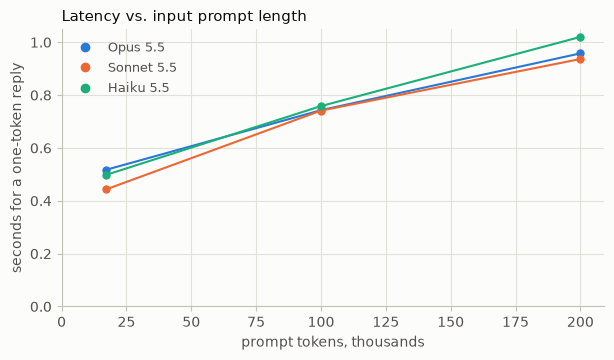

# Claude API 的延遲優化

> 原文：[latency_optimization/latency_optimization.ipynb](https://github.com/anthropics/claude-cookbooks/blob/main/latency_optimization/latency_optimization.ipynb)

在真實的 eval 上逐一測試 Claude API 的各種延遲手段，找出仍然達到準確率門檻的最快 agent 設定。

## 這篇在做什麼

用一個保險理賠的 desk agent 當範例，建一套能同時量延遲、準確率和成本的 eval，然後一個一個試 Claude API 上能降延遲的手段，像是 prompt caching、subagent、fast mode、effort 調整。最後看兩個不同的產品（電話語音和聊天）各自挑出什麼設定最快。

## 學完你會

- 用 TTFT、TTLT、OTPS 三個指標拆解一個 agent 的延遲，知道時間花在哪。
- 判斷哪些手段（caching、prefetch、fast mode、降 effort 等）值得開，哪些會犧牲準確率。
- 設計自己的延遲 eval：先定準確率門檻，再用 p50 / p90 找最快且合格的設定。

## 開跑前

- 需要 Anthropic API key，整本從頭跑完大約 20 美元的 API 額度，建議只在想實驗時才跑個別 cell。
- 需要 Python 3.11 以上，以及 `anthropic`（2.2.0 以上）、`matplotlib`、`numpy`、`python-dotenv`。
- 需要 cookbooks repo 裡這個資料夾的 `desk_agent/`、`results/`、`latency_stats.py`、`assets/`。

優化 LLM 工作負載是在品質、成本、延遲之間取捨。多數 cookbook 講輸出品質，[cost optimization cookbook](https://platform.claude.com/cookbook/cost-optimization-cost-optimization) 講花費，這篇專門講怎麼讓你用 Claude 做的體驗盡可能快。

你可能需要低延遲來做即時的產品體驗，像客服電話的語音 agent。你可能有時間敏感的相依，像詐欺檢查必須在付款授權逾時前通過。或者結果會隨時間貶值，像在市場反應前把財報電話會議摘要給交易員。

不管情境是什麼，我們用三種方式量延遲。Time to first token（TTFT）是看到模型*任何*回應要等多久。Time to last token（TTLT）是拿到完整最終回應要等多久。Output tokens per second（OTPS）是兩者之間輸出生成的速率。這篇會用下面幾個手段改善這三項：

1. **[輸入 token 管理](#input-token-management)**：每次呼叫送更少 token，然後用 [prompt caching](#prompt-caching) 避免重複處理同一段 prefix，預先暖 cache，並用 message threads 避免重送對話
2. **[Agent loop 效率](#agent-loop-efficiency)**：在背景做 compaction，讓任何一輪都不用等它；把獨立的工作丟給 subagent；減少來回次數
3. **[輸出 token 管理](#output-token-management)**：用 prompt 要求更短的回答，或用 structured outputs
4. **[模型、effort 和 thinking](#model-effort-and-thinking)**：用 fast mode 加快輸出，依每個請求或每一輪調 effort，或換模型、決定要不要 thinking
5. **[限制最長的任務](#limiting-the-longest-task)**：用你的程式或 API 強制執行的限制，把最慢的任務框住
6. **[使用者體驗設計](#user-experience-design)**：串流輸出、顯示載入狀態，讓使用者在模型工作時感覺等得比較短

做出一個快的 agent 相對容易，但要它同時維持你要的行為就難了。所以我們先建一個 eval，量延遲並訂出品質門檻，之後都對著它爬坡。

<a id="prerequisites"></a>
## 前置條件

> **注意**：從頭到尾跑完這本 cookbook 大約要花 ~<span>&#36;</span>20 的 API 額度。建議只在想實驗輸入時才跑 cell。延遲會隨服務狀況變動，每次跑的結果可能不一樣。API 手段以外還有哪些因素影響延遲，列在 [§限制](#limitations)。

要跑這個 notebook 你需要：

- **Anthropic API key** 用來呼叫 Claude API（[取得 API key](https://platform.claude.com/settings/keys)）
- **Python 3.11 以上**，並安裝 `anthropic`（2.2.0 以上）、`matplotlib`、`numpy`、`python-dotenv`
- **這本 cookbook 的資料夾**，來自 [cookbooks repo](https://github.com/anthropics/claude-cookbooks)：`desk_agent/`（任務、模擬工具、評分器）、`results/`（記錄下來的執行結果）、`latency_stats.py`（統計、表格、圖表）、`assets/`（mock 資料）

<a id="setup"></a>
## Setup

請從這本 cookbook 的資料夾 `latency_optimization/` 啟動 notebook，因為它用相對路徑讀 `assets/`、`results/`、`desk_agent/`。在這個目錄建一個 `.env`，內容是 `ANTHROPIC_API_KEY=your-anthropic-api-key`，然後安裝並 import 相依套件。

```python
%%capture
%pip install --upgrade "anthropic>=2.2.0" matplotlib numpy python-dotenv
```

```python
import base64
import csv
import io
import json
import random
import statistics
import threading
import time
from concurrent.futures import ThreadPoolExecutor
from dataclasses import dataclass, replace
from pathlib import Path

import anthropic
import desk_agent  # the tasks, simulated tools, and graders, in the folder beside this notebook
import httpx2  # the SDK's HTTP library
import matplotlib.pyplot as plt
from dotenv import load_dotenv
from IPython.display import display
from latency_stats import (
    Sweep,
    curve_chart,
    frontier_chart,
    in_words,
    rank_row,
    show,
    show_task,
    speed_chart,
    table,
)

load_dotenv()
# Retries are off so that timed_stream() can retry outside the timing.
client = anthropic.Anthropic(max_retries=0)
```

接著定義基準模型和價格表。下面的價格表是撰文當下（2026 年 10 月 16 日）的 cache 費率和 fast mode [定價](https://platform.claude.com/docs/en/about-claude/pricing)。`BASE` 是我們的基準線：Opus 5.5，預設 `medium` effort。我們從 Opus 5.5 開始，因為它大部分任務都答得對，如果一個設定本來就做不好事，加速它沒有意義。接下來的其他手段就專注在把它的延遲壓下來。

```python
OPUS, SONNET, HAIKU = "claude-opus-5-5", "claude-sonnet-5-5", "claude-haiku-5-5"
MODELS = (OPUS, SONNET, HAIKU)
NAME = {OPUS: "Opus 5.5", SONNET: "Sonnet 5.5", HAIKU: "Haiku 5.5"}

# $ per million tokens on October 16, 2026, from https://platform.claude.com/docs/en/about-claude/pricing
PRICE = {
    OPUS: {"input_tokens": 4.00, "cache_write": 5.00, "cache_read": 0.20, "output_tokens": 20.00},
    SONNET: {"input_tokens": 2.00, "cache_write": 2.50, "cache_read": 0.10, "output_tokens": 10.00},
    HAIKU: {"input_tokens": 0.10, "cache_write": 0.125, "cache_read": 0.01, "output_tokens": 0.50},
}
FAST_PRICE = 2.0  # fast mode multiplies every rate by this
EFFORTS = ("low", "medium", "high")
JOBS = {"letter": "letter", "quote": "quote", "prescreen": "pre-screen"}
PLAIN = {"loop": "plain", "commentary": "free"}
LOOPS = {
    "baseline loop": PLAIN,
    "prefetch": PLAIN | {"loop": "prefetch"},
    "bigger pages": PLAIN | {"loop": "big_pages"},
    "no commentary": PLAIN | {"commentary": "none"},
    "prefetch + bigger pages": PLAIN | {"loop": "prefetch+big_pages"},
}


@dataclass(frozen=True)
class Config:
    """One setting: what the request asks for, and what the agent loop does around it"""

    model: str = OPUS
    effort: str = "medium"
    thinking: str = "adaptive"  # or "disabled" (Haiku 5.5) or "between_tools" (Sonnet 5.5)
    speed: str = "standard"  # or "fast", on Opus 5.5 only
    loop: str = "plain"  # or "prefetch", "big_pages", "prefetch+big_pages"
    commentary: str = "free"  # or "none": the system prompt asks for no text around tool calls

    def kwargs(self):
        """The request parameters this setting fixes"""
        thinking = {"type": self.thinking}
        if self.thinking == "adaptive":
            thinking["display"] = "omitted"
        kw = {"model": self.model, "thinking": thinking, "output_config": {"effort": self.effort}}
        if self.speed == "fast":
            kw |= {"speed": "fast", "betas": ["fast-mode-2026-02-01"]}
        return kw

    def dollars(self, tokens):
        """tokens: the four counts in PRICE, for one call or summed over a task"""
        usd = sum(tokens[kind] * rate for kind, rate in PRICE[self.model].items()) / 1e6
        return usd * (FAST_PRICE if self.speed == "fast" else 1)

    def with_loop(self, name):
        """A copy of this setting with the loop and commentary of LOOPS[name]"""
        return replace(self, **LOOPS[name])

    @property
    def loop_name(self):
        return next(name for name in LOOPS if self == self.with_loop(name))

    @property
    def name(self):
        name = f"{NAME[self.model]} · {self.effort}"
        name += " · thinking off" if self.thinking == "disabled" else ""
        name += " · between tools" if self.thinking == "between_tools" else ""
        name += " · fast mode" if self.speed == "fast" else ""
        return name + (f" + {self.loop_name}" if self.loop_name != "baseline loop" else "")

    @property
    def order(self):
        """The key that tables sort settings by: the largest model and the highest effort first"""
        model, effort = MODELS.index(self.model), -EFFORTS.index(self.effort)
        loop = list(LOOPS).index(self.loop_name)
        return (model, self.thinking != "adaptive", self.speed == "fast", effort, loop)


BASE = Config()  # the baseline: Opus 5.5 at medium, its default effort, on the baseline loop
```

<a id="measuring-latency"></a>
## 量測延遲

我們用下面的式子算一個任務花多久，以及時間花在哪：

> TTLT ≈ calls × TTFT + output tokens ÷ OTPS + 額外的 client 端或 server 端延遲

換句話說，就是每次模型呼叫開始回應前的等待（乘以呼叫次數），加上寫出每個 output token 的時間，再加上模型以外花的時間，像工具查詢或網路來回。總和就是 TTLT，也就是每個任務的秒數，我們靠調整每個變數來降低它：

- **Calls**：每個對模型的請求都要付一次自己的 TTFT，我們在 [§Agent loop 效率](#agent-loop-efficiency) 讓次數變少。
- **TTFT**：每次呼叫都有一個取決於模型的下限，再加上讀 prompt 中沒被 cache 的部分的時間。我們在 [§輸入 token 管理](#input-token-management) 靠送更少 token、cache 每次呼叫重複的內容來縮短它。
- **Output tokens**：包含 thinking token。我們在 [§輸出 token 管理](#output-token-management) 減少它，也在 [§模型、effort 和 thinking](#model-effort-and-thinking) 靠降 effort 減少它。
- **OTPS**：取決於模型，fast mode 會提高它，見 [§模型、effort 和 thinking](#model-effort-and-thinking)。
- **額外延遲**：包含等工具、網路、佇列、compaction 的時間。[§Agent loop 效率](#agent-loop-efficiency) 處理等 compaction 的問題，[§整合起來](#putting-it-all-together) 的完整 loop 則讓一輪的查詢並行執行。

**百分位數：** 中位數（p50）是一半任務會在這個時間內完成，p90 是 90% 的任務會在這個時間內完成。我們兩個都追蹤，這樣才知道一般和較慢的使用者體驗長什麼樣。當某個手段對其中一個影響比較大時，要優先顧你的使用者比較有感的那個。通話中的人會注意到長時間的沉默，而等最終結果的人感受到的是一般的等待時間。至於更罕見的卡住情況，請對[最長的任務設限](#limiting-the-longest-task)。

**計時：** 我們用下一個 cell 的 `timed_stream()` 記錄延遲。它在送出請求前啟動計時，並在回覆串流進來時記下三個時刻：第一段 thinking 文字、第一段回答文字（TTFT）、回覆結束（TTLT）。OTPS 則是另外估的，在 [§模型、effort 和 thinking](#model-effort-and-thinking) 把上面的式子對記錄下來的 sweep 做擬合。

```python
MAX_TOKENS = 16_000  # per model call: thinking, text, and tool calls
TIME_LIMIT = 60  # seconds for a whole task in run_task(), which stops it there


def timed_stream(deadline=None, **request):
    """One streamed request. Returns (message, marks): the seconds until the first thinking text ("thinking")
    and the first answer text ("text"), each left out if none came, and until the end of the reply ("done").
    deadline: a time.perf_counter() reading. At the deadline the reply is cut off and TimeoutError raised, with no
    retry. A connection that goes completely silent can run past it: it ends once no data has arrived for as long as
    was left when the request was sent"""
    api = client.beta.messages if "betas" in request else client.messages
    for tries_left in (2, 1, 0):
        marks = {}
        start = time.perf_counter()
        if deadline is not None:
            if start >= deadline:
                raise TimeoutError
            request["timeout"] = deadline - start
        try:
            with api.stream(**request) as stream:
                # At the deadline the watchdog closes the connection, which stops the loop below with an error
                watchdog = None
                if deadline is not None:
                    left = max(0.0, deadline - time.perf_counter())
                    watchdog = threading.Timer(left, stream.close)
                    watchdog.start()
                try:
                    for event in stream:
                        if event.type == "content_block_delta":
                            kind = event.delta.type.removesuffix("_delta")
                            if kind == "text" or (kind == "thinking" and event.delta.thinking):
                                marks.setdefault(kind, time.perf_counter() - start)
                    message = stream.get_final_message()
                finally:
                    if watchdog:
                        watchdog.cancel()
            if deadline is not None and time.perf_counter() >= deadline:
                raise TimeoutError  # the watchdog may have cut the reply short
            return message, {**marks, "done": time.perf_counter() - start}
        except Exception as e:
            timed_out = isinstance(e, (anthropic.APITimeoutError, httpx2.TimeoutException))
            if deadline is not None and (timed_out or time.perf_counter() >= deadline):
                raise TimeoutError from None
            retry = (anthropic.APIStatusError, anthropic.APIConnectionError, httpx2.TransportError)
            if not isinstance(e, retry):
                raise
            # Retry everything except a request the API rejects (400 to 428)
            if not tries_left or 400 <= getattr(e, "status_code", 500) < 429:
                raise
            if deadline is not None and time.perf_counter() + 10 >= deadline:
                raise TimeoutError from None  # no time left to wait and try again
            time.sleep(10)


def token_counts(usage):
    """A reply's token counts, under the names the price table and the sweep's log use"""
    details = getattr(usage, "output_tokens_details", None)
    return {
        "input_tokens": usage.input_tokens,
        "cache_write": usage.cache_creation_input_tokens or 0,
        "cache_read": usage.cache_read_input_tokens or 0,
        "output_tokens": usage.output_tokens,
        "thinking_tokens": details.thinking_tokens if details else 0,
    }


def cached(block):
    """A copy of a content block with a cache breakpoint on it"""
    return {**block, "cache_control": {"type": "ephemeral"}}


def single_request(content, cfg=BASE, *, system, cache=False, max_tokens=MAX_TOKENS, **more):
    """A request with one user message. cache=True puts a cache breakpoint at the end of the system prompt"""
    system = [cached({"type": "text", "text": system})] if cache else system
    messages = [{"role": "user", "content": content}]
    return cfg.kwargs() | {"max_tokens": max_tokens, "system": system, "messages": messages} | more


def timed(request):
    """Sends one request. Returns its seconds and token counts, under the headings the demos' tables print"""
    message, marks = timed_stream(**request)
    counts = token_counts(message.usage)
    return {
        # the first thinking or answer text to arrive
        "first thing on screen, s": min(marks.values()),
        "first answer text, s": marks.get("text", marks["done"]),
        "done, s": marks["done"],  # TTLT
        "cache read, tokens": counts["cache_read"],
        "cache write, tokens": counts["cache_write"],
        "output tokens": counts["output_tokens"],
        "of which thinking": counts["thinking_tokens"],
    }


def compare(variants, repeats=3):
    """variants: {label: a function with no arguments that returns a dict of numbers, such as timed()'s}.
    Calls each one `repeats` times. Returns {label: the median of each number}"""
    runs = {label: [] for label in variants}
    for _ in range(repeats):  # alternating, so a change in load hits every variant
        for label, run in variants.items():
            runs[label].append(run())
    return {
        label: {k: statistics.median(r[k] for r in got) for k in got[0]}
        for label, got in runs.items()
    }


def show_medians(found, *columns):
    """Prints what compare() returns, one row for each variant"""
    show({"": label} | {k: medians[k] for k in columns} for label, medians in found.items())
```

<a id="our-example-use-case"></a>
## 我們的範例情境

這本 cookbook 的範例是 Acme Insurance 的 desk agent，Acme 是虛構的保險公司。agent 接一件理賠，用工具查需要的資料，然後記錄它的答案。Acme 在兩個產品上跑這個 agent：

- **電話專線**是讓人打進來的語音 agent。它是對話式的，agent 回應前來電者只能在沉默中等，所以需要接近即時的延遲。這裡 Acme 要優化 TTFT。
- **聊天 agent** 在聊天視窗裡回答。app 可以在它思考時顯示 agent 正在工作，使用者期待的是完整結果，所以多等一下可以接受。這裡 Acme 要優化 TTLT。

兩者都在 `desk_agent/` 裡的同一組 154 個任務上跑同一個 agent。我們用你可以重跑的 live demo cell，和一份記錄下來的 sweep 來量測每個手段的效果，這份 sweep 用 Claude Opus 5.5、Claude Sonnet 5.5、Claude Haiku 5.5 的 33 種不同設定跑過這些任務。下一個 cell 載入 mock 資料和各 demo 共用的部分。

```python
POLICY_MANUAL = Path("desk_agent/_gen/policy_manual.md").read_text()  # the cost cookbook's manual
LEDGER_ROWS = Path("assets/claims_ledger.csv").read_text().splitlines()
with open("assets/claims.csv") as f:
    CLAIMS = {r["id"]: r for r in csv.DictReader(f)}
with open("assets/prior_claims.csv") as f:
    PRIORS = list(csv.DictReader(f))
MANUAL = "=== UNDERWRITING MANUAL ===\n" + POLICY_MANUAL + "\n=== END MANUAL ==="
MEMO_SYSTEM = (
    "You are a licensed auto-insurance claims adjuster. The file has already been reviewed. "
    f"Write from the facts given and the manual below.\n\n{MANUAL}"
)
QUESTION = "Which section covers rental reimbursement?"
TWO_LINES = "DECISION: <APPROVE|DENY|SUPERVISOR|SIU>\nWHY: <one sentence>"


def ledger_system(tag, ledger_rows=None):
    """A tag, MEMO_SYSTEM, then the first ledger_rows lines of the paid-claims ledger (all of it by default).
    A tag nobody has sent before makes a prefix the cache has never seen"""
    paid = "\n".join(LEDGER_ROWS[:ledger_rows])
    return f"({tag})\n\n{MEMO_SYSTEM}\n\n=== PAID CLAIMS ===\n{paid}"


def claim_record(cid):
    """What is on file for one claim: the record, the shop's estimate, and the policyholder's prior claims"""
    claim, estimate = CLAIMS[cid], Path(f"assets/estimates/{cid}.txt").read_text()
    priors = [json.dumps(p) for p in PRIORS if p["policyholder_id"] == claim["policyholder_id"]]
    return (
        f"CLAIM RECORD\n{json.dumps(claim, indent=1)}\n\nESTIMATE\n{estimate}\n"
        "PRIOR CLAIMS\n" + ("\n".join(priors) or "none")
    )


print(
    f"{len(CLAIMS)} claims · manual {len(POLICY_MANUAL):,} characters · ledger {len(LEDGER_ROWS) - 1:,} rows"
)
```

??? note "輸出"

    ```text
    10 claims · manual 29,526 characters · ledger 5,050 rows
    ```

agent 的 system prompt 一開始放著一份承保手冊，加上一行請求，每個任務都提供同樣八個模擬工具。五個負責查資料，三個負責記錄答案，記錄的答案就是我們評分的輸出。

每個任務屬於三種工作之一。**letter** 依檔案中的決定填入正確的客戶信件範本：一兩次查詢，然後是可見的輸出。**quote** 依手冊的理賠試算表處理一件理賠，並記錄結論和金額，需要翻閱估價單、查零件價格、依規則推理。**pre-screen** 依詐欺評分標準找出算數的歷史理賠並替這件理賠打分數，要一頁一頁搜尋帳冊。

每種工作內再依所需工作量把任務分成難度等級，由易到難。[§整合起來](#putting-it-all-together) 會用它們來呈現各工作最難任務的準確率。

```python
TASKS = desk_agent.load_items("final")
print(f"{len(TASKS)} tasks")
print("tools: " + ", ".join(t["name"] for t in desk_agent.tool_specs()))
```

??? note "輸出"

    ```text
    154 tasks
    tools: get_claim, get_estimate, lookup_parts, search_ledger, get_template, submit_quote, submit_prescreen, submit_letter
    ```

<a id="before-you-start-optimizing"></a>
## 開始之前

在深入各種延遲優化方法前，我們要先確保有一套穩的 eval，能顯示每個手段如何改變整體表現，因為下面有好幾個手段是拿能力或成本去換速度。我們的 eval 對上面 154 個任務打分，指標包括準確率、TTFT、TTLT、每個任務的成本。

勝出的設定必須同時準確又快，所以我們要知道「夠好」長什麼樣。Acme 可以容忍二十個答案錯一個，也就是至少 95% 的任務要答對。不過每個產品的延遲需求不同：電話專線完全無法容忍長時間沉默（p90 TTFT），聊天 agent 則願意為困難案例接受較長的對話（p50 TTLT）。這些目標是 Acme 的，你的目標設定會取決於你自己的產品、使用者和對錯誤的容忍度。

我們從一個沒有任何延遲手段的簡單 agent loop 開始。下一個 cell 定義 `baseline_task()`，它把對話送給模型，依序執行模型要求的查詢，再把結果送回去，直到模型記錄答案為止。一個任務在它記錄的每個欄位都符合標準答案時才算答對。

```python
def baseline_task(task, cfg):
    """Runs one task until it records an answer or gives up, with no latency lever applied. cfg sets the
    model, effort, and thinking. Returns its id, type, grade, and a row per model call"""
    prompt = desk_agent.system_prompt()
    tools = desk_agent.tool_specs()
    first = desk_agent.first_turn(task)
    history = [{"role": "user", "content": [{"type": "text", "text": first}]}]
    calls, recorder, nudged = [], None, False
    while True:  # no cap on calls yet
        start = time.perf_counter()
        m = client.messages.create(
            **cfg.kwargs(), max_tokens=MAX_TOKENS, system=prompt, tools=tools, messages=history
        )
        marks = {"done": time.perf_counter() - start}
        history.append({"role": "assistant", "content": m.content})  # thinking blocks included
        uses = [b for b in m.content if b.type == "tool_use"]
        calls.append(
            {"secs": marks["done"], "tools": [b.name for b in uses], **token_counts(m.usage)}
        )
        if m.stop_reason in ("max_tokens", "refusal"):  # counts as wrong
            break
        recorder = next((b for b in uses if desk_agent.is_terminal(b.name)), None)
        if recorder or (nudged and not uses):
            break
        if not uses:  # one reminder, then the task ends with nothing recorded
            nudged = True
            reminder = {"type": "text", "text": desk_agent.NUDGE_MESSAGE}
            history.append({"role": "user", "content": [reminder]})
            continue
        results = [desk_agent.call_tool(task, b.name, b.input) for b in uses]  # one after another
        blocks = [
            {"type": "tool_result", "tool_use_id": b.id, "content": r}
            | ({"is_error": True} if r.startswith("ERROR: ") else {})
            for b, r in zip(uses, results, strict=True)
        ]
        history.append({"role": "user", "content": blocks})  # one message, in call order
    recorded = {"name": recorder.name, "args": recorder.input} if recorder else None
    correct = bool(desk_agent.grade(task, recorded)["correct"])
    return {"task": task["id"], "type": task["type"], "correct": correct, "calls": calls}
```

我們用 Opus 5.5 在預設的 `medium` effort 下，把 baseline 跑在全部 154 個任務上，並跑三次以降低非確定性的變異。工具是模擬的，每次呼叫的網路時間都固定一樣，所以我們的計時只反映模型本身。你的後端服務和網路會增加自己的延遲，這超出本文範圍，在 [§限制](#limitations) 有提到。一個任務的秒數是它各次呼叫 TTLT 的總和。至於第一個可見 token，我們取任務第一次呼叫回傳第一個 token 的時間（thinking token 也算），再加上那次呼叫花在思考的時間，思考時間用它的 thinking token 數除以輸出速度來估算。

下一個 cell 顯示我們 eval 集中一個範例任務的時間和 token 是怎麼累積的。

```python
# One task from the baseline's run, a quote.
# To run one live: show_task(baseline_task(TASKS[0], BASE), BASE)
examples = [json.loads(line) for line in open("results/examples.jsonl")]
show_task(next(row for row in examples if row["type"] == "quote"), BASE)
```

??? note "輸出"

    ```text
    call             wait                                 tools called   input tokens   output tokens   of which thinking
    Q1-002, call 1   1.0s                      get_claim, get_estimate         15,872             108                   0
    Q1-002, call 2   1.5s   lookup_parts, search_ledger, search_ledger         16,712             194                   0
    Q1-002, call 3   2.6s                                 submit_quote         17,152             335                 254
    ```

    ```text
    → correct, 5.1s waiting on the model, $0.212
    ```

現在對完整的 eval 套件做同樣的事，從 `results/baseline.jsonl` 載入結果。輸出顯示三次試驗的平均延遲、成本和準確率。

```python
BASELINE = Sweep("results/baseline.jsonl", Config)
display(BASELINE.results_table([BASE]))
for metric in ("p50", "p90"):
    each = ", ".join(f"{seconds:.1f}s" for seconds in BASELINE.stat(BASE, metric)[:, 0])
    print(f"{metric} is the average of the three rounds: {each}")
```

??? note "輸出"

    ```text
    setting             correct    p50     p90   calls / task   output tokens / task   $ / task
    Opus 5.5 · medium     99.0%   6.1s   11.3s            3.5                    861    $0.2512
    ```

    ```text
    p50 is the average of the three rounds: 6.0s, 5.9s, 6.4s
    p90 is the average of the three rounds: 10.6s, 11.2s, 12.2s
    ```

下面是 Acme 的產品必須打敗的 p50 和 p90 等待時間。

```python
from latency_stats import to_beat

MEASURES = {"Phone line": "first token p90", "Chat agent": "p50"}
display(to_beat(BASELINE, BASE, MEASURES))
```

??? note "輸出"

    ```text
    product                                    wait     p50     p90   optimizes for
    Phone line   seconds to the first visible token   0.56s   0.70s             p90
    Chat agent                     seconds per task    6.1s   11.3s             p50
    ```

所以從現在起，我們做的每個延遲優化都要保持準確率 95% 以上，同時打敗電話專線的 p90 TTFT 和聊天 agent 的 p50 TTLT。延遲有雜訊（光是 baseline 的 p90 TTLT 在各輪之間就差了 1.6 秒），所以只有 bootstrap 檢定給出 *p* < 0.05 時，我們才說一個改變顯著。目標定好了，開始爬坡。

<a id="input-token-management"></a>
## 輸入 token 管理
延遲公式取決於模型要處理多少 token，所以最簡單的一個手段就是送更少 token。當所有輸入 token 都是必要的時候，次好的做法是用 [prompt caching](#prompt-caching) 或 [message threads](#message-threads) 把它們存在 server 端，這樣就不用每次呼叫都重新處理或重送。

<a id="sending-fewer-tokens"></a>
### 送更少 token

為了看較長的 prompt 會增加多少時間，下面的 cell 對每個模型送出約 17,000 token（我們任務 prompt 的大小）、100,000 token、200,000 token 的 prompt，要求只回一個 token。每個 prompt 都是新的，沒有任何東西被 cache。每個 prompt 跑三次，畫出最快的那次，這樣可以排除服務忙碌的時刻。

```python
def read_prompt(model, ledger_rows):
    """A one-token reply to a prompt nobody has sent before, with no caching, so its seconds go to reading the
    prompt, plus a fixed overhead. Returns the prompt's tokens and the seconds"""
    paid = "\n".join((LEDGER_ROWS * 2)[:ledger_rows])
    system = f"(length {time.time_ns()})\n\n{MEMO_SYSTEM}\n\n=== PAID CLAIMS ===\n{paid}"
    request = single_request(QUESTION, Config(model, "low"), system=system, max_tokens=1)
    message, marks = timed_stream(**request)
    return message.usage.input_tokens, marks["done"]


# Ledger rows for about 17,000 prompt tokens (our tasks' size), 100,000, and 200,000
LENGTHS = (220, 3318, 7057)
runs = {(model, rows): [] for model in MODELS for rows in LENGTHS}
for repeat in range(3):
    order = list(runs)
    random.Random(repeat).shuffle(order)
    for model, rows in order:
        runs[model, rows].append(read_prompt(model, rows))

# Each point is its fastest run
CURVE = [
    {"model": NAME[model], "prompt tokens": got[0][0], "s": min(s for _, s in got)}
    for (model, rows), got in runs.items()
]
show(CURVE, places=2)
curve_chart(CURVE)
```

??? note "輸出"

    ```text
    model        prompt tokens      s
    Opus 5.5            17,066   0.52
    Opus 5.5           100,002   0.74
    Opus 5.5           199,994   0.96
    Sonnet 5.5          17,066   0.44
    Sonnet 5.5         100,002   0.74
    Sonnet 5.5         199,994   0.94
    Haiku 5.5           17,066   0.50
    Haiku 5.5          100,002   0.76
    Haiku 5.5          199,994   1.02
    ```

    

從 Desk Agent 的 17,000 token 輸入 prompt 增加到 200,000 token，每個模型大約多了半秒，也就是每 100,000 token 約四分之一秒。這對電話專線 0.70 秒的 p90 TTFT 來說占很大一部分，但對聊天 agent 6.1 秒的 p50 來說很小，因為它大部分時間花在寫輸出。所以對近乎即時的產品，精簡 prompt 可以是很有效的延遲手段。

送更少 token 有三種做法：

- **裁掉。** 移除任務用不到的 prompt 部分。對圖片來說，[縮放](https://platform.claude.com/docs/en/build-with-claude/vision#evaluate-image-size)到任務需要的解析度，因為較大的圖片要花更多 token、處理更久。在長對話中，[context editing](https://platform.claude.com/docs/en/build-with-claude/context-editing) 會清掉模型不再需要的舊工具結果或 thinking block，而在 5.5 模型上它會[讓先前的 thinking 保持有效](https://platform.claude.com/docs/en/build-with-claude/context-editing#context-editing-happens-server-side)。如果你有用 [prompt caching](#prompt-caching)，每次清除都會讓 cache 從那個位置重新開始，所以下一次呼叫要冷讀它後面的所有內容。
- **延後載入。** 在模型需要之前，不把 context 放進 prompt，這也叫 progressive disclosure。用 [tool search](https://platform.claude.com/docs/en/agents-and-tools/tool-use/tool-search-tool)，標了 `defer_loading` 的工具在模型搜尋載入它們之前都不在 prompt 裡，工具定義超過約 10,000 token 時通常就划算。Skills 對指令也是同樣的做法，把 system prompt 的一部分搬到 skill 後面，只在任務需要時才載入。
- **讓存取更有效率。** 給模型一條更窄的路去接觸大量 context。一個只回傳任務需要的頁面或欄位的工具，可以讓長文件的其餘部分不進 context。對表格資料，把 CSV 掛載到 [code execution tool](https://platform.claude.com/docs/en/agents-and-tools/tool-use/code-execution-tool) 裡，模型就能在 sandbox 查詢它，只有程式碼和輸出會進 context。

這些做法每一個都可能在後面多一次呼叫或多一些 token，所以讓你的 eval 決定你的輸入該長什麼樣。

<a id="prompt-caching"></a>
### Prompt caching

我們的 agent 每次呼叫都重送同樣的工具、system prompt 和對話歷史，模型要先重新處理這些內容才能開始輸出 token。[Prompt caching](https://platform.claude.com/docs/en/build-with-claude/prompt-caching) 把模型已經看過的內容存起來，之後的呼叫就不用重新處理，所以 caching 是降 TTFT 的好手段。prefix 是 prompt 開頭每次呼叫都重複的部分，包含工具、system prompt 和先前的訊息，它結束在一個 cache breakpoint，也就是標示要 cache 多少 prompt 的記號。最簡單的起手式是[自動 caching](https://platform.claude.com/docs/en/build-with-claude/prompt-caching#automatic-caching)：在請求加一個頂層的 `cache_control`，它會幫你放 breakpoint。

我們幫 baseline 加 caching 時改用[明確的 cache breakpoint](https://platform.claude.com/docs/en/build-with-claude/prompt-caching#explicit-cache-breakpoints)。這讓你自己最多放四個 breakpoint，每個標示一段可以被 cache 的 prefix 的結尾。用不只一個，可以對應 prompt 中變化速度不同的部分，這樣後面的部分變了，呼叫仍然可以從 cache 讀前面的部分。這裡我們用三個，`cache_control` 標記分別放在 system prompt、第一個 user turn 和最新的 user turn。做這件事的幾行如下：

```python
system = [{"type": "text", "text": prompt, "cache_control": {"type": "ephemeral"}}]
...
    messages = list(history)
    for k in {0, len(messages) - 1}:
        *before, last = messages[k]["content"]
        messages[k] = {"role": "user", "content": [*before, {**last, "cache_control": {"type": "ephemeral"}}]}
```

這樣每個請求就送 `system` 和 `messages`，而不是 `prompt` 和 `history`。下一個 cell 在全部 154 個任務上，分別用和不用 caching 跑我們的 eval。

```python
@dataclass(frozen=True)
class CachingConfig(Config):
    """A Config that also says whether the requests were cached, to tell the two baselines apart"""

    caching: str = "on"  # or "off"

    @property
    def name(self):
        return super().name + (" · caching" if self.caching == "on" else " · no caching")


BOTH = Sweep(["results/baseline.jsonl", "results/sweep.jsonl"], CachingConfig)
no_caching = CachingConfig(caching="off")
display(BOTH.results_table([CachingConfig()], base=no_caching, waits=tuple(MEASURES.values())))

# The baseline caches from here on. Every setting in the sweep ran with caching on
SWEEP = Sweep("results/sweep.jsonl", Config)
```

??? note "輸出"

    ```text
    setting                          correct   correct vs first row, points   first token p90   first token p90 vs first row    p50       p50 vs first row   calls / task   output tokens / task   $ / task
    Opus 5.5 · medium · no caching     99.0%                                            0.70s                                  6.1s                                   3.5                    861    $0.2512
    Opus 5.5 · medium · caching        98.4%            -0.6 (-1.6 to +0.4)             0.69s           ×0.98 (0.94 to 1.01)   6.2s   ×1.01 (0.96 to 1.06)            3.5                    856    $0.0377
    ```

Caching 讓每個任務的成本降了 85%，對任何一個產品的等待時間或準確率都沒有顯著改變。電話專線的 p90 TTFT 從 0.70 變成 0.69 秒，聊天 agent 的 p50 TTLT 從 6.1 變成 6.2 秒，都在每次執行間的雜訊範圍內。就算 p50 那一點上升是真的，我們也願意接受，只要能把每個任務成本從 <span>&#36;</span>0.25 降到 <span>&#36;</span>0.04，所以從這裡開始 caching 一直開著，當作新的 baseline 去打敗。我們的任務很短，平均 3.5 次呼叫，prompt 約 17,000 token，所以 cache 讀取能跳過的 prefix 不多。

TTFT 的節省會隨 prefix 大小和重用它的呼叫次數增長，所以在輪數更多的長程任務上會累積起來。下面的 cell 對一個約 146,000 token 的新 system prompt，計時一段兩輪的對話，先不用 caching，再加上頂層的 `cache_control`。第二輪會重送整個 prompt 和第一輪，這就是 caching 帶來較大延遲收益的地方。在那一輪，`usage.cache_read_input_tokens` 會顯示 cache 有沒有被讀到。我們在 Haiku 5.5 的 `low` effort 上跑，這樣重跑這麼長的 prompt 比較便宜，並回報五次執行的中位數。

```python
TURNS = (QUESTION, "What are its standard daily and aggregate limits?")


def long_system():
    """A system prompt of about 146,000 tokens that the cache has never seen"""
    return ledger_system(f"caching demo {time.time_ns()}")


def run_turns(system, cfg, cache):
    """Asks TURNS in one conversation. cache: turn on automatic caching. Returns the seconds until each
    answer began, and the tokens written to the cache and read from it"""
    history, calls = [], []
    for turn in TURNS:
        history.append({"role": "user", "content": turn})
        request = cfg.kwargs() | {"max_tokens": MAX_TOKENS, "system": system, "messages": history}
        if cache:
            request["cache_control"] = {"type": "ephemeral"}  # the one line that turns caching on
        m, marks = timed_stream(**request)
        history.append({"role": "assistant", "content": m.content})  # thinking blocks included
        calls.append(marks | token_counts(m.usage))
    waits = {f"turn {n}, s": c.get("text", c["done"]) for n, c in enumerate(calls, 1)}
    return waits | {
        "cache write, tokens": sum(c["cache_write"] for c in calls),
        "cache read, tokens": sum(c["cache_read"] for c in calls),
    }


cfg = Config(HAIKU, "low")
found = compare(
    {
        "BEFORE: no caching": lambda: run_turns(long_system(), cfg, cache=False),
        "AFTER: caching": lambda: run_turns(long_system(), cfg, cache=True),
    },
    repeats=5,
)
before, after = found.values()
show_medians(found, *before)
saved = before["turn 2, s"] - after["turn 2, s"]
print(f"\n→ {saved:.1f}s faster with {after['cache read, tokens']:,} tokens read from cache")
```

??? note "輸出"

    ```text
                         turn 1   turn 2   cache write, tokens   cache read, tokens
    BEFORE: no caching     1.6s     1.7s                     0                    0
    AFTER: caching         1.2s     0.5s               146,605              146,312

    → 1.2s faster with 146,312 tokens read from cache
    ```

注意這些節省只有在 prefix 保持完全相同時才成立。system prompt 開頭的動態欄位，像時間戳記或 request ID，會讓每個請求的 prefix 都不一樣，就對不上已寫進 cache 的內容。把[靜態內容放前面](https://platform.claude.com/docs/en/build-with-claude/prompt-caching#structuring-your-prompt)，用明確的 breakpoint 標示它的結尾，會變動的東西放在它後面的最新 user turn。當請求只共享那段靜態部分時，光用自動 caching 不夠，因為它把 breakpoint 放在最後一個 block。

對話也一樣。編輯較早的 turn 會讓 cache 從那裡重新開始，在支援 [preserved thinking](https://platform.claude.com/docs/en/build-with-claude/preserved-thinking) 的新模型上，還可能讓請求被拒絕。改工具、thinking、effort 或模型，也會讓 cache 的一部分或全部失效（[哪些部分](https://platform.claude.com/docs/en/build-with-claude/prompt-caching#what-invalidates-the-cache)）。所以只在 `messages` 的尾端新增，需要的話用[對話中途的 system message](https://platform.claude.com/docs/en/build-with-claude/mid-conversation-system-messages)，並保持模型和它的設定不變。如果 cache 讀取掉到零而你看不出原因，[cache diagnostics](https://platform.claude.com/docs/en/build-with-claude/cache-diagnostics) 會顯示改了什麼。

<a id="pre-warming"></a>
#### Pre-warming

cache 項目預設存活五分鐘，每次被讀取就會刷新，所以停機超過五分鐘後的第一個請求要付冷 prefix 的代價。[Pre-warming](https://platform.claude.com/docs/en/build-with-claude/prompt-caching#pre-warming-the-cache) 把這個代價移出使用者的路徑。在啟動時，或在 cache 存活期內用計時器，你送出共用的 prefix，在它最後一個 block 上放明確的 breakpoint，並設 `max_tokens: 0`，讓模型什麼都不寫。使用跟後續流量相同的模型、thinking 設定和 effort。

在上面的 caching 範例中，第一輪還是很慢，因為它冷讀全部 146,000 token 的 prompt。下面的 cell 用 caching 重跑那段對話，一次照原樣，一次在 pre-warm 之後。

```python
def prewarm(system, cfg):
    """Writes system into the cache ahead of real traffic, and returns it. cfg: that traffic's setting.
    max_tokens=0 generates nothing and can't stream"""
    request = single_request("warmup", cfg, system=system, cache=True, max_tokens=0)
    client.with_options(max_retries=2).messages.create(**request)
    return system


found = compare(
    {
        "BEFORE: no pre-warm": lambda: run_turns(long_system(), cfg, cache=True),
        "AFTER: pre-warmed": lambda: run_turns(prewarm(long_system(), cfg), cfg, cache=True),
    },
    repeats=5,
)
before, after = found.values()
show_medians(found, *before)
saved = before["turn 1, s"] - after["turn 1, s"]
more = after["cache read, tokens"] - before["cache read, tokens"]
print(f"\n→ {saved:.1f}s faster with {more:,} more tokens read from cache")
```

??? note "輸出"

    ```text
                          turn 1   turn 2   cache write, tokens   cache read, tokens
    BEFORE: no pre-warm     1.0s     0.5s               146,615              146,312
    AFTER: pre-warmed       0.8s     0.6s                   308              292,609

    → 0.2s faster with 146,297 more tokens read from cache
    ```

在這個 146,000 token 的 prompt 上，pre-warming 讓第一個回答的等待從 1.0 秒降到 0.8 秒。節省會隨 prompt 長度增加，因為 token 越多，冷讀越久，這在 [§送更少 token](#sending-fewer-tokens) 量過了。我們會在 prefix 很長、流量成陣發而且安靜時段比 cache 存活時間長的情況下做 pre-warm。對那些安靜時段，[一小時 cache](https://platform.claude.com/docs/en/build-with-claude/prompt-caching#1-hour-cache-duration) 是計時器的替代方案；而穩定流量本來就讓 cache 保持溫熱的地方，pre-warm 只是多了一個計費的請求。

<a id="message-threads"></a>
### Message threads

Prompt caching 讓模型不用重新處理 prefix，但每次呼叫仍然要上傳整段對話，讓 API 再驗證和 tokenize 一次。[Message threads](https://platform.claude.com/docs/en/build-with-claude/message-threads) 把對話留在 server 上，你就不用重送。第一次呼叫照常送所有內容並建立 thread。之後每次呼叫只送新訊息和前一個回應的 ID，省略 system prompt、工具和先前的 turn。實作方式如下：

```python
first = {"system": system, "messages": history, "thread": {"type": "create"}}
...
later = {"messages": [new_message], "thread": {"type": "continue", "previous_message_id": previous.id}}
```

thread 讓你不用重送對話，當對話累積了圖片、文件或上百個工具結果時，這點更重要。下面的 cell 用 Acme 理賠帳冊的掃描頁面開一段對話，問幾個關於它們的問題，分別用和不用 thread。thread 的第一次呼叫會上傳完整對話，所以我們回報後面呼叫的 TTFT 中位數。而且我們每個請求都保留 `cache_control`，因為 thread 不會幫我們 cache prompt。

```python
THREADS = "message-threads-2026-08-12"
LOST = ("thread_not_found", "thread_already_continued", "thread_continue_in_flight")
PAGES = (4, 8, 16)
cfg = Config(HAIKU, "low", thinking="disabled")


def scan(rows):
    """An image block of one page of the paid claims ledger, as a 300 dpi scan of about 1 MB"""
    page = plt.figure(figsize=(8.5, 11))
    page.text(0.05, 0.96, "\n".join(rows), family="monospace", size=7, va="top", parse_math=False)
    jpeg = io.BytesIO()
    page.savefig(jpeg, format="jpg", dpi=300, pil_kwargs={"quality": 90})
    plt.close(page)
    data = base64.b64encode(jpeg.getvalue()).decode()
    return {"type": "image", "source": {"type": "base64", "media_type": "image/jpeg", "data": data}}


SCANS = [scan(LEDGER_ROWS[80 * n : 80 * (n + 1)]) for n in range(max(PAGES))]
PAID_CLAIMS = [row.split(",")[0] for row in LEDGER_ROWS[10:290:40]]
TOKENS = {
    pages: client.messages.count_tokens(
        model=cfg.model, system=MEMO_SYSTEM, messages=[{"role": "user", "content": SCANS[:pages]}]
    ).input_tokens
    for pages in PAGES
}


def run_claims(pages, thread):
    """Opens a conversation with that many scanned pages, then asks about each of PAID_CLAIMS, with caching on. thread: create a
    thread on the first call and send each later call only its new message. Returns, over the calls after the first,
    the median seconds until the answer began and the median size of the request's JSON"""
    system = f"(threads {time.time_ns()})\n\n{MEMO_SYSTEM}"
    fixed = cfg.kwargs() | {"max_tokens": MAX_TOKENS, "cache_control": {"type": "ephemeral"}}
    history = [
        {"role": "user", "content": SCANS[:pages]},
        {"role": "assistant", "content": "I have the pages."},
    ]
    previous, calls = None, []
    for claim in PAID_CLAIMS:
        history.append({"role": "user", "content": f"What was paid on {claim}?"})
        whole = fixed | {"system": system, "messages": history}
        if thread:
            whole["thread"] = {"type": "create"}
        request = whole
        if thread and previous:  # the thread holds the system prompt and the earlier messages
            request = fixed | {"messages": history[-1:]}
            request["thread"] = {"type": "continue", "previous_message_id": previous}
        start, lost = time.perf_counter(), 0.0
        try:
            m, marks = timed_stream(betas=[THREADS], **request)
        except (anthropic.NotFoundError, anthropic.BadRequestError) as e:
            details = e.body.get("error", {}).get("details") if isinstance(e.body, dict) else None
            if (details or {}).get("error_code") not in LOST:
                raise
            # The thread can't be continued, so resend the conversation on a new one. The failed call's time counts
            request, lost = whole, time.perf_counter() - start
            m, marks = timed_stream(betas=[THREADS], **request)
        calls.append(
            {
                "TTFT, s": lost + marks.get("text", marks["done"]),
                "bytes": len(json.dumps(request, default=lambda block: block.to_dict())),
            }
        )
        history.append({"role": "assistant", "content": m.content})
        previous = m.id
    ttft, size = (statistics.median(c[k] for c in calls[1:]) for k in ("TTFT, s", "bytes"))
    return {
        "TTFT, s": ttft,
        "request": f"{size / 1e6:.1f} MB" if size >= 1e6 else f"{size / 1e3:.1f} KB",
    }


runs = {(pages, thread): [] for pages in PAGES for thread in (False, True)}
for repeat in range(3):
    order = list(runs)
    random.Random(repeat).shuffle(order)
    for pages, thread in order:
        runs[pages, thread].append(run_claims(pages, thread))

show(
    [
        {"": "AFTER: caching + thread" if thread else "BEFORE: caching", "pages": pages}
        | {"prompt tokens": TOKENS[pages]}
        | min(repeats, key=lambda run: run["TTFT, s"])
        for (pages, thread), repeats in runs.items()
    ],
    places=2,
)
```

??? note "輸出"

    ```text
                              pages   prompt tokens    TTFT   request
    BEFORE: caching               4          30,165   0.61s    5.6 MB
    AFTER: caching + thread       4          30,165   0.40s    0.3 KB
    BEFORE: caching               8          49,209   0.82s   11.2 MB
    AFTER: caching + thread       8          49,209   0.48s    0.3 KB
    BEFORE: caching              16          87,297   1.27s   22.3 MB
    AFTER: caching + thread      16          87,297   0.63s    0.3 KB
    ```

在 16 頁的情況下，thread 把每個請求從 22 MB 降到 0.3 KB，讓 TTFT 減半，而且節省會隨頁數增加。注意 thread 省的是上傳時間而不是 token。Claude 每次呼叫仍然讀完整對話，所以有沒有 thread 我們的成本都一樣。對任何長或負載重的多輪對話我們都會用 thread，但我們 desk agent 的典型任務只是幾次純文字呼叫，thread 能省的 payload 很少。

<a id="agent-loop-efficiency"></a>
## Agent loop 效率

延遲也取決於 agent 呼叫模型幾次。這就是我們公式裡的 calls × TTFT 項：一個要五次呼叫才能回答的 agent 要付五次 TTFT，再加上中間等工具的時間。這一節的手段目標是減少呼叫次數，並把必須保留的呼叫並行化。

<a id="background-compaction"></a>
### 背景 compaction

在長的多輪任務中，對話最終可能超出模型的 context window。要繼續下去，較早的 turn 必須濃縮成一份摘要來取代。API 的 [compaction](https://platform.claude.com/docs/en/build-with-claude/compaction) 會幫你寫這份摘要。寫摘要要花時間，而各種觸發方式的差別在於使用者要不要等它。[在 token 門檻](https://platform.claude.com/docs/en/build-with-claude/compaction-threshold)觸發時，跨過門檻的那個請求要先寫摘要，這個等待就加在該輪上。[按需觸發](https://platform.claude.com/docs/en/build-with-claude/compaction-on-demand)時，由另一個請求回傳摘要，如果你[在背景](https://platform.claude.com/docs/en/build-with-claude/compaction-background)送那個請求，就完全沒有任何一輪要等它。
我們的 desk agent 任務不會長到碰到門檻，所以改用另一個聊天範例，有十件理賠，每件貼進約 8K token。我們用三種方式跑：不做 compaction、在 50K token 門檻做 compaction（API 接受的最低值）、以及 prompt 超過 50K token 後做背景 compaction。

```python
# Helpers shared by this demo and the per-turn effort demo in Model, effort, and thinking
SESSION_SYSTEM = (
    "You are a Senior Adjuster in Acme Insurance's auto claims unit, working a queue of claims "
    "in one session. Apply the underwriting manual below. For each claim reply in exactly two "
    f"lines and nothing else:\n{TWO_LINES}\n\n{MANUAL}"
)


def new_session():
    """A system prompt that no earlier session has cached, and an empty history"""
    return f"(session {time.time_ns()})\n\n" + SESSION_SYSTEM, []


def claim_file(i):
    cid = list(CLAIMS)[i]
    comparables = "\n".join([LEDGER_ROWS[0], *LEDGER_ROWS[1 + i * 270 : 1 + (i + 1) * 270]])
    return f"{claim_record(cid)}\n\nCOMPARABLE PAID CLAIMS\n{comparables}\n\nDecide claim {cid}."


def session_request(system, messages, **more):
    """What every request on a conversation shares. Two cache breakpoints: one at the end of the system prompt,
    and one the API places at the end of the history, asked for by the top-level cache_control"""
    return BASE.kwargs() | {
        "max_tokens": MAX_TOKENS,
        "system": [cached({"type": "text", "text": system})],
        "messages": messages,
        "cache_control": {"type": "ephemeral"},
        **more,
    }


def send_turn(label, system, history, **more):
    """Sends the conversation's next request and appends the reply to history as returned, thinking included.
    Returns its row of the session's table"""
    m, marks = timed_stream(**session_request(system, history, **more))
    history.append({"role": "assistant", "content": m.content})
    # A request that compacts before it answers makes two passes, and usage.iterations lists each
    parts = [token_counts(u) for u in getattr(m.usage, "iterations", None) or [m.usage]]
    sizes = [t["input_tokens"] + t["cache_read"] + t["cache_write"] for t in parts]
    return {
        "": label,
        "wait s": marks["done"],
        "prompt tokens": max(sizes),
        "cache read, tokens": parts[-1]["cache_read"],
        "cache write, tokens": parts[-1]["cache_write"],
        "output tokens": m.usage.output_tokens,
    }


# The compaction demo: one conversation of ten claims, run three ways
COMPACT_BETA = "compact-2026-09-04"  # compaction on demand
THRESHOLD_BETA = "compact-2026-01-12"  # compaction at a token threshold
COMPACT_AT = 50_000  # prompt tokens. Also the lowest threshold the API accepts
PAUSE = 4.0  # seconds between turns, standing in for the person reading. Not counted as waiting


def summarize(system, messages):
    """Compaction on demand. Model, system, thinking, effort, and cache_control match the conversation's,
    so the request reads the conversation's cached prefix"""
    extra = {"betas": [COMPACT_BETA], "compaction": {"type": "summarize"}}
    request = session_request(system, messages, **extra)
    return client.with_options(max_retries=2).beta.messages.create(**request)


def run_session(mode):
    """Ten claims in one conversation. mode: "none", "threshold" (compact inside the request that crosses it),
    or "background" (ask for a summary between turns, swap it in when ready). Returns one row for each turn"""
    system, history = new_session()
    extra = {}
    if mode == "threshold":
        trigger = {"type": "input_tokens", "value": COMPACT_AT}
        edits = [{"type": "compact_20260112", "trigger": trigger}]
        extra = {"betas": [THRESHOLD_BETA], "context_management": {"edits": edits}}
    if mode == "background":
        extra = {"betas": [COMPACT_BETA]}  # needed once the history holds a summary
    rows = []
    pending, held = None, 0  # the summary on its way, and how many messages it covers
    with ThreadPoolExecutor(max_workers=1) as pool:
        for i in range(len(CLAIMS)):
            if pending and pending.done():
                summary, pending = pending.result(), None
                if summary.stop_reason == "compaction":
                    # Replace exactly the messages the summary covers. Later turns stay after it
                    history[:held] = [{"role": "assistant", "content": summary.content}]
            history.append({"role": "user", "content": claim_file(i)})
            row = send_turn(f"turn {i + 1}", system, history, **extra)
            rows.append(row)
            last = i + 1 == len(CLAIMS)
            if mode == "background" and not (pending or last) and row["prompt tokens"] > COMPACT_AT:
                pending, held = pool.submit(summarize, system, list(history)), len(history)
            time.sleep(0 if last else PAUSE)
    return rows


SESSIONS = {
    "no compaction": run_session("none"),
    "BEFORE: at a threshold": run_session("threshold"),
    "AFTER: in the background": run_session("background"),
}
summary = [
    {
        "": label,
        "median wait s": statistics.median(r["wait s"] for r in rows),
        "longest wait s": max(r["wait s"] for r in rows),
        "largest prompt, tokens": max(r["prompt tokens"] for r in rows),
    }
    for label, rows in SESSIONS.items()
]
show(summary)
_, before, after = (row["longest wait s"] for row in summary)
print(f"\n→ longest wait: {before:.1f}s compacting at a threshold, {after:.1f}s in the background")
```

??? note "輸出"

    ```text
                               median wait   longest wait   largest prompt, tokens
    no compaction                     3.3s           5.4s                   95,881
    BEFORE: at a threshold            4.1s          21.4s                   55,674
    AFTER: in the background          3.3s           4.9s                   69,755

    → longest wait: 21.4s compacting at a threshold, 4.9s in the background
    ```

在門檻做 compaction 讓某一輪在寫摘要時等了 21.4 秒。在背景做的話，最長的等待是 4.9 秒，和不做 compaction 的 5.4 秒相當。代價是 prompt 比較大，峰值約 70,000 token，門檻做法是 56,000，因為摘要寫的期間送出的那些 turn 仍然帶著完整歷史。如果你的對話長到會 compact，而且每一輪都有人在等，我們會在背景 compact，並且提早要求摘要，讓那些 turn 仍能放進 context window。

<a id="subagents"></a>
### Subagents

當一個任務可以拆成獨立的幾塊，每一塊都可以交給 subagent。在 Messages API 裡，subagent 就是另一個有自己 `messages` 陣列的請求。它看得到你給它的 context，並把答案回給主 agent。同時送出的話，各塊並行執行，任務等最慢的那個。如果你用 [Agent SDK](https://code.claude.com/docs/en/agent-sdk/subagents) 或 [Claude Managed Agents](https://platform.claude.com/docs/en/managed-agents/multiagent-orchestration) 來建構，兩者都有自己的 subagent 支援。

在下面的 cell 裡，Opus 5.5 是決定一件理賠的主 agent，它需要先從理賠紀錄取得三個事實。第一次執行時它自己查，在自己的對話裡一輪一輪來。第二次它把這三個查詢交給三個更快更便宜的 Haiku 5.5 subagent，再根據它們的答案做決定。只有 Opus 拿到承保手冊，因為 subagent 只是查事實。每個請求都用 `low` effort，我們也會檢查它們的答案，確保準確率沒有下降。

```python
# Three facts the manual's fraud score (§5.1) turns on. Each is a lookup in the claim record
QUESTIONS = [
    "How many days passed between the loss and the report, and is a reason for the delay on file?",
    "How many prior claims fell in the 36 months before the loss date?",
    "Was a police report filed?",
]
CLAIM = claim_record("CLM-008")
ONE_LINE = "Answer in one terse line."
DECIDE = f"Decide the claim from these findings. Reply in exactly two lines:\n{TWO_LINES}"
ANSWER = "SUPERVISOR"  # the manual's fraud score comes to 4, and 3 to 5 means supervisor review
ORCHESTRATOR, SUBAGENT = Config(OPUS, "low"), Config(HAIKU, "low")
BEFORE, AFTER = "BEFORE: Opus 5.5 answers in turn", "AFTER: Haiku 5.5 subagents side by side"
GRADES = {BEFORE: [], AFTER: []}  # whether each decision matched ANSWER


def reply(cfg, system, messages):
    """Sends one conversation and adds the reply to it. Returns the seconds"""
    message, marks = timed_stream(**cfg.kwargs(), max_tokens=8192, system=system, messages=messages)
    messages.append({"role": "assistant", "content": message.content})
    return marks["done"]


def text(messages):
    """The text of the conversation's last reply"""
    return "".join(b.text for b in messages[-1]["content"] if b.type == "text")


def decide(messages, label):
    """The orchestrator, which has the manual, decides from the conversation so far. Returns the seconds"""
    messages.append({"role": "user", "content": DECIDE})
    secs = reply(ORCHESTRATOR, MEMO_SYSTEM, messages)
    GRADES[label].append(f"DECISION: {ANSWER}" in text(messages))
    return secs


def one_agent():
    """The orchestrator answers each question in turn in its own conversation, then decides. Returns the
    seconds"""
    messages, secs = [], 0.0
    for i, question in enumerate(QUESTIONS):
        ask = f"{question} {ONE_LINE}"
        messages.append({"role": "user", "content": f"{CLAIM}\n\n{ask}" if i == 0 else ask})
        secs += reply(ORCHESTRATOR, MEMO_SYSTEM, messages)
    decision = decide(messages, BEFORE)
    return {"answers, s": secs, "decision, s": decision, "total, s": secs + decision}


def subagent(question):
    """One subagent: a request with its own messages array and no manual. Returns its seconds and answer"""
    messages = [{"role": "user", "content": f"{CLAIM}\n\n{question} {ONE_LINE}"}]
    return reply(SUBAGENT, "You are a claims assistant.", messages), text(messages)


def with_subagents():
    """Subagents answer the questions side by side, then the orchestrator decides from their answers. Returns
    the seconds"""
    with ThreadPoolExecutor(max_workers=len(QUESTIONS)) as pool:
        found = list(pool.map(subagent, QUESTIONS))
    findings = "\n".join(f"{q}\n{answer}" for q, (_, answer) in zip(QUESTIONS, found, strict=True))
    messages = [{"role": "user", "content": f"{CLAIM}\n\nSubagents' findings:\n{findings}"}]
    secs = max(s for s, _ in found)
    decision = decide(messages, AFTER)
    return {"answers, s": secs, "decision, s": decision, "total, s": secs + decision}


found = compare({BEFORE: one_agent, AFTER: with_subagents}, repeats=5)
for label, medians in found.items():
    medians["decisions right"] = f"{sum(GRADES[label])}/{len(GRADES[label])}"
show_medians(found, "answers, s", "decision, s", "total, s", "decisions right")
before, after = (medians["total, s"] for medians in found.values())
print(f"\n→ with subagents the task waits ×{after / before:.2f} as long")
```

??? note "輸出"

    ```text
                                              answers   decision   total   decisions right
    BEFORE: Opus 5.5 answers in turn             6.8s       3.1s    9.5s               5/5
    AFTER: Haiku 5.5 subagents side by side      1.5s       4.2s    5.7s               5/5

    → with subagents the task waits ×0.60 as long
    ```

用 subagent 的話任務花 5.7 秒而不是 9.5 秒，五個決定全部正確。三個答案在 1.5 秒內回來，而不是 6.8 秒，因為它們在更快的模型上並行執行。所以當任務可以拆成獨立的查詢或檢查時，把它們交給小的 subagent，並且只給每個 subagent 它需要的 context。我們選 Haiku 5.5 是為了速度，適合這種簡單查詢。需要更多判斷力的子任務可能要用更大的模型，但因為 subagent 並行的收益，我們預期效果方向仍然一樣。

如果你的 subagent 一開始有相同的長 context，像是共用的文件，同時啟動它們就表示每個都讀沒 cache 的文件，因為 cache 項目要等第一個回應開始才準備好。要解決這點，可以對共用 context 做 [pre-warm](#pre-warming)，或先送一個 subagent，等它的回覆開始串流後再送其他 subagent。

<a id="prefetch-and-bigger-pages"></a>
### Prefetch 和更大的頁面

有時你的程式碼知道模型第一個會呼叫哪個工具。這時你的程式可以在 agent loop 外自己做那個呼叫，把結果放進第一個 user turn。每個 desk agent 任務一開始都會對請求指名的理賠呼叫 `get_claim`，quote 還需要那件理賠估價單第 1 頁的 `get_estimate`。**Prefetch** 事先執行這些查詢，省掉模型的一次來回。**Bigger pages** 把每次查詢回傳的估價單行數或帳冊列數加倍，所以需要翻頁的任務查詢次數更少。兩者做的取捨都跟 [§送更少 token](#sending-fewer-tokens) 相反，多加輸入 token 來換更少的呼叫，也就更少 TTFT 要付。

下面這幾行取代 baseline 的工具設定和第一個 turn：

```python
prefetch, big_pages = "prefetch" in cfg.loop, "big_pages" in cfg.loop
...
tools = desk_agent.tool_specs(big_pages=big_pages)
first = desk_agent.first_turn(task, prefetch=prefetch, big_pages=big_pages)
```

下面的表格呈現 prefetch 和 bigger pages 各自套用在我們 baseline eval 上的結果。

```python
LEVERS = ("prefetch", "bigger pages")
SWEEP.results_table([BASE.with_loop(name) for name in LEVERS])
```

??? note "輸出"

    ```text
    setting                            correct   correct vs first row, points    p50       p50 vs first row     p90       p90 vs first row   calls / task   output tokens / task   $ / task
    Opus 5.5 · medium                    98.4%                                  6.2s                          11.8s                                   3.5                    856    $0.0377
    Opus 5.5 · medium + prefetch         99.4%            +1.0 (+0.0 to +2.1)   5.3s   ×0.87 (0.82 to 0.90)   12.1s   ×1.02 (0.90 to 1.08)            2.4                    846    $0.0340
    Opus 5.5 · medium + bigger pages     98.5%            +0.2 (-1.4 to +1.6)   5.5s   ×0.90 (0.85 to 0.94)   11.4s   ×0.96 (0.86 to 1.01)            3.3                    829    $0.0373
    ```

Prefetch 每個任務省了約一次呼叫，p50 降了 13%。Bigger pages 省的呼叫較少，p50 降了 10%。兩者對 p90 或準確率都沒有顯著改變。有了這些 p50 延遲上的收益，我們建議對任務一定會先做的查詢做 prefetch，例如抓出退款請求所指的訂單，並在任務需要翻長結果的地方回傳更大的頁面。

<a id="programmatic-tool-calling"></a>
### Programmatic tool calling

在一般的工具 loop 中，每一輪工具呼叫之後模型都要重新取樣。它要求一次呼叫，你的程式執行，結果放回對話，模型才能要求下一個。一個要依序翻 20 筆結果的工作，要付 20 次來回，每次都有自己的 TTFT。模型也要完整讀每筆結果，即使它需要的只是總和。

用 [programmatic tool calling](https://platform.claude.com/docs/en/agents-and-tools/tool-use/programmatic-tool-calling)，模型寫一個腳本，從 code execution container 發出所有工具呼叫。這些呼叫之間模型不會被取樣，只讀腳本印出來的東西（[見 cookbook](https://platform.claude.com/cookbook/tool-use-programmatic-tool-calling-ptc)）。代價是啟動 container 和寫腳本有固定開銷，而且腳本發出的每個呼叫仍然要送到你的程式再回來。Programmatic tool calling 在呼叫很多或結果很大的工作上划算。如果模型需要先讀每筆結果才能選下一個呼叫，或工作只有少數幾次小結果的呼叫，就不要用。

在下面的 demo 中，模型要把一整年的保險賠付加總，工具一次回一頁。直接呼叫時，模型得依序要求每一頁。用腳本時，由程式去抓頁面，模型只讀總和。

```python
PAGE = 20
PAID = [row | {"paid_usd": float(row["paid_usd"])} for row in csv.DictReader(LEDGER_ROWS)]
LIST_CLAIMS = {
    "name": "list_paid_claims",
    "description": (
        f"One page of the claims paid in a state on one year's losses, {PAGE} to a page, the most the "
        "API returns. For the next page, pass the last page's next_cursor. Returns JSON: "
        '{"rows": [{"claim_id": str, "loss_date": "YYYY-MM-DD", "type": str, "paid_usd": float}], '
        '"next_cursor": str or null}. next_cursor is null on the last page.'
    ),
    "input_schema": {
        "type": "object",
        "properties": {
            "state": {"type": "string", "description": "Two letters"},
            "year": {"type": "integer"},
            "cursor": {"type": "string"},
        },
        "required": ["state", "year"],
    },
}


def list_paid_claims(state, year, cursor=None):
    """The simulated API. A cursor is the last claim of the page before, so no page can be asked for ahead of time"""
    rows = [r for r in PAID if (r["state"], r["loss_date"][:4]) == (state, str(year))]
    claim_ids = [r["claim_id"] for r in rows]
    if cursor and cursor not in claim_ids:
        return "ERROR: unknown cursor"
    start = claim_ids.index(cursor) + 1 if cursor else 0
    page = [{k: v for k, v in r.items() if k != "state"} for r in rows[start : start + PAGE]]
    more = start + PAGE < len(rows)
    return json.dumps({"rows": page, "next_cursor": page[-1]["claim_id"] if more else None})


REPORT = (
    "A regulator wants our Texas payouts on 2022 losses: the total paid, and the claim type we paid "
    "the most on."
)
REPORT_SYSTEM = (
    "You are an analyst in Acme Insurance's auto claims unit. Answer from the paid-claims API, using "
    "every matching claim. End with exactly two lines:\n"
    "TOTAL: <dollars and cents>\nTOP TYPE: <claim type>"
)
REPORT_KEY = "TOTAL: 2110804.91\nTOP TYPE: collision"  # worked out from the ledger
SCRIPTS = "code_execution_20260120"


def run_report(cfg, scripted):
    """Answers REPORT with the one tool, which the model calls directly or (scripted) from a script it writes"""
    tools, extra = [LIST_CLAIMS], {"cache_control": {"type": "ephemeral"}}
    if scripted:  # the pages go to the script, so the prompt doesn't grow: nothing to cache
        sandbox = {"type": SCRIPTS, "name": "code_execution"}
        tools, extra = [sandbox, LIST_CLAIMS | {"allowed_callers": [SCRIPTS]}], {}
    request = cfg.kwargs() | {"max_tokens": MAX_TOKENS, "system": REPORT_SYSTEM, "tools": tools}
    history, secs, tokens = [{"role": "user", "content": REPORT}], [], 0
    while len(secs) < 40:
        m, marks = timed_stream(**request, messages=history, **extra)
        secs.append(marks["done"])
        tokens += m.usage.output_tokens
        history.append({"role": "assistant", "content": m.content})
        if m.container:
            extra["container"] = m.container.id  # a paused script resumes only in its own container
        # A script's calls come back as tool_use too, and their results must be the whole message
        results = [
            {"type": "tool_result", "tool_use_id": b.id, "content": list_paid_claims(**b.input)}
            for b in m.content
            if b.type == "tool_use"
        ]
        if results:
            history.append({"role": "user", "content": results})
        elif m.stop_reason != "pause_turn":
            break
    answer = next((b.text for b in reversed(m.content) if b.type == "text"), "")
    reply = answer.replace("$", "").replace(",", "")
    return {
        "fetching pages, s": sum(secs[:-1]),
        "answering, s": secs[-1],
        "total, s": sum(secs),
        "output tokens": tokens,
        "correct": reply.rstrip().endswith(REPORT_KEY),
    }


before, after = run_report(BASE, scripted=False), run_report(BASE, scripted=True)
show([{"": "BEFORE: direct calls"} | before, {"": "AFTER: from a script"} | after])
saved, fewer = (before[k] - after[k] for k in ("total, s", "output tokens"))
print(f"\n→ {saved:.1f}s faster from a script, with {fewer:,} fewer output tokens")
```

??? note "輸出"

    ```text
                           fetching pages   answering   total   output tokens   correct
    BEFORE: direct calls            17.3s       29.6s   46.8s           5,262      True
    AFTER: from a script            26.8s        9.2s   36.0s             816      True

    → 10.8s faster from a script, with 4,446 fewer output tokens
    ```

用腳本抓頁面多花了 9.5 秒，但回答少花了 20.4 秒，所以整個工作快了約 11 秒。抓取比較慢是因為那些請求包含寫腳本。回答比較快是因為腳本在程式裡把賠付加起來並印出總和，模型只要回報它。直接呼叫時，模型得自己把每一頁的每筆賠付加起來，多花了約 4,400 個 output token。

Programmatic tool calling 最適合以加總、過濾或計數收尾的工作，這些是程式比模型擅長的事。我們的 desk agent 任務只有幾次小結果的呼叫，所以最終的 sweep 沒有用 programmatic tool calling。

<a id="output-token-management"></a>
## 輸出 token 管理

輸入 token 和輪數處理完後，延遲公式裡剩下的變數跟輸出有關。模型一次寫一個 output token，所以每一個它沒寫的 token 都縮短 TTLT，thinking 也算。如果你的應用只需要一個決定和一行理由，圍繞它的每一段解釋都是使用者不需要等的時間。

<a id="prompting-for-shorter-answers"></a>
### 用 prompt 要求更短的回答

聽起來可能很簡單，但你就是可以直接要求 Claude 輸出更少 token。說明你想要的輸出形狀，最好附一個範例，可以避免模型在得出答案的路上過度敘述。下面的 cell 要模型對同一件理賠做兩次決定。第一次它可以隨意回答。第二次它必須剛好回兩行，一個決定和一句理由。

```python
question = claim_record("CLM-008") + "\n\nWrite up your decision on this claim."
shaped = f"{MEMO_SYSTEM}\n\nRespond in exactly two lines and nothing else:\n{TWO_LINES}"
found = compare(
    {
        "BEFORE: free-form": lambda: timed(single_request(question, system=MEMO_SYSTEM)),
        "AFTER: two lines asked for": lambda: timed(single_request(question, system=shaped)),
    }
)
show_medians(found, "done, s", "output tokens", "of which thinking")
before, after = found.values()
saved = before["done, s"] - after["done, s"]
fewer = before["of which thinking"] - after["of which thinking"]
print(f"\n→ asking for two lines: {saved:.1f}s sooner, with {fewer:,.0f} fewer thinking tokens")
```

??? note "輸出"

    ```text
                                  done   output tokens   of which thinking
    BEFORE: free-form            46.4s           4,913               2,083
    AFTER: two lines asked for    4.9s             433                 296

    → asking for two lines: 41.5s sooner, with 1,787 fewer thinking tokens
    ```

要求兩行讓決定的時間從 46.4 秒降到 4.9 秒。模型也想得比較少，約 300 token 而不是 2,100，所以較短的答案表示較短的推理。如果你的任務需要深入推理但只要簡短輸出，用 [structured outputs](#structured-outputs) 輸出答案，並用 [effort](#effort) 設定模型思考多少。只要模型寫的東西超過有人會讀的量，我們就建議要求一個形狀。

<a id="no-commentary"></a>
#### 不要旁白

我們也可以用 prompt 要求 agent 不要在工具呼叫之間敘述。下面的表格比較 baseline 和在 system prompt 加了這個指令的版本：

> Write no text outside your tool calls: no plans, notes, summaries or explanations. Nobody reads that text, and the customer waits while you write it. Fill in the recorder call's arguments exactly as the manual asks.

```python
SWEEP.results_table([BASE.with_loop("no commentary")])
```

??? note "輸出"

    ```text
    setting                             correct   correct vs first row, points    p50       p50 vs first row     p90       p90 vs first row   calls / task   output tokens / task   $ / task
    Opus 5.5 · medium                     98.4%                                  6.2s                          11.8s                                   3.5                    856    $0.0377
    Opus 5.5 · medium + no commentary     99.5%            +1.2 (+0.1 to +2.3)   6.0s   ×0.97 (0.93 to 1.02)   12.0s   ×1.01 (0.92 to 1.08)            3.5                    836    $0.0376
    ```

不要旁白的指令在我們的情境下，對 p50 和 p90 都沒有顯著改變。它沒什麼可砍的，因為不管有沒有它，Opus 5.5 在得出答案的路上寫的量都一樣。準確率顯著提高了 1.2 個百分點，這可能來自指令最後一句關於填 recorder 參數的部分，而不是來自砍掉旁白。如果沒人讀你的 agent 在工具呼叫之間寫的文字，這個設定還是值得測，但要對你打算跑的每個模型檢查準確率，因為在長程任務上旁白可能幫助模型保持在軌道上。

<a id="structured-outputs"></a>
### Structured outputs

[Structured outputs](https://platform.claude.com/docs/en/build-with-claude/structured-outputs) 是強制一個形狀而不是要求一個形狀，做法是用送到 `output_config.format` 的 JSON schema 限制回應。回覆就只有 JSON，所以不用生成前言，也不用為解析失敗的輸出重試。用新 schema 的第一個請求比較久，因為 API 要把 schema 轉成限制模型能寫什麼的規則。這些規則在最後一次使用後會保留 24 小時。我們的 desk agent 已經用自訂工具回答，那個工具對模型輸出的限制就像 structured outputs，所以 schema 幫它省不了什麼。如果自由文字的答案會帶前言或需要解析，就改送 schema，並且保持它穩定，因為改過或很少用的 schema 會再付一次第一個請求的等待。

<a id="model-effort-and-thinking"></a>
## 模型、effort 和 thinking

一次呼叫寫多少 token 也取決於模型思考多少，而它們多快到達則取決於模型和它的速度。這裡的手段改變的是模型推理多少，或由哪個模型來推理。這設定了你應用的智力上限，也就是它還能處理的最難問題。較低的 effort 或較小的模型可能通過你 eval 裡所有任務，卻在之後出現更難的請求時失敗。這就是這些手段排在不動模型的手段之後的原因。例外是 fast mode，它服務的仍是同一個 Opus 5.5，只是更快。

<a id="fast-mode"></a>
### Fast mode

[Fast mode](https://platform.claude.com/docs/en/build-with-claude/fast-mode) 用較快的推論設定跑 Opus 5.5，OTPS 最高到 2.5 倍，價格是標價的兩倍。下面的表格比較 fast mode 和標準 Opus 5.5 在各個 effort 下的結果。

```python
for effort in reversed(EFFORTS):
    standard = Config(effort=effort)
    display(SWEEP.results_table([replace(standard, speed="fast")], base=standard, rounds=True))
```

??? note "輸出"

    ```text
    setting                       correct   correct vs first row, points    p50       p50 vs first row   p50 ratio in each round     p90       p90 vs first row   p90 ratio in each round   calls / task   output tokens / task   $ / task
    Opus 5.5 · high                 99.4%                                  6.6s                                                    13.2s                                                             3.5                    943    $0.0399
    Opus 5.5 · high · fast mode     99.2%            -0.2 (-1.2 to +1.0)   2.9s   ×0.44 (0.42 to 0.47)            0.47 0.51 0.36    5.4s   ×0.41 (0.35 to 0.45)            0.39 0.47 0.37            3.5                    961    $0.0804
    ```

    ```text
    setting                         correct   correct vs first row, points    p50       p50 vs first row   p50 ratio in each round     p90       p90 vs first row   p90 ratio in each round   calls / task   output tokens / task   $ / task
    Opus 5.5 · medium                 98.4%                                  6.2s                                                    11.8s                                                             3.5                    856    $0.0377
    Opus 5.5 · medium · fast mode     99.2%            +0.8 (-0.6 to +2.1)   2.8s   ×0.45 (0.43 to 0.47)            0.47 0.51 0.38    5.0s   ×0.42 (0.37 to 0.46)            0.46 0.45 0.36            3.5                    869    $0.0766
    ```

    ```text
    setting                      correct   correct vs first row, points    p50       p50 vs first row   p50 ratio in each round     p90       p90 vs first row   p90 ratio in each round   calls / task   output tokens / task   $ / task
    Opus 5.5 · low                 98.1%                                  5.3s                                                    11.8s                                                             3.4                    755    $0.0348
    Opus 5.5 · low · fast mode     97.7%            -0.4 (-1.9 to +1.0)   2.5s   ×0.47 (0.45 to 0.49)            0.50 0.54 0.38    5.0s   ×0.42 (0.38 to 0.48)            0.44 0.47 0.36            3.4                    764    $0.0699
    ```

在每個 effort 下，fast mode 都讓 p50 和 p90 降了 53% 到 59%。準確率沒有顯著改變，但每個任務成本大約加倍（<span>&#36;</span>0.0766，對比 `medium` 的 <span>&#36;</span>0.0377）。如果秒數值兩倍標價，而且任務需要 Opus 5.5 等級的智力，fast mode 就適合。如果你的任務由很多短呼叫組成，fast mode 可能不值得，因為它的收益主要在 OTPS 而不是 TTFT。

<a id="effort"></a>
### Effort

**[Effort](https://platform.claude.com/docs/en/build-with-claude/effort)** 設定模型有多徹底。以 token 來說，就是它在 thinking、文字和工具呼叫上花多少。在 adaptive thinking 下，模型自己決定要想多少，effort 是在引導它。較低的 effort 拿一些能力換更少的 token 和呼叫，這縮短一次呼叫的 TTLT，OTPS 大致不變。注意[可用的 effort 等級](https://platform.claude.com/docs/en/build-with-claude/effort#effort-levels)和預設值會因模型和世代而異；下表的 Opus 5.5，預設是 `medium`。

```python
ON_BASELINE_LOOP = SWEEP.pick(**LOOPS["baseline loop"])
table([SWEEP.result_row(Config(effort=effort), BASE, "medium") for effort in reversed(EFFORTS)])
```
??? note "輸出"

    ```text
    setting             correct   correct vs medium, points    p50          p50 vs medium     p90          p90 vs medium   calls / task   output tokens / task   $ / task
    Opus 5.5 · high       99.4%         +1.0 (+0.0 to +2.1)   6.6s   ×1.07 (1.03 to 1.12)   13.2s   ×1.12 (1.04 to 1.24)            3.5                    943    $0.0399
    Opus 5.5 · medium     98.4%                               6.2s                          11.8s                                   3.5                    856    $0.0377
    Opus 5.5 · low        98.1%         -0.2 (-1.3 to +0.8)   5.3s   ×0.87 (0.83 to 0.91)   11.8s   ×1.00 (0.87 to 1.06)            3.4                    755    $0.0348
    ```

在 `low` 時，Opus 5.5 的 p50 顯著下降 13%，p90 和準確率沒有顯著改變。在 `high` 時，p50 上升 7%、p90 上升 12%，兩者都顯著，準確率沒有顯著改變。這些結果顯示，相對於我們 eval 任務的複雜度，Opus 5.5 在 `medium` effort 可能用力過頭，降低 effort 就能把延遲拿回來。一般來說，從模型的預設值開始，往下調直到 eval 顯示準確率開始掉，只有在收益值得多等的時間時才調高 effort。我們會在 [§整合起來](#putting-it-all-together) 用實測來做這件事。

<a id="per-turn-effort"></a>
#### 每一輪調 effort

你也可以在對話中改變 effort，例如遇到難題時從 `low` 換成 `high`。在 5.5 模型上，使用[每則訊息的形式](https://platform.claude.com/docs/en/build-with-claude/effort#change-effort-mid-conversation-beta)，它會附加一個內容為空、帶新 effort 等級的 system message，這樣能保住你的 prompt cache。改頂層的 `output_config.effort` 反而會讓已 cache 的訊息失效，所以務必使用下面的語法：

```json
{"role": "system", "content": [], "output_config": {"effort": "high"}}
```

每則訊息的形式在所有使用 adaptive thinking 的 5.5 模型上都能用，但不能用於 thinking 關閉的 Haiku 5.5，也不能用於 Sonnet 5.5 的 `between_tools`（見 [§關掉 thinking](#thinking-off)）。在下面的 cell 裡，Opus 5.5 在一段對話裡以 `high` effort 決定四件理賠。只有第四件很難，所以如果讓 effort 配合難度，前三件可以用 `low` 跑，再用一則訊息把第四件的 effort 提到 `high`。

```python
EFFORT_BETA = "mid-conversation-output-config-2026-07-01"
# Three routine claims, then one we want more care on
SESSION = ("CLM-001", "CLM-004", "CLM-005", "CLM-008")
KEY = {"CLM-001": "APPROVE", "CLM-004": "SIU", "CLM-005": "DENY", "CLM-008": "SUPERVISOR"}
BEFORE, AFTER = "BEFORE: high on every claim", "AFTER: low, then high for the last claim"
GRADES = {BEFORE: [], AFTER: []}  # whether each decision matched KEY


def work_session(label):
    """Decides the SESSION claims in one conversation on Opus 5.5. Returns the seconds"""
    system, history = new_session()
    effort = "high" if label == BEFORE else "low"
    secs = []
    for n, cid in enumerate(SESSION, 1):
        if label == AFTER and n == len(SESSION):
            # Raise effort in a message, which keeps the cache
            history.append({"role": "system", "content": [], "output_config": {"effort": "high"}})
        history.append({"role": "user", "content": claim_file(list(CLAIMS).index(cid))})
        extra = {"betas": [EFFORT_BETA], "output_config": {"effort": effort}}
        secs.append(send_turn(cid, system, history, **extra)["wait s"])
        answer = "".join(b.text for b in history[-1]["content"] if b.type == "text")
        GRADES[label].append(f"DECISION: {KEY[cid]}" in answer)
    return {
        "first three claims, s": sum(secs[:-1]),
        "last claim, s": secs[-1],
        "total, s": sum(secs),
    }


found = compare(
    {BEFORE: lambda: work_session(BEFORE), AFTER: lambda: work_session(AFTER)}, repeats=5
)
for label, medians in found.items():
    medians["decisions right"] = f"{sum(GRADES[label])}/{len(GRADES[label])}"
show_medians(found, "first three claims, s", "last claim, s", "total, s", "decisions right")
before, after = (medians["total, s"] for medians in found.values())
print(f"\n→ {before - after:.1f}s sooner with low effort on the routine claims")
```

??? note "輸出"

    ```text
                                               first three claims   last claim   total   decisions right
    BEFORE: high on every claim                             12.6s         4.3s   17.3s             20/20
    AFTER: low, then high for the last claim                 9.3s         3.7s   13.0s             20/20

    → 4.3s sooner with low effort on the routine claims
    ```

三件例行理賠用 `low` 跑省了 3.3 秒，整段對話提早 4.3 秒完成，而且維持 100% 準確率。所以例行的 turn 用 `low`，只有需要的 turn 才在訊息裡提高 effort。在 production 中，得有東西決定哪些 turn 需要，像任務類型或分類器。能省多少取決於你的 turn 組合，請用你自己的對話去量。

<a id="model"></a>
### 模型

較小的模型，像 Sonnet 或 Haiku，通常寫 output token 比較快，這會縮短大部分時間花在寫輸出的任務。我們的 desk agent 就是這樣，output token 對任務秒數的貢獻比每次呼叫的固定成本更大。下一個 cell 比較每次呼叫的秒數和它的 output token 數，來量每個模型寫得多快。每多一個 token 呼叫多花的時間就是 OTPS，剩下的是每次呼叫都要花的固定時間，大約是 TTFT 加網路時間。

```python
# The three models at medium effort and standard speed
MEDIUM = [
    cfg
    for cfg in ON_BASELINE_LOOP
    if cfg.effort == "medium" and cfg.thinking == "adaptive" and cfg.speed == "standard"
]
rows = []
for setting in MEDIUM:
    a, b = SWEEP.fit(setting)  # a call's seconds = a + b per 100 output tokens
    calls = SWEEP.value(setting, "calls")
    out = SWEEP.value(setting, "output_tokens")
    rows.append(
        {
            "setting": setting.name,
            "output tokens per second": round(100 / b),
            "calls / task": calls,
            "output tokens / task": round(out),
            # what calls and tokens each add to the average task's seconds
            "from calls, s": calls * a,
            "from tokens, s": out * b / 100,
        }
    )
display(table(rows))
speed_chart(SWEEP, MEDIUM)
```

??? note "輸出"

    ```text
    setting               output tokens per second   calls / task   output tokens / task   from calls   from tokens
    Opus 5.5 · medium                          153            3.5                    856         1.9s          5.6s
    Sonnet 5.5 · medium                        236            3.3                    870         1.0s          3.7s
    Haiku 5.5 · medium                         581            3.9                  2,492         1.2s          4.3s
    ```

Haiku 5.5 是[目前產品線中最快的模型](https://platform.claude.com/docs/en/models/overview)，每秒寫 581 個 token，Sonnet 5.5 是 236，Opus 5.5 是 153。但更快的 token 不一定表示更快的任務。注意 Haiku 5.5 的呼叫分布往右延伸很遠，因為它為了完成同樣的任務寫了更多 token。較小的模型比較快，但不表示比較有效率。

下面的表格比較 Sonnet 5.5 和 Haiku 5.5 在 `high`、`medium`、`low` 下相對於 Opus 5.5 baseline 的表現。除了秒數，也要看準確率和 output token。

```python
SMALLER = [cfg for cfg in ON_BASELINE_LOOP if cfg.model != OPUS and cfg.thinking == "adaptive"]
SWEEP.results_table(SMALLER, rounds=True)
```

??? note "輸出"

    ```text
    setting               correct   correct vs first row, points    p50       p50 vs first row   p50 ratio in each round     p90       p90 vs first row   p90 ratio in each round   calls / task   output tokens / task   $ / task
    Opus 5.5 · medium       98.4%                                  6.2s                                                    11.8s                                                             3.5                    856    $0.0377
    Sonnet 5.5 · high       97.5%            -0.8 (-2.5 to +0.8)   4.0s   ×0.65 (0.61 to 0.69)            0.64 0.68 0.64    8.7s   ×0.74 (0.67 to 0.83)            0.76 0.69 0.78            3.4                  1,008    $0.0201
    Sonnet 5.5 · medium     94.4%            -3.9 (-6.4 to -1.3)   3.5s   ×0.57 (0.53 to 0.62)            0.56 0.58 0.57    8.1s   ×0.69 (0.59 to 0.74)            0.63 0.68 0.76            3.3                    870    $0.0184
    Sonnet 5.5 · low        95.3%            -3.1 (-5.2 to -1.0)   3.4s   ×0.55 (0.51 to 0.59)            0.53 0.57 0.55    7.9s   ×0.67 (0.58 to 0.71)            0.61 0.68 0.71            3.3                    827    $0.0178
    Haiku 5.5 · high        97.5%            -0.9 (-2.1 to +0.2)   4.9s   ×0.79 (0.75 to 0.85)            0.83 0.72 0.81   15.7s   ×1.33 (1.10 to 1.47)            1.51 1.09 1.44            4.0                  3,441    $0.0028
    Haiku 5.5 · medium      96.0%            -2.4 (-4.8 to +0.0)   4.0s   ×0.64 (0.60 to 0.69)            0.69 0.60 0.64   12.2s   ×1.03 (0.81 to 1.13)            1.10 0.88 1.14            3.9                  2,492    $0.0023
    Haiku 5.5 · low         90.4%           -8.0 (-11.0 to -5.3)   3.6s   ×0.58 (0.55 to 0.62)            0.64 0.53 0.58    9.8s   ×0.82 (0.68 to 0.94)            0.98 0.66 0.87            3.8                  2,017    $0.0020
    ```

在 `medium`，也就是跟 Opus 5.5 baseline 相同的 effort 下，Sonnet 讓任務時間中位數少了 2.7 秒，Haiku 少了 2.2 秒。Sonnet 比較快是因為它寫的 output token 比 Haiku 少很多，即使 Haiku 輸出多出來的 token 速度更快。這點在 p90 更明顯，Haiku 在 `high` 比 Opus 多花 3.9 秒。不過 Sonnet 和 Haiku 在 `medium` 的準確率都比較低，分別低 3.9 和 2.4 個百分點，所以它們省下的時間是拿品質換的。而且每個任務的成本隨模型大小穩定下降，Sonnet 約 2 倍、Haiku 約 16 倍，準確率和延遲卻不是這樣。Haiku 在 `high` 的準確率比 Sonnet 在 `low` 高 2.2 個百分點，但 p90 多花 7.8 秒。

這裡的教訓是用你的 eval 去比較各種設定，而不是只看模型大小和標價，就像我們在 [§整合起來](#putting-it-all-together) 做的那樣。要求速度的話，我們建議只把不太需要推理的工作搬到較小的模型。

<a id="thinking-off"></a>
### 關掉 thinking

Thinking 是模型在回答和工具呼叫之前與之間寫的推理。它是讓模型有能力的很大一部分，所以關掉它是用在速度比準確率重要的時候。三個模型中只有 Haiku 5.5 接受 `thinking: {"type": "disabled"}`，Sonnet 5.5 最低的 thinking 設定是 [`thinking: {"type": "between_tools"}`](https://platform.claude.com/docs/en/build-with-claude/prompt-engineering/prompting-claude-sonnet-5-5#running-without-up-front-thinking)，它會關掉事前 thinking。兩者都只在 `high` effort 或以下才能用。

我們在三個 effort 等級下都跑了 thinking 關閉的 Haiku 5.5，下面的 cell 把每個和 thinking 開著的 `high` Haiku 5.5 做比較。

```python
# Against Haiku 5.5 at high with thinking on, not the Opus 5.5 baseline
THINKING_ON = Config(HAIKU, "high")
THINKING_OFF = [cfg for cfg in ON_BASELINE_LOOP if cfg.thinking == "disabled"]
SWEEP.results_table(THINKING_OFF, base=THINKING_ON, rounds=True)
```

??? note "輸出"

    ```text
    setting                             correct   correct vs first row, points    p50       p50 vs first row   p50 ratio in each round     p90       p90 vs first row   p90 ratio in each round   calls / task   output tokens / task   $ / task
    Haiku 5.5 · high                      97.5%                                  4.9s                                                    15.7s                                                             4.0                  3,441    $0.0028
    Haiku 5.5 · high · thinking off       73.5%         -24.0 (-27.8 to -20.2)   3.7s   ×0.76 (0.71 to 0.79)            0.75 0.77 0.76    8.9s   ×0.56 (0.50 to 0.61)            0.56 0.56 0.57            3.8                  1,962    $0.0020
    Haiku 5.5 · medium · thinking off     70.9%         -26.6 (-30.7 to -22.5)   3.4s   ×0.71 (0.67 to 0.74)            0.72 0.70 0.69    7.7s   ×0.49 (0.46 to 0.55)            0.47 0.48 0.52            3.8                  1,739    $0.0019
    Haiku 5.5 · low · thinking off        72.0%         -25.5 (-29.7 to -21.0)   3.3s   ×0.67 (0.62 to 0.69)            0.70 0.68 0.63    7.6s   ×0.48 (0.44 to 0.53)            0.45 0.51 0.49            3.8                  1,574    $0.0017
    ```

在 `high`，關掉 thinking 讓 Haiku 5.5 的 p50 少了 1.2 秒、p90 少了 6.8 秒，但準確率掉了 24 個百分點。降低 effort 又多省一點時間，準確率還是惡化。這樣的加速代價大約是每四個答案錯一個，所以對你自己的 agent，我們建議只有在 eval 顯示準確率能維持時才讓 thinking 保持關閉。

Sonnet 5.5 的 `between_tools` 和關掉 thinking 的運作方式不同。它跳過回覆第一次輸出前的 thinking，並在工具呼叫之間保留較輕量的思考。只有在回覆原本會以長時間思考開場時才省時間。我們 desk agent 的回覆一律從查詢開始，沒有東西可跳過。但當我們要求寫長篇回覆時，差別就大了。下面的 cell 要 Sonnet 5.5 在 `high` 下為一件理賠寫出決定說明，一次用 adaptive thinking，一次用 `between_tools`，並檢查每個決定對不對。

```python
MEMO_DECISION = (
    claim_record("CLM-008") + "\n\nWrite an adjudication memo covering coverage analysis, damages, "
    "fraud review, authority, and a final recommendation. End the memo with exactly these two "
    f"lines:\n{TWO_LINES}"
)
MEMO_GRADES = {"adaptive": [], "between_tools": []}


def sonnet_memo(thinking):
    """Streams the memo on Sonnet 5.5 at high effort. Returns its seconds and token counts"""
    cfg = Config(SONNET, "high", thinking=thinking)
    message, marks = timed_stream(**single_request(MEMO_DECISION, cfg, system=MEMO_SYSTEM))
    text = "".join(b.text for b in message.content if b.type == "text")
    decision = text.rpartition("DECISION:")[2].partition("WHY")[0]
    MEMO_GRADES[thinking].append("SUPERVISOR" in decision)
    counts = token_counts(message.usage)
    return {
        "first thing on screen, s": min(marks.values()),
        "done, s": marks["done"],
        "output tokens": counts["output_tokens"],
        "of which thinking": counts["thinking_tokens"],
    }


found = compare(
    {
        "BEFORE: adaptive thinking": lambda: sonnet_memo("adaptive"),
        "AFTER: between_tools": lambda: sonnet_memo("between_tools"),
    },
    repeats=5,
)
for medians, grades in zip(found.values(), MEMO_GRADES.values(), strict=True):
    medians["decisions right"] = f"{sum(grades)}/{len(grades)}"
show_medians(found, *next(iter(found.values())))
before, after = found.values()
print(
    f"\n→ text on screen {before['first thing on screen, s'] - after['first thing on screen, s']:.1f}s sooner "
    f"with between_tools, and done {before['done, s'] - after['done, s']:.1f}s sooner"
)
```

??? note "輸出"

    ```text
                                first thing on screen    done   output tokens   of which thinking   decisions right
    BEFORE: adaptive thinking                   15.8s   33.9s           4,633               1,944               5/5
    AFTER: between_tools                         0.5s   23.2s           3,217                   0               3/5

    → text on screen 15.2s sooner with between_tools, and done 10.7s sooner
    ```

用 adaptive thinking 時，Sonnet 5.5 在寫之前想了約 1,900 個 token，使用者在這段期間要等 15.8 秒。`between_tools` 半秒就讓文字上了畫面，最後一個 token 也早 10.7 秒輸出完。但速度又一次拿準確率去換，五個決定只有三個正確。所以你可以用 Sonnet 5.5 搭配 `between_tools`，在使用者等待的重推理任務上壓低 TTFT 和 TTLT，但務必在你的 eval 上檢查準確率。

<a id="limiting-the-longest-task"></a>
## 限制最長的任務

到目前為止的手段縮短了 p50 和 p90 延遲，但沒有一個框住 p99。我們的應用需要能減輕最極端等待時間的手段，這些通常是錯誤的軌跡造成的，像呼叫卡住、回覆一直寫下去，或 loop 不停地查東西。限制分兩種：**stop** 是從模型外部強制執行，由你的程式或 API 執行；**signal** 是模型看得到、可以拿來調整步調的計數。你可以用下面的機制，數 token、呼叫次數或秒數，來知道任務是否拖太久：

| 限制 | 種類 | 計數對象 |
|---|---|---|
| `max_tokens` | Stop，由 API 執行 | Token |
| 任務預算（task budget） | Signal | Token |
| turn 上限 | Stop，由你的程式執行 | 呼叫次數 |
| 最後一次呼叫的訊息 | Signal | 呼叫次數 |
| timeout | Stop，由你的程式執行 | 秒數 |
| 顯示給模型的時鐘 | Signal | 秒數 |

stop 和 signal 搭配起來效果最好。只有 stop 會讓任務被截斷、沒有答案，只有 signal 則在呼叫卡住時沒用。兩者都有的話，模型會看到限制快到了，在 stop 必須動作前先回答。選跟問題相符的限制：使用者在等就用秒數，loop 是風險就用呼叫次數，回覆太長就用 token。

#### Token：`max_tokens` 和任務預算

`max_tokens` 是模型在某一輪最多能輸出多少 token 的硬上限。模型看不到它，所以較低的上限不一定讓它寫得比較少。只要 thinking 開著，這個上限就涵蓋 thinking 和工具呼叫，也包含文字，所以太低的上限可能在寫出任何答案前就結束請求。把它設得夠高，讓真正的答案不會碰到，並像處理錯誤一樣處理 `stop_reason: "max_tokens"`。

API 對整個 agent loop token 的限制，也就是[任務預算](https://platform.claude.com/docs/en/build-with-claude/task-budgets)，不是確定性強制的。它是 loop 中所有請求共用的一份 token 額度，計入 thinking、工具呼叫、工具結果和文字。模型會依剩餘預算調整工作步調，預算太緊會讓模型提早停下或跳過步驟。預算只能間接限制秒數，所以當你的限制是秒數時，下面的時鐘比較適合。

#### 呼叫次數：turn 上限和最後一次呼叫的訊息

限制模型呼叫次數是對一直沒記錄答案的 loop 的粗略 stop。下面這幾行在 `TURN_CAP`（16 次呼叫）停下 loop，並在模型第 15 次呼叫後告訴它下一次是最後一次：

```python
while len(calls) < desk_agent.TURN_CAP:
    ...
    if len(calls) == desk_agent.TURN_CAP - 1:
        results = [f"{r}\n\n{desk_agent.TURN_CAP_MESSAGE}" for r in results]
```

沒有這則訊息的話，上限會在任務查到一半時就結束、沒有答案，但有了它，模型會把最後一次呼叫用來記錄它最好的答案。

#### 秒數：timeout 和時鐘

模型沒有自己的時鐘，所以它天生分不出一秒和十分鐘的差別。如果你的任務需要在一定時間內完成，就在每次請求前，把相對於該限制已經過的時間加到最新 user message 的尾端。模型會調整步調在限制內完成，通常還會早很多完成。下面的程式碼片段幫我們的 baseline 加上時鐘，對照 60 秒的 `TIME_LIMIT` 計時：

```python
def add_clock(message, seconds):
    """Adds the elapsed time, against the limit, to the end of a user message"""
    clock, last = f"elapsed {seconds:.0f}s / {TIME_LIMIT}s", message["content"][-1]
    if last["type"] == "tool_result":
        last["content"] += f"\n\n{clock}"
    else:
        message["content"].append({"type": "text", "text": clock})


task_start = time.perf_counter()
while True:
    add_clock(history[-1], time.perf_counter() - task_start)  # the newest message only
    ...
```

每個較早的時鐘都留在原位，所以 cache 的 prefix 在下一個請求仍然對得上。如果模型不遵守時鐘，你應該在程式裡定義 timeout。把每個 stop 設在比健康任務需要的值更高的位置，這樣它只抓失控的任務，並決定觸發時使用者看到什麼，例如部分答案、重試或轉交。在你設任何 stop 之前，先數一數在你記錄下來的任務上每個 stop 本來會觸發幾次，因為每個被觸發的任務都會在沒有答案的情況下結束。下一個 cell 對 sweep 做這件事。

```python
rows = []
for model, name in NAME.items():
    runs = [line for (cfg, _), got in SWEEP.rows.items() if cfg.model == model for line in got]
    outputs = [tokens for line in runs for tokens in line["call_output_tokens"]]
    rows.append(
        {
            "model": name,
            "task runs": len(runs),
            f"over {TIME_LIMIT}s": sum(line["secs"] > TIME_LIMIT for line in runs),
            "most calls in a task": max(len(line["call_secs"]) for line in runs),
            f"calls at {MAX_TOKENS:,} output tokens": sum(t >= MAX_TOKENS for t in outputs),
        }
    )
show(rows)
```

??? note "輸出"

    ```text
    model        task runs   over 60s   most calls in a task   calls at 16,000 output tokens
    Opus 5.5         6,893          0                      5                               0
    Sonnet 5.5       2,760          0                      5                               0
    Haiku 5.5        5,519          0                      8                               1
    ```

在 sweep 中，60 秒的 timeout 不會結束 15,172 次任務執行中的任何一次，沒有任務用超過 16 次呼叫中的 8 次，只有 1 次呼叫碰到 `MAX_TOKENS`。這些 stop 幾乎沒有成本，卻框住了任何使用者的等待時間，所以 [§整合起來](#putting-it-all-together) 裡的 `run_task()` 三個都保留，再加上最後一次呼叫的訊息。我們沒有採用任務預算或時鐘，因為我們的任務很短、呼叫次數少，模型沒什麼可調整步調的。

<a id="user-experience-design"></a>
## 使用者體驗設計

不管模型或 harness 多好，總是會有一些等待時間。在面向使用者的應用中，這段等待*感覺*多久，跟實際多久一樣重要。這一節的手段讓東西更早出現在畫面上，即使總時間不變，也能縮短感受到的等待。

<a id="streaming"></a>
### Streaming

[Streaming](https://platform.claude.com/docs/en/build-with-claude/streaming) 在回覆生成的同時送出，使用者從第一個 token 就開始讀，而不是等整個回覆。API 以一連串事件送出回覆，每個事件帶下一段文字或工具輸入，你的應用在每一段到達時顯示它。開啟它只要改一處，就是對每個請求用串流，而不是呼叫 `create()`。在 Python SDK 裡長這樣：

```python
with client.messages.stream(**request) as stream:
    for text in stream.text_stream:
        print(text, end="", flush=True)  # show each piece as it arrives
    message = stream.get_final_message()
```
Streaming 在 agent loop 裡也能省時間。一個回覆的工具呼叫一個接一個到達，每個都在整個回覆結束前就串流完了，所以你的 loop 可以在每個工具呼叫一到就啟動該工具，而不是等整個回覆。[Fine-grained tool streaming](https://platform.claude.com/docs/en/agents-and-tools/tool-use/fine-grained-tool-streaming) 更進一步，在每個工具的輸入被寫出時就串流它，不過輸入在完整之前可能不是合法的 JSON。只要有使用者看著回覆到達，你的應用就該 stream，而回覆帶有多個工具呼叫時，也該提早啟動工具。

<a id="ui-during-thinking-state"></a>
### Thinking 期間的 UI

Streaming 只有在 output token 開始輸出後才有用。開了 thinking 時，模型會先思考再寫答案，而 API 預設不會把 thinking 送到 client。[`display`](https://platform.claude.com/docs/en/build-with-claude/thinking#controlling-thinking-display) 欄位預設是 `"omitted"`，這也是我們 baseline 的設定。這樣的話，在模型思考完之前畫面上什麼都不會出現。但如果你把 `display` 設成 `"summarized"`，API 會邊走邊串流一份可讀的 thinking 摘要，使用者就會看到模型在工作，而不是一片空白。

在 agent loop 中，Opus 5.5 和 Sonnet 5.5 在工具呼叫之間寫的簡短[進度更新](https://platform.claude.com/docs/en/build-with-claude/thinking#progress-updates)是以 thinking 的形式到達的，所以保持預設的介面在 agent 工作期間也會安靜下來。`"updates"`（beta，需要 `thinking-display-updates-2026-08-18` header）讓推理保持隱藏，並以可讀的形式回傳這些筆記。沒有 API 設定的話，你的介面也可以顯示正在執行哪個工具，例如「Searching the ledger…」，避免畫面安靜下來。Sonnet 5.5 的 `between_tools` 用另一種方式消除空白畫面，就是跳過思考而不是顯示它，如 [§關掉 thinking](#thinking-off) 所討論的。

下面的 cell 在 agent loop 外串流一份備忘錄，先把 thinking 設為 omitted，再設為 summarized。注意 `first thing on screen` 那一欄。

```python
MEMO = (
    claim_record("CLM-008") + "\n\nWrite an adjudication memo covering coverage analysis, damages, "
    "fraud review, authority, and a final recommendation."
)


def memo(display):
    thinking = {"type": "adaptive", "display": display}
    return timed(single_request(MEMO, system=MEMO_SYSTEM, thinking=thinking))


found = compare(
    {
        "BEFORE: thinking omitted": lambda: memo("omitted"),
        "AFTER: thinking summarized": lambda: memo("summarized"),
    },
    repeats=5,
)
show_medians(found, "first thing on screen, s", "first answer text, s", "done, s", "output tokens")
before, after = found.values()
print(
    f"\n→ the screen stays empty for {before['done, s']:.1f}s without streaming, "
    f"{before['first thing on screen, s']:.1f}s streaming with the thinking omitted, "
    f"and {after['first thing on screen, s']:.1f}s with it summarized"
)
```

??? note "輸出"

    ```text
                                 first thing on screen   first answer text    done   output tokens
    BEFORE: thinking omitted                     26.3s               26.3s   64.5s           6,923
    AFTER: thinking summarized                    4.2s               25.1s   58.2s           6,339

    → the screen stays empty for 64.5s without streaming, 26.3s streaming with the thinking omitted, and 4.2s with it summarized
    ```

摘要讓文字早了 22.1 秒上畫面。顯示 thinking 不該改變模型回答所需的時間，回答和結束時間的小差異都在每次執行間的變異範圍內。對於有人在螢幕上跟著看的 agent，我們建議在它思考時顯示一些東西，不管是 thinking 的摘要、`"updates"` 顯示，還是指出當前工具的狀態列。

<a id="putting-it-all-together"></a>
## 整合起來

現在各個手段都講過了，來決定哪些對 Acme 的電話專線（p90 TTFT）和聊天 agent（p50 TTLT）降延遲最多。測試每一種組合會超出合理的預算，所以我們先縮小範圍。根據前面各節的結果，把手段分成對成本或準確率沒有負面影響的、不適合我們情境的，以及需要進一步測試的。然後把剩下的列入候選名單並跑每一種組合，讓每個產品挑出通過品質門檻的最快設定。

**明確的勝利**（這些對延遲和成本都有幫助，沒有取捨）：

| 手段 | 為什麼保持開啟 |
|---|---|
| [Prompt caching](#prompt-caching) | 成本降 85%，對延遲和準確率沒有影響 |
| [Streaming](#streaming)、[thinking 期間的 UI](#ui-during-thinking-state) | 讓東西更早上畫面，且不改變任務時間 |
| [Turn 上限、最後一次呼叫的訊息、timeout](#limiting-the-longest-task) | 幾乎零成本就框住最壞情況 |
| [Structured answers](#structured-outputs) | 回應透過有固定欄位的答案工具送出 |

**排除**（這些不符合我們產品的形狀、讓延遲變差，或讓準確率低於品質門檻）：

| 手段 | 為什麼排除 |
|---|---|
| [送更少輸入 token](#sending-fewer-tokens) | 我們的 prompt 大部分是任務需要的政策手冊 |
| [Pre-warming](#pre-warming) | 我們的 prompt 太短，沒有影響 |
| [Message threads](#message-threads) | 我們的任務呼叫次數太少，每次呼叫省的量加不起來 |
| [背景 compaction](#background-compaction) | 每個任務都是一段短對話，到不了 compaction 門檻 |
| [Subagents](#subagents) | 我們的任務是依序的幾次查詢，不是獨立的幾塊 |
| [Programmatic tool calling](#programmatic-tool-calling) | 我們的任務呼叫次數少、結果小 |
| [不要旁白](#no-commentary) | 我們的 agent 在工具呼叫之間幾乎不寫東西 |
| [每一輪調 effort](#per-turn-effort) | 每個任務是同一個難度的一件工作 |
| [`between_tools`](#thinking-off) | 我們的回覆從查詢開始，沒有事前思考可跳過 |
| [關掉 thinking](#thinking-off) | 在每個 effort 都沒達到準確率門檻 |

**需要測試**（這些單獨用都加快了速度，但還不清楚彼此組合會怎樣）：

| 手段 | 為什麼需要測試 |
|---|---|
| [Prefetch](#prefetch-and-bigger-pages) | 縮短了 baseline 的任務時間，但拖慢了第一個 token |
| [Bigger pages](#prefetch-and-bigger-pages) | 縮短了 baseline 的任務時間，只在那裡量過 |
| [模型](#model) | 較小的模型寫得比較快，但有時寫得比較多 |
| [Effort](#effort) | 較低的 effort 比較快，準確率的代價因模型而異 |
| [Fast mode](#fast-mode) | 在 Opus 5.5 上快很多，但價格兩倍 |

我們把明確的勝利套用成新的 baseline，並用需要測試的手段做多變數測試。也就是 prefetch 和 bigger pages 各自開或關，乘上八種模型設定：Haiku 5.5 的 `medium` 和 `high`、Sonnet 5.5 的每個 effort、以及 Opus 5.5 加 fast mode 的每個 effort。標準速度的 Opus 5.5 被排除，因為它對兩個產品都太慢；Haiku 5.5 的 `low` 也被排除，因為它只有 90.4%，離 95% 門檻太遠，改 loop 補不起來。這樣共 32 種設定，每個都用下面的 loop 在全部 154 個任務上跑三輪。

```python
def run_task(task, cfg):
    """Runs one task until it records an answer, gives up, or runs out of time. Returns its id, type, grade, and a row
    per model call that finished"""
    prefetch, big_pages = "prefetch" in cfg.loop, "big_pages" in cfg.loop
    prompt = desk_agent.system_prompt(no_commentary=cfg.commentary == "none")
    system = [cached({"type": "text", "text": prompt})]
    tools = desk_agent.tool_specs(big_pages=big_pages)
    first = desk_agent.first_turn(task, prefetch=prefetch, big_pages=big_pages)
    history = [{"role": "user", "content": [{"type": "text", "text": first}]}]
    calls, recorder, nudged = [], None, False
    deadline = time.perf_counter() + TIME_LIMIT
    while len(calls) < desk_agent.TURN_CAP:
        # Cache breakpoints on the first user turn and the newest one. They go on a copy, so the
        # history we keep never carries an old breakpoint
        messages = list(history)
        for k in {0, len(messages) - 1}:
            *before, last = messages[k]["content"]
            messages[k] = {"role": "user", "content": [*before, cached(last)]}
        try:
            m, marks = timed_stream(
                **cfg.kwargs(),
                max_tokens=MAX_TOKENS,
                system=system,
                tools=tools,
                messages=messages,
                deadline=deadline,
            )
        except TimeoutError:  # past TIME_LIMIT: nothing recorded, so it counts as wrong
            break
        history.append({"role": "assistant", "content": m.content})  # thinking blocks included
        uses = [b for b in m.content if b.type == "tool_use"]
        calls.append(
            {"secs": marks["done"], "tools": [b.name for b in uses], **token_counts(m.usage)}
        )
        if m.stop_reason in ("max_tokens", "refusal"):  # counts as wrong
            break
        recorder = next((b for b in uses if desk_agent.is_terminal(b.name)), None)
        if recorder or (nudged and not uses):
            break
        if not uses:  # one reminder, then the task ends with nothing recorded
            nudged = True
            reminder = {"type": "text", "text": desk_agent.NUDGE_MESSAGE}
            history.append({"role": "user", "content": [reminder]})
            continue
        with ThreadPoolExecutor(max_workers=8) as pool:  # one turn's lookups run side by side
            results = list(
                pool.map(
                    lambda b: desk_agent.call_tool(task, b.name, b.input, big_pages=big_pages), uses
                )
            )
        if len(calls) == desk_agent.TURN_CAP - 1:
            results = [f"{r}\n\n{desk_agent.TURN_CAP_MESSAGE}" for r in results]
        blocks = [
            {"type": "tool_result", "tool_use_id": b.id, "content": r}
            | ({"is_error": True} if r.startswith("ERROR: ") else {})
            for b, r in zip(uses, results, strict=True)
        ]
        history.append({"role": "user", "content": blocks})  # one message, in call order
    recorded = {"name": recorder.name, "args": recorder.input} if recorder else None
    correct = bool(desk_agent.grade(task, recorded)["correct"])
    return {"task": task["id"], "type": task["type"], "correct": correct, "calls": calls}
```

```python
# Haiku 5.5 at low fell short of the bar on the baseline loop, so it's left out
RACE = Sweep(
    "results/race.jsonl",
    Config,
    keep=lambda line: (line["model"], line["effort"]) != (HAIKU, "low"),
    stop=TIME_LIMIT,
)
rows = [
    {
        "setting": cfg.name,
        "correct": f"{RACE.value(cfg, 'correct'):.1%}",
        "first token p90": f"{RACE.value(cfg, 'first token p90'):.2f}s",
        "p50": f"{RACE.value(cfg, 'p50'):.1f}s",
        "p90": f"{RACE.value(cfg, 'p90'):.1f}s",
        "$ / task": f"${RACE.value(cfg, 'usd'):.4f}",
    }
    for cfg in RACE.settings
]
display(table(rows))
```

??? note "輸出"

    ```text
    setting                                                   correct   first token p90    p50     p90   $ / task
    Opus 5.5 · high · fast mode                                100.0%             0.73s   3.7s    7.1s    $0.0804
    Opus 5.5 · high · fast mode + prefetch                      98.1%             1.19s   2.8s    6.1s    $0.0712
    Opus 5.5 · high · fast mode + bigger pages                  98.7%             0.72s   3.6s    6.4s    $0.0776
    Opus 5.5 · high · fast mode + prefetch + bigger pages       99.4%             1.15s   2.7s    5.5s    $0.0678
    Opus 5.5 · medium · fast mode                               99.2%             0.77s   3.6s    6.7s    $0.0761
    Opus 5.5 · medium · fast mode + prefetch                    99.0%             1.03s   2.6s    5.9s    $0.0664
    Opus 5.5 · medium · fast mode + bigger pages                98.4%             0.70s   3.3s    5.9s    $0.0729
    Opus 5.5 · medium · fast mode + prefetch + bigger pages     97.9%             1.13s   2.4s    5.2s    $0.0641
    Opus 5.5 · low · fast mode                                  98.8%             0.65s   2.9s    6.0s    $0.0689
    Opus 5.5 · low · fast mode + prefetch                       97.7%             0.92s   2.4s    5.7s    $0.0591
    Opus 5.5 · low · fast mode + bigger pages                   97.5%             0.65s   2.8s    5.3s    $0.0653
    Opus 5.5 · low · fast mode + prefetch + bigger pages        96.9%             0.95s   2.3s    5.1s    $0.0557
    Sonnet 5.5 · high                                           97.9%             0.71s   5.4s   13.2s    $0.0205
    Sonnet 5.5 · high + prefetch                                98.1%             1.69s   4.9s   15.0s    $0.0196
    Sonnet 5.5 · high + bigger pages                            97.7%             0.69s   5.0s   13.2s    $0.0193
    Sonnet 5.5 · high + prefetch + bigger pages                 97.5%             1.78s   4.4s   14.1s    $0.0179
    Sonnet 5.5 · medium                                         94.8%             0.71s   4.7s   11.1s    $0.0186
    Sonnet 5.5 · medium + prefetch                              97.1%             1.23s   3.9s   10.6s    $0.0162
    Sonnet 5.5 · medium + bigger pages                          95.9%             0.65s   4.4s   11.1s    $0.0175
    Sonnet 5.5 · medium + prefetch + bigger pages               94.7%             1.04s   3.7s    9.8s    $0.0150
    Sonnet 5.5 · low                                            94.4%             0.68s   4.6s   10.6s    $0.0180
    Sonnet 5.5 · low + prefetch                                 94.9%             0.92s   3.6s   10.7s    $0.0155
    Sonnet 5.5 · low + bigger pages                             94.8%             0.73s   4.3s   10.6s    $0.0170
    Sonnet 5.5 · low + prefetch + bigger pages                  93.8%             0.85s   3.5s    9.3s    $0.0144
    Haiku 5.5 · high                                            96.0%             0.82s   9.0s   31.6s    $0.0028
    Haiku 5.5 · high + prefetch                                 95.9%             3.39s   8.8s   31.9s    $0.0025
    Haiku 5.5 · high + bigger pages                             96.1%             0.82s   9.7s   33.1s    $0.0029
    Haiku 5.5 · high + prefetch + bigger pages                  95.6%             3.40s   8.6s   32.3s    $0.0024
    Haiku 5.5 · medium                                          96.2%             0.82s   7.5s   24.1s    $0.0023
    Haiku 5.5 · medium + prefetch                               96.4%             2.60s   7.1s   25.5s    $0.0020
    Haiku 5.5 · medium + bigger pages                           94.5%             0.84s   7.6s   24.0s    $0.0023
    Haiku 5.5 · medium + prefetch + bigger pages                96.2%             2.61s   7.0s   22.8s    $0.0019
    ```

32 種設定中有 25 種通過 95% 門檻，但沒有哪一種設定在每個指標上都最快。現在我們把每個產品的指標分開來看，聊天 agent 看 p50 TTLT，電話專線看 p90 TTFT，找出哪種設定適合哪個產品。符合品質門檻的最快設定勝出。

```python
@dataclass(frozen=True)
class Bounds:
    """What a product fixes before it looks at any result"""

    bar: float  # the share of tasks it needs right
    metric: str  # the wait its users feel: "p50", "p90", "first token p50", or "first token p90"

    def outside(self, cfg):
        """Why the setting is out, in words. Empty if it meets the bar"""
        return "under the bar" if RACE.value(cfg, "correct") < self.bar else ""


PRODUCTS = {name: Bounds(bar=0.95, metric=metric) for name, metric in MEASURES.items()}
SETTINGS = list(RACE.settings)


def report(name, shown=8):
    """One product: the settings that meet its bar, fastest first at its metric, and the chart"""
    bounds = PRODUCTS[name]
    print(f"{name}: quality bar {bounds.bar:.0%}, ranked by {in_words(bounds.metric)}")
    inside = [cfg for cfg in SETTINGS if not bounds.outside(cfg)]
    inside.sort(key=lambda cfg: RACE.value(cfg, bounds.metric))
    pick = inside[0]
    rows = []
    for cfg in inside[:shown]:
        tied = cfg != pick and RACE.versus(cfg, pick, bounds.metric).verdict == "not significant"
        rows.append(rank_row(RACE, cfg, bounds, "" if cfg == pick else "yes" if tied else "no"))
    display(table(rows))
    title = f"{name}: every setting, by {in_words(bounds.metric)}"
    frontier_chart(RACE, SETTINGS, bounds, pick, title)
```

```python
report("Chat agent")
```

??? note "輸出"

    ```text
    Chat agent: quality bar 95%, ranked by p50 seconds per task
    ```

    ```text
    setting                                                   correct (hardest level)    p50    p90   $ / task   tied with the fastest
    Opus 5.5 · low · fast mode + prefetch + bigger pages                96.9% (90.3%)   2.3s   5.1s    $0.0557
    Opus 5.5 · low · fast mode + prefetch                               97.7% (90.3%)   2.4s   5.7s    $0.0591                     yes
    Opus 5.5 · medium · fast mode + prefetch + bigger pages             97.9% (94.4%)   2.4s   5.2s    $0.0641                     yes
    Opus 5.5 · medium · fast mode + prefetch                            99.0% (96.3%)   2.6s   5.9s    $0.0664                      no
    Opus 5.5 · high · fast mode + prefetch + bigger pages               99.4% (98.1%)   2.7s   5.5s    $0.0678                      no
    Opus 5.5 · low · fast mode + bigger pages                           97.5% (90.7%)   2.8s   5.3s    $0.0653                      no
    Opus 5.5 · high · fast mode + prefetch                              98.1% (90.4%)   2.8s   6.1s    $0.0712                      no
    Opus 5.5 · low · fast mode                                          98.8% (94.4%)   2.9s   6.0s    $0.0689                      no
    ```

**聊天 agent**

- 我們的選擇：Opus 5.5 用 `low`，加 fast mode、prefetch 和 bigger pages，p50 TTLT 是 2.3 秒，準確率 96.9%，每個任務 <span>&#36;</span>0.056。
- 如果成本是限制：Sonnet 5.5 用 `medium` 加 prefetch，成本大約是三分之一，但 p50 慢約 1.6 秒，準確率 97.1%。
- 跨模型來看，p50 速度的提升大部分來自 prefetch。在 Opus 5.5 `low` 加 fast mode 上，prefetch 省掉 agent 的第一次查詢，讓 p50 少了約半秒。對只有幾次呼叫的任務，這占等待時間很大一部分。

```python
report("Phone line")
```

??? note "輸出"

    ```text
    Phone line: quality bar 95%, ranked by p90 seconds to the first visible token
    ```

    ```text
    setting                                        correct (hardest level)   first token p90    p50     p90   $ / task   tied with the fastest
    Opus 5.5 · low · fast mode                               98.8% (94.4%)             0.65s   2.9s    6.0s    $0.0689
    Opus 5.5 · low · fast mode + bigger pages                97.5% (90.7%)             0.65s   2.8s    5.3s    $0.0653                     yes
    Sonnet 5.5 · medium + bigger pages                       95.9% (92.6%)             0.65s   4.4s   11.1s    $0.0175                     yes
    Sonnet 5.5 · high + bigger pages                         97.7% (98.1%)             0.69s   5.0s   13.2s    $0.0193                     yes
    Opus 5.5 · medium · fast mode + bigger pages             98.4% (96.3%)             0.70s   3.3s    5.9s    $0.0729                     yes
    Sonnet 5.5 · high                                        97.9% (98.1%)             0.71s   5.4s   13.2s    $0.0205                      no
    Opus 5.5 · high · fast mode + bigger pages               98.7% (94.4%)             0.72s   3.6s    6.4s    $0.0776                     yes
    Opus 5.5 · high · fast mode                            100.0% (100.0%)             0.73s   3.7s    7.1s    $0.0804                      no
    ```

**電話專線**

- 我們的選擇：Opus 5.5 用 `low` 加 fast mode，p90 TTFT 是 0.65 秒，準確率 98.8%，每個任務 <span>&#36;</span>0.069。
- 如果成本是限制：Sonnet 5.5 用 `medium` 加 bigger pages 一樣快，價格約四分之一，準確率 95.9%。不過它的 p90 TTLT 多 5.1 秒，所以來電者要等更久才拿到完整答案。
- 對電話專線來說，第一個 token 取決於第一次呼叫有沒有思考。任何讓它思考的東西，像 prefetch 那件理賠或選 Haiku 5.5，都會讓 TTFT 變慢。模型大小和 effort 幾乎沒影響，bigger pages 看起來也沒怎麼影響 TTFT。

<a id="takeaways-and-next-steps"></a>
## 重點與下一步

我們的兩個產品最後落在同一個模型、effort 和速度，Opus 5.5 的 `low` 加 fast mode，但 loop 不同，因為一個看第一個 token 評判，另一個看整個任務。套用到你自己延遲實驗的關鍵教訓如下：

1. **從 eval 和品質門檻開始。** 有些最快的設定準確率不及格，所以在你自己的任務上建 eval，事先決定你能接受的最低品質，每次改動都重跑。

2. **為*感受到的*延遲設計。** 根據你的產品形狀，優化使用者真正感受到的等待。有些人在意東西多久才出現，有些人在意完整答案多久出來，加快其中一個可能拖慢另一個。

3. **先修 loop 再動模型。** 更少的來回不碰模型的推理就能省時間，通常也降成本。較小的模型或較低的 effort 是拿一些準確率換速度。

4. **時間通常花在輸出。** 要求它少寫，因為較短的答案常常表示較短的 thinking，而當任務需要深度推理但只要簡短答案時，用 structured outputs 並另外設 effort。Fast mode 或較小的模型寫輸出比較快，但如果它得寫更多，寫得快的模型仍可能更晚完成。

下面的表格從你想要的結果出發，列出能推動它的手段。決定先拉哪些手段來降低應用延遲時，可以當作速查表。

| 如果你想要… | 試試 |
|---|---|
| 更快的第一個 token | [送更少輸入 token](#sending-fewer-tokens)，用 [prompt caching](#prompt-caching) cache 靜態 prefix，對陣發流量做 [pre-warm](#pre-warming)，在長或圖片多的對話用 [message threads](#message-threads)；用[較低的 effort](#effort)、Sonnet 5.5 的 [`between_tools`](#thinking-off) 或 Haiku 5.5 的[關掉 thinking](#thinking-off)，讓第一次呼叫不思考 |
| 要等的呼叫更少 | 對每個任務一開始都做的查詢做 [prefetch](#prefetch-and-bigger-pages)，長結果回傳 [bigger pages](#prefetch-and-bigger-pages)；一連串呼叫以加總、過濾或計數收尾時用 [programmatic tool calling](#programmatic-tool-calling)，獨立查詢用較小模型的 [subagents](#subagents) |
| 要等的輸出更少 | 要求[簡短的輸出形狀](#prompting-for-shorter-answers)或用 [structured outputs](#structured-outputs)，整體降低 [effort](#effort) 或[只在例行 turn 降低](#per-turn-effort)；如果 agent 在工具呼叫之間會寫文字，要求[不要旁白](#no-commentary) |
| 輸出開始後更快 | 對 Opus 5.5 開 [fast mode](#fast-mode)，或把不太需要推理的工作搬到[較小的模型](#model)，前提是它不會因此寫得更多 |
| 更短的最壞情況 | 用 timeout 和 turn 上限框住 loop，用 `max_tokens` 框住每次呼叫，並依 [§限制最長的任務](#limiting-the-longest-task) 給模型任務預算或已經過的時間 |
| 感覺更短的等待 | [Stream](#streaming) 回覆，並在模型工作時[顯示 thinking 摘要、進度更新或正在執行的工具](#ui-during-thinking-state)；[在背景 compact](#background-compaction)，讓長對話不會卡在寫摘要上 |

<a id="limitations"></a>
### 限制

把我們的結果搬到你自己的 agent 之前，有幾個注意事項：

- **最好的手段取決於你的具體情境。** 我們的工作負載是合成的，工具會立刻回答，所以真實的查詢會增加我們數字沒算進去的等待，也會暴露出不同的延遲優化機會。

- **延遲是非確定性的。** 大部分 demo 回報幾次執行的中位數，模型之間的結果在各輪也會變動。一個手段是有幫助還是有傷害，比確切差多少更可靠。跑更多次試驗能減少雜訊，但可能貴到做不下去。
- **我們把測試集中在 5.5 模型和 Messages API。** 輸出速度、thinking 和 fast mode 這類設定可能在模型世代之間改變，這本 cookbook 的 API 手段也可能隨平台演進而改變。Agent SDK、Claude Code 和其他框架也有各自的手段，我們沒有涵蓋。

- **還有其他因素可能影響你的延遲。** 延遲也取決於這裡任何手段都改變不了的東西，像流量負載、時段、rate limit，以及你的網路和 client。它也取決於你是直接呼叫 Claude API 還是透過雲端平台，以及在哪個 region。

<a id="conclusion"></a>
### 結語

不存在通用的最快設定。Acme 的電話專線和聊天 agent 從同一個 agent 和同樣的手段出發，仍然落在不同的設定，因為它們的使用者感受到的等待不同。你的數字多半會和我們的不一樣，但方法和最佳實踐可以沿用。訂一個品質門檻，建一個能約束你的 eval。找出延遲公式中哪些項對你的使用者最重要。然後測試可能有幫助的手段組合，把通過門檻的最快設定上線。

延遲優化也永遠沒有做完的一天。你的流量和任務會變，新模型和 API 功能會打開這本 cookbook 沒涵蓋的手段。常常重跑你的 eval，確認今天的選擇是不是仍然最快。

## 重點整理

- 延遲拆成 `calls × TTFT + output tokens ÷ OTPS + 額外延遲`，先知道時間花在哪一項，再挑對應的手段。
- 先建 eval 和準確率門檻（這裡是 95%），再用 p50 / p90 比較，因為最快的設定常常準確率不及格。
- 先修 loop 再動模型：prompt caching、prefetch、bigger pages、subagent 這類手段減少來回，通常不傷準確率；降 effort、換小模型、關 thinking 則是拿準確率換速度。
- 輸出常是時間大宗，要求短答案或 structured outputs 能同時縮短 thinking；fast mode 加快的是 OTPS，不是 TTFT。
- 不同產品在意的延遲不同（電話看 p90 TTFT，聊天看 p50 TTLT），要為使用者感受到的等待設計，並用 stop 加 signal 框住最壞情況。

## 練習

1. 把 baseline 的 effort 從預設的 `medium` 改成 `low`，重跑 eval，看 p50 TTLT 和準確率變了多少，有沒有跌破 95%。
2. 在「用 prompt 要求更短的回答」那個 cell，把兩行格式的要求改成三行（決定、理由、風險），比較 output token 數和等待時間。
3. 把 `TURN_CAP` 改成 4，用 sweep 的紀錄數一數有多少任務會在沒有答案的情況下被截斷，再決定最後一次呼叫的訊息要在第幾次呼叫後送。
