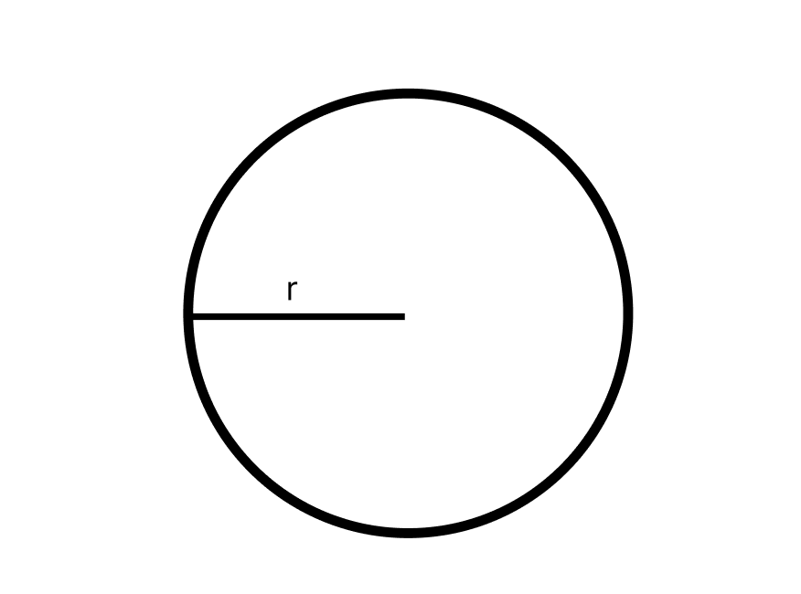
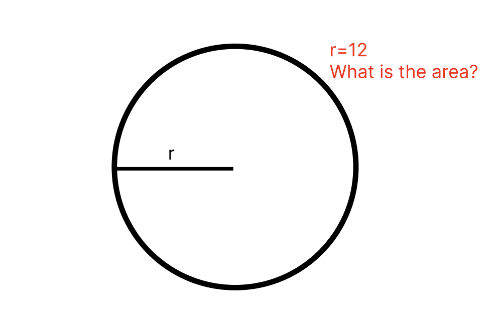

# 用 Claude 做 vision 的最佳實踐

> 原文：[multimodal/best_practices_for_vision.ipynb](https://github.com/anthropics/claude-cookbooks/blob/main/multimodal/best_practices_for_vision.ipynb)

讓 Claude vision 能力處理圖片時表現更好的技巧。

## 這篇在做什麼

用幾個實例示範怎麼讓 Claude 看圖看得更準：角色指派、在圖片裡直接下指令、few-shot 範例、多張圖片輸入。

## 學完你會

- 用傳統 prompt engineering（像角色指派）減少圖片計數的錯誤
- 把問題或標記直接畫在圖片上當 visual prompt
- 用 few-shot 圖片範例和多張圖片輸入處理讀表、長收據、物品辨識

## 開跑前

需要 Anthropic API key，以及 notebook 用到的圖片檔。

Vision 讓你和 Claude 有了新的互動方式。我們整理了幾個讓圖片效果更好的小技巧。在開始之前，先把 notebook 需要的程式碼設定好。

```python
%pip install anthropic IPython
```

```python
import base64

from anthropic import Anthropic
from IPython.display import Image

client = Anthropic()
MODEL_NAME = "claude-opus-5-5"


def get_base64_encoded_image(image_path):
    with open(image_path, "rb") as image_file:
        binary_data = image_file.read()
        base_64_encoded_data = base64.b64encode(binary_data)
        base64_string = base_64_encoded_data.decode("utf-8")
        return base64_string


def get_response_text(response):
    # The response may lead with a thinking block, so read text blocks by type, not position.
    return "".join(block.text for block in response.content if block.type == "text")
```

## 把傳統技巧用在 multimodal

hallucination 的問題可以用傳統的 prompt engineering 技巧來改善，像是角色指派。來看個例子：


假設我要 Claude 數這張圖裡有幾隻狗：

```python
Image(filename="../images/best_practices/nine_dogs.jpg")
```

```python
message_list = [
    {
        "role": "user",
        "content": [
            {
                "type": "image",
                "source": {
                    "type": "base64",
                    "media_type": "image/jpeg",
                    "data": get_base64_encoded_image("../images/best_practices/nine_dogs.jpg"),
                },
            },
            {"type": "text", "text": "How many dogs are in this picture?"},
        ],
    }
]

response = client.messages.create(model=MODEL_NAME, max_tokens=2048, messages=message_list)
print(get_response_text(response))
```

??? note "輸出"

    ```text
    The image shows a group of 10 dogs of various breeds sitting together in a grassy field with flowers in the background. The breeds appear to include Border Collies, an Australian Shepherd, and a Terrier mix, though I can't say for certain. The dogs have different colored coats including black, white, brown, and gray. They are all attentively facing the camera, likely posing for the photo.
    ```

圖裡只有 9 隻狗，但 Claude 以為有 10 隻！我們稍微做點 prompt engineering 再試一次。

```python
message_list = [
    {
        "role": "user",
        "content": [
            {
                "type": "image",
                "source": {
                    "type": "base64",
                    "media_type": "image/jpeg",
                    "data": get_base64_encoded_image("../images/best_practices/nine_dogs.jpg"),
                },
            },
            {
                "type": "text",
                "text": "You have perfect vision and pay great attention to detail which makes you an expert at counting objects in images. How many dogs are in this picture? Before providing the answer in <answer> tags, think step by step in <thinking> tags and analyze every part of the image.",
            },
        ],
    }
]

response = client.messages.create(model=MODEL_NAME, max_tokens=2048, messages=message_list)
print(get_response_text(response))
```

??? note "輸出"

    ```text
    <thinking>
    To accurately count the number of dogs in this image, I'll visually scan the image from left to right, focusing on each individual dog.

    Starting on the left side, I see two black dogs standing next to each other. Moving to the right, there's a white and gray dog, then a brown and white dog, then a predominantly black dog with white markings.

    Continuing to the right, I see a mostly black dog, then a black and white border collie type dog, then another dog with black and white fur.

    Scanning the remaining right portion of the image, I see one more brown and white dog.

    After carefully examining each dog in the photo, it appears I have accounted for all the dogs present.
    </thinking>

    <answer>There are 9 dogs total in this image of a diverse group of dogs sitting together in grass with some flowers in the background.</answer>
    ```

很好！改過 prompt 之後，Claude 正確數出 9 隻狗。

## Visual prompting

圖片作為輸入，代表 prompt 可以直接寫在圖片裡面。來看幾個例子。

這張圖上我們寫了一些文字，並畫了一個箭頭。先不加任何文字 prompt，直接丟給 Claude。

```python
Image(filename="../images/best_practices/circle.png")
```

??? note "輸出"

    

```python
message_list = [
    {
        "role": "user",
        "content": [
            {
                "type": "image",
                "source": {
                    "type": "base64",
                    "media_type": "image/png",
                    "data": get_base64_encoded_image("../images/best_practices/circle.png"),
                },
            },
        ],
    }
]

response = client.messages.create(model=MODEL_NAME, max_tokens=2048, messages=message_list)
print(get_response_text(response))
```

??? note "輸出"

    ```text
    The image shows a simple black circle outline on a white background. Inside the circle, there is a straight horizontal line segment that does not touch the circle's edges. The circle and line are both drawn with thin, black strokes, giving the appearance of a basic geometric diagram or symbol.
    ```

可以看到，因為我們沒給問題，Claude 只是描述這張圖。我們把問題加到圖片上，再傳一次。

```python
Image(filename="../images/best_practices/labeled_circle.png")
```

??? note "輸出"

    

```python
message_list = [
    {
        "role": "user",
        "content": [
            {
                "type": "image",
                "source": {
                    "type": "base64",
                    "media_type": "image/png",
                    "data": get_base64_encoded_image("../images/best_practices/labeled_circle.png"),
                },
            },
        ],
    }
]

response = client.messages.create(model=MODEL_NAME, max_tokens=2048, messages=message_list)
print(get_response_text(response))
```

??? note "輸出"

    ```text
    The area of the circle is πr^2, where r is the radius of the circle. The question states that the radius is 12, so the area would be π(12)^2 = 144π square units.
    ```

我們也可以標出圖片的特定部分，針對它發問。

這兩個數字有什麼差別？

```python
Image(filename="../images/best_practices/table.png")
```

```python
message_list = [
    {
        "role": "user",
        "content": [
            {
                "type": "image",
                "source": {
                    "type": "base64",
                    "media_type": "image/png",
                    "data": get_base64_encoded_image("../images/best_practices/table.png"),
                },
            },
            {"type": "text", "text": "What’s the difference between these two numbers?"},
        ],
    }
]

response = client.messages.create(model=MODEL_NAME, max_tokens=2048, messages=message_list)
print(get_response_text(response))
```

??? note "輸出"

    ```text
    The difference between North America's net sales for the twelve months ended December 31, 2023 ($352,828) and December 31, 2022 ($315,880) is $36,948.
    ```

## Few-shot 範例

在 prompt 加範例，對視覺任務一樣能提高準確度。我們請 Claude 讀一張車速表的照片。

```python
Image(filename="../images/best_practices/140.png")
```

```python
message_list = [
    {
        "role": "user",
        "content": [
            {
                "type": "image",
                "source": {
                    "type": "base64",
                    "media_type": "image/png",
                    "data": get_base64_encoded_image("../images/best_practices/140.png"),
                },
            },
            {"type": "text", "text": "What speed am I going?"},
        ],
    }
]

response = client.messages.create(model=MODEL_NAME, max_tokens=2048, messages=message_list)
print(get_response_text(response))
```

??? note "輸出"

    ```text
    The speedometer in the image is showing a speed of 140 kilometers/hour (or about 87 miles/hour).
    ```

Claude 的答案看起來不太對，它覺得時速是 140 公里，不是 140 英里！我們這次在 prompt 裡加幾個範例再試一次。

```python
message_list = [
    {
        "role": "user",
        "content": [
            {
                "type": "image",
                "source": {
                    "type": "base64",
                    "media_type": "image/png",
                    "data": get_base64_encoded_image("../images/best_practices/70.png"),
                },
            },
            {"type": "text", "text": "What speed am I going?"},
        ],
    },
    {
        "role": "assistant",
        "content": [{"type": "text", "text": "You are going 70 miles per hour."}],
    },
    {
        "role": "user",
        "content": [
            {
                "type": "image",
                "source": {
                    "type": "base64",
                    "media_type": "image/png",
                    "data": get_base64_encoded_image("../images/best_practices/100.png"),
                },
            },
            {"type": "text", "text": "What speed am I going?"},
        ],
    },
    {
        "role": "assistant",
        "content": [{"type": "text", "text": "You are going 100 miles per hour."}],
    },
    {
        "role": "user",
        "content": [
            {
                "type": "image",
                "source": {
                    "type": "base64",
                    "media_type": "image/png",
                    "data": get_base64_encoded_image("../images/best_practices/140.png"),
                },
            },
            {"type": "text", "text": "What speed am I going?"},
        ],
    },
]

response = client.messages.create(model=MODEL_NAME, max_tokens=2048, messages=message_list)
print(get_response_text(response))
```

??? note "輸出"

    ```text
    The speedometer in the image shows that you are going 140 miles per hour.
    ```

太好了！有了這些範例，Claude 學會怎麼讀車速表上的速度。不過要注意，圖片的 few-shot prompting 不一定每次都有效，但值得在你的案例上試試。

## 多張圖片輸入
Claude 也可以在同一個 prompt 裡同時接收並推理多張圖片！例如你有一張很大的圖，像一張很長的收據，可以把它切成幾塊，每塊都餵給 Claude。

```python
Image(filename="../images/best_practices/receipt1.png")
```

```python
Image(filename="../images/best_practices/receipt2.png")
```

```python
message_list = [
    {
        "role": "user",
        "content": [
            {
                "type": "image",
                "source": {
                    "type": "base64",
                    "media_type": "image/png",
                    "data": get_base64_encoded_image("../images/best_practices/receipt1.png"),
                },
            },
            {
                "type": "image",
                "source": {
                    "type": "base64",
                    "media_type": "image/png",
                    "data": get_base64_encoded_image("../images/best_practices/receipt2.png"),
                },
            },
            {"type": "text", "text": "Output the name of the restaurant and the total."},
        ],
    }
]

response = client.messages.create(model=MODEL_NAME, max_tokens=2048, messages=message_list)
print(get_response_text(response))
```

??? note "輸出"

    ```text
    The name of the restaurant is The Breakfast Club and the total amount on the receipt is $78.86.
    ```

## 用範例辨識物品

用圖片輸入，你可以把其他圖片放進 prompt，Claude 會用這些資訊回答問題。來看個例子。

假設我們想辨識圖片裡褲子的種類，可以在 prompt 裡提供幾種不同褲子的範例。

```python
Image(filename="../images/best_practices/officer_example.png")
```

```python
message_list = [
    {
        "role": "user",
        "content": [
            {
                "type": "image",
                "source": {
                    "type": "base64",
                    "media_type": "image/png",
                    "data": get_base64_encoded_image("../images/best_practices/wrinkle.png"),
                },
            },
            {
                "type": "image",
                "source": {
                    "type": "base64",
                    "media_type": "image/png",
                    "data": get_base64_encoded_image("../images/best_practices/officer.png"),
                },
            },
            {
                "type": "image",
                "source": {
                    "type": "base64",
                    "media_type": "image/png",
                    "data": get_base64_encoded_image("../images/best_practices/chinos.png"),
                },
            },
            {
                "type": "image",
                "source": {
                    "type": "base64",
                    "media_type": "image/png",
                    "data": get_base64_encoded_image(
                        "../images/best_practices/officer_example.png"
                    ),
                },
            },
            {
                "type": "text",
                "text": "These pants are (in order) WRINKLE-RESISTANT DRESS PANT, ITALIAN MELTON OFFICER PANT, SLIM RAPID MOVEMENT CHINO. What pant is shown in the last image?",
            },
        ],
    }
]

response = client.messages.create(model=MODEL_NAME, max_tokens=2048, messages=message_list)
print(get_response_text(response))
```

??? note "輸出"

    ```text
    The last image shows a person wearing light gray wool dress pants or trousers paired with brown leather dress shoes or loafers. Based on the texture and drape of the fabric, these appear to be the Italian Melton Officer pants that were shown in the second product image.
    ```

## 重點整理

- 文字 prompt 的老招數（角色指派、few-shot）在 vision 任務上一樣有用。
- 問題可以直接畫在圖上，沒有文字問題時模型只會描述圖片。
- few-shot 圖片範例能修正單位這類細節誤讀，但不保證每次有效。
- 大圖可以切塊、多張圖一起送，也能放參考圖當辨識依據。

## 練習

1. 換一個你自己的圖片，先不加 prompt 看 Claude 怎麼描述，再加角色指派比較差異。
2. 在車速表範例裡多加一個 few-shot 範例，看答案是否更穩。
3. 把長收據切成不同大小的塊（例如 2 塊和 4 塊），比較總金額的準確度。
