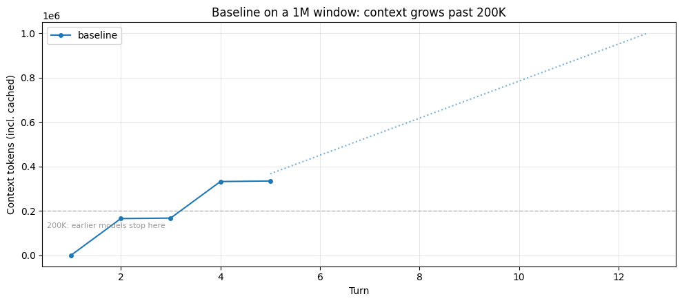
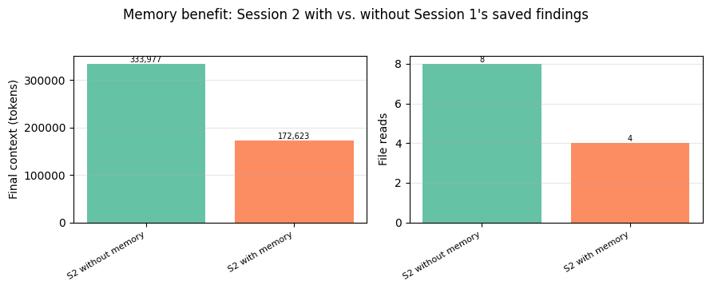
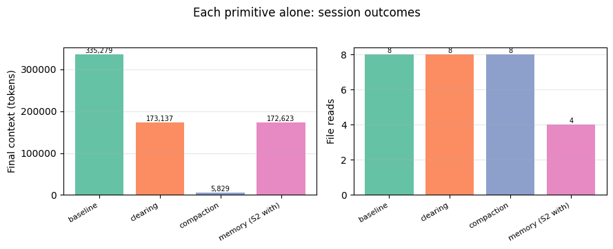

# Context engineering：memory、compaction 與 tool clearing

> 原文：[tool_use/context_engineering/context_engineering_tools.ipynb](https://github.com/anthropics/claude-cookbooks/blob/main/tool_use/context_engineering/context_engineering_tools.ipynb)

比較長時間運作 agent 的幾種 context engineering 策略，搞清楚各自適用在哪、成本多少、怎麼搭配。

## 這篇在做什麼

用一個要讀八份長文件、跨多個 session 做研究的 agent，實測 Claude API 提供的三種 context 管理工具：compaction、tool-result clearing 和 memory tool。每一種先用幾行程式碼示範原理，再換成官方 API 的版本，最後看三者一起用會怎樣。

## 學完你會

- 用 `clear_tool_uses` 限制 session 內的 token 成長，適合 context 被檔案內容、API 回應這類可重抓的 tool 結果塞滿的 agent。
- 設定 server-side compaction，把 `compaction` block 送回去，並測試哪些細節會在摘要裡留下來。
- 寫一個檔案式的 memory handler 讓模型自己管 `/memories`，讓第二個 session 接著第一個 session 的進度做。

## 開跑前

- 需要 `ANTHROPIC_API_KEY`，而且會真的呼叫 API，語料大約 320K tokens，要有費用預期。
- 需要 `research_corpus.py`（repo 內附），放在 notebook 同一個目錄。

## Introduction

做長時間運作的 agent 時，常見的難題是管理 context。tool 結果、模型自己的推理、使用者訊息會不斷累積，最後不是撞到 token 上限，就是在為已經沒用的 context 付錢。needle-in-a-haystack 類的 benchmark 研究發現了 [context rot](https://research.trychroma.com/context-rot) 這個現象：context window 裡的 token 越多，模型從中準確回想資訊的能力就越差。所以還沒碰到硬上限，agent 從每個 token 得到的價值就已經在下降了。

我們的工程部落格 [effective context engineering for AI agents](https://www.anthropic.com/engineering/effective-context-engineering-for-ai-agents) 把這件事看成資源問題：context 是有限的，邊際效益遞減，核心工作是找出最小的一組高訊號 token，讓你要的結果最有可能出現。可用的手段有好幾種，例如讓 subagent 在自己的 context 裡做事、用 programmatic tool calling 讓大結果完全不進 window 等等。

這份 cookbook 聚焦三種：**compaction**、**tool-result clearing** 和 **memory**。三種都是有效的 context engineering 策略，但因為都是讓 context window 更有效率，只是做法不同，所以容易搞混。分清楚差異，才能把每個工具對應到工作負載中它真正有幫助的部分。連同 subagent 這類核心策略，這三種是做長時間運作 agent 的團隊一定要懂的。三者也都有官方 API 支援，不用自己架 orchestration 基礎設施就能採用。

- **Compaction** 把 context window 的內容濃縮成高保真的摘要，讓 agent 在對話變長時還能繼續做，表現下降很少。
- **Tool-result clearing** 處理 tool 使用本身造成的膨脹。agent 用的 tool 越多、呼叫越多，結果就堆得越高，決定要保留多少 tool 輸出變得越來越重要。Clearing 會丟掉舊的、可重抓的結果，但保留「這個呼叫發生過」的紀錄。
- **Memory** 是結構化的筆記：agent 把東西寫進持久的外部儲存，就能跨 task、跨 session 追蹤進度，不必把所有東西都放在 active context 裡。

[Claude Code](https://claude.com/product/claude-code) 在正式環境就用了好幾種：長對話用 compaction，跨 session 的持久化用兩套互補的 memory 系統。我們的 API 三種都有官方實作：[server-side compaction](https://platform.claude.com/docs/en/build-with-claude/compaction)、[context editing](https://platform.claude.com/docs/en/build-with-claude/context-editing)（包含 tool-result clearing）和 [memory tool](https://platform.claude.com/docs/en/agents-and-tools/tool-use/memory-tool)。這份 cookbook 帶你思考怎麼設計：各自什麼時候適用、怎麼設定、單獨用跟一起用有什麼不同，以及哪些情境適合哪種組合。

範例圍繞一個**長時間運作的研究 agent**：它讀一批文件、做筆記、跨多個 session 累積發現。這是很好的測試案例，因為三種問題都會碰到：文件內容很大（clearing）、分析對話很長（compaction）、知識要在 session 之間保存（memory）。

### 你會學到什麼

- 當 agent 的 context 主要被檔案讀取、API 回應這類大型且可重抓的 tool 結果佔滿時，怎麼用 `clear_tool_uses` **限制 session 內的 token 成長**
- 怎麼用 server-side compaction **讓長對話持續下去**，包括把 `compaction` block 序列化送回去，以及探測摘要裡留下了什麼
- 怎麼實作檔案式的 memory handler 讓模型自己驅動，**讓知識跨 session 保存**，Session 2 就能接著 Session 1 做
- 怎麼**把每個工具用得更有效**：換掉預設的 compaction prompt 來保留 agent 需要的東西、引導 agent 寫進 `/memories` 的內容，並用你自己工作負載的 tool 使用模式測試 clearing 設定
- 怎麼**診斷你的工作負載到底是哪種 context 問題**，並挑出對應的工具，附一個把工作負載特徵對應到工具的框架

### 前置條件

要執行這個 notebook，你需要：

- **Anthropic API key**，設定成環境變數 `ANTHROPIC_API_KEY` 或放在 `.env` 檔裡（[在這裡申請](https://platform.claude.com/)）
- **Python 3.11+**，並安裝 `anthropic`、`python-dotenv`、`matplotlib`
- **`research_corpus.py`** 放在 notebook 旁邊（repo 內附）。它定義了 `CORPUS`，是一個 dict，裡面有八份關於老化研究模式生物的合成評論文件（每份約 40K tokens，共約 320K tokens），還有後面用來測試 compaction 後留下什麼的探測問題。你可以把 dict 換成自己的文件。

> **從 cookbooks repo 執行？** 確定工作目錄是 `tool_use/context_engineering`。

## Step 0：環境設定

在這個目錄建一個 `.env` 檔，放你的 Anthropic API key：

```
ANTHROPIC_API_KEY=your-key-here
```

```python
%%capture
%pip install anthropic python-dotenv matplotlib
```

```python
import json
import os
import tempfile
from collections import namedtuple
from pathlib import Path

import anthropic
import matplotlib.pyplot as plt
from dotenv import load_dotenv

load_dotenv()

if not os.environ.get("ANTHROPIC_API_KEY"):
    raise ValueError("ANTHROPIC_API_KEY not set. Add it to a .env file or export it.")

CORPUS_PATH = Path("research_corpus.py")
assert CORPUS_PATH.exists(), (
    f"research_corpus.py not found in {Path.cwd()}. It should be alongside this notebook."
)

client = anthropic.Anthropic()
MODEL = "claude-sonnet-5-5"
print(f"anthropic SDK {anthropic.__version__}, model {MODEL}")
```

??? note "輸出"

    ```text
    anthropic SDK 0.109.0, model claude-sonnet-5-5
    ```

```python
# Force-reload the corpus module in case this kernel has a stale cached version
import importlib

import research_corpus

importlib.reload(research_corpus)
from research_corpus import COMPACTION_PROBES, CORPUS

# Count tokens via the API (cached in-memory so repeat kernel runs are fast).
_token_cache: dict[str, int] = {}


def count_tokens(text: str) -> int:
    if text not in _token_cache:
        _token_cache[text] = client.messages.count_tokens(
            model=MODEL, messages=[{"role": "user", "content": text}]
        ).input_tokens
    return _token_cache[text]


print(f"CORPUS is a dict of {len(CORPUS)} synthetic documents held in Python memory.")
print("When the agent calls read_file, the content is served from this dict and")
print("lands directly in the agent's context window — no disk I/O involved.\n")
_total_tokens = 0
for path, content in CORPUS.items():
    n_tok = count_tokens(content)
    _total_tokens += n_tok
    # Strip the virtual directory prefix for display clarity
    display_name = path.removeprefix("/research/")
    print(f"  {display_name:<26} ~{n_tok:>6,} tokens")
print(f"\n  Total corpus: ~{_total_tokens:,} tokens")

# Sanity check: the corpus should be large enough to push context well past
# 200K in a single read-pass. If this fires, research_corpus.py may be stale.
assert _total_tokens > 250_000, (
    f"Corpus is only {_total_tokens:,} tokens; expected >250K. "
    "Restart the kernel and re-run, or verify research_corpus.py is current."
)
```

??? note "輸出"

    ```text
    CORPUS is a dict of 8 synthetic documents held in Python memory.
    When the agent calls read_file, the content is served from this dict and
    lands directly in the agent's context window — no disk I/O involved.

      celegans_review.md         ~41,260 tokens
      drosophila_review.md       ~41,200 tokens
      mouse_review.md            ~41,155 tokens
      zebrafish_review.md        ~41,095 tokens
      killifish_review.md        ~41,115 tokens
      yeast_review.md            ~41,101 tokens
      nmr_review.md              ~41,017 tokens
      rhesus_review.md           ~41,012 tokens

      Total corpus: ~328,955 tokens
    ```

## 問題：長時間運作的研究 agent

這份 cookbook 裡的 agent 扮演生物學研究員，要寫一篇關於老化與長壽研究模式生物的比較性評論。任務夠貼近現實：要讀一批評論文件（每個物種一份）、抽出可比較的事實（壽命、基因操作難易度、對人類的轉譯相關性）、做結構化筆記，並把讀過的全部綜合起來。

這種工作正是 context 管理開始出問題的地方。每份文件約 40K tokens（敘述加上大量介入資料的附錄表格），任務要 agent 分兩批讀：先讀四種高通量物種（C. elegans、Drosophila、yeast、killifish），再讀四種低通量物種（mouse、zebrafish、naked mole-rat、rhesus）。兩批的結構是這份 cookbook 刻意的實驗設計：這樣 context 軌跡會在第一批超過 compaction 的觸發點，第二批超過 200K 參考線，所以同一次執行就能看到每個工具對軌跡的影響。沒有 context 管理的話，agent 的 context 在任務中途就會長到幾十萬 tokens。而且因為工作橫跨多個 session，就算跑完了，下一個 session 一開始也完全不記得學到什麼。

### 研究任務

agent 的具體任務：比較 `/research/` 裡的模式生物，維度有三個（壽命與實驗通量、基因操作難易度、對人類老化的轉譯相關性），分兩批讀八份評論文件，邊讀邊做筆記，最後寫出比較性的綜合分析。

## 三種 API 怎麼對應到問題

每種 API 針對不同類型的 context 成長。先分清楚你面對的是哪一種，才知道該選哪個工具。

### 概念上

**Compaction** 是在對話快碰到 context window 上限時，把內容摘要起來，再用這份摘要重新開始。目標是用高保真的方式濃縮 context window，讓 agent 能繼續做，表現下降很少。難處在於留什麼、丟什麼：壓得太兇，可能丟掉當下看起來不重要、之後才發現很關鍵的細微 context。摘要會保留架構決策、未解問題和關鍵事實，丟掉重複的內容；它設計上就是有損的，但能處理所有的 context 成長，不只是 tool 結果。Compaction 是**整份 transcript** 的操作：使用者訊息、assistant 訊息、tool 呼叫、tool 結果，甚至先前的 compaction block，全都會被壓平成摘要。

**Tool-result clearing** 則是 **transcript 局部**的操作。它走過訊息列表，精準地替換 `tool_result` content block，其他東西（使用者訊息、assistant 的推理、`tool_use` 紀錄）都不動。agent 呼叫 tool 時，結果會成為對話歷史的一部分，之後每一輪都算進 context 預算。這些內容很多是可重抓的：agent 可以重讀的檔案內容、可以重新請求的 API 回應。Clearing 把舊的 `tool_result` block 換成一小段 placeholder，保留 `tool_use` 紀錄，讓模型還知道自己呼叫過，只是丟掉龐大的內容。一個 tool 在訊息歷史很深的地方被呼叫之後，agent 很少需要再看原始結果；clearing 是回收空間最安全、最輕量的方式之一。如果 agent 真的需要資料，再呼叫一次 tool 就好。

**Memory**，也就是結構化筆記，是 agent 定期把筆記寫到 context window 之外的持久儲存，之後再讀回來的技巧。它以很小的負擔提供持久記憶：agent 在複雜任務中追蹤進度，保住那些在幾十次 tool 呼叫或 context 重置之間可能遺失的關鍵 context。重置之後（新 session，或 compaction 之後），agent 讀自己的筆記再繼續。儲存後端由你實作，所以存什麼、存多久都由你控制。

除了啟用這些功能，怎麼把它們用好也很重要：預設行為讓你起步，但 compaction 摘要的品質、寫進 memory 的內容有沒有用，都取決於你提供的引導。下面每個工具的章節都有一小節講怎麼有效實作。

### 實務上

| API | Identifier | Beta header | 觸發方式 | 可調參數 |
|---|---|---|---|---|
| Compaction | `compact_20260112` | `compact-2026-01-12` | token 門檻（server-side，最低 50K） | `trigger`（預設 150K）、`instructions`、`pause_after_compaction` |
| Tool clearing | `clear_tool_uses_20250919` | `context-management-2025-06-27` | token 門檻（server-side） | `trigger`（預設 100K）、`keep`（預設 3 次 tool 使用）、`clear_at_least`、`exclude_tools`、`clear_tool_inputs` |
| Memory tool | `memory_20250818` | 無（獨立） | 模型（它就是一個 tool 呼叫） | 由 client 實作：`view`、`create`、`str_replace`、`insert`、`delete`、`rename` |

### 對應到研究 agent

以這個研究 agent 來說，三種問題剛好對得很整齊：
- agent 的即時評論（「C. elegans 壽命 18 天、有全基因體 RNAi，mouse 是 30 個月但每組要 $100K...」）加上使用者的追問，累積成很長的對話。這是 **compaction** 的問題。
- 讀八份約 40K tokens 的評論文件，會產生大約 320K tokens 的 tool 結果量，已經進入 context rot 讓模型表現下降的範圍。其中大部分 agent 都能隨時重讀。這是 **clearing** 的問題。
- 工作橫跨多個 session。如果 Session 1 判斷出 killifish 是壽命最短的脊椎動物（4-6 個月），我們希望 Session 2 保留這個發現並在上面繼續，而不是從頭重新發現。這是 **memory** 的問題。

粗略的心智模型：compaction 在 window 太大時壓縮整個 window，clearing 丟掉 window 內過時且可重抓的資料，memory 把資訊搬出 window 讓它能跨 session 保存。每一層都會多一些要調的設定和要理解的互動，所以最好從符合你實際觀察到的瓶頸的那一個開始。

## 研究 agent

在逐一探討各個工具之前，先把 agent 本身架起來：tool schema、tool 執行，以及一個可以帶或不帶任何 context 管理設定來跑的 agent loop。全部寫在 notebook 裡，所以你能看到完整的 loop。

```python
# ── Tool schemas ─────────────────────────────────────────────────────────
RESEARCH_TASK = """Compare the model organisms in /research/ on three dimensions:
1. Lifespan and experimental throughput (how fast can you get a lifespan result?)
2. Genetic tractability (what tools exist for manipulation and screening?)
3. Translational relevance (how well do findings transfer to human aging?)

Work through the organisms in two batches, recording a note after each
batch before moving on:

BATCH 1 (high-throughput models): Read celegans_review.md,
drosophila_review.md, yeast_review.md, and killifish_review.md. Record a
single detailed note covering all four organisms on all three dimensions.
Do not begin Batch 2 until this note is recorded.

BATCH 2 (low-throughput models): Read mouse_review.md,
zebrafish_review.md, nmr_review.md, and rhesus_review.md. Record a
single detailed note covering all four organisms on all three
dimensions.

After both batches, write a comprehensive comparative synthesis
contrasting the high-throughput and low-throughput models."""

BASE_TOOLS: list[dict] = [
    {
        "name": "search_files",
        "description": "Search document filenames and contents for a keyword. Returns matching paths with a short excerpt.",
        "input_schema": {
            "type": "object",
            "properties": {"query": {"type": "string", "description": "Search term"}},
            "required": ["query"],
        },
    },
    {
        "name": "read_file",
        "description": "Read the full content of a document by path.",
        "input_schema": {
            "type": "object",
            "properties": {
                "path": {"type": "string", "description": "e.g. /research/celegans_review.md"}
            },
            "required": ["path"],
        },
    },
    {
        "name": "record_finding",
        "description": "Record a research finding (freeform text). Findings are held for the duration of this session only; they are not persisted across sessions.",
        "input_schema": {
            "type": "object",
            "properties": {"finding": {"type": "string"}},
            "required": ["finding"],
        },
    },
]

# The memory tool spec is defined here but only added to the agent's tool
# list when a memory_handler is passed to run_research_session. Baseline
# and clearing/compaction runs do NOT get the memory tool.
MEMORY_TOOL_SPEC = {"type": "memory_20250818", "name": "memory"}

SYSTEM_PROMPT = """You are a biology research analyst writing a comparative review of model organisms for aging research.

Work systematically: search and read review documents, take notes on key facts (lifespans, genetic tools, translational strengths and caveats), and build a comparative picture.

Be concise in your reasoning text; the goal is notes, not essays."""
```

```python
# ── Tool execution ───────────────────────────────────────────────────────
def execute_research_tool(name: str, tool_input: dict, notes: list[str]) -> str:
    if name == "search_files":
        query = tool_input.get("query", "").lower()
        if not query:
            return "Error: query is required."
        hits: list[str] = []
        for path, content in CORPUS.items():
            if query in path.lower() or query in content.lower():
                for line in content.split("\n"):
                    if query in line.lower():
                        hits.append(f"  {path}\n    → {line.strip()[:120]}")
                        break
                else:
                    hits.append(f"  {path}")
        return (
            f"Found {len(hits)} match(es):\n" + "\n".join(hits)
            if hits
            else f"No matches for '{query}'."
        )

    if name == "read_file":
        path = tool_input.get("path", "")
        content = CORPUS.get(path)
        if content is None:
            return f"Error: '{path}' not found. Available: {', '.join(CORPUS.keys())}"
        return content

    if name == "record_finding":
        finding = tool_input.get("finding", "")
        notes.append(finding)
        return f"Finding #{len(notes)} recorded (session-local)."

    return f"Error: unknown tool '{name}'"
```

```python
# ── Session result container ─────────────────────────────────────────────
SessionResult = namedtuple(
    "SessionResult",
    [
        "messages",  # final message list
        "notes",  # notes taken this session
        "token_trajectory",  # list of (turn, total_context_tokens)
        "events",  # list of dicts describing compaction / clearing events
        "tool_counts",  # dict of tool_name -> call count
        "file_reads",  # list of (turn, path) for each read_file call
        "hit_limit",  # True if the session stopped because it hit the context window
        "final_text",  # final assistant text (convenience)
    ],
)


def _format_tool_arg(name: str, tool_input: dict) -> str:
    """Human-readable one-line summary of a tool call's arguments for verbose output."""
    if name == "search_files":
        return repr(tool_input.get("query", ""))
    if name == "read_file":
        return tool_input.get("path", "?")
    if name == "record_finding":
        finding = tool_input.get("finding", "")
        preview = finding[:50].replace("\n", " ")
        return f'"{preview}{"..." if len(finding) > 50 else ""}"'
    if name == "memory":
        cmd = tool_input.get("command", "?")
        path = tool_input.get("path", tool_input.get("old_path", ""))
        return f"{cmd} {path}"
    return str(tool_input)[:60]


# ── Agent loop ───────────────────────────────────────────────────────────
def run_research_session(
    initial_prompt: str,
    *,
    context_management: dict | None = None,
    betas: list[str] | None = None,
    memory_handler=None,
    max_turns: int = 12,
    label: str = "session",
    verbose: bool = True,
) -> SessionResult:
    """Run the research agent. Catches context-window overflow gracefully."""
    tools = list(BASE_TOOLS)
    if memory_handler is not None:
        tools.append(MEMORY_TOOL_SPEC)

    messages: list[dict] = [{"role": "user", "content": initial_prompt}]
    notes: list[str] = []
    token_trajectory: list[tuple[int, int]] = []
    events: list[dict] = []
    tool_counts: dict[str, int] = {}
    file_reads: list[tuple[int, str]] = []  # (turn, path) for each read_file
    hit_limit = False
    final_text = ""

    if verbose:
        print(f"┌─ [{label}]")

    for turn in range(1, max_turns + 1):
        kwargs: dict = dict(
            model=MODEL,
            max_tokens=4096,
            system=SYSTEM_PROMPT,
            tools=tools,
            messages=messages,
        )
        if context_management:
            kwargs["context_management"] = context_management
        if betas:
            kwargs["betas"] = betas

        # Call the API; catch context-window overflow
        try:
            if betas:
                response = client.beta.messages.create(**kwargs)
            else:
                response = client.messages.create(**kwargs)
        except anthropic.BadRequestError as e:
            # Context window exceeded (or similar input-too-large error)
            hit_limit = True
            if verbose:
                print(f"│  ⚠ CONTEXT WINDOW LIMIT REACHED at turn {turn} (API rejected)")
                print(f"│    {str(e)[:200]}")
            break

        # Track TOTAL context size: uncached + cache-read + cache-created.
        # usage.input_tokens alone excludes cached tokens, which makes the
        # plot show dips that are just cache hits, not context management.
        u = response.usage
        total_in = (
            u.input_tokens
            + (getattr(u, "cache_read_input_tokens", None) or 0)
            + (getattr(u, "cache_creation_input_tokens", None) or 0)
        )
        token_trajectory.append((turn, total_in))

        # Surface context-management events on their own prominent lines
        cm = getattr(response, "context_management", None)
        if cm is not None and getattr(cm, "applied_edits", None):
            for edit in cm.applied_edits:
                cleared_uses = getattr(edit, "cleared_tool_uses", None)
                cleared_toks = getattr(edit, "cleared_input_tokens", None)
                events.append(
                    {
                        "turn": turn,
                        "kind": "clearing",
                        "cleared_tool_uses": cleared_uses,
                        "cleared_input_tokens": cleared_toks,
                    }
                )
                if verbose:
                    print(
                        f"│  ✂ CLEARING (turn {turn}): {cleared_uses or '?'} tool results cleared, "
                        f"~{cleared_toks:,} tokens freed"
                        if cleared_toks
                        else f"│  ✂ CLEARING (turn {turn}): applied"
                    )

        # Serialize assistant content, track tool calls and compaction
        serialized: list[dict] = []
        tool_calls: list[dict] = []
        turn_tool_calls: list[tuple[str, dict]] = []  # (name, input) for verbose display
        compaction_this_turn = False
        for block in response.content:
            if block.type == "text":
                serialized.append({"type": "text", "text": block.text})
                if block.text.strip():
                    final_text = block.text
            elif block.type == "tool_use":
                serialized.append(
                    {
                        "type": "tool_use",
                        "id": block.id,
                        "name": block.name,
                        "input": block.input,
                    }
                )
                tool_calls.append({"id": block.id, "name": block.name, "input": block.input})
                turn_tool_calls.append((block.name, block.input))
                tool_counts[block.name] = tool_counts.get(block.name, 0) + 1
                # Track file reads specifically so we can show what clearing drops
                if block.name == "read_file":
                    file_reads.append((turn, block.input.get("path", "?")))
            elif block.type == "thinking":
                serialized.append(
                    {"type": "thinking", "thinking": block.thinking, "signature": block.signature}
                )
            elif block.type == "compaction":
                serialized.append({"type": "compaction", "content": block.content})
                events.append({"turn": turn, "kind": "compaction", "summary": block.content})
                compaction_this_turn = True
                if verbose:
                    print(
                        f"│  ⊟ COMPACTION (turn {turn}): "
                        f"~{count_tokens(block.content):,}-token summary replaces prior turns"
                    )
        messages.append({"role": "assistant", "content": serialized})

        if not tool_calls:
            if verbose and not compaction_this_turn:
                print(f"│  turn {turn:2d}  ctx={total_in:>7,}  (final answer)")
            break

        # Execute tools, collecting result sizes so the verbose print
        # can show how much each call added to context
        tool_results: list[dict] = []
        result_sizes: list[int] = []
        for call in tool_calls:
            if call["name"] == "memory" and memory_handler is not None:
                result = memory_handler.handle(call["input"])
            else:
                result = execute_research_tool(call["name"], call["input"], notes)
            tool_results.append(
                {
                    "type": "tool_result",
                    "tool_use_id": call["id"],
                    "content": result,
                }
            )
            result_sizes.append(len(result) if isinstance(result, str) else 0)
        messages.append({"role": "user", "content": tool_results})

        if verbose and not compaction_this_turn:
            # Header with context size, then one line per tool call with
            # its argument and approximate result size (so you can see
            # which calls are responsible for the next turn's ctx jump)
            print(f"│  turn {turn:2d}  ctx={total_in:>7,}")
            for (name, tinput), rsize in zip(turn_tool_calls, result_sizes, strict=False):
                size_note = f"  → ~{rsize // 4:,} tok" if rsize > 200 else ""
                print(f"│            {name:<16} {_format_tool_arg(name, tinput)}{size_note}")

    if verbose:
        if token_trajectory:
            peak = max(t for _, t in token_trajectory)
            status = "⚠ HIT CONTEXT LIMIT" if hit_limit else "completed"
            print(
                f"└─ {status}: {len(token_trajectory)} turns, peak ctx {peak:,}, "
                f"final ctx {token_trajectory[-1][1]:,}, {len(events)} context event(s)\n"
            )
        else:
            print("└─ HIT CONTEXT LIMIT on first turn: 0 turns completed\n")

    return SessionResult(
        messages, notes, token_trajectory, events, tool_counts, file_reads, hit_limit, final_text
    )


def show_cleared_reads(result: SessionResult, keep: int):
    """Show which file reads are no longer in context after clearing.

    Clearing replaces tool results older than the last `keep` tool uses
    with placeholders. We reconstruct the tool-use order and mark any
    read that falls outside the surviving `keep`-window as cleared.

    Note: if clearing fires multiple times, only the last event's
    boundary is considered and earlier cleared-then-re-read files may
    be misclassified.
    """
    if not result.file_reads:
        print("No file reads in this session.")
        return
    clearing_events = [e for e in result.events if e["kind"] == "clearing"]
    if not clearing_events:
        print("Clearing never fired; all file reads remain in context.")
        return

    # Walk messages in order to reconstruct the sequence of tool_use blocks
    # and which turn each one came from. The last `keep` of these survive
    # the most recent clearing; earlier ones are cleared.
    tool_use_seq: list[tuple[int, str, str]] = []  # (turn, name, path-if-read)
    turn = 0
    for msg in result.messages:
        if msg["role"] == "assistant" and isinstance(msg["content"], list):
            turn += 1
            for block in msg["content"]:
                if block.get("type") == "tool_use":
                    name = block.get("name", "?")
                    path = block.get("input", {}).get("path", "") if name == "read_file" else ""
                    tool_use_seq.append((turn, name, path))

    last_clear_turn = clearing_events[-1]["turn"]
    seq_before = [t for t in tool_use_seq if t[0] < last_clear_turn]
    cleared_reads = [(t, p) for (t, n, p) in seq_before[:-keep] if n == "read_file"]
    surviving_reads = [
        (t, p) for tu in seq_before[-keep:] for (t, n, p) in [tu] if n == "read_file"
    ]
    # Reads at or after the last clearing turn are untouched by it.
    surviving_reads += [
        (t, p) for (t, n, p) in tool_use_seq if t >= last_clear_turn and n == "read_file"
    ]

    total = len(result.file_reads)
    print(f"Total file reads across session: {total}")
    print(f"Last clearing event fired at turn {last_clear_turn} (keep={keep})")
    print(f"\nReads cleared from context: {len(cleared_reads)}")
    for turn, path in cleared_reads[:12]:
        print(f"  ✗ turn {turn:2d}: {path}")
    if len(cleared_reads) > 12:
        print(f"  ... and {len(cleared_reads) - 12} more")
    print(
        f"\nReads still in context (within the keep={keep} window or after "
        f"the last clearing): {len(surviving_reads)}"
    )
    for turn, path in surviving_reads[:6]:
        print(f"  ✓ turn {turn:2d}: {path}")
    if len(surviving_reads) > 6:
        print(f"  ... and {len(surviving_reads) - 6} more")


# ── Plot helpers ─────────────────────────────────────────────────────────


def plot_trajectories(
    results: dict[str, SessionResult],
    title: str = "Context size per turn",
    triggers: dict[str, int] | None = None,
    project_growth_for: str | None = None,
):
    """Line plot of context tokens per turn.

    Vertical dashed lines mark turns where clearing fired; dash-dot lines
    mark compaction. Horizontal dotted lines mark configured trigger
    thresholds (pass triggers={"clearing": 20000, "compaction": 50000} etc).

    project_growth_for: label of a run to extrapolate. Fits a line to the
    last 5 points and draws a dotted segment forward ~8 turns to show where
    unmanaged growth is heading.
    """
    fig, ax = plt.subplots(figsize=(10, 4.5))
    colors = plt.rcParams["axes.prop_cycle"].by_key()["color"]

    for i, (label, res) in enumerate(results.items()):
        turns = [t for t, _ in res.token_trajectory]
        tokens = [tok for _, tok in res.token_trajectory]
        color = colors[i % len(colors)]
        ax.plot(turns, tokens, marker="o", label=label, markersize=4, color=color)
        # Mark events on the x-axis
        for ev in res.events:
            style = "--" if ev["kind"] == "clearing" else "-."
            ax.axvline(x=ev["turn"], color=color, linestyle=style, alpha=0.25, linewidth=1)
        # Dotted growth projection for the named run, capped at 1M
        if label == project_growth_for and len(turns) >= 3:
            HARD_LIMIT = 1_000_000
            fit_n = min(5, len(turns))
            xs, ys = turns[-fit_n:], tokens[-fit_n:]
            n = len(xs)
            sx, sy = sum(xs), sum(ys)
            slope = (n * sum(x * y for x, y in zip(xs, ys, strict=False)) - sx * sy) / (
                n * sum(x * x for x in xs) - sx * sx
            )
            intercept = (sy - slope * sx) / n
            proj_x, proj_y = [], []
            for x in range(turns[-1], turns[-1] + 9):
                y = slope * x + intercept
                if y > HARD_LIMIT:
                    # Clip the last segment to the 1M ceiling and stop
                    if proj_y and slope > 0:
                        proj_x.append(proj_x[-1] + (HARD_LIMIT - proj_y[-1]) / slope)
                        proj_y.append(HARD_LIMIT)
                    break
                proj_x.append(x)
                proj_y.append(y)
            if proj_y:
                ax.plot(proj_x, proj_y, linestyle=":", color=color, alpha=0.6, linewidth=1.5)

    # Horizontal reference lines for trigger thresholds
    if triggers:
        for name, value in triggers.items():
            ax.axhline(y=value, color="gray", linestyle=":", alpha=0.6, linewidth=1)
            ax.annotate(
                f"{name} trigger: {value:,}",
                xy=(ax.get_xlim()[1], value),
                xytext=(-5, 3),
                textcoords="offset points",
                ha="right",
                va="bottom",
                fontsize=8,
                color="gray",
            )

    # 200K reference: earlier models cap here and would hard-stop
    if ax.get_ylim()[1] > 30_000:
        ax.axhline(y=200_000, color="gray", linestyle="--", alpha=0.5, linewidth=1)
        ax.annotate(
            "200K: earlier models stop here",
            xy=(ax.get_xlim()[0], 200_000),
            xytext=(5, -12),
            textcoords="offset points",
            ha="left",
            va="top",
            fontsize=8,
            color="gray",
            alpha=0.8,
        )

    ax.set_xlabel("Turn")
    ax.set_ylabel("Context tokens (incl. cached)")
    ax.set_title(title)
    ax.legend(loc="best")
    ax.grid(alpha=0.3)
    plt.tight_layout()
    plt.show()


def plot_summary_bars(results: dict[str, SessionResult], title: str = "Session outcomes"):
    """Side-by-side bars: final context, file reads."""
    labels = list(results.keys())
    final_ctx = [r.token_trajectory[-1][1] for r in results.values()]
    reads = [r.tool_counts.get("read_file", 0) for r in results.values()]

    fig, axes = plt.subplots(1, 2, figsize=(9, 3.5))
    fig.suptitle(title, y=1.02)

    for ax, values, ylabel in zip(
        axes,
        [final_ctx, reads],
        ["Final context (tokens)", "File reads"],
        strict=False,
    ):
        bars = ax.bar(range(len(labels)), values, color=plt.cm.Set2(range(len(labels))))
        ax.set_ylabel(ylabel)
        ax.set_xticks(range(len(labels)))
        ax.set_xticklabels(labels, rotation=30, ha="right", fontsize=8)
        ax.grid(axis="y", alpha=0.3)
        for bar, val in zip(bars, values, strict=False):
            ax.text(
                bar.get_x() + bar.get_width() / 2,
                bar.get_height(),
                f"{val:,}" if val > 1000 else str(val),
                ha="center",
                va="bottom",
                fontsize=7,
            )

    plt.tight_layout()
    plt.show()
```

### Baseline：不做 context 管理

先用完全不帶 context 管理設定的方式跑 agent。語料很大（每份文件含附錄表格約 40K tokens），context 累積很快。同一次執行我們用兩個角度看：在 1M-token window 上會怎樣，以及在 200K window 上會怎樣。

#### Part 1：在 1M-token window 上

Claude Opus 5.5 和 Claude Sonnet 5.5 都提供 [1M-token context window](https://platform.claude.com/docs/en/build-with-claude/context-windows)。這個任務的 baseline 總輸入量還在這個上限之內：agent 讀完整份語料並完成綜合，沒有撞牆。下面的軌跡顯示執行過程爬升到幾十萬 tokens，虛線是依同樣速度往後推估的成長。

```python
baseline = run_research_session(RESEARCH_TASK, label="baseline", max_turns=12)

plot_trajectories(
    {"baseline": baseline},
    "Baseline on a 1M window: context grows past 200K",
    project_growth_for="baseline",
)

peak = max(t for _, t in baseline.token_trajectory)
n_turns = len(baseline.token_trajectory)
print(f"Peak context: {peak:,} tokens across {n_turns} turns")
print(f"File reads: {baseline.tool_counts.get('read_file', 0)}, Notes: {len(baseline.notes)}")
if baseline.hit_limit:
    print("\n⚠ This run hit the 1M hard limit.")
else:
    print(
        "\nThe run stayed within the 1M window. The dotted line projects "
        "where continued growth at the same rate would land, capped at 1M."
    )
```

??? note "輸出"

    ```text
    ┌─ [baseline]
    │  turn  1  ctx=  1,058
    │            read_file        /research/celegans_review.md  → ~27,465 tok
    │            read_file        /research/drosophila_review.md  → ~27,435 tok
    │            read_file        /research/yeast_review.md  → ~27,320 tok
    │            read_file        /research/killifish_review.md  → ~27,349 tok
    │  turn  2  ctx=166,043
    │            record_finding   "## BATCH 1 NOTES: High-Throughput Model Organisms ..."
    │  turn  3  ctx=168,242
    │            read_file        /research/mouse_review.md  → ~27,390 tok
    │            read_file        /research/zebrafish_review.md  → ~27,363 tok
    │            read_file        /research/nmr_review.md  → ~27,287 tok
    │            read_file        /research/rhesus_review.md  → ~27,285 tok
    │  turn  4  ctx=332,821
    │            record_finding   "## BATCH 2 NOTES: Low-Throughput Model Organisms —..."
    │  turn  5  ctx=335,279  (final answer)
    └─ completed: 5 turns, peak ctx 335,279, final ctx 335,279, 0 context event(s)
    ```

    

    ```text
    Peak context: 335,279 tokens across 5 turns
    File reads: 8, Notes: 2

    The run stayed within the 1M window. The dotted line projects where continued growth at the same rate would land, capped at 1M.
    ```

```python
# ── What's actually sitting in the context window at the end of the run ──
# Walk the message list and bucket everything by type. This is what the
# model has to attend to on every turn: no hard wall stopped it, but the
# pile keeps growing and every fact from early turns is buried deeper.


def _bucket_context(messages: list[dict]) -> dict[str, tuple[int, int]]:
    """Categorize message content into (count, approx_tokens) per bucket."""
    buckets: dict[str, list[int]] = {
        "File-read results": [],
        "Other tool results": [],
        "Agent reasoning text": [],
        "Tool-call records": [],
        "User/task prompts": [],
    }
    for msg in messages:
        content = msg.get("content")
        if isinstance(content, str):
            buckets["User/task prompts"].append(len(content))
        elif isinstance(content, list):
            for block in content:
                bt = block.get("type")
                if bt == "tool_result":
                    body = block.get("content", "")
                    body = body if isinstance(body, str) else json.dumps(body)
                    # Heuristic: large tool results are file reads
                    key = "File-read results" if len(body) > 5000 else "Other tool results"
                    buckets[key].append(len(body))
                elif bt == "text":
                    buckets["Agent reasoning text"].append(len(block.get("text", "")))
                elif bt == "tool_use":
                    buckets["Tool-call records"].append(len(json.dumps(block.get("input", {}))))
    # chars // 4 as a rough token estimate; the exact number isn't the point
    return {k: (len(v), sum(v) // 4) for k, v in buckets.items() if v}


print("=" * 72)
print("WHAT THE MODEL IS ATTENDING TO at the end of the baseline run")
print("=" * 72)
breakdown = _bucket_context(baseline.messages)
total_est = sum(tok for _, tok in breakdown.values())
# Scale the char-based estimates so the total matches the API's reported
# context size. This keeps the proportions meaningful and the absolute
# numbers consistent with the usage figures shown elsewhere.
api_total = baseline.token_trajectory[-1][1]
scale = api_total / total_est if total_est else 1.0
print(f"\nContext breakdown ({api_total:,} tokens total per API usage):\n")
for label, (count, tokens) in sorted(breakdown.items(), key=lambda kv: -kv[1][1]):
    scaled = int(tokens * scale)
    pct = 100 * tokens / total_est if total_est else 0
    print(f"  {label:<26} ~{scaled:>8,} tokens  ({count:>3} blocks, {pct:4.1f}%)")

if baseline.file_reads:
    first_turn, first_path = baseline.file_reads[0]
    doc_name = first_path.split("/")[-1]
    print(f"\nFirst document read: {doc_name} at turn {first_turn}.")
```

??? note "輸出"

    ```text
    ========================================================================
    WHAT THE MODEL IS ATTENDING TO at the end of the baseline run
    ========================================================================

    Context breakdown (335,279 tokens total per API usage):

      File-read results          ~ 322,946 tokens  (  8 blocks, 96.3%)
      Tool-call records          ~   6,287 tokens  ( 10 blocks,  1.9%)
      Agent reasoning text       ~   5,660 tokens  (  5 blocks,  1.7%)
      User/task prompts          ~     357 tokens  (  1 blocks,  0.1%)
      Other tool results         ~      26 tokens  (  2 blocks,  0.0%)

    First document read: celegans_review.md at turn 1.
    ```

上面的拆解把規模具體呈現出來。模型每一輪都背著幾十萬 tokens 的檔案內容，其中大多是 agent 已經處理過、也做過筆記的文件。第一份讀的文件還在 window 裡，但到執行尾聲，它已經被幾十萬 tokens 的其他 tool 結果加上 agent 的所有推理和筆記壓在後面。它沒被移除，只是跟其他所有東西搶注意力。context rot 就是在這裡出現：就算內容技術上還在，window 越滿，從那麼深的位置回想細節的能力就越差。而且 prefill 延遲會隨 context 長度增加，所以每一輪都要為處理整堆內容付出代價。

#### Part 2：在 200K-token window 上

較早的模型上限是 200K tokens。在那些模型上，同樣的 baseline 會撞到硬牆：context 超過上限後 API 會拒絕下一個請求，任務在中途停掉。

下面的 cell 找出 baseline 第一次超過 200K 的那一輪，並顯示從 200K 模型的角度看這次執行會是什麼樣子：到那個點為止軌跡一樣，然後硬性中止。

```python
# No new agent run here. We reuse the Part-1 baseline's token_trajectory
# and clip it at the turn where context first exceeded 200K, to show what
# the same run would look like from a 200K model's perspective.
cross_turn = next((t for t, tok in baseline.token_trajectory if tok > 200_000), None)

if cross_turn is None:
    print(
        "Baseline never exceeded 200K tokens this run; a 200K model "
        "would have seen the same result."
    )
else:
    # Plot the turns that fit under 200K, plus a dotted segment to the
    # rejected turn and a red cutoff marker between them.
    clipped_traj = [(t, tok) for t, tok in baseline.token_trajectory if t < cross_turn]
    turns_c = [t for t, _ in clipped_traj]
    toks_c = [tok for _, tok in clipped_traj]
    rejected_ctx = dict(baseline.token_trajectory).get(cross_turn, 200_000)

    fig, ax = plt.subplots(figsize=(10, 4.5))
    ax.plot(turns_c, toks_c, marker="o", markersize=4, label="baseline")
    # Dotted segment from last successful turn to the rejected turn
    ax.plot(
        [turns_c[-1], cross_turn],
        [toks_c[-1], min(rejected_ctx, 200_000)],
        linestyle=":",
        color="#1f77b4",
        alpha=0.6,
        linewidth=1.5,
    )
    # Hard red vertical line marking the cutoff between the last
    # successful turn and the rejected one
    cutoff_x = (turns_c[-1] + cross_turn) / 2
    ax.axvline(x=cutoff_x, color="#d62728", linewidth=2)
    ax.set_xlim(0.5, cross_turn + 0.5)
    ax.set_ylim(0, 205_000)
    ax.text(
        0.02,
        0.96,
        "context window: 200,000",
        transform=ax.transAxes,
        ha="left",
        va="top",
        fontsize=9,
        color="#d62728",
    )
    ax.set_xlabel("Turn")
    ax.set_ylabel("Context tokens (incl. cached)")
    ax.set_title("Baseline on a 200K window: agent stopped mid-task")
    ax.legend(loc="lower right")
    ax.grid(alpha=0.3)
    plt.tight_layout()
    plt.show()

    last_turn = clipped_traj[-1][0]
    last_ctx = clipped_traj[-1][1]
    reads_done = sum(1 for t, _ in baseline.file_reads if t < cross_turn)
    notes_at_stop = sum(
        1
        for m in baseline.messages[: 2 * cross_turn]
        if isinstance(m.get("content"), list)
        for b in m["content"]
        if b.get("type") == "tool_use" and b.get("name") == "record_finding"
    )
    print("⚠ Baseline HIT THE CONTEXT WINDOW LIMIT.")
    print(f"  Completed {last_turn} turns before the API rejected the next request.")
    print(f"  Last successful context: {last_ctx:,} tokens")
    print(f"  File reads attempted: {reads_done}")
    print(f"  Notes taken: {notes_at_stop}")
    print()
    print(
        "  The agent stopped mid-task. Without context management, it "
        "cannot continue past this point."
    )
```

??? note "輸出"

    ```text
    ⚠ Baseline HIT THE CONTEXT WINDOW LIMIT.
      Completed 3 turns before the API rejected the next request.
      Last successful context: 168,242 tokens
      File reads attempted: 8
      Notes taken: 2

      The agent stopped mid-task. Without context management, it cannot continue past this point.
    ```

兩種失敗模式來自同一個根本問題：context window 被幾十萬 tokens 的檔案內容塞滿，其中大多已經處理過、記下來了。差別在失敗怎麼表現。在 200K window 上是硬性中止：API 拒絕下一個請求，任務在某個階段中途結束。在 1M window 上 agent 會繼續跑，但隨著 window 填滿，context rot 開始出現：早期讀的文件技術上還在，但到執行尾聲被之後讀的所有東西埋住，模型回想它細節的能力下降。agent 完成了任務，但綜合的品質取決於跟那堆東西對抗的回想能力。prefill 延遲也一樣：不管 context 裡還有多少有用，每一輪都要處理完整的 context。

下面每個工具都是想讓工作集小到這兩種失敗都不會發生：window 不會滿，所以小模型不會停，大模型也不會退化。圖上有 200K 的虛線參考線，讓你看到較早的模型會在哪裡被截斷。

---

## Compaction

[Compaction](https://platform.claude.com/docs/en/build-with-claude/compaction) 是管理長對話 context 的好策略：在對話快碰到 context window 上限時，把內容摘要起來，再用摘要重新開始。它處理的是 agent 自己的推理文字、使用者來回對話，以及 session 中做過的決定。早期輪次的具體動作順序和確切措辭不會保留，但目標、決定和 agent 的重大發現會被摘要進去。摘要保留什麼取決於你的 compaction prompt，下面會講。

Compaction 的核心是用高保真的方式濃縮 context window 的內容，讓 agent 能繼續做，表現下降很少。取捨在於摘要必須保留什麼、可以安全丟掉什麼：壓得太兇，可能丟掉當下看不出重要、之後才發現關鍵的細微 context。摘要會保留關鍵決定和事實，但可能丟掉具體數字或確切措辭。它要花推論成本（摘要模型要跑），但能處理所有 context 成長，不只是 tool 結果。

### 底層怎麼運作

這是一個最小的 compaction 範例實作。我們的官方 API 提供穩健、測試過的版本（達到 token 門檻自動觸發、原生嵌入對話的 typed content block、正確處理 tool-use 配對），但下面這個約 25 行的版本能讓機制具體可見：把對話轉成文字、請模型摘要、用摘要取代舊訊息。

```python
def demo_compact(client, messages: list[dict], model: str) -> list[dict]:
    """Summarize the conversation and return a fresh message list containing only the summary."""
    # Render to a plain-text transcript
    lines: list[str] = []
    for msg in messages:
        role = msg["role"]
        content = msg.get("content", "")
        if isinstance(content, str):
            lines.append(f"[{role}] {content}")
        elif isinstance(content, list):
            for block in content:
                bt = block.get("type", "?")
                if bt == "text":
                    lines.append(f"[{role}] {block['text']}")
                elif bt == "tool_use":
                    lines.append(f"[{role}→tool] {block['name']}({block.get('input', {})})")
                elif bt == "tool_result":
                    body = block.get("content", "")
                    body = body if isinstance(body, str) else json.dumps(body)
                    lines.append(f"[tool_result] {body[:200]}{'…' if len(body) > 200 else ''}")
    transcript = "\n".join(lines)

    resp = client.messages.create(
        model=model,
        max_tokens=1024,
        messages=[
            {
                "role": "user",
                "content": (
                    "Summarize the following agent transcript, preserving key "
                    "decisions, facts learned, and open threads. Be concise.\n\n"
                    f"<transcript>\n{transcript}\n</transcript>"
                ),
            }
        ],
    )
    summary = "".join(block.text for block in resp.content if block.type == "text")
    return [{"role": "user", "content": f"[conversation summary]\n{summary}"}]
```

```python
# Demonstrate on a longer synthetic conversation so the summary is meaningfully shorter
demo_convo = []
organisms = [
    (
        "C. elegans",
        "18-day median lifespan at 20°C. Survival curve takes 4-6 weeks. Automated platforms handle thousands of animals. Genome-wide RNAi by feeding, fast CRISPR knock-ins. ~40% human orthology, no adaptive immunity, post-mitotic soma.",
    ),
    (
        "Drosophila",
        "60-80 day median lifespan at 25°C. Survival curves take 3-4 months. GAL4/UAS tissue-specific expression, FLP/FRT mosaic analysis, mature CRISPR. ~60% human disease gene orthology. Good for cardiac aging and neurodegeneration models.",
    ),
    (
        "Mouse",
        "~24-30 month median lifespan. Full study is 3-year commitment, $1-2/day/animal, $100K+ per 100-mouse cohort. Cre-lox conditionals, inbred strain panels, humanized models. ~85% orthology, best translational predictor.",
    ),
    (
        "Killifish",
        "4-6 month median lifespan (GRZ strain), shortest-lived vertebrate in the lab. Survival curves under a year. CRISPR works, toolkit still thin. ~70% orthology. Rapid vertebrate aging phenotypes on a compressed timeline.",
    ),
    (
        "Yeast",
        "Replicative lifespan ~25 divisions, ~1-2 weeks to result. Genome-wide deletion collection, trivial CRISPR, pooled competitive assays. ~30% orthology. Great for mechanism, not for translation.",
    ),
    (
        "Naked mole-rat",
        "Max lifespan >37 years, negligible senescence. No controlled genetics (eusocial breeding). Cell-line studies only. Near-zero cancer incidence. Comparative biology resource, not a screening organism.",
    ),
]
for name, facts in organisms:
    demo_convo.append({"role": "user", "content": f"Tell me about {name} for aging research."})
    demo_convo.append({"role": "assistant", "content": f"{name}: {facts}"})
demo_convo.append({"role": "user", "content": "What are the key tradeoffs across all of these?"})
demo_convo.append(
    {
        "role": "assistant",
        "content": "The core tradeoff is throughput vs. translational relevance. Short-lived invertebrates (worm, fly, yeast) let you screen fast but translate weakly. Mouse is the translational gatekeeper but slow and expensive. Killifish tries to split the difference. The mole-rat is a comparative outlier you study to understand exceptional longevity, not to screen interventions.",
    }
)

before_tokens = count_tokens(json.dumps(demo_convo))
compacted = demo_compact(client, demo_convo, MODEL)
after_tokens = count_tokens(json.dumps(compacted))
print(
    f"Conversation size: ~{before_tokens:,} → ~{after_tokens:,} tokens "
    f"({(before_tokens - after_tokens) / before_tokens:.0%} reduction)"
    if after_tokens < before_tokens
    else f"Conversation size: ~{before_tokens:,} → ~{after_tokens:,} tokens"
)
print(f"\nSummary produced:\n{compacted[0]['content'][:800]}")
if len(compacted[0]["content"]) > 800:
    print("...")
```

??? note "輸出"

    ```text
    Conversation size: ~741 → ~449 tokens (39% reduction)

    Summary produced:
    [conversation summary]
    ## Summary: Model Organisms for Aging Research

    ### Key Facts Learned
    | Organism | Lifespan | Study Duration | Human Orthology | Standout Feature |
    |---|---|---|---|---|
    | *C. elegans* | 18-day median | 4–6 weeks | ~40% | Genome-wide RNAi; high throughput |
    | *Drosophila* | 60–80 days | 3–4 months | ~60% | Tissue-specific genetics; cardiac/neuro models |
    | Mouse | 24–30 months | ~3 years | ~85% | Best translational predictor; expensive ($100K+/cohort) |
    | Killifish | 4–6 months | <1 year | ~70% | Shortest-lived vertebrate; thin toolkit |
    | Yeast | ~25 divisions | 1–2 weeks | ~30% | Mechanistic screening; poor translation |
    | Naked mole-rat | >37 years | N/A | — | Negligible senescence; no genetic control |

    ### Core Tradeoff
    **Throughput ↔ Translational relevance** —
    ...
    ```

上面的範例示範了機制：模型產生一份濃縮版的對話，agent 可以從這裡繼續。

### 使用 API

我們的 API 以 `compact_20260112` context edit 原生提供這個功能。它在 token 門檻（最低 50K）自動觸發，回傳 typed 的 `compaction` content block 原生嵌入對話，並處理摘要邊界前後的 tool-use 配對。compaction 觸發時，你要把 compaction block 序列化送回去（`{"type": "compaction", "content": block.content}`），下一次請求 API 就會丟掉它之前的所有內容。

**API 文件：** [Compaction — platform.claude.com](https://platform.claude.com/docs/en/build-with-claude/compaction)

這是設定了 compaction 的研究 agent。我們把 trigger 設在 180K，讓第一批讀取（約 165K）停在它之下：compaction 的軌跡在第一批跟 baseline 一致，等第二批把 context 推過 trigger 才分開。注意輸出裡的 `⊟ COMPACTION` 行，以及圖上摘要取代早期對話時的下降。

```python
COMPACTION_TRIGGER = 180_000  # above batch-1's ~165K so the rise is visible before compaction fires

compaction_run = run_research_session(
    RESEARCH_TASK,
    betas=["compact-2026-01-12"],
    context_management={
        "edits": [
            {
                "type": "compact_20260112",
                "trigger": {"type": "input_tokens", "value": COMPACTION_TRIGGER},
            }
        ]
    },
    max_turns=12,
    label="compaction",
)

plot_trajectories(
    {"baseline": baseline, "compaction": compaction_run},
    "Compaction: tracks baseline through batch 1, then summarizes and continues",
    triggers={"compaction": COMPACTION_TRIGGER},
)

compaction_events = [e for e in compaction_run.events if e["kind"] == "compaction"]

# Outcome comparison
print(
    f"Baseline:    {'HIT LIMIT at' if baseline.hit_limit else 'completed'} "
    f"turn {len(baseline.token_trajectory)}, "
    f"peak {max(t for _, t in baseline.token_trajectory):,} tokens"
)
print(
    f"Compaction:  {'HIT LIMIT at' if compaction_run.hit_limit else 'completed'} "
    f"turn {len(compaction_run.token_trajectory)}, "
    f"peak {max(t for _, t in compaction_run.token_trajectory):,} tokens, "
    f"{len(compaction_events)} compaction event(s)"
)

if compaction_events:
    for i, ev in enumerate(compaction_events, 1):
        print(
            f"  Compaction #{i} at turn {ev['turn']}: ~{count_tokens(ev['summary']):,}-token summary"
        )

baseline_peak = max(t for _, t in baseline.token_trajectory)
compaction_peak = max(t for _, t in compaction_run.token_trajectory)
print(
    f"\n→ Baseline climbed to {baseline_peak:,} tokens; compaction kept "
    f"the peak at {compaction_peak:,}. On a smaller context window the "
    f"baseline would have been cut off mid-task; here it completed, but "
    f"every turn paid to process the full pile."
)
```

??? note "輸出"

    ```text
    ┌─ [compaction]
    │  turn  1  ctx=  1,129
    │            read_file        /research/celegans_review.md  → ~27,465 tok
    │            read_file        /research/drosophila_review.md  → ~27,435 tok
    │            read_file        /research/yeast_review.md  → ~27,320 tok
    │            read_file        /research/killifish_review.md  → ~27,349 tok
    │  turn  2  ctx=166,103
    │            record_finding   "## BATCH 1 DETAILED NOTE: High-Throughput Model Or..."
    │  turn  3  ctx=169,164
    │            read_file        /research/mouse_review.md  → ~27,390 tok
    │            read_file        /research/zebrafish_review.md  → ~27,363 tok
    │            read_file        /research/nmr_review.md  → ~27,287 tok
    │            read_file        /research/rhesus_review.md  → ~27,285 tok
    │  ⊟ COMPACTION (turn 4): ~2,783-token summary replaces prior turns
    │  turn  5  ctx=  5,635
    │            search_files     'comparative aging model organisms synthesis pipeline translational'
    │  turn  6  ctx=  5,751
    │            search_files     'aging model organism review'
    │  turn  7  ctx=  5,829  (final answer)
    └─ completed: 7 turns, peak ctx 169,164, final ctx 5,829, 1 context event(s)
    ```

    ```text
    Baseline:    completed turn 5, peak 335,279 tokens
    Compaction:  completed turn 7, peak 169,164 tokens, 1 compaction event(s)
      Compaction #1 at turn 4: ~2,783-token summary

    → Baseline climbed to 335,279 tokens; compaction kept the peak at 169,164. On a smaller context window the baseline would have been cut off mid-task; here it completed, but every turn paid to process the full pile.
    ```

```python
# What compaction costs: check the summary text directly for a MIX of
# details. We inspect what the summary PRESERVED, not what the agent
# happens to have in context at end-of-run (which could include reads
# that happened after compaction fired).
compaction_events = [e for e in compaction_run.events if e["kind"] == "compaction"]

print("=" * 70)
print("WHAT COMPACTION COSTS: what the summary preserved vs. dropped")
print("=" * 70)

if not compaction_events:
    print("(Compaction did not fire this run; probe skipped)")
else:
    # Use the last compaction summary — it covers the most history.
    last_ev = compaction_events[-1]
    summary_text = last_ev["summary"]
    n_tok = count_tokens(summary_text)
    print(
        f"Last compaction at turn {last_ev['turn']} produced a "
        f"~{n_tok:,}-token summary. The file content read before "
        f"that point was distilled into this.\n"
    )
    print(
        "Checking the summary text directly for six details: three "
        "HIGH-LEVEL facts (central to the task, likely summarized) and "
        "three OBSCURE specifics (appendix table cells, unlikely to make "
        "the cut).\n"
    )

    results = []
    for question, answer_key, expected_survive in COMPACTION_PROBES:
        survived = answer_key.lower() in summary_text.lower()
        results.append((question, answer_key, expected_survive, survived))

    for label, expect in [
        ("HIGH-LEVEL FACTS (expected to survive)", True),
        ("OBSCURE SPECIFICS (expected to be lost)", False),
    ]:
        print(f"── {label} ──")
        for q, key, exp, surv in results:
            if exp != expect:
                continue
            status = "✓ in summary" if surv else "✗ not in summary"
            print(f"  {status:<18} looking for '{key}' — {q}")
        print()

    hl_survived = sum(1 for _, _, e, s in results if e and s)
    hl_total = sum(1 for _, _, e, _ in results if e)
    ob_survived = sum(1 for _, _, e, s in results if not e and s)
    ob_total = sum(1 for _, _, e, _ in results if not e)

    print("=" * 70)
    print(
        f"RESULT: high-level {hl_survived}/{hl_total} preserved, "
        f"obscure {ob_survived}/{ob_total} preserved"
    )
    print("=" * 70)

    # Show a representative excerpt of the summary so the reader can see
    # the compression directly.
    excerpt = summary_text.strip()
    if len(excerpt) > 600:
        excerpt = excerpt[:600] + "…"
    print("\nExcerpt from the summary (first ~600 chars):\n")
    for line in excerpt.splitlines():
        print(f"  {line}")
```

??? note "輸出"

    ```text
    ======================================================================
    WHAT COMPACTION COSTS: what the summary preserved vs. dropped
    ======================================================================
    Last compaction at turn 4 produced a ~2,783-token summary. The file content read before that point was distilled into this.

    Checking the summary text directly for six details: three HIGH-LEVEL facts (central to the task, likely summarized) and three OBSCURE specifics (appendix table cells, unlikely to make the cut).

    ── HIGH-LEVEL FACTS (expected to survive) ──
      ✓ in summary       looking for '18' — What is the approximate median lifespan of C. elegans at 20°C?
      ✓ in summary       looking for 'killifish' — Which model organism is the shortest-lived vertebrate used in aging research?
      ✓ in summary       looking for '60' — Roughly what percentage of human disease genes have Drosophila orthologs?

    ── OBSCURE SPECIFICS (expected to be lost) ──
      ✗ not in summary   looking for '61' — In the appendix Table A5, what is the I-squared heterogeneity value for the NAD+ precursor intervention?
      ✗ not in summary   looking for '55' — In appendix Table A2, what was the effect magnitude for the IIS reduction intervention in cohort 2?
      ✗ not in summary   looking for '0.72' — In appendix Table A7, what is the PhenoAge-like epigenetic clock acceleration ratio under DR for liver tissue?

    ======================================================================
    RESULT: high-level 3/3 preserved, obscure 0/3 preserved
    ======================================================================

    Excerpt from the summary (first ~600 chars):

      ## Task Overview
      I am a biology research analyst writing a comparative review of model organisms for aging research. The task has three phases:
      1. **BATCH 1 (DONE):** Read and record a note on four high-throughput models (C. elegans, Drosophila, yeast, killifish)
      2. **BATCH 2 (IN PROGRESS):** Read four low-throughput models (mouse, zebrafish, NMR, rhesus) and record a single note — **FILES HAVE BEEN READ, NOTE NOT YET RECORDED**
      3. **FINAL:** Write a comprehensive comparative synthesis contrasting both batches
      
      ---
      
      ## Current State
      
      ### Batch 1 — COMPLETE
      - All four files read: `celegans_revi…
    ```

### 分析

baseline 一直往上爬，直到撞到 context window 上限（小 window 上是硬性中止），或累積到 context rot 明顯降低回想品質。Compaction 兩個問題都處理：context 超過 trigger 時，較早的對話被模型產生的摘要取代，context 大幅下降。agent 用精簡的 window 繼續工作，而不是一個越長越大的 window。

上面的探測直接檢查摘要文字裡**各種**細節的留存狀況。常見的模式是：對任務核心的高層事實（agent 記下的壽命數字、物種身分、主要比較）通常會留在摘要裡；冷門的細節（附錄表格裡的單一格子、異質性統計量）通常不會。這跟 tool-result clearing 是很有意義的差別：clearing 是把 tool 結果整個丟掉，內容在重抓之前就是沒了；compaction 則是把*實質內容*以壓縮形式保留，但失去逐字的細節。

Compaction 給你的是一個通用的方式讓 window 保持精簡：它同時處理對話和 tool 結果，重要內容以摘要形式留存，agent 在原本會被截斷或淹沒的情況下還能繼續工作。它沒辦法給你的是具體細節的逐字保真，也沒有跨 session 的持久性。如果你的 context 膨脹大多是可重抓的 tool 輸出，clearing 更便宜而且無損（agent 再呼叫一次 tool 就好）。如果是無法重抓的對話與推理，compaction 才是對的選擇。

### 有效實作 compaction

`instructions` 參數讓你完全取代預設的摘要 prompt。[compaction 文件](https://platform.claude.com/docs/en/build-with-claude/compaction#custom-summarization-instructions)逐字給出預設 prompt：

> You have written a partial transcript for the initial task above. Please write a summary of the transcript. The purpose of this summary is to provide continuity so you can continue to make progress towards solving the task in a future context, where the raw history above may not be accessible and will be replaced with this summary. Write down anything that would be helpful, including the state, next steps, learnings etc. You must wrap your summary in a `<summary></summary>` block.

這給你一個起點。不過自訂的 `instructions` 不是補充這個 prompt，而是完全取代它。所以如果你提供自己的，整個框架都要你自己負責。文件裡給 coding 情境的範例是 `"Focus on preserving code snippets, variable names, and technical decisions."`。

對這份 cookbook 的研究 agent，你可以寫一段指名上面探測顯示有遺失風險的具體細節：

```python
context_management={
    "edits": [{
        "type": "compact_20260112",
        "trigger": {"type": "input_tokens", "value": 150_000},
        "instructions": (
            "Summarize this research agent transcript. Preserve every "
            "quantitative lifespan figure and effect size with its "
            "source organism, and note which documents have been read "
            "and which remain. Wrap the summary in <summary></summary>."
        ),
    }]
}
```

---

## Tool-Result Clearing

agent 呼叫 tool 時，每個結果都會附加到對話裡成為 `tool_result` block（[context editing 文件](https://platform.claude.com/docs/en/build-with-claude/context-editing)）。這些 block 在之後每一輪都算進 input-token 預算，即使 agent 已經處理完內容、繼續往前。對可重複呼叫的 tool（讀檔、API 查詢、搜尋），把逐字結果一直帶著往往沒必要，agent 需要時再呼叫一次就好。

Clearing 把舊的 `tool_result` block 換成一小段 placeholder 字串。前面的 `tool_use` block 還在，所以模型仍知道自己做過這個呼叫（以及輸入是什麼），只是龐大的回應內容沒了。這是三個工具裡最便宜的：沒有推論成本，只是對訊息列表做機械式編輯。

### 底層怎麼運作

為了讓機制具體，這是 tool-result clearing 的最小範例實作。我們的官方 API 提供穩健、測試過的版本（自動觸發、正確維持 block 配對的不變條件、tool 排除等等），但看這個約 15 行的版本，核心操作就很清楚了：走過訊息列表，找到 `tool_result` block，把最近幾個以外的全部內容換成 placeholder。

```python
def demo_clear_tool_results(messages: list[dict], keep: int = 3) -> int:
    """Replace the content of all but the last `keep` tool_result blocks.
    Returns the number of blocks cleared."""
    positions: list[tuple[int, int]] = []
    for mi, msg in enumerate(messages):
        if msg.get("role") != "user" or not isinstance(msg.get("content"), list):
            continue
        for bi, block in enumerate(msg["content"]):
            if isinstance(block, dict) and block.get("type") == "tool_result":
                positions.append((mi, bi))

    to_clear = positions[:-keep] if keep > 0 else positions
    for mi, bi in to_clear:
        messages[mi]["content"][bi]["content"] = "[cleared to save context]"
    return len(to_clear)
```

```python
# Demonstrate on a small message list using the actual research corpus
sample_paths = list(CORPUS.keys())[:3]  # first three docs

demo = [{"role": "user", "content": "Read three files and summarize."}]
for i, path in enumerate(sample_paths):
    demo.append(
        {
            "role": "assistant",
            "content": [
                {"type": "tool_use", "id": f"t{i}", "name": "read_file", "input": {"path": path}},
            ],
        }
    )
    demo.append(
        {
            "role": "user",
            "content": [
                {"type": "tool_result", "tool_use_id": f"t{i}", "content": CORPUS[path]},
            ],
        }
    )

before_tokens = count_tokens(json.dumps(demo))
cleared = demo_clear_tool_results(demo, keep=1)
after_tokens = count_tokens(json.dumps(demo))

print(f"Cleared {cleared} of 3 tool results (keep=1 leaves the most recent)")
print(
    f"Message-list size: ~{before_tokens:,} → ~{after_tokens:,} tokens "
    f"({(before_tokens - after_tokens) / before_tokens:.0%} reduction)"
)
print()
print("What each tool_result looks like now:")
for _i, msg in enumerate(demo):
    if not isinstance(msg.get("content"), list):
        continue
    for block in msg["content"]:
        if block.get("type") == "tool_use":
            print(f"\n  [tool_use]  read_file({block['input']['path']})")
        elif block.get("type") == "tool_result":
            body = block["content"]
            if body == "[cleared to save context]":
                print(f"  [tool_result] {body!r}  (← cleared)")
            else:
                preview = body[:80].replace("\n", " ")
                print(f"  [tool_result] {preview!r}... (~{count_tokens(body):,} tokens retained)")
```

??? note "輸出"

    ```text
    Cleared 2 of 3 tool results (keep=1 leaves the most recent)
    Message-list size: ~128,740 → ~43,060 tokens (67% reduction)

    What each tool_result looks like now:

      [tool_use]  read_file(/research/celegans_review.md)
      [tool_result] '[cleared to save context]'  (← cleared)

      [tool_use]  read_file(/research/drosophila_review.md)
      [tool_result] '[cleared to save context]'  (← cleared)

      [tool_use]  read_file(/research/mouse_review.md)
      [tool_result] '# Model Organism Review: Mus musculus in Aging Research  The laboratory mouse is'... (~41,155 tokens retained)
    ```

上面的範例展示了機制。它缺的是：token 計算與自動觸發、正確的 `tool_use`/`tool_result` 配對不變條件、針對特定 tool 的排除，以及模型端對「clearing 發生過」的感知。

### 使用 API
我們的 API 以 `clear_tool_uses_20250919` context edit 原生提供這個功能。它在 server-side 處理 token 計算和觸發，維持 block 配對，也讓你可以讓特定 tool 不被清掉（memory tool 同時啟用時很有用，後面會看到）。clearing 觸發時，回應會包含 `context_management.applied_edits`，說明清掉了幾次 tool 使用、釋放了多少 tokens。

> 還有一個 `clear_thinking_20251015` 用來清 extended-thinking block。設定格式一樣，只有 `type` 不同。如果兩個一起用，它必須是 `edits` 陣列的第一項。

**API 文件：** [Context editing — platform.claude.com](https://platform.claude.com/docs/en/build-with-claude/context-editing)

這是啟用 clearing 的研究 agent。baseline 的 context 隨每次讀檔往上爬；clearing 在 context 超過 trigger 時丟掉舊的 tool 結果，讓這次執行維持有界。注意輸出裡的 `✂ CLEARING` 行；圖上的垂直虛線標出每次觸發。

```python
CLEARING_KEEP = 4  # How many most-recent tool results survive each clearing

clearing_run = run_research_session(
    RESEARCH_TASK,
    betas=["context-management-2025-06-27"],
    context_management={
        "edits": [
            {
                "type": "clear_tool_uses_20250919",
                "trigger": {"type": "input_tokens", "value": 30_000},
                "keep": {"type": "tool_uses", "value": CLEARING_KEEP},
                "clear_at_least": {"type": "input_tokens", "value": 10_000},
            }
        ]
    },
    label="clearing",
    max_turns=12,
)

plot_trajectories(
    {"baseline": baseline, "clearing": clearing_run},
    "Clearing: stays bounded while the baseline climbs",
    triggers={"clearing": 30_000},
)

# Show outcome comparison
baseline_turns = len(baseline.token_trajectory)
clearing_turns = len(clearing_run.token_trajectory)
print(
    f"Baseline:  {'HIT LIMIT at' if baseline.hit_limit else 'completed'} "
    f"turn {baseline_turns}, peak {max(t for _, t in baseline.token_trajectory):,} tokens"
)
print(
    f"Clearing:  {'HIT LIMIT at' if clearing_run.hit_limit else 'completed'} "
    f"turn {clearing_turns}, peak {max(t for _, t in clearing_run.token_trajectory):,} tokens"
)

baseline_peak = max(t for _, t in baseline.token_trajectory)
clearing_peak = max(t for _, t in clearing_run.token_trajectory)
print(
    f"\n→ Baseline climbed to {baseline_peak:,} tokens; clearing kept "
    f"the peak at {clearing_peak:,}. On a smaller context window the "
    f"baseline would have been cut off; here both completed, but the "
    f"baseline was attending to far more on every turn."
)

print(f"\nClearing events: {len([e for e in clearing_run.events if e['kind'] == 'clearing'])}")
print(
    f"File reads: baseline={baseline.tool_counts.get('read_file', 0)}, "
    f"clearing={clearing_run.tool_counts.get('read_file', 0)}"
)
```

??? note "輸出"

    ```text
    ┌─ [clearing]
    │  turn  1  ctx=  1,058
    │            read_file        /research/celegans_review.md  → ~27,465 tok
    │            read_file        /research/drosophila_review.md  → ~27,435 tok
    │            read_file        /research/yeast_review.md  → ~27,320 tok
    │            read_file        /research/killifish_review.md  → ~27,349 tok
    │  turn  2  ctx=166,043
    │            record_finding   "## BATCH 1 NOTES: High-Throughput Model Organisms ..."
    │  turn  3  ctx=169,211
    │            read_file        /research/mouse_review.md  → ~27,390 tok
    │            read_file        /research/zebrafish_review.md  → ~27,363 tok
    │            read_file        /research/nmr_review.md  → ~27,287 tok
    │            read_file        /research/rhesus_review.md  → ~27,285 tok
    │  ✂ CLEARING (turn 4): 4 tool results cleared, ~163,817 tokens freed
    │  turn  4  ctx=169,174
    │            record_finding   ""
    │  ✂ CLEARING (turn 5): 4 tool results cleared, ~163,811 tokens freed
    │  turn  5  ctx=169,255
    │            record_finding   ""
    │  ✂ CLEARING (turn 6): 4 tool results cleared, ~163,807 tokens freed
    │  turn  6  ctx=169,313
    │            record_finding   "## BATCH 2 NOTES: Low-Throughput Model Organisms (..."
    │  ✂ CLEARING (turn 7): 4 tool results cleared, ~162,930 tokens freed
    │  turn  7  ctx=173,137  (final answer)
    └─ completed: 7 turns, peak ctx 173,137, final ctx 173,137, 4 context event(s)
    ```

    ```text
    Baseline:  completed turn 5, peak 335,279 tokens
    Clearing:  completed turn 7, peak 173,137 tokens

    → Baseline climbed to 335,279 tokens; clearing kept the peak at 173,137. On a smaller context window the baseline would have been cut off; here both completed, but the baseline was attending to far more on every turn.

    Clearing events: 4
    File reads: baseline=8, clearing=8
    ```

```python
# What's lost: which file reads are no longer in the clearing run's context?
print("=" * 60)
print("WHAT CLEARING COSTS: reads no longer in context")
print("=" * 60)
show_cleared_reads(clearing_run, keep=CLEARING_KEEP)
print(
    "\nThe cleared reads above are gone from the conversation. If the "
    "agent needs that content again, it must call read_file again; the "
    "information is re-fetchable, but the original read is no longer "
    "visible in context."
)
```

??? note "輸出"

    ```text
    ============================================================
    WHAT CLEARING COSTS: reads no longer in context
    ============================================================
    Total file reads across session: 8
    Last clearing event fired at turn 7 (keep=4)

    Reads cleared from context: 7
      ✗ turn  1: /research/celegans_review.md
      ✗ turn  1: /research/drosophila_review.md
      ✗ turn  1: /research/yeast_review.md
      ✗ turn  1: /research/killifish_review.md
      ✗ turn  3: /research/mouse_review.md
      ✗ turn  3: /research/zebrafish_review.md
      ✗ turn  3: /research/nmr_review.md

    Reads still in context (within the keep=4 window or after the last clearing): 1
      ✓ turn  3: /research/rhesus_review.md

    The cleared reads above are gone from the conversation. If the agent needs that content again, it must call read_file again; the information is re-fetchable, but the original read is no longer visible in context.
    ```

### 分析

baseline 一直往上爬，clearing 這次則維持有界。context 超過 trigger（這裡是 30K）而且紀錄中的 tool 使用次數多過 `keep` 時，clearing 會在 server-side 觸發：比最近 `keep` 個更舊的 tool 結果被換成 placeholder，context 掉回來。圖上的虛線標出每次觸發。這個有界的 window 代表小模型不會撞到硬上限，也不會累積到 context rot 讓回想變差的範圍。

上面第二個 cell 顯示了代價。除了最近幾個之外，每次讀檔的內容都不在 context 了。agent 走到綜合階段時有兩個選擇。一是靠自己的筆記加上上次 clearing 之後還留著的近期讀取：筆記寫得詳細就沒問題，寫得稀疏的話，綜合就會漏掉 agent 看過但沒記下的細節。二是呼叫 `read_file` 重抓被清掉的內容：clearing 那次執行對同樣的文件可能比 baseline 有更多次讀檔，因為有些讀取在 agent 還沒用完之前就被清掉了。第二條路的成本取決於你的 tool：重讀本機檔案幾乎免費，但重打有速率限制或很慢的 API 就不是了。調整 `keep` 和 `trigger` 會改變 agent 落在這兩條路之間的哪裡。

Clearing 給你的是不用推論成本的有界 window，同時避開硬上限截斷和大量累積 context 造成的回想退化。它沒辦法幫你的是非 tool 結果的內容（agent 自己的推理、使用者訊息），也沒有跨 session 的持久性。

### 有效實作 clearing

跟 compaction、memory 不同，clearing 沒有 prompt 可調，參數都是數字（`trigger`、`keep`、`clear_at_least`）或清單（`exclude_tools`）。有一個取捨要理解：clearing 會讓 prompt cache 的前綴失效。為了顧及這點，要清掉足夠多的 tokens 才值得讓 cache 失效；`clear_at_least` 參數確保每次至少清掉最小數量的 tokens。每次 clearing 觸發你都會付 cache 寫入成本，但之後的請求可以重用新快取的前綴。

`trigger` 和 `keep` 的適當值取決於你的 agent 怎麼用 tool 結果：結果多大、agent 多常回頭看、重抓便不便宜。上面的 clearing 執行用 trigger=30K、keep=4；後面三者一起跑的版本用較高的 trigger 和 keep=6，讓 clearing 和 compaction 分工。用你自己 agent 的工作負載試幾種設定：每個回應裡的 `context_management.applied_edits` 欄位顯示清掉了多少 tool 使用和 tokens，讓每種設定的效果可以直接觀察。

---

## Memory Tool

[Memory tool](https://platform.claude.com/docs/en/agents-and-tools/tool-use/memory-tool) 讓 Claude 透過一個 memory 檔案目錄，在多次對話之間儲存和取回資訊。Claude 可以建立、讀取、更新、刪除跨 session 持久存在的檔案，隨時間累積知識，而不必把所有東西都放在 context window 裡。

這是 just-in-time context 取回的關鍵工具：不是一開始就載入所有相關資訊，而是 agent 把學到的東西存進 memory，需要時再拉回來。這讓 active context 專注在當下相關的內容，對於一次全部載入會塞爆 window 的長時間工作流程至關重要。Clearing 和 compaction 都是作用在當前的 context；新 session 開始、window 是空的時候，兩者都幫不上忙。Memory 解決的就是這個問題。

Memory tool 是 client-side 運作的：Claude 發出 tool 呼叫來執行 memory 操作，由你的應用程式在本機執行。這讓你完全控制資料怎麼儲存、存在哪裡。API 提供 tool 協定，並自動注入一段 system prompt 建立「檢查 memory」的行為；儲存後端由你實作。

### 底層怎麼運作

這是一個最小的範例實作：一個 key-value 儲存，在 session 結束後寫入，下一個 session 開始前讀取。我們的官方 API 提供穩健的版本（模型在推理過程中自己決定存什麼、什麼時候存，完整的檔案操作，自動注入的協定 prompt），但這個約 10 行的版本讓核心模式具體可見。

```python
class SimpleMemoryStore:
    def __init__(self):
        self._store: dict[str, str] = {}

    def save(self, key: str, value: str) -> None:
        self._store[key] = value

    def load(self, key: str) -> str | None:
        return self._store.get(key)

    def keys(self) -> list[str]:
        return list(self._store)


# Demonstrate the pattern manually
store = SimpleMemoryStore()
store.save(
    "lifespans",
    "C. elegans: ~18 days. Mouse: ~24-30 months. Killifish: 4-6 months (shortest vertebrate).",
)
store.save(
    "tractability",
    "Worm has genome-wide RNAi by feeding. Mouse has Cre-lox conditionals. Killifish toolkit still thin.",
)

# In "session 2", you'd inject these into the first prompt:
preamble = "\n".join(f"- {k}: {store.load(k)}" for k in store.keys())
print(f"Session-2 opening prompt would include:\n\nPrior research notes:\n{preamble}")
```

??? note "輸出"

    ```text
    Session-2 opening prompt would include:

    Prior research notes:
    - lifespans: C. elegans: ~18 days. Mouse: ~24-30 months. Killifish: 4-6 months (shortest vertebrate).
    - tractability: Worm has genome-wide RNAi by feeding. Mouse has Cre-lox conditionals. Killifish toolkit still thin.
    ```

上面的範例展示了模式，但它讓你自己決定存什麼、何時載入。這恰恰是模型更適合做的工作：它在推理中途就知道哪些事實重要、什麼時候需要回想。

### 使用 API

我們的 API 以 `memory_20250818` tool 原生提供這個功能。模型在 tool 使用迴圈中自己決定存什麼、什麼時候存，自動注入的 system prompt 建立了協定（「做任何事之前先查看你的 memory 目錄」），tool 提供完整的檔案操作而不只是 key-value。這是 client-side tool：API 提供協定，檔案後端由你實作。

**API 文件：** [Memory tool — platform.claude.com](https://platform.claude.com/docs/en/agents-and-tools/tool-use/memory-tool)

這是實作全部六個指令的完整 handler。

```python
class MemoryToolHandler:
    """Client-side backend for the memory_20250818 tool.
    Implements view, create, str_replace, insert, delete, rename.
    File-backed (tempdir) so writes persist across notebook cells.
    """

    def __init__(self, base_dir: str | None = None):
        self.base = Path(base_dir or tempfile.mkdtemp(prefix="memory_"))
        self.base.mkdir(parents=True, exist_ok=True)

    def _resolve(self, path: str) -> Path:
        rel = path.removeprefix("/memories").removeprefix("/") or "."
        resolved = (self.base / rel).resolve()
        if not str(resolved).startswith(str(self.base.resolve())):
            raise ValueError(f"path escapes memory directory: {path}")
        return resolved

    def handle(self, tool_input: dict) -> str:
        cmd = tool_input.get("command")
        try:
            if cmd == "view":
                return self._view(tool_input.get("path", "/memories"))
            if cmd == "create":
                return self._create(tool_input["path"], tool_input["file_text"])
            if cmd == "str_replace":
                return self._str_replace(
                    tool_input["path"], tool_input["old_str"], tool_input["new_str"]
                )
            if cmd == "insert":
                return self._insert(
                    tool_input["path"], tool_input["insert_line"], tool_input["insert_text"]
                )
            if cmd == "delete":
                return self._delete(tool_input["path"])
            if cmd == "rename":
                return self._rename(tool_input["old_path"], tool_input["new_path"])
            return f"Error: unknown command '{cmd}'"
        except Exception as e:
            return f"Error: {e}"

    def _view(self, path: str) -> str:
        p = self._resolve(path)
        if not p.exists():
            return (
                "Directory /memories is empty."
                if path in ("/memories", "/memories/")
                else f"Error: '{path}' does not exist."
            )
        if p.is_dir():
            entries = sorted(p.iterdir())
            if not entries:
                return "(empty directory)"
            return "\n".join((f"{e.name}/" if e.is_dir() else e.name) for e in entries)
        content = p.read_text()
        lines = content.split("\n")
        return "\n".join(f"{i + 1:4d}\t{line}" for i, line in enumerate(lines))

    def _create(self, path: str, file_text: str) -> str:
        p = self._resolve(path)
        p.parent.mkdir(parents=True, exist_ok=True)
        p.write_text(file_text)
        return f"Created {path}"

    def _str_replace(self, path: str, old_str: str, new_str: str) -> str:
        p = self._resolve(path)
        content = p.read_text()
        if old_str not in content:
            return f"Error: old_str not found in {path}"
        if content.count(old_str) > 1:
            return f"Error: old_str appears {content.count(old_str)} times; be more specific."
        p.write_text(content.replace(old_str, new_str, 1))
        return f"Replaced in {path}"

    def _insert(self, path: str, insert_line: int, insert_text: str) -> str:
        p = self._resolve(path)
        lines = p.read_text().split("\n")
        lines.insert(insert_line, insert_text)
        p.write_text("\n".join(lines))
        return f"Inserted at line {insert_line} in {path}"

    def _delete(self, path: str) -> str:
        p = self._resolve(path)
        if p.is_dir():
            import shutil

            shutil.rmtree(p)
        else:
            p.unlink()
        return f"Deleted {path}"

    def _rename(self, old_path: str, new_path: str) -> str:
        old_p, new_p = self._resolve(old_path), self._resolve(new_path)
        new_p.parent.mkdir(parents=True, exist_ok=True)
        old_p.rename(new_p)
        return f"Renamed {old_path} → {new_path}"
```

> 安全備註：`_resolve` 方法防範 path traversal（`../../etc/passwd`）。正式環境你還會想限制單檔大小和整個目錄的總大小。更深入的 memory 模式請見 [Memory Cookbook](https://platform.claude.com/cookbook/tool-use-memory-cookbook)。

### 示範好處

為了具體看到效果，我們讓 agent 跑三個 session：

1. **Session 1** 做第一輪研究，把發現寫進 `/memories`。
2. **Session 2（沒有 memory）** 用空的 memory 目錄跑後續任務，得從頭重新發現一切。
3. **Session 2（有 memory）** 跑同樣的後續任務，但可以取用 Session 1 存的檔案。它先讀那些檔案，在上面繼續做，而不是重新研究。

兩個 Session 2 的比較，就是 memory 好處顯現的地方。

```python
# Session 1: initial research pass, memory tool enabled
memory = MemoryToolHandler()
# Focused task for S1: read a handful of docs, save the comparative findings
S1_TASK = """Compare four model organisms for aging research: C. elegans, mouse,
killifish, and yeast. For each one, summarize lifespan, genetic tractability,
and translational relevance. Read the review documents and save your
comparative findings to /memories so a follow-up session can build on them."""

memory_s1 = run_research_session(
    S1_TASK,
    memory_handler=memory,
    max_turns=15,
    label="memory/s1",
)

print("=" * 60)
print("What Session 1 wrote to /memories:")
print("=" * 60)
for f in sorted(memory.base.iterdir()):
    content = f.read_text()
    print(f"\n▸ {f.name} (~{count_tokens(content):,} tokens)")
    for line in content.split("\n")[:10]:
        print(f"  {line}")
    if len(content.split("\n")) > 10:
        print("  ...")
```

??? note "輸出"

    ```text
    ┌─ [memory/s1]
    │  turn  1  ctx=  1,941
    │            memory           view /memories
    │  turn  2  ctx=  2,025
    │            search_files     'C. elegans aging lifespan'
    │            search_files     'mouse aging model organism'
    │            search_files     'killifish aging'
    │            search_files     'yeast aging replicative chronological'
    │  turn  3  ctx=  2,386
    │            search_files     'aging model organism review'
    │            search_files     'lifespan genetics'
    │  turn  4  ctx=  2,576
    │            search_files     'review'  → ~205 tok
    │            search_files     'organism'  → ~205 tok
    │  turn  5  ctx=  3,296
    │            read_file        /research/celegans_review.md  → ~27,465 tok
    │            read_file        /research/mouse_review.md  → ~27,390 tok
    │            read_file        /research/killifish_review.md  → ~27,349 tok
    │            read_file        /research/yeast_review.md  → ~27,320 tok
    │  turn  6  ctx=168,218
    │            memory           create /memories/aging_model_organisms_comparison.md
    │  turn  7  ctx=171,354
    │            record_finding   "Four aging model organism reviews fully read and s..."
    │  turn  8  ctx=171,935  (final answer)
    └─ completed: 8 turns, peak ctx 171,935, final ctx 171,935, 0 context event(s)

    ============================================================
    What Session 1 wrote to /memories:
    ============================================================

    ▸ aging_model_organisms_comparison.md (~2,999 tokens)
      # Comparative Notes: Four Model Organisms in Aging Research
      ## Source files read: /research/celegans_review.md, mouse_review.md, killifish_review.md, yeast_review.md
      ## Session status: COMPLETE — all four reviews read, notes synthesised
      
      ---
      
      ## 1. C. elegans (Caenorhabditis elegans)
      
      ### Lifespan
    ... (省略 2 行)
    ```

```python
# Session 2 WITHOUT memory: follow-up task with empty /memories
# This shows what happens when the agent has no prior knowledge to draw on.
S2_TASK = (
    "Write a final synthesis comparing all eight model organisms for "
    "aging research (C. elegans, Drosophila, yeast, killifish, mouse, "
    "zebrafish, naked mole-rat, rhesus), focusing on which organisms "
    "are strongest for which kinds of questions. Use information from "
    "/memories for organisms already covered there; read source "
    "documents for any organism not yet captured."
)

empty_memory = MemoryToolHandler()  # fresh, empty /memories
memory_s2_without = run_research_session(
    S2_TASK,
    memory_handler=empty_memory,
    max_turns=12,
    label="memory/s2-without",
)
```

??? note "輸出"

    ```text
    ┌─ [memory/s2-without]
    │  turn  1  ctx=  1,952
    │            memory           view /memories
    │  turn  2  ctx=  2,056
    │            search_files     'C. elegans aging model organism'
    │            search_files     'Drosophila aging model organism'
    │            search_files     'yeast aging model organism'
    │            search_files     'killifish aging model organism'
    │  turn  3  ctx=  2,415
    │            search_files     'aging model organism lifespan'
    │            search_files     'mouse aging research'
    │            search_files     'naked mole-rat longevity'
    │            search_files     'rhesus macaque aging'
    │  turn  4  ctx=  2,755
    │            search_files     'model organism'  → ~205 tok
    │            search_files     'aging research review'
    │            search_files     'lifespan genetics'
    │  turn  5  ctx=  3,277
    │            read_file        /research/celegans_review.md  → ~27,465 tok
    │            read_file        /research/drosophila_review.md  → ~27,435 tok
    │            read_file        /research/yeast_review.md  → ~27,320 tok
    │            read_file        /research/killifish_review.md  → ~27,349 tok
    │  turn  6  ctx=168,250
    │            read_file        /research/mouse_review.md  → ~27,390 tok
    │            read_file        /research/zebrafish_review.md  → ~27,363 tok
    │            read_file        /research/nmr_review.md  → ~27,287 tok
    │            read_file        /research/rhesus_review.md  → ~27,285 tok
    │  turn  7  ctx=332,824
    │            memory           create /memories/organism_notes.md
    │  turn  8  ctx=333,872
    │            record_finding   "All 8 organism review documents read and key facts..."
    │  turn  9  ctx=333,977  (final answer)
    └─ completed: 9 turns, peak ctx 333,977, final ctx 333,977, 0 context event(s)
    ```

```python
# Session 2 WITH memory: same follow-up task, but with access to Session 1's files
# The agent should read /memories first and build on it instead of re-researching.
memory_s2 = run_research_session(
    S2_TASK,
    memory_handler=memory,  # SAME handler as Session 1
    max_turns=12,
    label="memory/s2-with",
)

# Show what Session 2 read from /memories in its opening turns
print("=" * 60)
print("What Session 2 (with memory) read from /memories:")
print("=" * 60)
for msg_i, msg in enumerate(memory_s2.messages[:8]):
    # Look for memory tool calls in assistant turns
    if msg["role"] == "assistant" and isinstance(msg["content"], list):
        for block in msg["content"]:
            if block.get("type") == "tool_use" and block.get("name") == "memory":
                inp = block.get("input", {})
                print(f"\n[memory {inp.get('command', '?')}] {inp.get('path', '')}")
    # Look for the corresponding tool results (what was read)
    if msg["role"] == "user" and isinstance(msg["content"], list) and msg_i <= 6:
        for block in msg["content"]:
            if block.get("type") == "tool_result":
                result = block.get("content", "")
                if isinstance(result, str) and len(result) > 20:
                    # Show a preview of what was read
                    preview = result[:350].replace("\n", "\n  ")
                    print(f"  └ {preview}{'...' if len(result) > 350 else ''}")
```

??? note "輸出"

    ```text
    ┌─ [memory/s2-with]
    │  turn  1  ctx=  1,952
    │            memory           view /memories
    │  turn  2  ctx=  2,043
    │            memory           view /memories/aging_model_organisms_comparison.md  → ~2,707 tok
    │  turn  3  ctx=  5,737
    │            read_file        /research/drosophila_review.md  → ~27,435 tok
    │            read_file        /research/zebrafish_review.md  → ~27,363 tok
    │            read_file        /research/nmr_review.md  → ~27,287 tok
    │            read_file        /research/rhesus_review.md  → ~27,285 tok
    │  turn  4  ctx=170,401
    │            memory           str_replace /memories/aging_model_organisms_comparison.md
    │  turn  5  ctx=172,415
    │            record_finding   "All eight model organism reviews fully read and sy..."
    │  turn  6  ctx=172,623  (final answer)
    └─ completed: 6 turns, peak ctx 172,623, final ctx 172,623, 0 context event(s)

    ============================================================
    What Session 2 (with memory) read from /memories:
    ============================================================

    [memory view] /memories
      └ aging_model_organisms_comparison.md

    [memory view] /memories/aging_model_organisms_comparison.md
      └    1	# Comparative Notes: Four Model Organisms in Aging Research
         2	## Source files read: /research/celegans_review.md, mouse_review.md, killifish_review.md, yeast_review.md
         3	## Session status: COMPLETE — all four reviews read, notes synthesised
         4	
         5	---
         6	
         7	## 1. C. elegans (Caenorhabditis elegans)
         8	
         9	### Lifespan
        10	-...
      └ # Model Organism Review: Drosophila melanogaster in Aging Research
      
      Drosophila melanogaster, the common fruit fly, has been a genetic model for
      over a century and an aging model since Pearl's demographic work in the
      1920s. It occupies a useful middle ground: more complex than C. elegans
    ... (省略 23 行)
    ```

```python
# Compare: the bar chart shows final context and file reads side by side.
plot_summary_bars(
    {
        "S2 without memory": memory_s2_without,
        "S2 with memory": memory_s2,
    },
    "Memory benefit: Session 2 with vs. without Session 1's saved findings",
)

s2_with_reads = memory_s2.tool_counts.get("read_file", 0)
s2_without_reads = memory_s2_without.tool_counts.get("read_file", 0)
s2_with_mem = memory_s2.tool_counts.get("memory", 0)
s2_without_mem = memory_s2_without.tool_counts.get("memory", 0)

print("Session 2 comparison:")
print(
    f"  Without memory: {s2_without_reads} file reads, {s2_without_mem} memory ops, "
    f"peak ctx {max(t for _, t in memory_s2_without.token_trajectory):,}"
)
print(
    f"  With memory:    {s2_with_reads} file reads, {s2_with_mem} memory ops, "
    f"peak ctx {max(t for _, t in memory_s2.token_trajectory):,}"
)

if s2_with_reads < s2_without_reads:
    saved = s2_without_reads - s2_with_reads
    print(
        f"\n→ Memory saved {saved} file read(s): the agent pulled Session 1's "
        "findings from /memories instead of re-reading the source documents."
    )
elif s2_with_reads == 0 and s2_with_mem > 0:
    print(
        "\n→ Session 2 with memory completed using only /memories; "
        "no source-document re-reads needed."
    )
else:
    print(
        "\n→ Read counts are similar this run. The benefit depends on how "
        "comprehensive Session 1's notes were and how the agent chose to use them."
    )

print(
    "\nThis comparison shows memory working well because Session 1's notes "
    "were comprehensive. If Session 1 had saved sparse or poorly organized "
    "notes, Session 2 would fall back to re-reading source documents. "
    "Memory's value depends on the agent's judgment about what to write."
)
```

??? note "輸出"

    

    ```text
    Session 2 comparison:
      Without memory: 8 file reads, 2 memory ops, peak ctx 333,977
      With memory:    4 file reads, 3 memory ops, peak ctx 172,623

    → Memory saved 4 file read(s): the agent pulled Session 1's findings from /memories instead of re-reading the source documents.

    This comparison shows memory working well because Session 1's notes were comprehensive. If Session 1 had saved sparse or poorly organized notes, Session 2 would fall back to re-reading source documents. Memory's value depends on the agent's judgment about what to write.
    ```

### 分析

這個比較讓好處很具體。沒有 memory 的 Session 2 沒有東西可參考；`/memories` 是空的，所以它得回到來源文件去重新發現同樣的事實。有 memory 的 Session 2 一開始就讀 `/memories`（自動注入的協定讓這成為預設的第一步），找到 Session 1 存下的發現，就能用這些來建立綜合分析，而不用重讀每份來源文件。

這就是 just-in-time 取回的實際樣子：不是把所有先前的知識載入第一個 prompt，而是 agent 需要時才從 memory 拉出相關部分。長條圖裡的讀檔次數和最終 context 直接量化了差異。

Memory 給你的是跨 session 的持久性，而且 agent 選擇存的內容是無損的。它沒辦法幫你的是 session 內的 context 成長（Session 1 的 context 峰值還是很高），而且每次讀寫都會增加 tool 呼叫的負擔。Memory 解決跨 session 的問題；clearing 和 compaction 解決 session 內的問題。

### 有效實作 memory

`memory_20250818` tool 會自動注入一段 system prompt，建立先檢查 memory 的協定，以及隨時可能被中斷的心態（「ALWAYS VIEW YOUR MEMORY DIRECTORY BEFORE DOING ANYTHING ELSE... Your context window might be reset at any moment」）。這處理了基本機制。除此之外，[memory tool 文件](https://platform.claude.com/docs/en/agents-and-tools/tool-use/memory-tool#prompting-guidance)描述了幾種引導模型存什麼的方法：

**主題引導。** 你可以用一句簡單的 system prompt 指令引導寫入內容：`"Only write down information relevant to <topic> in your memory system."`。對這份 cookbook 的研究 agent，可以寫成「存比較性的發現和關鍵數字，不要存文件的原始內容」。

**保持 `/memories` 有條理。** 如果你發現模型建立雜亂的 memory 檔案，可以加上：`"when editing your memory folder, always try to keep its content up-to-date, coherent and organized. You can rename or delete files that are no longer relevant. Do not create new files unless necessary."`。這能避免目錄在多個 session 之間累積一堆內容半重疊的筆記。

**Initializer session 結構。** 對跨多個 session 的工作，可以試著先跑一個專門的第一個 session，在實質工作開始前建立 memory 的產物：進度紀錄、功能清單、設定腳本的參考。之後的 session 一開始就讀這些產物來恢復狀態。像這樣預先設定好 `/memories`，讓後面的 session 有一致的結構可依循，而不是每個 session 各自發明組織方式。

**儲存衛生。** 在 client-side，你也可以追蹤檔案大小以防無限成長、考慮清掉很久沒被存取的 memory 檔案，並驗證 path traversal。

---

## 摘要：每個工具做什麼

| 工具 | 作用對象 | 犧牲什麼 | 解決什麼 |
|---|---|---|---|
| **Compaction** | 當前 window 的整個對話 | 逐字細節被壓成摘要；冷門細節可能遺失 | 所有 session 內的成長 |
| **Clearing** | 當前 window 的 tool 結果 | 舊的 tool 結果從 context 消失（再需要就得重抓） | tool 結果膨脹 |
| **Memory** | 外部儲存，跨 window | tool 呼叫負擔；品質只取決於 agent 選擇存什麼 | 跨 session 的持久性 |

下面的圖把三次單獨執行和 baseline 並排。注意 memory 的 Session 2 是不同的任務（後續綜合），所以絕對數字跟其他的不能直接比；對 memory 來說重要的是上面看到的 S2-with 對 S2-without 的比較。

```python
# Side-by-side view of each primitive's solo run
solo_results = {
    "baseline": baseline,
    "clearing": clearing_run,
    "compaction": compaction_run,
    "memory (S2 with)": memory_s2,
}
plot_summary_bars(solo_results, "Each primitive alone: session outcomes")

# Completion status and events per run
print(f"{'Run':<20} {'Status':<18} {'Context events'}")
print("-" * 60)
for name, res in solo_results.items():
    status = "HIT LIMIT" if res.hit_limit else "completed"
    n_clear = sum(1 for e in res.events if e["kind"] == "clearing")
    n_compact = sum(1 for e in res.events if e["kind"] == "compaction")
    ev_parts = []
    if n_clear:
        ev_parts.append(f"{n_clear} clearing")
    if n_compact:
        ev_parts.append(f"{n_compact} compaction")
    print(f"  {name:<18} {status:<18} {', '.join(ev_parts) if ev_parts else 'none'}")
```

??? note "輸出"

    

    ```text
    Run                  Status             Context events
    ------------------------------------------------------------
      baseline           completed          none
      clearing           completed          4 clearing
      compaction         completed          1 compaction
      memory (S2 with)   completed          none
    ```

這三個工具處理 context 問題的不同部分，所以是互相搭配而不是競爭。Clearing 和 compaction 管理當前 window 裡的東西；memory 把資訊搬出 window，讓它能跨 session 保存。你需要哪幾個，取決於你的工作負載實際碰到問題的哪些部分。

---

## 一起使用
這三個工具針對 context 問題的不同部分，所以可以疊加。[Claude Code](https://code.claude.com/docs/en/memory) 是真實世界的例子，它同時用 compaction 和[兩套互補的 memory 系統](https://code.claude.com/docs/en/memory#claudemd-vs-auto-memory)：`CLAUDE.md` 檔案放使用者定義的指示與規則（coding 標準、專案架構、工作流程），由開發者撰寫並簽入版本控制；auto memory 放 Claude 自己寫下的學習和模式（build 指令、debug 心得、從糾正中發現的偏好）。兩者都是 Claude Code 有用的 memory 形式。

Claude Code 的設計顯示，同一個 agent 的 memory 可以有不同形式：一種由使用者寫，一種由模型寫。compaction 和 clearing 也一樣：各自有設定參數（trigger 門檻、自訂 instructions、要排除哪些 tool），讓你依用途調整行為。這就是為什麼上面「有效實作」章節的 prompt 與設定建議很重要：預設行為是起點，但適合的設定取決於你的 agent 實際在做什麼。

> **關於 `exclude_tools`**：clearing 和 memory tool 一起用時，`exclude_tools: ["memory"]` 設定（見下面的設定）能防止 agent 的 memory 讀寫被清掉。沒有它的話，agent 可能搞不清楚自己剛存了什麼。[memory tool 文件](https://platform.claude.com/docs/en/agents-and-tools/tool-use/memory-tool#using-with-context-editing)在疊用兩者時明確建議這樣做。

下面我們讓研究 agent 同時啟用三個工具，追蹤整個 session 中每一個做了什麼。

> **關於設定**：兩個 trigger 都設在第一批大小（約 167K）之上，所以第一批期間軌跡跟 baseline 一致。第二批把 context 推到約 330K 時，clearing 先觸發（keep=6 丟掉最早的讀取，剩下約 210K），compaction 再對 clearing 留下的內容觸發。Memory 全程啟用。這個調法是為了示範，讓三個工具在一次執行裡都會動起來。正式環境的設定取決於你的 agent 特有的 context 成長模式。

```python
# Both triggers sit above batch-1's ~167K so the rise is visible. At
# batch-2 (~330K) clearing fires first (keep=6 drops the earliest 3-4
# reads, leaving ~210K) and compaction then fires on what clearing
# left. Tuned for demo visibility, not a production recommendation.
combo_memory = MemoryToolHandler()
COMBO_CLEARING_TRIGGER = 200_000
COMBO_COMPACTION_TRIGGER = 180_000

combo_run = run_research_session(
    """Compare the model organisms in /research/ on lifespan, genetic
tractability, and translational relevance.

Work in two batches, recording a note after each batch before moving on.
Batch 1 (high-throughput): read celegans_review.md, drosophila_review.md,
yeast_review.md, killifish_review.md, then record a note. Batch 2
(low-throughput): read mouse_review.md, zebrafish_review.md,
nmr_review.md, rhesus_review.md, then record a note. Save a comparative
summary to /memories so future sessions can build on it. Finish with a
detailed synthesis.""",
    betas=["context-management-2025-06-27", "compact-2026-01-12"],
    context_management={
        "edits": [
            {
                "type": "clear_tool_uses_20250919",
                "trigger": {"type": "input_tokens", "value": COMBO_CLEARING_TRIGGER},
                "keep": {"type": "tool_uses", "value": 6},
                "clear_at_least": {"type": "input_tokens", "value": 30_000},
                "exclude_tools": ["memory"],
            },
            {
                "type": "compact_20260112",
                "trigger": {"type": "input_tokens", "value": COMBO_COMPACTION_TRIGGER},
            },
        ],
    },
    memory_handler=combo_memory,
    max_turns=20,
    label="all-three",
)
```

??? note "輸出"

    ```text
    ┌─ [all-three]
    │  turn  1  ctx=  2,106
    │            memory           view /memories
    │  turn  2  ctx=  2,206
    │            read_file        /research/celegans_review.md  → ~27,465 tok
    │            read_file        /research/drosophila_review.md  → ~27,435 tok
    │            read_file        /research/yeast_review.md  → ~27,320 tok
    │            read_file        /research/killifish_review.md  → ~27,349 tok
    │  turn  3  ctx=167,185
    │            memory           create /memories/batch1_notes.md
    │  turn  4  ctx=169,938
    │            read_file        /research/mouse_review.md  → ~27,390 tok
    │            read_file        /research/zebrafish_review.md  → ~27,363 tok
    │            read_file        /research/nmr_review.md  → ~27,287 tok
    │            read_file        /research/rhesus_review.md  → ~27,285 tok
    │  ✂ CLEARING (turn 5): 2 tool results cleared, ~81,993 tokens freed
    │  ⊟ COMPACTION (turn 5): ~2,839-token summary replaces prior turns
    │  ✂ CLEARING (turn 6): 2 tool results cleared, ~81,810 tokens freed
    │  turn  6  ctx=  4,901
    │            memory           view /memories/batch1_notes.md  → ~2,370 tok
    │  ✂ CLEARING (turn 7): 2 tool results cleared, ~81,683 tokens freed
    │  turn  7  ctx=  8,121
    │            memory           create /memories/batch2_notes.md
    │  ✂ CLEARING (turn 8): 2 tool results cleared, ~81,508 tokens freed
    │  turn  8  ctx= 10,524
    │            memory           create /memories/comparative_summary.md
    │  ✂ CLEARING (turn 9): 2 tool results cleared, ~81,413 tokens freed
    │  turn  9  ctx= 12,799
    │            search_files     'translational relevance aging pipeline'
    │            search_files     'lifespan maximum cohort size intervention'
    │  ✂ CLEARING (turn 10): 4 tool results cleared, ~162,379 tokens freed
    │  turn 10  ctx= 13,096
    │            search_files     'yeast replicative lifespan'
    │            search_files     'rhesus macaque caloric restriction'
    │  ✂ CLEARING (turn 11): 4 tool results cleared, ~162,371 tokens freed
    │  turn 11  ctx= 13,290
    │            record_finding   "All 8 model organisms reviewed and compared. Notes..."
    │  ✂ CLEARING (turn 12): 4 tool results cleared, ~162,337 tokens freed
    │  turn 12  ctx= 13,461
    │            memory           str_replace /memories/comparative_summary.md
    ... (省略 3 行)
    ```

```python
# Build a timeline showing when each primitive activated over the session
print("=" * 70)
print("SESSION TIMELINE: all three primitives active")
print("=" * 70)

# Build turn-indexed event markers
clear_turns = {e["turn"] for e in combo_run.events if e["kind"] == "clearing"}
compact_turns = {e["turn"] for e in combo_run.events if e["kind"] == "compaction"}

# Find per-turn memory tool calls by walking messages
mem_call_turns = set()
turn = 0
for msg in combo_run.messages:
    if msg["role"] == "assistant" and isinstance(msg["content"], list):
        turn += 1
        for block in msg["content"]:
            if block.get("type") == "tool_use" and block.get("name") == "memory":
                mem_call_turns.add(turn)

# Print turn-by-turn with markers
for t, ctx in combo_run.token_trajectory:
    markers = []
    if t in clear_turns:
        markers.append("✂ CLEARING")
    if t in compact_turns:
        markers.append("⊟ COMPACTION")
    if t in mem_call_turns:
        markers.append("◇ memory")
    marker_str = "  " + "  ".join(markers) if markers else ""
    print(f"  turn {t:2d}  ctx={ctx:>7,}{marker_str}")

# Summary of what each primitive did
n_clearing = len(clear_turns)
n_compaction = len(compact_turns)
n_memory_calls = combo_run.tool_counts.get("memory", 0)
mem_files = sorted(combo_memory.base.iterdir())

print("\n" + "─" * 70)
print("What each primitive did this session:")
print(f"\n  ✂ Tool-result clearing fired {n_clearing} time(s)")
print(
    f"    → Dropped old tool results to keep context capped at ~{max(t for _, t in combo_run.token_trajectory):,} tokens"
)
print(
    f"    → {combo_run.tool_counts.get('read_file', 0)} file reads total "
    f"(vs baseline's {baseline.tool_counts.get('read_file', 0)}); some were re-fetches after context was reset"
)

if n_compaction > 0:
    print(f"\n  ⊟ Compaction fired {n_compaction} time(s)")
    for ev in combo_run.events:
        if ev["kind"] == "compaction":
            print(
                f"    → At turn {ev['turn']}: replaced prior conversation with ~{count_tokens(ev['summary']):,}-token summary"
            )
else:
    print(
        f"\n  ⊟ Compaction did not fire (clearing kept context below the {COMBO_COMPACTION_TRIGGER:,} trigger)"
    )

print(
    f"\n  ◇ Memory tool called {n_memory_calls} time(s), wrote {len(mem_files)} file(s) to /memories"
)
for f in mem_files:
    content = f.read_text()
    print(f"    → {f.name} (~{count_tokens(content):,} tokens)")
    lines = content.split("\n")
    for line in lines[:6]:
        print(f"        {line}")
    if len(lines) > 6:
        print("        ...")

print("\n" + "─" * 70)
print(
    f"Peak context: {max(t for _, t in combo_run.token_trajectory):,} tokens "
    f"(vs baseline's {max(t for _, t in baseline.token_trajectory):,})"
)
print(f"Final context: {combo_run.token_trajectory[-1][1]:,} tokens")
print(
    f"Session {'completed' if not combo_run.hit_limit else 'HIT LIMIT'} "
    f"in {len(combo_run.token_trajectory)} turns"
)
```

??? note "輸出"

    ```text
    ======================================================================
    SESSION TIMELINE: all three primitives active
    ======================================================================
      turn  1  ctx=  2,106  ◇ memory
      turn  2  ctx=  2,206
      turn  3  ctx=167,185  ◇ memory
      turn  4  ctx=169,938
      turn  5  ctx=  4,798  ✂ CLEARING  ⊟ COMPACTION  ◇ memory
      turn  6  ctx=  4,901  ✂ CLEARING  ◇ memory
      turn  7  ctx=  8,121  ✂ CLEARING  ◇ memory
      turn  8  ctx= 10,524  ✂ CLEARING  ◇ memory
      turn  9  ctx= 12,799  ✂ CLEARING
      turn 10  ctx= 13,096  ✂ CLEARING
      turn 11  ctx= 13,290  ✂ CLEARING
      turn 12  ctx= 13,461  ✂ CLEARING  ◇ memory
      turn 13  ctx= 13,749  ✂ CLEARING

    ──────────────────────────────────────────────────────────────────────
    What each primitive did this session:

      ✂ Tool-result clearing fired 9 time(s)
        → Dropped old tool results to keep context capped at ~169,938 tokens
        → 8 file reads total (vs baseline's 8); some were re-fetches after context was reset

      ⊟ Compaction fired 1 time(s)
        → At turn 5: replaced prior conversation with ~2,839-token summary

      ◇ Memory tool called 7 time(s), wrote 3 file(s) to /memories
        → batch1_notes.md (~2,610 tokens)
            # Batch 1: High-Throughput Model Organisms — Notes
            
            ## 1. C. elegans (Caenorhabditis elegans)
            
            ### Lifespan
            - Wild-type median: ~18 days at 20°C (N2 strain)
            ...
        → batch2_notes.md (~2,254 tokens)
            # Batch 2: Vertebrate & Exceptional Longevity Models — Notes
            
            ## 5. Mus musculus (Mouse)
    ... (省略 17 行)
    ```

```python
plot_trajectories(
    {"baseline": baseline, "all three active": combo_run},
    "All three primitives active: context stays bounded while the session continues",
    triggers={"clearing": COMBO_CLEARING_TRIGGER, "compaction": COMBO_COMPACTION_TRIGGER},
)
```

### 時間軸顯示了什麼

三個工具都啟用時，每一個都是因為各自的理由才動作。第一批期間軌跡跟 baseline 一致：兩個 trigger 都在第一批大小之上，所以直到第二批把 context 推過約 330K 才有 edit 觸發。那時 clearing 丟掉最早的讀取，compaction 把剩下的摘要起來，agent 得以繼續。Memory 全程啟用，agent 一開始檢查 `/memories`，並把比較性的筆記存起來供未來使用。上面的時間軸顯示三者在一個 session 裡合作。

要讓這些工具有效分工需要一些調整；請預期要用你自己的工作負載去試各種值。

重點不是三個一起跑就能得到「最好」的數字，而是問題真的出現時，它們各自處理問題的不同部分。有用的問題不是「我該三個都用嗎」，而是「我的工作負載實際有這三個問題中的哪幾個」。

### 什麼時候你可能不想用某個工具

不是每個工作負載都需要每個工具。有幾種情況你會刻意不用：

- **不用 memory**：如果你希望每個 session 都全新開始。每次對話都該獨立的面向使用者聊天機器人，不需要跨 session 持久化；加了 memory 反而會帶著你不想要的狀態。
- **不用 compaction**：如果你的 session 夠短，自然就會待在 context 上限之下。Compaction 是有損的（具體細節會被摘要掉），所以不需要多出來的空間時，你是白白用保真度換東西。
- **不用 clearing**：如果 agent 真的需要完整看到過去的 tool 結果。做跨文件分析、要並排比較段落的 agent，沒辦法快到靠重抓回到被清掉的結果；clearing 會逼它做多餘的讀取。

---

## 心得與下一步

### 實驗的教訓

用不同設定跑研究 agent，浮現幾個實務上的教訓：

**軌跡的形狀反映每個工具做了什麼。** clearing 觸發時，舊 tool 結果被移除的那一輪會看到一個階梯式下降；較長的 session 裡，context 爬回 trigger 之上時可能重複發生。Compaction 每次觸發會有更大的下降，因為摘要取代的是一整段輪次，不只是其中的 tool 結果。這份 cookbook 的圖就是要讓這些效果看得見，讓你具體看到調一個參數會改變什麼。哪個工具適合你的工作負載是另一個問題，取決於 agent 要做什麼。

**有損是一個光譜，不是二選一。** 只要 tool 可重複呼叫，clearing 就是無損的。Compaction 是以可控的方式有損：摘要 prompt（預設或自訂）決定什麼能留下來。Memory 對存下來的東西是無損的，但只跟 agent 對「該存什麼」的判斷一樣好。每個工具用不同方式換保真度。

**疊加帶來的能力和複雜度一樣多。** 三個一起用能涵蓋更多 context 問題，但也代表更多要調的參數和要追的互動。加一個工具之前，有用的問題是它解決你工作負載裡的什麼具體問題。

**關於更大的 context window。** Claude Opus 5.5 和 Claude Sonnet 5.5 提供 1M tokens 的 context，這些空間很有用：可以保留更多逐字細節，有損操作也可以隔久一點做。但就像 baseline 的 context 拆解顯示的，1M 模型上的工作集被過時 tool 結果填滿的速度跟 200K 模型一樣快；差別在硬上限在哪裡，不是 context 累積得多快。context rot 和 prefill 延遲取決於 window 裡有多少東西，不是 window 的上限，所以就算硬牆很遠，保持工作集精簡還是值得的。

### 想想你的工作負載

這張表列出工作負載特徵，以及值得先試的工具。把它們當成要在你自己 agent 上驗證的假設，而不是答案。每個工作負載都有表格捕捉不到的特殊性。

| 如果你的工作負載有... | 值得先試 | 要注意 |
|---|---|---|
| 橫跨數天或數週的 session | Memory tool | tool 呼叫負擔；事實改變時 memory 會過時 |
| 要跨 session 學習使用者偏好的 agent | Memory tool | PII/敏感資料政策；使用者改變主意時偏好會過時 |
| 大型、可重抓的 tool 結果 | Clearing | agent 重讀剛被清掉的內容；調整 `keep` 和 trigger |
| 以對話為主要 context | Compaction | 具體數字被摘要掉 |
| 不容易重抓的 tool 結果（暫時性 API、上傳檔案） | 用 compaction 而不是 clearing | 這些特定結果在摘要中的保真度 |
| 每個 session 都該全新開始 | 不用 memory | 你不想要的跨 session 狀態 |
| session 遠低於 window 上限 | 不用 compaction | 你不需要的有損 |

### 這份 cookbook 沒涵蓋的

**基本之外的調校。** 上面各個「有效實作」章節給你每個工具的起點。下一步是實驗：不同用途從同一個工具得到的價值，會因參數和 prompt 而異。coding agent 和研究 agent 可能都用 compaction，但適合其中一個的 `instructions` 字串在另一個上不會有效；clearing 的門檻和你引導模型寫進 `/memories` 的內容也一樣。

建一個測試框架會有幫助。簡單的例子是，這份 cookbook 的 agent loop（`run_research_session`）會回傳 `token_trajectory`、`events` 和 `tool_counts`：你可以用幾種設定跑你的 agent，把軌跡並排畫出來，並量你在乎的東西（任務品質、延遲、token 花費）。

**相鄰功能。** [Programmatic tool calling (PTC)](https://www.anthropic.com/engineering/advanced-tool-use) 讓工具在模型寫出的程式內執行，使大型結果根本不進 context，這是處理 tool 膨脹的另一種做法。[Tool search](https://www.anthropic.com/engineering/advanced-tool-use) 則在你有很多 tool 時，縮減 tool 定義的膨脹。

### 延伸閱讀

[Memory Cookbook](https://platform.claude.com/cookbook/tool-use-memory-cookbook) 用 code-review agent 深入講 memory 模式，[Compaction Cookbook](https://platform.claude.com/cookbook/tool-use-automatic-context-compaction) 單獨講 compaction。想看多 session 軟體 agent 的 context 管理技巧詳細案例，請見 [Effective harnesses for long-running agents](https://www.anthropic.com/engineering/effective-harnesses-for-long-running-agents)。

## 結論

這個 notebook 走過長時間運作 agent 的三種 context 管理工具：compaction 壓縮對話歷史、tool-result clearing 丟掉可重抓的 tool 輸出、memory tool 讓知識跨 session 保存。每一個處理 context 問題的不同部分。

哪些工具對你的 agent 重要，取決於它的 context 成長實際來自哪裡。這份 cookbook 的設定和 agent loop 是起點，讓你用自己的工作負載跑不同設定，看看有什麼改變。

## 重點整理

- Compaction 壓縮整個對話，處理所有類型的 context 成長，但有損，冷門細節可能被摘要掉，也不能跨 session。
- Tool-result clearing 只替換舊的 `tool_result` 內容，沒有推論成本，只要 tool 可重抓就是無損的，但會讓 prompt cache 前綴失效。
- Memory 把資訊搬出 window，是唯一能跨 session 保存知識的工具，品質取決於 agent 選擇存什麼。
- 先診斷你的工作負載到底是哪種問題（對話太長、tool 結果太大、還是跨 session），再挑對應的工具，不要預設三個全開。
- 1M window 只是把硬上限推遠，context rot 和 prefill 延遲仍然隨 window 內容量增加，所以保持工作集精簡還是值得。

## 練習

1. 把 clearing 範例的 `keep` 從 4 改成 2 和 8，比較 `applied_edits` 顯示的清除量，以及 agent 重讀檔案的次數有什麼變化。
2. 把 compaction 的 `instructions` 改成一段你自己寫的 prompt，明確要求保留每個物種的壽命數字和成本，然後重跑探測，看哪些細節從摘要裡消失或留下來。
3. 在三者一起用的設定裡，把 clearing 的 `exclude_tools: ["memory"]` 拿掉，觀察 agent 的 memory 讀寫是不是被清掉了，以及它之後的行為有沒有受影響。
