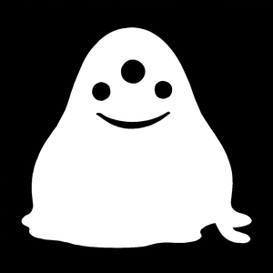

# 用 GPT Image 產生圖片

> 原文：[examples/Generate_Images_With_GPT_Image.ipynb](https://github.com/openai/openai-cookbook/blob/main/examples/Generate_Images_With_GPT_Image.ipynb)

用 GPT Image 的能力產生和編輯圖片的 cookbook。

## 這篇在做什麼

示範怎麼用 GPT Image 從文字 prompt 產生圖片、調整輸出設定，以及拿現有圖片當輸入來編輯，包含用 mask 只改圖片的一部分。

## 學完你會

- 用 prompt 產生圖片，並調整 quality、size、壓縮率和透明背景。
- 用最多 10 張輸入圖片做出新圖片。
- 產生帶 alpha channel 的 mask，只編輯圖片中指定的區域。

## 開跑前

- 需要 `OPENAI_API_KEY`，並有 GPT Image 模型的使用權限。
- 產生和編輯圖片會產生 API 費用。

這份 cookbook 會教你怎麼使用 GPT Image，這是我們具備圖片生成能力的新大型語言模型。

這個模型有世界知識，能運用這種廣泛的理解來產生圖片。它在遵循指令和產生擬真圖片上，也比我們前一代的圖片模型 DallE 2 和 3 好很多。

想進一步了解圖片生成，請看我們的[指南](https://platform.openai.com/docs/guides/image-generation?image-generation-model=gpt-image-1)。

## 環境設定

```python
%pip install pillow openai -U
```

```python
import base64
import os
from openai import OpenAI
from PIL import Image
from io import BytesIO
from IPython.display import Image as IPImage, display
```

```python
client = OpenAI()
# Set your API key if not set globally
#client = OpenAI(api_key=os.environ.get("OPENAI_API_KEY", "<your OpenAI API key if not set as env var>"))
```

```python
# Create imgs/ folder
folder_path = "imgs"
os.makedirs(folder_path, exist_ok=True)
```

## 產生圖片

GPT Image 1 很擅長遵循指令，所以你可以用非常詳細的指示來 prompt 模型產生圖片。

```python
prompt1 = """
Render a realistic image of this character:
Blobby Alien Character Spec Name: Glorptak (or nickname: "Glorp")
Visual Appearance Body Shape: Amorphous and gelatinous. Overall silhouette resembles a teardrop or melting marshmallow, shifting slightly over time. Can squish and elongate when emotional or startled.
Material Texture: Semi-translucent, bio-luminescent goo with a jelly-like wobble. Surface occasionally ripples when communicating or moving quickly.
Color Palette:
- Base: Iridescent lavender or seafoam green
- Accents: Subsurface glowing veins of neon pink, electric blue, or golden yellow
- Mood-based color shifts (anger = dark red, joy = bright aqua, fear = pale gray)
Facial Features:
- Eyes: 3–5 asymmetrical floating orbs inside the blob that rotate or blink independently
- Mouth: Optional—appears as a rippling crescent on the surface when speaking or emoting
- No visible nose or ears; uses vibration-sensitive receptors embedded in goo
- Limbs: None by default, but can extrude pseudopods (tentacle-like limbs) when needed for interaction or locomotion. Can manifest temporary feet or hands.
Movement & Behavior Locomotion:
- Slides, bounces, and rolls.
- Can stick to walls and ceilings via suction. When scared, may flatten and ooze away quickly.
Mannerisms:
- Constant wiggling or wobbling even at rest
- Leaves harmless glowing slime trails
- Tends to absorb nearby small objects temporarily out of curiosity
"""

img_path1 = "imgs/glorptak.jpg"
```

```python
# Generate the image
result1 = client.images.generate(
    model="gpt-image-1",
    prompt=prompt1,
    size="1024x1024"
)
```

```python
# Save the image to a file and resize/compress for smaller files
image_base64 = result1.data[0].b64_json
image_bytes = base64.b64decode(image_base64)

# Adjust this if you want a high-quality Glorptak
image = Image.open(BytesIO(image_bytes))
image = image.resize((300, 300), Image.LANCZOS)
image.save(img_path1, format="JPEG", quality=80, optimize=True)
```

```python
# Show the result
display(IPImage(img_path1))
```

### 自訂輸出

你可以自訂下列輸出屬性：
- Quality 可以是 `low`、`medium`、`high` 或 `auto`（預設值）
- Size 可以是 `1024x1024`（正方形）、`1536x1024`（橫向）、`1024x1536`（直向）或 `auto`（預設值）
- JPEG 和 WEBP 格式可以調整壓縮程度（0 到 100%）
- 你可以選擇產生透明背景的圖片（只有 PNG 或 WEBP 可用）

```python
prompt2 = "generate a portrait, pixel-art style, of a grey tabby cat dressed as a blond woman on a dark background."
img_path2 = "imgs/cat_portrait_pixel.jpg"
```

```python
# Generate the image
result2 = client.images.generate(
    model="gpt-image-1",
    prompt=prompt2,
    quality="low",
    output_compression=50,
    output_format="jpeg",
    size="1024x1536"
)
```

```python
# Save the image to a file and resize/compress for smaller files
image_base64 = result2.data[0].b64_json
image_bytes = base64.b64decode(image_base64)

image = Image.open(BytesIO(image_bytes))
image = image.resize((250, 375), Image.LANCZOS)
image.save(img_path2, format="JPEG", quality=80, optimize=True)
```

```python
# Show the result
display(IPImage(img_path2))
```

??? note "輸出"

    ```text
    <IPython.core.display.Image object>
    ```

### 透明背景

你可以用 `background` 屬性要求透明背景，不過如果你在 prompt 裡寫了想要透明背景，它預設就會設成 `transparent`。

```python
prompt3 = "generate a pixel-art style picture of a green bucket hat with a pink quill on a transparent background."
img_path3 = "imgs/hat.png"
```

```python
result3 = client.images.generate(
    model="gpt-image-1",
    prompt=prompt3,
    quality="low",
    output_format="png",
    size="1024x1024"
)
image_base64 = result3.data[0].b64_json
image_bytes = base64.b64decode(image_base64)
```

```python
# Save the image to a file and resize/compress for smaller files
image_base64 = result3.data[0].b64_json
image_bytes = base64.b64decode(image_base64)

image = Image.open(BytesIO(image_bytes))
image = image.resize((250, 250), Image.LANCZOS)
image.save(img_path3, format="PNG")
```

```python
# Show the result
display(IPImage(img_path3))
```

## 編輯圖片

GPT Image 也能接受圖片輸入，用它們來產生新圖片。如果你不想讓模型改動輸入圖片的特定部分，也可以提供 mask。

輸入圖片最多可以用 10 張，如果用了 mask，它會套用在 `image` 陣列中的第一張圖片上。

```python
prompt_edit = """
Combine the images of the cat and the hat to show the cat wearing the hat while being perched in a tree, still in pixel-art style.
"""
img_path_edit = "imgs/cat_with_hat.jpg"
```

```python
img1 = open(img_path2, "rb")
img2 = open(img_path3, "rb")
```

```python
# Generate the new image
result_edit = client.images.edit(
    model="gpt-image-1",
    image=[img1,img2], 
    prompt=prompt_edit,
    size="1024x1536"
)
```

```python
# Save the image to a file and resize/compress for smaller files
image_base64 = result_edit.data[0].b64_json
image_bytes = base64.b64decode(image_base64)

image = Image.open(BytesIO(image_bytes))
image = image.resize((250, 375), Image.LANCZOS)
image.save(img_path_edit, format="JPEG", quality=80, optimize=True)
```

```python
# Show the result
display(IPImage(img_path_edit))
```

??? note "輸出"

    ```text
    <IPython.core.display.Image object>
    ```

## 用 mask 編輯圖片

你也可以在輸入圖片之外提供 mask（如果有好幾張，mask 會套用在第一張上），這樣只會編輯輸入圖片中沒被 mask 蓋住的部分。請注意，模型有可能還是會改到 mask 裡面的某些部分，但它會盡量避免。

重要提醒：mask 必須包含 alpha channel。如果你是手動產生的，例如用影像編輯軟體，要確定有加上這個 alpha channel。

#### 產生 mask

這個範例我們用模型自動幫我們產生 mask。mask 可能不精確，但對我們的目的已經夠用。
如果你需要精確的 mask，可以改用影像分割（image segmentation）模型。

```python
img_path_mask = "imgs/mask.png"
prompt_mask = "generate a mask delimiting the entire character in the picture, using white where the character is and black for the background. Return an image in the same size as the input image."
```

```python
img_input = open(img_path1, "rb")

# Generate the mask
result_mask = client.images.edit(
    model="gpt-image-1",
    image=img_input, 
    prompt=prompt_mask
)
```

```python
# Save the image to a file and resize/compress for smaller files
image_base64 = result_mask.data[0].b64_json
image_bytes = base64.b64decode(image_base64)

image = Image.open(BytesIO(image_bytes))
image = image.resize((300, 300), Image.LANCZOS)
image.save(img_path_mask, format="PNG")
```

```python
# Show the mask
display(IPImage(img_path_mask))
```

??? note "輸出"

    

#### 建立 alpha channel
這一步是選用的，用在你想把黑白圖片變成帶 alpha channel 的 mask，讓它能用在 Image Edit API 的時候。

```python
# 1. Load your black & white mask as a grayscale image
mask = Image.open(img_path_mask).convert("L")

# 2. Convert it to RGBA so it has space for an alpha channel
mask_rgba = mask.convert("RGBA")

# 3. Then use the mask itself to fill that alpha channel
mask_rgba.putalpha(mask)

# 4. Convert the mask into bytes
buf = BytesIO()
mask_rgba.save(buf, format="PNG")
mask_bytes = buf.getvalue()
```

```python
# Save the resulting file
img_path_mask_alpha = "imgs/mask_alpha.png"
with open(img_path_mask_alpha, "wb") as f:
    f.write(mask_bytes)
```

#### 用 mask 編輯
使用 mask 的時候，prompt 要描述整張結果圖片，不只是被編輯的區域。

```python
prompt_mask_edit = "A strange character on a colorful galaxy background, with lots of stars and planets."
mask = open(img_path_mask_alpha, "rb")
```

```python
result_mask_edit = client.images.edit(
    model="gpt-image-1",         
    prompt=prompt_mask_edit,
    image=img_input,
    mask=mask,
    size="1024x1024"
)
```

```python
# Display result

img_path_mask_edit = "imgs/mask_edit.png"

image_base64 = result_mask_edit.data[0].b64_json
image_bytes = base64.b64decode(image_base64)

image = Image.open(BytesIO(image_bytes))
image = image.resize((300, 300), Image.LANCZOS)
image.save(img_path_mask_edit, format="JPEG", quality=80, optimize=True)
    
display(IPImage(img_path_mask_edit))
```

## 總結

這份 cookbook 看了怎麼用我們新的圖片生成模型 GPT Image，從零產生新圖片，或是用參考圖片來產生。我們也介紹了怎麼建立帶 alpha channel 的 mask，套用在輸入圖片上，進一步引導圖片編輯。

你可以把這份當成起點，去探索其他用法。如果想找靈感，可以看看我們文件裡的[圖片範例庫](https://platform.openai.com/docs/guides/image-generation?image-generation-model=gpt-image-1&gallery=open#generate-images)。

Happy building!

## 重點整理

- GPT Image 有世界知識，遵循指令和擬真度都比 DallE 2 和 3 好，prompt 可以寫得很詳細。
- quality、size、壓縮率和背景都是輸出參數，透明背景只支援 PNG 或 WEBP。
- 編輯圖片最多可傳 10 張輸入圖，mask 只會套用在 `image` 陣列的第一張。
- mask 必須有 alpha channel，被 mask 蓋住的部分模型會盡量不改，但不保證。
- 用 mask 編輯時，prompt 要描述整張結果圖，不只是被改的區域。

## 練習

1. 把 `quality` 改成 `low` 和 `high` 各產生一次，比較畫質和等待時間。
2. 在 prompt 裡加上「透明背景」，輸出改成 PNG，確認結果是否有 alpha channel。
3. 換一張自己的圖片當輸入，自己做一個黑白 mask 並補上 alpha channel，只改圖中的某個物件，prompt 要描述整張結果。
