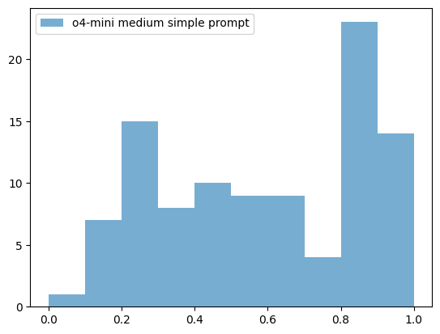
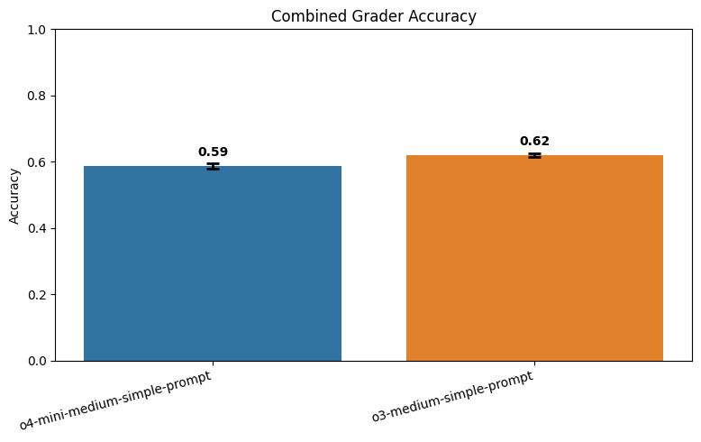
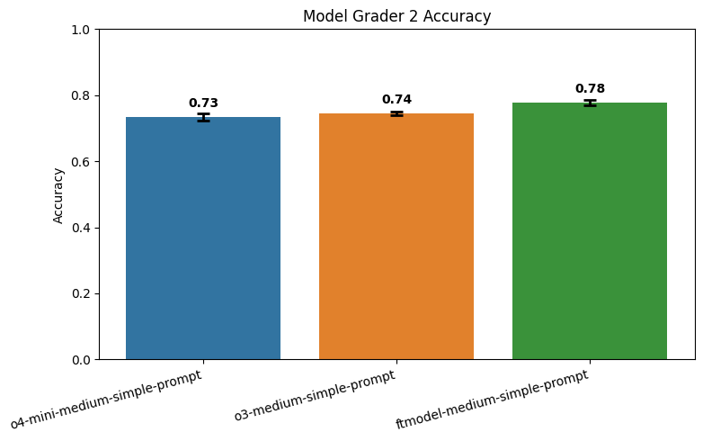
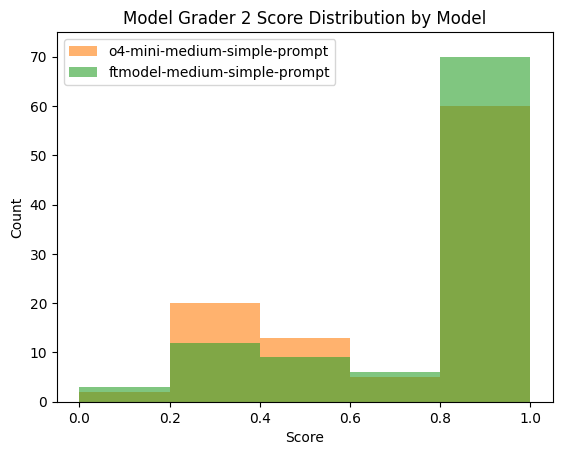

# 用 Model Grader 做 Reinforcement Fine-Tuning

> 原文：[examples/Reinforcement_Fine_Tuning.ipynb](https://github.com/openai/openai-cookbook/blob/main/examples/Reinforcement_Fine_Tuning.ipynb)

這份 cookbook 示範在專家級任務上，用 model grader 做 reinforcement fine-tuning。

## 這篇在做什麼

用 `o4-mini` 跑一次 reinforcement fine-tuning（RFT），任務是從醫病對話描述預測臨床結果。重點放在怎麼設計 grader，以及怎麼抓到 reward hacking。

## 學完你會

- 先用字串 grader 幫 base model 跑 benchmark，判斷任務適不適合做 RFT。
- 寫出 model grader 並放進 API 需要的格式，還能發現並修掉 reward hacking。
- 上傳資料、設定 hyper-parameters 啟動 RFT job，並比較 base 跟 fine-tuned model 的分數與 reasoning。

## 開跑前

- 需要 `OPENAI_API_KEY`。
- RFT 訓練和 LLM grader 都會收費。
- 資料集從 Hugging Face 下載。

*這份指南的對象是已經熟悉 OpenAI API、對 reinforcement fine-tuning（RFT）有基本概念的開發者和 ML 工程師，用來做研究或其他適當用途。OpenAI 的服務不適用於個人化的醫療處置或診斷，並受[適用條款](https://openai.com/policies/)規範。*

[Reinforcement fine-tuning (RFT)](https://platform.openai.com/docs/guides/reinforcement-fine-tuning) 是在 reasoning model 上再跑一輪 reinforcement learning，讓模型去探索解法空間，強化能拿到較高 reward 的策略，藉此提升推理表現。RFT 能讓模型做決策更準，也更會理解 context。

這篇會示範怎麼對 OpenAI 的 `o4-mini` reasoning model 做 RFT。任務來自生命科學研究：根據醫病對話和病況描述預測結果，這在很多健康研究裡都是必要的評估。我們用 medical-o1-verifiable-problem [資料集](https://huggingface.co/datasets/FreedomIntelligence/medical-o1-verifiable-problem/viewer/default/train?row=0)的一個子集。你會學到成功跑 RFT job 的關鍵步驟。

內容大綱：

- **[1. Setup](#1-setup)**
- **[2. Gathering the dataset](#2-gathering-the-dataset)**
- **[3. Benchmarking the base model](#3-benchmarking-the-base-model)**
- **[4. Defining your grader](#4-defining-your-grader)**
- **[5. Training](#5-training)**
- **[6. Using your fine-tuned model](#6-using-your-fine-tuned-model)**

---


## **1. 前置說明**

就算是很強的 reasoning model，碰到專家級的行為也可能沒到位，醫療這種講究細節和精確的領域尤其明顯。想像模型要從對話逐字稿抽出 [ICD-10](https://www.cms.gov/medicare/coding-billing/icd-10-codes) 代碼：就算大致理解內容，也可能沒用到醫療人員預期的精確術語。

其他適合 RFT 的題目還有帳本正規化、詐欺風險分級這類場景，都需要精確、可靠、可重複的推理。更多例子可以看 [RFT use-cases 指南](https://platform.openai.com/docs/guides/rft-use-cases)。

這次我們要教 `o4-mini` 更會預測臨床對話和描述的結果，具體來說是看 RFT 能不能提升預測準確率。

過程中會談怎麼寫有效的 grader、grader 怎麼引導模型學習，還有要留意的典型 reward hacking 陷阱。

---


## **2. 取得資料集**

先從 Hugging Face 載入資料集。我們要的樣本格式是：一段病例描述加一個問題，後面接正確答案。這些代表真實世界裡醫師總結病例並給出結果的逐字稿。不管什麼用途，驗證標準答案的正確性都很關鍵，需要仔細考量。這裡我們直接信任資料集品質。

```python
import re
from datasets import load_dataset
ds = load_dataset("FreedomIntelligence/medical-o1-verifiable-problem")

def is_age_question(sample):
    question = sample.get('Open-ended Verifiable Question', '')
    # Match "A 88-year-old", "An 8-year-old", "A 23-year-old", etc. at the start
    return re.match(r"^(A|An) \d{1,2}-year-old", question) is not None

filtered_samples = [s for s in ds["train"] if is_age_question(s)]
print(f"Filtered samples: {len(filtered_samples)}")
```

??? note "輸出"

    ```text
    /Users/theophile/Documents/repos/jupyter-env/lib/python3.12/site-packages/tqdm/auto.py:21: TqdmWarning: IProgress not found. Please update jupyter and ipywidgets. See https://ipywidgets.readthedocs.io/en/stable/user_install.html
      from .autonotebook import tqdm as notebook_tqdm
    ```

    ```text
    Filtered samples: 9169
    ```

RFT 的好處之一是不需要幾千筆樣本就能看到差異。靠 trajectory sampling 和訓練時的 feedback loop，模型不只學到正確行為，也學到該避開的模式。所以小資料集也能有明顯進步。

這次隨機抽 100 筆訓練、100 筆測試，並做一點正規化。

```python
import random

# Set a random seed for reproducibility
random.seed(42)

# Randomly select 100 training samples from filtered_samples
train_samples = random.sample(filtered_samples, min(100, len(filtered_samples)))

# Remove training samples from filtered_samples to avoid overlap
remaining_samples = [s for s in filtered_samples if s not in train_samples]

# Randomly select 100 test samples from the remaining samples (no overlap)
test_samples = random.sample(remaining_samples, min(100, len(remaining_samples)))

print(f"Number of training samples: {len(train_samples)}")
print(f"Number of test samples: {len(test_samples)}")
```

??? note "輸出"

    ```text
    Number of training samples: 100
    Number of test samples: 100
    ```

```python
# Standardize the 'Ground-True Answer' fields to all lowercase in train and test samples
for sample in train_samples:
    if 'Ground-True Answer' in sample and isinstance(sample['Ground-True Answer'], str):
        sample['Ground-True Answer'] = sample['Ground-True Answer'].lower()

for sample in test_samples:
    if 'Ground-True Answer' in sample and isinstance(sample['Ground-True Answer'], str):
        sample['Ground-True Answer'] = sample['Ground-True Answer'].lower()
```

接著把樣本轉成 `jsonl` 格式，這是 [reinforcement finetuning API](https://platform.openai.com/docs/api-reference/fine-tuning/reinforcement-input) 要求的格式。

```python
import json

def convert_to_jsonl_format(samples, filename):
    with open(filename, "w") as f:
        for sample in samples:
            user_content = sample.get("Open-ended Verifiable Question", "")
            reference_answer = sample.get("Ground-True Answer", "")
            json_obj = {
                "messages": [
                    {"role": "user", "content": user_content}
                ],
                "reference_answer": reference_answer
            }
            f.write(json.dumps(json_obj) + "\n")

def load_jsonl(filename):
    samples = []
    with open(filename, "r") as f:
        for line in f:
            samples.append(json.loads(line))
    return samples

# Save the datasets to jsonl files
convert_to_jsonl_format(train_samples, "data/medical_01_verifiable_problem_train.jsonl")
convert_to_jsonl_format(test_samples, "data/medical_01_verifiable_problem_val.jsonl")

# Load the datasets back from jsonl files
train_samples_loaded = load_jsonl("data/medical_01_verifiable_problem_train.jsonl")
test_samples_loaded = load_jsonl("data/medical_01_verifiable_problem_val.jsonl")
```


下一步看 base model 開箱即用的表現，以及還有多少進步空間。

---


## **3. 幫 Base Model 跑 Benchmark**

微調之前要先知道起點在哪。benchmark 能清楚看出模型原本的強項和弱點，之後才能衡量進步多少。

我們先用兩個簡單但好用的 evaluator：

1. `clinical_phrase_binary_grader`：exact match 檢查。
2. `clinical_phrase_grader`：比較寬鬆、以 token 為基礎的相似度 grader。

```python
from rapidfuzz import fuzz, utils

def clinical_phrase_grader(sample: dict, item: dict) -> float:
    from rapidfuzz import fuzz, utils
    score = fuzz.token_set_ratio(sample["output_text"], item["reference_answer"], processor=utils.default_process)
    return score / 100.0

def clinical_phrase_binary_grader(sample: dict, item: dict) -> float:
    return 1.0 if sample["output_text"] == item["reference_answer"] else 0.0

def combined_grader(sample: dict, item: dict, weights: list[float] = [0.85, 0.15]) -> float:
    clinical_phrase_score = clinical_phrase_grader(sample, item)
    binary_score = clinical_phrase_binary_grader(sample, item)
    return weights[0] * clinical_phrase_score + weights[1] * binary_score
```

這樣搭配就能同時追蹤嚴格正確性和部分字面重疊。binary grader 給明確的 0 或 1，看模型有沒有完全吻合。寬鬆的那個則給更細的資訊，看輸出離標準答案多近。兩個都用，是因為同一個結果常有多種合理說法。例如模型回答「gouty arthritis」而不是「gout」，人類評審可能覺得部分可接受，但嚴格比對字串就不會算對。精確加模糊的評分一起用，評估才會比較準也比較公平。

我們寫一個 helper function，在範例前面加上 system prompt。

```python
def prepend_system_prompt_to_first_user_message(samples, system_prompt, path=None):
    new_samples = []
    for sample in samples:
        # Deep copy to avoid mutating the original
        sample_copy = json.loads(json.dumps(sample))
        messages = sample_copy.get("messages", [])
        if messages and messages[0].get("role") == "user" and isinstance(messages[0].get("content"), str):
            if not messages[0]["content"].startswith(system_prompt):
                messages[0]["content"] = f"{system_prompt}\n\n{messages[0]['content']}"
        new_samples.append(sample_copy)
    if path is not None:
        with open(path, "w", encoding="utf-8") as f:
            for item in new_samples:
                f.write(json.dumps(item, ensure_ascii=False) + "\n")
    return new_samples
```

```python
simple_prompt = """You are an expert clinician. For each clinical vignette, respond with exactly one phrase: the single most likely outcome or phenomenon, all in lowercase. 
- Do not add punctuation, articles, explanations, or commentary - output only the term itself.
- Sometimes, the expected answer can be a synonym of what you think.
- Use the standard clinical name (e.g. “thought withdrawal”, “Toxoplasma encephalitis”)."""
train_samples_loaded_simple_sys_prompt = prepend_system_prompt_to_first_user_message(
    train_samples_loaded, simple_prompt, path="data/medical_01_verifiable_problem_train_simple_prompt.jsonl"
)
test_samples_loaded_simple_sys_prompt = prepend_system_prompt_to_first_user_message(
    test_samples_loaded, simple_prompt, path="data/medical_01_verifiable_problem_val_simple_prompt.jsonl"
)
```

再寫一個 helper function 來產生並儲存模型的預測。

```python
from openai import OpenAI
import concurrent.futures
from tqdm import tqdm
import os

client = OpenAI()

def generate_model_predictions(
    subset,
    prompt_type,
    model_name="o4-mini-2025-04-16",
    reasoning_effort="medium",
    n_runs=1,
    verbose=False,
):
    if isinstance(subset, str):
        samples_path = f"data/medical_01_verifiable_problem_{subset}_{prompt_type}_prompt.jsonl"
        with open(samples_path, "r", encoding="utf-8") as f:
            test_samples = [json.loads(line) for line in f if line.strip()]
    else:
        test_samples = [subset]

    def run_inference(item):
        resp = client.responses.create(
            model=model_name,
            input=item["messages"],
            reasoning={"effort": reasoning_effort, "summary": "detailed"},
        )
        model_prediction = {'output_text': resp.output_text}
        reasoning_tokens_used = resp.usage.output_tokens_details.reasoning_tokens
        summaries = [seg.text for item in resp.output if item.type == "reasoning" for seg in item.summary]
        summaries_string = "\n".join(summaries)
        if verbose:
            print("Prompt: {}".format(item["messages"][0]["content"]))
            print(f"Model Sample: {model_prediction}\nSolution: {item['reference_answer']}\n")
        return {
            "model_prediction": model_prediction["output_text"],
            "input": item,
            "reasoning_tokens_used": reasoning_tokens_used,
            "reference_answer": item["reference_answer"],
            "summaries": summaries_string
        }

    # Ensure the predictions directory exists before any file operations
    predictions_dir = os.path.join("data", "rft", "predictions")
    os.makedirs(predictions_dir, exist_ok=True)

    # Check if results already exist for all runs
    results_per_run = []
    for run_idx in range(n_runs):
        run_save_path = os.path.join(
            predictions_dir,
            f"{subset}_{prompt_type}_{model_name}_{reasoning_effort}_predictions_run{run_idx+1}.json"
        )
        if os.path.exists(run_save_path):
            print(f"Results for run {run_idx+1} already exist at {run_save_path}. Loading results.")
            with open(run_save_path, "r", encoding="utf-8") as f:
                run_results = json.load(f)
            results_per_run.append(run_results)
        else:
            if len(test_samples) == 1:
                run_results = [run_inference(test_samples[0])]
            else:
                run_results = []
                with concurrent.futures.ThreadPoolExecutor() as executor:
                    futures = [executor.submit(run_inference, item) for item in test_samples]
                    for future in tqdm(futures, total=len(futures), desc=f"Generating predictions (run {run_idx+1})"):
                        result = future.result()
                        run_results.append(result)
                with open(run_save_path, "w", encoding="utf-8") as f:
                    json.dump(run_results, f, ensure_ascii=False, indent=2)
            results_per_run.append(run_results)

    # Return a flat list for backward compatibility
    if n_runs == 1:
        return results_per_run[0]
    else:
        return results_per_run
```

要產生預測，先確認 API key 已設定：

```bash
export OPENAI_API_KEY=...
```

```python
# OpenAI o4-mini model
results_simple_o4mini = generate_model_predictions(
    subset="train",
    prompt_type="simple",
    model_name="o4-mini",
    reasoning_effort="medium",
    n_runs=3
)
```

```python
# OpenAI o3 model
results_simple_o3 = generate_model_predictions(
    subset="train",
    prompt_type="simple",
    model_name="o3",
    reasoning_effort="medium",
    n_runs=3
)
```

現在預測都準備好可以評估了。<br>
我們寫一個 helper function，方便抽換不同的評分方法，

```python
import functools

def evaluate_predictions_with_grader(
    predictions,
    grader_func=combined_grader,
):
    results = []

    if isinstance(predictions, dict):
        predictions = [predictions]

    def run_grading(pred):
        model_prediction = {"output_text": pred["model_prediction"]}
        item = pred["input"]
        score = grader_func(model_prediction, item)
        result = pred.copy()
        result["score"] = score
        return result

    if len(predictions) == 1:
        result = run_grading(predictions[0])
        results.append(result)
    else:
        with concurrent.futures.ThreadPoolExecutor() as executor:
            futures = [executor.submit(run_grading, pred) for pred in predictions]
            for future in tqdm(concurrent.futures.as_completed(futures), total=len(futures), desc="Grading predictions"):
                results.append(future.result())

    total = len(results)
    correct = sum(r["score"] for r in results)
    accuracy = correct / total if total else 0.0

    metrics = {
        "total_samples": total,
        "accuracy": accuracy,
    }
    print(metrics)
    return metrics, results

def run_prediction_evaluation(
    model_name="o4-mini",
    reasoning_effort="medium",
    prompt_type="simple",
    subset="train",
    grader_func=combined_grader,
    num_runs=3,
):
    if isinstance(grader_func, functools.partial):
        name = grader_func.func.__name__
        mg = grader_func.keywords["model_grader"]
        mg_name = mg["name"]
        name = f"{name}_{mg_name}"
    else:
        name = getattr(grader_func, "__name__", getattr(grader_func, "__class__", type(grader_func)).__name__)
    grader_func_name = name.replace(" ", "_").replace(":", "_").replace("/", "_").replace(",", "_")

    for i in range(num_runs):
        preds_path = f"data/rft/predictions/{subset}_{prompt_type}_{model_name}_{reasoning_effort}_predictions_run{i+1}.json"
        with open(preds_path, "r") as f:
            preds = json.load(f)
        metrics, results_with_scores = evaluate_predictions_with_grader(preds, grader_func=grader_func)
        # Save the scored results
        with open(f"data/rft/predictions/{subset}_{prompt_type}_{model_name}_{reasoning_effort}_{grader_func_name}_predictions_run_{i+1}_scored.json", "w") as f:
            json.dump(results_with_scores, f, indent=2)
        # Save the metrics
        with open(f"data/rft/predictions/{subset}_{prompt_type}_{model_name}_{reasoning_effort}_{grader_func_name}_predictions_run_{i+1}_metrics.json", "w") as f:
            json.dump(metrics, f, indent=2)
        # Save the scores (if present in results_with_scores)
        scores = [item.get("score") for item in results_with_scores if "score" in item]
        with open(f"data/rft/predictions/{subset}_{prompt_type}_{model_name}_{reasoning_effort}_{grader_func_name}_predictions_run_{i+1}_scores.json", "w") as f:
            json.dump(scores, f, indent=2)

def load_predictions(
    model_name="o4-mini",
    reasoning_effort="medium",
    prompt_type="simple",
    subset="train",
    grader_func_name="clinical_phrase_grader",
    num_runs=3
):
    all_predictions = []
    all_metrics = []
    for run in range(1, num_runs + 1):
        pred_path = f"data/rft/predictions/{subset}_{prompt_type}_{model_name}_{reasoning_effort}_{grader_func_name}_predictions_run_{run}_scored.json"
        metrics_path = f"data/rft/predictions/{subset}_{prompt_type}_{model_name}_{reasoning_effort}_{grader_func_name}_predictions_run_{run}_metrics.json"
        try:
            with open(pred_path, "r") as f:
                predictions = json.load(f)
        except FileNotFoundError:
            predictions = None
        try:
            with open(metrics_path, "r") as f:
                metrics = json.load(f)
        except FileNotFoundError:
            metrics = None
        all_predictions.append(predictions)
        all_metrics.append(metrics)
    return all_predictions, all_metrics
```

然後跑評估。

```python
model_name = "o4-mini"
reasoning_effort = "medium"
prompt_type = "simple"
subset = "train"
grader_func = combined_grader
grader_func_name = "combined_grader"
num_runs = 3
run_prediction_evaluation(
    model_name=model_name, 
    reasoning_effort=reasoning_effort, 
    prompt_type=prompt_type, 
    subset=subset, 
    grader_func=grader_func, 
    num_runs=num_runs
)
predictions_o4mini_medium_simple_prompt, metrics_o4mini_medium_simple_prompt = load_predictions(model_name=model_name, reasoning_effort=reasoning_effort, prompt_type=prompt_type, subset=subset, grader_func_name=grader_func_name, num_runs=num_runs)
```

??? note "輸出"

    ```text
    Grading predictions: 100%|██████████| 100/100 [00:00<00:00, 610524.60it/s]
    ```

    ```text
    {'total_samples': 100, 'accuracy': 0.590985993228499}
    ```

    ```text
    Grading predictions: 100%|██████████| 100/100 [00:00<00:00, 311612.48it/s]
    ```

    ```text
    {'total_samples': 100, 'accuracy': 0.5750433490539723}
    ```

    ```text
    Grading predictions: 100%|██████████| 100/100 [00:00<00:00, 769597.06it/s]
    ```

    ```text
    {'total_samples': 100, 'accuracy': 0.5943742483874717}
    ```

把結果視覺化，比較容易看出趨勢和失敗模式。

```python
# Print mistakes where the model did not get the correct answer (score < 1.0)
mistakes = [
    {"index": i, **res}
    for i, res in enumerate(predictions_o4mini_medium_simple_prompt[0])
    if res["score"] < 1.0
]

print(f"\nTotal mistakes: {len(mistakes)}")
for m in mistakes[15:20]:
    print(f"\n[Sample {m['index']}]")
    print(f"  Model prediction: {m['model_prediction']}")
    print(f"  Reference answer: {m['reference_answer']}")
    print(f"  Score: {m['score']}")
```

??? note "輸出"

    ```text

    Total mistakes: 86

    [Sample 18]
      Model prediction: acute anterior uveitis
      Reference answer: recurring eye redness and pain
      Score: 0.3596153846153846

    [Sample 19]
      Model prediction: 390 meq
      Reference answer: 150 meq
      Score: 0.6071428571428571

    [Sample 20]
      Model prediction: adamts13 deficiency
      Reference answer: decreased adamts13 activity in serum
      Score: 0.5037037037037037

    [Sample 22]
      Model prediction: todd paralysis
      Reference answer: seizure
      Score: 0.16190476190476194

    [Sample 23]
      Model prediction: hypokalemia
      Reference answer: hypomagnesemia
      Score: 0.612
    ```

從上面可以看到，典型的失敗模式分三類：
1. 小差異和格式問題，score >= 0.8。
2. 部分字面吻合，0.3 < score < 0.8。
3. 字面上完全偏掉，score < 0.3。

我們可以把訓練集完整的分數分布畫出來。

> 註：實務上要大規模分析模型錯誤，通常會混合人工檢視和自動化方法，例如標記失敗類型，或依分數和內容把預測分群。這部分超出本篇範圍，但找出大方向的模式之後，這是很值得做的下一步。

```python
import matplotlib.pyplot as plt
scores_distribution = [m['score'] for m in predictions_o4mini_medium_simple_prompt[0]]
plt.hist(scores_distribution, alpha=0.6, label='o4-mini medium simple prompt')
plt.legend()
```

??? note "輸出"

    ```text
    <matplotlib.legend.Legend at 0x125f6b7a0>
    ```

    

再拿其他模型和 prompt 來比較，並把分數視覺化。

```python
# OpenAI o3 model
model_name = "o3"
reasoning_effort = "medium"
prompt_type = "simple"
subset = "train"
grader_func = combined_grader
grader_func_name = "combined_grader"
num_runs = 3
run_prediction_evaluation(model_name=model_name, reasoning_effort=reasoning_effort, prompt_type=prompt_type, subset=subset, grader_func=grader_func, num_runs=num_runs)
predictions_o3_medium_simple_prompt, metrics_o3_medium_simple_prompt = load_predictions(model_name=model_name, reasoning_effort=reasoning_effort, prompt_type=prompt_type, subset=subset, grader_func_name=grader_func_name, num_runs=num_runs)
```

??? note "輸出"

    ```text
    Grading predictions: 100%|██████████| 100/100 [00:00<00:00, 820803.13it/s]
    ```

    ```text
    {'total_samples': 100, 'accuracy': 0.6186850707880021}
    ```

    ```text
    Grading predictions: 100%|██████████| 100/100 [00:00<00:00, 523633.46it/s]
    ```

    ```text
    {'total_samples': 100, 'accuracy': 0.6149897683385446}
    ```

    ```text
    Grading predictions: 100%|██████████| 100/100 [00:00<00:00, 515270.76it/s]
    ```

    ```text
    {'total_samples': 100, 'accuracy': 0.6254662232084496}
    ```

```python
import numpy as np
import pandas as pd
import seaborn as sns

def average_and_std_metrics(metrics_list):
    """Returns dicts of mean and std for a list of metrics dicts."""
    if not metrics_list: return {}, {}
    keys = metrics_list[0].keys()
    arr = {k: np.array([m[k] for m in metrics_list]) for k in keys}
    mean = {k: float(np.mean(arr[k])) for k in keys}
    std = {k: float(np.std(arr[k])) for k in keys}
    return mean, std

def plot_model_accuracies(model_metrics_avg, model_metrics_std, grader_title="Combined Grader Accuracy", sharey: bool = True) -> None:
    """Plots model accuracies with standard deviation error bars."""
    # Convert the nested dicts into tidy DataFrames
    df_avg = pd.DataFrame(model_metrics_avg).T.reset_index().rename(columns={"index": "Model"})
    df_std = pd.DataFrame(model_metrics_std).T.reset_index().rename(columns={"index": "Model"})

    # Long-form for Seaborn
    long_df_avg = df_avg.melt(id_vars="Model", value_vars=["accuracy"], var_name="Metric", value_name="Accuracy")
    long_df_std = df_std.melt(id_vars="Model", value_vars=["accuracy"], var_name="Metric", value_name="Std")

    # Merge avg and std for error bars
    long_df = pd.merge(long_df_avg, long_df_std, on=["Model", "Metric"])

    pretty_names = {"accuracy": grader_title}

    # Create a separate figure for each metric
    for metric_key in ["accuracy"]:
        metric_df = long_df[long_df["Metric"] == metric_key].copy()
        plt.figure(figsize=(8, 5))
        # Plot bars with error bars
        ax = sns.barplot(data=metric_df, x="Model", y="Accuracy", hue="Model", palette="tab10", legend=False, errorbar=None)
        bars = ax.patches
        # Add error bars manually
        for i, row in enumerate(metric_df.itertuples()):
            bar = bars[i]
            x = bar.get_x() + bar.get_width() / 2
            y = row.Accuracy
            yerr = row.Std
            ax.errorbar(x=x, y=y, yerr=yerr, fmt='none', ecolor='black', capsize=5, elinewidth=2, capthick=2, zorder=10)
        plt.title(pretty_names[metric_key])
        plt.ylabel("Accuracy")
        plt.xlabel("")
        if sharey: plt.ylim(0, 1)
        # Annotate bars with exact values
        for bar in bars:
            height = bar.get_height()
            ax.annotate(f"{height:.2f}", xy=(bar.get_x() + bar.get_width() / 2, height), xytext=(0, 6), textcoords="offset points", ha='center', va='bottom', fontsize=10, fontweight='bold')
        plt.xticks(rotation=15, ha="right")
        plt.tight_layout()
        plt.show()
```

```python
avg_metrics_o4mini_medium_simple_prompt, std_metrics_o4mini_medium_simple_prompt = average_and_std_metrics(metrics_o4mini_medium_simple_prompt)
avg_metrics_o3_medium_simple_prompt, std_metrics_o3_medium_simple_prompt = average_and_std_metrics(metrics_o3_medium_simple_prompt)
model_metrics_avg = {
    "o4-mini-medium-simple-prompt": avg_metrics_o4mini_medium_simple_prompt,
    "o3-medium-simple-prompt": avg_metrics_o3_medium_simple_prompt,
}
model_metrics_std = {
    "o4-mini-medium-simple-prompt": std_metrics_o4mini_medium_simple_prompt,
    "o3-medium-simple-prompt": std_metrics_o3_medium_simple_prompt,
}
plot_model_accuracies(model_metrics_avg, model_metrics_std, grader_title="Combined Grader Accuracy")
```

??? note "輸出"

    

可以看到模型的表現有明顯上限。實務上調整 prompt 通常能拉高 baseline，讓 base model 發揮更多。不過這個案例裡 prompt engineering 沒帶來有意義的進步，所以那些 run 就沒放進分析。


RFT 要有效有個前提：base model 至少要在一部分範例上，一開始就能成功完成任務。初始準確率約 0.6，是 RFT 能提升表現的強烈訊號。如果模型在你的任務上從來沒成功過，就沒有訓練訊號可以往上爬。


這個評估流程為下一步做準備：用 grader 給模型結構化的高品質回饋。

---


## **4. 定義你的 Grader**

grader 定義 RFT 期間塑造模型行為的 reward function。它會給期望輸出的範例，並懲罰不想要的輸出。設計有效的 grader 需要有原則的結構，也需要領域知識，可能是 RFT 成功最重要的工作。

這一節會介紹 3 個 grader，說明怎麼設定才符合 API，並討論它們的結果，然後示範怎麼真正啟動 RFT 任務。

### String based grader
我們一開始用前面的評估函式組成雙重 grader，它給出的分數分布會對應預測跟標準答案在字面上的接近程度。這是個起點，但訊號不夠豐富，`o4-mini` 學不到東西，第一次實驗的 reward 在 RFT 過程中停滯不前。呼叫 API 時，要像下面這樣寫 python grading function。

```python
import inspect

# --- Utility functions ---
def build_python_grader_payload(grader_fn) :
    """Build a payload for a python grader."""
    grader_source = inspect.getsource(grader_fn)
    # Enforce function name to be `grade`
    grader_source = grader_source.replace(grader_fn.__name__, "grade", 1)
    return {
        "type": "python",
        "source": grader_source,
    }

multi_python_grader_tool_call = {
    "type": "multi",
    "graders": {
        "clinical_phrase": {
            "name": "clinical_phrase_grader",
            "image_tag": "2025-05-08",
            **build_python_grader_payload(clinical_phrase_grader),
        },
        "clinical_phrase_binary": {
            "name": "clinical_phrase_binary_grader",
            "image_tag": "2025-05-08",
            **build_python_grader_payload(clinical_phrase_binary_grader),
        },
    },
    "calculate_output": "0.85 * clinical_phrase + 0.15 * clinical_phrase_binary",
}
```

下面是它的訓練曲線，綠色是訓練集 reward，藍色是測試集 reward：


### Model Grader 1
為了解決這個限制，我們改用更進階的做法：**model grader**。以模型為基礎的 grader 可以把語意理解和細微差別放進回饋裡，碰到領域專有的同義詞或需要模糊推理時特別有用。

我們用 gpt-4.1 當 grader model，並用強調語意忠實度的 rubric 引導它：臨床同義詞、疾病分類是否正確、概念是否一致。它不看表面措辭（例如「這是同一個字串嗎？」），而是想回答「這有沒有反映正確的結果或現象？」

為了確保 grader 符合專家的期待，我們拿一部分 base model 的預測來評估它。任何正式的使用情境，都應該由領域專家審核，確認 model 給的分數符合偏好的答案排序，也符合領域判斷。這通常是確認 model grader 有依預測的有效程度正確排序。在這份 cookbook 的範圍內，我們用 OpenAI `o3` 近似這個評估，檢查品質較高的預測是不是一致地比其他選項得到更高的獎勵。

根據與 `o3` 的這些討論，我們反覆修改 model grader，直到結果一致。

```python
GRADER_PROMPT_1 = """
System:
  You are an expert medical grader. Compare the **Reference Answer** to the **Model's Answer** and produce **only** a JSON object with:
    • **result**: a float between 0.0 and 1.0  
    • **steps**: a list of reasoning steps (each with a `"description"` and a `"conclusion"`)

  Scoring rubric (start at 0.0, then add or subtract):
    1. Exact lexical match: **+0.15**  
    2. Clinical synonym (e.g. “withdrawal of thought” ↔ “thought withdrawal”): **+0.35**  
    3. Same disease family (e.g. two viral encephalitides): **+0.35**  
    4. Partial term overlap (e.g. “ulcer” in both phrases): **+0.15**  
    5. Completely unrelated: **-0.10**

  • If multiple criteria apply, sum their weights (max 1.0).  
  • Cap the final score to the [0.0, 1.0] range.  
  • In your **steps**, show which rule you applied and the running subtotal.
"""
```

要透過 API 提交時，dictionary 是這樣建構的。

```python
model_grader_1 = {
   "type": "score_model",
   "name": "gpt41_score_model_1",
   "input": [
        {
            "role": "system",
            "content": GRADER_PROMPT_1
        },
        {
            "role": "user",
            "content": "Reference Answer: {{item.reference_answer}}. Model's Answer: {{sample.output_text}}"
        }
   ],
   "pass_threshold": 0.75,
   "model": "gpt-4.1-2025-04-14",
   "range": [0, 1],
   "sampling_params": {
       "seed": 42,
       "temperature": 0,
   },
}
```

接著我們在本機設定 model grader，用來檢查接下來要微調的模型的結果。

```python
response_format = {
  "name": "float_score_classification",
  "strict": True,
  "schema": {
    "type": "object",
    "properties": {
      "steps": {
        "type": "array",
        "description": "A sequence of steps outlining the reasoning process.",
        "items": {
          "type": "object",
          "properties": {
            "description": {
              "type": "string",
              "description": "Detailed description of the reasoning in this step."
            },
            "conclusion": {
              "type": "string",
              "description": "The conclusion of the reasoning in this step."
            }
          },
          "required": ["description", "conclusion"],
          "additionalProperties": False
        }
      },
      "result": {
        "type": "number",
        "description": "The float score assigned to the response. This should be in inclusive range RANGE_MIN to RANGE_MAX."
      }
    },
    "required": ["steps", "result"],
    "additionalProperties": False
  }
}

# for completions
response_format = {
    "type": "json_schema",
    "json_schema": response_format
}

# Adapted python_model_grader to match the other graders' interface
def python_model_grader(sample, item, model_grader=model_grader_1):
    """
    Calls an OpenAI model to grade the model output against the reference answer.
    Expects sample to have "output_text", item to have "reference_answer".
    Returns a float score (parsed from the model's JSON response).
    """
    # Prepare the prompt as the grader expects
    system_prompt = model_grader["input"][0]["content"]
    user_prompt = model_grader["input"][1]["content"]
    user_prompt_filled = user_prompt.replace("{{item.reference_answer}}", item["reference_answer"]).replace("{{sample.output_text}}", sample["output_text"])
    messages = [
        {"role": "system", "content": system_prompt},
        {"role": "user", "content": user_prompt_filled}
    ]
    # Call the OpenAI API with the grader's model
    response = client.chat.completions.create(
        model=model_grader["model"],
        messages=messages,
        seed=model_grader.get("sampling_params", {}).get("seed", None),
        temperature=model_grader.get("sampling_params", {}).get("temperature", 0),
        response_format=response_format,
    )
    # Parse the float score from the model's JSON response
    parsed = json.loads(response.choices[0].message.content)
    
    return float(parsed["result"])
```

rubric 一開始給出合理的回饋，但模型很快就找到漏洞，開始 **reward hacking**。分數衝高，有時多出 20 到 30 個百分點，原因不是臨床準確度提升，而是模型把「一個片語」的答案灌水，塞進同義詞、劑量和完整的處置計畫。你可能會看到 `begin warfarin therapy **and** continue unfractionated heparin for ≥5 days, overlapping until the INR is in the therapeutic range (2–3)`，或 `chewable aspirin 325 mg stat plus nitroglycerin…`，而不是要求的 `continue unfractionated heparin` 或 `aspirin`。雖然 system prompt 寫得很明確（*"respond with exactly one phrase: the single most likely outcome or phenomenon"*），這些冗長的輸出還是會拉高 *lexical_similarity* 分數，卻沒有真的增加預測價值。這個經驗說明要持續檢查模型輸出，並提防會悄悄扭曲評估指標的 reward hacking 行為。

下面是它的訓練曲線（綠色是訓練 reward，藍色是測試 reward）：


### Model Grader 2
為了減輕這個 reward hack，我們改良 grader prompt：把期望講得更清楚、對輸出加更嚴格的限制，並提供正確與錯誤行為的對照範例。我們再 用 `o3` 反覆迭代，用 base `o4-mini` 的預測和前一個被 hack 的 fine-tuned model 範例來設計並驗證 grader。這個新版 grader 還有一點很重要：降低 *lexical_similarity* 的權重，讓 *clinical_similarity* 佔上風。

```python
GRADER_PROMPT_2 = """You are an expert medical grader.

Compare the reference_answer (gold standard) with the model_prediction
and return **exactly** this JSON object:

{
  "steps": [            // each: {"description": "...", "conclusion": "..."}
    …
  ],
  "result": <float 0-1 rounded to 3 decimals>
}

──────────────── Input placeholders ───────────────
reference_answer:
model_prediction:

──────────── Normalisation steps ────────────
• lowercase, strip punctuation / excess whitespace  
• expand common abbreviations (e.g. cll → chronic lymphocytic leukemia)  
• map both strings to ICD-10 / SNOMED concepts when possible

──────────── Clinical layer rubric ───────────
L1  exact concept or universally accepted synonym  
L2  same concept but benign modifier differs (e.g. “acute”, “left”)  
L3  same disease / drug family but wrong subtype or variant  
L4  same organ system but entirely different disease / intervention  
L5  only partial mechanistic overlap (e.g. both vasodilators)  
L6  unrelated or nonsensical

──────────── Scoring parameters ─────────────
clinical_weight  = 0.90
lexical_weight   = 0.10
clinical_similarity = {1:1.00, 2:0.85, 3:0.45, 4:0.30, 5:0.10, 6:0.00}

lexical_similarity = normalized_levenshtein(reference_answer,
                                            model_prediction)

# Optional penalty if a clinically critical adjective is missing
critical_modifiers = [
  "wide", "narrow", "acute", "chronic", "posteromedial",
  "oxidized", "oxidised", "left", "right"
]
modifier_pen = -0.05 if any(
    w in reference_answer and w not in model_prediction
    for w in critical_modifiers
) else 0.0

# Determine layer L (1-6) per rubric above using ontology + judgment.
if L == 6:
    score = 0.0
else:
    score = (clinical_weight * clinical_similarity[L] +
             lexical_weight  * lexical_similarity) + modifier_pen

Clamp to [0,1] and round to 3 decimals.  
Output **only** the JSON.

──────────────── Worked examples ─────────────
reference_answer: beta-thalassemia major  
model_prediction: beta-thalassemia minor  
reasoning: Both involve β-globin chain synthesis, but “major” causes
          transfusion-dependent anemia while “minor” is largely benign;
          same family, wrong subtype → **L3**. Lexical ≈ 0.83.  
score = 0.90·0.45 + 0.10·0.83 = 0.488 → **0.488**

reference_answer: ACE inhibitor  
model_prediction: angiotensin-receptor blocker  
reasoning: Both act on the renin–angiotensin axis yet on different
          targets; only partial mechanistic overlap → **L5**.
          Lexical ≈ 0.31.  
score = 0.90·0.10 + 0.10·0.31 = 0.121 → **0.121**

reference_answer: acute pancreatitis  
model_prediction: pancreatitis  
reasoning: Same disorder but missing timing adjective “acute”;
          benign modifier difference → **L2**. Lexical ≈ 0.78.  
score = 0.90·0.85 + 0.10·0.78 = 0.843 → **0.843**

reference_answer: valproate  
model_prediction: valproic acid  
reasoning: Valproic acid is the active moiety of valproate; mechanisms
          and indications are identical → **L1**. Lexical ≈ 0.82.  
score = 0.90·1.00 + 0.10·0.82 = 0.982 → **0.982**

reference_answer: riboflavin  
model_prediction: riboflavin deficiency  
reasoning: Adds “deficiency” but refers to the same vitamin (B₂);
          benign modifier difference → **L2**. Lexical ≈ 0.60.  
score = 0.90·0.85 + 0.10·0.60 = 0.825 → **0.825**

reference_answer: splenectomy  
model_prediction: acetaminophen overdose  
reasoning: Surgical removal of the spleen has no mechanistic or anatomic
          relationship to toxic drug ingestion → **L6**.  
score = **0.000**

reference_answer: ulcerative colitis  
model_prediction: Crohn disease  
reasoning: Both are inflammatory-bowel diseases but differ in location,
          histology and management; same organ system, different disease
          → **L4**. Lexical ≈ 0.38.  
score = 0.90·0.30 + 0.10·0.38 = 0.308 → **0.308**"""
```

```python
model_grader_2 = {
   "type": "score_model",
   "name": "gpt41_score_model_2",
   "input": [
        {
            "role": "system",
            "content": GRADER_PROMPT_2
        },
        {
            "role": "user",
            "content": "Reference Answer: {{item.reference_answer}}. Model's Answer: {{sample.output_text}}"
        }
   ],
   "pass_threshold": 0.75,
   "model": "gpt-4.1-2025-04-14",
   "range": [0, 1],
   "sampling_params": {
       "seed": 42,
       "temperature": 0,
   },
}
```


最後得到的是高訊號、對領域敏感的 grader，引導模型給出更恰當、更簡潔的預測。
**費用提醒：** LLM grader 除了訓練算力之外，還會產生 token 費用。為了控制成本，建議：
1. 先在本機用 base model 的 completion（也可以加合成的）測試 grader，確認它符合你的 rubric 或人類偏好。有的話可以用 [flex processing](https://platform.openai.com/docs/guides/flex-processing) 讓評估更省。
2. 先跑小規模的 RFT，確認 grader 對得上、並偵測可能的 reward hacking，再放大規模。

下一步來看怎麼啟動訓練！

---


## **5. 訓練**

prompt 和 grader 都定案後就可以開始訓練。這一節示範用最終版 grader 啟動 RFT，不過你在試驗前面幾版 grader 時，當然也已經跑過類似的指令來評估它們的表現。

先確認 grader 通過 API 測試，

```python
import requests

API_KEY = os.environ["OPENAI_API_KEY"]
HEADERS = {"Authorization": f"Bearer {API_KEY}"}

# Validate a grader configuration for fine-tuning
payload = {"grader": model_grader_2}
try:
    response = requests.post(
        "https://api.openai.com/v1/fine_tuning/alpha/graders/validate",
        json=payload,
        headers=HEADERS,
    )
    response.raise_for_status()
    print("Grader validated")
except requests.exceptions.RequestException as e:
    print(f"Error validating grader: {e}")
    if 'response' in locals():
        print(f"Response: {response.text}")
```

??? note "輸出"

    ```text
    Grader validated
    ```

再把訓練集和測試集上傳到 OpenAI 檔案系統。

```python
# Set your training and test file paths
train_file = "data/medical_01_verifiable_problem_train_simple_prompt.jsonl"
test_file = "data/medical_01_verifiable_problem_val_simple_prompt.jsonl"

def upload_file(file_path: str) -> str:
    """Upload a file to the OpenAI platform for fine-tuning."""
    print(f"Uploading file: {file_path}")
    with open(file_path, 'rb') as f:
        response = requests.post(
            "https://api.openai.com/v1/files",
            headers=HEADERS,
            files={"file": f},
            data={"purpose": "fine-tune"}
        )
        response.raise_for_status()
        file_id = response.json()["id"]
        print(f"File uploaded successfully. File ID: {file_id}")
        return file_id

train_file_id = train_file
if train_file.endswith("jsonl"):
    print(f"Training file detected: {train_file}")
    train_file_id = upload_file(train_file)
test_file_id = test_file
if test_file and test_file.endswith("jsonl"):
    print(f"test file detected: {test_file}")
    test_file_id = upload_file(test_file)
```

??? note "輸出"

    ```text
    Training file detected: data/medical_01_verifiable_problem_train_simple_prompt.jsonl
    Uploading file: data/medical_01_verifiable_problem_train_simple_prompt.jsonl
    File uploaded successfully. File ID: file-19L9jKsJXNJ17DtjvPwN3M
    test file detected: data/medical_01_verifiable_problem_val_simple_prompt.jsonl
    Uploading file: data/medical_01_verifiable_problem_val_simple_prompt.jsonl
    File uploaded successfully. File ID: file-78q2N1QAMKhLiRK3zVB6MC
    ```

接著設定這次 run 的 hyper-parameters。我們要微調 `o4-mini`，reasoning effort 用 `medium`。這個參數會限制模型拿來推理的 token 數，所以會影響訓練時間。我們用中等的 compute multiplier 和合理的 epoch 數，優先考慮效率和快速迭代。另外把 `eval_samples` 設成 3，因為 `o4-mini` 的輸出有隨機性，多取樣平均可以讓驗證曲線更穩，降低雜訊，讓一致的學習模式浮現。

你要依預算、希望的泛化程度和資料集難度調整這些參數。

```python
# Set the model and other parameters
model = "o4-mini-2025-04-16"
suffix = "medical_01_verifiable_problem_gpt41_grader"
reasoning_effort = "medium"
n_epochs = 5
seed = 42
grader = model_grader_2
response_format_predictions = None
compute_multiplier = 1.0
eval_samples = 3
eval_interval = 5
```

準備好了，啟動 run！

```python
# Launch the RFT job
payload = dict(
    training_file=train_file_id,
    validation_file=test_file_id,
    model=model,
    suffix=suffix,
    method=dict(
        type="reinforcement",
        reinforcement=dict(
            grader=grader,
            response_format=response_format_predictions,
            hyperparameters=dict(
                compute_multiplier=compute_multiplier,
                eval_samples=eval_samples,
                eval_interval=eval_interval,
                n_epochs=n_epochs,
                reasoning_effort=reasoning_effort,
            )
        )
    ),
    seed=seed
)

try:
    response = requests.post(
        "https://api.openai.com/v1/fine_tuning/jobs",
        json=payload,
        headers=HEADERS,
    )
    response.raise_for_status()
    job_id = response.json().get("id")
    if job_id:
        print("Training job created with ID:", job_id)
        print(
            f"View the job details at: https://platform.openai.com/finetune/{job_id}")
    else:
        print("Failed to retrieve job ID from response.")
except requests.exceptions.RequestException as e:
    print(f"An error occurred while creating the training job: {e}")
    if 'response' in locals():
        print(f"Response: {response.text}")
```

??? note "輸出"

    ```text
    Training job created with ID: ftjob-tt3B7l45hLUoaXGJRfoL1lLT
    View the job details at: https://platform.openai.com/finetune/ftjob-tt3B7l45hLUoaXGJRfoL1lLT
    ```

在 [dashboard](https://platform.openai.com/finetune/) 上可以看 reward 曲線，看整體表現隨 step 進步。如果用的是 *multi_grader*，各 grader 的圖表還會拆出個別元件的表現。Reasoning token 用量的趨勢（模型越有把握通常越少）和 step 時間指標可以看效率。Grader 延遲和錯誤數的圖則確保 grader 在 run 期間跑得順、沒有 bug。

下面是我們的訓練曲線，綠色和橘色是訓練集，藍色和紅色是測試子集：


訓練期間，測試集上的評估 run 會直接記錄到 [Evaluation API](https://platform.openai.com/evaluations?tab=runs)。你可以去那裡追蹤樣本的表現，看預測怎麼隨時間演變。

---


## **6. 使用微調後的模型**

訓練完成後，用 `model_id` 就能呼叫新模型並 benchmark 它的進步。預期預測會更準！


```python
# To retrieve information about a fine-tuning job (including the fine-tuned model id), use the job_id:
response = requests.get(
    f"https://api.openai.com/v1/fine_tuning/jobs/{job_id}",
    headers=HEADERS,
)
if response.ok:
    data = response.json()
    if data.get("status") == "succeeded":
        fine_tuned_model_id = data.get("fine_tuned_model")
    else:
        fine_tuned_model_id = None
else:
    raise Exception(f"Request failed: {response.status_code} - {response.text}")
print("Fine-tuned model id:", fine_tuned_model_id)
```

### 模型的預測分數

算出 base model 和 fine-tuned model 的分數來比較。

```python
from functools import partial
model_name = fine_tuned_model_id
reasoning_effort = "medium"
prompt_type = "simple"
subset = "val"
grader_func = partial(python_model_grader, model_grader=model_grader_2)
grader_func_name = "python_model_grader_gpt41_score_model_2"
num_runs = 3

results_ft_model_grader_2 = generate_model_predictions(
    subset=subset,
    prompt_type=prompt_type,
    model_name=model_name,
    reasoning_effort=reasoning_effort,
    n_runs=num_runs
)

run_prediction_evaluation(
    model_name=model_name, 
    reasoning_effort=reasoning_effort, 
    prompt_type=prompt_type, 
    subset=subset,
    grader_func=grader_func, 
    num_runs=num_runs
)
predictions_ftmodel_medium_simple_prompt_model_grader_2, metrics_ftmodel_medium_simple_prompt_model_grader_2 = load_predictions(
    model_name=model_name,
    reasoning_effort=reasoning_effort,
    prompt_type=prompt_type,
    subset=subset,
    grader_func_name=grader_func_name,
    num_runs=num_runs
)
```

??? note "輸出"

    ```text
    Generating predictions (run 1): 100%|██████████| 100/100 [01:16<00:00,  1.30it/s]
    Generating predictions (run 2): 100%|██████████| 100/100 [01:25<00:00,  1.17it/s]
    Generating predictions (run 3): 100%|██████████| 100/100 [01:07<00:00,  1.49it/s]
    ```

    ```text
    Grading predictions: 100%|██████████| 100/100 [00:22<00:00,  4.51it/s]
    ```

    ```text
    {'total_samples': 100, 'accuracy': 0.7730899999999999}
    ```

    ```text
    Grading predictions: 100%|██████████| 100/100 [00:17<00:00,  5.57it/s]
    ```

    ```text
    {'total_samples': 100, 'accuracy': 0.7697499999999999}
    ```

    ```text
    Grading predictions: 100%|██████████| 100/100 [00:19<00:00,  5.01it/s]
    ```

    ```text
    {'total_samples': 100, 'accuracy': 0.78996}
    ```

```python
model_name = "o4-mini"
reasoning_effort = "medium"
prompt_type = "simple"
subset = "val"
grader_func = partial(python_model_grader, model_grader=model_grader_2)
grader_func_name = "python_model_grader_gpt41_score_model_2"
num_runs = 3

results_o4mini_model_grader_2 = generate_model_predictions(
    subset=subset,
    prompt_type=prompt_type,
    model_name=model_name,
    reasoning_effort=reasoning_effort,
    n_runs=num_runs
)
run_prediction_evaluation(
    model_name=model_name, 
    reasoning_effort=reasoning_effort, 
    prompt_type=prompt_type, 
    subset=subset,
    grader_func=grader_func, 
    num_runs=num_runs
)
predictions_o4mini_medium_simple_prompt_model_grader_2, metrics_o4mini_medium_simple_prompt_model_grader_2 = load_predictions(
    model_name=model_name,
    reasoning_effort=reasoning_effort,
    prompt_type=prompt_type,
    subset=subset,
    grader_func_name=grader_func_name,
    num_runs=num_runs
)
```

??? note "輸出"

    ```text
    Generating predictions (run 1):   0%|          | 0/100 [00:00<?, ?it/s]
    ```

    ```text
    Generating predictions (run 1): 100%|██████████| 100/100 [01:11<00:00,  1.39it/s]
    Generating predictions (run 2): 100%|██████████| 100/100 [00:42<00:00,  2.34it/s]
    Generating predictions (run 3): 100%|██████████| 100/100 [00:41<00:00,  2.40it/s]
    Grading predictions: 100%|██████████| 100/100 [00:19<00:00,  5.20it/s]
    ```

    ```text
    {'total_samples': 100, 'accuracy': 0.72282}
    ```

    ```text
    Grading predictions: 100%|██████████| 100/100 [00:19<00:00,  5.14it/s]
    ```

    ```text
    {'total_samples': 100, 'accuracy': 0.72807}
    ```

    ```text
    Grading predictions: 100%|██████████| 100/100 [00:17<00:00,  5.65it/s]
    ```

    ```text
    {'total_samples': 100, 'accuracy': 0.74812}
    ```

```python
model_name = "o3"
reasoning_effort = "medium"
prompt_type = "simple"
subset = "val"
grader_func = partial(python_model_grader, model_grader=model_grader_2)
grader_func_name = "python_model_grader_gpt41_score_model_2"
num_runs = 3

results_o3_model_grader_2 = generate_model_predictions(
    subset=subset,
    prompt_type=prompt_type,
    model_name=model_name,
    reasoning_effort=reasoning_effort,
    n_runs=num_runs
)
run_prediction_evaluation(
    model_name=model_name, 
    reasoning_effort=reasoning_effort, 
    prompt_type=prompt_type, 
    subset=subset,
    grader_func=grader_func, 
    num_runs=num_runs
)
predictions_o3_medium_simple_prompt_model_grader_2, metrics_o3_medium_simple_prompt_model_grader_2 = load_predictions(
    model_name=model_name,
    reasoning_effort=reasoning_effort,
    prompt_type=prompt_type,
    subset=subset,
    grader_func_name=grader_func_name,
    num_runs=num_runs
)
```

??? note "輸出"

    ```text
    Generating predictions (run 1):   0%|          | 0/100 [00:00<?, ?it/s]
    ```

    ```text
    Generating predictions (run 1): 100%|██████████| 100/100 [01:01<00:00,  1.62it/s]
    Generating predictions (run 2): 100%|██████████| 100/100 [00:52<00:00,  1.90it/s]
    Generating predictions (run 3): 100%|██████████| 100/100 [01:13<00:00,  1.37it/s]
    Grading predictions: 100%|██████████| 100/100 [00:21<00:00,  4.55it/s]
    ```

    ```text
    {'total_samples': 100, 'accuracy': 0.74015}
    ```

    ```text
    Grading predictions: 100%|██████████| 100/100 [00:16<00:00,  6.08it/s]
    ```

    ```text
    {'total_samples': 100, 'accuracy': 0.7515900000000001}
    ```

    ```text
    Grading predictions: 100%|██████████| 100/100 [00:16<00:00,  6.13it/s]
    ```

    ```text
    {'total_samples': 100, 'accuracy': 0.74235}
    ```

現在把它們視覺化！

```python
avg_metrics_o4mini_medium_simple_prompt_model_grader_2, std_metrics_o4mini_medium_simple_prompt_model_grader_2 = average_and_std_metrics(metrics_o4mini_medium_simple_prompt_model_grader_2)
avg_metrics_o3_medium_simple_prompt_model_grader_2, std_metrics_o3_medium_simple_prompt_model_grader_2 = average_and_std_metrics(metrics_o3_medium_simple_prompt_model_grader_2)
avg_metrics_ftmodel_medium_simple_prompt_model_grader_2, std_metrics_ftmodel_medium_simple_prompt_model_grader_2 = average_and_std_metrics(metrics_ftmodel_medium_simple_prompt_model_grader_2)
model_metrics_avg = {
    "o4-mini-medium-simple-prompt": avg_metrics_o4mini_medium_simple_prompt_model_grader_2,
    "o3-medium-simple-prompt": avg_metrics_o3_medium_simple_prompt_model_grader_2,
    "ftmodel-medium-simple-prompt": avg_metrics_ftmodel_medium_simple_prompt_model_grader_2
}
model_metrics_std = {
    "o4-mini-medium-simple-prompt": std_metrics_o4mini_medium_simple_prompt_model_grader_2,
    "o3-medium-simple-prompt": std_metrics_o3_medium_simple_prompt_model_grader_2,
    "ftmodel-medium-simple-prompt": std_metrics_ftmodel_medium_simple_prompt_model_grader_2
}
plot_model_accuracies(model_metrics_avg, model_metrics_std, grader_title="Model Grader 2 Accuracy")
```

??? note "輸出"

    

```python
# Print mistakes where the model did not get the correct answer (score < 1.0)
mistakes = [
    {"index": i, **res}
    for i, res in enumerate(predictions_ftmodel_medium_simple_prompt_model_grader_2[0])
    if res["score"] < 1.0
]

print(f"\nTotal mistakes: {len(mistakes)}")
for m in mistakes[5:10]:
    print(f"\n[Sample {m['index']}]")
    print(f"  Model prediction: {m['model_prediction']}")
    print(f"  Reference answer: {m['reference_answer']}")
    print(f"  Score: {m['score']}")
```

??? note "輸出"

    ```text

    Total mistakes: 84

    [Sample 9]
      Model prediction: ventilation-perfusion scan
      Reference answer: lung ventilation-perfusion scan
      Score: 0.989

    [Sample 11]
      Model prediction: autoimmune destruction of melanocytes (vitiligo)
      Reference answer: autoimmune melanocyte destruction
      Score: 0.991

    [Sample 12]
      Model prediction: contrast enhanced computed tomography of the abdomen
      Reference answer: ct abdomen
      Score: 0.812

    [Sample 13]
      Model prediction: unfractionated heparin
      Reference answer: enoxaparin
      Score: 0.428

    [Sample 15]
      Model prediction: t cell–mediated delayed (type iv) hypersensitivity
      Reference answer: th1-mediated cytotoxicity
      Score: 0.932
    ```

微調後準確率大約提升 5 個百分點。看前幾個錯誤會發現，模型對「接近但臨床上不完全相同」的答案懲罰很重，例如 *unfractionated heparin* 對 *enoxaparin*。它也會扣長答案的分，就算答案是對的，例如 *contrast enhanced computed tomography of the abdomen*。

```python
scores_o4 = [p['score'] for p in predictions_o4mini_medium_simple_prompt_model_grader_2[0]]
scores_ft = [p['score'] for p in predictions_ftmodel_medium_simple_prompt_model_grader_2[0]]

# Determine common bins for both histograms
all_scores = scores_o4 + scores_ft
bins = plt.hist(all_scores, bins=5, alpha=0)[1]

# Plot histograms and capture the counts
counts_o4, _, _ = plt.hist(
    scores_o4,
    bins=bins,
    alpha=0.6,
    label='o4-mini-medium-simple-prompt'
)
counts_ft, _, _ = plt.hist(
    scores_ft,
    bins=bins,
    alpha=0.6,
    label='ftmodel-medium-simple-prompt'
)

plt.title("Model Grader 2 Score Distribution by Model")
plt.xlabel("Score")
plt.ylabel("Count")
plt.ylim(top=75)
plt.legend()

# Print the bin counts
print("o4-mini-medium-simple-prompt bin counts:", counts_o4)
print("ftmodel-medium-simple-prompt bin counts:", counts_ft)
print("Max bin count (y-axis):", max(max(counts_o4), max(counts_ft)))
```

??? note "輸出"

    ```text
    o4-mini-medium-simple-prompt bin counts: [ 2. 20. 13.  5. 60.]
    ftmodel-medium-simple-prompt bin counts: [ 3. 12.  9.  6. 70.]
    Max bin count (y-axis): 70.0
    ```

    

分數分布顯示，RFT 把模型的預測從中低區間（0.2-0.6）推到高區間（0.8-1.0）。因為 grader 看重臨床相似度勝過字面吻合，我們的 *expert* grader 把這個轉變歸因於醫學推理變強，而不是措辭變好。少數本來就很弱的預測掉到 0.0-0.1，表示還有知識缺口。

要注意，前面的 `combined_grader` 是設計來獎勵字面正確性的，所以它的準確率沒什麼提升，這是預期中的事。這個落差也說明了為什麼驗證 model grader 很關鍵，以及為什麼要監控 reward hacking。我們用 `o3` 抽查 grading 行為，但領域專家的審核不可少。

### 模型的 reasoning

分析 fine-tuned model 還有一件重要的事，就是看 reasoning summary。模型可能在這些 summary 裡提供關鍵資訊，研究它們能了解模型哪裡失敗，進而更新模型和 grader 的 system prompt。下面是模型產生的 chain of thought summary 範例，看它怎麼一步步回答問題：

```python
# Flatten the list of lists into a single list of dicts
predictions = {
    "o4-mini": predictions_o4mini_medium_simple_prompt_model_grader_2,
    "o3": predictions_o3_medium_simple_prompt_model_grader_2,
    "ftmodel": predictions_ftmodel_medium_simple_prompt_model_grader_2,
}

for model_name, predictions in predictions.items():
    all_preds = [item for sublist in predictions for item in sublist]
    reasoning_tokens = [p['reasoning_tokens_used'] for p in all_preds if 'reasoning_tokens_used' in p]
    mean_reasoning_tokens = np.mean(reasoning_tokens)
    print(f"Mean reasoning_tokens_used {model_name}: {mean_reasoning_tokens:.0f}")
```

??? note "輸出"

    ```text
    Mean reasoning_tokens_used o4-mini: 404
    Mean reasoning_tokens_used o3: 384
    Mean reasoning_tokens_used ftmodel: 925
    ```

fine-tuned model 花更多 reasoning token 去思考問題。我們用 reasoning summary 來視覺化一個例子。

```python
from IPython.display import Markdown, display
markdown_text = results_o4mini_model_grader_2[0][30]["summaries"]
display(Markdown(markdown_text))
```

??? note "輸出"

    ```text
    **Choosing imaging study**

    The user is looking for a single phrase regarding the imaging study for a 49-year-old male with chronic alcohol consumption and related symptoms. I'm considering whether to suggest a CT scan or MRI; however, a CT scan is often the initial choice for chronic pancreatitis. I’ll go with "abdominal ct scan" since it's standardized. I need to ensure I format it in lowercase without punctuation, following the user’s request. So the output is "abdominal ct scan."
    ```

```python
markdown_text = results_ft_model_grader_2[0][30]["summaries"]
display(Markdown(markdown_text))
```

??? note "輸出"

    ```text
    **Considering imaging options**

    I'm analyzing the user's question about a 49-year-old male with symptoms suggesting steatorrhea, possibly indicating exocrine pancreatic insufficiency from chronic alcohol use. It raises concerns about chronic pancreatitis or pancreatic cancer. I think the best imaging choice is a contrast-enhanced CT scan of the abdomen because it effectively examines structural abnormalities. Alternatively, an endoscopic ultrasound could be more sensitive, but CT is generally preferred. So, my recommendation is to start with a contrast-enhanced CT scan.
    **Determining the appropriate imaging study**

    I'm analyzing the question about the most suitable imaging study for a patient with symptoms suggesting chronic pancreatitis. The standard approach for suspected chronic pancreatitis is a contrast-enhanced CT scan of the abdomen, as it effectively identifies pancreatic calcifications and structural changes. While MRCP and endoscopic ultrasound provide additional details, CT is often preferred as the initial test. Therefore, my answer should focus on recommending a "contrast-enhanced abdominal CT" as the next step in evaluation.
    ```

base `o4‑mini` 的推理直接跳到「abdominal CT scan」，主要在擔心小寫格式，只給了「often the initial choice」這種簡略的理由。`finetuned model` 則先把病人的脂肪瀉和酗酒史連到慢性胰臟炎或癌症，再比較 CT、MRCP 和 EUS，並解釋為什麼 contrast‑enhanced abdominal CT 最能看出鈣化和結構變化。後者看起來更仔細，似乎學會了把病例描述拆得更細。

### 想把分數再往上推
baseline `o3` 和我們微調的 `o4-mini` 有時在同樣的樣本上都得 0 分，這是標準答案可能標錯的警訊。加更多算力之前，先投資在資料品質：請領域專家重新標註有雜訊的那一部分，分析模型的 reasoning，再收緊 grader prompt。乾淨可信的資料加上有條理的修改，通常比多跑 epoch 更能換到準確率。


---


## **結論**

我們看了怎麼設計 grader，讓 `o4-mini` 在 RFT 時拿到夠細緻的回饋。這個訊號讓模型真的能學習並超越 baseline。model grader 可以非常強大，但前提是設計得夠小心。草率的 grader 或草率的資料，會送出錯的訊號，把模型帶往錯的方向。

現在你可以用 OpenAI API 對自己的模型做 reinforcement fine-tuning 了。期待看到你用客製 grader 和更聰明的模型行為，推進 reasoning 和 tool use 的邊界！

要排除問題或找下一步，可參考 [OpenAI fine-tuning 文件](https://platform.openai.com/docs/guides/fine-tuning)。

## 重點整理

- RFT 要有訓練訊號才有效：base model 至少要在部分範例上成功（這篇初始約 0.6），否則沒東西可爬。
- grader 就是 reward function，決定模型往哪裡學，是 RFT 最關鍵的設計。
- 字串型 grader 只看字面，訊號太貧乏，reward 會停滯。model grader 能看語意，但也會被鑽漏洞。
- 模型會用灌水（塞同義詞、劑量、整套處置）來 reward hack，要持續檢查輸出，並用對照範例和調整權重來修 grader。
- grader 和資料品質比多跑 epoch 更重要，兩個模型同時得 0 分，可能是標準答案標錯。

## 練習

1. 在第 2 節把訓練和測試各抽 100 筆的數字改成 50，重跑 benchmark，看 baseline 分數變動多大。
2. 在第 3 節的 benchmark 裡，自己挑 5 筆 score 介於 0.3 到 0.8 的預測，手動判斷它們屬於哪種失敗模式，再看 binary grader 和 phrase grader 的分數差在哪。
3. 在 Model Grader 2 的 grader 設定裡，調整 *lexical_similarity* 和 *clinical_similarity* 的權重（例如各 0.5），再用本機 grader 對灌水的答案評分，觀察 reward hacking 有沒有回來。
