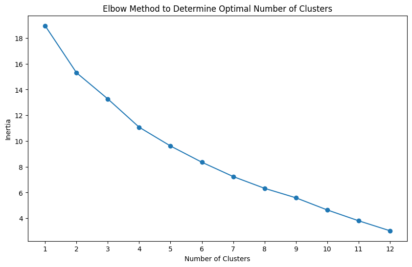

# 合成資料生成（第一部分）

> 原文：[examples/SDG1.ipynb](https://github.com/openai/openai-cookbook/blob/main/examples/SDG1.ipynb)

## 這篇在做什麼

用 LLM 生成合成資料，解決真實資料取得不易、有隱私限制、分布不均的問題。從最簡單的用 prompt 直接產 CSV，到請模型寫 Python 程式、產多張互相關聯的表，再到產生文字資料，並用 embedding 加 K-means 分群來找出資料偏少或缺少的主題。

## 學完你會

- 用「格式、schema、欄位關係說明」三個重點寫 prompt，產出 CSV，並請模型寫 Python 程式來擴大資料量。
- 生成有 primary key 和 foreign key 對得上的多表資料，以及可用來 fine-tuning 的輸入輸出文字配對。
- 用 embedding、K-means 和 elbow method 分析資料分布，找出不平衡的主題，再請模型補生資料，提高多樣性。

## 開跑前

需要 OpenAI API key（環境變數 `OPENAI_API_KEY`），範例會呼叫 `gpt-4` 系列模型和 embedding 模型，會產生 API 費用。

用大型語言模型（LLM）生成合成資料，能解決一個常見的問題：高品質、多樣、又符合隱私規範的資料不好取得。合成資料可以用在很多場景，例如訓練資料科學或機器學習模型（SVM、決策樹、KNN）、拿來 fine-tuning 另一個 GPT 模型、解決冷啟動問題、用擬真資料做出有說服力的 demo 或 app、情境測試等等。

有幾個主要原因會讓你想用合成資料。 
1. 人類資料可能有隱私限制，或包含我們不想被使用的可識別資料。 
2. 合成資料可以更有結構，比真實資料更容易處理。 
3. 在資料稀少、或某些類別的資料稀少的領域，我們可能想擴充資料。 
4. 面對不平衡或缺乏多樣性的資料集時，我們可能想生成資料來提升資料集的豐富度。

跟傳統的資料擴增或人工建立資料的方法不同，用 LLM 可以生成豐富、細緻、貼合情境的資料集，對企業和開發者的實用性提升很多。

我們把這個教學分成兩部分。這本 cookbook 的內容如下：
1. 用結構化 prompt 產 CSV
2. 用 Python 程式產 CSV
3. 用 Python 程式產多表 CSV
4. 直接生成文字資料
5. 處理不平衡或缺乏多樣性的文字資料
第二部分則會看怎麼用 prompting 策略得到更好的文字資料。

最後兩項特別適合用來生成合成資料以 fine-tuning 另一個 GPT 模型。例如用 `gpt-4o` 產出的高品質資料，去 fine-tune 更便宜、更快的 `gpt-3.5-turbo`，在降低成本的同時提升表現。


### 環境設定

```python
%pip install openai
%pip install pandas
%pip install scikit-learn
%pip install matplotlib
```

```python
from openai import OpenAI
import os
import re
import numpy as np
import pandas as pd
from sklearn.cluster import KMeans
import matplotlib.pyplot as plt
import json
import matplotlib

client = OpenAI(api_key=os.environ.get("OPENAI_API_KEY", "<your OpenAI API key if not set as env var>"))
```

### 1. 用結構化 prompt 產 CSV
這裡用最簡單的方式生成資料。只要抓住 3 個重點就能快速產出：告訴模型資料格式（CSV）、schema，以及欄位之間關係的有用資訊（LLM 其實能從欄位名稱推斷，但多給一點提示會讓表現更好）。

```python
datagen_model = "gpt-4o-mini"
question = """
Create a CSV file with 10 rows of housing data.
Each row should include the following fields:
 - id (incrementing integer starting at 1)
 - house size (m^2)
 - house price
 - location
 - number of bedrooms

Make sure that the numbers make sense (i.e. more rooms is usually bigger size, more expensive locations increase price. more size is usually higher price etc. make sure all the numbers make sense). Also only respond with the CSV.
"""

response = client.chat.completions.create(
  model=datagen_model,
  messages=[
    {"role": "system", "content": "You are a helpful assistant designed to generate synthetic data."},
    {"role": "user", "content": question}
  ]
)
res = response.choices[0].message.content
print(res)
```

??? note "輸出"

    ````text
    ```csv
    id,house_size_m2,house_price,location,number_of_bedrooms
    1,50,150000,Suburban,2
    2,75,250000,City Center,3
    3,100,350000,Suburban,4
    4,120,450000,Suburban,4
    5,80,300000,City Center,3
    6,90,400000,City Center,3
    7,150,600000,Premium Area,5
    8,200,750000,Premium Area,5
    9,55,180000,Suburban,2
    10,300,950000,Premium Area,6
    ```
    ````

### 2. 用 Python 程式產 CSV
直接生成資料的問題是，受限於 context，能產的量有限。我們可以改成請 LLM 寫一支 Python 程式來生成合成資料。這樣能擴展到多得多的資料量，也能透過檢視這支程式，看到資料是怎麼產生的。

之後就能依需要修改這支程式，同時它也是個不錯的起點。


```python
question = """
Create a Python program to generate 100 rows of housing data.
I want you to at the end of it output a pandas dataframe with 100 rows of data.
Each row should include the following fields:
 - id (incrementing integer starting at 1)
 - house size (m^2)
 - house price
 - location
 - number of bedrooms

Make sure that the numbers make sense (i.e. more rooms is usually bigger size, more expensive locations increase price. more size is usually higher price etc. make sure all the numbers make sense).
"""

response = client.chat.completions.create(
  model=datagen_model,
  messages=[
    {"role": "system", "content": "You are a helpful assistant designed to generate synthetic data."},
    {"role": "user", "content": question}
  ]
)
res = response.choices[0].message.content
print(res)
```

??? note "輸出"

    ````text
    Certainly! Below is a Python program that generates synthetic housing data according to your specifications. We will create a pandas DataFrame with the defined fields and characteristics.

    ```python
    import pandas as pd
    import random

    def generate_housing_data(num_rows):
        data = []
        
        locations = [
            ('City Center', 10000, 150),  # (location name, base price per m², base size)
            ('Suburban Area', 8000, 100),
            ('Country Side', 5000, 80),
            ('Coastal Region', 12000, 110),
            ('Urban Neighborhood', 9000, 130)
        ]
        
        for i in range(1, num_rows + 1):
            # Randomly pick a location
            location, base_price_per_m2, base_size = random.choice(locations)
            
            # Generate number of bedrooms (1 to 5)
            number_of_bedrooms = random.randint(1, 5)
            
            # Calculate house size based on the number of bedrooms
            house_size = base_size + (10 * number_of_bedrooms) + random.randint(-5, 15)  # Adding some noise
            
            # Calculate house price based on house size and location
            house_price = base_price_per_m2 * house_size + random.randint(-5000, 10000)  # Adding some noise

            # Append the generated data to the list
            data.append({
                'id': i,
                'house_size_m2': house_size,
                'house_price': house_price,
                'location': location,
                'number_of_bedrooms': number_of_bedrooms
            })

        # Create a pandas DataFrame
    ... (省略 17 行)
    ````

要記得適當地解析輸出，因為 Python 程式碼周圍常常會有其他文字。我們也可以明確要求它說明對生成資料做的所有假設，不過這個例子裡它自己就主動講了。

### 3. 用 Python 程式產多表 CSV
比較複雜的關係，就需要多指定一些特性。 

要產生多個互相關聯的資料集（例如房屋、地點、房屋類型），跟前面一樣要指定格式、schema 和有用的資訊。不過這時要得到好結果，需要的資訊更多。內容視情況而定，但值得描述的包括：資料集彼此怎麼關聯、各資料集之間的大小比例、確保 foreign key 和 primary key 正確建立，最好還能用先前生成的資料集去填新的資料集，讓實際的資料值在需要的地方對得上。

```python
question = """
Create a Python program to generate 3 different pandas dataframes.

1. Housing data
I want 100 rows. Each row should include the following fields:
 - id (incrementing integer starting at 1)
 - house size (m^2)
 - house price
 - location
 - number of bedrooms
 - house type
 + any relevant foreign keys

2. Location
Each row should include the following fields:
 - id (incrementing integer starting at 1)
 - country
 - city
 - population
 - area (m^2)
 + any relevant foreign keys

 3. House types
 - id (incrementing integer starting at 1)
 - house type
 - average house type price
 - number of houses
 + any relevant foreign keys

Make sure that the numbers make sense (i.e. more rooms is usually bigger size, more expensive locations increase price. more size is usually higher price etc. make sure all the numbers make sense).
Make sure that the dataframe generally follow common sense checks, e.g. the size of the dataframes make sense in comparison with one another.
Make sure the foreign keys match up and you can use previously generated dataframes when creating each consecutive dataframes.
You can use the previously generated dataframe to generate the next dataframe.
"""

response = client.chat.completions.create(
  model=datagen_model,
  messages=[
    {"role": "system", "content": "You are a helpful assistant designed to generate synthetic data."},
    {"role": "user", "content": question}
  ]
)
res = response.choices[0].message.content
print(res)
```

??? note "輸出"

    ````text
    Certainly! Below is a Python program that generates the three specified pandas DataFrames for housing data, location data, and house types. Each DataFrame will include the necessary fields, and the foreign keys will ensure proper relationships among them.

    ```python
    import pandas as pd
    import numpy as np

    # Set random seed for reproducibility
    np.random.seed(0)

    # Function to generate location DataFrame
    def generate_location_data(num_locations):
        locations = {
            "id": range(1, num_locations + 1),
            "country": np.random.choice(['USA', 'Canada', 'UK'], num_locations),
            "city": np.random.choice(['New York', 'Toronto', 'London', 'Vancouver', 'Manchester'], num_locations),
            "population": np.random.randint(50000, 1000000, num_locations),
            "area": np.random.randint(10000, 500000, num_locations)
        }
        return pd.DataFrame(locations)

    # Function to generate house types DataFrame
    def generate_house_type_data(num_house_types):
        house_types = {
            "id": range(1, num_house_types + 1),
            "house_type": np.random.choice(['Detached', 'Semi-Detached', 'Terraced', 'Flat'], num_house_types),
            "average_house_type_price": np.random.randint(100000, 1000000, num_house_types),
            "number_of_houses": np.random.randint(10, 1000, num_house_types)
        }
        return pd.DataFrame(house_types)

    # Function to generate housing data DataFrame
    def generate_housing_data(num_houses, location_df, house_type_df):
        house_sizes = np.random.randint(50, 300, num_houses)  # size in m^2
        location_ids = np.random.choice(location_df['id'], num_houses)
        house_type_ids = np.random.choice(house_type_df['id'], num_houses)
        
        # Generate prices based on size, location, and house type
        house_prices = (house_sizes * np.random.randint(2000, 5000, num_houses) // 10) + \
                       (location_ids * 1000) + \
                       (house_type_df.loc[house_type_ids - 1, 'average_house_type_price'].values // 4)
    ... (省略 47 行)
    ````

### 4. 直接生成文字資料
這裡先初步看看怎麼生成文字資料，例如可以用來 fine-tuning 另一個 GPT 模型。假設我們是零售商，想簡化為販售商品撰寫描述的流程。我們一樣要指定資料格式，這次特別要選一個容易解析的輸出格式。

下面的例子是要建立輸入輸出的訓練配對，讓 GPT 模型去 fine-tune。輸入是商品名稱和所屬類別，輸出是商品描述。 

明確指定輸出結構，並下指令要求不要偏離，有助於強制輸出結構。你可以放在迴圈裡跑，並把資料接起來，生成更多合成資料。同樣地，我們需要好好解析資料，下游的程式才不會壞掉。

```python
output_string = ""
for i in range(3):
  question = f"""
  I am creating input output training pairs to fine tune my gpt model. The usecase is a retailer generating a description for a product from a product catalogue. I want the input to be product name and category (to which the product belongs to) and output to be description.
  The format should be of the form:
  1.
  Input: product_name, category
  Output: description
  2.
  Input: product_name, category
  Output: description

  Do not add any extra characters around that formatting as it will make the output parsing break.
  Create as many training pairs as possible.
  """

  response = client.chat.completions.create(
    model=datagen_model,
    messages=[
      {"role": "system", "content": "You are a helpful assistant designed to generate synthetic data."},
      {"role": "user", "content": question}
    ]
  )
  res = response.choices[0].message.content
  output_string += res + "\n" + "\n"
print(output_string[:1000]) #displaying truncated response
```

??? note "輸出"

    ```text
    1.
    Input: Wireless Bluetooth Headphones, Electronics
    Output: Immerse yourself in high-quality sound with these Wireless Bluetooth Headphones, featuring active noise cancellation and a comfortable over-ear design for extended listening sessions.

    2.
    Input: Organic Green Tea, Beverages
    Output: Enjoy a refreshing cup of Organic Green Tea, sourced from the finest leaves, packed with antioxidants, and perfect for a healthy, invigorating boost anytime.

    3.
    Input: Stainless Steel Kitchen Knife, Kitchenware
    Output: Cut with precision and ease using this Stainless Steel Kitchen Knife, designed with an ergonomic handle and a sharp blade for all your culinary tasks.

    4.
    Input: Hiking Backpack, Outdoor Gear
    Output: Explore the great outdoors with this durable Hiking Backpack, featuring multiple compartments for optimal organization and a breathable design for ultimate comfort on long treks.

    5.
    Input: Air Fryer, Kitchen Appliances
    Output: Cook your favorite meals with less oil using this Air Fryer
    ```

注意：上面的輸出被截斷了。接著可以像下面這樣解析，得到商品、類別和描述的清單。例如我們來看看它生成了哪些商品。

```python
#regex to parse data
pattern = re.compile(r'Input:\s*(.+?),\s*(.+?)\nOutput:\s*(.+?)(?=\n\n|\Z)', re.DOTALL)
matches = pattern.findall(output_string)
products = []
categories = []
descriptions = []

for match in matches:
    product, category, description = match
    products.append(product.strip())
    categories.append(category.strip())
    descriptions.append(description.strip())
products
```

??? note "輸出"

    ```text
    ['Wireless Bluetooth Headphones',
     'Organic Green Tea',
     'Stainless Steel Kitchen Knife',
     'Hiking Backpack',
     'Air Fryer',
     "Kids' Educational Tablet",
     'Bluetooth Speaker',
     'Yoga Mat',
     'Memory Foam Mattress',
     'Smartwatch',
     'Leather Wallet',
     'Portable Phone Charger',
     'Non-Stick Cookware Set',
     'Pet Dog Bed',
     'Fitness Tracker',
     'Wireless Earbuds',
     'Organic Green Tea',
     'Reusable Water Bottle',
     'Yoga Mat',
     'Leather Wallet',
     'Air Fryer',
     'Gaming Mouse',
     'Crochet Kit',
     'Hiking Boots',
     'Scented Candles',
     'Bluetooth Speaker',
     'Stainless Steel Cookware Set',
     'Fitness Tracker',
     'Decorative Throw Pillows',
     'Eco-Friendly Cleaning Supplies',
     'Wireless Noise Cancelling Headphones',
     'Organic Green Tea',
     'Adjustable Yoga Mat',
     'Bluetooth Smart Scale',
     'Stainless Steel Water Bottle',
     'Soft Cotton Bedding Set',
     'Multi-Functional Kitchen Blender',
     'Eco-Friendly Reusable Bags',
     'Portable Phone Charger',
     'Classic Leather Wallet',
    ... (省略 5 行)
    ```


### 5. 處理不平衡或缺乏多樣性的文字資料
生成高品質合成資料最重要的幾個面向是：準確性（資料合不合理）、一致性（同一個輸入的兩筆不同資料是否大致相同）和多樣性（確保資料分布盡量涵蓋正式環境中存在的分布）。


為了提高資料的多樣性，我們先對資料分群。這樣能知道哪些群代表性不足（資料集不平衡），或哪些資料完全沒涵蓋到（需要拓寬資料分布）。接著，我們要不是建議新的群（用 GPT 的 self-reflection 式呼叫），就是讓下一輪的合成生成呼叫明確針對代表性不足的群。 

然後可以遞迴地執行這個「生成加分群分析」的迴圈，自動化生成多樣的合成資料。

為了示範，我們明確 prompt LLM 去生成 4 個不同主題領域的資訊：vehicle、clothing、toiletries、food。接著對資料分群，看它能不能找出這 4 個主題領域。

```python
output_string = ""
for i in range(3):
  question = f"""
  I am creating input output training pairs to fine tune my gpt model. I want the input to be product name and category and output to be description. the category should be things like: mobile phones, shoes, headphones, laptop, electronic toothbrush, etc. and also more importantly the categories should come under 4 main topics: vehicle, clothing, toiletries, food)
  After the number of each example also state the topic area. The format should be of the form:
  1. topic_area
  Input: product_name, category
  Output: description

  Do not add any extra characters around that formatting as it will make the output parsing break.

  Here are some helpful examples so you get the style of output correct.

  1) clothing
  Input: "Shoe Name, Shoes"
  Output: "Experience unparalleled comfort. These shoes feature a blend of modern style and the traditional superior cushioning, perfect for those always on the move."
  """

  response = client.chat.completions.create(
    model="gpt-4o-mini",
    messages=[
      {"role": "system", "content": "You are a helpful assistant designed to generate synthetic data."},
      {"role": "user", "content": question}
    ]
  )
  res = response.choices[0].message.content
  output_string += res + "\n" + "\n"
print(output_string[:1000]) #displaying truncated response
```

??? note "輸出"

    ```text
    1. vehicle  
    Input: "Tesla Model 3, Electric Car"  
    Output: "The Tesla Model 3 is a revolutionary electric car with impressive range and cutting-edge technology, designed to provide an exhilarating driving experience while minimizing environmental impact."

    2. clothing  
    Input: "Nike Air Max, Shoes"  
    Output: "Elevate your sneaker game with Nike Air Max. Combining iconic style with superior comfort and support, these shoes are perfect for both workouts and casual outings."

    3. toiletries  
    Input: "Oral-B Pro 1000, Electronic Toothbrush"  
    Output: "Achieve a superior clean with the Oral-B Pro 1000. This electronic toothbrush features 3D cleaning action that pulsates and oscillates to remove more plaque than a regular manual toothbrush."

    4. food  
    Input: "Chobani Greek Yogurt, Yogurt"  
    Output: "Indulge in a nutritious snack with Chobani Greek Yogurt. Packed with protein and delicious flavors, it’s the perfect choice for a healthy breakfast or a satisfying treat anytime."

    5. vehicle
    ```

注意：上面的輸出被截斷了。在上面的範例中，我們明確要求每個範例的回應都包含主題領域，因為這有助於對後面的輸出做條件約束，通常表現也比較好。我們也可以給它一個輸出該長什麼樣的實際範例，讓它抓到輸出風格，也有助於強制結構。

```python
pattern = re.compile(r'(\d+)\.\s*(\w+)\s*Input:\s*"(.+?),\s*(.+?)"\s*Output:\s*"(.*?)"', re.DOTALL)
matches = pattern.findall(output_string)

topics = []
products = []
categories = []
descriptions = []

for match in matches:
    number, topic, product, category, description = match
    topics.append(topic)
    products.append(product)
    categories.append(category)
    descriptions.append(description)
```

```python
products
```

??? note "輸出"

    ```text
    ['Tesla Model 3',
     'Nike Air Max',
     'Oral-B Pro 1000',
     'Chobani Greek Yogurt',
     'Ford F-150',
     "Levi's 511",
     'Philips Sonicare',
     'Quaker Oatmeal',
     'Toyota Camry',
     'Adidas Ultraboost',
     'Toyota Camry',
     'Nike Air Max',
     'Colgate Electric Toothbrush',
     'Blue Diamond Almonds',
     'Harley Davidson Fat Boy',
     'Adidas UltraBoost',
     "Dove Men's Body Wash",
     'Quaker Oats',
     'Ford F-150',
     "Levi's 501 Jeans",
     'Tesla Model 3',
     'Nike Air Max',
     'Oral-B Pro 1000',
     'Organic Almond Butter',
     'Yamaha YZF-R3',
     'Adidas Ultraboost',
     'Philips Sonicare',
     'Organic Quinoa']
    ```

接著對資料分群來分析。我們用 K-means 分群來切分資料。K-means 有個要設定的重要參數 K，也就是群數。

我們知道應該有 4 個群（4 個主題），因為我們在 prompt 裡指定了：vehicle、electronics、clothing、food。但一般情況下，我們並不知道資料裡有幾個群。所以我們用 elbow method 找出最佳群數。

elbow method 是遍歷一段範圍的 K，每次都記錄 inertia。inertia 衡量每個群內各點到群中心的距離平方和，告訴我們每個群分得多開、多密集。把 K 對 inertia 畫圖，就能看到 inertia 如何下降，下降最不明顯的地方（通常會呈現手肘的形狀）就是我們可以設定的最佳群數。想更深入了解 elbow method，可以看[這裡](https://en.wikipedia.org/wiki/Elbow_method_(clustering))。

先把資料存進 pandas dataframe，方便分析


```python
data = {
    'Product': products,
    'Category': categories,
    'Description': descriptions
}

df = pd.DataFrame(data)
```

接著對資料做 embedding，因為我們要分群的是 embeddings，相似的資料在向量空間裡應該會靠得近。

```python
def get_embedding(text, model="text-embedding-3-small"):
    text = text.replace("\n", " ")

    response = client.embeddings.create(input=[text], model=model)

    return response.data[0].embedding

embedding_model = "text-embedding-3-small"
df["embedding"] = df.Category.apply(lambda x: get_embedding(x, model=embedding_model))

# Ensure there are embeddings to concatenate
if len(df.embedding.values) > 0:
    matrix = np.vstack(df.embedding.values)
else:
    matrix = np.array([])  # Handle the case where there are no embeddings
```

```python
df
```

??? note "輸出"

    ```text
                            Product               Category  \
    0                 Tesla Model 3           Electric Car   
    1                  Nike Air Max                  Shoes   
    2               Oral-B Pro 1000  Electronic Toothbrush   
    3          Chobani Greek Yogurt                 Yogurt   
    4                    Ford F-150           Pickup Truck   
    5                    Levi's 511                  Jeans   
    6              Philips Sonicare    Electric Toothbrush   
    7                Quaker Oatmeal       Breakfast Cereal   
    8                  Toyota Camry                  Sedan   
    9             Adidas Ultraboost          Running Shoes   
    10                 Toyota Camry                    Car   
    11                 Nike Air Max                  Shoes   
    12  Colgate Electric Toothbrush  Electronic Toothbrush   
    13         Blue Diamond Almonds                   Nuts   
    14      Harley Davidson Fat Boy             Motorcycle   
    15            Adidas UltraBoost               Sneakers   
    16         Dove Men's Body Wash              Body Wash   
    17                  Quaker Oats                   Oats   
    18                   Ford F-150                  Truck   
    19             Levi's 501 Jeans                  Jeans   
    20                Tesla Model 3          Mobile Phones   
    21                 Nike Air Max                  Shoes   
    22              Oral-B Pro 1000  Electronic Toothbrush   
    23        Organic Almond Butter                   Food   
    24                Yamaha YZF-R3          Mobile Phones   
    25            Adidas Ultraboost                  Shoes   
    26             Philips Sonicare  Electronic Toothbrush   
    27               Organic Quinoa                   Food   

                                              Description  \
    0   The Tesla Model 3 is a revolutionary electric ...   
    1   Elevate your sneaker game with Nike Air Max. C...   
    2   Achieve a superior clean with the Oral-B Pro 1...   
    3   Indulge in a nutritious snack with Chobani Gre...   
    4   The Ford F-150 is the ultimate pickup truck, d...   
    5   Step out in style with Levi's 511 jeans. Featu...   
    6   Discover a new level of oral care with the Phi...   
    7   Start your day right with Quaker Oatmeal. This...   
    8   The Toyota Camry stands out in the sedan categ...   
    ... (省略 49 行)
    ```

現在來做 elbow method。 

```python
# Determine the optimal number of clusters using the elbow method
inertias = []
range_of_clusters = range(1, 13)  # Adjust the range as necessary

for n_clusters in range_of_clusters:
    kmeans = KMeans(n_clusters=n_clusters, init="k-means++", random_state=42, n_init=10)
    kmeans.fit(matrix)
    inertias.append(kmeans.inertia_)
```

這會輸出一張圖，要靠肉眼判斷最佳群數的位置。下面可以看到 inertia 是逐漸下降，沒有明顯尖銳的手肘，不過下降最陡的點大約落在 3、4 或 5 個群，跟我們依 prompt 的預期相符。 

```python
# Plotting the elbow plot
plt.figure(figsize=(10, 6))
plt.plot(range_of_clusters, inertias, '-o')
plt.title('Elbow Method to Determine Optimal Number of Clusters')
plt.xlabel('Number of Clusters')
plt.ylabel('Inertia')
plt.xticks(range_of_clusters)
plt.show()
```

??? note "輸出"

    


為了示範，我們選 5 當最佳群數，說明只要大致正確，選在哪裡不太重要。分類資料有很多種正確的方式。我們也記錄每筆資料屬於哪個群。

```python
n_clusters = 5

kmeans = KMeans(n_clusters=n_clusters, init="k-means++", random_state=42)
kmeans.fit(matrix)
labels = kmeans.labels_
df["Cluster"] = labels
```

現在來分析群的資料。我們要處理兩件事：1. 不平衡的資料，2. 拓寬資料分布。

首先處理不平衡的資料，我們計算每個群的範例數量。然後從每個群隨機挑幾個範例，問 LLM 它們對應到哪些主題。 

```python
cluster_counts = df["Cluster"].value_counts().sort_index()
print(cluster_counts)
```

??? note "輸出"

    ```text
    Cluster
    0    5
    1    7
    2    8
    3    6
    4    2
    Name: count, dtype: int64
    ```

可以看到找出的主題：
Eco-friendly Transportation、Luxury and Leisure Items、Personal Care Products、Electronic Toothbrushes 和 Clothing and Apparel，
跟我們最初 prompt 指定的 vehicle、clothing、toiletries、food 大致吻合，但不完全一樣。

因為我們選了 5 個群，它把 toiletries 拆成 Skincare 和 Personal Care，這對後面的處理影響不大。

```python
df
```

??? note "輸出"

    ```text
                            Product               Category  \
    0                 Tesla Model 3           Electric Car   
    1                  Nike Air Max                  Shoes   
    2               Oral-B Pro 1000  Electronic Toothbrush   
    3          Chobani Greek Yogurt                 Yogurt   
    4                    Ford F-150           Pickup Truck   
    5                    Levi's 511                  Jeans   
    6              Philips Sonicare    Electric Toothbrush   
    7                Quaker Oatmeal       Breakfast Cereal   
    8                  Toyota Camry                  Sedan   
    9             Adidas Ultraboost          Running Shoes   
    10                 Toyota Camry                    Car   
    11                 Nike Air Max                  Shoes   
    12  Colgate Electric Toothbrush  Electronic Toothbrush   
    13         Blue Diamond Almonds                   Nuts   
    14      Harley Davidson Fat Boy             Motorcycle   
    15            Adidas UltraBoost               Sneakers   
    16         Dove Men's Body Wash              Body Wash   
    17                  Quaker Oats                   Oats   
    18                   Ford F-150                  Truck   
    19             Levi's 501 Jeans                  Jeans   
    20                Tesla Model 3          Mobile Phones   
    21                 Nike Air Max                  Shoes   
    22              Oral-B Pro 1000  Electronic Toothbrush   
    23        Organic Almond Butter                   Food   
    24                Yamaha YZF-R3          Mobile Phones   
    25            Adidas Ultraboost                  Shoes   
    26             Philips Sonicare  Electronic Toothbrush   
    27               Organic Quinoa                   Food   

                                              Description  \
    0   The Tesla Model 3 is a revolutionary electric ...   
    1   Elevate your sneaker game with Nike Air Max. C...   
    2   Achieve a superior clean with the Oral-B Pro 1...   
    3   Indulge in a nutritious snack with Chobani Gre...   
    4   The Ford F-150 is the ultimate pickup truck, d...   
    5   Step out in style with Levi's 511 jeans. Featu...   
    6   Discover a new level of oral care with the Phi...   
    7   Start your day right with Quaker Oatmeal. This...   
    8   The Toyota Camry stands out in the sedan categ...   
    ... (省略 49 行)
    ```

```python
selected_examples = df.groupby('Cluster').apply(lambda x: x.sample(3, replace=True)).reset_index(drop=True)

# Format the selected examples
formatted_examples = "\n".join(
    f'Input: "{row["Product"]}, {row["Category"]}"\nOutput: "{row["Description"]}"\nCluster: "{row["Cluster"]}"'
    for _, row in selected_examples.iterrows()
)

topic_prompt = f"""
    I previously generated some examples of input output trainings pairs and then I clustered them based on category. From each cluster I picked 3 example data point which you can find below.
    I want you identify the broad topic areas these clusters belong to.
    Previous examples:
    {formatted_examples}


    Your output should be strictly of the format:
    Cluster: number, topic: topic
    Cluster: number, topic: topic
    Cluster: number, topic: topic

    Do not add any extra characters around that formatting as it will make the output parsing break.
    """

response = client.chat.completions.create(
  model=datagen_model,
  messages=[
    {"role": "system", "content": "You are a helpful assistant designed analyze clustered data"},
    {"role": "user", "content": topic_prompt}
  ]
)
res = response.choices[0].message.content

pattern = r"Cluster: (\d+), topic: ([^\n]+)"
matches = re.findall(pattern, res)
clusters = [{"cluster": int(cluster), "topic": topic} for cluster, topic in matches]
json_output = json.dumps(clusters, indent=2)
print(json_output)
```

??? note "輸出"

    ```text
    [
      {
        "cluster": 0,
        "topic": "Automotive  "
      },
      {
        "cluster": 1,
        "topic": "Personal Care  "
      },
      {
        "cluster": 2,
        "topic": "Footwear  "
      },
      {
        "cluster": 3,
        "topic": "Food  "
      },
      {
        "cluster": 4,
        "topic": "Automotive  "
      }
    ]
    ```

現在我們有了各群和它們的數量，就可以 prompt LLM 在我們想要的主題下生成更多範例。不過這個範例不會再往下做，因為群已經切得很好，你只要照前面的流程，在 prompt 模型生成資料時，把代表性不足的主題帶進去就行。

接下來，我們試著提高資料分布的多樣性。 

一開始做法類似，從每個群隨機找幾個範例，問 LLM 它們對應到哪些主題。除此之外，在同一次 LLM 呼叫中，我們還要它生成更多主題來增加資料的多樣性。放在同一次呼叫是為了節省時間和成本。

```python
selected_examples = df.groupby('Cluster').apply(lambda x: x.sample(3, replace=True)).reset_index(drop=True)

# Format the selected examples
formatted_examples = "\n".join(
    f'Input: "{row["Product"]}, {row["Category"]}"\nOutput: "{row["Description"]}"\nCluster: "{row["Cluster"]}"'
    for _, row in selected_examples.iterrows()
)

topic_prompt = f"""
    I previously generated some examples of input output trainings pairs and then I clustered them based on category. From each cluster I picked 3 example data point which you can find below.
    I want to promote diversity in my examples across categories so follow the procedure below:
    1. You must identify the broad topic areas these clusters belong to.
    2. You should generate further topic areas which don't exist so I can generate data within these topics to improve diversity.


    Previous examples:
    {formatted_examples}


    Your output should be strictly of the format:

    1. Cluster topic mapping
    Cluster: number, topic: topic
    Cluster: number, topic: topic
    Cluster: number, topic: topic

    2. New topics
    1. topic
    2. topic
    3. topic
    4. topic

    Do not add any extra characters around that formatting as it will make the output parsing break. It is very important you stick to that output format
    """

response = client.chat.completions.create(
  model=datagen_model,
  messages=[
    {"role": "system", "content": "You are a helpful assistant designed to analyze clustered data"},
    {"role": "user", "content": topic_prompt}
  ]
)
res = response.choices[0].message.content
print(res)
```

??? note "輸出"

    ```text
    1. Cluster topic mapping
    Cluster: 0, topic: Automotive
    Cluster: 1, topic: Personal Care
    Cluster: 2, topic: Footwear
    Cluster: 3, topic: Food
    Cluster: 4, topic: Electric Vehicles

    2. New topics
    1. topic: Home Appliances
    2. topic: Outdoor Equipment
    3. topic: Smart Home Technology
    4. topic: Fitness Equipment
    ```

這裡可以再次看到，我們明確 prompt 了它應該遵循的輸出結構。我也告訴它生成主題的目的（促進多樣性），讓模型掌握完整的 context。

然後把資料解析成「群對應 json」的清單和主題清單

```python
parts = res.split("\n\n")
cluster_mapping_part = parts[0]
new_topics_part = parts[1]

# Parse cluster topic mapping
cluster_topic_mapping_lines = cluster_mapping_part.split("\n")[1:]  # Skip the first two lines
cluster_topic_mapping = [{"cluster": int(line.split(",")[0].split(":")[1].strip()), "topic": line.split(":")[2].strip()} for line in cluster_topic_mapping_lines]

# Parse new topics
new_topics_lines = new_topics_part.split("\n")[1:]  # Skip the first line
new_topics = [line.split(". ")[1] for line in new_topics_lines]

cluster_topic_mapping, new_topics
```

??? note "輸出"

    ```text
    ([{'cluster': 0, 'topic': 'Automotive'},
      {'cluster': 1, 'topic': 'Personal Care'},
      {'cluster': 2, 'topic': 'Footwear'},
      {'cluster': 3, 'topic': 'Food'},
      {'cluster': 4, 'topic': 'Electric Vehicles'}],
     ['topic: Home Appliances',
      'topic: Outdoor Equipment',
      'topic: Smart Home Technology',
      'topic: Fitness Equipment'])
    ```

最後，可以用這些資訊進一步 prompt 模型持續生成合成資料。做法是把 json 清單裡的所有主題傳進下面的 prompt。

```python
output_string = ""
for i in range(3):
  question = f"""
  I am creating input output training pairs to fine tune my gpt model. I want the input to be product name and category and output to be description. the category should be things like: mobile phones, shoes, headphones, laptop, electronic toothbrush, etc. and also more importantly the categories should come under some main topics: {[entry['topic'] for entry in cluster_topic_mapping]})
  After the number of each example also state the topic area. The format should be of the form:
  1. topic_area
  Input: product_name, category
  Output: description

  Do not add any extra characters around that formatting as it will make the output parsing break.

  Here are some helpful examples so you get the style of output correct.

  1) clothing
  Input: "Shoe Name, Shoes"
  Output: "Experience unparalleled comfort. These shoes feature a blend of modern style and the traditional superior cushioning, perfect for those always on the move."
  """

  response = client.chat.completions.create(
    model="gpt-4o-mini",
    messages=[
      {"role": "system", "content": "You are a helpful assistant designed to generate synthetic data."},
      {"role": "user", "content": question}
    ]
  )
  res = response.choices[0].message.content
  output_string += res + "\n" + "\n"
print(output_string)
```

??? note "輸出"

    ```text
    1. Automotive  
    Input: "Tesla Model S, Electric Vehicles"  
    Output: "The Tesla Model S delivers exhilarating performance with advanced electric technology, offering a sleek design, impressive range, and an industry-leading infotainment system."

    2. Personal Care  
    Input: "Oral-B Pro 1000, Electronic Toothbrush"  
    Output: "The Oral-B Pro 1000 features a 3D cleaning action that oscillates, rotates, and pulsates to remove plaque, ensuring a deeper clean for healthier gums."

    3. Footwear  
    Input: "Nike Air Max 270, Shoes"  
    Output: "Step into comfort and style with Nike Air Max 270, designed with a large Max Air unit for superior cushioning and a breathable upper for a snug fit."

    4. Electronics  
    Input: "Apple iPhone 12, Mobile Phones"  
    Output: "The Apple iPhone 12 combines powerful performance with stunning design, equipped with A14 Bionic chip and advanced camera systems for capturing every moment in stunning detail."

    5. Food  
    Input: "Nature Valley Granola Bars, Snacks"  
    Output: "Nature Valley Granola Bars offer a wholesome crunch made from simple, delicious ingredients, providing a perfect snack that fuels your adventure."

    6. Automotive  
    Input: "Ford F-150, Electric Vehicles"  
    Output: "The Ford F-150 stands at the forefront of durability and innovation, with its powerful electric version setting new standards for strength and sustainability in the truck category." 

    7. Personal Care  
    Input: "Philips Sonicare, Electronic Toothbrush"  
    Output: "Philips Sonicare delivers superior cleaning with dynamic technology that provides up to 31,000 strokes per minute for a healthier mouth and brighter smile."

    8. Footwear  
    Input: "Adidas Ultraboost, Shoes"  
    Output: "The Adidas Ultraboost is a game-changer in running footwear, featuring responsive cushioning and a knit upper for a snug, supportive fit that adapts to any run."

    9. Electronics  
    Input: "Dell XPS 13, Laptop"  
    Output: "The Dell XPS 13 is a remarkable laptop with an ultra-thin design, featuring a stunning InfinityEdge display and powerful performance to accommodate your multitasking needs."

    10. Food  
    Input: "Kraft Macaroni & Cheese, Instant Food"  
    Output: "Kraft Macaroni & Cheese offers quick and convenient comfort food, combining creamy cheese sauce with perfectly cooked pasta for a simple meal that satisfies."

    ... (省略 59 行)
    ```

你可以把它放進迴圈，接到先前的資料後面，這樣就能持續生成更多文字合成資料來訓練另一個 GPT 模型，同時兼顧不平衡的資料集，並生成多樣的資料。

你已經完成合成資料生成教學的第一部分，內容包括：
*   用結構化 prompt 產 CSV
*   用 Python 程式產 CSV
*   用 Python 程式產多表 CSV
*   直接生成文字資料
*   處理不平衡或缺乏多樣性的文字資料

第二部分會介紹更好地 prompt LLM 的技巧，強化文字合成資料的生成。

## 重點整理

- 合成資料適合處理隱私限制、資料稀少、資料不平衡和冷啟動問題，也能產生 fine-tuning 用的訓練配對。
- prompt 要講清楚格式、schema 和欄位關係；多表資料還要交代表之間的大小比例與 key 的對應。
- 請模型寫 Python 程式比直接產資料更能擴量，而且程式可檢視、可修改。
- 輸出結構要明確指定並解析，下游程式才不會被多餘的文字弄壞。
- 品質看準確、一致、多樣三件事。用 embedding 加 K-means 分群，可找出代表性不足的主題，再請模型補生或擴增主題。

## 練習

1. 把「用結構化 prompt 產 CSV」的 prompt 改成別的領域（例如訂單或學生成績），自己換 schema 和欄位關係說明，看輸出是否仍合理。
2. 在 elbow method 那段，把選定的群數從 5 改成 4 或 3，重新分群，看每群的主題標籤和數量怎麼變。
3. 修改文字資料生成的 prompt，讓它多加一個欄位，再改解析的程式碼配合，並把生成放進迴圈，累積成一份較大的資料集。
