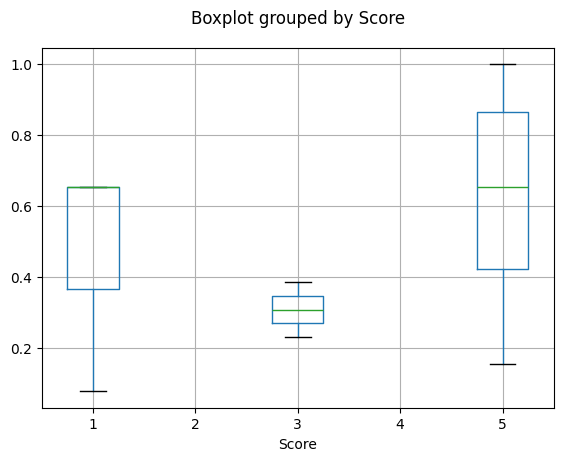

# 使用者與產品 embedding

> 原文：[examples/User_and_product_embeddings.ipynb](https://github.com/openai/openai-cookbook/blob/main/examples/User_and_product_embeddings.ipynb)


## 這篇在做什麼
這篇用訓練集算出使用者和產品的 embedding，再拿沒看過的測試集評估。評估方式是畫出使用者與產品的相似度對評論分數的關係。資料集來自 [Get_embeddings_from_dataset](Get_embeddings_from_dataset.md) 那篇。

## 學完你會
- 用平均同一個使用者或同一個產品的所有評論 embedding，得到使用者與產品 embedding。
- 用 cosine distance 算使用者與產品的相似度，並轉成百分位數正規化。
- 畫出各評論分數的相似度分佈，判斷這種訊號能不能預測評分。

## 開跑前
- 需要先跑完 Get_embeddings_from_dataset，產生帶 embedding 的資料集。

## 1. 計算使用者與產品 embedding

做法很簡單：把訓練集中關於同一個產品、或由同一個使用者寫的所有評論 embedding 取平均。

```python
import pandas as pd
import numpy as np
from sklearn.model_selection import train_test_split
from ast import literal_eval

df = pd.read_csv('data/fine_food_reviews_with_embeddings_1k.csv', index_col=0)  # note that you will need to generate this file to run the code below
df.head(2)
```

??? note "輸出"

    ```text
          ProductId          UserId  Score  \
    0    B003XPF9BO  A3R7JR3FMEBXQB      5   
    297  B003VXHGPK  A21VWSCGW7UUAR      4   

                                                   Summary  \
    0    where does one  start...and stop... with a tre...   
    297                   Good, but not Wolfgang Puck good   

                                                      Text  \
    0    Wanted to save some to bring to my Chicago fam...   
    297  Honestly, I have to admit that I expected a li...   

                                                  combined  n_tokens  \
    0    Title: where does one  start...and stop... wit...        52   
    297  Title: Good, but not Wolfgang Puck good; Conte...       178   

                                                 embedding  
    0    [0.03599238395690918, -0.02116263099014759, -0...  
    297  [-0.07042013108730316, -0.03175969794392586, -...
    ```

```python
df['babbage_similarity'] = df["embedding"].apply(literal_eval).apply(np.array)
X_train, X_test, y_train, y_test = train_test_split(df, df.Score, test_size = 0.2, random_state=42)

user_embeddings = X_train.groupby('UserId').babbage_similarity.apply(np.mean)
prod_embeddings = X_train.groupby('ProductId').babbage_similarity.apply(np.mean)
len(user_embeddings), len(prod_embeddings)
```

??? note "輸出"

    ```text
    (577, 706)
    ```

可以看到大部分使用者和產品在這 5 萬筆範例中只出現過一次。

## 2. 評估 embedding

評估推薦效果時，我們在沒看過的測試集上，看評論中使用者與產品 embedding 的相似度。計算使用者和產品 embedding 之間的 cosine distance，得到一個介於 0 到 1 的相似度分數。接著算每個相似度分數在所有預測分數中的百分位數，把分數正規化成平均分佈在 0 到 1 之間。

```python
from utils.embeddings_utils import cosine_similarity

# evaluate embeddings as recommendations on X_test
def evaluate_single_match(row):
    user_id = row.UserId
    product_id = row.ProductId
    try:
        user_embedding = user_embeddings[user_id]
        product_embedding = prod_embeddings[product_id]
        similarity = cosine_similarity(user_embedding, product_embedding)
        return similarity
    except Exception as e:
        return np.nan

X_test['cosine_similarity'] = X_test.apply(evaluate_single_match, axis=1)
X_test['percentile_cosine_similarity'] = X_test.cosine_similarity.rank(pct=True)
```

### 2.1 依評論分數視覺化 cosine similarity

我們把 cosine similarity 分數依評論分數分組，畫出每個評論分數對應的 cosine similarity 分佈。

```python
import matplotlib.pyplot as plt
import statsmodels.api as sm


correlation = X_test[['percentile_cosine_similarity', 'Score']].corr().values[0,1]
print('Correlation between user & vector similarity percentile metric and review number of stars (score): %.2f%%' % (100*correlation))

# boxplot of cosine similarity for each score
X_test.boxplot(column='percentile_cosine_similarity', by='Score')
plt.title('')
plt.show()
plt.close()
```

??? note "輸出"

    ```text
    Correlation between user & vector similarity percentile metric and review number of stars (score): 29.56%
    ```

    

可以看到一個微弱的趨勢：使用者與產品 embedding 的相似度越高，評論分數也越高。所以使用者和產品 embedding 能微弱地預測評論分數，甚至在使用者拿到產品之前就能預測。

因為這個訊號的運作方式和較常見的 collaborative filtering 不同，可以作為額外特徵，稍微改善現有問題的表現。

## 重點整理
- 平均 embedding 是最簡單的使用者與產品表示法，不需要額外訓練。
- 大部分使用者和產品只出現一次，代表資料稀疏，平均出來的向量雜訊較大。
- 相似度轉成百分位數，可以讓不同分佈的分數放在同一個尺度比較。
- 這個訊號和 collaborative filtering 互補，適合當額外特徵而不是單獨使用。

## 練習
1. 把訓練集取樣的筆數改小，重新計算 embedding，看相似度與評分的趨勢有沒有變弱。
2. 只保留評論數大於 1 的使用者和產品，重畫分佈圖。
3. 把平均改成其他聚合方式（例如只取最近的幾則評論），比較趨勢。
