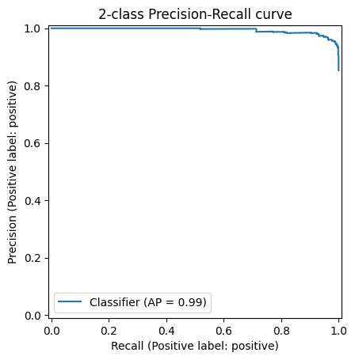
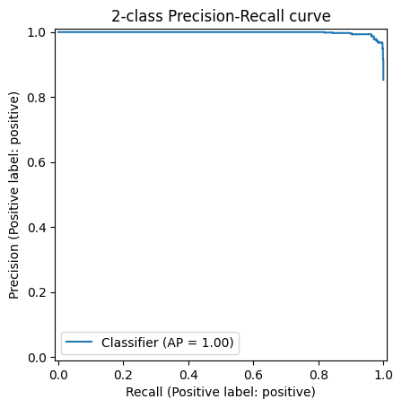

# 用 embedding 做 zero-shot 分類

> 原文：[examples/Zero-shot_classification_with_embeddings.ipynb](https://github.com/openai/openai-cookbook/blob/main/examples/Zero-shot_classification_with_embeddings.ipynb)


## 這篇在做什麼
這篇用 embedding 對評論做情感分類，完全不需要標註資料。資料集來自 [Get_embeddings_from_dataset](Get_embeddings_from_dataset.md) 那篇。
做法是替每個類別寫一段描述並取 embedding，再拿新樣本的 embedding 去跟這些類別 embedding 比對。

## 學完你會
- 不用任何訓練，只靠標籤描述的 embedding 預測評論是正面還是負面。
- 用 cosine distance 差值當預測分數，畫 precision-recall 曲線來調整取捨。
- 比較簡單標籤和較具描述性的標籤，在不同 embedding 下的表現差異。

## 開跑前
- 需要先跑完 Get_embeddings_from_dataset，產生帶 embedding 的資料集。
- 需要 OpenAI API key，用來替標籤描述取 embedding。

## Zero-shot 分類

我們把 4 星和 5 星評論定義為正面，1 星和 2 星評論定義為負面。3 星算中性，這個範例不使用。

```python
import pandas as pd
import numpy as np
from ast import literal_eval

from sklearn.metrics import classification_report

EMBEDDING_MODEL = "text-embedding-3-small"

datafile_path = "data/fine_food_reviews_with_embeddings_1k.csv"

df = pd.read_csv(datafile_path)
df["embedding"] = df.embedding.apply(literal_eval).apply(np.array)

# convert 5-star rating to binary sentiment
df = df[df.Score != 3]
df["sentiment"] = df.Score.replace({1: "negative", 2: "negative", 4: "positive", 5: "positive"})
```

### Zero-Shot 分類
zero-shot 分類是不經任何訓練就預測樣本的標籤。做法很簡單：替每個標籤（例如 positive 和 negative）的短描述取 embedding，再比較樣本 embedding 和標籤描述 embedding 之間的 cosine distance。

跟樣本最相似的標籤就是預測結果。我們也可以把預測分數定義為「到正面標籤的 cosine distance」減「到負面標籤的 cosine distance」。這個分數可以用來畫 precision-recall 曲線，換個 threshold 就能在 precision 和 recall 之間選不同的取捨。

```python
from utils.embeddings_utils import cosine_similarity, get_embedding
from sklearn.metrics import PrecisionRecallDisplay

def evaluate_embeddings_approach(
    labels = ['negative', 'positive'],
    model = EMBEDDING_MODEL,
):
    label_embeddings = [get_embedding(label, model=model) for label in labels]

    def label_score(review_embedding, label_embeddings):
        return cosine_similarity(review_embedding, label_embeddings[1]) - cosine_similarity(review_embedding, label_embeddings[0])

    probas = df["embedding"].apply(lambda x: label_score(x, label_embeddings))
    preds = probas.apply(lambda x: 'positive' if x>0 else 'negative')

    report = classification_report(df.sentiment, preds)
    print(report)

    display = PrecisionRecallDisplay.from_predictions(df.sentiment, probas, pos_label='positive')
    _ = display.ax_.set_title("2-class Precision-Recall curve")

evaluate_embeddings_approach(labels=['negative', 'positive'], model=EMBEDDING_MODEL)
```

??? note "輸出"

    ```text
                  precision    recall  f1-score   support

        negative       0.54      0.92      0.68       136
        positive       0.98      0.87      0.92       789

        accuracy                           0.87       925
       macro avg       0.76      0.89      0.80       925
    weighted avg       0.92      0.87      0.89       925
    ```

    

可以看到這個分類器已經表現得非常好，而且我們用的是 similarity embedding 和最簡單的標籤名稱。接著試著用更有描述性的標籤名稱和 search embedding 來改進。

```python
evaluate_embeddings_approach(labels=['An Amazon review with a negative sentiment.', 'An Amazon review with a positive sentiment.'])
```

??? note "輸出"

    ```text
                  precision    recall  f1-score   support

        negative       0.76      0.96      0.85       136
        positive       0.99      0.95      0.97       789

        accuracy                           0.95       925
       macro avg       0.88      0.96      0.91       925
    weighted avg       0.96      0.95      0.95       925
    ```

    

用 search embedding 加上描述性名稱，表現又有進一步提升。

```python
evaluate_embeddings_approach(labels=['An Amazon review with a negative sentiment.', 'An Amazon review with a positive sentiment.'])
```

??? note "輸出"

    ```text
                  precision    recall  f1-score   support

        negative       0.76      0.96      0.85       136
        positive       0.99      0.95      0.97       789

        accuracy                           0.95       925
       macro avg       0.88      0.96      0.91       925
    weighted avg       0.96      0.95      0.95       925
    ```

    

如上所示，用 embedding 做 zero-shot 分類可以得到很好的結果，標籤比單一簡單字詞更有描述性時更是如此。

## 重點整理
- zero-shot 分類不需要訓練資料，只要把標籤本身變成 embedding。
- 預測分數（兩個標籤距離的差）可以拿來畫 precision-recall 曲線，再選 threshold。
- 標籤名稱寫得越有描述性，效果通常越好。
- 不同用途的 embedding 模型（similarity 和 search）對結果有影響，值得試。

## 練習
1. 把標籤描述從單字改成你自己寫的一句話，重跑評估，看表現有沒有變化。
2. 調整 threshold，觀察 precision 和 recall 怎麼變，挑一個你覺得合適的值。
3. 加入 3 星評論當第三個類別（neutral），為它寫描述，看三分類的準確率。
