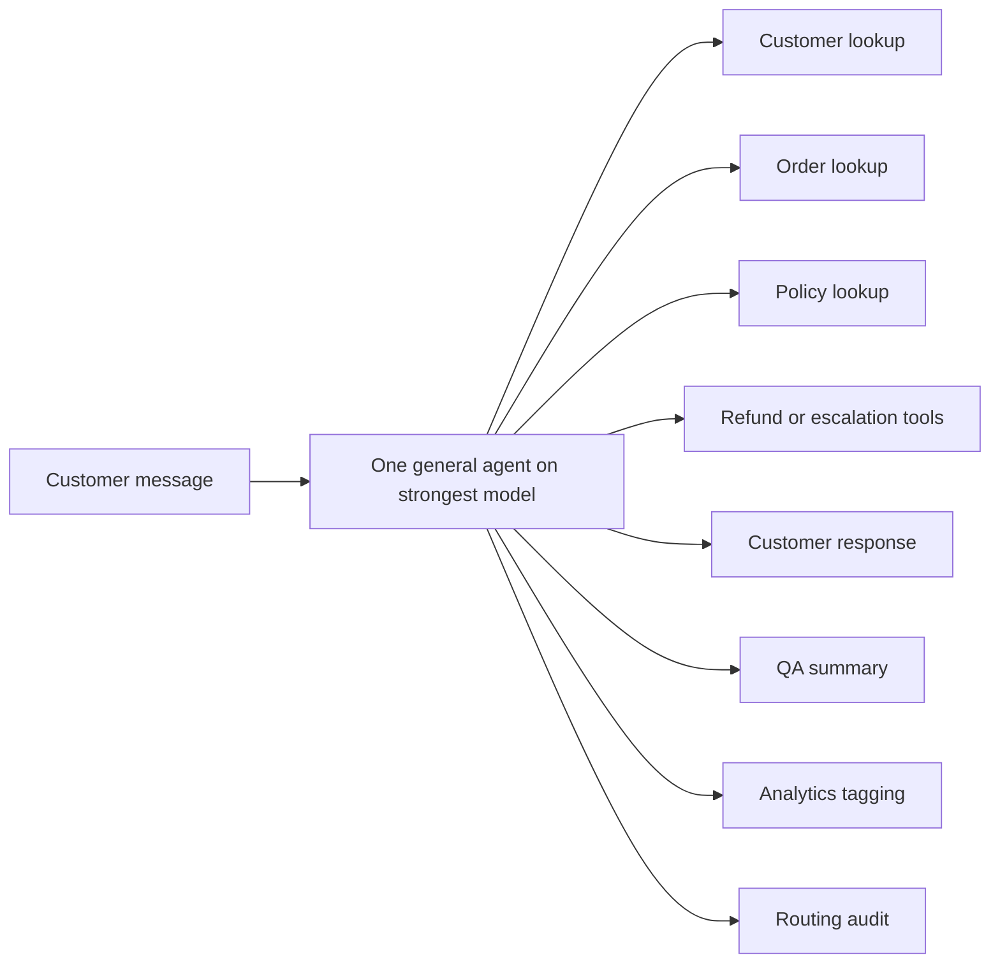

# 為成本與品質優化客服 Agent

> 原文：[examples/agent_optimization/optimizing_agents_for_cost_and_quality.ipynb](https://github.com/openai/openai-cookbook/blob/main/examples/agent_optimization/optimizing_agents_for_cost_and_quality.ipynb)

從成本、延遲和表現三個面向優化 agent。

## 這篇在做什麼

這篇示範一套可以重複跑的 agent 優化流程：先量出 baseline，一次只改 workflow 的一個環節，確認品質沒掉才接受省下來的錢。範例用合成的電商客服工單，加上確定性的模擬，所以不用花 API 費用。同一套量測迴圈也能套到其他 agent workflow。

## 學完你會

- 在同一組 eval set 上量測品質、延遲、tool 使用量和總成本。
- 用 prompt 與 tool 控制、model routing、prompt caching 減少不必要的工作。
- 把面向客戶的工作和離線的後續處理拆開，並檢查拆完之後的取捨。

## 開跑前

程式預設是 dry-run 模式，不會呼叫 API。想跑選用的 live 範例，需要設定 `OPENAI_API_KEY` 和 `RUN_LIVE_API_CALLS=true`（會產生費用）。

## 大綱

1. 定義成功標準，準備一組小而有代表性的 eval set。
2. 建立刻意寫得沒效率的 baseline 客服 agent。
3. 量測 baseline 的成本、token、品質、延遲和 tool call 次數。
4. 套用 prompt、輸出、tool 和 context 的控制。
5. 把簡單的步驟交給較小的模型。
6. 調整 request 結構以利用 prompt caching。
7. 拆開即時工作和後續工作。
8. 加上監控、eval 和 guardrail。

## 情境與 agent 設定

這個虛構的電商助理處理訂單狀態、貨物損壞、退款資格、重複扣款和帳號存取問題。例行查詢值得拿小模型來評估；牽涉政策的案件則用來測試優化後的 workflow 還能不能正確升級給真人。

五個 mock tool 分別代表訂單系統（`lookup_order`）、客戶資料（`lookup_customer`）、政策來源（`lookup_policy`）、退款或換貨案件（`create_refund_case`）和真人客服（`escalate_to_human`）。它們都是本機的 Python function，所以即使跑 live 模型範例，也不會動到真實的客戶帳號。

Baseline 會把所有 tool 都開放出來、回傳過大的 payload、每個步驟都用完整模型，還會在回覆之前先做內部 QA、分析標記和 routing 稽核。後面幾輪維持同樣的業務任務，只減少不必要的工作，並把後續處理移出面向客戶的路徑。


## 參考資料

**最後驗證日期：2026 年 9 月 14 日。** 範例使用 GPT-5.4 系列模型；模型選擇和 caching 的章節也會談到 GPT-5.6 的考量。

| Reference | Details used here |
|---|---|
| [Responses API](https://developers.openai.com/api/reference/resources/responses/methods/create) | Output limits, reasoning, verbosity, usage, conversation state, and service tiers |
| [Function calling](https://developers.openai.com/api/docs/guides/function-calling) | Function schemas, `allowed_tools`, and forwarding reasoning and tool-call items |
| [Prompt caching](https://developers.openai.com/api/docs/guides/prompt-caching) | Stable prefixes, model-specific caching controls, and token accounting |
| [Compaction](https://developers.openai.com/api/docs/guides/compaction) | `context_management` and `compact_threshold` |
| [Cost optimization](https://developers.openai.com/api/docs/guides/cost-optimization) | Fewer requests, smaller token budgets, and model selection |
| [Batch API](https://developers.openai.com/api/docs/guides/batch) and [flex processing](https://developers.openai.com/api/docs/guides/flex-processing) | Offline processing, the Batch `24h` window, and flex availability tradeoffs |
| [GPT-5.4](https://developers.openai.com/api/docs/models/gpt-5.4), [mini](https://developers.openai.com/api/docs/models/gpt-5.4-mini), and [nano](https://developers.openai.com/api/docs/models/gpt-5.4-nano) | Standard text-token prices and supported reasoning settings |


## 環境設定

需要 Python 3.10 以上。Clone Cookbook repo，或下載整個[範例資料夾](https://github.com/openai/openai-cookbook/tree/main/examples/agent_optimization)，然後以 `examples/agent_optimization` 當工作目錄啟動 notebook，這樣本地 import 才找得到。

在你的 notebook 環境裡安裝相依套件：

```bash
pip install --upgrade openai pandas matplotlib jinja2 ipykernel
```

相同的相依套件也列在 [requirements.txt](https://github.com/openai/openai-cookbook/blob/bb95430abb908c1edddc38af5911109ab2ce3987/examples/agent_optimization/requirements.txt)。帶樣式的 pandas 表格需要 `jinja2`。輔助檔案包含 [mock 資料、tool 和 prompt](https://github.com/openai/openai-cookbook/blob/bb95430abb908c1edddc38af5911109ab2ce3987/examples/agent_optimization/support.py)、[模擬與檢查](https://github.com/openai/openai-cookbook/blob/bb95430abb908c1edddc38af5911109ab2ce3987/examples/agent_optimization/simulation.py)、[live API helper](https://github.com/openai/openai-cookbook/blob/bb95430abb908c1edddc38af5911109ab2ce3987/examples/agent_optimization/live_api.py)、[離線答案評估](https://github.com/openai/openai-cookbook/blob/bb95430abb908c1edddc38af5911109ab2ce3987/examples/agent_optimization/evaluation.py)，以及[情境評分](https://github.com/openai/openai-cookbook/blob/bb95430abb908c1edddc38af5911109ab2ce3987/examples/agent_optimization/scenarios.py)。

Notebook 預設不會呼叫 API。想啟用 live agent 範例，請在啟動 kernel 之前設定這些變數：

```bash
export OPENAI_API_KEY=...
export RUN_LIVE_API_CALLS=true
```

選用的答案 judge 有自己的開關 `RUN_LLM_JUDGE=true`，同樣需要 `OPENAI_API_KEY`。它會用 50 次付費的 judge request，替現有的 50 條模擬 trace（10 張工單 × 5 個版本）評分，不會跑 live agent。兩個開關都不設，就是完全離線執行。

由上到下依序執行 cell。Batch 範例會在 `outputs/` 底下寫一個本機檔案；它的提交程式碼只顯示給你看，不會執行。


```python
import json
import math
import os

os.environ.setdefault("MPLCONFIGDIR", "/tmp/matplotlib")

import matplotlib.pyplot as plt
import pandas as pd
from IPython.display import display
from openai import OpenAI

RUN_LIVE_API_CALLS = os.environ.get("RUN_LIVE_API_CALLS", "false").lower() == "true"
RUN_LLM_JUDGE = os.environ.get("RUN_LLM_JUDGE", "false").lower() == "true"
if (RUN_LIVE_API_CALLS or RUN_LLM_JUDGE) and not os.environ.get("OPENAI_API_KEY"):
    raise RuntimeError("Set OPENAI_API_KEY before enabling the live agent or judge.")
client = OpenAI() if RUN_LIVE_API_CALLS else None
judge_client = OpenAI() if RUN_LLM_JUDGE else None

pd.set_option("display.max_columns", 40)
pd.set_option("display.width", 140)
print("RUN_LIVE_API_CALLS =", RUN_LIVE_API_CALLS)
print("RUN_LLM_JUDGE =", RUN_LLM_JUDGE)
```

??? note "輸出"

    ```text
    RUN_LIVE_API_CALLS = True
    RUN_LLM_JUDGE = True
    ```

## 成功標準與限制

只有在 agent 仍然用對事實、遵守政策、做了該做的動作、而且正確升級時，才接受省下來的成本。簡潔的回覆必須告訴客戶下一步，又不能洩漏內部資料。這些品質檢查通過之後，再比較 p50/p95 延遲和總成本。

這組 eval set 刻意做得很小。正式環境要用分層抽樣，涵蓋主要的 intent、風險等級、語言、地區、客戶等級和邊界案例。另外留一組 holdout，每個優化都要先過品質關，才比較省了多少。


## 模擬約定

預設流程使用 mock 資料和模型化的指標。它示範的是量測迴圈，數字不是正式環境的 benchmark。

這套 harness 量的是序列化後的文字長度，並把 tool、action、escalation 和回覆用語的檢查結果跟 fixture 對照。Token 數是從長度估出來的。Reasoning token、延遲、cache 命中和整體品質分數都用示意性的公式算；成本則是把驗證過的價格表套在估計的用量上。

Routing 和優化後的 action 來自 fixture 標籤，所以這個模擬並沒有衡量模型自己選擇的能力。回覆檢查用的是不分大小寫的字面片語比對，可能會誤殺合理的換句話說，也無法證明事實正確。要做上線決策，請把這些 trace 換成真實的使用量、時間、tool 結果、routing 決策，以及校準過的 judge 或人工評估。


## 優化旋鈕

| Knob | Inefficient baseline | Optimized pattern | Primary metric |
|---|---|---|---|
| Prompt and output | Broad "be thorough" instructions and long answers | Specific task rules, concise response contract, `text.verbosity="low"`, capped output | Output tokens, concision, quality |
| Reasoning effort | High reasoning for every ticket | Low for routine work, higher only for high-risk decisions | Reasoning tokens, latency |
| Tool surface | All tools exposed for every request | Full stable tool list plus `tool_choice.allowed_tools` per task | Tool calls, cacheability |
| Tool schemas | Verbose descriptions and broad payload expectations | Small schemas with only decision-critical arguments | Input tokens |
| Tool payloads | Raw CRM, carrier, audit, and appendix blobs | Slim fields needed for the next decision | Tool output tokens |
| Model routing | One large model for all steps | Nano for triage/tags, mini for routine resolution, full model for high-risk cases | Cost, latency, escalation accuracy |
| Prompt caching | Volatile ticket data mixed into the prefix | Stable instructions, tools, policy framing, and schema first; ticket data last | Cached input tokens, cost |
| Workflow split | QA, analytics, summaries, and audits in the customer path | Customer resolution sync; QA/tags/reporting async via background, flex, or Batch | p50 latency, synchronous cost |
| Guardrails and evals | Informal spot checks | Deterministic checks plus judge schema for live traces | Regression rate, safety pass rate |


## 範例 eval set

這組小型的範例 eval set 提供具體的工單、預期的 tool、預期的 action、escalation 標籤和禁止出現的說法，用來替每一輪優化評分。


```python
from support import EVAL_SET

pd.DataFrame(EVAL_SET)[
    [
        "ticket_id",
        "intent",
        "risk",
        "difficulty",
        "expected_tools",
        "expected_action",
        "must_escalate",
    ]
]
```

??? note "輸出"

    ```text
      ticket_id                  intent    risk             difficulty                                     expected_tools  \
    0     T-001            order_status     low          simple_lookup                                     [lookup_order]   
    1     T-002        damaged_delivery  medium         routine_policy                      [lookup_order, lookup_policy]   
    2     T-003      refund_eligibility  medium         routine_policy  [lookup_order, lookup_policy, create_refund_case]   
    3     T-004           billing_issue  medium       sensitive_policy   [lookup_order, lookup_policy, escalate_to_human]   
    4     T-005          account_access    high       account_security  [lookup_customer, lookup_policy, escalate_to_h...   
    5     T-006          refund_dispute    high  outside_policy_window   [lookup_order, lookup_policy, escalate_to_human]   
    6     T-007  delivered_not_received  medium         routine_policy                      [lookup_order, lookup_policy]   
    7     T-008       high_value_damage    high      high_value_policy   [lookup_order, lookup_policy, escalate_to_human]   
    8     T-009      refund_eligibility     low         routine_policy  [lookup_order, lookup_policy, create_refund_case]   
    9     T-010          account_access    high       account_security  [lookup_customer, lookup_policy, escalate_to_h...   

                            expected_action  must_escalate  
    0                    provide_status_eta          False  
    1  request_photo_then_offer_replacement          False  
    2                      open_refund_case          False  
    3               escalate_billing_review           True  
    4             escalate_account_security           True  
    5                escalate_refund_review           True  
    6            start_delivery_trace_steps          False  
    7            escalate_high_value_damage           True  
    8                      open_refund_case          False  
    9             escalate_account_security           True
    ```

## 客服資料與 tool

[support.py](https://github.com/openai/openai-cookbook/blob/bb95430abb908c1edddc38af5911109ab2ce3987/examples/agent_optimization/support.py) 裡的五個本機 tool function 用來代替內部系統。Baseline 會回傳過大的 payload，示範 tool 輸出如何主宰 input token；後面幾輪只回傳決策和回覆需要的欄位。

下面的 cell 顯示一筆精簡過的訂單紀錄。這些 mock action tool 只會回傳合成結果，不會真的建立案件或升級。


```python
from support import lookup_order

# Inspect the decision-critical fields returned by the slim payload.
print(json.dumps(lookup_order("O-1001", payload="slim"), indent=2))
```

??? note "輸出"

    ```text
    {
      "found": true,
      "order_id": "O-1001",
      "status": "in_transit",
      "carrier": "UPS",
      "eta": "tomorrow",
      "delivered_days_ago": null,
      "payment_status": "paid_once",
      "item_value": 18.0,
      "events": [
        "regional_delay"
      ]
    }
    ```

```python
from support import SLIM_TOOLS, VERBOSE_TOOLS, allowed_tool_choice

print("Verbose tool schema tokens:", math.ceil(len(json.dumps(VERBOSE_TOOLS)) / 4))
print("Slim tool schema tokens:", math.ceil(len(json.dumps(SLIM_TOOLS)) / 4))
```

??? note "輸出"

    ```text
    Verbose tool schema tokens: 550
    Slim tool schema tokens: 397
    ```

## Baseline 架構

這個糟糕的 baseline 在一條同步路徑裡做了太多事。



寬鬆的指示、高 reasoning effort 和不設限的 tool，讓每個 request 都很貴。龐大的 schema 和冗長的 payload 撐大了 input，而過長的回答和同步 QA 則讓客戶收到回覆之前多了一堆工作。


```python
from support import CONTROLLED_PROMPT

print(CONTROLLED_PROMPT)
```

??? note "輸出"

    ```text
    Role: E-commerce support assistant.

    Goal: Resolve routine support tickets with the fewest necessary tool calls while preserving policy correctness.

    Tool rules:
    - Use only tools required for the current decision.
    - Order status: order lookup only.
    - Damaged delivery or refund: order lookup plus the relevant policy.
    - Billing duplicate charge: order lookup plus billing policy, then escalate.
    - Account access with unverified identity: customer lookup plus account policy, then escalate.

    Response rules:
    - Give the customer the outcome and next step.
    - Do not expose internal reasoning, raw tool data, audit notes, or policy text.
    - Keep the customer-facing answer under 120 words unless escalation legally requires more detail.
    ```

## 指標 helper

Live helper 會讀取 `input_tokens`、`output_tokens`、`total_tokens`、`input_tokens_details.cached_tokens` 和 `output_tokens_details.reasoning_tokens`。Output token 的用量已經包含 reasoning token，算成本時不要再加一次。

下表是標準費率下每百萬個文字 token 的美元價格，在 2026 年 9 月 14 日對照 [GPT-5.4](https://developers.openai.com/api/docs/models/gpt-5.4)、[mini](https://developers.openai.com/api/docs/models/gpt-5.4-mini) 和 [nano](https://developers.openai.com/api/docs/models/gpt-5.4-nano) 的頁面驗證過。它涵蓋這裡用到的短 GPT-5.4 request。這個估算器不包含長 context 加價、priority 定價，也不含 GPT-5.6 的 cache 寫入費用；要改那些設定之前，請先更新它。最新費率請看[價格頁](https://developers.openai.com/api/docs/pricing)。


```python
from simulation import MODEL_PRICES_USD_PER_1M

pd.DataFrame(MODEL_PRICES_USD_PER_1M).T.rename_axis("model")
```

??? note "輸出"

    ```text
                  input  cached_input  output
    model                                    
    gpt-5.4        2.50         0.250   15.00
    gpt-5.4-mini   0.75         0.075    4.50
    gpt-5.4-nano   0.20         0.020    1.25
    ```

## Dry-run 模擬

[模擬 helper](https://github.com/openai/openai-cookbook/blob/bb95430abb908c1edddc38af5911109ab2ce3987/examples/agent_optimization/simulation.py) 把每個版本套在同一批工單上，從 prompt 和 payload 估算用量，並記錄客戶回覆和它的品質檢查。缺少必要用語或出現禁止的說法，會拉低品質並讓 demo 的政策檢查失敗，即使 action 和 escalation 標籤都吻合也一樣。

優化後的版本假設 application router 是正確的，而且預期 action 已知。Caching 用的是簡化的暖 cache 假設和 1,024 token 的資格門檻，並不是對真實 cache 行為的量測。重複的 playbook 讓 demo 夠大，足以走到那個分支；正式環境的 prompt 應該放真正有用的共用 context，而 cache 資格還取決於 request 的設定。

最後一個版本把背景工作從同步延遲中移除，但仍然計入它們的 token 和 Batch 成本。依賴平均值之前，先檢查個別的 trace。


```python
from simulation import CACHE_FRIENDLY_PROMPT, VARIANT_ORDER, simulate_trace

traces = pd.DataFrame(
    simulate_trace(ticket, variant)
    for variant in VARIANT_ORDER
    for ticket in EVAL_SET
)
traces.drop(columns="tool_results").head()
```

??? note "輸出"

    ```text
               variant variant_label ticket_id              intent    risk        difficulty    model  routing_tokens  tool_calls  \
    0  00_bad_baseline  Bad baseline     T-001        order_status     low     simple_lookup  gpt-5.4               0           5   
    1  00_bad_baseline  Bad baseline     T-002    damaged_delivery  medium    routine_policy  gpt-5.4               0           5   
    2  00_bad_baseline  Bad baseline     T-003  refund_eligibility  medium    routine_policy  gpt-5.4               0           5   
    3  00_bad_baseline  Bad baseline     T-004       billing_issue  medium  sensitive_policy  gpt-5.4               0           5   
    4  00_bad_baseline  Bad baseline     T-005      account_access    high  account_security  gpt-5.4               0           5   

                                          expected_tools                                              tools                          action  \
    0                                       lookup_order  lookup_customer, lookup_order, lookup_policy, ...              provide_status_eta   
    1                        lookup_order, lookup_policy  lookup_customer, lookup_order, lookup_policy, ...  open_replacement_without_photo   
    2    lookup_order, lookup_policy, create_refund_case  lookup_customer, lookup_order, lookup_policy, ...          escalate_refund_review   
    3     lookup_order, lookup_policy, escalate_to_human  lookup_customer, lookup_order, lookup_policy, ...         escalate_billing_review   
    4  lookup_customer, lookup_policy, escalate_to_human  lookup_customer, lookup_order, lookup_policy, ...       escalate_account_security   

                            expected_action  input_tokens  latency_input_tokens  cacheable_prefix_tokens  cached_tokens  output_tokens  \
    0                    provide_status_eta         12301                 12301                        0              0            612   
    1  request_photo_then_offer_replacement         12273                 12273                        0              0            644   
    2                      open_refund_case         12178                 12178                        0              0            640   
    3               escalate_billing_review         12166                 12166                        0              0            664   
    4             escalate_account_security          7415                  7415                        0              0            697   

       visible_output_tokens  reasoning_tokens  ...  total_tokens  latency_s  sync_cost_usd  background_tokens  background_cost_usd  cost_usd  \
    0                    167               445  ...         12913       4.88       0.039933                  0                  0.0  0.039933   
    1                    174               470  ...         12917       4.88       0.040343                  0                  0.0  0.040343   
    2                    170               470  ...         12818       4.87       0.040045                  0                  0.0  0.040045   
    3                    169               495  ...         12830       4.87       0.040375                  0                  0.0  0.040375   
    4                    172               525  ...          8112       3.97       0.028993                  0                  0.0  0.028993   

       escalated                                  customer_response missing_required_tools extra_tool_calls  \
    0      False  I reviewed your message for ticket T-001 and c...                                       4   
    1      False  I reviewed your message for ticket T-002 and c...                                       3   
    2       True  I reviewed your message for ticket T-003 and c...                                       2   
    3       True  I reviewed your message for ticket T-004 and c...                                       2   
    4       True  I reviewed your message for ticket T-005 and c...                                       2   

                                       unnecessary_tools escalation_correct  action_correct  policy_compliant  concise  response_complete  \
    0  create_refund_case, escalate_to_human, lookup_...               True            True             False    False              False   
    1  create_refund_case, escalate_to_human, lookup_...               True           False             False    False               True   
    2                 escalate_to_human, lookup_customer              False           False             False    False              False   
    3                create_refund_case, lookup_customer               True            True              True    False               True   
    ... (省略 10 行)
    ```

```python
summary = (
    traces.groupby(["variant", "variant_label"], sort=False)
    .agg(
        tickets=("ticket_id", "count"),
        mean_quality=("quality_score", "mean"),
        policy_compliance=("policy_compliant", "mean"),
        action_accuracy=("action_correct", "mean"),
        escalation_accuracy=("escalation_correct", "mean"),
        concise_rate=("concise", "mean"),
        mean_tool_calls=("tool_calls", "mean"),
        mean_extra_tool_calls=("extra_tool_calls", "mean"),
        mean_input_tokens=("input_tokens", "mean"),
        mean_cached_tokens=("cached_tokens", "mean"),
        mean_output_tokens=("output_tokens", "mean"),
        mean_reasoning_tokens=("reasoning_tokens", "mean"),
        mean_sync_tokens=("sync_tokens", "mean"),
        mean_total_tokens=("total_tokens", "mean"),
        p50_latency_s=("latency_s", "median"),
        p95_latency_s=("latency_s", lambda s: s.quantile(0.95)),
        sync_cost_per_ticket_usd=("sync_cost_usd", "mean"),
        background_cost_per_ticket_usd=("background_cost_usd", "mean"),
        cost_per_ticket_usd=("cost_usd", "mean"),
    )
    .reset_index()
)

baseline_cost = summary.loc[summary["variant"] == "00_bad_baseline", "cost_per_ticket_usd"].iloc[0]
baseline_tokens = summary.loc[summary["variant"] == "00_bad_baseline", "mean_total_tokens"].iloc[0]
baseline_latency = summary.loc[summary["variant"] == "00_bad_baseline", "p50_latency_s"].iloc[0]

summary["cost_reduction_vs_baseline"] = 1 - summary["cost_per_ticket_usd"] / baseline_cost
summary["token_reduction_vs_baseline"] = 1 - summary["mean_total_tokens"] / baseline_tokens
summary["latency_reduction_vs_baseline"] = 1 - summary["p50_latency_s"] / baseline_latency
summary["monthly_cost_at_100k_tickets"] = summary["cost_per_ticket_usd"] * 100_000

summary_view = summary[
    [
        "variant_label",
        "mean_quality",
        "policy_compliance",
        "action_accuracy",
        "escalation_accuracy",
        "mean_tool_calls",
        "mean_extra_tool_calls",
        "mean_sync_tokens",
        "mean_total_tokens",
        "mean_cached_tokens",
        "p50_latency_s",
        "cost_per_ticket_usd",
        "cost_reduction_vs_baseline",
        "monthly_cost_at_100k_tickets",
    ]
]

display(
    summary_view.style.format(
        {
            "mean_quality": "{:.2f}",
            "policy_compliance": "{:.0%}",
            "action_accuracy": "{:.0%}",
            "escalation_accuracy": "{:.0%}",
            "mean_tool_calls": "{:.1f}",
            "mean_extra_tool_calls": "{:.1f}",
            "mean_sync_tokens": "{:,.0f}",
            "mean_total_tokens": "{:,.0f}",
            "mean_cached_tokens": "{:,.0f}",
            "p50_latency_s": "{:.2f}",
            "cost_per_ticket_usd": "${:.5f}",
            "cost_reduction_vs_baseline": "{:.0%}",
            "monthly_cost_at_100k_tickets": "${:,.0f}",
        }
    )
)
```

??? note "輸出"

    ```text
    <pandas.io.formats.style.Styler at 0x116b33740>
    ```

## 逐輪的影響

每一列都是拿該輪跟上一輪比較。這樣比單一的前後對照更容易看出每個旋鈕的作用。


```python
round_impact = summary[
    [
        "variant_label",
        "mean_quality",
        "policy_compliance",
        "mean_tool_calls",
        "mean_extra_tool_calls",
        "mean_sync_tokens",
        "mean_total_tokens",
        "mean_cached_tokens",
        "p50_latency_s",
        "cost_per_ticket_usd",
    ]
].copy()

for col in ["mean_sync_tokens", "mean_total_tokens", "p50_latency_s", "cost_per_ticket_usd"]:
    round_impact[f"{col}_delta_vs_previous"] = round_impact[col].diff()

round_impact["quality_delta_vs_previous"] = round_impact["mean_quality"].diff()

display(
    round_impact.style.format(
        {
            "mean_quality": "{:.2f}",
            "policy_compliance": "{:.0%}",
            "mean_tool_calls": "{:.1f}",
            "mean_extra_tool_calls": "{:.1f}",
            "mean_sync_tokens": "{:,.0f}",
            "mean_total_tokens": "{:,.0f}",
            "mean_cached_tokens": "{:,.0f}",
            "p50_latency_s": "{:.2f}",
            "cost_per_ticket_usd": "${:.5f}",
            "mean_sync_tokens_delta_vs_previous": "{:+,.0f}",
            "mean_total_tokens_delta_vs_previous": "{:+,.0f}",
            "p50_latency_s_delta_vs_previous": "{:+.2f}",
            "cost_per_ticket_usd_delta_vs_previous": "${:+.5f}",
            "quality_delta_vs_previous": "{:+.2f}",
        }
    )
)
```

??? note "輸出"

    ```text
    <pandas.io.formats.style.Styler at 0x116dded50>
    ```

```python
plot_df = summary.copy()
labels = plot_df["variant_label"].str.replace("Round ", "R", regex=False)

fig, axes = plt.subplots(1, 3, figsize=(16, 4))

axes[0].bar(labels, plot_df["mean_sync_tokens"], color="#4C78A8")
axes[0].set_title("Mean synchronous tokens")
axes[0].set_ylabel("sync tokens per ticket")
axes[0].tick_params(axis="x", rotation=30)

axes[1].bar(labels, plot_df["cost_per_ticket_usd"], color="#59A14F")
axes[1].set_title("Estimated cost")
axes[1].set_ylabel("USD per ticket")
axes[1].tick_params(axis="x", rotation=30)

axes[2].plot(labels, plot_df["mean_quality"], marker="o", color="#E15759")
axes[2].set_ylim(0, 1.0)
axes[2].set_title("Quality score")
axes[2].set_ylabel("score")
axes[2].tick_params(axis="x", rotation=30)

plt.tight_layout()
plt.show()
```

## 選用：live Responses API tool 迴圈

[live_api.py](https://github.com/openai/openai-cookbook/blob/bb95430abb908c1edddc38af5911109ab2ce3987/examples/agent_optimization/live_api.py) 的實作會在附加 function 結果之前先轉送 `response.output`，以保留 reasoning 和 tool-call item。後續的 request 沿用設定好的 tool choice，讓流程能先查訂單和政策，再呼叫退款。經過 `max_tool_rounds` 批 tool 之後，最後一個 request 用 `tool_choice="none"` 取得答案，不再執行更多 tool。

這個範例用一張退款工單，並從同一張工單推出允許的 tool。這個 router 仍然用 fixture 標籤；正式流量請換成評估過的應用邏輯。如果 response 不完整，或最後出現非預期的 tool call，會直接丟出錯誤，而不是當成完成的答案回報。

對於分開的對話回合，可以用 `previous_response_id` 帶狀態。想讓指示套用到下一個 request，就要再提供一次 instructions。


```python
from live_api import (
    background_followup_request,
    live_config_for_ticket,
    run_live_support_ticket,
)

# Keep the allowed tools tied to the ticket being evaluated.
live_ticket = EVAL_SET[2]  # Order/policy lookup, then open a refund case.
live_config = live_config_for_ticket(live_ticket, "01_prompt_tool_context_controls")
```

```python
if RUN_LIVE_API_CALLS:
    live_result = run_live_support_ticket(live_ticket, live_config, client=client)
    print(live_result["response_text"])
    display(pd.DataFrame([{k: v for k, v in live_result.items() if k not in {"response_text", "tool_results"}}]))
else:
    print("Dry-run mode. Set OPENAI_API_KEY and RUN_LIVE_API_CALLS=true to run a live Responses API ticket.")
```

??? note "輸出"

    ```text
    Your refund request is eligible, and I’ve opened a return/refund case for order O-1003.

    Next step: please use the return instructions from your order page or confirmation email to send the item back. Once the return is received and processed, your refund will be issued.
    ```

    ```text
                                config ticket_id    model  tool_calls  latency_s  estimated_cost_usd  input_tokens  cached_tokens  \
    0  01_prompt_tool_context_controls     T-003  gpt-5.4           3   8.056909            0.008085          1788              0   

       output_tokens  reasoning_tokens  total_tokens  
    0            241                84          2029
    ```

## 優化第 1 輪：prompt、tool 與 context 控制

先從具體的回覆規則和 tool 規則開始。下面的 request 結合了低 verbosity、低 reasoning effort、輸出上限和一組允許的 tool 子集。輸出上限同時涵蓋可見輸出和 reasoning token，所以調這個值時要檢查有沒有不完整的 response。

Helper 也限制 tool 的輪數，並回傳精簡的 payload。對於很長的對話，壓縮或截斷要小心評估：拿掉較早的 context 可能會丟掉下一個決策需要的事實。

這個 demo 用已知的工單 metadata 來限制 tool。正式環境的 router 需要另外評估，並且為低信心的 routing 準備 fallback。如果要用 prompt 優化，請針對一個具體觀察到的失敗，然後重跑同一批 eval。


```python
round1_request_example = {
    "model": "gpt-5.4",
    "instructions": CONTROLLED_PROMPT,
    "tools": SLIM_TOOLS,
    "tool_choice": allowed_tool_choice(["lookup_order", "lookup_policy"], mode="auto"),
    "reasoning": {"effort": "low"},
    "text": {"verbosity": "low"},
    "max_output_tokens": 350,
    "parallel_tool_calls": True,
    "truncation": "auto",
    "context_management": [{"type": "compaction", "compact_threshold": 20_000}],
    "input": [
        {
            "role": "user",
            "content": "My blender arrived cracked. Order O-1002. Can you replace it?",
        }
    ],
}

print(json.dumps(round1_request_example, indent=2)[:2400] + "\n...")
```

??? note "輸出"

    ```text
    {
      "model": "gpt-5.4",
      "instructions": "Role: E-commerce support assistant.\n\nGoal: Resolve routine support tickets with the fewest necessary tool calls while preserving policy correctness.\n\nTool rules:\n- Use only tools required for the current decision.\n- Order status: order lookup only.\n- Damaged delivery or refund: order lookup plus the relevant policy.\n- Billing duplicate charge: order lookup plus billing policy, then escalate.\n- Account access with unverified identity: customer lookup plus account policy, then escalate.\n\nResponse rules:\n- Give the customer the outcome and next step.\n- Do not expose internal reasoning, raw tool data, audit notes, or policy text.\n- Keep the customer-facing answer under 120 words unless escalation legally requires more detail.",
      "tools": [
        {
          "type": "function",
          "name": "lookup_customer",
          "description": "Fetch minimal customer verification and support tier fields.",
          "parameters": {
            "type": "object",
            "properties": {
              "customer_id": {
                "type": "string"
              }
            },
            "required": [
              "customer_id"
            ],
            "additionalProperties": false
          },
          "strict": true
        },
        {
          "type": "function",
          "name": "lookup_order",
          "description": "Fetch order status, delivery age, payment status, and item value.",
          "parameters": {
            "type": "object",
            "properties": {
              "order_id": {
                "type": "string"
              }
            },
            "required": [
              "order_id"
            ],
            "additionalProperties": false
          },
          "strict": true
        },
    ... (省略 30 行)
    ```

```python
round1_detail = traces[traces["variant"].isin(["00_bad_baseline", "01_prompt_tool_context_controls"])]
display(
    round1_detail[
        [
            "variant_label",
            "ticket_id",
            "intent",
            "tools",
            "action",
            "extra_tool_calls",
            "policy_compliant",
            "concise",
            "visible_output_tokens",
            "total_tokens",
            "latency_s",
            "cost_usd",
            "quality_score",
        ]
    ].style.format({"cost_usd": "${:.5f}", "quality_score": "{:.2f}", "latency_s": "{:.2f}"})
)
```

??? note "輸出"

    ```text
    <pandas.io.formats.style.Styler at 0x117d1d040>
    ```

## 優化第 2 輪：模型選擇

依每個步驟選合適大小的模型，而不是挑一個全域模型。先為每個 workload 建立 GPT-5.4 baseline，再用同一批標註過的工單、prompt、tool、structured output schema 和品質標準來評估。

- **Intent 分類、資訊擷取、低風險 routing：** 用 `gpt-5.4-nano` 做工單分類、實體擷取和簡單標籤。比較 intent 準確率、高風險案件的漏判、structured output 的可靠度、延遲，以及每張分類正確工單的成本。（[GPT-5.4 nano](https://developers.openai.com/api/docs/models/gpt-5.4-nano)）

- **例行客服與訂單流程：** 用 `gpt-5.4-mini` 處理訂單狀態、貨物損壞、單純的退款資格檢查，以及其他需要政策判讀或 tool 使用的可重複客服任務。評估解決的正確性、tool call 準確度、政策遵循、p50/p95 延遲，以及每張成功解決工單的成本。（[GPT-5.4 mini](https://developers.openai.com/api/docs/models/gpt-5.4-mini)）

- **複雜或高風險案件：** 用 `gpt-5.4` 處理帳號存取問題、重複扣款的升級、退款爭議和其他後果嚴重的互動。要保留確定性的授權與退款檢查、明確的升級規則，以及必要時的人工審查。衡量解決品質、政策遵循、延遲和端到端成本。（[GPT-5.4](https://developers.openai.com/api/docs/models/gpt-5.4)）

GPT-5.6 系列有對應這幾個層級的較新模型。[GPT-5.6 Luna](https://developers.openai.com/api/docs/models/gpt-5.6-luna)（`gpt-5.6-luna`）對應 nano 層級，用於分類和大量任務。[GPT-5.6 Terra](https://developers.openai.com/api/docs/models/gpt-5.6-terra)（`gpt-5.6-terra`）對應 mini 層級，用於例行客服流程。[GPT-5.6 Sol](https://developers.openai.com/api/docs/models/gpt-5.6-sol)（`gpt-5.6-sol`）對應完整模型層級，用於複雜或高風險案件。每一個都可以用同一批工單和品質標準，跟對應的 GPT-5.4 baseline 比較。

每次比較時，先用現有的 reasoning effort 設定，同時也評估低一級的設定。新模型在任務層級可能更省，只要它解決工單時需要的重試、不必要的 tool call 或升級比較少。只有在選定的模型明確支援時，才考慮 fine-tuning。（[GPT-5.6 遷移指南](https://developers.openai.com/api/docs/guides/latest-model)）


```python
from live_api import TRIAGE_SCHEMA

print(json.dumps(TRIAGE_SCHEMA, indent=2))
# Optional: from live_api import live_triage_example
# live_triage_example(EVAL_SET[0]["message"], client=client)
```

??? note "輸出"

    ```text
    {
      "type": "json_schema",
      "name": "support_triage",
      "strict": true,
      "schema": {
        "type": "object",
        "properties": {
          "intent": {
            "type": "string",
            "enum": [
              "order_status",
              "damaged_delivery",
              "refund_eligibility",
              "billing_issue",
              "account_access",
              "refund_dispute",
              "delivered_not_received",
              "high_value_damage"
            ]
          },
          "risk": {
            "type": "string",
            "enum": [
              "low",
              "medium",
              "high"
            ]
          },
          "needs_human": {
            "type": "boolean"
          },
          "order_id": {
            "type": [
              "string",
              "null"
            ]
          }
        },
        "required": [
          "intent",
    ... (省略 7 行)
    ```

```python
model_routing_view = traces[traces["variant"].isin(["01_prompt_tool_context_controls", "02_model_routing"])]
display(
    model_routing_view[
        [
            "variant_label",
            "ticket_id",
            "intent",
            "risk",
            "model",
            "routing_tokens",
            "total_tokens",
            "sync_cost_usd",
            "quality_score",
            "policy_compliant",
        ]
    ].style.format({"sync_cost_usd": "${:.5f}", "quality_score": "{:.2f}"})
)
```

??? note "輸出"

    ```text
    <pandas.io.formats.style.Styler at 0x117d1cb60>
    ```

## 優化第 3 輪：prompt caching

每個客服 request 都帶有相同的核心指示、政策規則、tool 定義和回覆 schema。Prompt caching 讓 API 在不同工單之間重用這份共用 context，減少重複處理並降低 input token 成本。客戶專屬的細節，例如訂單編號、帳號資訊和查回來的紀錄，應該放在共用前綴之後。

Prompt caching 在不同世代的模型之間有變化。用 `gpt-5.4-mini` 時，API 會自動辨識重複的前綴，即使客戶專屬細節變了，也能重用共用的客服 context。寫入新前綴不會另外收 cache 寫入費。保持 tool 定義一致，並用 `tool_choice.allowed_tools` 控制哪些 tool 可用，而不要更動共用的 tool 清單。

GPT-5.6 有兩個變化：cache 寫入要收費，而且開發者可以明確選擇 prompt 的哪一段要被 cache。用 `gpt-5.6-luna`、`gpt-5.6-terra` 或 `gpt-5.6-sol` 時，預設的 cache breakpoint 會放在最新一則訊息之後。如果那則訊息在工單之間會變，最長的 cache 前綴可能就對不上。Implicit 模式仍然可以重用較早且符合資格的訊息結尾，包括最初的 developer message 區塊。因為把內容寫進 cache 的價格是一般 input token 的 1.25 倍，反覆 cache 這些獨一無二的訊息，可能增加成本卻沒有產生有用的重用。

舉例來說，兩張訂單狀態工單可以共用同樣的客服指示、政策規則和 tool，即使一張問訂單 `O-1001`，另一張問 `O-2002`。在 GPT-5.6 上，把共用的 playbook 放在 developer message 的 `input_text` 區塊裡，並在訂單專屬細節之前，用 `prompt_cache_breakpoint={"mode": "explicit"}` 標記它的結尾。最上層的 `instructions` 不能放 breakpoint。把 `prompt_cache_options` 設成 explicit 模式並加上 `ttl="30m"`，兩個 request 使用同一個 `prompt_cache_key`，例如 `support_order_status_v1`。前綴符合資格且吻合時，第一張工單會寫入 playbook，之後的工單可以用 cached-input 費率重用它，同時正常處理自己的訂單細節。

比較 `cached_tokens` 和 `cache_write_tokens`，同時看延遲和每張已解決工單的成本。更多實作細節請看 [prompt caching 指南](https://developers.openai.com/api/docs/guides/prompt-caching)。


```python
cache_friendly_request = {
    "model": "gpt-5.4-mini",
    "instructions": CACHE_FRIENDLY_PROMPT,
    "tools": SLIM_TOOLS,
    "tool_choice": allowed_tool_choice(["lookup_order"], mode="auto"),
    "prompt_cache_key": "support_order_status_v1",
    "reasoning": {"effort": "low"},
    "text": {"verbosity": "low"},
    "max_output_tokens": 300,
    "input": [
        {
            "role": "user",
            "content": json.dumps(
                {
                    "ticket_id": "T-001",
                    "customer_id": "C-100",
                    "message": "Where is order O-1001?",
                    "order_id": "O-1001",
                }
            ),
        }
    ],
}

print(json.dumps(cache_friendly_request, indent=2)[:2400] + "\n...")
```

??? note "輸出"

    ```text
    {
      "model": "gpt-5.4-mini",
      "instructions": "Role: E-commerce support assistant.\nConstraints: Be concise, policy-compliant, and explicit about next steps. Do not disclose internal data.\nEscalate: duplicate charges, account access without verification, high-value disputes, and refunds outside the window.\nOutput shape: customer_message, resolution_type, escalate, internal_tags.\nTool contract: tool definitions are stable across requests; restrict callable tools with tool_choice.allowed_tools.\nVersion: support-agent-optimization-v1.\n\nStable support playbook digest:\n- Shipping delays: provide status, ETA, and tracking next steps; do not refund solely for short carrier delays.\n- Delivered-not-received: verify delivery details, ask the customer to check common locations, and start carrier trace steps when appropriate.\n- Damaged delivery: request photo evidence before offering replacement or refund; high-value damaged items require human review.\n- Refunds: standard returnable items are eligible within 30 days; outside-window or high-value disputes require human review.\n- Billing: duplicate-charge reports require billing review; acknowledge and escalate, but do not promise a completed refund.\n- Account access: when identity is not verified, escalate to account security; do not change credentials or contact information in chat.\n- Customer messages must be concise, policy-compliant, and explicit about next steps.\n- Internal notes, raw carrier payloads, CRM audit logs, and policy appendices must never be exposed to the customer.\nStable support playbook digest:\n- Shipping delays: provide status, ETA, and tracking next steps; do not refund solely for short carrier delays.\n- Delivered-not-received: verify delivery details, ask the customer to check common locations, and start carrier trace steps when appropriate.\n- Damaged delivery: request photo evidence before offering replacement or refund; high-value damaged items require human review.\n- Refunds: standard returnable items are eligible within 30 days; outside-window or high-value disputes require human review.\n- Billing: duplicate-charge reports require billing review; acknowledge and escalate, but do not promise a completed refund.\n- Account access: when identity is not verified, escalate to account security; do not change credentials or contact information in chat.\n- Customer messages must be
    ...
    ```

```python
previous_response_id_example = '''
from support import STABLE_SUPPORT_PREFIX

first = client.responses.create(
    model="gpt-5.4-mini",
    instructions=STABLE_SUPPORT_PREFIX,
    tools=SLIM_TOOLS,
    input="Customer asks: Where is order O-1001?",
    prompt_cache_key="support_order_status_v1",
)

follow_up = client.responses.create(
    model="gpt-5.4-mini",
    previous_response_id=first.id,
    instructions=STABLE_SUPPORT_PREFIX,
    input="Customer follow-up: the carrier link is stale. What should I do?",
    prompt_cache_key="support_order_status_v1",
)
'''

print(previous_response_id_example)
```

??? note "輸出"

    ```text

    from support import STABLE_SUPPORT_PREFIX

    first = client.responses.create(
        model="gpt-5.4-mini",
        instructions=STABLE_SUPPORT_PREFIX,
        tools=SLIM_TOOLS,
        input="Customer asks: Where is order O-1001?",
        prompt_cache_key="support_order_status_v1",
    )

    follow_up = client.responses.create(
        model="gpt-5.4-mini",
        previous_response_id=first.id,
        instructions=STABLE_SUPPORT_PREFIX,
        input="Customer follow-up: the carrier link is stale. What should I do?",
        prompt_cache_key="support_order_status_v1",
    )
    ```

```python
caching_view = traces[traces["variant"].isin(["02_model_routing", "03_prompt_caching"])]
display(
    caching_view[
        [
            "variant_label",
            "ticket_id",
            "model",
            "input_tokens",
            "cacheable_prefix_tokens",
            "cached_tokens",
            "latency_input_tokens",
            "output_tokens",
            "cost_usd",
            "latency_s",
            "quality_score",
        ]
    ].style.format({"cost_usd": "${:.5f}", "quality_score": "{:.2f}", "latency_s": "{:.2f}"})
)
```

??? note "輸出"

    ```text
    <pandas.io.formats.style.Styler at 0x117d1f320>
    ```

## 優化第 4 輪：拆開 workflow

分類、必要的查詢、解決或升級的決定，以及給客戶的回覆，留在同步路徑。QA、標籤、內部摘要、稽核和報表，如果不影響當下的結果，就移到後續工作。

預設或 priority 處理可以服務對延遲敏感的 request。Flex 用較慢的回應和偶爾的資源不可用，換取較低成本；請確認模型是否支援，並處理 timeout 或容量不足。Batch 適合有 `24h` 完成時間窗的離線工作。Background 模式讓 request 變成非同步，但本身沒有價格折扣。


```python
sync_request = {
    "model": "gpt-5.4-mini",
    "instructions": CACHE_FRIENDLY_PROMPT,
    "tools": SLIM_TOOLS,
    "tool_choice": allowed_tool_choice(["lookup_order", "lookup_policy"], mode="auto"),
    "input": "Customer says order O-1002 arrived cracked. Resolve or escalate.",
    "reasoning": {"effort": "low"},
    "text": {"verbosity": "low"},
    "max_output_tokens": 260,
    "service_tier": "default",
    "prompt_cache_key": "support_damaged_delivery_v1",
}

background_flex_request = background_followup_request(EVAL_SET[1])

print("Synchronous customer-facing request:")
print(json.dumps(sync_request, indent=2)[:1800] + "\n...")
print("\nFollow-up flex request:")
print(json.dumps(background_flex_request, indent=2)[:1600] + "\n...")
```

??? note "輸出"

    ```text
    Synchronous customer-facing request:
    {
      "model": "gpt-5.4-mini",
      "instructions": "Role: E-commerce support assistant.\nConstraints: Be concise, policy-compliant, and explicit about next steps. Do not disclose internal data.\nEscalate: duplicate charges, account access without verification, high-value disputes, and refunds outside the window.\nOutput shape: customer_message, resolution_type, escalate, internal_tags.\nTool contract: tool definitions are stable across requests; restrict callable tools with tool_choice.allowed_tools.\nVersion: support-agent-optimization-v1.\n\nStable support playbook digest:\n- Shipping delays: provide status, ETA, and tracking next steps; do not refund solely for short carrier delays.\n- Delivered-not-received: verify delivery details, ask the customer to check common locations, and start carrier trace steps when appropriate.\n- Damaged delivery: request photo evidence before offering replacement or refund; high-value damaged items require human review.\n- Refunds: standard returnable items are eligible within 30 days; outside-window or high-value disputes require human review.\n- Billing: duplicate-charge reports require billing review; acknowledge and escalate, but do not promise a completed refund.\n- Account access: when identity is not verified, escalate to account security; do not change credentials or contact information in chat.\n- Customer messages must be concise, policy-compliant, and explicit about next steps.\n- Internal notes, raw carrier payloads, CRM audit logs, and policy appendices must never be exposed to the customer.\nStable support playbook digest:\n- Shipping delays: provide status, ETA, and tracking next steps; do not refund solely for short carrier delays.\n- Delivered-not-received: verify delivery details, ask the customer to check common location
    ...

    Follow-up flex request:
    {
      "model": "gpt-5.4-nano",
      "input": "{\"ticket\": {\"ticket_id\": \"T-002\", \"customer_id\": \"C-200\", \"message\": \"My blender arrived cracked. Order O-1002. Can you replace it?\", \"intent\": \"damaged_delivery\", \"order_id\": \"O-1002\", \"risk\": \"medium\", \"difficulty\": \"routine_policy\", \"must_escalate\": false, \"expected_policy\": \"damaged_delivery\", \"expected_tools\": [\"lookup_order\", \"lookup_policy\"], \"expected_action\": \"request_photo_then_offer_replacement\", \"expected_resolution_type\": \"resolved_next_step\", \"expected_customer_response_contains\": [\"photo\", \"replacement\"], \"forbidden_response_claims\": [\"refund completed\", \"no photo needed\"]}, \"policy\": \"If damage is reported within 7 days of delivery, ask for a photo and offer replacement or refund after evidence is collected. High-value damaged items over $1,000 require human review before promising a refund or replacement.\"}",
      "reasoning": {
        "effort": "low"
      },
      "text": {
        "verbosity": "low"
      },
      "max_output_tokens": 160,
      "service_tier": "flex"
    }
    ...
    ```

```python
batch_requests = []
for ticket in EVAL_SET:
    batch_requests.append(
        {
            "custom_id": f"qa-{ticket['ticket_id']}",
            "method": "POST",
            "url": "/v1/responses",
            "body": {
                "model": "gpt-5.4-nano",
                "instructions": "Return concise internal support QA tags and a one-sentence summary.",
                "input": json.dumps(ticket),
                "reasoning": {"effort": "low"},
                "text": {"verbosity": "low"},
                "max_output_tokens": 160,
            },
        }
    )

from pathlib import Path

Path("outputs").mkdir(exist_ok=True)
batch_file_path = "outputs/nightly_support_qa_batch.jsonl"
with open(batch_file_path, "w") as f:
    f.writelines(json.dumps(row) + "\n" for row in batch_requests)

print(f"Wrote {len(batch_requests)} example batch rows to {batch_file_path}")
print(json.dumps(batch_requests[0], indent=2))
```

??? note "輸出"

    ```text
    Wrote 10 example batch rows to outputs/nightly_support_qa_batch.jsonl
    {
      "custom_id": "qa-T-001",
      "method": "POST",
      "url": "/v1/responses",
      "body": {
        "model": "gpt-5.4-nano",
        "instructions": "Return concise internal support QA tags and a one-sentence summary.",
        "input": "{\"ticket_id\": \"T-001\", \"customer_id\": \"C-100\", \"message\": \"Where is order O-1001? It was supposed to arrive yesterday.\", \"intent\": \"order_status\", \"order_id\": \"O-1001\", \"risk\": \"low\", \"difficulty\": \"simple_lookup\", \"must_escalate\": false, \"expected_policy\": \"shipping\", \"expected_tools\": [\"lookup_order\"], \"expected_action\": \"provide_status_eta\", \"expected_resolution_type\": \"resolved\", \"expected_customer_response_contains\": [\"in transit\", \"tomorrow\"], \"forbidden_response_claims\": [\"refund completed\", \"replacement opened\"]}",
        "reasoning": {
          "effort": "low"
        },
        "text": {
          "verbosity": "low"
        },
        "max_output_tokens": 160
      }
    }
    ```

```python
batch_submission_example = '''
batch_input_file = client.files.create(
    file=open(batch_file_path, "rb"),
    purpose="batch",
)

batch = client.batches.create(
    input_file_id=batch_input_file.id,
    endpoint="/v1/responses",
    completion_window="24h",
    metadata={"description": "nightly support QA tags"},
)
'''

print(batch_submission_example)
```

??? note "輸出"

    ```text

    batch_input_file = client.files.create(
        file=open(batch_file_path, "rb"),
        purpose="batch",
    )

    batch = client.batches.create(
        input_file_id=batch_input_file.id,
        endpoint="/v1/responses",
        completion_window="24h",
        metadata={"description": "nightly support QA tags"},
    )
    ```

```python
split_view = traces[traces["variant"].isin(["03_prompt_caching", "04_split_workflow"])]
display(
    split_view[
        [
            "variant_label",
            "ticket_id",
            "model",
            "tool_calls",
            "sync_tokens",
            "total_tokens",
            "background_tokens",
            "latency_s",
            "sync_cost_usd",
            "background_cost_usd",
            "cost_usd",
            "quality_score",
        ]
    ].style.format(
        {
            "sync_cost_usd": "${:.5f}",
            "background_cost_usd": "${:.5f}",
            "cost_usd": "${:.5f}",
            "quality_score": "{:.2f}",
            "latency_s": "{:.2f}",
        }
    )
)
```

??? note "輸出"

    ```text
    <pandas.io.formats.style.Styler at 0x117d1e720>
    ```

## 取捨與情境對照

沒有放諸四海皆準的最佳配置。最適合的點取決於流量型態、對客戶的承諾、政策風險、cache 命中率、tool 延遲、可觀測性的成熟度，以及有多少工作可以移出同步路徑。

客服 agent 的主要取捨如下：

| Constraint | Pushes you toward | Watch out for |
|---|---|---|
| High policy or account-security risk | Larger model on high-risk paths, stricter escalation, judge evals | Over-escalation can hurt customer experience and support capacity |
| High ticket volume with repeated workflows | Stable prefixes, prompt caching, smaller models, Batch for follow-up work | Cache misses on large prefixes can add latency |
| Low latency customer promise | Short prompts, slim tool payloads, routing, async follow-up work | Too much routing can add overhead if the task is already simple |
| Strict cost target | Nano/mini for triage and routine paths, output caps, flex or Batch for offline work | Cost-only tuning can remove safeguards if quality gates are weak |
| Messy tools or unreliable data | Fewer tool calls, validated payloads, fallbacks, escalation on tool failure | Blindly shrinking context can remove the evidence needed for policy decisions |
| Premium or regulated support | Higher quality floor, lower escalation threshold, more audit metadata offline | More synchronous review increases latency and cost |
| Seasonal bursts | Cache-friendly requests, queue-aware service tiers, async analytics | Peak traffic can reduce cache effectiveness if routing keys are too fragmented |

下表把常見的營運情境對應到候選配置。把它當設計輔助：選出能達到該情境的品質、延遲和營運限制、而且最便宜的配置。


### 候選架構組合

這張表比較同一個客服情境下的候選 agent 架構。它使用 notebook 的 mock eval set 和確定性的 dry-run 模擬指標，不是 live API trace。用相對差異來理解取捨；做上線決策之前，請把這些指標換成正式環境的 trace 資料。


```python
from scenarios import (
    ARCHITECTURE_OPTIONS,
    OPERATING_SCENARIOS,
    architecture_metrics,
    scenario_fit_score,
)

architecture_rows = [
    {"architecture": key, **option, **architecture_metrics(key, summary)}
    for key, option in ARCHITECTURE_OPTIONS.items()
]
architecture_df = pd.DataFrame(architecture_rows)
print("Table: Candidate architecture combinations (mock eval set + deterministic dry-run metrics)")
display(
    architecture_df[
        [
            "label",
            "models",
            "tools",
            "cache",
            "workflow",
            "quality",
            "policy_compliance",
            "p50_latency_s",
            "monthly_cost_at_100k_tickets",
            "best_for",
        ]
    ].style.format(
        {
            "quality": "{:.2f}",
            "policy_compliance": "{:.0%}",
            "p50_latency_s": "{:.2f}",
            "monthly_cost_at_100k_tickets": "${:,.0f}",
        }
    )
)
```

??? note "輸出"

    ```text
    Table: Candidate architecture combinations (mock eval set + deterministic dry-run metrics)
    ```

    ```text
    <pandas.io.formats.style.Styler at 0x117d23bc0>
    ```

### 各情境的甜蜜點

這張表把常見的真實營運情境對應到得分最高的架構組合。情境的限制是為了 demo 而 mock 出來的，架構指標則來自上面的 dry-run 模擬。正式環境請把限制換成你的客服 SLA、預算、政策風險門檻和實際觀察到的 cache 命中率。


```python
fit_rows = [
    scenario_fit_score(scenario, option_key, summary)
    for scenario in OPERATING_SCENARIOS
    for option_key in ARCHITECTURE_OPTIONS
]
fit_df = pd.DataFrame(fit_rows)

best_fit = (
    fit_df.sort_values(["scenario", "score", "monthly_cost_at_100k_tickets"], ascending=[True, False, True])
    .groupby("scenario", sort=False)
    .head(1)
    .reset_index(drop=True)
)

scenario_context = pd.DataFrame(OPERATING_SCENARIOS)[
    [
        "scenario",
        "description",
        "quality_floor",
        "policy_floor",
        "p50_latency_target_s",
        "monthly_budget_100k_usd",
        "needs_async",
        "cache_locality",
    ]
]

best_fit_view = best_fit.merge(scenario_context, on="scenario")

print("Table: Recommended sweet spot by scenario (mock constraints + dry-run architecture metrics)")
display(
    best_fit_view[
        [
            "scenario",
            "description",
            "label",
            "score",
            "quality",
            "quality_floor",
            "policy_compliance",
            "policy_floor",
            "p50_latency_s",
            "p50_latency_target_s",
            "monthly_cost_at_100k_tickets",
            "monthly_budget_100k_usd",
            "cache_locality",
            "failed_constraints",
        ]
    ].style.format(
        {
            "quality": "{:.2f}",
            "quality_floor": "{:.2f}",
            "policy_compliance": "{:.0%}",
            "policy_floor": "{:.0%}",
            "p50_latency_s": "{:.2f}",
            "p50_latency_target_s": "{:.2f}",
            "monthly_cost_at_100k_tickets": "${:,.0f}",
            "monthly_budget_100k_usd": "${:,.0f}",
        }
    )
)
```

??? note "輸出"

    ```text
    Table: Recommended sweet spot by scenario (mock constraints + dry-run architecture metrics)
    ```

    ```text
    <pandas.io.formats.style.Styler at 0x117cff9e0>
    ```

### 單一情境的完整組合圖

這張表列出一個 mock 情境 `Low-repeat long tail` 底下所有的架構選項。放出來是為了讓取捨看得見，而不是把一切藏在單一的最佳選擇後面。數字仍然是模擬的；重點是說明為什麼 cache 局部性低的時候，重度依賴 cache 的設計比較沒吸引力。


```python
# Show the full combination map for one scenario so tradeoffs are visible, not hidden behind the best pick.
scenario_to_inspect = "Low-repeat long tail"
combo_map = fit_df[fit_df["scenario"] == scenario_to_inspect].sort_values("score", ascending=False)

print(f"Table: Full architecture ranking for {scenario_to_inspect} (mock scenario + dry-run metrics)")
display(
    combo_map[
        [
            "label",
            "score",
            "quality",
            "policy_compliance",
            "p50_latency_s",
            "monthly_cost_at_100k_tickets",
            "failed_constraints",
        ]
    ].style.format(
        {
            "quality": "{:.2f}",
            "policy_compliance": "{:.0%}",
            "p50_latency_s": "{:.2f}",
            "monthly_cost_at_100k_tickets": "${:,.0f}",
        }
    )
)
```

??? note "輸出"

    ```text
    Table: Full architecture ranking for Low-repeat long tail (mock scenario + dry-run metrics)
    ```

    ```text
    <pandas.io.formats.style.Styler at 0x117d34b30>
    ```

在這些 mock 情境中，重複性高的 workflow 偏好共用 cache 前綴加非同步後續處理。重複性低的佇列可能偏好不用 caching 的 routed 拆分，而早期試行階段在 routing 還不可靠之前，可能有理由先用完整模型。

把這些排名當成設計練習。它們包含手動設定的限制和評分加成，所以高分不代表該架構滿足所有需求。選定正式環境配置之前，先檢查 `failed_constraints`，並落實品質與政策的門檻。


## 監控、eval 與 guardrail

優化後的 workflow 上線之後，要持續跑 eval 迴圈。目標不是單純把 token 壓到最低，而是用最低的「每個成功結果的總成本」，正確、安全、快速地解決客戶的問題。

### 衡量任務效率，不只是 token 效率

Token 數是有用的診斷數據，但它們不會告訴你客戶的問題有沒有解決。一個便宜的模型如果需要重複嘗試、不必要的 tool call 或人工修正，每個已解決問題的成本可能比一個第一次就做對的強模型更高。

OpenAI 的指引建議衡量達到可接受結果的完整成本，包括「model and tool usage, attempts, completion rate, latency, and human review」。對客服來說，可接受的結果可能是一個已解決的案件。參見 [How to manage AI investments in the agentic era](https://openai.com/index/managing-ai-investments-in-agentic-era/) 和 [A scorecard for the AI age](https://openai.com/index/a-scorecard-for-the-ai-age/)。

一個實用的營運公式：

`blended cost per verified resolution = total model, tool, infrastructure, retry, human-review, escalation, and rework costs / verified customer issues resolved`

分子必須包含失敗嘗試的花費，不只是最後通過的 trace。把自主解決和人工協助解決分開追蹤，才不會讓 agent 成本看似下降，實際上是把工作轉給了客服團隊。

舉例來說，一個每張工單花 0.02 美元、解決 50% 工單的 workflow，每次成功解決的成本是 0.04 美元。另一個每張工單花 0.03 美元、解決 90% 的 workflow，每次成功解決約 0.033 美元。第二個每次嘗試比較貴，但每個成功結果比較便宜。這些數字僅供示意，且不含人工客服成本。

### 先定義成功，再優化

成功的回覆用對帳號、訂單和政策的事實，並給出正確的下一步。必要的 tool 必須用有效的參數成功執行，承諾的 action 必須完成或明確標示為處理中。政策和授權檢查決定哪些案件可以自動解決、哪些必須升級。

依政策必須升級的案件，可以算成功的處理結果，但不算自主解決。同樣地，開了案件或請客戶補照片，也不能證明客戶的根本問題已經解決。計算首次聯繫解決率和自動化率時，要把這些結果分開。

### 追蹤完整的客服 workflow

把自主案件和人工協助案件的已驗證解決分開監控，包括重複聯繫和重新開啟的案件。再搭配政策與升級的準確度、每個已驗證解決的總成本，以及面向客戶的 p50/p95 延遲。

用模型呼叫、tool 失敗、重試、token 用量和 routing 決策，來解釋這些結果的變化。依 intent、風險、語言、地區、客戶等級和模型路徑切分結果，避免平均值掩蓋退步。

要檢視完整的執行軌跡，不只看最終答案。OpenAI 的 [agent evaluation 指南](https://developers.openai.com/api/docs/guides/agent-evals)描述了會記錄模型呼叫、tool call、guardrail 和 handoff 的 trace，這樣就能找出不必要的迴圈、錯誤的 action 和 routing 失敗，這些問題可能被一個漂亮的回覆掩蓋。

用同一組有代表性的工單分布來比較各個 workflow 版本，要包含困難和涉及政策的案件。先把政策遵循、action 正確性、安全性和升級準確度當成硬門檻，才比較成本或延遲。用正式環境的失敗案例更新資料集，並在 prompt、模型、tool、routing 或政策改變時重跑 eval。參見 [Evaluation best practices](https://developers.openai.com/api/docs/guides/evaluation-best-practices)。

看起來有效率、卻會在下游製造風險的 guardrail 失效模式包括：tool timeout、空的或過大的 tool payload、重複的 tool 迴圈、不安全的帳號存取 action、略過必要的驗證，以及在資格或完成狀態確認之前就承諾退款。

**Demo 的限制：** 這個 notebook 直接建模的是 token、估計成本、tool 使用、延遲、action 準確度、政策遵循和升級行為。真正的首次聯繫解決率、重新開啟的案件、重試紀錄、下游完成的結果和人工處理成本，需要正式環境的客服系統和 trace 資料。不要只憑 dry-run 模擬去推論這些指標。


```python
from simulation import deterministic_guardrail_check

guardrail_rows = []
for _, row in traces.iterrows():
    ticket = next(t for t in EVAL_SET if t["ticket_id"] == row["ticket_id"])
    failures = deterministic_guardrail_check(ticket, row.to_dict())
    guardrail_rows.append(
        {
            "variant_label": row["variant_label"],
            "ticket_id": row["ticket_id"],
            "failures": ", ".join(failures),
            "passed": not failures,
        }
    )

guardrails = pd.DataFrame(guardrail_rows)
guardrail_summary = guardrails.groupby("variant_label", sort=False).agg(pass_rate=("passed", "mean"), failures=("passed", lambda s: (~s).sum())).reset_index()

display(guardrail_summary.style.format({"pass_rate": "{:.0%}"}))
display(guardrails[~guardrails["passed"]].head(20))
```

??? note "輸出"

    ```text
    <pandas.io.formats.style.Styler at 0x11704a150>
    ```

    ```text
      variant_label ticket_id                                           failures  passed
    0  Bad baseline     T-001  too_many_unnecessary_tools, missing_required_r...   False
    1  Bad baseline     T-002  too_many_unnecessary_tools, policy_or_action_m...   False
    2  Bad baseline     T-003  missing_required_response_content, policy_or_a...   False
    3  Bad baseline     T-004                           customer_answer_too_long   False
    4  Bad baseline     T-005  missing_required_response_content, policy_or_a...   False
    5  Bad baseline     T-006  missing_required_response_content, policy_or_a...   False
    6  Bad baseline     T-007  too_many_unnecessary_tools, missing_required_r...   False
    7  Bad baseline     T-008  missing_required_response_content, policy_or_a...   False
    8  Bad baseline     T-009  missing_required_response_content, policy_or_a...   False
    9  Bad baseline     T-010  missing_required_response_content, policy_or_a...   False
    ```

### 選用：評判客戶答案的完整性與依據

比較便宜的 workflow 有沒有保住準確又有用的答案？這個 judge 只檢查一個問題：給定客戶工單、相關政策和記錄下來的 tool 結果，答案有沒有正確說明結果和下一步，而且沒有無依據的說法？

[judge helper](https://github.com/openai/openai-cookbook/blob/bb95430abb908c1edddc38af5911109ab2ce3987/examples/agent_optimization/live_api.py) 回傳 `passed` 和簡短的 `reason`。它接受等價的說法：「Your return qualifies under our 30-day policy」不需要包含 fixture 裡的確切片語「within 30 days」。但如果記錄下來的 tool 結果只確認開了審查案件，「Your refund is on its way」就應該不通過。Tool 結果是在 tool 執行時擷取的，而不是從預期的 action 重建出來。

執行 setup cell 之前，先設定 `RUN_LLM_JUDGE=true` 和 `OPENAI_API_KEY`。下面的程式碼用固定的 `gpt-5.4-mini` judge 和評分標準，替每一輪優化記錄下來的同一批答案評分。Judge 看不到版本名稱、agent 模型、成本或預期的 action 標籤。這些是對**合成 agent trace** 做的真實 judge 呼叫，所以結果評估的是那些預先寫好的答案，不是模型表現。要評 live 答案，啟用之後呼叫 `live_judge_response(live_ticket, live_result["response_text"], live_result["tool_results"], client=judge_client)`。

這張表把 judge 通過率放在確定性通過率旁邊。`both_pass_rate` 要求兩個檢查都通過；judge 通過不會推翻確定性檢查的失敗。Judge 通過率和合併通過率只涵蓋成功評分的 trace，所以比較版本之前，要先看 coverage 和錯誤。被略過、被拒絕、格式錯誤或不完整的評分仍然是不可用的。評估成本和 agent 成本、客戶延遲分開報告；`known_judge_cost_usd` 用回傳的 usage 計算，`judge_cost_unavailable` 則標示沒有成本資料的嘗試。

在把這些評分當作上線門檻之前，先自己標註一小批樣本，包括一個有效的換句話說、一個缺少下一步的答案和一個沒有依據的退款承諾。檢查一致程度，不一致時修改評分標準。參見 [evaluation best practices](https://developers.openai.com/api/docs/guides/evaluation-best-practices)。


```python
from evaluation import evaluate_answer_traces, summarize_answer_evals

answer_evals = evaluate_answer_traces(
    EVAL_SET, traces.to_dict("records"), client=judge_client
)
answer_eval_summary = summarize_answer_evals(answer_evals)
display(answer_eval_summary.drop(columns="variant").style.format(
    {
        "deterministic_pass_rate": "{:.0%}",
        "judge_coverage": "{:.0%}",
        "judge_pass_rate": "{:.0%}",
        "both_pass_rate": "{:.0%}",
        "known_judge_cost_usd": "${:.5f}",
    },
    na_rep="Not available",
))
if RUN_LLM_JUDGE:
    # Inspect failures, errors, and disagreements with the literal phrase checks.
    needs_review = answer_evals[
        answer_evals["judge_status"].eq("error") | answer_evals["passed"].eq(False)
        | answer_evals["passed"].ne(answer_evals["deterministic_passed"])
    ]
    display(needs_review[["variant_label", "ticket_id", "deterministic_passed", "passed", "reason"]])
else:
    print("Judge not run. Set RUN_LLM_JUDGE=true to grade these saved answers.")
```

??? note "輸出"

    ```text
    <pandas.io.formats.style.Styler at 0x117d1cda0>
    ```

    ```text
                  variant_label ticket_id  deterministic_passed  passed                                             reason
    0              Bad baseline     T-001                 False   False  The answer does not give the customer the actu...
    1              Bad baseline     T-002                 False   False  The reply does not follow the policy: it shoul...
    2              Bad baseline     T-003                 False   False  The answer is not grounded in the evidence: th...
    3              Bad baseline     T-004                 False   False  The reply does not clearly tell the customer t...
    4              Bad baseline     T-005                 False   False  It does not give the customer the needed accou...
    5              Bad baseline     T-006                 False   False  It does not clearly tell the customer that O-1...
    6              Bad baseline     T-007                 False   False  The reply does not give the customer-facing ne...
    7              Bad baseline     T-008                 False   False  The answer is not grounded in the evidence: it...
    8              Bad baseline     T-009                 False   False  The answer is vague and overly internal. It do...
    9              Bad baseline     T-010                 False   False  It follows the policy direction to escalate, b...
    12        Round 1: controls     T-003                  True   False  The case opening is supported, but the answer ...
    19        Round 1: controls     T-010                  True   False  It correctly says identity must be verified be...
    22         Round 2: routing     T-003                  True   False  The answer overstates the outcome: it only sho...
    24         Round 2: routing     T-005                  True   False  The reply correctly says account details can’t...
    29         Round 2: routing     T-010                  True   False  The reply gives the right general guidance, bu...
    39         Round 3: caching     T-010                  True   False  The reply gives the right general guidance, bu...
    44  Round 4: split workflow     T-005                  True   False  The reply is grounded on the identity check an...
    49  Round 4: split workflow     T-010                  True   False  The answer gives the right general guidance, b...
    ```

## 優化前後的工單走查

這些範例拿沒效率的 baseline 和最終優化後的路徑做比較。


```python
walkthrough_tickets = ["T-002", "T-004", "T-008"]
walkthrough = traces[
    traces["ticket_id"].isin(walkthrough_tickets)
    & traces["variant"].isin(["00_bad_baseline", "04_split_workflow"])
].copy()
walkthrough["response_preview"] = walkthrough["customer_response"].str.replace("\n", " ").str.slice(0, 220)

display(
    walkthrough[
        [
            "ticket_id",
            "variant_label",
            "intent",
            "risk",
            "model",
            "tools",
            "action",
            "policy_compliant",
            "sync_tokens",
            "total_tokens",
            "latency_s",
            "cost_usd",
            "quality_score",
            "response_preview",
        ]
    ].style.format({"cost_usd": "${:.5f}", "quality_score": "{:.2f}", "latency_s": "{:.2f}"})
)
```

??? note "輸出"

    ```text
    <pandas.io.formats.style.Styler at 0x117d350a0>
    ```

```python
walkthrough_delta = (
    walkthrough.pivot(index="ticket_id", columns="variant", values=["sync_tokens", "total_tokens", "latency_s", "cost_usd", "quality_score"])
    .copy()
)

walkthrough_delta[("delta", "sync_tokens_saved")] = walkthrough_delta[("sync_tokens", "00_bad_baseline")] - walkthrough_delta[("sync_tokens", "04_split_workflow")]
walkthrough_delta[("delta", "total_tokens_saved")] = walkthrough_delta[("total_tokens", "00_bad_baseline")] - walkthrough_delta[("total_tokens", "04_split_workflow")]
walkthrough_delta[("delta", "latency_saved_s")] = walkthrough_delta[("latency_s", "00_bad_baseline")] - walkthrough_delta[("latency_s", "04_split_workflow")]
walkthrough_delta[("delta", "cost_saved_usd")] = walkthrough_delta[("cost_usd", "00_bad_baseline")] - walkthrough_delta[("cost_usd", "04_split_workflow")]
walkthrough_delta[("delta", "quality_change")] = walkthrough_delta[("quality_score", "04_split_workflow")] - walkthrough_delta[("quality_score", "00_bad_baseline")]

display(
    walkthrough_delta[["delta"]].style.format(
        {
            ("delta", "sync_tokens_saved"): "{:,.0f}",
            ("delta", "total_tokens_saved"): "{:,.0f}",
            ("delta", "latency_saved_s"): "{:.2f}",
            ("delta", "cost_saved_usd"): "${:.5f}",
            ("delta", "quality_change"): "{:+.2f}",
        }
    )
)
```

??? note "輸出"

    ```text
    <pandas.io.formats.style.Styler at 0x117d7c200>
    ```

## 前後對照總結

最後一列同時包含同步的客戶路徑成本和模型化的非同步後續處理成本。`mean_sync_tokens` 是面向客戶的路徑；`mean_total_tokens` 還包含 workflow 拆分之後在背景做的 QA 和標記工作。

最強的成果不是來自單一招式，而是用安全的順序套用各個槓桿：

建立 baseline -> prompt/輸出控制 -> tool 控制 -> 基本的 context 整理 -> model routing -> caching -> 配合 cache 的 context 調整 -> 拆開 workflow -> processing tier

關鍵的工程習慣是逐步驟優化，而不是全域優化。例行的分類器、高風險的退款爭議、面向客戶的回覆和離線的 QA 標記器，不該用同樣的模型、context、tool、延遲目標或服務層級。


```python
before_after = summary[summary["variant"].isin(["00_bad_baseline", "04_split_workflow"])].copy()
display(
    before_after[
        [
            "variant_label",
            "mean_quality",
            "policy_compliance",
            "action_accuracy",
            "escalation_accuracy",
            "mean_tool_calls",
            "mean_extra_tool_calls",
            "mean_sync_tokens",
            "mean_total_tokens",
            "mean_cached_tokens",
            "p50_latency_s",
            "sync_cost_per_ticket_usd",
            "background_cost_per_ticket_usd",
            "cost_per_ticket_usd",
            "monthly_cost_at_100k_tickets",
        ]
    ].style.format(
        {
            "mean_quality": "{:.2f}",
            "policy_compliance": "{:.0%}",
            "action_accuracy": "{:.0%}",
            "escalation_accuracy": "{:.0%}",
            "mean_tool_calls": "{:.1f}",
            "mean_extra_tool_calls": "{:.1f}",
            "mean_sync_tokens": "{:,.0f}",
            "mean_total_tokens": "{:,.0f}",
            "mean_cached_tokens": "{:,.0f}",
            "p50_latency_s": "{:.2f}",
            "sync_cost_per_ticket_usd": "${:.5f}",
            "background_cost_per_ticket_usd": "${:.5f}",
            "cost_per_ticket_usd": "${:.5f}",
            "monthly_cost_at_100k_tickets": "${:,.0f}",
        }
    )
)
```

??? note "輸出"

    ```text
    <pandas.io.formats.style.Styler at 0x117d7f5f0>
    ```

### 建議的調整順序

1. Baseline
2. Prompt/輸出控制
3. Tool 控制
4. Context 整理
5. Model routing
6. Prompt caching
7. 配合 cache 的 context
8. 拆開 workflow
9. Processing tier


## 結論

客服 agent 的成本優化，最好當作一連串經過量測的小改動，而不是一次換模型或重寫 prompt。先建立一個 baseline，看出 token、tool call、延遲、品質失敗和花費都去了哪裡。接著收緊 prompt 和輸出控制、限制 tool 使用、縮小 tool payload、修剪 context、把簡單工作交給較小的模型、讓穩定的前綴對 cache 友善，並把不面向客戶的工作移出同步路徑。

主要原則是把能力花在能保護品質的地方。例行的訂單狀態問題、結構化的分流步驟、重政策的退款爭議和離線的 QA 標記器，不該用同樣的模型、context、tool 或延遲層級。優化後的系統會比較便宜，是因為更有紀律，而不是因為盲目拿掉安全措施。

上線改動之前，用有代表性的 eval 和 trace 指標驗證。追蹤品質分數、政策遵循、action 準確度、escalation 準確度、tool call 數量、token 用量、cached token 量、p50 和 p95 延遲、同步成本、非同步後續成本和每張工單的總成本。只有在降低成本又守住客服品質底線時，這個配置才算比較好。


## 重點整理

- 一次只改一個環節，每一步都用同一組 eval 驗證，品質過關才接受省下的錢。
- 比較的單位是「每個已驗證解決的成本」，不是單次呼叫的 token 成本，便宜但常失敗的配置可能反而更貴。
- 依步驟分配能力：分類給 nano、例行處理給 mini、高風險案件給完整模型。
- Prompt caching 要求穩定的前綴放前面、工單專屬資料放後面，GPT-5.6 還要考慮 cache 寫入費用和 explicit breakpoint。
- 不影響當下結果的 QA、標籤、稽核搬到非同步，用 flex 或 Batch 處理，客戶路徑會更快更省。

## 練習

1. 在 eval set 加一張你自己設計的工單（含預期 tool、action 和禁止說法），重跑 dry-run，看它在每一輪的品質和成本怎麼變。
2. 把 model routing 的對照改成讓 `gpt-5.4-mini` 也處理帳號存取案件，觀察 escalation 準確度和政策檢查有沒有掉。
3. 試著把 live 範例的 `max_tool_rounds` 調小，並故意把輸出上限壓很低，確認 incomplete response 的錯誤會不會被正確丟出。
