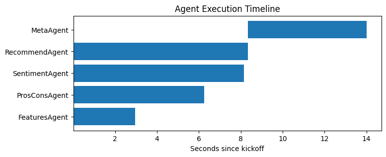
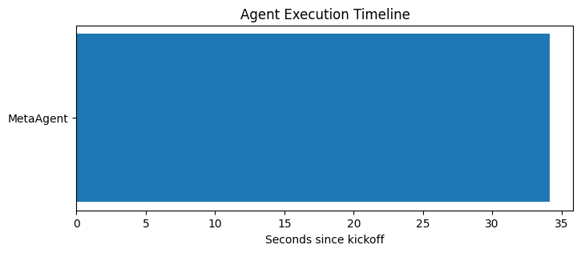

# 用 OpenAI Agents SDK 做平行 agent

> 原文：[examples/agents_sdk/parallel_agents.ipynb](https://github.com/openai/openai-cookbook/blob/main/examples/agents_sdk/parallel_agents.ipynb)


## 這篇在做什麼

示範怎麼讓多個專職的 agent 同時跑，最後把各自的輸出交給一個「meta」agent 整合成使用者看得懂的答案。用兩種方式實作：Python 的 `asyncio`，以及 Agents SDK 的「agent as tool」，並畫出時間軸比較延遲。

## 學完你會

- 用 OpenAI Agents SDK 定義幾個各管一件事的 agent
- 用 `asyncio.gather` 平行執行它們，或把它們包成 tool 交給 planner 動態呼叫
- 把各 agent 的輸出收集起來餵給下游的 meta agent，產生最終回答

## 開跑前

- OpenAI API key（會呼叫多次模型，有費用）

為什麼要這樣做？
很多正式環境的流程需要對同一份內容回答好幾個彼此獨立的問題。
一個一個做會拉長延遲，而且任何一步失敗需要重試時，總成本也可能增加。
如果把多個專職 agent 同時「fan out」，再把它們的輸出「fan in」給最後的「meta」agent，就能降低延遲。

這份 notebook 是個玩具範例，現實中你大概不會把它平行化，但它示範了：
1. 如何用 OpenAI Agents SDK 定義幾個專注的 agent。
2. 如何同時執行它們：可以用 Python 的 [asyncio](https://docs.python.org/3/library/asyncio.html)，延遲低、平行化輕量；也可以直接透過 [Agents SDK](https://openai.github.io/openai-agents-python/tools/#agents-as-tools)，好管理，還能動態規劃 tool 呼叫。
3. 如何收集各自的輸出，餵給下游的 meta agent，產生最後給使用者的答案。
4. 一個簡單的時間軸視覺化，讓你看出平行化帶來的延遲改善。

同樣的模式可以套用到真實情境，像是客服分流、內容審核，或任何需要對同一份輸入跑多個獨立分析、再合併成單一結果的場景。

1. 安裝相依套件

```python
%pip install openai-agents asyncio matplotlib nest_asyncio

import time

import asyncio
import matplotlib.pyplot as plt
import nest_asyncio

from agents import Agent, Runner

nest_asyncio.apply()
```

2. 定義你的 agent

```python
# Agent focusing on product features
features_agent = Agent(
    name="FeaturesAgent",
    instructions="Extract the key product features from the review."
)

# Agent focusing on pros & cons
pros_cons_agent = Agent(
    name="ProsConsAgent",
    instructions="List the pros and cons mentioned in the review."
)

# Agent focusing on sentiment analysis
sentiment_agent = Agent(
    name="SentimentAgent",
    instructions="Summarize the overall user sentiment from the review."
)

# Agent focusing on recommendation summary
recommend_agent = Agent(
    name="RecommendAgent",
    instructions="State whether you would recommend this product and why."
)

parallel_agents = [
    features_agent,
    pros_cons_agent,
    sentiment_agent,
    recommend_agent
]

# Meta-agent to combine outputs
meta_agent = Agent(
    name="MetaAgent",
    instructions="You are given multiple summaries labeled with Features, ProsCons, Sentiment, and a Recommendation."
    " Combine them into a concise executive summary of the product review with a 1-5 star rating for each summary area."
)
```

```python
starts, ends = [], []
async def run_agent(agent, review_text: str):
    agent_name = agent.name

    start = time.time()
    starts.append((agent_name, start))

    result = await Runner.run(agent, review_text)

    end = time.time()
    ends.append((agent_name, end))

    return result
```

3. 建立平行執行的函式

```python
async def run_agents(review_text: str):
    responses = await asyncio.gather(
        *(run_agent(agent, review_text) for agent in parallel_agents)
    )

    labeled_summaries = [
        f"### {resp.last_agent.name}\n{resp.final_output}"
        for resp in responses
    ]

    collected_summaries = "\n".join(labeled_summaries)
    final_summary = await run_agent(meta_agent, collected_summaries)


    print('Final summary:', final_summary.final_output)

    return
```

```python
review_text = """
I recently upgraded to the AuroraSound X2 wireless noise-cancelling headphones, and after two weeks of daily use I have quite a bit to share. First off, the design feels premium without being flashy: the matte‐finish ear cups are softly padded and rotate smoothly for storage, while the headband’s memory‐foam cushion barely presses on my temples even after marathon work calls. Connectivity is seamless—pairing with my laptop and phone took under five seconds each time, and the Bluetooth 5.2 link held rock-solid through walls and down the hallway.

The noise-cancelling performance is genuinely impressive. In a busy café with music and chatter swirling around, flipping on ANC immediately quiets low-level ambient hums, and it even attenuates sudden noises—like the barista’s milk frother—without sounding distorted. The “Transparency” mode is equally well‐tuned: voices come through clearly, but the world outside isn’t overwhelmingly loud. Audio quality in standard mode is rich and balanced, with tight bass, clear mids, and a hint of sparkle in the highs. There’s also a dedicated EQ app, where you can toggle between “Podcast,” “Bass Boost,” and “Concert Hall” presets or craft your own curve.

On the control front, intuitive touch panels let you play/pause, skip tracks, and adjust volume with a simple swipe or tap. One neat trick: holding down on the right ear cup invokes your phone’s voice assistant. Battery life lives up to the hype, too—over 30 hours with ANC on, and the quick‐charge feature delivers 2 hours of playtime from just a 10-minute top-up.

That said, it isn’t perfect. For one, the carrying case is a bit bulky, so it doesn’t slip easily into a slim bag. And while the touch interface is mostly reliable, I occasionally trigger a pause when trying to adjust the cup position. The headphones also come in only two colorways—black or white—which feels limiting given the premium price point.
"""

asyncio.get_event_loop().run_until_complete(run_agents(review_text))

def plot_timeline(starts, ends):

    # Plot the timeline of the agents
    # normalize times to zero
    base = min(t for _, t in starts)
    labels = [n for n, _ in starts]
    start_offsets = [t - base for _, t in starts]
    lengths = [ends[i][1] - starts[i][1] for i in range(len(starts))]

    plt.figure(figsize=(8, 3))
    plt.barh(labels, lengths, left=start_offsets)
    plt.xlabel("Seconds since kickoff")
    plt.title("Agent Execution Timeline")
    plt.show()

plot_timeline(starts, ends)
```

??? note "輸出"

    ```text
    Final summary: ### Executive Summary

    The AuroraSound X2 wireless noise-cancelling headphones offer a blend of premium design and advanced features. The headphones boast a matte-finish with comfortable, memory-foam padding, making them ideal for extended use. With Bluetooth 5.2, they provide seamless connectivity and stable communication. The noise-cancelling capabilities effectively reduce ambient noise and feature a well-tuned Transparency mode for essential sound transmission.

    **Audio Quality** is a highlight, delivering rich, balanced sound with customizable EQ presets including “Podcast,” “Bass Boost,” and “Concert Hall.” Intuitive touch controls allow for easy navigation, though some users report occasional misfires. The extended battery life offers over 30 hours with ANC on, with a quick-charge option for convenience.

    **Minor Limitations** include a bulky carrying case, occasional touch control issues, and limited color choices (black or white). Despite these, the overall sentiment is highly positive, with users particularly appreciating the headphones' design, connectivity, and performance. The product is recommended for those seeking high-quality audio experiences with effective noise-cancelling features.

    ### Star Ratings

    - **Features**: ★★★★☆
    - **Pros & Cons**: ★★★★☆
    - **Sentiment**: ★★★★★
    - **Recommendation**: ★★★★★

    Overall, the AuroraSound X2 headphones are a compelling choice, offering excellent value despite minor drawbacks.
    ```

    

這些 agent 也可以直接透過 SDK 用「agent as tool」的方式平行化，好處是方便，而且由 planner 動態決定要呼叫哪些 tool，代價是延遲比較高。延遲來自兩方面：一開始多一次規劃用的 API 呼叫，以及 tool 呼叫物件帶來的額外開銷和更長的 context。

```python
from agents import ModelSettings


meta_agent_parallel_tools = Agent(
    name="MetaAgent",
    instructions="You are given multiple summaries labeled with Features, ProsCons, Sentiment, and a Recommendation."
    " Combine them into a concise executive summary of the product review with a 1-5 star rating for each summary area.",
   model_settings=ModelSettings(
       parallel_tool_calls=True
   ),
    tools=[
        features_agent.as_tool(
            tool_name="features",
            tool_description="Extract the key product features from the review.",
        ),
        pros_cons_agent.as_tool(
            tool_name="pros_cons",
            tool_description="List the pros and cons mentioned in the review.",
        ),
        sentiment_agent.as_tool(
            tool_name="sentiment",
            tool_description="Summarize the overall user sentiment from the review.",
        ),
        recommend_agent.as_tool(
            tool_name="recommend",
            tool_description="State whether you would recommend this product and why.",
        ),
    ],
)

starts, ends = [], []
result = await run_agent(meta_agent_parallel_tools, review_text)

print('Final summary:', result.final_output)

plot_timeline(starts, ends)
```

??? note "輸出"

    ```text
    Final summary: **Executive Summary: AuroraSound X2 Wireless Noise-Cancelling Headphones**

    **Features (⭐️⭐️⭐️⭐️⭐️ 5/5):** The headphones boast a premium, matte-finish design with comfortable memory-foam cushioning. They offer seamless Bluetooth 5.2 connectivity, impressive noise-cancelling capabilities, and a well-tuned "Transparency" mode. The audio quality is rich and balanced, with customizable sound options via a dedicated EQ app. Additional features include intuitive touch controls and excellent battery life paired with a quick-charge option.

    **Pros and Cons (⭐️⭐️⭐️⭐️ 4/5):** 
    - **Pros:** Premium design, comfortable fit, seamless connectivity, effective noise-cancelling, clear voice input in "Transparency" mode, customizable audio, intuitive controls, long battery life.
    - **Cons:** Bulky carrying case, occasional touch control sensitivity issues, limited color options.

    **Sentiment (⭐️⭐️⭐️⭐️ 4/5):** The overall sentiment is highly positive, with appreciation for the design, comfort, connectivity, noise-cancelling effectiveness, and audio quality. Minor drawbacks are noted but do not outweigh the benefits.

    **Recommendation (⭐️⭐️⭐️⭐️ 4/5):** Highly recommended for those seeking premium noise-cancelling headphones with versatile features and excellent audio performance. The minor drawbacks are outweighed by the comprehensive suite of high-quality features.
    ```

    

## 總結

從上面可以看到兩種平行化 agent 的模式。最後要選哪種，看你想在下面幾件事之間怎麼取捨：

1. 方便 vs. 客製
    * 想要方便，就用 agent as tool。想自己決定 agent 在多層之間怎麼 fan in、fan out，用 `asyncio.gather` 建一個圖會比較合適
1. 規劃 vs. 確定性
    * 想讓 planner（這裡是 meta agent）動態決定要呼叫哪些 tool 以及順序，用 agent as tool；想要固定的順序，`asyncio.gather` 比較合適
1. 對延遲的敏感度
    * 如果很在意延遲，可以用 `asyncio`，省掉規劃平行 tool 的前置成本，也避開 tool 輸出和較長 context window 的開銷

## 重點整理

- 彼此獨立的分析適合 fan out 再 fan in，延遲約等於最慢的那個 agent，而不是全部加總。
- `asyncio.gather` 流程固定、延遲低，但編排要自己寫。
- agent as tool 讓 planner 動態決定呼叫誰，方便但多一次規劃呼叫，延遲較高。
- meta agent 的工作是整合，它拿到的是各專職 agent 的輸出，所以每個 agent 的職責要切得清楚。

## 練習

1. 新增一個專職 agent（例如檢查語氣的），把它加進平行執行的清單，看時間軸多出什麼。
2. 把平行版本改成逐個 `await` 的串行版本，比較總耗時。
3. 修改 meta agent 的 instructions，讓它只輸出一句話結論，再比較兩種模式的延遲與輸出差異。
