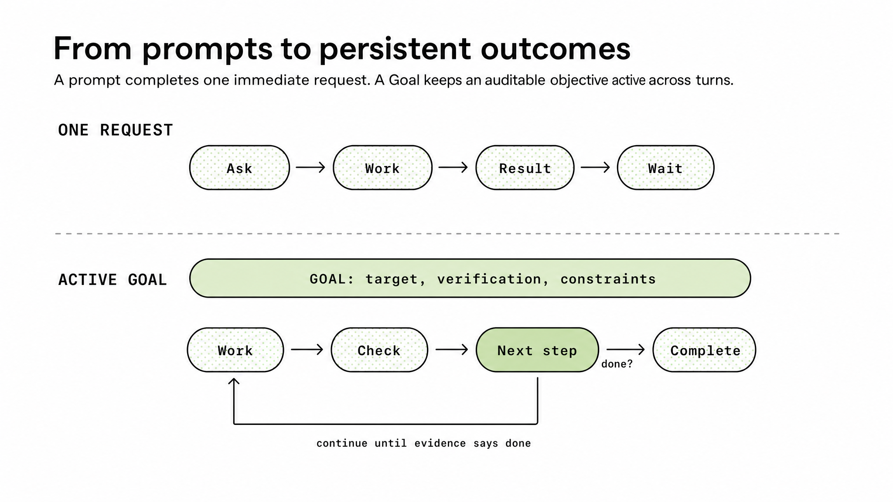
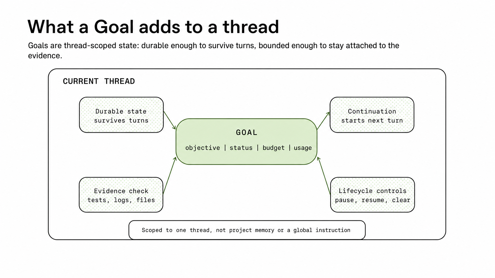
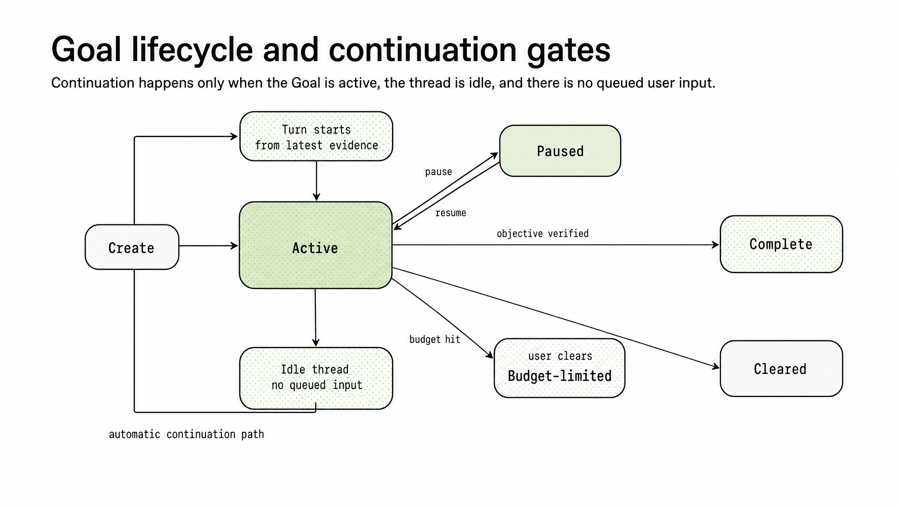
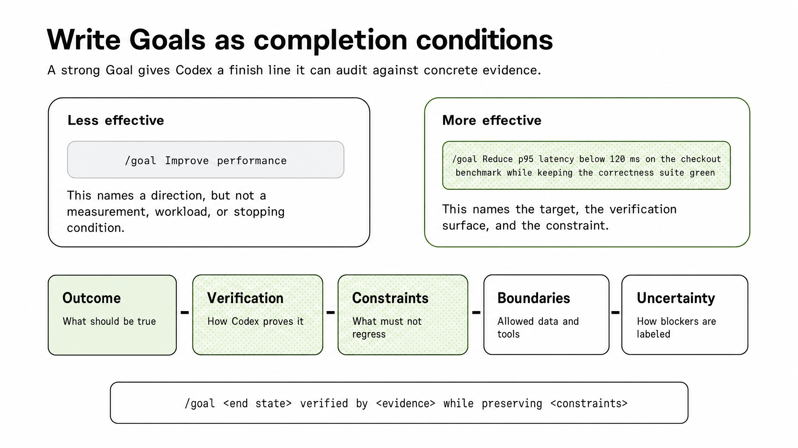
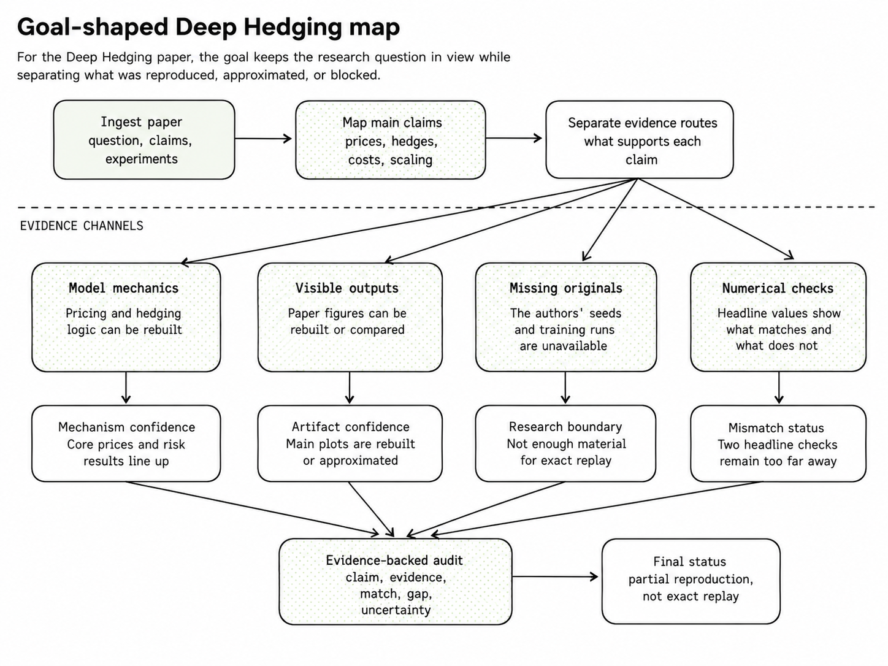
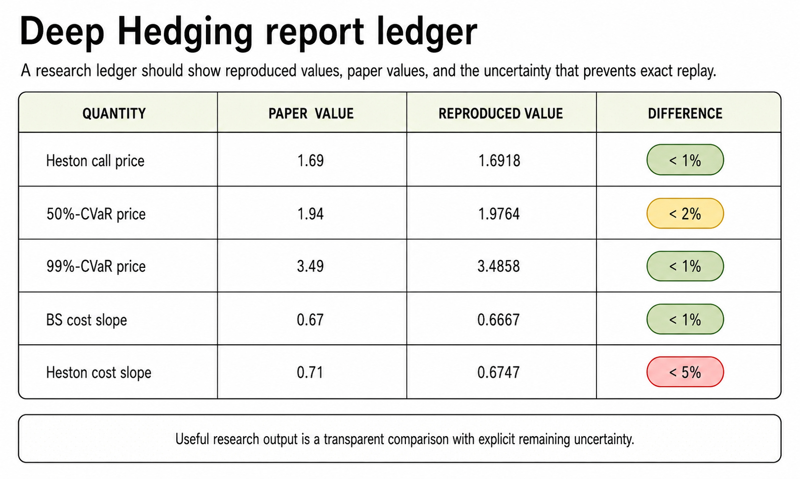
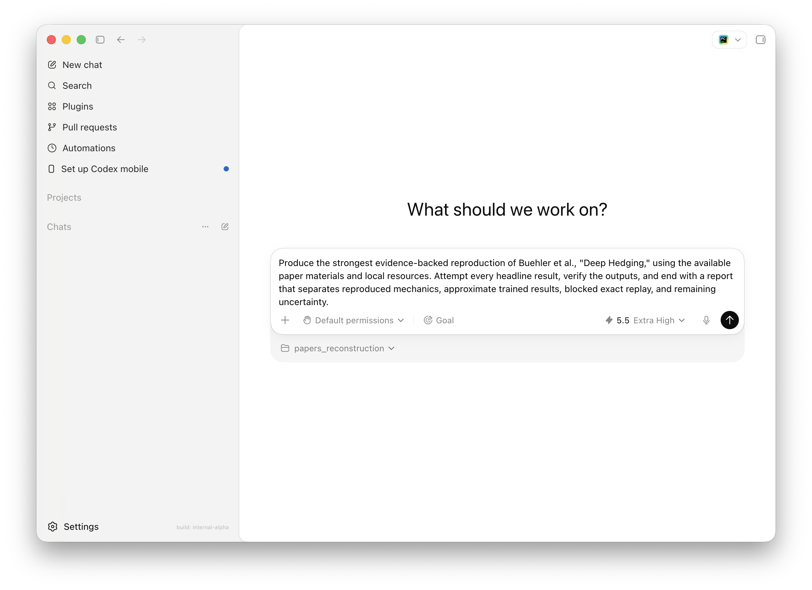

# 在 Codex 裡使用 Goals

> 原文：[examples/codex/using_goals_in_codex.ipynb](https://github.com/openai/openai-cookbook/blob/main/examples/codex/using_goals_in_codex.ipynb)

用 Codex 的 Goal 讓長時間的工作跨多個 turn 持續朝一個有證據檢驗的目標前進。

## 這篇在做什麼

Goal 是 Codex 裡的持久目標，會綁在一個 thread 上，讓 Codex 跨 turn 朝同一個結果工作。這篇教你什麼時候該用 Goal、怎麼把 Goal 寫得可驗證，以及怎麼用 `/goal` 系列指令管理它的生命週期。最後用一個重現量化論文的案例示範研究型 Goal。

## 學完你會

- 判斷一個任務該用 Goal 還是一般 prompt。
- 寫出有可量測結果、驗證方式和限制條件的 Goal，例如把 p95 latency 壓到指定數字以下且測試不能壞。
- 用 `/goal`、`/goal pause`、`/goal resume`、`/goal clear` 控制 Goal 的啟動、暫停、恢復和清除。

## 開跑前

- 需要支援 Goals 的 Codex 版本（0.128.0 起）。
- 任務要有明確的終點，以及你看得到的證據來源，例如測試、benchmark 或最終產出。

Goals 是 Codex 裡的持久目標，會讓一個 thread 跨 turn 朝著定義好的結果工作。Goal 給 Codex 一個完成條件：什麼狀態算達成、怎麼檢查成功、哪些限制不能破壞。

Codex 本來就很擅長範圍明確的程式任務：看 repo、修 bug、加測試、解釋錯誤、做一個聚焦的改動。Goals 是給另一種任務用的，這種任務的下一步要看 Codex 一路學到什麼，例如 profiling、改 patch、跑 benchmark、重現不穩定的測試，或把一個研究問題變成有證據支撐的稽核報告。

這類任務需要的不是更長的 prompt，而是一個持久的目標。有了 Goal，Codex 可以一直記得目標、評估工作做完了沒、自己選下一步，你不用每次中間結果出來就重講一次。

Goal 不是沒有邊界的背景自主行為。它是一份範圍明確、由使用者控制的完成契約。你定義結果，Codex 根據 thread 裡的證據工作，Goal 可以被暫停、恢復、清除、完成，或因為預算用完而停止。


## 本篇內容

讀完這篇你可以：
- 判斷 Goal 什麼時候比一次性的 prompt 更適合。
- 寫出有可量測結果、驗證方式和限制的 Goal。
- 用 `/goal`、`/goal pause`、`/goal resume`、`/goal clear` 管理生命週期。

## 前置條件

- 支援 Goals 的 Codex 版本。
- 一個有明確終點、而且有證據可檢查的任務，例如測試、benchmark 或最終產出。
- 足夠的 repo 或研究背景，讓 Codex 能驗證進度，而不是光講故事。

## 大綱

1. 啟動 Goal 並管理它的生命週期。
2. 了解 Goal 跟一次性 prompt 的差別。
3. 寫出可稽核完成標準的 Goal。
4. 把這個模式用在複雜的研究工作上。
5. 判斷什麼時候一般 prompt 仍然比較好。




*圖 1. Goal 把單輪對話變成有證據檢查的持續循環。*

## 快速開始：使用 Goals

任務的終點明確、但路徑不確定時，就適合用 Goal。
適合的例子有效能優化、不穩定測試的調查、dependency 遷移、需要重現的 bug 追查、多步驟 refactor、靠 benchmark 調校，以及需要產出最終成品的研究任務。一次性的小修改還是用一般 prompt。

要用 Goals，先安裝或更新 Codex 並確認版本。Goals 從 Codex 0.128.0 開始提供。

用 npm：

```bash
npm install -g @openai/codex@latest
codex --version
```

用 Homebrew：

```bash
brew update
brew upgrade --cask codex
codex --version
```

然後用 /goal 後面接想要的結果來設定 Goal：

```text
/goal Reduce p95 latency below 120 ms without regressing correctness tests
```

同一組指令也能管理生命週期：

```text
/goal      	View the current Goal
/goal pause    Pause an active Goal
/goal resume   Resume a paused Goal
/goal clear    Remove the current Goal
```

Goal 啟動後，Codex 會看程式碼、跑相關指令、改程式、測試結果，一直做到碰到停止條件。停止條件可能是成功、暫停、清除、被打斷、預算用完，或是卡在需要使用者輸入的 blocker。

如果你發現自己每個 turn 結束都在講同一句話，就該用 Goal：

```text
Keep going.
Try the next likely fix.
Run the benchmark again.
Now check the tests.
Continue until this is actually done.
```

Goal 把這個意圖明確寫下來。

## Goals vs prompts

一般 prompt 的意思是：做下一件事。

Goal 的意思是：一直做到這個結果成立為止。
這個差別很重要。一般請求裡，Codex 做完眼前的指令、回報結果、然後等你。有了 Goal，thread 上會掛著一個持久的目標。每個 turn 結束後，Codex 可以檢查目前的證據，判斷目標達成了沒。如果沒有，而且 Goal 還在 active、預算也還夠，Codex 就從最新的狀態繼續做。

所以當正確的下一步取決於 Codex 剛學到的東西時，Goals 最有用。例如：

```text
/goal Reduce p95 checkout latency below 120 ms on the checkout benchmark while keeping the correctness suite green
```

這個請求要的不只是更好的效能。它給了 Codex 可量測的結果、驗證方式和一個限制。Codex 可以跑 benchmark、看 hot path、做有針對性的修改、重跑 benchmark、跑正確性測試，結果還不夠好就繼續。

實用的心智模型很簡單：

Prompt:  ask -> work -> result -> wait

Goal:    work -> check -> continue or complete

Goal 給 Codex 一個終點線，但工作仍然要用證據來稽核。

## 怎麼寫 Goal

好的 Goal 不只是比較長的 prompt。它是一份精簡的契約，說明 Codex 該怎麼工作、什麼算成功、還達不到成功時該怎麼辦。

最強的 Goal 通常定義六件事：
* Outcome（結果）：做完時什麼應該成立。
* Verification surface（驗證面）：證明它成立的測試、benchmark、報告、產出、指令輸出或原始資料。
* Constraints（限制）：Codex 工作時什麼不能退步。
* Boundaries（邊界）：Codex 可以用哪些檔案、工具、資料、repo 或資源。
* Iteration policy（迭代策略）：每次嘗試後，Codex 怎麼決定下一步試什麼。
* Blocked stop condition（卡住的停止條件）：什麼時候 Codex 該停下來回報，在目前限制下已經沒有站得住腳的路。

一個好用的模板是：

```text
/goal <desired end state> verified by <specific evidence> while preserving <constraints>. Use <allowed inputs, tools, or boundaries>. Between iterations, <how Codex should choose the next best action>. If blocked or no valid paths remain, <what Codex should report and what would unlock progress>.
```

例如這個 Goal 可行，但還偏單薄：

```text
/goal Reduce p95 checkout latency below 120 ms without regressing correctness tests
```

比較強的版本給 Codex 一份完整的作業契約：

```text
/goal Reduce p95 checkout latency below 120 ms, verified by the checkout benchmark, while keeping the correctness suite green. Use only the checkout service, benchmark fixtures, and related tests. Between iterations, record what changed, what the benchmark showed, and the next best experiment to try. If the benchmark cannot run or no valid paths remain, stop with the attempted paths, the evidence gathered, the blocker, and the next input needed.
```

研究和調查類的任務也是同一個原則。工作開始前就先定義證據標準，尤其是可能拿不到精確證明的時候：

```text
/goal Produce the strongest evidence-backed reproduction of the paper using the available materials and local resources. Attempt the headline results where feasible, verify outputs where possible, and end with a report that separates confirmed findings, approximate reconstructions, blocked claims, and remaining uncertainty.
```

這種 Goal 讓 Codex 有空間去調查，同時讓最後的結果保持誠實。它不只是叫 Codex「繼續做」，還定義了「完成」「卡住」「仍不確定」各是什麼意思。

任務很清楚但 Goal 還沒想好時，可以請 Codex 幫你寫 Goal。有個兩步驟的流程很好用：先用白話描述工作，請 Codex 轉成 Goal 草稿；再檢查草稿，在啟動前把成功條件、驗證面、限制和卡住的停止條件收緊。

例如：

```text
Help me turn this into a strong `/goal`: I want Codex to keep working on this flaky checkout test until we either fix it with evidence or can clearly explain what is blocking progress.
```

Codex 接著可以提出更完整的 Goal、只問真正必要的缺漏資訊，最後留給你一個更乾淨的 `/goal` 可以用。

## Goal 啟動後有什麼不同

Goal 啟動後有三件事會變。

第一，目標一直看得到。Codex 跑測試失敗時，thread 上還留著原本的目標。benchmark 有進步但沒達標，Codex 可以繼續。研究路徑碰到缺資料，Codex 可以調整證據計畫，但不會忘記研究標準。

第二，idle 的 thread 可以接著繼續。有其他 turn 在跑、有使用者輸入排隊、或有其他 thread 工作待處理時，Codex 不會繼續。只有 thread idle、Goal 是 active 而且預算夠的時候才會繼續。
第三，完成必須有證據。不能因為模型覺得大概做完了就標成完成。只有把目標對照相關檔案、測試、log、benchmark 輸出、產生的成品或其他具體證據檢查過，才算完成。

這就是設計核心：Codex 可以一直往前走，但是否做完由證據決定。

## Codex 裡的 Goals 怎麼設計

Goals 實作成持久化的 thread 狀態，不是全域記憶，也不是專案層級的指令。這個設計很重要：目標屬於相關脈絡所在的那個 thread，包括 Codex 看過的檔案、跑過的指令、產生的 diff、看到的 log，以及累積的推理過程。




*圖 2. Goal 替目前的 thread 加上持久狀態、持續執行、控制和證據檢查。*

在架構層，Goal 是持久的、以 thread 為範圍的狀態。它記錄目標、生命週期、預算，以及 Codex 隨時間評估這個 thread 所需的進度統計。關鍵邊界是範圍：Goal 屬於目前的 thread，不屬於全域記憶或專案指令。

Codex 把這個狀態當成使用者、模型和 thread 三方之間的契約。Goal 可以是 active、paused、complete 或 budget-limited。這些狀態決定 Codex 可不可以繼續、該不該等使用者，以及該不該改成總結進度而不是開始新工作。

持續執行是事件驅動的，不是單純的 loop。Codex 只在安全的邊界檢查要不要繼續：turn 結束後、沒有其他待處理工作、沒有排隊的使用者輸入、thread 是 idle 的時候。

dispatcher 的行為刻意保守。只有規劃的工作不會觸發繼續。被打斷會暫停目標。恢復 thread 時，適當的話會還原目標。如果一個繼續的 turn 沒有呼叫任何 tool，下一次自動繼續就會被壓掉，避免 Codex 空轉。




*圖 3. Codex 只在 Goal 是 active、thread 是 idle、且沒有排隊的使用者輸入時才繼續。*

prompt 層強化同一個架構。繼續用的 prompt 讓 Codex 圍繞著 active 的目標，但也要求完成前先稽核。Codex 必須把目標對照具體證據：改了哪些檔案、跑了哪些指令、通過哪些測試、benchmark 輸出、產生的成品或研究證據。

預算處理是明確的。預算用完時，Codex 應該停止實質工作、總結進度和 blocker、指出下一個有用的步驟。碰到預算上限不等於完成目標。

tool 契約把生命週期的權限限制住。模型可以開始一個 Goal，也只有在證據支持時才能把現有的 Goal 標成完成。暫停、恢復、清除和 budget-limited 的轉換，仍由使用者或系統控制。

要記住的架構就是：Goal 是以 thread 為範圍的完成契約。它結合了持久的目標狀態、生命週期控制、繼續執行的策略、預算統計和以證據為準的完成判定。重點不是讓 Codex 永遠 loop，而是讓目標一直存在，直到證據說工作做完了。

## 把弱的 Goal 改成強的 Goal

弱：

```text
/goal Improve performance
```

強：

```text
/goal Reduce p95 latency below 120 ms on the checkout benchmark while keeping the correctness test suite green
```

### 範例：效能調校



*圖 4. 強的 Goal 會講明最終狀態、驗證面和限制。*

比較強的版本給了 Codex 三樣東西：結果、驗證方法和限制。它也讓 Codex 知道什麼時候不能停。p95 從 180 ms 降到 135 ms，Goal 還沒完成。latency 降到 120 ms 以下但正確性測試失敗，Goal 還沒完成。benchmark 跑不起來的話，Codex 必須把這個 blocker 講出來，而不是宣稱成功。

效能以外的工作也是同一條規則：Goal 要具體到能驗證，但也要開放到能讓 Codex 去探索。

Goal 要窄到可以稽核，也要寬到讓 Codex 能自己選下一步。「修好失敗的 checkout 測試」可能太窄，如果真正的問題在上游 dependency。「改善整個系統」太寬，因為沒有可稽核的面。「讓目前 branch 上的 checkout 測試全部通過，而且不改公開 API 的行為」就好多了。

產生成品的任務也一樣。弱的 Goal 是：

```text
/goal Write docs for this feature
```

強的 Goal 是：

```text
/goal Produce a docs page for Goals that explains the lifecycle, command surface, and two examples. Verify that the page builds locally and that all referenced commands match the current CLI behavior.
```

第二個 Goal 給了 Codex 可以檢查的東西：一個頁面、一個 build 指令，還有指令的行為。
研究型 Goal 更需要這種紀律。調查開始前就定義證據標準：什麼算精確重現、什麼算部分重建、什麼算代理證據支持、什麼要視為卡住。

強的研究 Goal 應該要求 Codex 建立 claim 清單、把 claim 對應到證據、實作可行的部分、標出 blocker，並產出一份稽核，把已確認的 claim、僅有支持證據的 claim、被卡住的 claim 和剩餘的不確定性分開。

這樣 Goal 窄到可以稽核，又不用規定整條路徑。Codex 可以自己選下一步，但完成標準是固定的。

## 用 Goals 做複雜研究：重現一篇量化論文

這是一個用上述原則的研究 Goal 實例。

案例是 Buehler、Gonon、Teichmann 和 Wood 的 Deep Hedging。這篇論文問的是：神經網路交易策略能不能在不同風險偏好、交易成本和更高維度的市場設定下，重現以模型為基礎的對沖。正確的 Goal 不是抽象地「重現這篇論文」，而是去嘗試論文的主要數值 claim、把精確的機制和近似的訓練替代品分開，並明講哪些東西無法用現有材料精確重播。

弱的研究 Goal 會是：

```text
/goal Reproduce Buehler et al., "Deep Hedging"
```

這太含糊。它沒說哪一節重要、什麼算重現、拿不到訓練狀態時怎麼辦，也沒說怎麼區分接近的數值和精確重播。

比較好的 Goal 是：

```text
/goal Produce the strongest evidence-backed reproduction of Buehler et al., "Deep Hedging," using the available paper materials and local resources. Attempt every headline result, verify the outputs, and end with a report that separates reproduced mechanics, approximate trained results, blocked exact replay, and remaining uncertainty.
```

強的版本有效，是因為它講明證據標準和最終產出。Codex 不只是想做出一個漂亮的重現，而是要在不誇大現有證據的前提下，把不確定性降到最低。




*圖 5. 研究型 Goal 在宣告狀態前，先把論文拆成多個證據管道。*

實際上，這個 Goal 給了調查一份具體的作業契約。

Codex 用它來：
* 分開主要 claim 和輔助 claim，
* 把 claim 對應到手上的證據，
* 重建可以在本機測試的部分，
* 標出無法用現有材料精確重現的 claim。

有幾個部分是可行的。Codex 重建了定價和對沖的機制、重現了 Heston 的參考價格、為 CVaR 對沖實驗訓練 policy、重建主要的直方圖和對沖曲面成品、重現 Black-Scholes 交易成本的斜率，並對 Heston 交易成本和高維度範例跑了訓練後的檢查。

有些 claim 因為缺原始材料而一直卡住。論文沒有提供精確的 random seed、產生的訓練路徑、TensorFlow graph、optimizer 狀態、checkpoint 或完整的原始模擬狀態。所以最誠實的結果是部分且近似的重現，而不是精確的神經網路重播。

這就是 Goal 的價值。出現 blocker 後它讓工作繼續走，也讓最後的措辭保持誠實。訓練出來的替代品可以支持一個 claim、接近的數值可以提高信心、重建的圖可以驗證結果的一部分，但這些都不能被描述成精確還原了原本的實驗。




*圖 6. 最終輸出應該保留不同層級的證據支持程度。*

最終報告應該保留這些不同層級的支持，而不是把它們壓平成一句「成功」。
例如，帳本裡的一筆紀錄可以長這樣：

```text
Claim: Deep hedging approximates complete-market Heston hedge without transaction costs.
Route: Rebuilt model mechanics, reference hedge comparison, and trained neural policy.
Evidence surface: Price checks, histograms, and hedge surfaces.
Status: Close approximate reproduction.
Remaining uncertainty: Original training paths, seeds, and checkpoints are unavailable.
```

這就是 Goals 在研究上的示範價值。它們讓 Codex 在模糊中持續工作，同時避免一個看起來合理的成品變成誇大的結論。Goal 定義了做完是什麼意思：逐條 claim 的稽核，以證據為基礎，對近似之處講清楚，並誠實面對重現和重播之間的界線。



## 什麼時候不該用 Goals

Goals 不是每個任務都適合。

一行的修改、簡單的解釋、簡短的 code review，或你只要一個答案然後就停的問題，不要用 Goal。這些用一般的 Codex prompt 比較好。

終點線很模糊時不要用 Goal。「Make this better」沒有給 Codex 可靠的完成條件。「Refactor this code」也很弱，除非你定義了預期的最終狀態、測試和限制。

不要用 Goal 來掩蓋不確定性。資料可能拿不到，就在 Goal 裡講。benchmark 可能不穩，就說怎麼處理。允許用代理證據的話，就定義要怎麼標示。

Goals 最強的情境有三個特性：持久的目標、以證據為準的終點，以及可能需要多輪調查的路徑。

## 結論：讓目標持續存在，讓證據決定結果

Goals 改變了 Codex 的運作模型。它們把 thread 從一串各自獨立的 prompt，變成圍繞著既定結果的有狀態工作循環。

架構刻意有邊界。Goal 的範圍是 thread，帶著生命週期狀態和預算統計，可以被暫停、恢復、清除、完成，或因預算而停止。Codex 可以一直往前走，但只在使用者定義的契約之內。
這讓 Goals 在 Codex 本來最有價值的工作上很有用：debug、優化、遷移、測試和研究。使用者給目標，Codex 跟著證據走，Goal 讓兩邊一直連在一起，直到工作完成或誠實地卡住。

對複雜的研究來說，這就是產生一個答案和產出一份稽核的差別。好的 Goal 不只是叫 Codex 做完，而是告訴 Codex 做完是什麼意思。

## 重點整理

- Goal 是以 thread 為範圍的完成契約，不是更長的 prompt，也不是全域記憶。
- 好的 Goal 要有結果、驗證面、限制、邊界、迭代策略和卡住的停止條件。
- 完成必須有證據，模型覺得做完了不算數，預算用完也不等於完成。
- Codex 只在 thread idle、Goal active、預算夠的時候才會自動繼續，沒呼叫 tool 的繼續 turn 會被抑制，避免空轉。
- 研究型 Goal 要事先定義證據標準，並在報告裡分開已確認、僅支持、被卡住和不確定的 claim。

## 練習

1. 把頁面上效能調校的弱 Goal 改寫成強的版本，換成你自己專案的指標，寫出數字門檻、驗證指令和一個不能壞的限制。
2. 挑一個你專案裡不穩定的測試，寫一個 `/goal`，加上「卡住的停止條件」，說明跑幾次仍無法重現就停下來回報。
3. 改寫頁面上的研究 Goal，把證據標準改成四層（精確重現、部分重建、代理證據、卡住），並要求最後的稽核報告用表格列出每條 claim 屬於哪一層。
