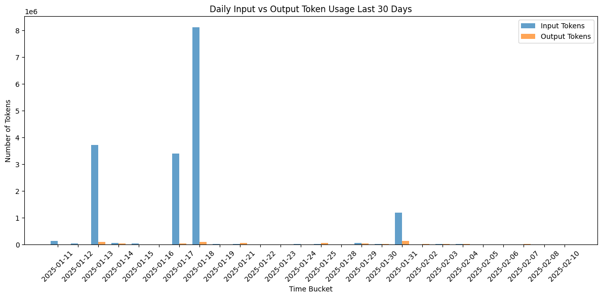
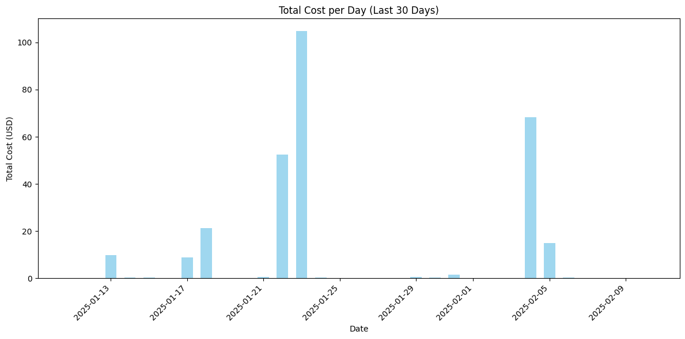

# 如何用 Usage API 和 Cost API 監控你的 OpenAI 用量

> 原文：[examples/completions_usage_api.ipynb](https://github.com/openai/openai-cookbook/blob/main/examples/completions_usage_api.ipynb)

用 API 抓取並視覺化 Completions 用量和費用資料。

## 這篇在做什麼
用 Completions Usage API 和 Costs API 把組織的 token 用量和費用抓下來，轉成 pandas DataFrame，再用 matplotlib 畫成圖表。從時間序列、依模型分組到依 line item 看花費，都有範例。

## 學完你會
- 呼叫 Usage API 和 Costs API，並用 `group_by` 依 model、project 等欄位分組。
- 把 API 回傳的 JSON 解析成 DataFrame，畫出 token 用量的長條圖、堆疊圖和圓餅圖。
- 知道怎麼把這些資料匯出給 Tableau、Power BI 或自建 dashboard。

## 開跑前
- 需要一把 Admin Key（到 platform.openai.com/settings/organization/admin-keys 建立），一般的 API key 不能呼叫這些端點。
- 需要安裝 pandas 和 matplotlib。

大部分人用[預設的用量與費用 dashboard](https://platform.openai.com/usage) 就夠了。如果你需要更細的資料或自訂 dashboard，就可以用 Completions Usage API。

這份 notebook 示範怎麼從 OpenAI Completions Usage API 和 Costs API 取得用量資料並視覺化，步驟如下：
- 呼叫 API 取得 completions 用量資料。
- 把 JSON 回應解析成 pandas DataFrame。
- 用 matplotlib 畫出 token 用量隨時間的變化。
- 依 model 分組，比較不同模型的 token 用量。
- 用圓餅圖顯示模型的分布。

我們也把所有可用的 API 參數都列成佔位符，方便你一次看完整個樣貌。

```python
# Install required libraries (if not already installed)
!pip install requests pandas numpy matplotlib --quiet

# Import libraries
import requests
import pandas as pd
import numpy as np
import matplotlib.pyplot as plt
import matplotlib.patches as mpatches
import time
import json

# For inline plotting in Jupyter
%matplotlib inline
```

## 設定 API 憑證和參數

先建立 Admin Key：https://platform.openai.com/settings/organization/admin-keys

把 `'PLACEHOLDER'` 換成你真正的 ADMIN API key。比較安全的做法是從環境變數讀取 key。

```python
# Reusable function for retrieving paginated data from the API
def get_data(url, params):
    # Set up the API key and headers
    OPENAI_ADMIN_KEY = 'PLACEHOLDER'

    headers = {
        "Authorization": f"Bearer {OPENAI_ADMIN_KEY}",
        "Content-Type": "application/json",
    }

    # Initialize an empty list to store all data
    all_data = []

    # Initialize pagination cursor
    page_cursor = None

    # Loop to handle pagination
    while True:
        if page_cursor:
            params["page"] = page_cursor

        response = requests.get(url, headers=headers, params=params)

        response.raise_for_status()
        data_json = response.json()
        all_data.extend(data_json.get("data", []))

        page_cursor = data_json.get("next_page")
        if not page_cursor:
            break

    if all_data:
        print("Data retrieved successfully!")
    else:
        print("Issue: No data available to retrieve.")
    return all_data
```

```python
# Define the API endpoint
url = "https://api.openai.com/v1/organization/usage/completions"

# Calculate start time: n days ago from now
days_ago = 30
start_time = int(time.time()) - (days_ago * 24 * 60 * 60)

# Define parameters with placeholders for all possible options
params = {
    "start_time": start_time,  # Required: Start time (Unix seconds)
    # "end_time": end_time,  # Optional: End time (Unix seconds)
    "bucket_width": "1d",  # Optional: '1m', '1h', or '1d' (default '1d')
    # "project_ids": ["proj_example"],  # Optional: List of project IDs
    # "user_ids": ["user_example"],     # Optional: List of user IDs
    # "api_key_ids": ["key_example"],   # Optional: List of API key IDs
    # "models": ["o1-2024-12-17", "gpt-4o-2024-08-06", "gpt-4o-mini-2024-07-18"],  # Optional: List of models
    # "batch": False,             # Optional: True for batch jobs, False for non-batch
    # "group_by": ["model"],     # Optional: Fields to group by
    "limit": 7,  # Optional: Number of buckets to return, this will chunk the data into 7 buckets
    # "page": "cursor_string"   # Optional: Cursor for pagination
}

usage_data = get_data(url, params)
```

??? note "輸出"

    ```text
    Data retrieved successfully!
    ```

## 看一下 JSON 回應

先看原始的 JSON 回應，了解資料結構。


```python
print(json.dumps(usage_data, indent=2))
```

??? note "輸出"

    ```text
    [
      {
        "object": "bucket",
        "start_time": 1736616660,
        "end_time": 1736640000,
        "results": [
          {
            "object": "organization.usage.completions.result",
            "input_tokens": 141201,
            "output_tokens": 9756,
            "num_model_requests": 470,
            "project_id": null,
            "user_id": null,
            "api_key_id": null,
            "model": null,
            "batch": null,
            "input_cached_tokens": 0,
            "input_audio_tokens": 0,
            "output_audio_tokens": 0
          }
        ]
      },
      {
        "object": "bucket",
        "start_time": 1736640000,
        "end_time": 1736726400,
        "results": [
          {
            "object": "organization.usage.completions.result",
            "input_tokens": 45949,
            "output_tokens": 282,
            "num_model_requests": 150,
            "project_id": null,
            "user_id": null,
            "api_key_id": null,
            "model": null,
            "batch": null,
            "input_cached_tokens": 0,
            "input_audio_tokens": 0,
            "output_audio_tokens": 0
    ... (省略 538 行)
    ```

## 解析 API 回應並建立 DataFrame

接著解析 JSON，取出需要的欄位，建成 pandas DataFrame，後面處理和分析會比較方便。

```python
# Initialize a list to hold parsed records
records = []

# Iterate through the data to extract bucketed data
for bucket in usage_data:
    start_time = bucket.get("start_time")
    end_time = bucket.get("end_time")
    for result in bucket.get("results", []):
        records.append(
            {
                "start_time": start_time,
                "end_time": end_time,
                "input_tokens": result.get("input_tokens", 0),
                "output_tokens": result.get("output_tokens", 0),
                "input_cached_tokens": result.get("input_cached_tokens", 0),
                "input_audio_tokens": result.get("input_audio_tokens", 0),
                "output_audio_tokens": result.get("output_audio_tokens", 0),
                "num_model_requests": result.get("num_model_requests", 0),
                "project_id": result.get("project_id"),
                "user_id": result.get("user_id"),
                "api_key_id": result.get("api_key_id"),
                "model": result.get("model"),
                "batch": result.get("batch"),
            }
        )

# Create a DataFrame from the records
df = pd.DataFrame(records)

# Convert Unix timestamps to datetime for readability
df["start_datetime"] = pd.to_datetime(df["start_time"], unit="s")
df["end_datetime"] = pd.to_datetime(df["end_time"], unit="s")

# Reorder columns for better readability
df = df[
    [
        "start_datetime",
        "end_datetime",
        "start_time",
        "end_time",
        "input_tokens",
        "output_tokens",
        "input_cached_tokens",
        "input_audio_tokens",
        "output_audio_tokens",
        "num_model_requests",
        "project_id",
        "user_id",
        "api_key_id",
        "model",
        "batch",
    ]
]

# Display the DataFrame
df.head()
```

??? note "輸出"

    ```text
           start_datetime end_datetime  start_time    end_time  input_tokens  \
    0 2025-01-11 17:31:00   2025-01-12  1736616660  1736640000        141201   
    1 2025-01-12 00:00:00   2025-01-13  1736640000  1736726400         45949   
    2 2025-01-13 00:00:00   2025-01-14  1736726400  1736812800       3718360   
    3 2025-01-14 00:00:00   2025-01-15  1736812800  1736899200         52786   
    4 2025-01-15 00:00:00   2025-01-16  1736899200  1736985600         35664   

       output_tokens  input_cached_tokens  input_audio_tokens  \
    0           9756                    0                   0   
    1            282                    0                   0   
    2          97756                76544                5776   
    3          38204                 5440                4066   
    4           1835                  192                2520   

       output_audio_tokens  num_model_requests project_id user_id api_key_id  \
    0                    0                 470       None    None       None   
    1                    0                 150       None    None       None   
    2                 3166                3053       None    None       None   
    3                 1097                 157       None    None       None   
    4                 1549                  55       None    None       None   

      model batch  
    0  None  None  
    1  None  None  
    2  None  None  
    3  None  None  
    4  None  None
    ```

## 視覺化 Token 用量隨時間的變化

用長條圖畫出每個時間 bucket 的 input 和 output token 用量。


```python
if not df.empty:
    plt.figure(figsize=(12, 6))

    # Create bar charts for input and output tokens
    width = 0.35  # width of the bars
    indices = range(len(df))

    plt.bar(indices, df["input_tokens"], width=width, label="Input Tokens", alpha=0.7)
    plt.bar(
        [i + width for i in indices],
        df["output_tokens"],
        width=width,
        label="Output Tokens",
        alpha=0.7,
    )

    # Set labels and ticks
    plt.xlabel("Time Bucket")
    plt.ylabel("Number of Tokens")
    plt.title("Daily Input vs Output Token Usage Last 30 Days")
    plt.xticks(
        [i + width / 2 for i in indices],
        [dt.strftime("%Y-%m-%d") for dt in df["start_datetime"]],
        rotation=45,
    )
    plt.legend()
    plt.tight_layout()
    plt.show()
else:
    print("No data available to plot.")
```

??? note "輸出"

    

## 範例：依 model 分組

這一段抓取依 model 和 project_id 分組的用量資料並視覺化，可以看出指定期間內每個模型用了多少 token。

### 關於 group_by 參數

- 如果沒有指定 `group_by`，`project_id`、`model` 這類欄位會回傳 `null`。
  雖然 `group_by` 是選填，但多數情況建議加上，才拿得到有意義的資料。
  
- 可以用逗號分隔指定多個分組欄位，例如：`group_by=["model", "project_id"]`。

```python
# Calculate start time: n days ago from now
days_ago = 30
start_time = int(time.time()) - (days_ago * 24 * 60 * 60)

# Define parameters with grouping by model and project_id
params = {
    "start_time": start_time,  # Required: Start time (Unix seconds)
    "bucket_width": "1d",  # Optional: '1m', '1h', or '1d' (default '1d')
    "group_by": ["model", "project_id"],  # Group data by model and project_id
    "limit": 7,  # Optional: Number of buckets to return
}

# Initialize an empty list to store all data
all_group_data = get_data(url, params)

# Initialize a list to hold parsed records
records = []

# Iterate through the data to extract bucketed data
for bucket in all_group_data:
    start_time = bucket.get("start_time")
    end_time = bucket.get("end_time")
    for result in bucket.get("results", []):
        records.append(
            {
                "start_time": start_time,
                "end_time": end_time,
                "input_tokens": result.get("input_tokens", 0),
                "output_tokens": result.get("output_tokens", 0),
                "input_cached_tokens": result.get("input_cached_tokens", 0),
                "input_audio_tokens": result.get("input_audio_tokens", 0),
                "output_audio_tokens": result.get("output_audio_tokens", 0),
                "num_model_requests": result.get("num_model_requests", 0),
                "project_id": result.get("project_id", "N/A"),
                "user_id": result.get("user_id", "N/A"),
                "api_key_id": result.get("api_key_id", "N/A"),
                "model": result.get("model", "N/A"),
                "batch": result.get("batch", "N/A"),
            }
        )

# Create a DataFrame from the records
df = pd.DataFrame(records)

# Convert Unix timestamps to datetime for readability
df["start_datetime"] = pd.to_datetime(df["start_time"], unit="s", errors="coerce")
df["end_datetime"] = pd.to_datetime(df["end_time"], unit="s", errors="coerce")

# Reorder columns for better readability
df = df[
    [
        "start_datetime",
        "end_datetime",
        "start_time",
        "end_time",
        "input_tokens",
        "output_tokens",
        "input_cached_tokens",
        "input_audio_tokens",
        "output_audio_tokens",
        "num_model_requests",
        "project_id",
        "user_id",
        "api_key_id",
        "model",
        "batch",
    ]
]

# Display the DataFrame
df.head()
```

??? note "輸出"

    ```text
    Data retrieved successfully!
    ```

    ```text
           start_datetime end_datetime  start_time    end_time  input_tokens  \
    0 2025-01-11 17:31:39   2025-01-12  1736616699  1736640000          6897   
    1 2025-01-11 17:31:39   2025-01-12  1736616699  1736640000         33984   
    2 2025-01-11 17:31:39   2025-01-12  1736616699  1736640000          2846   
    3 2025-01-11 17:31:39   2025-01-12  1736616699  1736640000         97474   
    4 2025-01-12 00:00:00   2025-01-13  1736640000  1736726400          1989   

       output_tokens  input_cached_tokens  input_audio_tokens  \
    0             97                    0                   0   
    1            206                    0                   0   
    2           8874                    0                   0   
    3            579                    0                   0   
    4             28                    0                   0   

       output_audio_tokens  num_model_requests                     project_id  \
    0                    0                  97  proj_hNhhQzyYu7HxySZWs7cA3Ugu   
    1                    0                  95  proj_hNhhQzyYu7HxySZWs7cA3Ugu   
    2                    0                   8  proj_hNhhQzyYu7HxySZWs7cA3Ugu   
    3                    0                 270  proj_hNhhQzyYu7HxySZWs7cA3Ugu   
    4                    0                  28  proj_hNhhQzyYu7HxySZWs7cA3Ugu   

      user_id api_key_id                                              model batch  
    0    None       None                             gpt-4o-mini-2024-07-18  None  
    1    None       None  ft:gpt-4o-2024-08-06:distillation-test:wordle2...  None  
    2    None       None                                 o1-mini-2024-09-12  None  
    3    None       None                                  gpt-4o-2024-08-06  None  
    4    None       None                             gpt-4o-mini-2024-07-18  None
    ```

## 解析回應成 DataFrame 並畫堆疊長條圖

一樣先解析 JSON、取出需要的欄位，建成 pandas DataFrame 方便後續處理。

```python
# Group data by model and project_id and aggregate model request counts
grouped_by_model_project = (
    df.groupby(["model", "project_id"])
    .agg(
        {
            "num_model_requests": "sum",
        }
    )
    .reset_index()
)

# Determine unique models and project IDs for plotting and color mapping
models = sorted(grouped_by_model_project["model"].unique())
project_ids = sorted(grouped_by_model_project["project_id"].unique())
distinct_colors = [
    "#1f77b4",
    "#ff7f0e",
    "#2ca02c",
    "#d62728",
    "#9467bd",
    "#8c564b",
    "#e377c2",
    "#7f7f7f",
    "#bcbd22",
    "#17becf",
]
project_color_mapping = {
    pid: distinct_colors[i % len(distinct_colors)] for i, pid in enumerate(project_ids)
}

# Calculate total number of requests per project_id for legend
project_totals = (
    grouped_by_model_project.groupby("project_id")["num_model_requests"]
    .sum()
    .sort_values(ascending=False)  # Sort by highest total first
)

# Set up bar positions
n_models = len(models)
bar_width = 0.6
x = np.arange(n_models)

plt.figure(figsize=(12, 6))

# Plot stacked bars for each model
for model_idx, model in enumerate(models):
    # Filter data for the current model
    model_data = grouped_by_model_project[grouped_by_model_project["model"] == model]

    bottom = 0
    # Stack segments for each project ID within the bars
    for _, row in model_data.iterrows():
        color = project_color_mapping[row["project_id"]]
        plt.bar(
            x[model_idx],
            row["num_model_requests"],
            width=bar_width,
            bottom=bottom,
            color=color,
        )
        bottom += row["num_model_requests"]

# Labeling and styling
plt.xlabel("Model")
plt.ylabel("Number of Model Requests")
plt.title("Total Model Requests by Model and Project ID Last 30 Days")
plt.xticks(x, models, rotation=45, ha="right")

# Create a sorted legend with totals
handles = [
    mpatches.Patch(color=project_color_mapping[pid], label=f"{pid} (Total: {total})")
    for pid, total in project_totals.items()
]
plt.legend(handles=handles, bbox_to_anchor=(1.05, 1), loc="upper left")

plt.tight_layout()
plt.show()
```

## 範例：模型分布圓餅圖

這一段用圓餅圖顯示各模型的 token 用量占比。


```python
records = []
for bucket in all_group_data:
    for result in bucket.get("results", []):
        records.append(
            {
                "project_id": result.get("project_id", "N/A"),
                "num_model_requests": result.get("num_model_requests", 0),
            }
        )

# Create a DataFrame
df = pd.DataFrame(records)

# Aggregate data by project_id
grouped_by_project = (
    df.groupby("project_id").agg({"num_model_requests": "sum"}).reset_index()
)

# Visualize Pie Chart
if not grouped_by_project.empty:
    # Filter out rows where num_model_requests == 0
    filtered_grouped_by_project = grouped_by_project[
        grouped_by_project["num_model_requests"] > 0
    ]

    # Calculate the total model requests after filtering
    total_requests = filtered_grouped_by_project["num_model_requests"].sum()

    if total_requests > 0:
        # Calculate percentage of total for each project
        filtered_grouped_by_project["percentage"] = (
            filtered_grouped_by_project["num_model_requests"] / total_requests
        ) * 100

        # Separate "Other" projects (below 5%)
        other_projects = filtered_grouped_by_project[
            filtered_grouped_by_project["percentage"] < 5
        ]
        main_projects = filtered_grouped_by_project[
            filtered_grouped_by_project["percentage"] >= 5
        ]

        # Sum up "Other" projects
        if not other_projects.empty:
            other_row = pd.DataFrame(
                {
                    "project_id": ["Other"],
                    "num_model_requests": [other_projects["num_model_requests"].sum()],
                    "percentage": [other_projects["percentage"].sum()],
                }
            )
            filtered_grouped_by_project = pd.concat(
                [main_projects, other_row], ignore_index=True
            )

        # Sort by number of requests for better legend organization
        filtered_grouped_by_project = filtered_grouped_by_project.sort_values(
            by="num_model_requests", ascending=False
        )

        # Main pie chart for distribution of model requests by project_id
        plt.figure(figsize=(10, 8))
        plt.pie(
            filtered_grouped_by_project["num_model_requests"],
            labels=filtered_grouped_by_project["project_id"],
            autopct=lambda p: f"{p:.1f}%\n({int(p * total_requests / 100):,})",
            startangle=140,
            textprops={"fontsize": 10},
        )
        plt.title("Distribution of Model Requests by Project ID", fontsize=14)
        plt.axis("equal")  # Equal aspect ratio ensures pie chart is circular.
        plt.tight_layout()
        plt.show()

        # If there are "Other" projects, generate a second pie chart for breakdown
        if not other_projects.empty:
            other_total_requests = other_projects["num_model_requests"].sum()

            plt.figure(figsize=(10, 8))
            plt.pie(
                other_projects["num_model_requests"],
                labels=other_projects["project_id"],
                autopct=lambda p: f"{p:.1f}%\n({int(p * other_total_requests / 100):,})",
                startangle=140,
                textprops={"fontsize": 10},
            )
            plt.title('Breakdown of "Other" Projects by Model Requests', fontsize=14)
            plt.axis("equal")  # Equal aspect ratio ensures pie chart is circular.
            plt.tight_layout()
            plt.show()
    else:
        print("Total model requests is zero. Pie chart will not be rendered.")
else:
    print("No grouped data available for pie chart.")
```

## Costs API 範例

這一段改用 OpenAI Costs API 取得並視覺化費用資料。流程跟 completions 資料類似：
- 呼叫 Costs API 取得彙總後的費用資料。
- 把 JSON 回應解析成 pandas DataFrame。
- 用長條圖視覺化依 line item 分組的費用。

```python
# Calculate start time: n days ago from now
days_ago = 30
start_time = int(time.time()) - (days_ago * 24 * 60 * 60)

# Define the Costs API endpoint
costs_url = "https://api.openai.com/v1/organization/costs"

costs_params = {
    "start_time": start_time,  # Required: Start time (Unix seconds)
    "bucket_width": "1d",  # Optional: Currently only '1d' is supported
    "limit": 30,  # Optional: Number of buckets to return
}

# Initialize an empty list to store all data
all_costs_data = get_data(costs_url, costs_params)
```

??? note "輸出"

    ```text
    Data retrieved successfully!
    ```

```python
print(json.dumps(all_costs_data, indent=2))
```

??? note "輸出"

    ```text
    [
      {
        "object": "bucket",
        "start_time": 1736553600,
        "end_time": 1736640000,
        "results": [
          {
            "object": "organization.costs.result",
            "amount": {
              "value": 0.13080438340307526,
              "currency": "usd"
            },
            "line_item": null,
            "project_id": null,
            "organization_id": "org-GLHrIv00VVN9dEQC2b4wsBkf"
          }
        ]
      },
      {
        "object": "bucket",
        "start_time": 1736640000,
        "end_time": 1736726400,
        "results": [
          {
            "object": "organization.costs.result",
            "amount": {
              "value": 0.12270423340307525,
              "currency": "usd"
            },
            "line_item": null,
            "project_id": null,
            "organization_id": "org-GLHrIv00VVN9dEQC2b4wsBkf"
          }
        ]
      },
      {
        "object": "bucket",
        "start_time": 1736726400,
        "end_time": 1736812800,
        "results": [
    ... (省略 489 行)
    ```

## 解析 Costs API 回應並建立 DataFrame

解析 Costs API 回傳的 JSON，取出欄位，建成 DataFrame 供後續分析。


```python
# Initialize a list to hold parsed cost records
cost_records = []

# Extract bucketed cost data from all_costs_data
for bucket in all_costs_data:
    start_time = bucket.get("start_time")
    end_time = bucket.get("end_time")
    for result in bucket.get("results", []):
        cost_records.append(
            {
                "start_time": start_time,
                "end_time": end_time,
                "amount_value": result.get("amount", {}).get("value", 0),
                "currency": result.get("amount", {}).get("currency", "usd"),
                "line_item": result.get("line_item"),
                "project_id": result.get("project_id"),
            }
        )

# Create a DataFrame from the cost records
cost_df = pd.DataFrame(cost_records)

# Convert Unix timestamps to datetime for readability
cost_df["start_datetime"] = pd.to_datetime(cost_df["start_time"], unit="s")
cost_df["end_datetime"] = pd.to_datetime(cost_df["end_time"], unit="s")

# Display the first few rows of the DataFrame
cost_df.head()
```

??? note "輸出"

    ```text
       start_time    end_time  amount_value currency line_item project_id  \
    0  1736553600  1736640000      0.130804      usd      None       None   
    1  1736640000  1736726400      0.122704      usd      None       None   
    2  1736726400  1736812800      9.888144      usd      None       None   
    3  1736812800  1736899200      0.350764      usd      None       None   
    4  1736899200  1736985600      0.297748      usd      None       None   

      start_datetime end_datetime  
    0     2025-01-11   2025-01-12  
    1     2025-01-12   2025-01-13  
    2     2025-01-13   2025-01-14  
    3     2025-01-14   2025-01-15  
    4     2025-01-15   2025-01-16
    ```

## 視覺化每日總費用

用長條圖畫出依天彙總的總費用，從高層次看組織的花費狀況。

```python
if not cost_df.empty:
    # Ensure datetime conversion for 'start_datetime' column
    if (
        "start_datetime" not in cost_df.columns
        or not pd.api.types.is_datetime64_any_dtype(cost_df["start_datetime"])
    ):
        cost_df["start_datetime"] = pd.to_datetime(
            cost_df["start_time"], unit="s", errors="coerce"
        )

    # Create a new column for just the date part of 'start_datetime'
    cost_df["date"] = cost_df["start_datetime"].dt.date

    # Group by date and sum the amounts
    cost_per_day = cost_df.groupby("date")["amount_value"].sum().reset_index()

    # Plot the data
    plt.figure(figsize=(12, 6))
    plt.bar(
        cost_per_day["date"],
        cost_per_day["amount_value"],
        width=0.6,
        color="skyblue",
        alpha=0.8,
    )
    plt.xlabel("Date")
    plt.ylabel("Total Cost (USD)")
    plt.title("Total Cost per Day (Last 30 Days)")
    plt.xticks(rotation=45, ha="right")
    plt.tight_layout()
    plt.show()
else:
    print("No cost data available to plot.")
```

??? note "輸出"

    

## 依 Line Item 視覺化費用

用長條圖畫出依 line item 彙總的總費用，可以看出哪些類別（例如模型或其他服務）占了最多開銷。

```python
days_ago = 30
start_time = int(time.time()) - (days_ago * 24 * 60 * 60)

costs_params = {
    "start_time": start_time,  # Required: Start time (Unix seconds)
    "bucket_width": "1d",  # Optional: Currently only '1d' is supported
    "limit": 30,  # Optional: Number of buckets to return
    "group_by": ["line_item"],
}

line_item_cost_data = get_data(costs_url, costs_params)

# Initialize a list to hold parsed cost records
cost_records = []

# Extract bucketed cost data from all_costs_data
for bucket in line_item_cost_data:
    start_time = bucket.get("start_time")
    end_time = bucket.get("end_time")
    for result in bucket.get("results", []):
        cost_records.append(
            {
                "start_time": start_time,
                "end_time": end_time,
                "amount_value": result.get("amount", {}).get("value", 0),
                "currency": result.get("amount", {}).get("currency", "usd"),
                "line_item": result.get("line_item"),
                "project_id": result.get("project_id"),
            }
        )

# Create a DataFrame from the cost records
cost_df = pd.DataFrame(cost_records)

# Convert Unix timestamps to datetime for readability
cost_df["start_datetime"] = pd.to_datetime(cost_df["start_time"], unit="s")
cost_df["end_datetime"] = pd.to_datetime(cost_df["end_time"], unit="s")

# Display the first few rows of the DataFrame
cost_df.head()
```

??? note "輸出"

    ```text
    Data retrieved successfully!
    ```

    ```text
       start_time    end_time  amount_value currency  \
    0  1736553600  1736640000      0.127440      usd   
    1  1736553600  1736640000      0.003090      usd   
    2  1736553600  1736640000      0.000271      usd   
    3  1736553600  1736640000      0.000003      usd   
    4  1736640000  1736726400      0.028607      usd   

                                   line_item                     project_id  \
    0            ft-gpt-4o-2024-08-06, input  proj_hNhhQzyYu7HxySZWs7cA3Ugu   
    1           ft-gpt-4o-2024-08-06, output  proj_hNhhQzyYu7HxySZWs7cA3Ugu   
    2           assistants api | file search  proj_L67gOme4S2nBA8aQieEOwLy7   
    3           assistants api | file search  proj_VV4ZAjd6ALfFd9uh0vY8joR1   
    4  evals | gpt-4o-mini-2024-07-18, input  proj_L67gOme4S2nBA8aQieEOwLy7   

      start_datetime end_datetime  
    0     2025-01-11   2025-01-12  
    1     2025-01-11   2025-01-12  
    2     2025-01-11   2025-01-12  
    3     2025-01-11   2025-01-12  
    4     2025-01-12   2025-01-13
    ```

```python
if not cost_df.empty:
    # Ensure datetime conversion for 'start_datetime' column
    if "start_datetime" not in cost_df.columns or not pd.api.types.is_datetime64_any_dtype(cost_df["start_datetime"]):
        cost_df["start_datetime"] = pd.to_datetime(cost_df["start_time"], unit="s", errors="coerce")

    # Create a new column for just the date part of 'start_datetime'
    cost_df["date"] = cost_df["start_datetime"].dt.date

    # Group by date and line_item and sum the amounts
    cost_per_day = cost_df.groupby(["date", "line_item"])["amount_value"].sum().reset_index()

    # Pivot the DataFrame so each date has one bar with line_item stacks
    cost_pivot = cost_per_day.pivot(index="date", columns="line_item", values="amount_value").fillna(0)
    cost_pivot = cost_pivot.sort_index()

    # Plot a stacked bar chart with one bar for each grouped day
    plt.figure(figsize=(12, 6))
    ax = cost_pivot.plot(kind="bar", stacked=True, ax=plt.gca(), width=0.8)
    plt.xlabel("Date")
    plt.ylabel("Total Cost (USD)")
    plt.title("Total Cost by Line Item")
    plt.xticks(rotation=45, ha="right")
    # Update legend so it doesn't overlay the graph by placing it outside the plot area
    plt.legend(bbox_to_anchor=(1.05, 1), loc="upper left", borderaxespad=0.)
    plt.tight_layout()
    plt.show()
else:
    print("No cost data available to plot.")
```

??? note "輸出"

    ```text
    /var/folders/r_/g8r2dz8s2qd104th5p5yxljr0000gp/T/ipykernel_49468/2813361465.py:25: UserWarning: Tight layout not applied. The bottom and top margins cannot be made large enough to accommodate all Axes decorations.
      plt.tight_layout()
    ```

## 更多視覺化（選用）

你可以替 Completions 和 Costs API 加上更多圖表，例如：

**Completions API：**
- 依 user、project 或 model 分組，看誰用最多 token。
- 畫折線圖，看按天或按小時的 token 用量趨勢。
- 用圓餅圖看 token 在各 model、user 或 project 之間的分布。
- 試不同的 `group_by`（例如 `["model", "user_id"]`）挖出更深的資訊。

**Costs API：**
- 依 project 或 line item 分組，找出花費模式。
- 用折線圖或長條圖看每日費用趨勢。
- 用圓餅圖看費用在各 project、服務或 line item 之間的分配。
- 試各種 `group_by`（例如 `["project_id"]`、`["line_item"]`）做更細的分析。

你可以用 `pandas` 和 `matplotlib`（或 Plotly/Bokeh）試各種參數和圖表，也可以進一步整合成互動式 dashboard 做即時監控。


## 整合第三方 Dashboard 平台

想把 OpenAI 的用量和費用資料帶進 Tableau、Power BI 或自建平台（例如 Plotly Dash、Bokeh），可以照下面做：

1. **資料收集與整理：**
   - 用 Python 腳本定期從 Completions 和 Costs API 抓資料。
   - 用 pandas 處理、彙總後，存進資料庫、資料倉儲，或匯出成 CSV/JSON。

2. **連到 Dashboard：**
   - **BI 工具（Tableau、Power BI）：**
     - 直接連到整理好的資料來源（SQL 資料庫、CSV 或 web API）。
     - 用內建 connector 排程更新，讓 dashboard 一直是最新資料。
   - **自建 Dashboard（Plotly Dash、Bokeh）：**
     - 把 API 呼叫和資料處理寫進 dashboard 程式裡。
     - 做出會隨新資料自動更新的互動元件。

3. **即時與自動更新：**
   - 用 cron job、工作排程器或 Apache Airflow 這類工具定期刷新資料。
   - 如果有 webhook 或 streaming API，可以做到接近即時的更新。

把 API 資料整合進第三方平台後，就能做出結合 OpenAI 指標和其他業務資料的互動式即時 dashboard，做完整的分析和自動監控。


## 重點整理
- Usage API 和 Costs API 需要 Admin Key，跟一般 API key 是分開的。
- `group_by` 雖然選填，但沒設的話 `model`、`project_id` 等欄位都是 `null`，通常要加。
- 流程固定是三步：呼叫 API、把 JSON 轉成 DataFrame、用 matplotlib 畫圖。
- 資料轉成 DataFrame 之後，要匯出給 BI 工具或排程更新都很容易。

## 練習
1. 把 `group_by` 改成只有 `["model"]`，看圓餅圖和堆疊長條圖有什麼變化。
2. 把 Costs API 的分組改成 `["project_id"]`，重畫「依 line item」那張圖，看各 project 的花費占比。
3. 把 DataFrame 用 `to_csv` 存成檔案，再寫一小段腳本每天跑一次並附加新資料，當作自建 dashboard 的資料來源。
