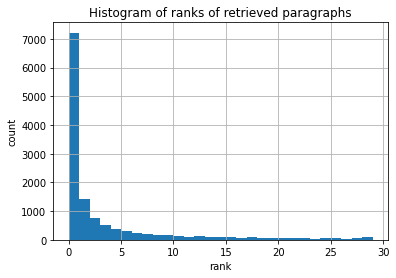
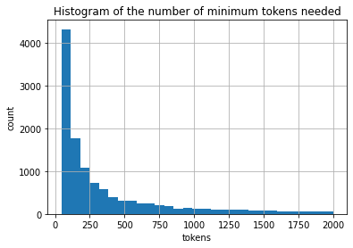

# Fine-Tuned Q&A：建立 Q&A 資料集

> 原文：[examples/fine-tuned_qa/olympics-2-create-qa.ipynb](https://github.com/openai/openai-cookbook/blob/main/examples/fine-tuned_qa/olympics-2-create-qa.ipynb)


## 這篇在做什麼

用 `davinci-instruct-beta-v3` 針對奧運維基百科的每個段落，先產生問題，再根據同一段內容產生答案，組成 Q&A 資料集，供之後 fine-tuning 使用。後半段還會用舊的 search endpoint 做問答，並分析它能多常找回正確的段落。

## 學完你會

- 把標題、小標、內文串成 context，並用 prompt 讓模型批次產生問題與答案。
- 看懂為什麼 instruct 模型即使 context 裡沒有答案，也傾向硬答，這正是後面要 fine-tune 的原因。
- 用產生的問題估算 retrieval 找回原始 context 的比例與排名分布。

## 開跑前

- 需要 OpenAI API key。
- 這份 notebook 會對每個段落呼叫 davinci，花很多時間和 token，也很貴。可以直接下載最後的資料集。
- 部分程式碼用到已棄用的 API endpoint。

<span style="color:orange; font-weight:bold">注意：想根據文字文件回答問題的話，建議改用 <a href="https://github.com/openai/openai-cookbook/blob/main/examples/Question_answering_using_embeddings.ipynb">Question Answering using Embeddings</a> 的做法。下面部分程式碼可能用到<a href="https://github.com/openai/openai-cookbook/tree/main/transition_guides_for_deprecated_API_endpoints">已棄用的 API endpoint</a>。</span>

我們用 [`davinci-instruct-beta-v3`](https://beta.openai.com/docs/engines/instruct-series-beta)，一個擅長遵循指令的模型，根據給定的 context 產生問題。接著再用同一個 [`davinci-instruct-beta-v3`](https://beta.openai.com/docs/engines/instruct-series-beta)，根據同樣的 context 回答這些問題。 

這很貴，也會花很長時間，因為每個段落都要呼叫一次 davinci engine。你也可以直接下載最後的資料集。

我們用的是[上一本 notebook](https://github.com/openai/openai-cookbook/blob/main/examples/fine-tuned_qa/olympics-1-collect-data.ipynb) 建立的資料集

## 2.1 讀入資料並建立 context
把該段落的標題、小標和內文串在一起，作為 context

```python
import pandas as pd
df = pd.read_csv('olympics-data/olympics_sections.csv')
df['context'] = df.title + "\n" + df.heading + "\n\n" + df.content
df.head()
```

??? note "輸出"

    ```text
                      title                                         heading  \
    0  2020 Summer Olympics                                         Summary   
    1  2020 Summer Olympics                             Host city selection   
    2  2020 Summer Olympics                 Impact of the COVID-19 pandemic   
    3  2020 Summer Olympics  Qualifying event cancellation and postponement   
    4  2020 Summer Olympics                          Effect on doping tests   

                                                 content  tokens  \
    0  The 2020 Summer Olympics (Japanese: 2020年夏季オリン...     713   
    1  The International Olympic Committee (IOC) vote...     126   
    2  In January 2020, concerns were raised about th...     369   
    3  Concerns about the pandemic began to affect qu...     298   
    4  Mandatory doping tests were being severely res...     163   

                                                 context  
    0  2020 Summer Olympics\nSummary\n\nThe 2020 Summ...  
    1  2020 Summer Olympics\nHost city selection\n\nT...  
    2  2020 Summer Olympics\nImpact of the COVID-19 p...  
    3  2020 Summer Olympics\nQualifying event cancell...  
    4  2020 Summer Olympics\nEffect on doping tests\n...
    ```

## 2.2 根據 context 產生問題
用 davinci-instruct 針對維基百科段落內容，產生一批合理的問題。

注意：我們用的是 temperature=0，但把 temperature 調高、讓問題更多樣，也許會更好。

<span style="color:orange; font-weight:bold">警告：這一步會跑很久，也會消耗大量 token，因為每個段落都要呼叫 davinci-instruct 來產生一批問題。</span>

```python
from openai import OpenAI

client = OpenAI(api_key=os.environ.get("OPENAI_API_KEY", "<your OpenAI API key if not set as env var>"))

def get_questions(context):
    try:
        response = client.chat.completions.create(model="davinci-instruct-beta-v3",
        prompt=f"Write questions based on the text below\n\nText: {context}\n\nQuestions:\n1.",
        temperature=0,
        max_tokens=257,
        top_p=1,
        frequency_penalty=0,
        presence_penalty=0,
        stop=["\n\n"])
        return response.choices[0].text
    except:
        return ""


df['questions']= df.context.apply(get_questions)
df['questions'] = "1." + df.questions
print(df[['questions']].values[0][0])
```

??? note "輸出"

    ```text
    1. What is the 2020 Summer Olympics?
    2. When did the 2020 Summer Olympics take place?
    3. Who won the most medals at the 2020 Summer Olympics?
    4. Who won the most gold medals at the 2020 Summer Olympics?
    5. Who won the most medals at the 2020 Summer Olympics?
    ```

這個 prompt 的設計是產生一批問題。上面的範例問題，是根據 2020 年夏季奧運頁面的摘要段落產生的。

可以看到上面第 3 題和第 5 題重複了。有時候產生的問題如果沒有 context 會有歧義。我們會證明，即使有這些限制，仍然能訓練出成功的模型。

```python
print(df.content.values[0])
```

??? note "輸出"

    ```text
    The 2020 Summer Olympics (Japanese: 2020年夏季オリンピック, Hepburn: Nisen Nijū-nen Kaki Orinpikku), officially the Games of the XXXII Olympiad (第三十二回オリンピック競技大会, Dai Sanjūni-kai Orinpikku Kyōgi Taikai) and branded as Tokyo 2020 (東京2020, Tōkyō Nii Zero Nii Zero), was an international multi-sport event held from 23 July to 8 August 2021 in Tokyo, Japan, with some preliminary events that began on 21 July.
    Tokyo was selected as the host city during the 125th IOC Session in Buenos Aires, Argentina, on 7 September 2013. Originally scheduled to take place from 24 July to 9 August 2020, the event was postponed to 2021 in March 2020 as a result of the COVID-19 pandemic, the first such instance in the history of the Olympic Games (previous games had been cancelled but not rescheduled). However, the event retained the Tokyo 2020 name for marketing and branding purposes. It was largely held behind closed doors with no public spectators permitted due to the declaration of a state of emergency in the Greater Tokyo Area in response to the pandemic. The Summer Paralympics were held between 24 August and 5 September 2021, 16 days after the completion of the Olympics.The 2020 Games were the fourth Olympic Games to be held in Japan, following the Tokyo 1964 (Summer), Sapporo 1972 (Winter) and Nagano 1998 (Winter) games. Tokyo is the first city in Asia to hold the Summer Games twice. The 2020 Games were the second of three consecutive Olympics to be held in East Asia, following the 2018 Winter Olympics in Pyeongchang, South Korea and preceding the 2022 Winter Olympics in Beijing, China.
    New events were introduced in existing sports for 2020, including 3x3 basketball, freestyle BMX and mixed gender team events in a number of existing sports, as well as the return of madison cycling for men and an introduction of the same event for women. New IOC policies also allowed the host organizing committee to add new sports to the Olympic program for just one Games. The disciplines added by the Japanese Olympic Committee were baseball and softball, karate, sport climbing, surfing and skateboarding, the last four of which made their Olympic debuts, and the last three of which will remain on the Olympic program.The United States topped the medal count by both total golds (39) and total medals (113), with China finishing second by both respects (38 and 88). Host nation Japan finished third, setting a record for the most gold medals and total medals ever won by their delegation at an Olympic Games with 27 and 58. Great Britain finished fourth, with a total of 22 gold and 65 medals, becoming the first nation at the Summer Olympics to increase or equal their total medals won in the two Games subsequent to hosting them. The Russian delegation competing as the ROC (not to be confused with the Republic of China (Taiwan) which competed as Chinese Taipei, not ROC) finished fifth with 20 gold medals and third in the overall medal count, with 71 medals. Bermuda, the Philippines and Qatar won their first-ever Olympic gold medals. Burkina Faso, San Marino and Turkmenistan won their first-ever Olympic medals.
    ```

## 2.3 根據 context 產生答案
用 davinci-instruct，根據相關的維基百科段落內容回答問題

注意：我們用的是 temperature=0，但把 temperature 調高、讓問題更多樣，也許會更好。

<span style="color:orange">**警告：這一步會跑很久，也會消耗大量 token，因為每個段落都要呼叫 davinci-instruct 來回答所有問題。**</span>

```python
def get_answers(row):
    try:
        response = client.chat.completions.create(
            engine="davinci-instruct-beta-v3",
            prompt=f"Write answer based on the text below\n\nText: {row.context}\n\nQuestions:\n{row.questions}\n\nAnswers:\n1.",
            temperature=0,
            max_tokens=257,
            top_p=1,
            frequency_penalty=0,
            presence_penalty=0
        )
        return response.choices[0].text
    except Exception as e:
        print (e)
        return ""


df['answers']= df.apply(get_answers, axis=1)
df['answers'] = "1." + df.answers
df = df.dropna().reset_index().drop('index',axis=1)
print(df[['answers']].values[0][0])
```

??? note "輸出"

    ```text
    1. The 2020 Summer Olympics is an international multi-sport event held from 23 July to 8 August 2021 in Tokyo, Japan.
    2. The 2020 Summer Olympics took place from 23 July to 8 August 2021.
    3. The United States topped the medal count by both total golds (39) and total medals (113), with China finishing second by both respects (38 and 88).
    4. The United States topped the medal count by both total golds (39) and total medals (113), with China finishing second by both respects (38 and 88).
    5. The United States topped the medal count by both total golds (39) and total medals (113), with China finishing second by both respects (38 and 88).
    ```

這些是根據主辦城市選擇相關 context 所產生的答案。 

可以看到第 3 到第 5 題的答案包含正確內容，但不是直接回答問題，而是逐字摘出原文。雖然偶爾有品質較低的答案，只要範例夠多，模型仍然可以把這個任務學得不錯。

## 2.4 儲存根據維基百科段落建立的奧運 Q&A 資料集
把檔案存起來，給[下一本 notebook](olympics-3-train-qa.md) 使用

```python
df.to_csv('olympics-data/olympics_qa.csv', index=False)
```

## 2.5 Search 檔案（已棄用）
我們建立一個 search 檔案（[API reference](https://beta.openai.com/docs/api-reference/files/list)），問問題時可以用它找出相關的 context。

<span style="color:orange; font-weight:bold">已棄用：/search endpoint 已被 embeddings 取代。Embeddings 更便宜、更快，也能提供更好的搜尋體驗。用 embeddings 做搜尋的實作請看 <a href="https://github.com/openai/openai-cookbook/blob/main/examples/Question_answering_using_embeddings.ipynb">Question Answering Guide</a></span>


```python
df = df[df.tokens<2000]
df[['context', 'tokens']].rename(columns={'context':'text','tokens':'metadata'}).to_json('olympics-data/olympics_search.jsonl', orient='records', lines=True)

search_file = client.files.create(
  file=open("olympics-data/olympics_search.jsonl"),
  purpose='search'
)
olympics_search_fileid = search_file['id']
```

## 2.6 根據提供的 context 回答問題

我們用一個簡單的 answers endpoint 實作。做法是先用 [/search endpoint](https://beta.openai.com/docs/api-reference/searches) 搜尋已建立索引的檔案，取得相關段落放進 context，接著對指定的模型送出問答 prompt。

```python
from answers_with_ft import create_context, answer_question
print(create_context("Where did women's 4 x 100 metres relay event take place during the 2020 Summer Olympics?", olympics_search_fileid, max_len=400))
```

??? note "輸出"

    ```text
    Athletics at the 2020 Summer Olympics – Women's 4 × 100 metres relay
    Summary

    The women's 4 × 100 metres relay event at the 2020 Summer Olympics took place on 5 and 6 August 2021 at the Japan National Stadium. There were 16 competing relay teams, with each team having 5 members from which 4 were selected in each round.

    ###

    Athletics at the 2020 Summer Olympics – Men's 4 × 100 metres relay
    Qualification

    National Olympic Committees (NOCs) could qualify one relay team in one of three following ways:
    The top 8 NOCs at the 2019 World Athletics Championships qualified a relay team.
    The top 8 NOCs at the 2021 World Athletics Relays qualified a relay team.
    Where an NOC placed in the top 8 at both the 2019 World Championships and the 2021 World Relays, the quota place was allocated to the world top list as of 29 June 2021. In this case, 4 teams did so, so there are 4 places available through the world rankings.A total of five athletes may be entered for a relay team. Should a NOC have also entered individual athletes in the corresponding individual event (100 m), the entered individual athletes must be included in the total of five (5) athletes entered for the relay event. In addition of five, NOCs can nominate a maximum of one alternate athlete for each team.
    The qualifying period was originally from 1 May 2019 to 29 June 2020. Due to the COVID-19 pandemic, the period was suspended from 6 April 2020 to 30 November 2020, with the end date extended to 29 June 2021. The qualifying time standards could be obtained in various meets during the given period that have the approval of the IAAF. Both indoor and outdoor meets are eligible. The most recent Area Championships may be counted in the ranking, even if not during the qualifying period.
    ```

```python
answer_question(olympics_search_fileid, "davinci-instruct-beta-v3", 
            "Where did women's 4 x 100 metres relay event take place during the 2020 Summer Olympics?")
```

??? note "輸出"

    ```text
    ' Japan National Stadium'
    ```

等我們把模型 fine-tune 成 Q&A 模型之後，就能用它取代 [`davinci-instruct-beta-v3`](https://beta.openai.com/docs/engines/instruct-series-beta)，在問題無法從 context 回答的時候得到更好的答案。我們看到 [`davinci-instruct-beta-v3`](https://beta.openai.com/docs/engines/instruct-series-beta) 的缺點是，不管有沒有相關 context，它都一定會試著回答問題。（注意第二個問題問的是未來的事件，設定在 2024 年。）

```python
answer_question(olympics_search_fileid, "davinci-instruct-beta-v3", 
            "Where did women's 4 x 100 metres relay event take place during the 2048 Summer Olympics?", max_len=1000)
```

??? note "輸出"

    ```text
    ' Japan National Stadium'
    ```

可以看到 davinci 傾向回答問題，即使根據提供的 context 根本無法回答。注意問的是 2048 年夏季奧運，這個還沒發生，而檢索到的內容只有 2020 年的結果。

## 2.7 （選用）調查 search endpoint 回傳相關 context 的機率

```python
def check_context(title, heading, question, max_len=1800, search_model='ada', max_rerank=10):
    """
    Evaluate the performance of the search model in retrieving the correct context

    Parameters
    ----------
    title: str
        The title of the Wikipedia page
    heading: str
        The heading of the Wikipedia section
    qusetion: str
        The question
    max_len: int
        The maximum length of the context
    search_model: str
        The search model to use - `ada` is most cost effective
    max_rerank: int
        The maximum number of reranking documents to use the search model on

    Returns
    -------
    rank: int
        The rank of the correct context
    token_length: int
        The number of tokens needed to obtain the correct context
    """
    
    try:
        # TODO: openai.Engine(search_model) is deprecated
        results = openai.Engine(search_model).search(
            search_model=search_model, 
            query=question, 
            max_rerank=max_rerank,
            file=olympics_search_fileid,
            return_metadata=True
        )
        index=-1
        returns = []
        cur_len = 0
        for result in results['data']:
            cur_len += int(result['metadata']) + 4 # we add 4 tokens for the separator `\n\n###\n\n`
            if cur_len > max_len:
                break
            returns.append(result['text'])
            res = result['text'].split('\n')
            if res[0] == title and res[1] == heading:
                index = len(returns) - 1
                break
        return index, cur_len
    except Exception as e:
        #print (e)
        return []
print(check_context("Athletics at the 2020 Summer Olympics – Women's 4 × 100 metres relay", "Summary", "Where did women's 4 x 100 metres relay event take place during the 2020 Summer Olympics?", max_len=10000))
```

??? note "輸出"

    ```text
    (0, 58)
    ```

我們用根據 context 產生的問題，來估計能多常找回原始的 context。這些問題有雜訊，所以這不是完美的估計。

我們的問題和答案開頭有編號項目符號，但由於產生的方式，缺少了第一個編號，所以我們在問題（和答案）清單前面補上 "1."。

我們計算用 ada search 檢索到的段落排名，以及完整檢索到相關段落所需的 context token 數。

```python
ada_results = df.apply(lambda x: [
                    check_context( x.title, 
                                   x.heading, 
                                   q[3:],     # remove the number prefix
                                   max_len=1000000, # set a large number to get the full context 
                                   search_model='ada', 
                                   max_rerank=200,
                                 ) 
                    for q in (x.questions).split('\n') # split the questions
                    if len(q) >10 # remove the empty questions
                ], axis=1)
ada_results.head()
```

??? note "輸出"

    ```text
    0    [(132, 27104), (-1, 22939), (8, 2151), (2, 121...
    1    [(4, 1737), (0, 130), (8, 744), (96, 17208), (...
    2          [(0, 373), (0, 373), (-1, 40610), (1, 570)]
    3            [(0, 302), (0, 302), (5, 968), (8, 1425)]
    4                      [(0, 167), (0, 167), (2, 1442)]
    Name: ada, dtype: object
    ```

```python
out = pd.concat([ada_results], axis=1)
out.columns = ['ada']
out.to_csv('olympics-data/search_engine_results.csv')
```

```python
def expand_lists(out):
    """
    Expand a pandas series containing lists into a series, where each list element becomes a value on its own

    Input is a row per paragraph, which has multiple questions
    Output is a row per question
    """
    cols = [pd.DataFrame(out[name].tolist()).stack().reset_index(level=1, drop=True).rename(name) for name in out.columns] 
    return pd.concat(cols, axis=1)

out_expanded = expand_lists(out)
out_expanded['rank'] = out_expanded.ada.apply(lambda x: x[0] if x != [] else -2)
out_expanded['tokens'] = out_expanded.ada.apply(lambda x: x[1] if x != [] else -2)
```

```python
within_2k = (out_expanded.tokens < 2000).mean()
print(f"{within_2k*100:.1f}% of relevant paragraphs are retrieved within the first 2k tokens")
```

??? note "輸出"

    ```text
    74.3% of relevant paragraphs are retrieved within the first 2k tokens
    ```

在這個資料集上，有 74% 的機率可以取得相關 context

```python
outside_200 = (out_expanded['rank'] == -1).mean()
print(f"{outside_200*100:.1f}% of relevant paragraphs are not retrieved within the first 200 results")
```

??? note "輸出"

    ```text
    7.4% of relevant paragraphs are not retrieved within the first 200 results
    ```

其中 7.4% 是因為 search 演算法的關鍵字搜尋部分，沒有在前 200 筆結果裡找到相關 context。
另外 18.3% 是因為語意搜尋沒有把相關 context 放進前 2000 個 token。

```python
import matplotlib.pyplot as plt

# plot a histogram, and add axis descriptions and title
out_expanded[(out_expanded['rank'] >=0)&(out_expanded['rank'] <30)]['rank'].hist(bins=29)
plt.xlabel('rank')
plt.ylabel('count')
plt.title('Histogram of ranks of retrieved paragraphs')
plt.show()
```

??? note "輸出"

    

```python
out_expanded[(out_expanded.tokens>=0)&(out_expanded.tokens < 2000)]['tokens'].hist(bins=29)
plt.xlabel('tokens')
plt.ylabel('count')
plt.title('Histogram of the number of minimum tokens needed')
plt.show()
```

??? note "輸出"

    

可以看到 context 最可能出現在最前面的結果，而且最可能在前 200 到 500 個 token 內被回傳。

```python
# normalized value_counts
out_expanded['rank'].value_counts(normalize=True).sort_index()[:13]
```

??? note "輸出"

    ```text
    -2     0.000063
    -1     0.074428
     0     0.453420
     1     0.089515
     2     0.047146
     3     0.032437
     4     0.024139
     5     0.019676
     6     0.015967
     7     0.013452
     8     0.011189
     9     0.009869
     10    0.009178
    Name: rank, dtype: float64
    ```

相關 context 在各個排名被回傳的機率。（-2 代表處理錯誤，-1 代表排名超過 200）

## 重點整理

- 用 instruct 模型可以把現成文件變成 Q&A 資料集：先產生問題，再根據同一段 context 產生答案。
- 自動產生的資料有雜訊，例如問題重複、答案是逐字摘錄，但範例夠多，模型還是能學會這個任務。
- instruct 模型不論 context 有沒有答案都會硬答，這是需要 fine-tune 的動機。
- 評估 retrieval 時，可以用產生的問題反向檢查能不能找回原始段落。
- 這篇用到的 search endpoint 已棄用，新做法應該用 embeddings。

## 練習

1. 把產生問題的 temperature 從 0 調高一點，只跑一個段落，比較問題的重複程度和多樣性。
2. 修改產生答案的 prompt，要求答案必須用完整句子，而且不能逐字複製原文，看輸出有沒有改善。
3. 在 2.6 節自己再加一個無法從 context 回答的問題（例如問一個不存在的賽事），觀察模型是不是還是硬答。
