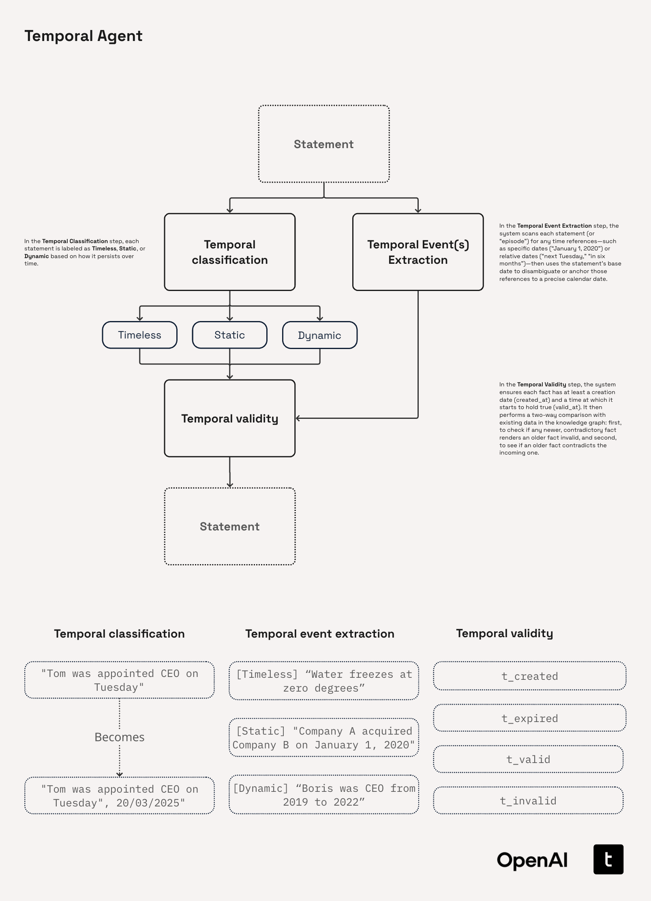
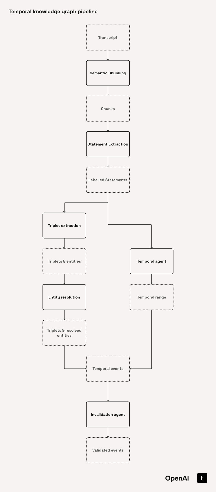
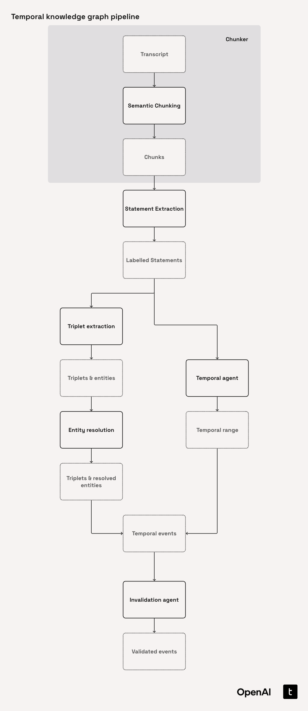
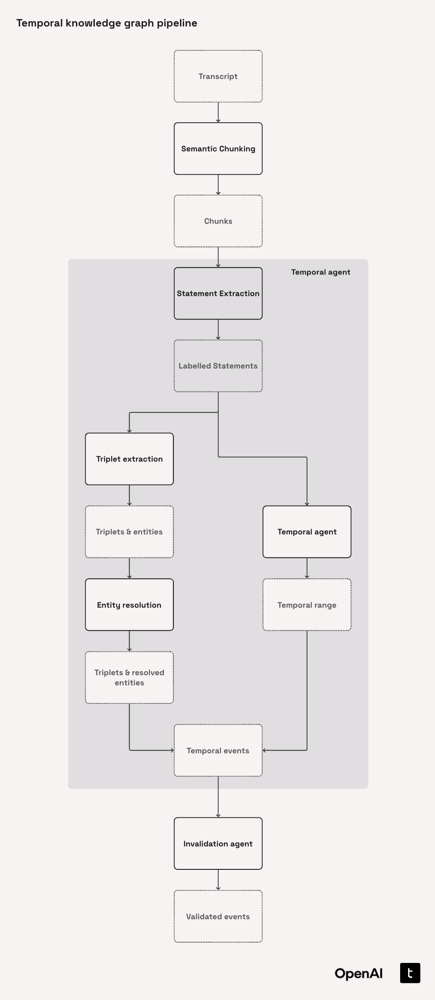
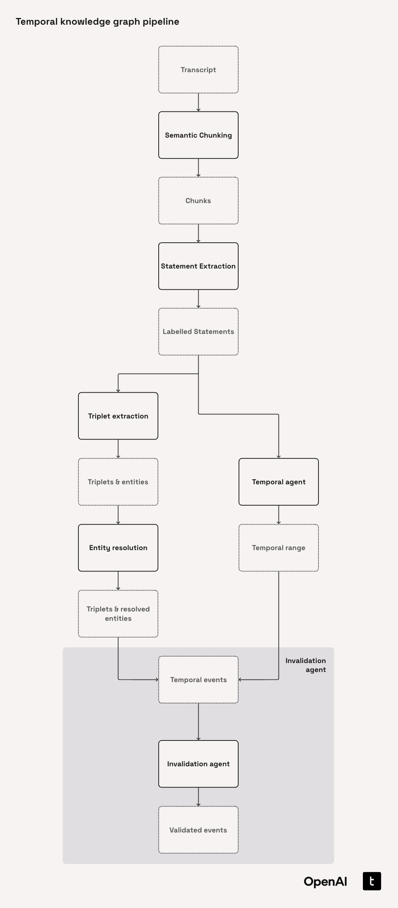
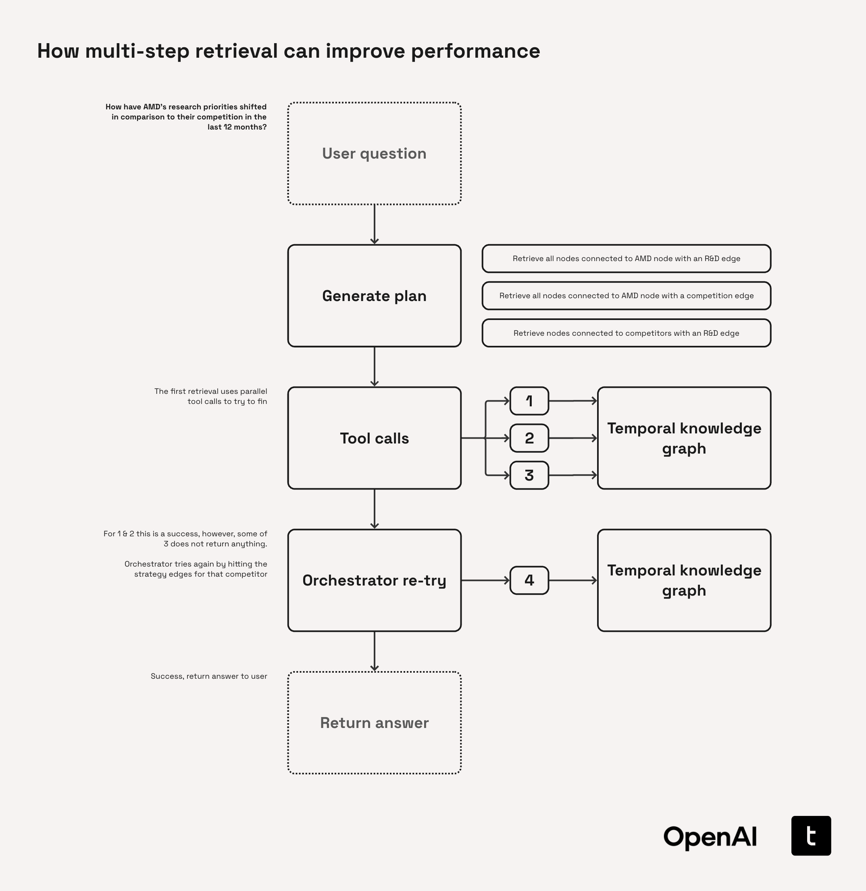
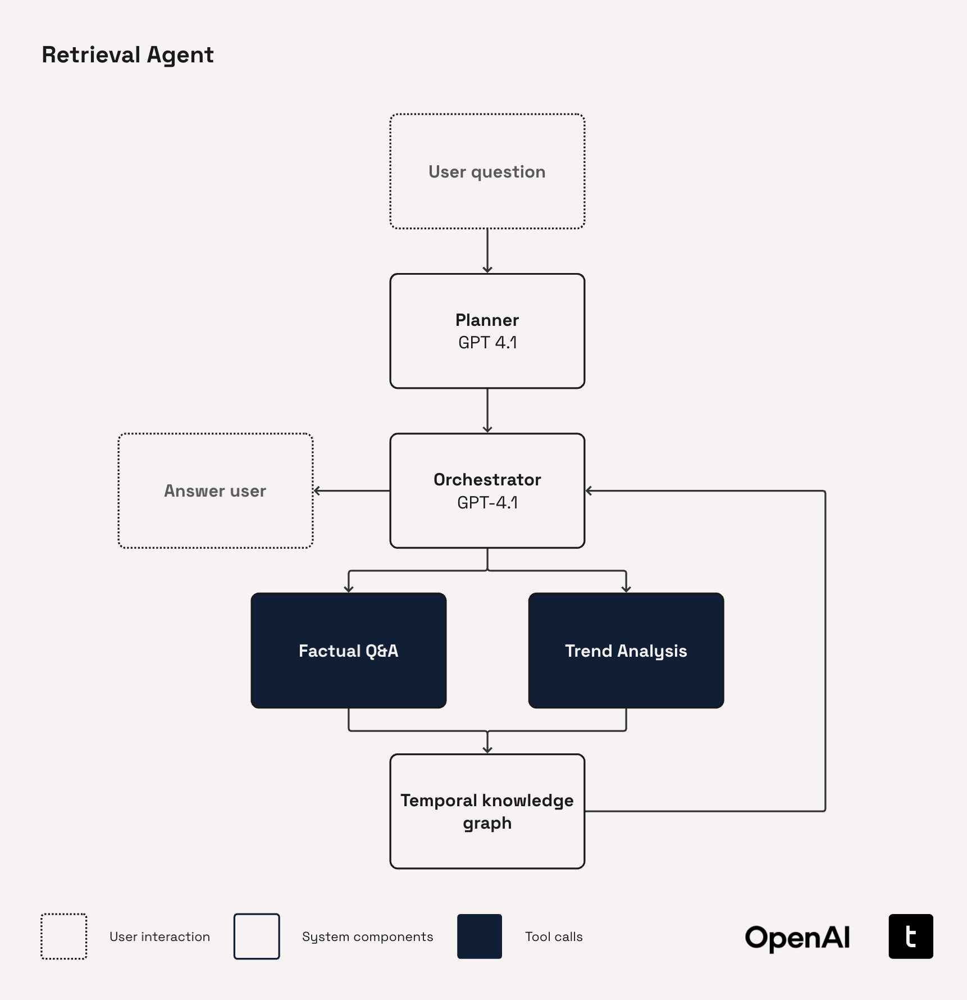
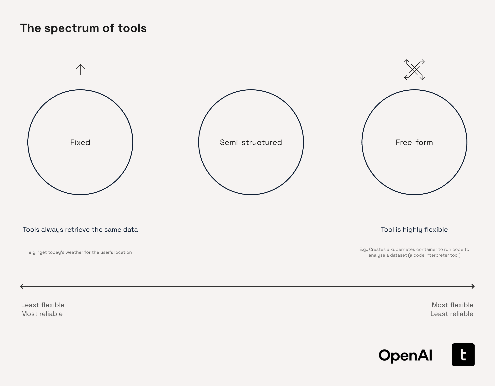

# Temporal Agents with Knowledge Graphs（帶時間感知的知識圖譜）

> 原文：[examples/partners/temporal_agents_with_knowledge_graphs/temporal_agents.ipynb](https://github.com/openai/openai-cookbook/blob/main/examples/partners/temporal_agents_with_knowledge_graphs/temporal_agents.ipynb)


## 這篇在做什麼

這篇教你把財報電話會議逐字稿，一路處理成「每條事實都帶有效時間」的知識圖譜，再讓 agent 用 tool call 在圖譜上多步查詢。重點有兩塊：新資料進來時怎麼讓舊事實失效（invalidation），以及怎麼讓模型一跳接一跳地走圖譜回答複雜問題。最後還會講從 prototype 走到 production 要注意什麼。

## 學完你會

- 用 LLM 把文字拆成 statement、時間範圍、triplet 和 entity，存進 SQLite 並建出 NetworkX 圖譜
- 寫出 Invalidation Agent，判斷新事實有沒有讓舊事實過期，並標上 `invalid_at` 和 `invalidated_by`
- 做一個 planner + orchestrator 的 multi-step retrieval agent，用 `factual_qa`、`trend_analysis` 這類 tool 在圖譜上查資料

## 開跑前

- 需要 `OPENAI_API_KEY` 環境變數，會呼叫 GPT-4.1 系列和 o4-mini，是付費 API
- Python 3.12 以上
- 完整處理所有逐字稿要花好幾個小時，建議直接載入文中提供的預處理資料

---

## 1.1. 目的與適合對象

這份 notebook 手把手帶你建出**具備時間感知的知識圖譜**，並直接在圖譜上做**多跳檢索（multi-hop retrieval）**。

它適合處理時間感知知識圖譜的工程師、架構師和分析師。不管你是在做 prototype、大規模部署，還是想找新的方式使用結構化資料，這裡都有實用的流程、最佳實務和決策框架可以參考。

這份 cookbook 提供兩個可以直接拿去用、擴充、部署的流程：

<ol style="margin-left: 1em; line-height: 1.6; padding-left: 0.5em;">
  <li style="margin-bottom: 1.2em;">
    <strong>具時間感知的知識圖譜（KG）建構</strong><br />
    <p style="margin-top: 0.5em; margin-bottom: 0.5em;">
      開發知識驅動的 AI 系統，有個關鍵挑戰是讓資料庫保持最新、保持有用。大家常把心力放在用語意相似度、re-ranking 這類技巧提升檢索準確率，但這篇聚焦在一個根本卻常被忽略的環節：<em>新資料進來時，有系統地更新並驗證你的知識庫</em>。
    </p>
    <p style="margin-top: 0.5em; margin-bottom: 0.5em;">
      不管檢索演算法多先進，效果都受限於資料庫的品質和新鮮度。這份 cookbook 示範如何在新資料到來時，定期驗證並更新知識圖譜裡的條目，讓知識庫維持正確、保持最新。
    </p>
  </li>

  <li style="margin-bottom: 1.2em;">
    <strong>用知識圖譜做多跳檢索</strong><br />
<p style="margin-top: 0.5em; margin-bottom: 0.5em;">
  學習怎麼把 OpenAI 模型（例如 o3、o4-mini、GPT-4.1 和 GPT-4.1-mini）和結構化圖譜查詢透過 tool call 結合，讓模型能跨實體和關係，分多步走訪你的圖譜。
</p>
<p style="margin-top: 0.5em; margin-bottom: 0.5em;">
  這個方法讓系統能回答需要串連多個事實才能推理的複雜問題，遠遠超過單跳檢索做得到的範圍。
</p>
  </li>
</ol>

裡面你會看到：

* **實用的決策框架**，教你在每個階段挑模型和 prompt 技巧
* **隨插即用的程式碼範例**，容易接進你的 ML 和資料 pipeline
* **深入資源的連結**，涵蓋 OpenAI tool use、fine-tuning、圖譜後端選型等
* **從 prototype 到 production 的清楚路徑**，附上可執行的擴展與可靠性最佳實務

> **注意：** 所有 benchmark 和建議，都是以 2025 年 6 月當時最好的模型和做法為準。生態系持續演進，建議定期回頭檢視你的做法，跟上新功能和改進。

## 1.2. 重點摘要

### 用 Temporal Agent 建立具時間感知的知識圖譜
<ol style="margin-left: 1em; line-height: 1.6; padding-left: 0.5em;">
  <li style="margin-bottom: 1.2em;">
    <strong>為什麼要讓知識圖譜帶時間？</strong><br />
    <p style="margin-top: 0.5em; margin-bottom: 0.5em;">
     傳統知識圖譜把事實當成靜態的，但真實世界的資訊一直在變。上一季為真的事，今天可能已經過時，圖譜如果沒記錄變化，就可能造成錯誤或誤導決策。時間感知的知識圖譜讓你能精準回答「某個日期當時什麼是真的？」，或分析事實與關係如何隨時間變動，確保決策永遠基於最相關的脈絡。
    </p>
  </li>

  <li style="margin-bottom: 1.2em;">
    <strong>什麼是 Temporal Agent？</strong><br />
    <p style="margin-top: 0.5em; margin-bottom: 0.5em;">
      Temporal Agent 是 pipeline 裡的一個元件，吃進原始資料，產出帶時間戳的 triplet 給知識圖譜用。這讓你能做精準的時間查詢、建構時間軸、做趨勢分析等等。
    </p>
  </li>

  <li style="margin-bottom: 1.2em;">
    <strong>Pipeline 怎麼運作？</strong><br />
    <p style="margin-top: 0.5em; margin-bottom: 0.5em;">
      Pipeline 先對原始文件做語意切塊（semantic chunking），再把 chunk 拆成一條條 statement 交給 Temporal Agent，由它產生帶時間的 triplet。接著 Invalidation Agent 做時間有效性檢查，找出被新進圖譜的 statement 推翻的舊 statement 並處理。
    </p>
  </li>
</ol>

### 在知識圖譜上做多步檢索
<ol style="margin-left: 1em; line-height: 1.6; padding-left: 0.5em;">
  <li style="margin-bottom: 1.2em;">
    <strong>為什麼要多步檢索？</strong><br />
<p style="margin-top: 0.5em; margin-bottom: 0.5em;">
  直接的單跳查詢常常漏掉分散在圖譜各處的重要事實。多步（multi-hop）檢索可以反覆走訪，沿著關係一路跟下去，跨好幾跳匯整證據。這樣能挖出單次查詢看不到的複雜依賴和隱藏關聯，給出更完整、更細緻的答案。
</p>
  </li>

  <li style="margin-bottom: 1.2em;">
    <strong>Planner</strong><br />
    <p style="margin-top: 0.5em; margin-bottom: 0.5em;">
      Planner 負責統籌檢索流程。<em>任務導向（task-orientated）</em>的 planner 把問題拆成具體、有順序的子任務。<em>假設導向（hypothesis-orientated）</em>的 planner 則提出要驗證、推翻或修正的主張。該選哪種，取決於你的問題落在「確定性報表（路徑明確）」到「探索式研究（開放推論）」這條光譜的哪裡。
    </p>
  </li>

  <li style="margin-bottom: 1.2em;">
    <strong>Tool 設計典範</strong><br />
    <p style="margin-top: 0.5em; margin-bottom: 0.5em;">
      Tool 設計是一條連續的光譜：<em>固定 tool（Fixed tools）</em>對特定查詢給出一致、可預測的輸出（例如永遠回傳舊金山今天天氣的服務）。另一端是<em>自由形式 tool（Free-form tools）</em>，彈性很大，像程式碼執行或開放式資料檢索。<em>半結構化 tool（Semi-structured tools）</em>落在兩者之間，限制某些動作，同時保留量身調整的彈性，專門的 sub-agent 就是典型例子。選哪種典範，是在可控性、適應力和複雜度之間取捨。
    </p>
  </li>

  <li style="margin-bottom: 1.2em;">
    <strong>評估檢索系統</strong><br />
<p style="margin-top: 0.5em; margin-bottom: 0.5em;">
  高品質的評估要靠專家整理的「golden」答案，但這很貴又費工。LLM 或 tool trace 這類自動評分可以快速產生，拿來補充或初篩，只是精準度比不上人工評估。系統成熟之後，要逐步轉向用真實使用者回饋，來衡量並優化 production 的檢索品質。
</p>
    <p style="margin-top: 0.5em; margin-bottom: 0.5em;">
      一個驗證過的流程：先用合成測試開始，再拿你整理好的人工標註 golden 資料集做 benchmark，最後依據線上使用者回饋和評分持續改進。
    </p>
  </li>
</ol>

### 從 Prototype 到 Production
<ol style="margin-left: 1em; line-height: 1.6; padding-left: 0.5em;">
  <li style="margin-bottom: 1.2em;">
    <strong>讓圖譜保持精簡</strong><br />
    <p style="margin-top: 0.5em; margin-bottom: 0.5em;">
      訂好封存政策，並給每條 edge 一個數值化的相關性分數（例如 新鮮度 x 可信度 x 查詢頻率）。自動封存或精簡低價值的 node 和 edge，只留下最關鍵、最常被存取的事實，讓檢索保持快速。
    </p>
  </li>

  <li style="margin-bottom: 1.2em;">
    <strong>讓 ingestion pipeline 平行化</strong><br />
    <p style="margin-top: 0.5em; margin-bottom: 0.5em;">
      把線性的 文件 → chunk → 抽取 → 解析 pipeline，改成分階段的非同步架構。每個處理階段有自己的 queue 和專屬 worker pool。invalidation 工作可以用分群或網路式的 batching 提高效率。外部 API 請求（例如 OpenAI）和資料庫寫入盡量批次化。這樣設計能提高吞吐量、帶來 backpressure 提升可靠性，還能讓每個階段獨立擴展。
    </p>
  </li>

  <li style="margin-bottom: 1.2em;">
    <strong>建立穩固的 production 防護</strong><br />
    <p style="margin-top: 0.5em; margin-bottom: 0.5em;">
      嚴格驗證輸出：統一時間欄位格式（例如 ISO-8601）、把 entity 類型限制在你控管的詞彙表內，並加上輕量的模型式 sanity check 確認輸出一致。用帶可追蹤 ID 的結構化 log，即時監控品質和效能指標，在資料漂移、退步或 pipeline 異常影響下游應用之前就先發現。
    </p>
  </li>
</ol>

# 2. 這份 Cookbook 怎麼用
---

這份 cookbook 可以彈性使用：

1. 當成完整的技術指南，從頭讀到尾，深入理解時間感知知識圖譜系統。
2. 想看高階概念、方法論和實作模式的話，可以快速瀏覽。
3. 直接跳進三個模組化章節的任何一個，每個都獨立成篇，能直接套用到實際場景。

內容包括：

<ol style="margin-left: 1em; line-height: 1.6; padding-left: 0.5em;">
  <li style="margin-bottom: 1.2em;">
    <strong>用 Temporal Agent 建立具時間感知的知識圖譜</strong><br />
    <p style="margin-top: 0.5em; margin-bottom: 0.5em;">
      建一條 pipeline，從非結構化文字抽出 entity 和關係，解決時間上的衝突，並在新資訊到來時讓圖譜保持最新。
    </p>
  </li>

  <li style="margin-bottom: 1.2em;">
    <strong>在知識圖譜上做多步檢索</strong><br />
    <p style="margin-top: 0.5em; margin-bottom: 0.5em;">
      用結構化查詢加語言模型的推理，把多跳串起來走過圖譜，回答複雜問題。
    </p>
  </li>

  <li style="margin-bottom: 1.2em;">
    <strong>從 Prototype 到 Production</strong><br />
    <p style="margin-top: 0.5em; margin-bottom: 0.5em;">
      從實驗走到部署。這一節講架構建議、整合模式，以及穩定擴展要考慮的事。
    </p>
  </li>
</ol>


## 2.1. 先決條件

在開始建 temporal agent 和知識圖譜之前，先把環境設好。用 pip 安裝所有需要的套件，並把 OpenAI API key 設成環境變數。需要 Python 3.12 以上。

```python
!python -V
%pip install --upgrade pip
%pip install -qU chonkie datetime ipykernel jinja2 matplotlib networkx numpy openai plotly pydantic rapidfuzz scipy tenacity tiktoken pandas
%pip install -q "datasets<3.0"
```

??? note "輸出"

    ```text
    Python 3.12.8
    Requirement already satisfied: pip in ./.venv/lib/python3.12/site-packages (25.1.1)
    Note: you may need to restart the kernel to use updated packages.
    Note: you may need to restart the kernel to use updated packages.
    Note: you may need to restart the kernel to use updated packages.
    ```

```python
import os

if "OPENAI_API_KEY" not in os.environ:
    import getpass
    os.environ["OPENAI_API_KEY"] = getpass.getpass("Paste your OpenAI API key here: ")
```

# 3. 用 Temporal Agent 建立具時間感知的知識圖譜
---

**正確的資料是所有好商業決策的基礎。**
OpenAI 最新的模型，像 o3、o4-mini 和 GPT-4.1 系列，讓企業能為最重要的工作流程打造頂尖的檢索系統。不過資訊變得很快：昨天還信心滿滿匯入的事實，今天可能已經過時了。
<!--  -->


如果沒辦法追蹤每個事實的有效期間，檢索系統就可能回傳過時、不合規或誤導的答案。缺少時間脈絡的後果在任何產業都可能很嚴重，下面的例子可以說明。

<table>
  <thead>
    <tr>
      <th>產業</th>
      <th>範例問題</th>
      <th>資料庫沒有時間維度的風險</th>
    </tr>
  </thead>
  <tbody>
    <tr>
      <td rowspan="3"><strong>金融服務</strong></td>
      <td><em>"How has Moody’s long‑term rating for Bank YY evolved since Feb 2023?"</em></td>
      <td>把歷史評等和當前評等混在一起，導致信用風險定價錯誤</td>
    </tr>
    <tr>
      <td><em>"Who was the CFO of Retailer ZZ when the FY‑22 guidance was issued?"</em></td>
      <td>治理或內線交易分析可能怪錯高階主管</td>
    </tr>
    <tr>
      <td><em>"Was Fund AA sanctioned under Article BB at the time it bought Stock CC in Jan 2024?"</em></td>
      <td>如果規則後來改了，合規報告可能漏掉違規行為</td>
    </tr>
    <tr>
      <td rowspan="3"><strong>製造 / 汽車</strong></td>
      <td><em>"Which ECU firmware was deployed in model Q3 cars shipped between 2022‑05 and 2023‑03?"</em></td>
      <td>因為韌體版本漂移而誤判現場故障原因</td>
    </tr>
    <tr>
      <td><em>"Which robot‑controller software revision ran on Assembly Line 7 during Lot 8421?"</em></td>
      <td>根因分析可能怪錯軟體版本</td>
    </tr>
    <tr>
      <td><em>"What torque specification applied to steering‑column bolts in builds produced in May 2024?"</em></td>
      <td>安全召回可能漏掉受影響的車輛</td>
    </tr>
  </tbody>
</table>


這裡只舉了幾個例子，同樣的情況在製藥、法律、消費品等許多產業都一樣。

**不只是一般檢索**

時間感知的知識圖譜讓你超越靜態的事實查詢。它能支援更豐富的檢索流程，例如有時間依據的事實問答、時間軸生成、變更追蹤、反事實分析等。這些我們會在後面的檢索章節詳細講。

<!--  -->


## 3.1. 介紹 Temporal Agent
---

**Temporal agent** 是一條專門的 pipeline，把原始、自由形式的陳述轉成帶時間的 triplet，可以匯入知識圖譜，之後就能回答「在時間 T 當時什麼是真的？」這類問題。

Triplet 是知識圖譜的基本單位。它用三個部分（所以叫 *triplet*）表示單一事實或知識：
- **Subject（主詞）**：你在談論的實體
- **Predicate（謂詞）**：關係或屬性的類型
- **Object（受詞）**：主詞所連結的值或其他實體

你可以把它想成結構是 `[Subject] - [Predicate] - [Object]` 的一句話。看一個更清楚的例子：
```
"London" - "isCapitalOf" - "United Kingdom"
```

這份 cookbook 實作的 Temporal Agent 參考了 [Zep](https://arxiv.org/abs/2501.13956) 和 [Graphiti](https://github.com/getzep/graphiti)，同時對事實失效加上更嚴謹的控制，並用更細緻的方式處理 episodic typing。

### 3.1.1. 這份 cookbook 的主要增強

<ol style="margin-left: 1em; line-height: 1.6; padding-left: 0.5em;">
  <li style="margin-bottom: 1.2em;">
    <strong>時間有效性抽取</strong><br />
    <p style="margin-top: 0.5em; margin-bottom: 0.5em;">
      以 Graphiti 的 prompt 設計為基礎，不需要額外的參照陳述，就能辨識時間區間和 episodic 脈絡。
    </p>
  </li>

  <li style="margin-bottom: 1.2em;">
    <strong>事實失效邏輯</strong><br />
    <p style="margin-top: 0.5em; margin-bottom: 0.5em;">
      加入雙向檢查，並依 episodic 類型限制比對範圍。這保留了 Zep 不丟資料（non-lossy）的做法，同時減少不必要的評估。
    </p>
  </li>

  <li style="margin-bottom: 1.2em;">
    <strong>時間與 episodic 類型</strong><br />
    <p style="margin-top: 0.5em; margin-bottom: 0.5em;">
      區分 <code>Fact</code>、<code>Opinion</code>、<code>Prediction</code>，也區分時間類別 <code>Static</code>、<code>Dynamic</code>、<code>Atemporal</code>。
    </p>
  </li>

  <li style="margin-bottom: 1.2em;">
    <strong>多事件抽取</strong><br />
    <p style="margin-top: 0.5em; margin-bottom: 0.5em;">
      一次處理就能搞定複合句和巢狀的日期參照。
    </p>
  </li>
</ol>


這個流程讓我們能有效率又可靠地更新真相來源（source of truth）：

<br>

<!--  -->


> **注意**：這份 cookbook 的實作以圖譜為主，但這個做法也可以套用到其他知識庫結構，例如基於 pgvector 的系統。
---

### 3.1.2. Temporal Agent Pipeline

Temporal Agent 用三階段的 pipeline 處理進來的 statement：

<ol style="margin-left: 1em; line-height: 1.6; padding-left: 0.5em;">
  <li style="margin-bottom: 1.2em;">
    <strong>時間分類（Temporal Classification）</strong><br />
    <p style="margin-top: 0.5em; margin-bottom: 0.5em;">
      把每條 statement 標成 <strong>Atemporal</strong>、<strong>Static</strong> 或 <strong>Dynamic</strong>：
    </p>
    <ul style="margin-top: 0.5em; margin-bottom: 0.5em; padding-left: 1em;">
      <li style="margin-bottom: 0.5em;"><em>Atemporal</em> statement 永遠不變（例如：「真空中的光速約為 3×10⁸ m s⁻¹」）。</li>
      <li style="margin-bottom: 0.5em;"><em>Static</em> statement 從某個時間點起成立，之後不再改變（例如："Person YY was CEO of Company XX on October 23rd 2014."）。</li>
      <li><em>Dynamic</em> statement 會隨時間演變（例如："Person YY is CEO of Company XX."）。</li>
    </ul>
  </li>

  <li style="margin-bottom: 1.2em;">
    <strong>時間事件抽取（Temporal Event Extraction）</strong><br />
    <p style="margin-top: 0.5em; margin-bottom: 0.5em;">
      找出相對或不完整的日期（例如「Tuesday」、「three months ago」），用文件時間戳或備用的啟發式規則（例如只知道月份時，預設取該月 1 號或最後一天）解析成絕對日期。
    </p>
  </li>

  <li style="margin-bottom: 1.2em;">
    <strong>時間有效性檢查（Temporal Validity Check）</strong><br />
    <p style="margin-top: 0.5em; margin-bottom: 0.5em;">
      確保每條 statement 都有 <code>t_created</code> 時間戳，適用時還有 <code>t_expired</code> 時間戳。接著 agent 會把候選 triplet 和知識圖譜現有的條目比對，用來：
    </p>
    <ul style="margin-top: 0.5em; margin-bottom: 0.5em; padding-left: 1em;">
      <li style="margin-bottom: 0.5em;">偵測矛盾，並用 <code>t_invalid</code> 把過時的條目標起來</li>
      <li style="margin-bottom: 0.5em;">用 <code>invalidated_by</code> 把較新的 statement 連到被它推翻的舊 statement</li>
    </ul>
  </li>
</ol>


<!--  -->


### 3.1.3. 幫 Temporal Agent 挑模型
用 LLM 建系統時，好習慣是[先用大模型，之後再優化、縮小](https://platform.openai.com/docs/guides/model-selection)。

GPT-4.1 系列的指令遵循能力很強，特別適合建 Temporal Agent。在 Scale 的 MultiChallenge 這類 benchmark 上，[GPT-4.1 比 GPT-4o 高出 $10.5\%_{abs}$](https://openai.com/index/gpt-4-1/)，顯示它在維持上下文、對話中推理和遵守指令上更強，這些正是抽取帶時間戳 triplet 的關鍵特質。所以拿來做依賴時間感知資料抽取的 agent prototype 很合適。

#### 建議的開發流程
<ol style="margin-left: 1em; line-height: 1.6; padding-left: 0.5em;">
  <li style="margin-bottom: 1.2em;">
    <strong>用 GPT-4.1 做 prototype</strong><br />
    <p style="margin-top: 0.5em; margin-bottom: 0.5em;">
      建核心 pipeline 邏輯時，先把正確率拉到最高，也減少 debug prompt 的時間。
    </p>
  </li>

  <li style="margin-bottom: 1.2em;">
    <strong>換成 GPT-4.1-mini 或 GPT-4.1-nano</strong><br />
    <p style="margin-top: 0.5em; margin-bottom: 0.5em;">
      prompt 和邏輯穩定之後，改用較小的版本，延遲更低、推論成本也更划算。
    </p>
  </li>

  <li style="margin-bottom: 1.2em;">
    <strong>蒸餾（distill）到 GPT-4.1-mini 或 GPT-4.1-nano</strong><br />
    <p style="margin-top: 0.5em; margin-bottom: 0.5em;">
      用 <a href="https://platform.openai.com/docs/guides/distillation" target="_blank">OpenAI 的 Model Distillation</a>，拿 GPT-4.1 這類大型「老師」模型的高品質輸出來訓練小模型，表現可以維持甚至超越原本的 GPT-4.1。
    </p>
  </li>
</ol>


| Model                    | 相對成本 | 相對延遲  | 智能 | 在流程中的理想角色                   |
| ----------------------- | ------ | -------- | - |------------------------------ |
| *GPT-4.1*      | ★★★ | ★★ | ★★★ *(highest)* | Ground-truth prototyping, generating data for distillation |
| *GPT-4.1-mini*             | ★★  | ★     | ★★ | Balanced cost-performance, mid to large scale production systems |
| *GPT-4.1-nano*        | ★ *(lowest)*    | ★ *(fastest)*     | ★ | Cost-sensitive and ultra-large scale bulk processing |

> 實務上就是：用 GPT-4.1 做 prototype → 量測品質 → 一階一階往下換，直到取捨不再符合你的需求為止。

## 3.2. 建立我們的 Temporal Agent Pipeline
---
在深入實作細節之前，先從高層看一下 ingestion pipeline：

<ol style="margin-left: 1em; line-height: 1.6; padding-left: 0.5em;">
  <li style="margin-bottom: 1.2em;">
    <strong>載入逐字稿</strong><br />
  </li>

  <li style="margin-bottom: 1.2em;">
    <strong>建立 Semantic Chunker</strong><br />
  </li>

  <li style="margin-bottom: 1.2em;">
    <strong>替 Temporal Agent 打好基礎</strong><br />
  </li>

  <li style="margin-bottom: 1.2em;">
    <strong>Statement 抽取</strong><br />
  </li>

  <li style="margin-bottom: 1.2em;">
    <strong>時間範圍抽取</strong><br />
  </li>

  <li style="margin-bottom: 1.2em;">
    <strong>建立 Triplet</strong><br />
  </li>

  <li style="margin-bottom: 1.2em;">
    <strong>時間事件（Temporal Events）</strong><br />
  </li>

  <li style="margin-bottom: 1.2em;">
    <strong>定義 Temporal Agent</strong><br />
  </li>

  <li style="margin-bottom: 1.2em;">
    <strong>Entity Resolution</strong><br />
  </li>

  <li style="margin-bottom: 1.2em;">
    <strong>Invalidation Agent</strong><br />
  </li>

  <li style="margin-bottom: 1.2em;">
    <strong>組裝 pipeline</strong><br />
  </li>
</ol>

### 架構圖

<!--  -->


### 3.2.1. 載入逐字稿
這份 cookbook 選用 ["Earnings Calls Dataset" (jlh-ibm/earnings_call)](https://huggingface.co/datasets/jlh-ibm/earnings_call)，以 Creative Commons Zero v1.0 授權公開。資料集收錄 188 份 2016 到 2020 年間、和 NASDAQ 股市相關的財報電話會議逐字稿。我們認為這個資料集很適合，因為從財報逐字稿抽取資訊、再從中查詢資訊，是全球許多金融機構都會遇到的常見問題。

另外，同一間公司在多場財報會議上的說法和主題常常會變，正好可以用來示範時間感知知識圖譜的概念。

雖然資料集偏金融領域，我們把 Temporal Agent 做成通用結構，所以很容易改去處理製藥、法律、汽車等其他產業的類似問題。

這份 cookbook 只處理兩間公司，AMD 和 Nvidia，不過這條 pipeline 其實可以輕鬆擴展到任何公司。

先從 HuggingFace 載入資料集。

```python
from datasets import load_dataset

hf_dataset_name = "jlh-ibm/earnings_call"
subset_options = ["stock_prices", "transcript-sentiment", "transcripts"]

hf_dataset = load_dataset(hf_dataset_name, subset_options[2])
my_dataset = hf_dataset["train"]
```

```python
my_dataset
```

??? note "輸出"

    ```text
    Dataset({
        features: ['company', 'date', 'transcript'],
        num_rows: 150
    })
    ```

```python
row = my_dataset[0]
row["company"], row["date"], row["transcript"][:200]
```

```python
from collections import Counter

company_counts = Counter(my_dataset["company"])
company_counts
```

**資料庫設定**


在處理資料之前，先把資料庫架好。

為了在 notebook 裡方便使用，這個實作選了 SQLite。在「Prototype to Production」章節和[附錄 A.1「Storing and Retrieving High-Volume Graph Data」](#a1-storing-and-retrieving-high-volume-graph-data)裡，我們會討論 production 環境下資料庫選擇的考量。

如果你是在本機執行這份 cookbook，可以把 `memory = False` 設起來，把資料庫存到磁碟。預設檔案路徑是 `my_database.db`，你也可以傳自己的 `db_path` 參數給 `make_connection`。

我們會建好幾張 table 來存放這些資訊：
- Transcripts
- Chunks
- Temporal Events
- Triplets
- Entities（包含 canonical 對應）

這段程式碼包在 `make_connection` 方法後面，由它建立新的 SQLite 資料庫。這個方法的細節可以在這份 cookbook 的 GitHub repository 裡的 `db_interface.py` 找到。

```python
from db_interface import make_connection

sqlite_conn = make_connection(memory=False, refresh=True)
```

### 3.2.2. 建立 Semantic Chunker

在開始建 `Chunker` 類別之前，先定義我們的第一批 data model。依照 Python 的慣用做法，我們用 [Pydantic](https://docs.pydantic.dev/latest/) 來確保型別安全，也讓 model 定義清楚。Pydantic 用乾淨、宣告式的方式定義資料結構，同時自動驗證並解析輸入資料，讓 data model 既穩固又好用。

#### Chunk model
這是核心的 data model，用來存從逐字稿切出來的一段段文字，以及相關 metadata。我們把逐字稿切成有語意的 chunk 之後，每一段都會存成一個 `Chunk`。

每個 `Chunk` 包含：
- `id`：自動為每個 chunk 產生的唯一識別碼，讓我們能在整個流程中識別、追蹤 chunk
- `text`：字串欄位，放 chunk 的文字內容
- `metadata`：字典，用來彈性存放 metadata

```python
import uuid
from typing import Any

from pydantic import BaseModel, Field


class Chunk(BaseModel):
    """A chunk of text from an earnings call."""

    id: uuid.UUID = Field(default_factory=uuid.uuid4)
    text: str
    metadata: dict[str, Any]
```

#### Transcript model
顧名思義，`Transcript` model 代表一份完整的財報電話會議逐字稿。它記錄幾項關鍵資訊：
- `id`：和 `Chunk` 一樣，提供唯一識別碼
- `text`：逐字稿全文
- `company`：這場財報會議對應的公司名稱
- `date`：財報會議的日期
- `quarter`：財報會議所屬的會計季度
- `chunks`：`Chunk` 物件的列表，每個代表完整逐字稿裡一段有意義的片段

為了確保 `date` 欄位處理正確，我們用 `to_datetime` validator 把值轉成 datetime 格式。

```python
from datetime import datetime

from pydantic import field_validator


class Transcript(BaseModel):
    """A transcript of a company earnings call."""

    id: uuid.UUID = Field(default_factory=uuid.uuid4)
    text: str
    company: str
    date: datetime
    quarter: str | None = None
    chunks: list[Chunk] | None = None

    @field_validator("date", mode="before")
    @classmethod
    def to_datetime(cls, d: Any) -> datetime:
        """Convert input to a datetime object."""
        if isinstance(d, datetime):
            return d
        if hasattr(d, "isoformat"):
            return datetime.fromisoformat(d.isoformat())
        return datetime.fromisoformat(str(d))
```

#### Chunker 類別

接著定義 `Chunker` 類別，把每份逐字稿切成有語意的 chunk。我們不靠字元數或換行這類任意規則，而是用 semantic chunking，盡量保留原始逐字稿的上下文完整性。這能確保每個 chunk 是自成一體的單元，把有關聯的想法放在一起。這對 statement 抽取這類下游任務特別有幫助，因為上下文對準確度影響很大。

Chunker 類別有兩個方法：

- `find_quarter`

  這個方法用簡單的 regular expression，直接從逐字稿文字抽出會計季度（例如 "Q1 2023"）。這份資料裡季度的格式一致、定義明確，所以做起來很直接。

  不過在真實場景中，要可靠地偵測季度可能得多花功夫。不同來源或文件類型對季度的寫法大概都不同。LLM 很適合用來解決這個問題。可以試試用 GPT-4.1-mini 配上專門的 prompt，根據文件更廣的上下文抽出季度。

- `generate_transcripts_and_chunks`

  這是核心方法，吃進資料集（字典的 iterable），回傳 `Transcript` 物件的列表，每個都帶有語意切出來的 `Chunk`。它做這幾步：

  1. *建立 Transcript*：用提供的 text、company、date 欄位初始化 `Transcript` 物件
  2. *切分*：用 [chonkie](https://chonkie.ai/) 的 `SemanticChunker` 搭配 OpenAI 的 text-embedding-3-small model，把逐字稿切成有邏輯的片段
  3. *指派 chunk*：把每個語意片段包成 `Chunk` model，附上起訖 index 這類相關 metadata

Chunker 在我們 pipeline 裡的位置如下：

<!--  -->


```python
import re
from concurrent.futures import ThreadPoolExecutor, as_completed
from typing import Any

from chonkie import OpenAIEmbeddings, SemanticChunker
from tqdm import tqdm


class Chunker:
    """
    Takes in transcripts of earnings calls and extracts quarter information and splits
    the transcript into semantically meaningful chunks using embedding-based similarity.
    """

    def __init__(self, model: str = "text-embedding-3-small"):
        self.model = model

    def find_quarter(self, text: str) -> str | None:
        """Extract the quarter (e.g., 'Q1 2023') from the input text if present, otherwise return None."""
        # In this dataset we can just use regex to find the quarter as it is consistently defined
        search_results = re.findall(r"[Q]\d\s\d{4}", text)

        if search_results:
            quarter = str(search_results[0])
            return quarter

        return None


    def generate_transcripts_and_chunks(
        self,
        dataset: Any,
        company: list[str] | None = None,
        text_key: str = "transcript",
        company_key: str = "company",
        date_key: str = "date",
        threshold_value: float = 0.7,
        min_sentences: int = 3,
        num_workers: int = 50,
    ) -> list[Transcript]:
        """Populate Transcript objects with semantic chunks."""
        # Populate the Transcript objects with the passed data on the transcripts
        transcripts = [
            Transcript(
                text=d[text_key],
                company=d[company_key],
                date=d[date_key],
                quarter=self.find_quarter(d[text_key]),
            )
            for d in dataset
        ]

        if company:
            transcripts = [t for t in transcripts if t.company in company]

        def _process(t: Transcript) -> Transcript:
            if not hasattr(_process, "chunker"):
                embed_model = OpenAIEmbeddings(self.model)
                _process.chunker = SemanticChunker(
                    embedding_model=embed_model,
                    threshold=threshold_value,
                    min_sentences=max(min_sentences, 1),
                )
            semantic_chunks = _process.chunker.chunk(t.text)
            t.chunks = [
                Chunk(
                    text=c.text,
                    metadata={
                        "start_index": getattr(c, "start_index", None),
                        "end_index": getattr(c, "end_index", None),
                    },
                )
                for c in semantic_chunks
            ]
            return t

        # Create the semantic chunks and add them to their respective Transcript object using a thread pool
        with ThreadPoolExecutor(max_workers=num_workers) as pool:
            futures = [pool.submit(_process, t) for t in transcripts]
            transcripts = [
                f.result()
                for f in tqdm(
                    as_completed(futures),
                    total=len(futures),
                    desc="Generating Semantic Chunks",
                )
            ]

        return transcripts
```

```python
raw_data = list(my_dataset)

chunker = Chunker()
transcripts = chunker.generate_transcripts_and_chunks(raw_data)
```

或者，我們也可以直接從 `transcripts/` 裡預先處理好的檔案，只載入 `AMD` 和 `NVDA` 已切好 chunk 的逐字稿

```python
import pickle
from pathlib import Path


def load_transcripts_from_pickle(directory_path: str = "transcripts/") -> list[Transcript]:
    """Load all pickle files from a directory into a dictionary."""
    loaded_transcripts = []
    dir_path = Path(directory_path).resolve()


    for pkl_file in sorted(dir_path.glob("*.pkl")):
        try:
            with open(pkl_file, "rb") as f:
                transcript = pickle.load(f)
                # Ensure it's a Transcript object
                if not isinstance(transcript, Transcript):
                    transcript = Transcript(**transcript)
                loaded_transcripts.append(transcript)
                print(f"✅ Loaded transcript from {pkl_file.name}")
        except Exception as e:
            print(f"❌ Error loading {pkl_file.name}: {e}")

    return loaded_transcripts
```

```python
# transcripts = load_transcripts_from_pickle()
```

現在來看幾個 chunk：

```python
chunks = transcripts[0].chunks
if chunks is not None:
    for i, chunk in enumerate(chunks[21:23]):
        print(f"Chunk {i+21}:")
        print(f"  ID: {chunk.id}")
        print(f"  Text: {repr(chunk.text[:200])}{'...' if len(chunk.text) > 100 else ''}")
        print(f"  Metadata: {chunk.metadata}")
        print()
else:
    print("No chunks found for the first transcript.")
```

這樣我們就成功把逐字稿切成語意分段的 chunk 了，可以進到 pipeline 的下一步。

### 3.2.3. 替 Temporal Agent 打好基礎

在定義 `TemporalAgent` 類別之前，先定義它運作需要的 prompt 和 data model。

#### 把 label 的定義正式化

要讓 temporal agent 準確抽出 statement 類型和時間類型，我們得給它足夠詳細、具體的上下文。為了方便，我們把這些定義放在下面的結構化格式裡。

每個 label 包含三項關鍵資訊，之後會在 prompt 裡傳給 LLM：
<ul style="margin-left: 1em; line-height: 1.6; padding-left: 0.5em;">
  <li style="margin-bottom: 1.2em;">
    <code>definition</code><br />
    <p style="margin-top: 0.5em; margin-bottom: 0.5em;">
      簡明描述這個 label 代表什麼。它劃定 statement 或時間類型的概念邊界，確保不同範例間的詮釋一致。
    </p>
  </li>

  <li style="margin-bottom: 1.2em;">
    <code>date_handling_guidance</code><br />
    <p style="margin-top: 0.5em; margin-bottom: 0.5em;">
      說明如何解讀與這個 label 相關的 statement 的時間有效性。它描述處理這個 label 的實例時，<code>valid_at</code> 和 <code>invalid_at</code> 日期該怎麼推導。
    </p>
  </li>

  <li style="margin-bottom: 1.2em;">
    <code>date_handling_examples</code><br />
    <p style="margin-top: 0.5em; margin-bottom: 0.5em;">
      舉例說明真實世界的 statement 在這個 label 下會怎麼標註、怎麼加上時間註記。這些會當成 few-shot 範例傳給下游的 LLM。
    </p>
  </li>
</ul>


```python
LABEL_DEFINITIONS: dict[str, dict[str, dict[str, str]]] = {
    "episode_labelling": {
        "FACT": dict(
            definition=(
                "Statements that are objective and can be independently "
                "verified or falsified through evidence."
            ),
            date_handling_guidance=(
                "These statements can be made up of multiple static and "
                "dynamic temporal events marking for example the start, end, "
                "and duration of the fact described statement."
            ),
            date_handling_example=(
                "'Company A owns Company B in 2022', 'X caused Y to happen', "
                "or 'John said X at Event' are verifiable facts which currently "
                "hold true unless we have a contradictory fact."
            ),
        ),
        "OPINION": dict(
            definition=(
                "Statements that contain personal opinions, feelings, values, "
                "or judgments that are not independently verifiable. It also "
                "includes hypothetical and speculative statements."
            ),
            date_handling_guidance=(
                "This statement is always static. It is a record of the date the "
                "opinion was made."
            ),
            date_handling_example=(
                "'I like Company A's strategy', 'X may have caused Y to happen', "
                "or 'The event felt like X' are opinions and down to the reporters "
                "interpretation."
            ),
        ),
        "PREDICTION": dict(
            definition=(
                "Uncertain statements about the future on something that might happen, "
                "a hypothetical outcome, unverified claims. It includes interpretations "
                "and suggestions. If the tense of the statement changed, the statement "
                "would then become a fact."
            ),
            date_handling_guidance=(
                "This statement is always static. It is a record of the date the "
                "prediction was made."
            ),
            date_handling_example=(
                "'It is rumoured that Dave will resign next month', 'Company A expects "
                "X to happen', or 'X suggests Y' are all predictions."
            ),
        ),
    },
    "temporal_labelling": {
        "STATIC": dict(
            definition=(
                "Often past tense, think -ed verbs, describing single points-in-time. "
                "These statements are valid from the day they occurred and are never "
                "invalid. Refer to single points in time at which an event occurred, "
                "the fact X occurred on that date will always hold true."
            ),
            date_handling_guidance=(
                "The valid_at date is the date the event occurred. The invalid_at date "
                "is None."
            ),
            date_handling_example=(
                "'John was appointed CEO on 4th Jan 2024', 'Company A reported X percent "
                "growth from last FY', or 'X resulted in Y to happen' are valid the day "
                "they occurred and are never invalid."
            ),
        ),
        "DYNAMIC": dict(
            definition=(
                "Often present tense, think -ing verbs, describing a period of time. "
                "These statements are valid for a specific period of time and are usually "
                "invalidated by a Static fact marking the end of the event or start of a "
                "contradictory new one. The statement could already be referring to a "
                "discrete time period (invalid) or may be an ongoing relationship (not yet "
                "invalid)."
            ),
            date_handling_guidance=(
                "The valid_at date is the date the event started. The invalid_at date is "
                "the date the event or relationship ended, for ongoing events this is None."
            ),
            date_handling_example=(
                "'John is the CEO', 'Company A remains a market leader', or 'X is continuously "
                "causing Y to decrease' are valid from when the event started and are invalidated "
                "by a new event."
            ),
        ),
        "ATEMPORAL": dict(
            definition=(
                "Statements that will always hold true regardless of time therefore have no "
                "temporal bounds."
            ),
            date_handling_guidance=(
                "These statements are assumed to be atemporal and have no temporal bounds. Both "
                "their valid_at and invalid_at are None."
            ),
            date_handling_example=(
                "'A stock represents a unit of ownership in a company', 'The earth is round', or "
                "'Europe is a continent'. These statements are true regardless of time."
            ),
        ),
    },
}
```

### 3.2.4. Statement 抽取

「Statement 抽取」是把我們的語意 chunk 拆成最小的「原子」事實的過程。在 Temporal Agent 裡，這是靠以下做法達成：

<ol style="margin-left: 1em; line-height: 1.6; padding-left: 0.5em;">
  <li style="margin-bottom: 1.2em;">
    <strong>找出每一條獨立的陳述性主張</strong><br />
    <p style="margin-top: 0.5em; margin-bottom: 0.5em;">
      抽出能自成完整 subject-predicate-object 表達、不用靠前後文的 statement。
    </p>
  </li>

  <li style="margin-bottom: 1.2em;">
    <strong>確保原子性</strong><br />
    <p style="margin-top: 0.5em; margin-bottom: 0.5em;">
      把複雜句或複合句拆成最小、不可再分的事實單元，每個只表達一個關係。
    </p>
  </li>

  <li style="margin-bottom: 1.2em;">
    <strong>解析指代</strong><br />
    <p style="margin-top: 0.5em; margin-bottom: 0.5em;">
      把代名詞或抽象指稱（例如 "he" 或 "The Company"）換成具體實體（例如 "John Smith"、"AMD"），並以主要主詞來消除歧義。
    </p>
  </li>

  <li style="margin-bottom: 1.2em;">
    <strong>保留時間與數量的精確度</strong><br />
    <p style="margin-top: 0.5em; margin-bottom: 0.5em;">
      保留明確的日期、期間和數量，把每個事實精準地定在時間和規模上。
    </p>
  </li>

  <li style="margin-bottom: 1.2em;">
    <strong>替每條抽出的 statement 加標籤</strong><br />
    <p style="margin-top: 0.5em; margin-bottom: 0.5em;">
      每條 statement 都標上 <code>StatementType</code> 和 <code>TemporalType</code>。
    </p>
  </li>
</ol>


#### Temporal Types

`TemporalType` enum 提供一組標準化的時間類別，讓我們更容易分類、處理從財報逐字稿抽出的 statement。

每個類別對應一種不同的時間參照：

* **Atemporal**：普遍為真、不隨時間改變的 statement（例如：「真空中的光速約為 3×10⁸ m s⁻¹。」）。
* **Static**：在某個特定時間點變成真、之後維持不變的 statement（例如：「Person YY was CEO of Company XX on October 23rd, 2014.」）。
* **Dynamic**：可能隨時間改變、需要時間脈絡才能正確解讀的 statement（例如：「Person YY is CEO of Company XX.」）。

```python
from enum import StrEnum


class TemporalType(StrEnum):
    """Enumeration of temporal types of statements."""

    ATEMPORAL = "ATEMPORAL"
    STATIC = "STATIC"
    DYNAMIC = "DYNAMIC"
```

#### Statement Types

同樣地，`StatementType` enum 把每條抽出的 statement 依性質分類，反映它的認識論特徵（epistemic characteristics）。

* **Fact**：斷言一個可驗證的主張，在說出當下被認為是真的。不過之後可能被其他事實取代或推翻（例如更新的資訊或更正）。
* **Opinion**：反映說話者信念、情緒或判斷的主觀陳述。就性質而言，opinion 在被表達的那一刻就視為時間上為真。
* **Prediction**：關於未來可能事件或結果的前瞻性或假設性陳述。在時間上，prediction 被假定從說出的當下起成立，直到推論出的預測期間結束。

```python
class StatementType(StrEnum):
    """Enumeration of statement types for statements."""

    FACT = "FACT"
    OPINION = "OPINION"
    PREDICTION = "PREDICTION"
```

#### Raw Statement

`RawStatement` model 代表 LLM 抽出的單一 statement，同時標有語意類型（`StatementType`）和時間分類（`TemporalType`）。這些 raw statement 是中間表示，之後會在處理階段被轉成 `TemporalEvent` 物件。

核心欄位：
- `statement`：抽出的 statement 的文字內容
- `statement_type`：statement 的類型（Fact、Opinion、Prediction），依據 `StatementType` enum
- `temporal_type`：statement 的時間分類（Static、Dynamic、Atemporal），取自 `TemporalType` enum

這個 model 包含欄位層級的 validator，確保所有型別註記都符合各自的 enum，防範無效輸入。

配套的 `RawStatementList` model 放 statement 抽取這一步的輸出：一串 `RawStatement` 實例。

```python
from pydantic import field_validator


class RawStatement(BaseModel):
    """Model representing a raw statement with type and temporal information."""

    statement: str
    statement_type: StatementType
    temporal_type: TemporalType

    @field_validator("temporal_type", mode="before")
    @classmethod
    def _parse_temporal_label(cls, value: str | None) -> TemporalType:
        if value is None:
            return TemporalType.ATEMPORAL
        cleaned_value = value.strip().upper()
        try:
            return TemporalType(cleaned_value)
        except ValueError as e:
            raise ValueError(f"Invalid temporal type: {value}. Must be one of {[t.value for t in TemporalType]}") from e

    @field_validator("statement_type", mode="before")
    @classmethod
    def _parse_statement_label(cls, value: str | None = None) -> StatementType:
        if value is None:
            return StatementType.FACT
        cleaned_value = value.strip().upper()
        try:
            return StatementType(cleaned_value)
        except ValueError as e:
            raise ValueError(f"Invalid temporal type: {value}. Must be one of {[t.value for t in StatementType]}") from e

class RawStatementList(BaseModel):
    """Model representing a list of raw statements."""

    statements: list[RawStatement]
```

#### Statement 抽取 Prompt

這是驅動 Temporal Agent 抽取並標註原子 statement 的核心 prompt。它用 [Jinja](https://jinja.palletsprojects.com/en/stable/) 寫成，讓我們能模組化地組合動態輸入，不用重寫核心邏輯。

##### Prompt 的結構
<ol style="margin-left: 1em; line-height: 1.6; padding-left: 0.5em;">
  <li style="margin-bottom: 1.2em;">
    <strong>設定抽取任務</strong><br />
    <p style="margin-top: 0.5em; margin-bottom: 0.5em;">
      我們指示 assistant 表現得像金融領域的專家，並清楚定義兩個子任務：(i) 抽出原子的陳述性 statement，(ii) 替每條標上 <code>statement_type</code> 和 <code>temporal_type</code>。
    </p>
  </li>

  <li style="margin-bottom: 1.2em;">
    <strong>強制執行嚴格的抽取準則</strong><br />
    <p style="margin-top: 0.5em; margin-bottom: 0.5em;">
      抽取規則有助於維持一致與清晰。Statement 必須：
    </p>
    <ul style="margin-top: 0.5em; margin-bottom: 0.5em; padding-left: 1em;">
      <li style="margin-bottom: 0.5em;">結構上是乾淨的 subject-predicate-object triplet</li>
      <li style="margin-bottom: 0.5em;">自成一體、不依賴上下文</li>
      <li style="margin-bottom: 0.5em;">解析 co-reference（例如 "he" → "John Smith"）</li>
      <li style="margin-bottom: 0.5em;">有時間或數量限定詞時要帶上</li>
      <li>描述多個事件或多種時間性時要拆開</li>
    </ul>
  </li>

  <li style="margin-bottom: 1.2em;">
    <strong>支援隨插即用的定義</strong><br />
    <p style="margin-top: 0.5em; margin-bottom: 0.5em;">
      <code></code> 區塊讓你很容易注入結構化的定義，例如 statement 類別、時間類型和領域專有術語。
    </p>
  </li>

  <li style="margin-bottom: 1.2em;">
    <strong>包含 few-shot 範例</strong><br />
    <p style="margin-top: 0.5em; margin-bottom: 0.5em;">
      我們提供一個標註過的範例 chunk 和對應的 JSON 輸出，向模型示範該有的行為。
    </p>
  </li>
</ol>


```python
statement_extraction_prompt = '''

  {{ name.replace('_', ' ')}}


You are an expert finance professional and information-extraction assistant.

===Inputs===


- {{ key }}: {{val}}



===Tasks===
1. Identify and extract atomic declarative statements from the chunk given the extraction guidelines
2. Label these (1) as Fact, Opinion, or Prediction and (2) temporally as Static or Dynamic

===Extraction Guidelines===
- Structure statements to clearly show subject-predicate-object relationships
- Each statement should express a single, complete relationship (it is better to have multiple smaller statements to achieve this)
- Avoid complex or compound predicates that combine multiple relationships
- Must be understandable without requiring context of the entire document
- Should be minimally modified from the original text
- Must be understandable without requiring context of the entire document,
    - resolve co-references and pronouns to extract complete statements, if in doubt use main_entity for example:
      "your nearest competitor" -> "main_entity's nearest competitor"
    - There should be no reference to abstract entities such as 'the company', resolve to the actual entity name.
    - expand abbreviations and acronyms to their full form

- Statements are associated with a single temporal event or relationship
- Include any explicit dates, times, or quantitative qualifiers that make the fact precise
- If a statement refers to more than 1 temporal event, it should be broken into multiple statements describing the different temporalities of the event.
- If there is a static and dynamic version of a relationship described, both versions should be extracted


  
==== {{ tidy(section_key) | upper }} DEFINITIONS & GUIDANCE ====
    
{{ loop.index }}. {{ category }}
- Definition: {{ details.get("definition", "") }}
    
  


===Examples===
Example Chunk: """
  TechNova Q1 Transcript (Edited Version)
  Attendees:
  * Matt Taylor
    ABC Ltd - Analyst
  * Taylor Morgan
    BigBank Senior - Coordinator
  ----
  On April 1st, 2024, John Smith was appointed CFO of TechNova Inc. He works alongside the current Senior VP Olivia Doe. He is currently overseeing the company’s global restructuring initiative, which began in May 2024 and is expected to continue into 2025.
  Analysts believe this strategy may boost profitability, though others argue it risks employee morale. One investor stated, “I think Jane has the right vision.”
  According to TechNova’s Q1 report, the company achieved a 10% increase in revenue compared to Q1 2023. It is expected that TechNova will launch its AI-driven product line in Q3 2025.
  Since June 2024, TechNova Inc has been negotiating strategic partnerships in Asia. Meanwhile, it has also been expanding its presence in Europe, starting July 2024. As of September 2025, the company is piloting a remote-first work policy across all departments.
  Competitor SkyTech announced last month they have developed a new AI chip and launched their cloud-based learning platform.
"""

Example Output: {
  "statements": [
    {
      "statement": "Matt Taylor works at ABC Ltd.",
      "statement_type": "FACT",
      "temporal_type": "DYNAMIC"
    },
    {
      "statement": "Matt Taylor is an Analyst.",
      "statement_type": "FACT",
      "temporal_type": "DYNAMIC"
    },
    {
      "statement": "Taylor Morgan works at BigBank.",
      "statement_type": "FACT",
      "temporal_type": "DYNAMIC"
    },
    {
      "statement": "Taylor Morgan is a Senior Coordinator.",
      "statement_type": "FACT",
      "temporal_type": "DYNAMIC"
    },
    {
      "statement": "John Smith was appointed CFO of TechNova Inc on April 1st, 2024.",
      "statement_type": "FACT",
      "temporal_type": "STATIC"
    },
    {
      "statement": "John Smith has held position CFO of TechNova Inc from April 1st, 2024.",
      "statement_type": "FACT",
      "temporal_type": "DYNAMIC"
    },
    {
      "statement": "Olivia Doe is the Senior VP of TechNova Inc.",
      "statement_type": "FACT",
      "temporal_type": "DYNAMIC"
    },
    {
      "statement": "John Smith works with Olivia Doe.",
      "statement_type": "FACT",
      "temporal_type": "DYNAMIC"
    },
    {
      "statement": "John Smith is overseeing TechNova Inc's global restructuring initiative starting May 2024.",
      "statement_type": "FACT",
      "temporal_type": "DYNAMIC"
    },
    {
      "statement": "Analysts believe TechNova Inc's strategy may boost profitability.",
      "statement_type": "OPINION",
      "temporal_type": "STATIC"
    },
    {
      "statement": "Some argue that TechNova Inc's strategy risks employee morale.",
      "statement_type": "OPINION",
      "temporal_type": "STATIC"
    },
    {
      "statement": "An investor stated 'I think John has the right vision' on an unspecified date.",
      "statement_type": "OPINION",
      "temporal_type": "STATIC"
    },
    {
      "statement": "TechNova Inc achieved a 10% increase in revenue in Q1 2024 compared to Q1 2023.",
      "statement_type": "FACT",
      "temporal_type": "DYNAMIC"
    },
    {
      "statement": "It is expected that TechNova Inc will launch its AI-driven product line in Q3 2025.",
      "statement_type": "PREDICTION",
      "temporal_type": "DYNAMIC"
    },
    {
      "statement": "TechNova Inc started negotiating strategic partnerships in Asia in June 2024.",
      "statement_type": "FACT",
      "temporal_type": "STATIC"
    },
    {
      "statement": "TechNova Inc has been negotiating strategic partnerships in Asia since June 2024.",
      "statement_type": "FACT",
      "temporal_type": "DYNAMIC"
    },
    {
      "statement": "TechNova Inc has been expanding its presence in Europe since July 2024.",
      "statement_type": "FACT",
      "temporal_type": "DYNAMIC"
    },
    {
      "statement": "TechNova Inc started expanding its presence in Europe in July 2024.",
      "statement_type": "FACT",
      "temporal_type": "STATIC"
    },
    {
      "statement": "TechNova Inc is going to pilot a remote-first work policy across all departments as of September 2025.",
      "statement_type": "FACT",
      "temporal_type": "STATIC"
    },
    {
      "statement": "SkyTech is a competitor of TechNova.",
      "statement_type": "FACT",
      "temporal_type": "DYNAMIC"
    },
    {
      "statement": "SkyTech developed new AI chip.",
      "statement_type": "FACT",
      "temporal_type": "STATIC"
    },
    {
      "statement": "SkyTech launched cloud-based learning platform.",
      "statement_type": "FACT",
      "temporal_type": "STATIC"
    }
  ]
}
===End of Examples===

**Output format**
Return only a list of extracted labelled statements in the JSON ARRAY of objects that match the schema below:
{{ json_schema }}
'''
```

### 3.2.5. 時間範圍抽取

#### Raw temporal range

`RawTemporalRange` model 存放一條 statement 的 `valid_at` 和 `invalid_at` 日期字串的原始抽取結果。兩者都使用 date-time 的[支援字串屬性](https://platform.openai.com/docs/guides/structured-outputs?api-mode=responses )。

- `valid_at` 代表 statement 有效期間的起點
- `invalid_at` 代表 statement 有效期間的終點

```python
class RawTemporalRange(BaseModel):
    """Model representing the raw temporal validity range as strings."""

    valid_at: str | None = Field(..., json_schema_extra={"format": "date-time"})
    invalid_at: str | None = Field(..., json_schema_extra={"format": "date-time"})
```

#### Temporal validity range

`RawTemporalRange` model 保留最初抽出的日期字串，而 `TemporalValidityRange` model 則把它們轉成標準化的 `datetime` 物件，供下游處理。

它會解析原始的 `valid_at` 和 `invalid_at` 值，把字串轉成帶時區的 `datetime` 實例。這是透過欄位層級的 validator 處理的。

```python
from utils import parse_date_str


class TemporalValidityRange(BaseModel):
    """Model representing the parsed temporal validity range as datetimes."""

    valid_at: datetime | None = None
    invalid_at: datetime | None = None

    @field_validator("valid_at", "invalid_at", mode="before")
    @classmethod
    def _parse_date_string(cls, value: str | datetime | None) -> datetime | None:
        if isinstance(value, datetime) or value is None:
            return value
        return parse_date_str(value)
```

#### 日期抽取 Prompt

現在來建立 prompt，引導 Temporal Agent 準確判斷 statement 的時間有效性。

##### Prompt 的結構

這個 prompt 幫助 Temporal Agent 精確理解並抽出時間有效區間。

<ol style="margin-left: 1em; line-height: 1.6; padding-left: 0.5em;">
  <li style="margin-bottom: 1.2em;">
    <strong>清楚定義抽取任務</strong><br />
    <p style="margin-top: 0.5em; margin-bottom: 0.5em;">
      這個 prompt 指示模型判斷一條 statement 何時變成真（<code>valid_at</code>），以及選擇性地判斷何時不再為真（<code>invalid_at</code>）。
    </p>
  </li>

  <li style="margin-bottom: 1.2em;">
    <strong>使用上下文引導</strong><br />
    <p style="margin-top: 0.5em; margin-bottom: 0.5em;">
      透過動態帶入 <code>{{ inputs.temporal_type }}</code> 和 <code>{{ inputs.statement_type }}</code>，prompt 會依每條 statement 的性質引導模型解讀時間上的細微差異（例如區分事實和預測，或 static 和 dynamic 情境）。
    </p>
  </li>

  <li style="margin-bottom: 1.2em;">
    <strong>用清楚的格式規則確保一致</strong><br />
    <p style="margin-top: 0.5em; margin-bottom: 0.5em;">
      為了維持清晰一致，prompt 要求所有日期都轉成標準化的 ISO 8601 date-time 格式，並正規化到 UTC。它也明確把相對說法（像 "last quarter"）錨定在已知的發布日期上，讓時間資訊精確可靠。
    </p>
  </li>

  <li style="margin-bottom: 1.2em;">
    <strong>對齊企業的報告週期</strong><br />
    <p style="margin-top: 0.5em; margin-bottom: 0.5em;">
      考量商業和金融情境中常見的季度推理需求，prompt 能依企業季度來解讀、計算時間範圍，減少模糊空間。
    </p>
  </li>

  <li style="margin-bottom: 1.2em;">
    <strong>配合 statement 類型維持語意準確</strong><br />
    <p style="margin-top: 0.5em; margin-bottom: 0.5em;">
      特定規則確保 statement 的語意完整，例如 opinion 可能只有起始日期（<code>valid_at</code>），反映它被表達的時刻，而 prediction 則會用結束日期（<code>invalid_at</code>）清楚界定預測期間。
    </p>
  </li>
</ol>

```python
date_extraction_prompt = """
{#
  This prompt (template) is adapted from [getzep/graphiti]
  Licensed under the Apache License, Version 2.0

  Original work:
    https://github.com/getzep/graphiti/blob/main/graphiti_core/prompts/extract_edge_dates.py

  Modifications made by Tomoro on 2025-04-14
  See the LICENSE file for the full Apache 2.0 license text.
#}


  {{ name.replace('_', ' ')}}


INPUTS:


- {{ key }}: {{val}}



TASK:
- Analyze the statement and determine the temporal validity range as dates for the temporal event or relationship described.
- Use the temporal information you extracted, guidelines below, and date of when the statement was made or published. Do not use any external knowledge to determine validity ranges.
- Only set dates if they explicitly relate to the validity of the relationship described in the statement. Otherwise ignore the time mentioned.
- If the relationship is not of spanning nature and represents a single point in time, but you are still able to determine the date of occurrence, set the valid_at only.

{{ inputs.get("temporal_type") | upper }} Temporal Type Specific Guidance:

- {{ tidy(key) | capitalize }}: {{ guide }}


{{ inputs.get("statement_type") | upper }} Statement Type Specific Guidance:

- {{ tidy(key) | capitalize }}: {{ guide }}


Validity Range Definitions:
- `valid_at` is the date and time when the relationship described by the statement became true or was established.
- `invalid_at` is the date and time when the relationship described by the statement stopped being true or ended. This may be None if the event is ongoing.

General Guidelines:
  1. Use ISO 8601 format (YYYY-MM-DDTHH:MM:SS.SSSSSSZ) for datetimes.
  2. Use the reference or publication date as the current time when determining the valid_at and invalid_at dates.
  3. If the fact is written in the present tense without containing temporal information, use the reference or publication date for the valid_at date
  4. Do not infer dates from related events or external knowledge. Only use dates that are directly stated to establish or change the relationship.
  5. Convert relative times (e.g., “two weeks ago”) into absolute ISO 8601 datetimes based on the reference or publication timestamp.
  6. If only a date is mentioned without a specific time, use 00:00:00 (midnight) for that date.
  7. If only year or month is mentioned, use the start or end as appropriate at 00:00:00 e.g. do not select a random date if only the year is mentioned, use YYYY-01-01 or YYYY-12-31.
  8. Always include the time zone offset (use Z for UTC if no specific time zone is mentioned).

  9. Assume that {{ inputs.quarter }} ends on {{ inputs.publication_date }} and infer dates for any Qx references from there.


Statement Specific Rules:
- when `statement_type` is **opinion** only valid_at must be set
- when `statement_type` is **prediction** set its `invalid_at` to the **end of the prediction window** explicitly mentioned in the text.

Never invent dates from outside knowledge.

**Output format**
Return only the validity range in the JSON ARRAY of objects that match the schema below:
{{ json_schema }}
"""
```

### 3.2.6. 建立 Triplet

接著我們要建立定義和 prompt 來產生 triplet。如前所述，triplet 由這三個部分組成：
- **Subject（主詞）**：你在談論的實體
- **Predicate（謂詞）**：關係或屬性的類型
- **Object（受詞）**：主詞所連結的值或其他實體

先從 predicate 開始。

#### Predicate

`Predicate` enum 提供一組標準的 predicate，清楚描述從文字抽出的關係。

我們定義的這組 predicate 適用於財報電話會議逐字稿。下面是每個 predicate 放進知識圖譜 triplet 的範例：

* `IS_A`: \[Company ABC]-\[IS\_A]-\[Software Provider]
* `HAS_A`: \[Corporation XYZ]-\[HAS\_A]-\[Innovation Division]
* `LOCATED_IN`: \[Factory 123]-\[LOCATED\_IN]-\[Germany]
* `HOLDS_ROLE`: \[Jane Doe]-\[HOLDS\_ROLE]-\[CEO at Company LMN]
* `PRODUCES`: \[Company DEF]-\[PRODUCES]-\[Smartphone Model X]
* `SELLS`: \[Retailer 789]-\[SELLS]-\[Furniture]
* `LAUNCHED`: \[Company UVW]-\[LAUNCHED]-\[New Subscription Service]
* `DEVELOPED`: \[Startup GHI]-\[DEVELOPED]-\[Cloud-Based Tool]
* `ADOPTED_BY`: \[New Technology]-\[ADOPTED\_BY]-\[Industry ABC]
* `INVESTS_IN`: \[Investment Firm JKL]-\[INVESTS\_IN]-\[Clean Energy Startups]
* `COLLABORATES_WITH`: \[Company PQR]-\[COLLABORATES\_WITH]-\[University XYZ]
* `SUPPLIES`: \[Manufacturer STU]-\[SUPPLIES]-\[Auto Components to Company VWX]
* `HAS_REVENUE`: \[Corporation LMN]-\[HAS\_REVENUE]-\[€500 Million]
* `INCREASED`: \[Company YZA]-\[INCREASED]-\[Market Share]
* `DECREASED`: \[Firm BCD]-\[DECREASED]-\[Operating Expenses]
* `RESULTED_IN`: \[Cost Reduction Initiative]-\[RESULTED\_IN]-\[Improved Profit Margins]
* `TARGETS`: \[Product Launch Campaign]-\[TARGETS]-\[Millennial Consumers]
* `PART_OF`: \[Subsidiary EFG]-\[PART\_OF]-\[Parent Corporation HIJ]
* `DISCONTINUED`: \[Company KLM]-\[DISCONTINUED]-\[Legacy Product Line]
* `SECURED`: \[Startup NOP]-\[SECURED]-\[Series B Funding]


```python
class Predicate(StrEnum):
    """Enumeration of normalised predicates."""

    IS_A = "IS_A"
    HAS_A = "HAS_A"
    LOCATED_IN = "LOCATED_IN"
    HOLDS_ROLE = "HOLDS_ROLE"
    PRODUCES = "PRODUCES"
    SELLS = "SELLS"
    LAUNCHED = "LAUNCHED"
    DEVELOPED = "DEVELOPED"
    ADOPTED_BY = "ADOPTED_BY"
    INVESTS_IN = "INVESTS_IN"
    COLLABORATES_WITH = "COLLABORATES_WITH"
    SUPPLIES = "SUPPLIES"
    HAS_REVENUE = "HAS_REVENUE"
    INCREASED = "INCREASED"
    DECREASED = "DECREASED"
    RESULTED_IN = "RESULTED_IN"
    TARGETS = "TARGETS"
    PART_OF = "PART_OF"
    DISCONTINUED = "DISCONTINUED"
    SECURED = "SECURED"
```

我們也替每個 predicate 指定一個定義，之後會傳給下游的抽取 prompt。

```python
PREDICATE_DEFINITIONS = {
    "IS_A": "Denotes a class-or-type relationship between two entities (e.g., 'Model Y IS_A electric-SUV'). Includes 'is' and 'was'.",
    "HAS_A": "Denotes a part-whole relationship between two entities (e.g., 'Model Y HAS_A electric-engine'). Includes 'has' and 'had'.",
    "LOCATED_IN": "Specifies geographic or organisational containment or proximity (e.g., headquarters LOCATED_IN Berlin).",
    "HOLDS_ROLE": "Connects a person to a formal office or title within an organisation (CEO, Chair, Director, etc.).",
    "PRODUCES": "Indicates that an entity manufactures, builds, or creates a product, service, or infrastructure (includes scale-ups and component inclusion).",
    "SELLS": "Marks a commercial seller-to-customer relationship for a product or service (markets, distributes, sells).",
    "LAUNCHED": "Captures the official first release, shipment, or public start of a product, service, or initiative.",
    "DEVELOPED": "Shows design, R&D, or innovation origin of a technology, product, or capability. Includes 'researched' or 'created'.",
    "ADOPTED_BY": "Indicates that a technology or product has been taken up, deployed, or implemented by another entity.",
    "INVESTS_IN": "Represents the flow of capital or resources from one entity into another (equity, funding rounds, strategic investment).",
    "COLLABORATES_WITH": "Generic partnership, alliance, joint venture, or licensing relationship between entities.",
    "SUPPLIES": "Captures vendor–client supply-chain links or dependencies (provides to, sources from).",
    "HAS_REVENUE": "Associates an entity with a revenue amount or metric—actual, reported, or projected.",
    "INCREASED": "Expresses an upward change in a metric (revenue, market share, output) relative to a prior period or baseline.",
    "DECREASED": "Expresses a downward change in a metric relative to a prior period or baseline.",
    "RESULTED_IN": "Captures a causal relationship where one event or factor leads to a specific outcome (positive or negative).",
    "TARGETS": "Denotes a strategic objective, market segment, or customer group that an entity seeks to reach.",
    "PART_OF": "Expresses hierarchical membership or subset relationships (division, subsidiary, managed by, belongs to).",
    "DISCONTINUED": "Indicates official end-of-life, shutdown, or termination of a product, service, or relationship.",
    "SECURED": "Marks the successful acquisition of funding, contracts, assets, or rights by an entity.",
}
```

#### 定義你自己的 predicate

處理不同資料來源時，你會想定義符合自己情境的 predicate。

定義自己的 predicate 可以這樣做：
1. 先用 `PREDICATE_DEFINITIONS = {}` 在一批有代表性的文件樣本上跑你的 pipeline。這次初跑會得到一張雜亂的圖譜，裡面有很多不標準、互相重疊的 predicate
2. 接著把初步結果的一部分貼到 [ChatGPT](https://chatgpt.com/)，或手動檢視，把相近的 predicate 類別合併。這樣能消除像 `IS_CEO` 和 `IS_CEO_OF` 這種重複
3. 最後仔細檢查並精修這份 predicate 清單，確保清楚、精確。這些定稿的 predicate 定義之後會引導你的抽取流程，讓抽取 pipeline 保持一致

#### Raw triplet

predicate 定義清楚之後，就可以開始建 triplet 的 data model。

`RawTriplet` model 代表直接從文字資料抽出來的基本 subject-predicate-object 關係。它是後面會介紹的、更詳細的 `Triplet` 表示法的前身。

核心欄位：
- `subject_name`：主詞實體的文字表示
- `subject_id`：主詞實體的數字識別碼
- `predicate`：關係類型，由 `Predicate` enum 指定
- `object_name`：受詞實體的文字表示
- `object_id`：受詞實體的數字識別碼
- `value`：與關係相關的數值，可能是 None，例如 `Company` -> `HAS_A` -> `Revenue` 搭配 `value='$100 mill'`


```python
class RawTriplet(BaseModel):
    """Model representing a subject-predicate-object triplet."""

    subject_name: str
    subject_id: int
    predicate: Predicate
    object_name: str
    object_id: int
    value: str | None = None
```

#### Triplet

`Triplet` model 在 `RawTriplet` 之上加入唯一識別碼，並可選擇性地把每個 triplet 連到特定事件。這些識別碼有助於整合進像我們這種時間知識圖譜的結構化知識庫。

```python
class Triplet(BaseModel):
    """Model representing a subject-predicate-object triplet."""

    id: uuid.UUID = Field(default_factory=uuid.uuid4)
    event_id: uuid.UUID | None = None
    subject_name: str
    subject_id: int | uuid.UUID
    predicate: Predicate
    object_name: str
    object_id: int | uuid.UUID
    value: str | None = None

    @classmethod
    def from_raw(cls, raw_triplet: "RawTriplet", event_id: uuid.UUID | None = None) -> "Triplet":
        """Create a Triplet instance from a RawTriplet, optionally associating it with an event_id."""
        return cls(
            id=uuid.uuid4(),
            event_id=event_id,
            subject_name=raw_triplet.subject_name,
            subject_id=raw_triplet.subject_id,
            predicate=raw_triplet.predicate,
            object_name=raw_triplet.object_name,
            object_id=raw_triplet.object_id,
            value=raw_triplet.value,
        )
```

#### RawEntity

`RawEntity` model 代表從 `Statement` 抽出的一個 Entity。它是下一段會介紹的、更詳細的 `Entity` 表示法的前身。

核心欄位：
- `entity_idx`：整數，用來區分從 statement 抽出的各個 entity（連到 `RawTriplet`）
- `name`：抽出的 entity 名稱，例如 `AMD`
- `type`：抽出的 entity 類型，例如 `Company`
- `description`：entity 的文字描述，例如 `Technology company know for manufacturing semiconductors`

```python
class RawEntity(BaseModel):
    """Model representing an entity (for entity resolution)."""

    entity_idx: int
    name: str
    type: str = ""
    description: str = ""
```

#### Entity

`Entity` model 在 `RawEntity` 之上加入唯一識別碼，並可選擇性地把每個 entity 連到特定事件。
此外它還有 `resolved_id` 欄位，會在 entity resolution 時填入 canonical entity 的 id，用來消除資料庫裡 entity 名稱重複的問題。
這些更新後的識別碼有助於把 entity 連到事件和 triplet。

```python
class Entity(BaseModel):
    """
    Model representing an entity (for entity resolution).
    'id' is the canonical entity id if this is a canonical entity.
    'resolved_id' is set to the canonical id if this is an alias.
    """

    id: uuid.UUID = Field(default_factory=uuid.uuid4)
    event_id: uuid.UUID | None = None
    name: str
    type: str
    description: str
    resolved_id: uuid.UUID | None = None

    @classmethod
    def from_raw(cls, raw_entity: "RawEntity", event_id: uuid.UUID | None = None) -> "Entity":
        """Create an Entity instance from a RawEntity, optionally associating it with an event_id."""
        return cls(
            id=uuid.uuid4(),
            event_id=event_id,
            name=raw_entity.name,
            type=raw_entity.type,
            description=raw_entity.description,
            resolved_id=None,
        )
```

#### Raw extraction

每條 `Statement` 會同時抽出 `RawTriplet` 和 `RawEntity`，這樣能減少 LLM 呼叫次數，也方便透過 triplet 引用 entity。

```python
class RawExtraction(BaseModel):
    """Model representing a triplet extraction."""

    triplets: list[RawTriplet]
    entities: list[RawEntity]
```

#### Triplet 抽取 Prompt

下面的 prompt 引導我們的 Temporal Agent 從給定的 statement 有效抽出 triplet 和 entity。

##### Prompt 的結構
<ul style="margin-left: 1em; line-height: 1.6; padding-left: 0.5em;">
  <li style="margin-bottom: 1.2em;">
    <strong>避開時間細節</strong><br />
    <p style="margin-top: 0.5em; margin-bottom: 0.5em;">
      agent 被明確指示忽略時間關係，因為這些已經另外記錄在 <code>TemporalValidityRange</code> 裡。
      定義好的 <code>Predicates</code> 刻意設計成與時間無關，例如 <code>HAS_A</code> 同時涵蓋現在（<code>HAS_A</code>）和過去（<code>HAD_A</code>）的情境。
    </p>
  </li>

  <li style="margin-bottom: 1.2em;">
    <strong>維持結構化輸出</strong><br />
    <p style="margin-top: 0.5em; margin-bottom: 0.5em;">
      這個 prompt 產出結構化的 <code>RawExtraction</code>，並搭配詳細範例，清楚說明：
    </p>
    <ul style="margin-left: 1.5em; margin-top: 0.5em; margin-bottom: 0.5em;">
      <li>如何從給定的 <code>Statement</code> 抽取資訊</li>
      <li>如何把 <code>Entities</code> 和對應的 <code>Triplets</code> 連起來</li>
      <li>如何處理抽出的 <code>values</code></li>
      <li>如何處理多個 <code>Triplets</code> 涉及同一個 <code>Entity</code> 的情況</li>
    </ul>
  </li>
</ul>


```python
triplet_extraction_prompt = """
You are an information-extraction assistant.

**Task:** You are going to be given a statement. Proceed step by step through the guidelines.

**Statement:** "{{ statement }}"

**Guidelines**
First, NER:
- Identify the entities in the statement, their types, and context independent descriptions.
- Do not include any lengthy quotes from the reports
- Do not include any calendar dates or temporal ranges or temporal expressions
- Numeric values should be extracted as separate entities as an instance_of _Numeric_, where the name is the units as a string and the numeric_value is the value. e.g: £30 -> name: 'GBP', numeric_value: 30, instance_of: 'Numeric'

Second, Triplet extraction:
- Identify the subject entity of that predicate – the main entity carrying out the action or being described.
- Identify the object entity of that predicate – the entity, value, or concept that the predicate affects or describes.
- Identify a predicate between the entities expressed in the statement, such as 'is', 'works at', 'believes', etc. Follow the schema below if given.
- Extract the corresponding (subject, predicate, object, date) knowledge triplet.
- Exclude all temporal expressions (dates, years, seasons, etc.) from every field.
- Repeat until all predicates contained in the statement have been extracted form the statements.


-------------------------------------------------------------------------
Predicate Instructions:
Please try to stick to the following predicates, do not deviate unless you can't find a relevant definition.

- {{ pred }}: {{ instruction }}

-------------------------------------------------------------------------


Output:
List the entities and triplets following the JSON schema below. Return ONLY with valid JSON matching this schema.
Do not include any commentary or explanation.
{{ json_schema }}

===Examples===
Example 1 Statement: "Google's revenue increased by 10% from January through March."
Example 1 Output: {
  "triplets": [
    {
      "subject_name": "Google",
      "subject_id": 0,
      "predicate": "INCREASED",
      "object_name": "Revenue",
      "object_id": 1,
      "value": "10%",
    }
  ],
  "entities": [
    {
      "entity_idx": 0,
      "name": "Google",
      "type": "Organization",
      "description": "Technology Company",
    },
    {
      "entity_idx": 1,
      "name": "Revenue",
      "type": "Financial Metric",
      "description": "Income of a Company",
    }
  ]
}

Example 2 Statement: "Amazon developed a new AI chip in 2024."
Example 2 Output:
{
  "triplets": [
    {
      "subject_name": "Amazon",
      "subject_id": 0,
      "predicate": "DEVELOPED",
      "object_name": "AI chip",
      "object_id": 1,
      "value": None,
    },
  ],
  "entities": [
    {
      "entity_idx": 0,
      "name": "Amazon",
      "type": "Organization",
      "description": "E-commerce and cloud computing company"
    },
    {
      "entity_idx": 1,
      "name": "AI chip",
      "type": "Technology",
      "description": "Artificial intelligence accelerator hardware"
    }
  ]
}

Example 3 Statement: "It is expected that TechNova Inc will launch its AI-driven product line in Q3 2025.",
Example 3 Output:{
  "triplets": [
    {
      "subject_name": "TechNova",
      "subject_id": 0,
      "predicate": "LAUNCHED",
      "object_name": "AI-driven Product",
      "object_id": 1,
      "value": "None,
    }
  ],
  "entities": [
    {
      "entity_idx": 0,
      "name": "TechNova",
      "type": "Organization",
      "description": "Technology Company",
    },
    {
      "entity_idx": 1,
      "name": "AI-driven Product",
      "type": "Product",
      "description": "General AI products",
    }
  ]
}

Example 4 Statement: "The SVP, CFO and Treasurer of AMD spoke during the earnings call."
Example 4 Output: {
  "triplets": [],
  "entities":[].
}

===End of Examples===
"""
```

### 3.2.7. Temporal Event

`TemporalEvent` model 把 `Statement` 和所有相關資訊整合在同一個好用的類別裡。它是 `TemporalAgent` 的主要輸出，在 `InvalidationAgent` 裡也扮演重要角色。

主要欄位：
- `id`：事件的唯一識別碼
- `chunk_id`：指向與事件相關的特定 `Chunk`
- `statement`：從 `Chunk` 抽出、描述某個關係或事件的 `RawStatement`
- `embedding`：`statement` 的向量表示，`InvalidationAgent` 用它來衡量事件相似度
- `triplets`：從 `Statement` 抽出的各個 `Triplets` 的唯一識別碼
- `valid_at`：時間戳，表示事件何時開始有效
- `invalid_at`：時間戳，表示事件何時失效
- `temporal_type`：描述 `RawStatement` 的時間特性
- `statement_type`：依原始 `RawStatement` 對 statement 分類
- `created_at`：事件首次建立的日期
- `expired_at`：事件被標為失效的日期（如果建立 `TemporalEvent` 時 `invalid_at` 已經有值，就設成 `created_at`）
- `invalidated_by`：使這個事件失效的 `TemporalEvent` 的 ID（如果有的話）

```python
import json

from pydantic import model_validator


class TemporalEvent(BaseModel):
    """Model representing a temporal event with statement, triplet, and validity information."""

    id: uuid.UUID = Field(default_factory=uuid.uuid4)
    chunk_id: uuid.UUID
    statement: str
    embedding: list[float] = Field(default_factory=lambda: [0.0] * 256)
    triplets: list[uuid.UUID]
    valid_at: datetime | None = None
    invalid_at: datetime | None = None
    temporal_type: TemporalType
    statement_type: StatementType
    created_at: datetime = Field(default_factory=datetime.now)
    expired_at: datetime | None = None
    invalidated_by: uuid.UUID | None = None

    @property
    def triplets_json(self) -> str:
        """Convert triplets list to JSON string."""
        return json.dumps([str(t) for t in self.triplets]) if self.triplets else "[]"

    @classmethod
    def parse_triplets_json(cls, triplets_str: str) -> list[uuid.UUID]:
        """Parse JSON string back into list of UUIDs."""
        if not triplets_str or triplets_str == "[]":
            return []
        return [uuid.UUID(t) for t in json.loads(triplets_str)]

    @model_validator(mode="after")
    def set_expired_at(self) -> "TemporalEvent":
        """Set expired_at if invalid_at is set and temporal_type is DYNAMIC."""
        self.expired_at = self.created_at if (self.invalid_at is not None) and (self.temporal_type == TemporalType.DYNAMIC) else None
        return self
```

### 3.2.8. 定義 Temporal Agent

現在來到 pipeline 的核心：`TemporalAgent` 類別。它把我們前面建好的步驟整合起來，包括切 chunk、data model 和 prompt。來仔細看它怎麼運作。

核心函式 `extract_transcript_events` 處理所有關鍵流程：

1. 從每個 `Chunk` 抽出 `RawStatement`。
2. 從每個 `RawStatement` 找出 `TemporalValidityRange`，以及相關的 `Triplet` 和 `Entity` 物件列表。
3. 最後為每個 `RawStatement` 把這些資訊整理成一個 `TemporalEvent`。

你會得到：

* `transcript`：目前分析的逐字稿。
* `all_events`：所有產生的 `TemporalEvent` 物件的完整列表。
* `all_triplets`：跨所有事件抽出的 `Triplet` 物件的完整集合。
* `all_entities`：從事件中取出的所有 `Entity` 物件的詳細列表，後續步驟會再進一步精煉。

下圖把 pipeline 的這個部分視覺化：


<!--  -->


```python
import asyncio
from typing import Any

from jinja2 import DictLoader, Environment
from openai import AsyncOpenAI
from tenacity import retry, stop_after_attempt, wait_random_exponential


class TemporalAgent:
    """Handles temporal-based operations for extracting and processing temporal events from text."""

    def __init__(self) -> None:
        """Initialize the TemporalAgent with a client."""
        self._client = AsyncOpenAI()
        self._model = "gpt-4.1-mini"

        self._env = Environment(loader=DictLoader({
            "statement_extraction.jinja": statement_extraction_prompt,
            "date_extraction.jinja": date_extraction_prompt,
            "triplet_extraction.jinja": triplet_extraction_prompt,
        }))
        self._env.filters["split_and_capitalize"] = self.split_and_capitalize
    @staticmethod
    def split_and_capitalize(value: str) -> str:
        """Split dict key string and reformat for jinja prompt."""
        return " ".join(value.split("_")).capitalize()

    async def get_statement_embedding(self, statement: str) -> list[float]:
        """Get the embedding of a statement."""
        response = await self._client.embeddings.create(
            model="text-embedding-3-large",
            input=statement,
            dimensions=256,
        )
        return response.data[0].embedding

    @retry(wait=wait_random_exponential(multiplier=1, min=1, max=30), stop=stop_after_attempt(3))
    async def extract_statements(
        self,
        chunk: Chunk,
        inputs: dict[str, Any],
    ) -> RawStatementList:
        """Determine initial validity date range for a statement.

        Args:
            chunk (Chunk): The chunk of text to analyze.
            inputs (dict[str, Any]): Additional input parameters for extraction.

        Returns:
            Statement: Statement with updated temporal range.
        """
        inputs["chunk"] = chunk.text

        template = self._env.get_template("statement_extraction.jinja")
        prompt = template.render(
            inputs=inputs,
            definitions=LABEL_DEFINITIONS,
            json_schema=RawStatementList.model_fields,
        )

        response = await self._client.responses.parse(
                model=self._model,
                temperature=0,
                input=prompt,
                text_format=RawStatementList,
            )


        raw_statements = response.output_parsed
        statements = RawStatementList.model_validate(raw_statements)
        return statements

    @retry(wait=wait_random_exponential(multiplier=1, min=1, max=30), stop=stop_after_attempt(3))
    async def extract_temporal_range(
        self,
        statement: RawStatement,
        ref_dates: dict[str, Any],
    ) -> TemporalValidityRange:
        """Determine initial validity date range for a statement.

        Args:
            statement (Statement): Statement to analyze.
            ref_dates (dict[str, Any]): Reference dates for the statement.

        Returns:
            Statement: Statement with updated temporal range.
        """
        if statement.temporal_type == TemporalType.ATEMPORAL:
            return TemporalValidityRange(valid_at=None, invalid_at=None)

        template = self._env.get_template("date_extraction.jinja")
        inputs = ref_dates | statement.model_dump()

        prompt = template.render(
            inputs=inputs,
            temporal_guide={statement.temporal_type.value: LABEL_DEFINITIONS["temporal_labelling"][statement.temporal_type.value]},
            statement_guide={statement.statement_type.value: LABEL_DEFINITIONS["episode_labelling"][statement.statement_type.value]},
            json_schema=RawTemporalRange.model_fields,
        )

        response = await self._client.responses.parse(
                model=self._model,
                temperature=0,
                input=prompt,
                text_format=RawTemporalRange,
            )

        raw_validity = response.output_parsed
        temp_validity = TemporalValidityRange.model_validate(raw_validity.model_dump()) if raw_validity else TemporalValidityRange()

        if temp_validity.valid_at is None:
            temp_validity.valid_at = inputs["publication_date"]
        if statement.temporal_type == TemporalType.STATIC:
            temp_validity.invalid_at = None

        return temp_validity

    @retry(wait=wait_random_exponential(multiplier=1, min=1, max=30), stop=stop_after_attempt(3))
    async def extract_triplet(
        self,
        statement: RawStatement,
        max_retries: int = 3,
    ) -> RawExtraction:
        """Extract triplets and entities from a statement as a RawExtraction object."""
        template = self._env.get_template("triplet_extraction.jinja")
        prompt = template.render(
            statement=statement.statement,
            json_schema=RawExtraction.model_fields,
            predicate_instructions=PREDICATE_DEFINITIONS,
        )

        for attempt in range(max_retries):
            try:
                response = await self._client.responses.parse(
                        model=self._model,
                        temperature=0,
                        input=prompt,
                        text_format=RawExtraction,
                    )
                raw_extraction = response.output_parsed
                extraction = RawExtraction.model_validate(raw_extraction)
                return extraction
            except Exception as e:
                if attempt == max_retries - 1:
                    raise
                print(f"Attempt {attempt + 1} failed with error: {str(e)}. Retrying...")
                await asyncio.sleep(1)

        raise Exception("All retry attempts failed to extract triplets")

    async def extract_transcript_events(
        self,
        transcript: Transcript,
    ) -> tuple[Transcript, list[TemporalEvent], list[Triplet], list[Entity]]:
        """
        For each chunk in the transcript:
            - Extract statements
            - For each statement, extract temporal range and Extraction in parallel
            - Build TemporalEvent for each statement
            - Collect all events, triplets, and entities for later DB insertion
        Returns the transcript, all events, all triplets, and all entities.
        """
        if not transcript.chunks:
            return transcript, [], [], []
        doc_summary = {
            "main_entity": transcript.company or None,
            "document_type": "Earnings Call Transcript",
            "publication_date": transcript.date,
            "quarter": transcript.quarter,
            "document_chunk": None,
        }
        all_events: list[TemporalEvent] = []
        all_triplets: list[Triplet] = []
        all_entities: list[Entity] = []

        async def _process_chunk(chunk: Chunk) -> tuple[Chunk, list[TemporalEvent], list[Triplet], list[Entity]]:
            statements_list = await self.extract_statements(chunk, doc_summary)
            events: list[TemporalEvent] = []
            chunk_triplets: list[Triplet] = []
            chunk_entities: list[Entity] = []

            async def _process_statement(statement: RawStatement) -> tuple[TemporalEvent, list[Triplet], list[Entity]]:
                temporal_range_task = self.extract_temporal_range(statement, doc_summary)
                extraction_task = self.extract_triplet(statement)
                temporal_range, raw_extraction = await asyncio.gather(temporal_range_task, extraction_task)
                # Create the event first to get its id
                embedding = await self.get_statement_embedding(statement.statement)
                event = TemporalEvent(
                    chunk_id=chunk.id,
                    statement=statement.statement,
                    embedding=embedding,
                    triplets=[],
                    valid_at=temporal_range.valid_at,
                    invalid_at=temporal_range.invalid_at,
                    temporal_type=statement.temporal_type,
                    statement_type=statement.statement_type,
                )
                # Map raw triplets/entities to Triplet/Entity with event_id
                triplets = [Triplet.from_raw(rt, event.id) for rt in raw_extraction.triplets]
                entities = [Entity.from_raw(re, event.id) for re in raw_extraction.entities]
                event.triplets = [triplet.id for triplet in triplets]
                return event, triplets, entities

            if statements_list.statements:
                results = await asyncio.gather(*(_process_statement(stmt) for stmt in statements_list.statements))
                for event, triplets, entities in results:
                    events.append(event)
                    chunk_triplets.extend(triplets)
                    chunk_entities.extend(entities)
            return chunk, events, chunk_triplets, chunk_entities

        chunk_results = await asyncio.gather(*(_process_chunk(chunk) for chunk in transcript.chunks))
        transcript.chunks = [chunk for chunk, _, _, _ in chunk_results]
        for _, events, triplets, entities in chunk_results:
            all_events.extend(events)
            all_triplets.extend(triplets)
            all_entities.extend(entities)
        return transcript, all_events, all_triplets, all_entities
```

```python
temporal_agent = TemporalAgent()
# transcripts: list[Transcript] = chunker.generate_transcripts_and_chunks(dataset)

# Process only the first transcript
results = await temporal_agent.extract_transcript_events(transcripts[0])
```

```python
# Parse and display the results in a nice format
transcript, events, triplets, entities = results

print("=== TRANSCRIPT PROCESSING RESULTS ===\n")

print(f"📄 Transcript ID: {transcript.id}")
print(f"📊 Total Chunks: {len(transcript.chunks) if transcript.chunks is not None else 0}")
print(f"🎯 Total Events: {len(events)}")
print(f"🔗 Total Triplets: {len(triplets)}")
print(f"🏷️  Total Entities: {len(entities)}")

print("\n=== SAMPLE EVENTS ===")
for i, event in enumerate(events[:3]):  # Show first 3 events
    print(f"\n📝 Event {i+1}:")
    print(f"   Statement: {event.statement[:100]}...")
    print(f"   Type: {event.temporal_type}")
    print(f"   Valid At: {event.valid_at}")
    print(f"   Triplets: {len(event.triplets)}")

print("\n=== SAMPLE TRIPLETS ===")
for i, triplet in enumerate(triplets[:5]):  # Show first 5 triplets
    print(f"\n🔗 Triplet {i+1}:")
    print(f"   Subject: {triplet.subject_name} (ID: {triplet.subject_id})")
    print(f"   Predicate: {triplet.predicate}")
    print(f"   Object: {triplet.object_name} (ID: {triplet.object_id})")
    if triplet.value:
        print(f"   Value: {triplet.value}")

print("\n=== SAMPLE ENTITIES ===")
for i, entity in enumerate(entities[:5]):  # Show first 5 entities
    print(f"\n🏷️  Entity {i+1}:")
    print(f"   Name: {entity.name}")
    print(f"   Type: {entity.type}")
    print(f"   Description: {entity.description}")
    if entity.resolved_id:
        print(f"   Resolved ID: {entity.resolved_id}")
```

### 3.2.9. Entity Resolution

在進入 Temporal Invalidation 之前，要先處理 entity resolution。這個流程很重要，能確保每個真實世界的實體只有一個權威表示，消除重複並維持資料一致。例如 `AMD` 和 `Advanced Micro Devices` 顯然指同一個實體，所以應該歸到同一個 canonical entity 底下。

我們的 entity resolution 做法如下：

* 用 `EntityResolution` 類別依類型（`Entity.type`）把 entity 分批，這樣可以做有情境的比對，例如區分公司和個人。

* 為了有效處理雜訊資料，我們用 [RapidFuzz](https://rapidfuzz.github.io/RapidFuzz/) 依名稱相似度把 entity 分群。方法是用 partial match ratio 做簡單、不分大小寫、忽略標點的比較，可以容忍小錯字和子字串比對。

* 在每個模糊比對出來的群裡，我們選 medoid，也就是依整體相似度最能代表該群的 entity。這樣可以避免偏向出現最多次或最早列出的 entity。這個 medoid 會成為初始的 canonical entity，為整群提供有語意意義的代表。

* 在新增 canonical entity 之前，我們會把 medoid 和現有的 canonical 交叉檢查，同時考慮模糊比對和縮寫。例如 `Advanced Micro Devices Inc.` 可能產生 `AMDI`，和縮寫 `AMD` 很接近。這一步有助於避免不必要地建立重複的 canonical entity。

* 如果找不到全域比對，medoid 就成為新的 canonical entity，群內所有 entity 都透過 resolved ID 連到它。

* 最後，我們再做一次額外的保險檢查，解決所有 canonical entity 之間可能的縮寫重複，確保清理徹底。

要進一步強化 entity resolution，可以考慮這些進階技巧：

* 除了 `Entity.name`，也對 `Entity.description` 做 embedding 相似度比對，比單純文字相似度更能消除歧義。
* 用大型語言模型（LLM）把 entity 智慧地歸到各自的 canonical 形式，靠語意理解提升準確度。


```python
import sqlite3
import string

from rapidfuzz import fuzz

from db_interface import (
    get_all_canonical_entities,
    insert_canonical_entity,
    remove_entity,
    update_entity_references,
)


class EntityResolution:
    """
    Entity resolution class.
    """

    def __init__(self, conn: sqlite3.Connection):
        self.conn = conn
        self.global_canonicals: list[Entity] = get_all_canonical_entities(conn)
        self.threshold = 80.0
        self.acronym_thresh = 98.0


    def resolve_entities_batch(
        self, batch_entities: list[Entity],
    ) -> None:
        """
        Orchestrate the scalable entity resolution workflow for a batch of entities.
        """
        type_groups = {t: [e for e in batch_entities if e.type == t] for t in set(e.type for e in batch_entities)}

        for entities in type_groups.values():
            clusters = self.group_entities_by_fuzzy_match(entities)

            for group in clusters.values():
                if not group:
                    continue
                local_canon = self.set_medoid_as_canonical_entity(group)
                if local_canon is None:
                    continue

                match = self.match_to_canonical_entity(local_canon, self.global_canonicals)
                if " " in local_canon.name:  # Multi-word entity
                    acronym = "".join(word[0] for word in local_canon.name.split())
                    acronym_match = next(
                        (c for c in self.global_canonicals if fuzz.ratio(acronym, c.name) >= self.acronym_thresh and " " not in c.name), None
                    )
                    if acronym_match:
                        match = acronym_match

                if match:
                    canonical_id = match.id
                else:
                    insert_canonical_entity(
                        self.conn,
                        {
                            "id": str(local_canon.id),
                            "name": local_canon.name,
                            "type": local_canon.type,
                            "description": local_canon.description,
                        },
                    )
                    canonical_id = local_canon.id
                    self.global_canonicals.append(local_canon)

                for entity in group:
                    entity.resolved_id = canonical_id
                    self.conn.execute(
                        "UPDATE entities SET resolved_id = ? WHERE id = ?",
                        (str(canonical_id), str(entity.id))
                    )

        # Clean up any acronym duplicates after processing all entities
        self.merge_acronym_canonicals()


    def group_entities_by_fuzzy_match(
            self, entities: list[Entity],
     ) -> dict[str, list[Entity]]:
        """
        Group entities by fuzzy name similarity using rapidfuzz"s partial_ratio.
        Returns a mapping from canonical name to list of grouped entities.
        """
        def clean(name: str) -> str:
            return name.lower().strip().translate(str.maketrans("", "", string.punctuation))

        name_to_entities: dict[str, list[Entity]] = {}
        cleaned_name_map: dict[str, str] = {}
        for entity in entities:
            name_to_entities.setdefault(entity.name, []).append(entity)
            cleaned_name_map[entity.name] = clean(entity.name)
        unique_names = list(name_to_entities.keys())

        clustered: dict[str, list[Entity]] = {}
        used = set()
        for name in unique_names:
            if name in used:
                continue
            clustered[name] = []
            for other_name in unique_names:
                if other_name in used:
                    continue
                score = fuzz.partial_ratio(cleaned_name_map[name], cleaned_name_map[other_name])
                if score >= self.threshold:
                    clustered[name].extend(name_to_entities[other_name])
                    used.add(other_name)
        return clustered


    def set_medoid_as_canonical_entity(self, entities: list[Entity]) -> Entity | None:
        """
        Select as canonical the entity in the group with the highest total similarity (sum of partial_ratio) to all others.
        Returns the medoid entity or None if the group is empty.
        """
        if not entities:
            return None

        def clean(name: str) -> str:
            return name.lower().strip().translate(str.maketrans("", "", string.punctuation))

        n = len(entities)
        scores = [0.0] * n
        for i in range(n):
            for j in range(n):
                if i != j:
                    s1 = clean(entities[i].name)
                    s2 = clean(entities[j].name)
                    scores[i] += fuzz.partial_ratio(s1, s2)
        max_idx = max(range(n), key=lambda idx: scores[idx])
        return entities[max_idx]


    def match_to_canonical_entity(self, entity: Entity, canonical_entities: list[Entity]) -> Entity | None:
        """
        Fuzzy match a single entity to a list of canonical entities.
        Returns the best matching canonical entity or None if no match above self.threshold.
        """
        def clean(name: str) -> str:
            return name.lower().strip().translate(str.maketrans("", "", string.punctuation))

        best_score: float = 0
        best_canon = None
        for canon in canonical_entities:
            score = fuzz.partial_ratio(clean(entity.name), clean(canon.name))
            if score > best_score:
                best_score = score
                best_canon = canon
        if best_score >= self.threshold:
            return best_canon
        return None


    def merge_acronym_canonicals(self) -> None:
        """
        Merge canonical entities where one is an acronym of another.
        """
        multi_word = [e for e in self.global_canonicals if " " in e.name]
        single_word = [e for e in self.global_canonicals if " " not in e.name]

        acronym_map = {}
        for entity in multi_word:
            acronym = "".join(word[0].upper() for word in entity.name.split())
            acronym_map[entity.id] = acronym

        for entity in multi_word:
            acronym = acronym_map[entity.id]
            for single_entity in single_word:
                score = fuzz.ratio(acronym, single_entity.name)
                if score >= self.threshold:
                    update_entity_references(self.conn, str(entity.id), str(single_entity.id))
                    remove_entity(self.conn, str(entity.id))
                    self.global_canonicals.remove(entity)
                    break
```

### 3.2.10. Invalidation agent

##### 理解失效流程

要有效地讓時間事件失效，agent 會雙向進行檢查：

> 1. **Incoming vs. Existing**：進來的事件有沒有被已存在的事件推翻？
> 2. **Existing vs. Incoming**：現有事件有沒有被新進來的事件推翻？

這種雙向評估會得出明確的 True/False 判斷。

#### 事件失效 Prompt

這個 prompt 有三個關鍵部分：

<ol style="margin-left: 1em; line-height: 1.6; padding-left: 0.5em;">
<li style="margin-bottom: 1.2em;"><strong>任務設定</strong><br />
定義兩個角色，<code>primary</code> 和 <code>secondary</code>，用來比較事件。評估的是 <code>primary</code> 事件有沒有被 <code>secondary</code> 事件推翻。</li>

<li style="margin-bottom: 1.2em;"><strong>準則</strong><br />
提供解讀時間 metadata 的清楚標準。重點是，失效判斷只能依據事件之間明確陳述的關係，外部資訊不能影響判斷。</li>

<li style="margin-bottom: 1.2em;"><strong>事件資訊</strong><br />
兩個事件（<code>primary</code> 和 <code>secondary</code>）都包含時間戳細節（<code>valid_at</code> 和 <code>invalid_at</code>），以及透過 <code>Statement</code>、<code>Triplet</code> 或兩者提供的語意脈絡。這些脈絡確保比較準確且相關。</li>
</ol>


```python
event_invalidation_prompt = """
Task: Analyze the primary event against the secondary event and determine if the primary event is invalidated by the secondary event.
Only set dates if they explicitly relate to the validity of the relationship described in the text.

IMPORTANT: Only invalidate events if they are directly invalidated by the other event given in the context. Do NOT use any external knowledge to determine validity ranges.
Only use dates that are directly stated to invalidate the relationship. The invalid_at for the invalidated event should be the valid_at of the event that caused the invalidation.

Invalidation Guidelines:
1. Dates are given in ISO 8601 format (YYYY-MM-DDTHH:MM:SS.SSSSSSZ).
2. Where invalid_at is null, it means this event is still valid and considered to be ongoing.
3. Where invalid_at is defined, the event has previously been invalidated by something else and can be considered "finished".
4. An event can refine the invalid_at of a finished event to an earlier date only.
5. An event cannot invalidate an event that chronologically occurred after it.
6. An event cannot be invalidated by an event that chronologically occurred before it.
7. An event cannot invalidate itself.

---
Primary Event:

Statement: {{primary_event}}


Triplet: {{primary_triplet}}

Valid_at: {{primary_event.valid_at}}
Invalid_at: {{primary_event.invalid_at}}
---
Secondary Event:

Statement: {{secondary_event}}


Triplet: {{secondary_triplet}}

Valid_at: {{secondary_event.valid_at}}
Invalid_at: {{secondary_event.invalid_at}}
---

Return: "True" if the primary event is invalidated or its invalid_at is refined else "False"
"""
```

#### 納入失效比對的條件
我們只能讓還沒被標成失效的 dynamic fact 失效。這些事實是我們的 primary 事件，而可能使它失效的候選就是 secondary 事件。為了精簡失效流程，評估 secondary 事件時可以參考這些準則：

1. 必須是 *FACT* 類型，且不是 *Atemporal*
2. 在 triplet 層級至少共用一個 canonical entity
3. 在 triplet 層級屬於同一個語意 predicate 群組（定義見下方）
4. 時間上有重疊，且目前仍在進行中
5. statement 的 cosine similarity 高於門檻（目前設為 0.5）
6. 相似度門檻（0.5）透過只挑出最相關的 `top_k` 個結果，有效過濾雜訊。低程度的語意相似度是可以接受的，因為我們的目標是縮小送給 LLM 進一步評估的資料範圍

發生失效時，我們會在受影響的事件上標註 `expired_at` 和 `invalidated_by`，清楚標示因果關係。

```python
PREDICATE_GROUPS: list[list[str]] = [
    ["IS_A", "HAS_A", "LOCATED_IN", "HOLDS_ROLE", "PART_OF"],
    ["PRODUCES", "SELLS", "SUPPLIES", "DISCONTINUED", "SECURED"],
    ["LAUNCHED", "DEVELOPED", "ADOPTED_BY", "INVESTS_IN", "COLLABORATES_WITH"],
    ["HAS_REVENUE", "INCREASED", "DECREASED", "RESULTED_IN", "TARGETS"],
]
```

把這一切組合起來，我們的 `InvalidationAgent` 工作流程長這樣：

<ol style="margin-left: 1em; line-height: 1.6; padding-left: 0.5em;">
  <li style="margin-bottom: 1.2em;">
    <strong>時間範圍偵測</strong><br />
    <p style="margin-top: 0.5em; margin-bottom: 0.5em;">
      先用 <code>get_incoming_temporal_bounds()</code> 找出事件發生的時間。這個函式檢查事件的 <code>valid_at</code>，如果是 dynamic，還會檢查它的 <code>invalid_at</code>。Atemporal 事件不包含在內。
    </p>
  </li>

  <li style="margin-bottom: 1.2em;">
    <strong>時間事件篩選</strong><br />
    <p style="margin-top: 0.5em; margin-bottom: 0.5em;">
      我們用 <code>select_events_temporally()</code> 依以下條件篩選事件：
    </p>
    <ul style="margin-left: 1.5em; margin-bottom: 0.5em;">
      <li>檢查它們是 static 還是 dynamic。</li>
      <li>判斷它們的時間範圍是否和進來的事件重疊。</li>
      <li>小心處理 dynamic 事件，尤其是沒有 <code>invalid_at</code> 的「進行中」事件，或各種不同重疊情況的事件。</li>
    </ul>
  </li>

  <li style="margin-bottom: 1.2em;">
    <strong>Embedding 相似度過濾</strong><br />
    <p style="margin-top: 0.5em; margin-bottom: 0.5em;">
      接著 <code>filter_by_embedding_similarity()</code> 依語意相似度比較事件：
    </p>
    <ul style="margin-left: 1.5em; margin-bottom: 0.5em;">
      <li>計算 embedding 之間的 cosine similarity。</li>
      <li>低於相似度門檻（<code>_similarity_threshold = 0.5</code>）的事件會被濾掉。</li>
      <li>只保留最相似的前 K 個事件（<code>_top_k = 10</code>）。</li>
    </ul>
  </li>

  <li style="margin-bottom: 1.2em;">
    <strong>結合時間與語意過濾</strong><br />
    <p style="margin-top: 0.5em; margin-bottom: 0.5em;">
      透過 <code>select_temporally_relevant_events_for_invalidation()</code>，我們會：
    </p>
    <ul style="margin-left: 1.5em; margin-bottom: 0.5em;">
      <li>先套用時間過濾。</li>
      <li>再套用 embedding 相似度過濾。</li>
      <li>這樣得到一份精煉過的清單，裡面是最可能和進來的事件互動或衝突的事件。</li>
    </ul>
  </li>

  <li style="margin-bottom: 1.2em;">
    <strong>事件失效判斷（LLM 驅動）</strong><br />
    <p style="margin-top: 0.5em; margin-bottom: 0.5em;">
      由 LLM 驅動的 <code>invalidation_step()</code>（用 GPT-4.1-mini）判斷進來的事件是否使另一個事件失效：
    </p>
    <ul style="margin-left: 1.5em; margin-bottom: 0.5em;">
      <li>如果是，我們會更新：
        <ul style="margin-left: 1.5em;">
          <li><code>invalid_at</code> 改成 secondary 事件的 <code>valid_at</code>。</li>
          <li><code>expired_at</code> 設成目前時間戳。</li>
          <li><code>invalidated_by</code> 設成 secondary 事件的 ID。</li>
        </ul>
      </li>
    </ul>
  </li>

  <li style="margin-bottom: 1.2em;">
    <strong>雙向事件檢查</strong><br />
    <p style="margin-top: 0.5em; margin-bottom: 0.5em;">
      我們用 <code>bi_directional_event_invalidation()</code> 檢查：
    </p>
    <ul style="margin-left: 1.5em; margin-bottom: 0.5em;">
      <li>進來的事件是否使現有事件失效。</li>
      <li>現有的較晚事件是否使進來的事件失效，特別是進來的事件是 dynamic 且目前仍有效的時候。</li>
    </ul>
  </li>

  <li style="margin-bottom: 1.2em;">
    <strong>去重邏輯</strong><br />
    <p style="margin-top: 0.5em; margin-bottom: 0.5em;">
      最後，<code>resolve_duplicate_invalidations()</code> 確保失效結果乾淨：
    </p>
    <ul style="margin-left: 1.5em; margin-bottom: 0.5em;">
      <li>每個事件只允許一次失效。</li>
      <li>挑最早的失效時間以避免衝突。</li>
      <li>這有助於有效管理批次處理。</li>
    </ul>
  </li>
</ol>

下圖呈現 pipeline 中的 invalidation 這個部分：

<!--  -->


```python
import asyncio
import logging
import pickle
import sqlite3
from collections import Counter, defaultdict
from collections.abc import Coroutine
from concurrent.futures import ThreadPoolExecutor
from datetime import datetime
from typing import Any

from jinja2 import DictLoader, Environment
from openai import AsyncOpenAI
from scipy.spatial.distance import cosine
from tenacity import retry, stop_after_attempt, wait_random_exponential


class InvalidationAgent:
    """Handles temporal-based operations for extracting and processing temporal events from text."""

    def __init__(self, max_workers: int = 5) -> None:
        """Initialize the TemporalAgent with a client."""
        self.max_workers = max_workers
        self._executor = ThreadPoolExecutor(max_workers=max_workers)
        self.logger = logging.getLogger(__name__)
        self._client = AsyncOpenAI()
        self._model = "gpt-4.1-mini"
        self._similarity_threshold = 0.5
        self._top_k = 10

        self._env = Environment(loader=DictLoader({
            "event_invalidation.jinja": event_invalidation_prompt,
        }))

    @staticmethod
    def cosine_similarity(v1: list[float], v2: list[float]) -> float:
        """Calculate cosine similarity between two vectors."""
        return float(1 - cosine(v1, v2))

    @staticmethod
    def get_incoming_temporal_bounds(
        event: TemporalEvent,
    ) -> dict[str, datetime] | None:
        """Get temporal bounds of all temporal events associated with a statement."""
        if (event.temporal_type == TemporalType.ATEMPORAL) or (event.valid_at is None):
            return None

        temporal_bounds = {"start": event.valid_at, "end": event.valid_at}

        if event.temporal_type == TemporalType.DYNAMIC:
            if event.invalid_at:
                temporal_bounds["end"] = event.invalid_at

        return temporal_bounds

    def select_events_temporally(
        self,
        triplet_events: list[tuple[Triplet, TemporalEvent]],
        temp_bounds: dict[str, datetime],
        dynamic: bool = False,
    ) -> list[tuple[Triplet, TemporalEvent]]:
        """Select temporally relevant events (static or dynamic) based on temporal bounds.

        Groups events into before, after, and overlapping categories based on their temporal bounds.

        Args:
            triplet_events: List of (Triplet, TemporalEvent) tuples to filter
            temp_bounds: Dict with 'start' and 'end' datetime bounds
            dynamic: If True, filter dynamic events; if False, filter static events
            n_window: Number of events to include before and after bounds

        Returns:
            Dict with keys '{type}_before', '{type}_after', '{type}_overlap' where type is 'dynamic' or 'static'
        """

        def _check_overlaps_dynamic(event: TemporalEvent, start: datetime, end: datetime) -> bool:
            """Check if the dynamic event overlaps with the temporal bounds of the incoming event."""
            if event.temporal_type != TemporalType.DYNAMIC:
                return False

            event_start = event.valid_at or datetime.min
            event_end = event.invalid_at

            # 1. Event contains the start
            if (event_end is not None) and (event_start <= start <= event_end):
                return True

            # 2. Ongoing event starts before the incoming start
            if (event_end is None) and (event_start <= start):
                return True

            # 3. Event starts within the incoming interval
            if start <= event_start <= end:
                return True
            return False

        # Filter by temporal type
        target_type = TemporalType.DYNAMIC if dynamic else TemporalType.STATIC
        filtered_events = [(triplet, event) for triplet, event in triplet_events if event.temporal_type == target_type]

        # Sort by valid_at timestamp
        sorted_events = sorted(filtered_events, key=lambda te: te[1].valid_at or datetime.min)

        start = temp_bounds["start"]
        end = temp_bounds["end"]

        if dynamic:
            overlap: list[tuple[Triplet, TemporalEvent]] = [
                (triplet, event) for triplet, event in sorted_events if _check_overlaps_dynamic(event, start, end)
            ]
        else:
            overlap = []
            if start != end:
                overlap = [(triplet, event) for triplet, event in sorted_events if event.valid_at and start <= event.valid_at <= end]

        return overlap

    def filter_by_embedding_similarity(
        self,
        reference_event: TemporalEvent,
        candidate_pairs: list[tuple[Triplet, TemporalEvent]],
    ) -> list[tuple[Triplet, TemporalEvent]]:
        """Filter triplet-event pairs by embedding similarity."""
        pairs_with_similarity = [
            (triplet, event, self.cosine_similarity(reference_event.embedding, event.embedding)) for triplet, event in candidate_pairs
        ]

        filtered_pairs = [
            (triplet, event) for triplet, event, similarity in pairs_with_similarity if similarity >= self._similarity_threshold
        ]

        sorted_pairs = sorted(filtered_pairs, key=lambda x: self.cosine_similarity(reference_event.embedding, x[1].embedding), reverse=True)

        return sorted_pairs[: self._top_k]

    def select_temporally_relevant_events_for_invalidation(
        self,
        incoming_event: TemporalEvent,
        candidate_triplet_events: list[tuple[Triplet, TemporalEvent]],
    ) -> list[tuple[Triplet, TemporalEvent]] | None:
        """Select the temporally relevant events based on temporal range of incoming event."""
        temporal_bounds = self.get_incoming_temporal_bounds(event=incoming_event)
        if not temporal_bounds:
            return None

        # First apply temporal filtering - find overlapping events
        selected_statics = self.select_events_temporally(
            triplet_events=candidate_triplet_events,
            temp_bounds=temporal_bounds,
        )
        selected_dynamics = self.select_events_temporally(
            triplet_events=candidate_triplet_events,
            temp_bounds=temporal_bounds,
            dynamic=True,
        )

        # Then filter by semantic similarity
        similar_static = self.filter_by_embedding_similarity(reference_event=incoming_event, candidate_pairs=selected_statics)

        similar_dynamics = self.filter_by_embedding_similarity(reference_event=incoming_event, candidate_pairs=selected_dynamics)

        return similar_static + similar_dynamics


    @retry(wait=wait_random_exponential(multiplier=1, min=1, max=30), stop=stop_after_attempt(3))
    async def invalidation_step(
        self,
        primary_event: TemporalEvent,
        primary_triplet: Triplet,
        secondary_event: TemporalEvent,
        secondary_triplet: Triplet,
    ) -> TemporalEvent:
        """Check if primary event should be invalidated by secondary event.

        Args:
            primary_event: Event to potentially invalidate
            primary_triplet: Triplet associated with primary event
            secondary_event: Event that might cause invalidation
            secondary_triplet: Triplet associated with secondary event

        Returns:
            TemporalEvent: Updated primary event (may have invalid_at and invalidated_by set)
        """
        template = self._env.get_template("event_invalidation.jinja")

        prompt = template.render(
            primary_event=primary_event.statement,
            primary_triplet=f"({primary_triplet.subject_name}, {primary_triplet.predicate}, {primary_triplet.object_name})",
            primary_valid_at=primary_event.valid_at,
            primary_invalid_at=primary_event.invalid_at,
            secondary_event=secondary_event.statement,
            secondary_triplet=f"({secondary_triplet.subject_name}, {secondary_triplet.predicate}, {secondary_triplet.object_name})",
            secondary_valid_at=secondary_event.valid_at,
            secondary_invalid_at=secondary_event.invalid_at,
        )

        response = await self._client.responses.parse(
                model=self._model,
                temperature=0,
                input=prompt,
            )

        # Parse boolean response
        response_bool = str(response).strip().lower() == "true" if response else False

        if not response_bool:
            return primary_event

        # Create updated event with invalidation info
        updated_event = primary_event.model_copy(
            update={
                "invalid_at": secondary_event.valid_at,
                "expired_at": datetime.now(),
                "invalidated_by": secondary_event.id,
            }
        )
        return updated_event

    async def bi_directional_event_invalidation(
        self,
        incoming_triplet: Triplet,
        incoming_event: TemporalEvent,
        existing_triplet_events: list[tuple[Triplet, TemporalEvent]],
    ) -> tuple[TemporalEvent, list[TemporalEvent]]:
        """Validate and update temporal information for triplet events with full bidirectional invalidation.

        Args:
            incoming_triplet: The new triplet
            incoming_event: The new event associated with the triplet
            existing_triplet_events: List of existing (triplet, event) pairs to validate against

        Returns:
            tuple[TemporalEvent, list[TemporalEvent]]: (updated_incoming_event, list_of_changed_existing_events)
        """
        changed_existing_events: list[TemporalEvent] = []
        updated_incoming_event = incoming_event

        # Filter for dynamic events that can be invalidated
        dynamic_events_to_check = [
            (triplet, event) for triplet, event in existing_triplet_events if event.temporal_type == TemporalType.DYNAMIC
        ]

        # 1. Check if incoming event invalidates existing dynamic events
        if dynamic_events_to_check:
            tasks = [
                self.invalidation_step(
                    primary_event=existing_event,
                    primary_triplet=existing_triplet,
                    secondary_event=incoming_event,
                    secondary_triplet=incoming_triplet,
                )
                for existing_triplet, existing_event in dynamic_events_to_check
            ]

            updated_events = await asyncio.gather(*tasks)

            for original_pair, updated_event in zip(dynamic_events_to_check, updated_events, strict=True):
                original_event = original_pair[1]
                if (updated_event.invalid_at != original_event.invalid_at) or (
                    updated_event.invalidated_by != original_event.invalidated_by
                ):
                    changed_existing_events.append(updated_event)

        # 2. Check if existing events invalidate the incoming dynamic event
        if incoming_event.temporal_type == TemporalType.DYNAMIC and incoming_event.invalid_at is None:
            # Only check events that occur after the incoming event
            invalidating_events = [
                (triplet, event)
                for triplet, event in existing_triplet_events
                if (incoming_event.valid_at and event.valid_at and incoming_event.valid_at < event.valid_at)
            ]

            if invalidating_events:
                tasks = [
                    self.invalidation_step(
                        primary_event=incoming_event,
                        primary_triplet=incoming_triplet,
                        secondary_event=existing_event,
                        secondary_triplet=existing_triplet,
                    )
                    for existing_triplet, existing_event in invalidating_events
                ]

                updated_events = await asyncio.gather(*tasks)

                # Find the earliest invalidation
                valid_invalidations = [(e.invalid_at, e.invalidated_by) for e in updated_events if e.invalid_at is not None]

                if valid_invalidations:
                    earliest_invalidation = min(valid_invalidations, key=lambda x: x[0])
                    updated_incoming_event = incoming_event.model_copy(
                        update={
                            "invalid_at": earliest_invalidation[0],
                            "invalidated_by": earliest_invalidation[1],
                            "expired_at": datetime.now(),
                        }
                    )

        return updated_incoming_event, changed_existing_events

    @staticmethod
    def resolve_duplicate_invalidations(changed_events: list[TemporalEvent]) -> list[TemporalEvent]:
        """Resolve duplicate invalidations by selecting the most restrictive (earliest) invalidation.

        When multiple incoming events invalidate the same existing event, we should apply
        the invalidation that results in the shortest validity range (earliest invalid_at).

        Args:
            changed_events: List of events that may contain duplicates with different invalidations

        Returns:
            List of deduplicated events with the most restrictive invalidation applied
        """
        if not changed_events:
            return []

        # Count occurrences of each event ID
        id_counts = Counter(str(event.id) for event in changed_events)
        resolved_events = []
        # Group events by ID only for those with duplicates
        events_by_id = defaultdict(list)
        for event in changed_events:
            event_id = str(event.id)
            if id_counts[event_id] == 1:
                resolved_events.append(event)
            else:
                events_by_id[event_id].append(event)

        # Deduplicate only those with duplicates
        for _id, event_versions in events_by_id.items():
            invalidated_versions = [e for e in event_versions if e.invalid_at is not None]
            if not invalidated_versions:
                resolved_events.append(event_versions[0])
            else:
                most_restrictive = min(invalidated_versions, key=lambda e: (e.invalid_at if e.invalid_at is not None else datetime.max))
                resolved_events.append(most_restrictive)

        return resolved_events

    async def _execute_task_pool(
        self,
        tasks: list[Coroutine[Any, Any, tuple[TemporalEvent, list[TemporalEvent]]]],
        batch_size: int = 10
    ) -> list[Any]:
        """Execute tasks in batches using a pool to control concurrency.

        Args:
            tasks: List of coroutines to execute
            batch_size: Number of tasks to process concurrently

        Returns:
            List of results from all tasks
        """
        all_results = []
        for i in range(0, len(tasks), batch_size):
            batch = tasks[i:i + batch_size]
            batch_results = await asyncio.gather(*batch, return_exceptions=True)
            all_results.extend(batch_results)

            # Small delay between batches to prevent overload
            if i + batch_size < len(tasks):
                await asyncio.sleep(0.1)

        return all_results

    async def process_invalidations_in_parallel(
        self,
        incoming_triplets: list[Triplet],
        incoming_events: list[TemporalEvent],
        existing_triplets: list[Triplet],
        existing_events: list[TemporalEvent],
    ) -> tuple[list[TemporalEvent], list[TemporalEvent]]:
        """Process invalidations for multiple triplets in parallel.

        Args:
            incoming_triplets: List of new triplets to process
            incoming_events: List of events associated with incoming triplets
            existing_triplets: List of existing triplets from DB
            existing_events: List of existing events from DB

        Returns:
            tuple[list[TemporalEvent], list[TemporalEvent]]:
                - List of updated incoming events (potentially invalidated)
                - List of existing events that were updated (deduplicated)
        """
        # Create mappings for faster lookups
        event_map = {str(e.id): e for e in existing_events}
        incoming_event_map = {str(t.event_id): e for t, e in zip(incoming_triplets, incoming_events, strict=False)}

        # Prepare tasks for parallel processing
        tasks = []
        for incoming_triplet in incoming_triplets:
            incoming_event = incoming_event_map[str(incoming_triplet.event_id)]

            # Get related triplet-event pairs
            related_pairs = [
                (t, event_map[str(t.event_id)])
                for t in existing_triplets
                if (str(t.subject_id) == str(incoming_triplet.subject_id) or str(t.object_id) == str(incoming_triplet.object_id))
                and str(t.event_id) in event_map
            ]

            # Filter for temporal relevance
            all_relevant_events = self.select_temporally_relevant_events_for_invalidation(
                incoming_event=incoming_event,
                candidate_triplet_events=related_pairs,
            )

            if not all_relevant_events:
                continue

            # Add task for parallel processing
            task = self.bi_directional_event_invalidation(
                incoming_triplet=incoming_triplet,
                incoming_event=incoming_event,
                existing_triplet_events=all_relevant_events,
            )
            tasks.append(task)

        # Process all invalidations in parallel with pooling
        if not tasks:
            return [], []

        # Use pool size based on number of workers, but cap it
        pool_size = min(self.max_workers * 2, 10)  # Adjust these numbers based on your needs
        results = await self._execute_task_pool(tasks, batch_size=pool_size)

        # Collect all results (may contain duplicates)
        updated_incoming_events = []
        all_changed_existing_events = []

        for result in results:
            if isinstance(result, Exception):
                self.logger.error(f"Task failed with error: {str(result)}")
                continue
            updated_event, changed_events = result
            updated_incoming_events.append(updated_event)
            all_changed_existing_events.extend(changed_events)

        # Resolve duplicate invalidations for existing events
        deduplicated_existing_events = self.resolve_duplicate_invalidations(all_changed_existing_events)

        # Resolve duplicate invalidations for incoming events (in case multiple triplets from same event)
        deduplicated_incoming_events = self.resolve_duplicate_invalidations(updated_incoming_events)

        return deduplicated_incoming_events, deduplicated_existing_events

    @staticmethod
    def batch_fetch_related_triplet_events(
        conn: sqlite3.Connection,
        incoming_triplets: list[Triplet],
    ) -> tuple[list[Triplet], list[TemporalEvent]]:
        """
        Batch fetch all existing triplets and their events from the DB that are related to any of the incoming triplets.
        Related means:
          - Share a subject or object entity
          - Predicate is in the same group
          - Associated event is a FACT
        Returns two lists: triplets and events (with mapping via event_id).
        """
        # 1. Build sets of all relevant entity IDs and predicate groups
        entity_ids = set()
        predicate_to_group = {}
        for group in PREDICATE_GROUPS:
            group_list = list(group)
            for pred in group_list:
                predicate_to_group[pred] = group_list
        relevant_predicates = set()
        for triplet in incoming_triplets:
            entity_ids.add(str(triplet.subject_id))
            entity_ids.add(str(triplet.object_id))
            group = predicate_to_group.get(str(triplet.predicate), [])
            if group:
                relevant_predicates.update(group)

        # 2. Prepare SQL query
        entity_placeholders = ",".join(["?"] * len(entity_ids))
        predicate_placeholders = ",".join(["?"] * len(relevant_predicates))
        query = f"""
            SELECT
                t.id,
                t.subject_name,
                t.subject_id,
                t.predicate,
                t.object_name,
                t.object_id,
                t.value,
                t.event_id,
                e.chunk_id,
                e.statement,
                e.triplets,
                e.statement_type,
                e.temporal_type,
                e.valid_at,
                e.invalid_at,
                e.created_at,
                e.expired_at,
                e.invalidated_by,
                e.embedding
            FROM triplets t
            JOIN events e ON t.event_id = e.id
            WHERE
                (t.subject_id IN ({entity_placeholders}) OR t.object_id IN ({entity_placeholders}))
                AND t.predicate IN ({predicate_placeholders})
                AND e.statement_type = ?
        """
        params = list(entity_ids) + list(entity_ids) + list(relevant_predicates) + [StatementType.FACT]
        cursor = conn.cursor()
        cursor.execute(query, params)
        rows = cursor.fetchall()

        triplets = []
        events = []
        events_by_id = {}
        for row in rows:
            triplet = Triplet(
                id=row[0],
                subject_name=row[1],
                subject_id=row[2],
                predicate=Predicate(row[3]),
                object_name=row[4],
                object_id=row[5],
                value=row[6],
                event_id=row[7],
            )
            event_id = row[7]
            triplets.append(triplet)
            if event_id not in events_by_id:
                events_by_id[event_id] = TemporalEvent(
                    id=row[7],
                    chunk_id=row[8],
                    statement=row[9],
                    triplets=TemporalEvent.parse_triplets_json(row[10]),
                    statement_type=row[11],
                    temporal_type=row[12],
                    valid_at=row[13],
                    invalid_at=row[14],
                    created_at=row[15],
                    expired_at=row[16],
                    invalidated_by=row[17],
                    embedding=pickle.loads(row[18]) if row[18] else [0] * 1536,
                )
        events = list(events_by_id.values())
        return triplets, events
```

我們可以建一個批次處理函式，對一組 Temporal Event 做 invalidation。這裡會先把 Statement 過濾成 FACT 類型，再傳進 invalidation agent 處理。

```python

async def batch_process_invalidation(
    conn: sqlite3.Connection, all_events: list[TemporalEvent], all_triplets: list[Triplet], invalidation_agent: InvalidationAgent
) -> tuple[list[TemporalEvent], list[TemporalEvent]]:
    """Process invalidation for all FACT events that are temporal.

    Args:
        conn: SQLite database connection
        all_events: List of all extracted events
        all_triplets: List of all extracted triplets
        invalidation_agent: The invalidation agent instance

    Returns:
        tuple[list[TemporalEvent], list[TemporalEvent]]:
            - final_events: All events (updated incoming events)
            - events_to_update: Existing events that need DB updates
    """
    def _get_fact_triplets(
        all_events: list[TemporalEvent],
        all_triplets: list[Triplet],
    ) -> list[Triplet]:
        """
        Return only those triplets whose associated event is of statement_type FACT.
        """
        fact_event_ids = {
            event.id for event in all_events if (event.statement_type == StatementType.FACT) and (event.temporal_type != TemporalType.ATEMPORAL)
        }
        return [triplet for triplet in all_triplets if triplet.event_id in fact_event_ids]
    # Prepare a list of triplets whose associated event is a FACT and not ATEMPORAL
    fact_triplets = _get_fact_triplets(all_events, all_triplets)
    if not fact_triplets:
        return all_events, []

    # Create event map for quick lookup
    all_events_map = {event.id: event for event in all_events}

    # Build aligned lists of valid triplets and their corresponding events
    fact_events: list[TemporalEvent] = []
    valid_fact_triplets: list[Triplet] = []
    for triplet in fact_triplets:
        # Handle potential None event_id and ensure type safety
        if triplet.event_id is not None:
            event = all_events_map.get(triplet.event_id)
            if event:
                fact_events.append(event)
                valid_fact_triplets.append(triplet)
            else:
                print(f"Warning: Could not find event for fact_triplet with event_id {triplet.event_id}")
        else:
            print(f"Warning: Fact triplet {triplet.id} has no event_id, skipping invalidation")

    if not valid_fact_triplets:
        return all_events, []

    # Batch fetch all related existing triplets and events
    existing_triplets, existing_events = invalidation_agent.batch_fetch_related_triplet_events(conn, valid_fact_triplets)

    # Process all invalidations in parallel
    updated_incoming_fact_events, changed_existing_events = await invalidation_agent.process_invalidations_in_parallel(
        incoming_triplets=valid_fact_triplets,
        incoming_events=fact_events,
        existing_triplets=existing_triplets,
        existing_events=existing_events,
    )

    # Create mapping for efficient updates
    updated_incoming_event_map = {event.id: event for event in updated_incoming_fact_events}

    # Reconstruct final events list with updates applied
    final_events = []
    for original_event in all_events:
        if original_event.id in updated_incoming_event_map:
            final_events.append(updated_incoming_event_map[original_event.id])
        else:
            final_events.append(original_event)

    return final_events, changed_existing_events
```

### 3.2.11. 全部串起來

現在 Temporal Knowledge Graph 工作流程的每個元件都建好了，可以把它們整合成一套完整的流程。

給定一份切好 chunk 的逐字稿，Temporal Agent 會依序處理每個 chunk，先抽出相關的 statement。接著這些 statement 經過後續的抽取階段分類並充實，產出 Temporal Event、結構化的 Triplet 和辨識出的 Entity。

抽出的 Entity 會和資料庫現有紀錄交叉比對，確保解析準確、避免冗餘。Entity resolution 之後，Dynamic Fact 會經過 Invalidation Agent 驗證，確認時間上的一致與有效。

處理並驗證成功之後，精煉過的資料會有系統地存進 SQLite 資料庫裡各自的 table，維持一張有條理、時間正確的知識圖譜。

為了幫助你對照下面的程式碼，我們再看一次 pipeline 圖：

<!--  -->


```python
import sqlite3

from db_interface import (
    has_events,
    insert_chunk,
    insert_entity,
    insert_event,
    insert_transcript,
    insert_triplet,
    update_events_batch,
)
from utils import safe_iso


async def ingest_transcript(
        transcript: Transcript,
        conn: sqlite3.Connection,
        temporal_agent: TemporalAgent,
        invalidation_agent: InvalidationAgent,
        entity_resolver: EntityResolution) -> None:
    """
    Ingest a Transcript object into the database, extracting and saving all chunks, events, triplets, and entities.
    """
    insert_transcript(
        conn,
        {
            "id": str(transcript.id),
            "text": transcript.text,
            "company": transcript.company,
            "date": transcript.date,
            "quarter": transcript.quarter,
        },
    )

    transcript, all_events, all_triplets, all_entities = await temporal_agent.extract_transcript_events(transcript)
    entity_resolver.resolve_entities_batch(all_entities)
    name_to_canonical = {entity.name: entity.resolved_id for entity in all_entities if entity.resolved_id}

    # Update triplets with resolved entity IDs
    for triplet in all_triplets:
        if triplet.subject_name in name_to_canonical:
            triplet.subject_id = name_to_canonical[triplet.subject_name]
        if triplet.object_name in name_to_canonical:
            triplet.object_id = name_to_canonical[triplet.object_name]


    # Invalidation processing with properly resolved triplet IDs
    events_to_update: list[TemporalEvent] = []
    if has_events(conn):
        all_events, events_to_update = await batch_process_invalidation(conn, all_events, all_triplets, invalidation_agent)

    # ALL DB operations happen in single transaction
    with conn:
        # Update existing events first (they're already in DB)
        if events_to_update:
            update_events_batch(conn, events_to_update)
            print(f"Updated {len(events_to_update)} existing events")

        # Insert new data
        for chunk in transcript.chunks or []:
            chunk_dict = chunk.model_dump()
            insert_chunk(
                conn,
                {
                    "id": str(chunk_dict["id"]),
                    "transcript_id": str(transcript.id),
                    "text": chunk_dict["text"],
                    "metadata": json.dumps(chunk_dict["metadata"]),
                },
            )
        for event in all_events:
            event_dict = {
                "id": str(event.id),
                "chunk_id": str(event.chunk_id),
                "statement": event.statement,
                "embedding": pickle.dumps(event.embedding) if event.embedding is not None else None,
                "triplets": event.triplets_json,
                "statement_type": event.statement_type.value if hasattr(event.statement_type, "value") else event.statement_type,
                "temporal_type": event.temporal_type.value if hasattr(event.temporal_type, "value") else event.temporal_type,
                "created_at": safe_iso(event.created_at),
                "valid_at": safe_iso(event.valid_at),
                "expired_at": safe_iso(event.expired_at),
                "invalid_at": safe_iso(event.invalid_at),
                "invalidated_by": str(event.invalidated_by) if event.invalidated_by else None,
            }

            insert_event(conn, event_dict)
        for triplet in all_triplets:
            try:
                insert_triplet(
                    conn,
                    {
                        "id": str(triplet.id),
                        "event_id": str(triplet.event_id),
                        "subject_name": triplet.subject_name,
                        "subject_id": str(triplet.subject_id),
                        "predicate": triplet.predicate,
                        "object_name": triplet.object_name,
                        "object_id": str(triplet.object_id),
                        "value": triplet.value,
                    },
                )
            except KeyError as e:
                print(f"KeyError: {triplet.subject_name} or {triplet.object_name} not found in name_to_canonical")
                print(f"Skipping triplet: Entity '{e.args[0]}' is unresolved.")
                continue
        # Deduplicate entities by id before insert
        unique_entities = {}
        for entity in all_entities:
            unique_entities[str(entity.id)] = entity
        for entity in unique_entities.values():
            insert_entity(conn, {"id": str(entity.id), "name": entity.name, "resolved_id": str(entity.resolved_id)})

    return None
```

```python
# Initialize core components
sqlite_conn = make_connection(memory=False, refresh=True)
temporal_agent = TemporalAgent()
invalidation_agent = InvalidationAgent()
entity_resolver = EntityResolution(sqlite_conn)
```

```python
# Ingest single transcript
await ingest_transcript(transcripts[0], sqlite_conn, temporal_agent, invalidation_agent, entity_resolver)
```

```python
# View what tables have been created and populated
sqlite_conn.execute("SELECT name FROM sqlite_master WHERE type='table';").fetchall()
```

```python
# View triplets table
from db_interface import view_db_table

triplets_df = view_db_table(sqlite_conn, "triplets", max_rows=10)
display(triplets_df)
```

接著可以匯入其餘的逐字稿。注意這段程式碼還沒有優化到能上 production，平均每份逐字稿要 2 到 5 分鐘。用 /transcripts 裡的資料（約 30 個檔案）做批次匯入，最多要跑 2 小時。優化這部分是擴展到 production 的關鍵一步。我們在附錄 [A.3「Implementing Concurrency in the Ingestion Pipeline」](#a3-implementing-concurrency-in-the-ingestion-pipeline)裡列出了幾個做法，包括 batch chunking、entity clustering 等。

```python
import time

from tqdm import tqdm


async def bulk_transcript_ingestion(transcripts: list[Transcript], sqlite_conn: sqlite3.Connection) -> None:
    """Handle transcript ingestion with duplicate checking, optional overwriting, and progress tracking.

    Args:
        transcripts (List[Transcript]): List of transcripts to ingest
        sqlite_conn (sqlite3.Connection): SQLite database connection
        overwrite (bool, optional): Whether to overwrite existing transcripts. Defaults to False.
    """
    temporal_agent = TemporalAgent()
    invalidation_agent = InvalidationAgent()
    entity_resolver = EntityResolution(sqlite_conn)

    pbar = tqdm(total=len(transcripts), desc="Ingesting transcripts")

    for transcript in transcripts:
        start_time = time.time()
        try:
            await ingest_transcript(transcript, sqlite_conn, temporal_agent, invalidation_agent, entity_resolver)
            # Calculate and display ingestion time
            end_time = time.time()
            ingestion_time = end_time - start_time

            # Update progress bar with completion message
            pbar.write(
                f"Ingested transcript {transcript.id} "
                f"in {ingestion_time:.2f} seconds"
            )

        except Exception as e:
            pbar.write(f"Error ingesting transcript {transcript.id}: {str(e)}")

        finally:
            # Update progress bar
            pbar.update(1)

    pbar.close()
```

> 注意：對這個資料集的所有逐字稿跑下面的 cell，大約需要 1 小時

```python
# Bulk ingestion (not recommended)
sqlite_conn = make_connection(memory=False, refresh=True, db_path="my_database.db")
transcripts = load_transcripts_from_pickle()
# await bulk_transcript_ingestion(transcripts, sqlite_conn)
```

我們建議用下面的程式碼建立新的 SQLite 連線，從檔案載入預先處理好的 AMD 和 NVDA 資料。這會建出建圖譜和 retriever 所需的資料庫。

這份資料可以在 [HuggingFace](https://huggingface.co/datasets/TomoroAI/temporal_cookbook_db) 找到。

```python
from cb_functions import load_db_from_hf
sqlite_conn = load_db_from_hf()
```

??? note "輸出"

    ```text
    Loading transcripts...
    Loading chunks...
    Loading events...
    Loading triplets...
    Loading entities...
    ✅ All tables written to SQLite.
    ```

```python
# View transcripts table
from db_interface import view_db_table

transcript_df = view_db_table(sqlite_conn, "transcripts", max_rows=None)
display(transcript_df)
```

??? note "輸出"

    ```text
                                          id  \
    0   f2f5aa4c-ad2b-4ed5-9792-bcbddbc4e207   
    1   74d42583-b614-4771-80c8-1ddf964a4f1c   
    2   26e523aa-7e15-4741-986a-6ec0be034a33   
    3   74380d19-203a-48f6-a1c8-d8df33aae362   
    4   7d620d30-7b09-4774-bc32-51b00a80badf   
    5   1ba2fc55-a121-43d4-85d7-e221851f2c7f   
    6   db1925df-b5a5-4cb2-862b-df269f53be7e   
    7   fe212bc0-9b3d-44ed-91ca-bfb856b21aa6   
    8   7c0a6f9c-9279-4714-b25e-8be20ae8fb99   
    9   10f95617-e5b2-4525-a207-cec9ae9a3211   
    10  aab926b2-5a23-4b39-a29c-c1e7ceef5a55   
    11  6d45f413-3aa5-4c76-b3cf-d0fdb0a03787   
    12  ad10e284-d209-42f1-8a7c-8c889af0914e   
    13  a30da2d4-3327-432e-9ce0-b57795a0fe26   
    14  038e0986-a689-4374-97d2-651b05bdfae8   
    15  6ff24a98-ad3b-4013-92eb-45ac5b0f214d   
    16  34d010f1-7221-4ed4-92f4-c69c4a3fd779   
    17  e5e31dd4-2587-40af-8f8c-56a772831acd   
    18  60e56971-9ab8-4ebd-ac2a-e9fce301ca33   
    19  1d4b2c13-4bf0-4c0f-90fe-a48c6e03c73a   
    20  b6b5df13-4736-4ecd-9c41-cf62f4639a4a   
    21  43094307-3f8f-40a2-886b-f4f1da64312c   
    22  e6902113-4b71-491d-b7de-8ff347b481cd   
    23  dbaa7a7c-1db2-4b0c-9130-8ca48f10be6f   
    24  6ec75a2d-d449-4f52-bb93-17b1770dbf6c   
    25  bcf360a8-0784-4c31-8a09-ca824a26264f   
    26  01d2252f-10a2-48f7-8350-ffe17bb8e18d   
    27  d4c10451-d7b2-4c13-8f15-695596e49144   
    28  6c832314-d5ef-42cd-9fa0-914c5480d7be   
    29  1207115e-20ed-479c-a903-e28dfda52ebd   
    30  259fe893-9d28-4e4d-bc55-2edf646e150b   
    31  02b1212b-cd3f-4c19-8505-8d1aea6d3ae2   
    32  fa199b2c-1f58-4663-af8c-29c531fc97d6   

                                                     text company  \
    0   \n\nRefinitiv StreetEvents Event Transcript\nE...    NVDA   
    1   \n\nThomson Reuters StreetEvents Event Transcr...     AMD   
    2   \n\nThomson Reuters StreetEvents Event Transcr...    NVDA   
    3   \n\nThomson Reuters StreetEvents Event Transcr...    NVDA   
    ... (省略 64 行)
    ```

## 3.3. 知識圖譜

### 3.3.1 用 NetworkX 建立知識圖譜

建構知識圖譜時，從 triplet 取得的 canonical entity 識別碼能確保 entity 名稱正確對應，讓我們直接把詳細的時間 metadata 存在 edge 上。具體來說，這個實作用了這些屬性：

* **valid\_at**、**invalid\_at** 和 **temporal\_type** 用於 **Temporal Validity（時間有效性）**，代表特定歷史時刻的真實世界正確性，對分析歷史事實很關鍵。
* 另外也可以選擇用 **created\_at** 和 **expired\_at** 屬性做 **Transactional Validity（交易有效性）**，透過追蹤資訊何時被記錄、更新或更正，支援稽核軌跡和來源歸屬。

Transactional validity 在這些情境特別有用：

* **金融**：依據當時被接受的知識，判斷某個歷史日期下，Company X 資產負債表上被公認的財務事實。
* **法律**：找出簽約日當時理解的適用法律框架，或過去某些日期認定的合規義務。
* **新聞**：評估先前報導的資訊是否已經過時，確保新聞稿和報導長期維持準確可信。


```python
import numpy
import pandas
import scipy

print("numpy :", numpy.__version__)
print("pandas:", pandas.__version__)
print("scipy :", scipy.__version__)
```

```python
from cb_functions import build_graph, load_db_from_hf

conn = load_db_from_hf()
G = build_graph(conn)

print(G.number_of_nodes(), "nodes,", G.number_of_edges(), "edges")
```

??? note "輸出"

    ```text
    Loading transcripts...
    ✅ All tables written to SQLite.
    Loading chunks...
    ✅ All tables written to SQLite.
    Loading events...
    ✅ All tables written to SQLite.
    Loading triplets...
    ✅ All tables written to SQLite.
    Loading entities...
    ✅ All tables written to SQLite.
    2282 nodes, 13150 edges
    ```

```python
import networkx as nx

# Print descriptive notes about the graph
print(f"Graph has {G.number_of_nodes()} nodes and {G.number_of_edges()} edges")

# Get some basic graph statistics
print(f"Graph density: {G.number_of_edges() / (G.number_of_nodes() * (G.number_of_nodes() - 1)):.4f}")

# Sample some nodes to see their attributes
sample_nodes = list(G.nodes(data=True))[:5]
print("\nSample nodes (first 5):")
for node_id, attrs in sample_nodes:
    print(f"  {node_id}: {attrs}")

# Sample some edges to see their attributes
sample_edges = list(G.edges(data=True))[:5]
print("\nSample edges (first 5):")
for u, v, attrs in sample_edges:
    print(f"  {u} -> {v}: {attrs}")

# Get degree statistics
degrees = [d for _, d in G.degree()]
print("\nDegree statistics:")
print(f"  Min degree: {min(degrees)}")
print(f"  Max degree: {max(degrees)}")
print(f"  Average degree: {sum(degrees) / len(degrees):.2f}")

# Check if graph is connected (considering it as undirected for connectivity)
undirected_G = G.to_undirected()
print("\nConnectivity:")
print(f"  Number of connected components: {len(list(nx.connected_components(undirected_G)))}")
print(f"  Is weakly connected: {nx.is_weakly_connected(G)}")
```

```python
# Create a visualization of the knowledge graph
import matplotlib.pyplot as plt
import networkx as nx
import numpy as np

# Create a smaller subgraph for visualization (reduce data for clarity)
# Get nodes with highest degrees for a meaningful visualization
degrees = dict(G.degree())
top_nodes = sorted(degrees.items(), key=lambda x: x[1], reverse=True)[:20]  # Reduced from 30 to 20
visualization_nodes = [node for node, _ in top_nodes]

# Create subgraph with these high-degree nodes
graph = G.subgraph(visualization_nodes)
print(f"Visualization subgraph: {graph.number_of_nodes()} nodes, {graph.number_of_edges()} edges")

# Create the plot with better styling
fig, ax = plt.subplots(figsize=(18, 14))
fig.patch.set_facecolor("white")

# Use hierarchical layout for better structure
try:
    # Try hierarchical layout first
    pos = nx.nx_agraph.graphviz_layout(graph, prog="neato")
except (ImportError, nx.NetworkXException):
    # Fall back to spring layout with better parameters
    pos = nx.spring_layout(graph, k=5, iterations=100, seed=42)

# Calculate node properties
node_degrees = [degrees[node] for node in graph.nodes()]
max_degree = max(node_degrees)
min_degree = min(node_degrees)

# Create better color scheme
colors = plt.cm.plasma(np.linspace(0.2, 0.9, len(node_degrees)))
node_colors = [colors[i] for i in range(len(node_degrees))]

# Draw nodes with improved styling
node_sizes = [max(200, min(2000, deg * 50)) for deg in node_degrees]  # Better size scaling
nx.draw_networkx_nodes(graph, pos,
                      node_color=node_colors,
                      node_size=node_sizes,
                      alpha=0.9,
                      edgecolors="black",
                      linewidths=1.5,
                      ax=ax)

# Draw edges with better styling
edge_weights = []
for _, _, _ in graph.edges(data=True):
    edge_weights.append(1)

nx.draw_networkx_edges(graph, pos,
                      alpha=0.4,
                      edge_color="#666666",
                      width=1.0,
                      arrows=True,
                      arrowsize=15,
                      arrowstyle="->",
                      ax=ax)

# Add labels for all nodes with better formatting
labels = {}
for node in graph.nodes():
    node_name = graph.nodes[node].get("name", str(node))
    # Truncate long names
    if len(node_name) > 15:
        node_name = node_name[:12] + "..."
    labels[node] = node_name

nx.draw_networkx_labels(graph, pos, labels,
                       font_size=9,
                       font_weight="bold",
                       font_color="black",  # changed from 'white' to 'black'
                       ax=ax)

# Improve title and styling
ax.set_title("Temporal Knowledge Graph Visualization\n(Top 20 Most Connected Entities)",
            fontsize=18, fontweight="bold", pad=20)
ax.axis("off")

# Add a better colorbar
sm = plt.cm.ScalarMappable(cmap=plt.cm.plasma,
                          norm=plt.Normalize(vmin=min_degree, vmax=max_degree))
sm.set_array([])
cbar = plt.colorbar(sm, ax=ax, shrink=0.6, aspect=30)
cbar.set_label("Node Degree (Number of Connections)", rotation=270, labelpad=25, fontsize=12)
cbar.ax.tick_params(labelsize=10)

# Add margin around the graph
ax.margins(0.1)

plt.tight_layout()
plt.show()

# Print some information about the visualized nodes
print("\nTop entities in visualization:")
for i, (node, degree) in enumerate(top_nodes[:10]):
    node_name = G.nodes[node].get("name", "Unknown")
    print(f"{i+1:2d}. {node_name} (connections: {degree})")

# Create an improved function for easier graph visualization
def visualise_graph(G, num_nodes=20, figsize=(16, 12)):
    """
    Visualize a NetworkX graph with improved styling and reduced data.

    Args:
        G: NetworkX graph
        num_nodes: Number of top nodes to include in visualization (default: 20)
        figsize: Figure size tuple
    """
    degrees = dict(G.degree())
    top_nodes = sorted(degrees.items(), key=lambda x: x[1], reverse=True)[:num_nodes]
    visualization_nodes = [node for node, _ in top_nodes]

    # Create subgraph
    subgraph = G.subgraph(visualization_nodes)

    # Create the plot
    fig, ax = plt.subplots(figsize=figsize)
    fig.patch.set_facecolor("white")

    # Layout with better parameters
    try:
        pos = nx.nx_agraph.graphviz_layout(subgraph, prog="neato")
    except (ImportError, nx.NetworkXException):
        pos = nx.spring_layout(subgraph, k=4, iterations=100, seed=42)

    # Node properties
    node_degrees = [degrees[node] for node in subgraph.nodes()]
    max_degree = max(node_degrees)
    min_degree = min(node_degrees)

    # Better color scheme
    colors = plt.cm.plasma(np.linspace(0.2, 0.9, len(node_degrees)))
    node_colors = list(colors)

    # Draw nodes
    node_sizes = [max(200, min(2000, deg * 50)) for deg in node_degrees]
    nx.draw_networkx_nodes(subgraph, pos,
                          node_color=node_colors,
                          node_size=node_sizes,
                          alpha=0.9,
                          edgecolors="black",
                          linewidths=1.5,
                          ax=ax)

    # Draw edges
    nx.draw_networkx_edges(subgraph, pos,
                          alpha=0.4,
                          edge_color="#666666",
                          width=1.0,
                          arrows=True,
                          arrowsize=15,
                          ax=ax)

    # Labels
    labels = {}
    for node in subgraph.nodes():
        node_name = subgraph.nodes[node].get("name", str(node))
        if len(node_name) > 15:
            node_name = node_name[:12] + "..."
        labels[node] = node_name

    nx.draw_networkx_labels(subgraph, pos, labels,
                           font_size=9,
                           font_weight="bold",
                           font_color="black",  # changed from 'white' to 'black'
                           ax=ax)

    ax.set_title(f"Temporal Knowledge Graph\n(Top {num_nodes} Most Connected Entities)",
                fontsize=16, fontweight="bold", pad=20)
    ax.axis("off")

    # Colorbar
    sm = plt.cm.ScalarMappable(cmap=plt.cm.plasma,
                              norm=plt.Normalize(vmin=min_degree, vmax=max_degree))
    sm.set_array([])
    cbar = plt.colorbar(sm, ax=ax, shrink=0.6)
    cbar.set_label("Connections", rotation=270, labelpad=20)

    ax.margins(0.1)
    plt.tight_layout()
    plt.show()

    return subgraph
```

```python
# Get node information on NVIDIA, filtering for what they have developed

# Find the node key for NVIDIA (case-insensitive match on name)
nvidia_node = None
for node, data in graph.nodes(data=True):
    if "nvidia" in str(data.get("name", "")).lower():
        nvidia_node = node
        break

if nvidia_node is not None:
    print(f"Node key for NVIDIA: {nvidia_node}")
    print("Node attributes:")
    for k, v in graph.nodes[nvidia_node].items():
        print(f"  {k}: {v}")

    # Show all edges where NVIDIA is the subject and the predicate is 'DEVELOPED' or 'LAUNCHED' or similar
    print("\nEdges where NVIDIA developed or launched something:")
    for _, v, _, d in graph.out_edges(nvidia_node, data=True, keys=True):
        pred = d.get("predicate", "").upper()
        if pred in {"LAUNCHED"}:#, "LAUNCHED", "PRODUCES", "CREATED", "INTRODUCED"}:
            print(f"  {nvidia_node} -[{pred}]-> {v} | {d}")
            # Optionally, print the statement if available
            if "statement" in d:
                print(f"    Statement: {d['statement']}")
else:
    print("NVIDIA node not found in the graph.")
```

### 3.3.2 Production 中的 NetworkX 與 Neo4j

這份 cookbook 用 [NetworkX](https://networkx.org/) 來實作並使用知識圖譜，原因有幾個。
1. **Python 整合**：NetworkX 和 Python 無縫整合，方便快速 prototype 和迭代開發
2. **容易設定**：只需要極少的初始設定，不用像其他方案那樣架 client-server。這讓想自己跑這份 cookbook 的人很方便
3. **相容於記憶體內資料庫**：NetworkX 能有效管理少於約 100,000 個 node 的圖，符合這份 cookbook 的資料規模

不過要注意，NetworkX 沒有內建資料持久化，所以一般不建議用在 production。

Production 建議用 [Neo4j](https://neo4j.com/)，它有更多面向 production 的功能，包括：
- **原生圖儲存與處理**：針對圖資料優化，效能高、處理有效率
- **優化的查詢引擎**：使用 Cypher 查詢語言，專為高效的圖走訪設計
- **擴展性與持久化**：能有效管理龐大的圖資料集，確保資料持久、可靠、耐用
- **Production 工具**：提供整合工具，例如視覺化用的 Neo4j Bloom 和探索用的 Neo4j Browser，增強使用者互動和分析
- **進階存取控制**：提供細緻的安全選項，控管資料存取

## 3.4. 評估與建議新增的功能

上面介紹的做法是 Temporal Agent 建構知識圖譜的基礎實作，但沒有完整處理真實應用會遇到的所有複雜情況和邊緣案例。下面列出幾個可行的增強，可以進一步提高這個實作的穩健性和適用性。後面的「Prototype to Production」章節會針對這些增強，補充部署這類 agent 到 production 的其他重要考量。更多關於擴展到 production 的細節在[附錄](#appendix)。

### 3.4.1. Temporal Agent

#### Statement 抽取與 Temporal Event
##### 重複的 Temporal Event
這份 cookbook 裡，Temporal Agent 不會辨識或合併重複的 Temporal Event，也就是多條 statement 指向同一個事件、尤其來自不同來源的情況。這些事件會分開儲存，不會被統一成單一整合事件。

##### Static 與 Dynamic 表示
即使沒有明確的 statement，如果能一致地同時捕捉事件的 Static 和 Dynamic 兩種表示，資料集會更豐富。

對沒有對應 Static statement 的 Dynamic 事件，可以建立明確的 Static 條目，標出起點（`valid_at`）和終點（`invalid_at`），這樣能讓時間更清楚，對檢索任務特別有幫助。

反過來，缺少 Dynamic 對應項的 Static 事件，可以推論出 Dynamic 關係，不過這需要在 statement 群組內仔細檢查可能的失效情況。

#### 日期抽取
這份 cookbook 的實作沒有明確記錄日期消歧時所做的假設。

如果沒有明確的發布日期，會隱含地拿現在的日期當參考。有些工作流程可能得調整這個假設，才能滿足最終使用者的需求。

抽象日期（例如 "until next year"）會被解析成明確日期，但這種模糊性不會表現在儲存的資料結構裡。加入更細緻的 metadata，就能捕捉更抽象的日期範圍：
```python
temporal_event = {
  "summary": "The event ran from April to September",
  "label": "dynamic",
  "valid_at": {
      "date": "2025-04-01",
      "literal": False,
      "abstract_date": "2025-04"
  },
  "invalid_at": {
      "date": "2025-09-30",
      "literal": False,
      "abstract_date": "2025-09"
  }
}
```
這個結構能同時明確表示字面和抽象兩種日期詮釋。

#### Triplet 抽取
這份 cookbook 的 Triplet 抽取有幾個可能的改進方向，包括：
- 用更大的模型，並進一步優化抽取 prompt
- 把抽取流程跑多次，再用像 modal pooling 這樣的機制整合結果，提高預測的準確度和信心
- 結合 entity 抽取工具（例如 [Spacy](https://spacy.io/)），並針對特定情境使用預先定義的 ontology，提高一致性和可靠性

### 3.4.2. Invalidation Agent
目前的 Invalidation Agent 不會精修時間有效區間，不過你可以擴充它的功能來做這件事，也可以加上群組內（intra-cohort）失效檢查，找出進來的 statement 之間的時間衝突。

效率上也有幾個可以強化的地方。
- 從一對一（1:1）比對改成全向（1:many）的失效檢查，可以減少需要的 LLM 呼叫次數
- 用網路分析技巧把相關的 statement 分群，就能對失效檢查做 batching。分群可以依語意相似度、時間接近程度或更進階的技術。這能大幅減輕循序處理造成的瓶頸，在匯入大量資料時特別重要

# 4. 在知識圖譜上做多步檢索
---

簡單的檢索系統通常用單次向量庫或文件索引搜尋，就能處理直接的「查詢」型問題。但實務上，部署在真實場景的 agent 常常需要更多。使用者的問題往往要求 LLM 綜合知識庫多個部分、或跨多個 endpoint 的資訊。

前面介紹的時間知識圖譜正好是這件事的天然基礎，它明確編碼了實體（node）、關係（edge）和它們隨時間的演變。

多步檢索讓我們能充分發揮這些圖譜的能力。它透過一連串有針對性的查詢反覆走訪圖譜，讓 agent 在形成回答之前蒐集到所有必要的上下文。

下圖可以看出多步檢索的威力：

<!--  -->


這個例子裡，對知識圖譜的第一次查詢沒有回傳某些競爭對手 R&D 活動的資訊。系統沒有默默失敗，而是轉向另一個來源，也就是策略內容，成功找到缺少的資訊。這種多步做法讓它能在資料稀疏的情況下順利找路，給使用者完整的回答。

## 4.1. 建立 Retrieval Agent

從高層來看，我們要建出這樣的結構：
<ol style="margin-left: 1em; line-height: 1.6; padding-left: 0.5em;">
  <li style="margin-bottom: 1.2em;">
    <strong>使用者問題 → Planner → Orchestrator</strong><br />
    <p style="margin-top: 0.5em; margin-bottom: 0.5em;">
      用 GPT 4.1 的 planner 把使用者的問題拆成一小串建議的圖操作，再交給 orchestrator 執行
    </p>
  </li>

  <li style="margin-bottom: 1.2em;">
    <strong>用 tool call 從 Temporal Knowledge Graph 取回資訊</strong><br />
    <p style="margin-top: 0.5em; margin-bottom: 0.5em;">
      Orchestrator（o4-mini）參考使用者的查詢和計畫，先做一系列 tool call 從知識圖譜取回資訊
    </p>
  </li>

  <li style="margin-bottom: 1.2em;">
    <strong>迴圈直到完成 → 產生答案</strong><br />
    <p style="margin-top: 0.5em; margin-bottom: 0.5em;">
      tool call 的回應會餵回 Orchestrator，由它決定要再查圖譜，還是直接回答使用者的問題
    </p>
  </li>
</ol>


<!--  -->


### 4.1.1. Imports

```python
%pip install --upgrade openai
```

### 4.1.2. （重新）初始化 OpenAI Client

```python
from openai import AsyncOpenAI

client = AsyncOpenAI()
```

### 4.1.3. （重新）載入 Temporal Knowledge Graph

```python
from cb_functions import build_graph, load_db_from_hf

conn = load_db_from_hf()
G = build_graph(conn)

print(G.number_of_nodes(), "nodes,", G.number_of_edges(), "edges")
```

### 4.1.4. Planner
很多現代 LLM 應用都有加入規劃（planning）步驟。

明確加入規劃步驟，能讓系統在動手前先考慮問題的完整範圍，進而提升整體表現。

這個實作裡計畫是靜態的。不過在更長時間跨度的 agent pipeline 中，常會加入重新規劃或隨系統進展更新計畫的機制。

大致上，planner 有兩種形式：
<ol style="margin-left: 1em; line-height: 1.6; padding-left: 0.5em;">
  <li style="margin-bottom: 1.2em;">
    <strong>任務導向（這份 cookbook 使用的）</strong><br />
    <p style="margin-top: 0.5em; margin-bottom: 0.5em;">
      planner 列出下游 agent 區塊該執行的具體子任務。任務用動作導向的方式描述，例如 "1. Extract information on R&amp;D activities of Company IJK between 2018–2020."。當目標大致是確定性的、主要風險是漏做或重複做時，通常偏好這種 planner。
    </p>
    <p style="margin-top: 0.5em; margin-bottom: 0.5em;">
      這個做法適用的範例任務：
    </p>
    <ul style="margin-top: 0.5em; margin-bottom: 0.5em; padding-left: 1.2em;">
      <li><strong>法律</strong>：<em>"Extract and tabulate termination-notice periods from every master service agreement executed in FY24"</em></li>
      <li><strong>金融</strong>：<em>"Fetch every 10-K filed by S&amp;P 500 banks for FY24, extract tier-1 capital and liquidity coverage ratios, and output a ranked table of institutions by capital adequacy"</em></li>
      <li><strong>汽車</strong>：<em>"Compile warranty-claim counts by component for Model XYZ vehicles sold in Europe since the new emissions regulation came into force"</em></li>
      <li><strong>製造</strong>：<em>"Analyse downtime logs from each CNC machine for Q1 2025, classify the root-cause codes, and generate a Pareto chart of the top five failure drivers"</em></li>
    </ul>
  </li>

  <li style="margin-bottom: 1.2em;">
    <strong>假設導向</strong><br />
    <p style="margin-top: 0.5em; margin-bottom: 0.5em;">
      計畫被表述成一組假設，系統可以針對使用者的問題去確認、推翻或修正。每個步驟代表一個可測試的主張，也可以搭配建議的動作。這個做法在開放式研究任務特別強，因為新資訊可能大幅改變解空間。
    </p>
    <p style="margin-top: 0.5em; margin-bottom: 0.5em;">
      這個做法適用的範例任務：
    </p>
    <ul style="margin-top: 0.5em; margin-bottom: 0.5em; padding-left: 1.2em;">
      <li><strong>法律</strong>：<em>"Does the supplied evidence satisfy all four prongs of the fair-use doctrine? Evaluate each prong against relevant case law"</em></li>
      <li><strong>製藥</strong>：<em>"What emerging mRNA delivery methods could be used to target the IRS1 gene to treat obesity?"</em></li>
      <li><strong>金融</strong>：<em>"Is Bank Alpha facing a liquidity risk? Compare its LCR trend, interbank borrowing costs, and deposit-outflow and anything else you find that is interesting"</em></li>
    </ul>
  </li>
</ol>


#### 替 planner 寫 prompt
我們要為初始 planner 定義兩個 prompt（一個 `system`、一個 `user`）。

下面 system prompt 最值得注意的特點，是用了「persona」式 prompting。我們給 LLM 一個公司內部專家的角色，這有助於把模型回應的語氣定調成我們要的行為：直接、動作導向的任務清單，適合金融業。

接著在 user prompt 裡延伸，我們在 `user_question` 前面加上這個特定情境的資訊，以及 planner 該如何處理。

在 production 環境，你可以在每次呼叫前動態充實這個模板來強化它。可以注入使用者的檔案資訊，例如產業、角色、偏好的寫作風格、先前的對話脈絡，讓 planner 的行動貼合他們的環境。也可以做一個快速的「問題建構」迴圈：讓 assistant 提出釐清問題，收集答案後合併回 prompt，這樣 planner 一開始拿到的是範圍明確、資訊豐富的請求，而不是模糊的需求。

另一個效果不錯的流程，是讓使用者在計畫執行前看到計畫，並可選擇性地編輯。當你的 AI 系統扮演助理角色時，這特別有效。讓律師或製藥研究人員這類領域專家有彈性去引導、並把他們的想法和研究方向更深地帶進系統，通常對系統表現和終端使用者滿意度都有好處。

```python
async def initial_planner(user_question: str) -> str:
    """Return an initial plan for answering the user's question."""
    initial_planner_system_prompt = (
        "You work for the leading financial firm, ABC Incorporated, one of the largest financial firms in the world. "
        "Due to your long and esteemed tenure at the firm, various equity research teams will often come to you "
        "for guidance on research tasks they are performing. Your expertise is particularly strong in the area of "
        "ABC Incorporated's proprietary knowledge base of earnings call transcripts. This contains details that have been "
        "extracted from the earnings call transcripts of various companies with labelling for when these statements are, or "
        "were, valid. You are an expert at providing instructions to teams on how to use this knowledge graph to answer "
        "their research queries. \n"
        "The teams will have access to the following tools to help them retrieve information from the knowledge graph: \n"
        "1. `factual_qa`: Queries the knowledge graph for time-bounded factual relationships involving a given entity and predicate. \n"
        "2. `trend_analysis`: Wraps the factual_qa tool with a specialised agent to perform in-depth trend analysis \n"
        "It shoudld also be noted that the trend_analysis tool can accept multiple predicate arguments as a list. \n "
        "You may recommend that multiple calls are made to the tools with different e.g., predicates if this is useful. \n "
        "Your recommendation should explain to the team how to retrieve the information from the database through these "
        "tools only. "
    )

    initial_planner_user_prompt = (
        "Your top equity research team has came to you with a research question they are trying to find the answer to. "
        "You should use your deep financial expertise to succinctly detail a step-by-step plan for retrieving "
        "this information from the the company's knowledge base of earnings call transcripts extracts. "
        "You should produce a concise set of individual research tasks required to thoroughly address the team's query. "
        "These tasks should cover all of the key points of the team's research task without overcomplicating it. \n\n"
        "The question the team has is: \n\n"
        f"{user_question} \n\n"
        "Return your answer under a heading 'Research tasks' with no filler language, only the plan."
    )

    input_messages = [
        {"role":"system", "content": initial_planner_system_prompt},
        {"role":"user", "content": initial_planner_user_prompt}
    ]

    initial_plan = await client.responses.create(
        model="gpt-4.1",
        input=input_messages
    )

    return initial_plan.output_text
```

```python
plan = await initial_planner("How can we find out how AMD's research priorties have changed in the last 4 years?")
```

```python
print(plan)
```

### 4.1.5. Function calling
[OpenAI function calling](https://platform.openai.com/docs/guides/function-calling?api-mode=responses)（也叫 tools）讓模型能透過呼叫預先定義的函式來執行特定的外部動作。OpenAI 平台提供的一些 tool 包括：
- **Code interpreter**：執行程式碼，做資料分析、數學、繪圖和檔案處理
- **Web search**：把網路上的資料納入模型回應的生成
- **File search**：在上傳的檔案內容裡搜尋上下文
- **Image generation**：用 GPT image 生成或編輯圖片
- **Remote MCP servers**：透過 Model Context Protocol (MCP) server 讓模型取得新能力

其他 cookbook 會講怎麼建給 LLM 用的 tool。這個範例裡，我們要開發幾個 tool，用來有效探索時間知識圖譜，幫助回答使用者的問題。

關於 tool 設計有好幾種思路，最好的選擇取決於手上的應用。

<!--  -->


#### Fixed Tools（固定 tool）

在這個脈絡下，「固定」tool 指的是功能死板、定義明確的 tool。它們通常只接受少數幾個特定參數，執行清楚界定的任務。例如固定 tool 可能執行像「取得使用者所在位置今天的天氣」這種簡單查詢。因為結構化的特性，這類 tool 很擅長在 ERP 系統、法規框架或儀表板這類結構化環境中，做一致的查詢或監控數值。不過它們缺乏彈性，所以使用者常常改用更動態的傳統資料 pipeline 取代，特別是連續資料串流的情況。

各產業的固定 tool 範例：

* **金融**：*"What's the current exchange rate from USD to EUR?"*
* **製藥**：*"Retrieve the known adverse effects for Drug ABC."*
* **製造**：*"What was the defect rate for batch #42?"*

#### Free-form（自由形式）

自由形式 tool 是 tool 光譜上最有彈性的一端。它們能執行複雜、開放式的任務，對輸入結構幾乎沒有限制。常見的例子是 code interpreter，能處理各式各樣的分析任務。雖然彈性帶來很大的優勢，也會引入不可預測性，而且要優化到穩定可靠比較難。

在產業應用中，自由形式 tool 可能長這樣：

* **金融**：*"Backtest this momentum trading strategy using ETF price data over the past 10 years, and plot the Sharpe ratio distribution."*
* **汽車**：*"Given this raw telemetry log, identify patterns that indicate early brake failure and simulate outcomes under various terrain conditions."*
* **製藥**：*"Create a pipeline that filters for statistically significant gene upregulation from this dataset, then run gene set enrichment analysis and generate a publication-ready figure."*

#### Semi-structured Tools（半結構化 tool，這份 cookbook 使用的）

現代 agent 工作流程常常需要在結構和彈性之間取得平衡的 tool。半結構化 tool 就是專門處理這個中間地帶。它們接受中等複雜度的輸入格式，例如文字片段、類 JSON 的參數或小段程式碼，通常還內建基本的推理、檢索或決策能力。當任務定義明確但不完全一致時，這類 tool 很理想，例如已知需要哪個資料集或服務，但查詢或預期輸出會變動。

半結構化 tool 有兩種常見的典範：

* **Extended Capabilities（擴充能力）**：本身就像專門 agent 的 tool，內含內部邏輯和分析流程
* **Flexible Argument Interfaces（彈性參數介面）**：讓 LLM 傳入有表達力又有結構的參數，例如詳細查詢、過濾條件或內嵌函式

半結構化 tool 在這些情況特別有價值：

* 把具體但不簡單的任務（像搜尋、轉換或摘要）委派給專門的 tool
* 資料來源或 API 已知，但回傳結果難以預測

在 production 環境，這類 tool 因為可靠度和效能更好，常比 code interpreter 這類自由形式 tool 更受青睞。例如對大型 Neo4j 知識圖譜執行複雜的多步查詢，用半結構化 tool 裡模板化的、優化過的 Cypher 查詢，比每次從頭生成查詢更可靠也更有效率。

半結構化 tool 的產業應用包括：

* **金融**：*"Extract all forward-looking risk factors from company filings for Q2 2023."*
* **汽車**：*"Identify recurring electrical faults from maintenance logs across EV models launched after 2020."*
* **製藥**：*"Locate omics data supporting the hypothesis that a specific mRNA treatment effectively upregulates the IRS1 gene."*


#### 建立給 retriever 用的 tool

##### Factual Q&A
`factual_qa` tool 讓我們的 agent 能有效從時間知識圖譜取回與特定公司、主題和日期範圍相關的資訊。這能幫助 agent 回答像「AMD 在 2017 年第三季的獲利是多少？」這類關於資料的問題。

這個 tool 落在前面介紹的固定 tool 和半結構化 tool 之間。整體上它相當死板，因為限制 agent 只能用少數幾個參數。不過輸入的自由度很大，tool 能取回的知識圖譜資訊仍然很有彈性。這樣核心 agent 就不必每次查詢都從頭寫新的 networkx 查詢，提升準確度和延遲表現。

這個 tool 的參數如下：
- `entity`：tool 要取回資訊的 entity（以 triplet ontology 來說是 object）
- `start_date_range`：tool 要檢索的日期範圍下界
- `end_date_range`：tool 要檢索的日期範圍上界
- `predicate`：tool 用來連接 `entity` 並執行檢索的 predicate 名稱

我們先載入 predicate 定義。這些定義用來提升 tool 的容錯能力，由 GPT-4.1-nano 把參數裡傳進來的 predicate 正規化成有效的 predicate 名稱。

```python
# Redefine the predicate definitions as we will need them here
PREDICATE_DEFINITIONS = {
    "IS_A": "Denotes a class-or-type relationship between two entities (e.g., 'Model Y IS_A electric-SUV'). Includes 'is' and 'was'.",
    "HAS_A": "Denotes a part-whole relationship between two entities (e.g., 'Model Y HAS_A electric-engine'). Includes 'has' and 'had'.",
    "LOCATED_IN": "Specifies geographic or organisational containment or proximity (e.g., headquarters LOCATED_IN Berlin).",
    "HOLDS_ROLE": "Connects a person to a formal office or title within an organisation (CEO, Chair, Director, etc.).",
    "PRODUCES": "Indicates that an entity manufactures, builds, or creates a product, service, or infrastructure (includes scale-ups and component inclusion).",
    "SELLS": "Marks a commercial seller-to-customer relationship for a product or service (markets, distributes, sells).",
    "LAUNCHED": "Captures the official first release, shipment, or public start of a product, service, or initiative.",
    "DEVELOPED": "Shows design, R&D, or innovation origin of a technology, product, or capability. Includes 'researched' or 'created'.",
    "ADOPTED_BY": "Indicates that a technology or product has been taken up, deployed, or implemented by another entity.",
    "INVESTS_IN": "Represents the flow of capital or resources from one entity into another (equity, funding rounds, strategic investment).",
    "COLLABORATES_WITH": "Generic partnership, alliance, joint venture, or licensing relationship between entities.",
    "SUPPLIES": "Captures vendor–client supply-chain links or dependencies (provides to, sources from).",
    "HAS_REVENUE": "Associates an entity with a revenue amount or metric—actual, reported, or projected.",
    "INCREASED": "Expresses an upward change in a metric (revenue, market share, output) relative to a prior period or baseline.",
    "DECREASED": "Expresses a downward change in a metric relative to a prior period or baseline.",
    "RESULTED_IN": "Captures a causal relationship where one event or factor leads to a specific outcome (positive or negative).",
    "TARGETS": "Denotes a strategic objective, market segment, or customer group that an entity seeks to reach.",
    "PART_OF": "Expresses hierarchical membership or subset relationships (division, subsidiary, managed by, belongs to).",
    "DISCONTINUED": "Indicates official end-of-life, shutdown, or termination of a product, service, or relationship.",
    "SECURED": "Marks the successful acquisition of funding, contracts, assets, or rights by an entity.",
}
```

我們為 factual QA tool 定義幾個 helper 函式。

第一個是 `_as_datetime`。這個函式用來把定義日期範圍的參數強制轉成正確的 datetime 格式。

接著引入兩個新的 data model：`PredicateMatching` 和 `PredicateMatchValidation`。`PredicateMatching` 定義 GPT-4.1-nano 呼叫的輸出格式，這個呼叫負責把函式參數裡的 predicate 對應到有效的 predicate 名稱。`PredicateMatchValidation` 再做第二層驗證，利用 Pydantic 的 field validator 斷言 GPT-4.1-nano 的輸出是有效的 predicate 名稱。這個流程能確保 tool 順利運作，也消除一些罕見、會導致圖查詢失敗的邊緣案例。

```python
# Helper functions and models
from datetime import datetime

from pydantic import BaseModel, Field, ValidationError, field_validator


def _as_datetime(ts) -> datetime | None:
    """Helper function to coerce possible timestamp formats to `datetime`."""  # noqa: D401
    if ts is None:
        return None
    if isinstance(ts, datetime):
        return ts
    for fmt in ("%Y-%m-%d", "%Y/%m/%d", "%Y-%m-%dT%H:%M:%S"):
        try:
            return datetime.strptime(ts, fmt)
        except ValueError:
            continue
    return None

class PredicateMatching(BaseModel):
    """Class for structured outputs from model to coerce input to correct predicate format."""
    reasoning: str = Field(description="Use this space to reason about the correct predicate to match.")
    predicate_match: str = Field(description="The predicate that aligns with the dictionary.")


class PredicateMatchValidation(BaseModel):
    """Class for validating the outputs from the model that tries to coerce predicate argument to a real predicate."""
    predicate: str

    @field_validator("predicate")
    @classmethod
    def predicate_in_definitions(cls, v):
        """Return an error string if the predicate is not in PREDICATE_DEFINITIONS."""
        if v not in PREDICATE_DEFINITIONS:
            return f"Error: '{v}' is not a valid predicate. Must be one of: {list(PREDICATE_DEFINITIONS.keys())}"
        return v
```

我們的 factual QA tool 可以拆成四個步驟。
<ol style="margin-left: 1em; line-height: 1.6; padding-left: 0.5em;">
  <li style="margin-bottom: 1.2em;">
    <strong>Predicate 強制轉換</strong><br />
    <p style="margin-top: 0.5em; margin-bottom: 0.5em;">
      如果提供的 predicate 不在 <code>PREDICATE_DEFINITIONS</code> 字典裡，這一步會用 GPT-4.1-nano 把它轉成有效的 predicate
    </p>
  </li>

  <li style="margin-bottom: 1.2em;">
    <strong>Entity 定位</strong><br />
    <p style="margin-top: 0.5em; margin-bottom: 0.5em;">
      用 fuzzy matching 找出 networkx 圖裡對應的 entity node
    </p>
  </li>

  <li style="margin-bottom: 1.2em;">
    <strong>Edge 蒐集</strong><br />
    <p style="margin-top: 0.5em; margin-bottom: 0.5em;">
      取回與找到的 entity node 相關的入向和出向 edge
    </p>
  </li>

  <li style="margin-bottom: 1.2em;">
    <strong>回應格式化</strong><br />
    <p style="margin-top: 0.5em; margin-bottom: 0.5em;">
      把蒐集到的資訊整理成格式良好、方便 orchestrator 使用的回應
    </p>
  </li>
</ol>


```python
async def factual_qa(
    entity: str,
    start_date_range: datetime,
    end_date_range: datetime,
    predicate: str
) -> str:
    """
    Query the knowledge-graph for relationships attached to *entity* that match
    *predicate* and fall within the requested time-window.

    The response is rendered as:

        Subject  –  PREDICATE  –  Object   [Valid-From]
            Statement: "..."
            Type: FACT   •   Value: 42

    If no matches are found (or on error) a human-readable explanation is returned.
    """
    # Checks that the date range passed is logical
    if start_date_range > end_date_range:
        return (
            "You used the `factual_qa` tool incorrectly last time. You provided a "
            "`start_date_range` that was more recent than the `end_date_range`. "
            "`end_date_range` must be ≥ `start_date_range`."
        )

    # ---- (1) predicate coercion / validation -----------------------
    if predicate not in PREDICATE_DEFINITIONS:
        try:
            predicate_definitions_str = "\n".join(
                f"- {k}: {v}" for k, v in PREDICATE_DEFINITIONS.items()
            )
            coercion_prompt = (
                "You are a helpful assistant that matches predicates to a dictionary of "
                "predicate definitions. Return the best-matching predicate **and** your reasoning.\n\n"
                f"Dictionary:\n{predicate_definitions_str}\n\n"
                f"Predicate to match: {predicate}"
            )

            completion = await client.beta.chat.completions.parse(
                model="gpt-4.1-nano",
                messages=[{"role": "user", "content": coercion_prompt}],
                response_format=PredicateMatching,
            )
            coerced_predicate = completion.choices[0].message.parsed.predicate_match

            # Validate against the enum / model we expect
            _ = PredicateMatchValidation(predicate=coerced_predicate)
            predicate = coerced_predicate
        except ValidationError:
            return (
                "You provided an invalid predicate. "
                f"Valid predicates are: {list(PREDICATE_DEFINITIONS.keys())}"
            )
        except Exception:
            # Coercion failed – fall back to original predicate
            pass

    predicate_upper = predicate.upper()
    entity_lower = entity.lower()

    # ---- (2) locate the entity node by fuzzy match -----------------
    try:
        target_node = None
        for node, data in G.nodes(data=True):
            node_name = data.get("name", str(node))
            if entity_lower in node_name.lower() or node_name.lower() in entity_lower:
                target_node = node
                break
        if target_node is None:
            return f"Entity '{entity}' not found in the knowledge graph."
    except Exception as e:
        return f"Error locating entity '{entity}': {str(e)}"

    # ---- (3) collect matching edges (outgoing + incoming) ----------
    matching_edges = []

    def _edge_ok(edge_data):
        """Return True if edge is temporally valid in the requested window."""
        valid_at = _as_datetime(edge_data.get("valid_at"))
        invalid_at = _as_datetime(edge_data.get("invalid_at"))
        if valid_at and end_date_range < valid_at:
            return False
        if invalid_at and start_date_range >= invalid_at:
            return False
        return True

    # Outgoing
    try:
        for _, tgt, _, ed in G.out_edges(target_node, data=True, keys=True):
            pred = ed.get("predicate", "").upper()
            if predicate_upper in pred and _edge_ok(ed):
                matching_edges.append(
                    {
                        "subject": G.nodes[target_node].get("name", str(target_node)),
                        "predicate": pred,
                        "object": G.nodes[tgt].get("name", str(tgt)),
                        **ed,
                    }
                )
    except Exception:
        pass

    # Incoming
    try:
        for src, _, _, ed in G.in_edges(target_node, data=True, keys=True):
            pred = ed.get("predicate", "").upper()
            if predicate_upper in pred and _edge_ok(ed):
                matching_edges.append(
                    {
                        "subject": G.nodes[src].get("name", str(src)),
                        "predicate": pred,
                        "object": G.nodes[target_node].get("name", str(target_node)),
                        **ed,
                    }
                )
    except Exception:
        pass

    # ---- (4) format the response -----------------------------------
    if not matching_edges:
        s = start_date_range.strftime("%Y-%m-%d")
        e = end_date_range.strftime("%Y-%m-%d")
        return (
            f"No data found for '{entity}' with predicate '{predicate}' "
            f"in the specified date range ({s} to {e})."
        )

    lines = [
        f"Found {len(matching_edges)} relationship"
        f"{'s' if len(matching_edges) != 1 else ''} for "
        f"'{entity}' with predicate '{predicate}':",
        ""
    ]

    for idx, edge in enumerate(matching_edges, 1):
        value        = edge.get("value")
        statement    = edge.get("statement")
        statement_tp = edge.get("statement_type")
        valid_from   = edge.get("valid_at")

        # First line: Subject – PREDICATE – Object
        triplet = f"{edge['subject']} – {edge['predicate']} – {edge['object']}"
        if valid_from:
            triplet += f"  [Valid-from: {valid_from}]"
        if value is not None:
            triplet += f"  (Value: {value})"
        lines.append(f"{idx}. {triplet}")

        # Second line: Statement (truncated to 200 chars) + Type
        if statement:
            snippet = statement if len(statement) <= 200 else statement[:197] + "…"
            lines.append(f'   Statement: "{snippet}"')
        if statement_tp:
            lines.append(f"   Type: {statement_tp}")

        lines.append("")  # spacer

    return "\n".join(lines)
```

```python
result = await factual_qa(
    entity="Amd",
    start_date_range=datetime(2016, 1, 1),
    end_date_range=datetime(2020, 1, 1),
    predicate="launched"
)
print(result)
```

```python
factual_qa_schema = {
  "type": "function",
  "name": "factual_qa",
  "description": "Queries the knowledge graph for time-bounded factual relationships involving a given entity and predicate.",
  "parameters": {
    "type": "object",
    "properties": {
      "entity": {
        "type": "string",
        "description": "The name of the entity (e.g., company or organization) whose relationships should be retrieved."
      },
      "start_date_range": {
        "type": "string",
        "format": "date",
        "description": "The start (inclusive) of the date range to filter factual relationships."
      },
      "end_date_range": {
        "type": "string",
        "format": "date",
        "description": "The end (inclusive) of the date range to filter factual relationships."
      },
      "predicate": {
        "type": "string",
        "description": "The type of relationship or topic to match against the knowledge graph (e.g., 'invested_in', 'founded')."
      }
    },
    "required": [
      "entity",
      "start_date_range",
      "end_date_range",
      "predicate"
    ],
    "additionalProperties": False
  }
}
```

##### Trend analysis
`trend_analysis` tool 用來比較特定指標或訊號隨時間的演變，通常橫跨多間公司和（或）多個主題。它提供結構化介面，讓 agent 指定時間視窗、主體集合和目標指標，再把比較邏輯委派給專門處理這類分析的 agent。這裡我們用 o4-mini 搭配 high reasoning effort，因為這是比較「難」的分析任務。

這讓我們能為比較型任務建一條高度專注、優化過的 pipeline。雖然也可以直接做進核心 orchestrator，但通常拆成專門的 tool 更好管理，之後更容易替換或更新，不必太擔心影響整個系統。

```python
import asyncio
from datetime import datetime


async def trend_analysis(
    question: str,
    companies: list[str],
    start_date_range: datetime,
    end_date_range: datetime,
    topic_filter: list[str],
) -> str:
    """
    Aggregate knowledge-graph facts for multiple companies and topics.

    For every (company, topic) pair, this calls `factual_qa` with the same
    date window and returns one concatenated, human-readable string.

    Sections are separated by blank lines and prefixed with:
        === <Company> · <Topic> ===

    If `factual_qa` raises an exception, an ⚠️  line with the error message
    is included in place of that section.
    """

    # -------- helper ------------------------------------------------------
    async def _fetch(company: str, predicate: str) -> str:
        return await factual_qa(
            entity=company,
            start_date_range=start_date_range,
            end_date_range=end_date_range,
            predicate=predicate,
        )

    # -------- schedule every call (concurrently) --------------------------
    pairs = [(c, p) for c in companies for p in topic_filter]
    tasks = [asyncio.create_task(_fetch(c, p)) for c, p in pairs]

    # -------- gather results ---------------------------------------------
    results = await asyncio.gather(*tasks, return_exceptions=True)

    # -------- assemble final string --------------------------------------
    sections: list[str] = []
    for (company, predicate), res in zip(pairs, results, strict=True):
        header = f"=== {company} · {predicate} ==="
        if isinstance(res, Exception):
            sections.append(f"{header}\n⚠️  {type(res).__name__}: {res}")
        else:
            sections.append(f"{header}\n{res}")

    joined = "\n\n".join(sections)

    analysis_user_prompt = (
        "You are a helpful assistant"
        "You specialise in providing in-depth analyses of financial data. "
        "You are provided with a detailed dump of data from a knowledge graph that contains data that has been "
        "extracted from companies' earnings call transcripts. \n"
        "Please summarise the trends from this, comparing how data has evolved over time in as much detail as possible. "
        "Your answer should only contain information that is derived from the data provided, do not lean on your internal "
        "knowledge. The knowledge graph contains data in the range 2016-2020. "
        "The data provided is: \n"
        f"{joined}\n\n"
        f"The user question you are summarizing for is: {question}"
    )

    analysis = await client.responses.create(
        model="o4-mini",
        input=analysis_user_prompt,
        reasoning={
            "effort": "high",
            "summary": "auto"
        }
    )

    return analysis.output_text
```

```python
result = await trend_analysis(
    question="How have AMD's research priorties changed over time?",
    companies=["AMD"],
    start_date_range=datetime(2016, 1, 1),
    end_date_range=datetime(2020, 1, 1),
    topic_filter=["launched", "researched", "developed"]
)
print(result)
```

```python
trend_analysis_schema = {
  "type": "function",
  "name": "trend_analysis",
  "description": "Aggregates and compares knowledge-graph facts for multiple companies and topics over a time range, returning a trend summary.",
  "parameters": {
    "type": "object",
    "properties": {
      "question": {
        "type": "string",
        "description": "A free-text question that guides the trend analysis (e.g., 'How did hiring trends differ between companies?')."
      },
      "companies": {
        "type": "array",
        "items": {
          "type": "string"
        },
        "description": "List of companies to compare (e.g., ['Apple', 'Microsoft'])."
      },
      "start_date_range": {
        "type": "string",
        "format": "date",
        "description": "The start (inclusive) of the date range to filter knowledge-graph facts."
      },
      "end_date_range": {
        "type": "string",
        "format": "date",
        "description": "The end (inclusive) of the date range to filter knowledge-graph facts."
      },
      "topic_filter": {
        "type": "array",
        "items": {
          "type": "string"
        },
        "description": "List of predicates (topics) to query for each company (e.g., ['hired_executive', 'launched_product'])."
      }
    },
    "required": [
      "question",
      "companies",
      "start_date_range",
      "end_date_range",
      "topic_filter"
    ],
    "additionalProperties": False
  }
}
```

```python
tools = [
    factual_qa_schema,
    trend_analysis_schema
]
```

### 4.1.6. Retriever

我們設計一個簡單的 retriever，只有一個 run 方法，裡面包含規劃步驟，以及一個 while 迴圈，執行 orchestrator 做的每個 tool call，最後才回傳最終答案。

```python
import json


class MultiStepRetriever:
    """Retrieve information in multiple steps using an OpenAI client."""
    def __init__(self, client: AsyncOpenAI):
        self.client = client
        # This helps us simplify our tool calling functionality in run()
        self.function_map = {
            "factual_qa": factual_qa,
            "trend_analysis": trend_analysis
        }

    async def run(self, user_question: str) -> tuple[str, dict]:
        """Run the multi-step retrieval process for a user question."""
        # -------------------------------------------------------
        # Step 1: Generate initial plan
        # -------------------------------------------------------

        initial_plan = await initial_planner(user_question=user_question)

        # -------------------------------------------------------
        # Step 2: Make initial model call
        # -------------------------------------------------------

        retriever_user_prompt = (
            "You are a helpful assistant. "
            "You are provided with a user question: \n\n"
            f"{user_question} \n\n"
            "You have access to a set of tools. You may choose to use these tools to retrieve information to "
            "help you answer the user's question. These tools allow you to query a knowledge graph that contains "
            "information that has been extracted from companies' earnings call transcripts. "
            "You should not use your own memory of these companies to answer questions. "
            "When returning an answer to the user, all of your content must be derived from the content "
            "you have retrieved from the tools used. This is to ensure that is is accurate, as the data in "
            "this knowledge graph has been carefully check to ensure its accuracy. The knowledge graph contains "
            "data spanning from 2016-2020. \n\n"
            "You are provided with a plan of action as follows: \n"
            f"{initial_plan} \n\n"
            "You should generally stick to this plan to help you answer the question, though you may deviate "
            "from it should you deem it suitable. You may make more than one tool call."
        )

        input_messages = [
            {"role":"user", "content":retriever_user_prompt}
        ]

        response = await self.client.responses.create(
            model="gpt-4.1",
            input=input_messages,
            tools=tools,
            parallel_tool_calls=False,
        )

        # -------------------------------------------------------
        # Step 3: While loop until no more tool calls are made
        # -------------------------------------------------------

        tools_used = {}

        while response.output[0].type == "function_call":
            tool_call = response.output[0]
            args = json.loads(tool_call.arguments)
            name = tool_call.name

            if name in self.function_map:
                tool_func = self.function_map[name]
                tool_response_text = await tool_func(**args)

                input_messages.append(tool_call)
                input_messages.append({
                    "type": "function_call_output",
                    "call_id": tool_call.call_id,
                    "output": tool_response_text
                })

            tools_used[name] = [args, tool_response_text]

            response = await self.client.responses.create(
                model="gpt-4.1",
                input=input_messages,
                tools=tools,
                parallel_tool_calls=False
            )

        return response.output_text, tools_used
```

現在可以執行我們的 MultiStepRetriever 了。

我們觀察到回傳的答案很詳細，包含 AMD 的研究重點從 2016 到 2020 年如何演變的完整說明，並引用了推導這些答案所用的原始引文。

```python
retriever = MultiStepRetriever(client=client)

answer, tools_used = await retriever.run(user_question="How have AMD's research & development priorities changed over time?")

print(answer)
```

我們也可以檢視 MultiStepRetriever 為了回答這個查詢用了哪些 tool。

```python
for key, value in tools_used.items():
    if value:
        print(f"{key}: {value[0]}")
    else:
        print(f"{key}: [empty list]")
```

[附錄 A.5「Scaling and Productionizing our Retrieval Agent」](#a5-scaling-and-productionizing-our-retrieval-agent)列出了把我們建好的 Retrieval Agent 推上 production 的指引。

### 4.1.7. 為多步知識圖譜檢索挑選合適的模型

多步檢索 agent 需要很強的推理能力，才能在 entity 和關係之間一跳一跳地走、驗證答案，並決定下一步。延遲對使用者仍然重要，但通常比純粹的準確度*不那麼*重要。因此這是 OpenAI 的 o3 和 o4-mini 推理模型發揮所長的領域之一。

開發時我們同樣建議「先用大的，再專門化」的階梯：

1. **從 o3 開始**：確認你的檢索邏輯（串接、re-ranking、備援 prompt）是否健全。如果你的檢索系統處理的是特別複雜的資料（像製藥或法律資料），o3 也可能是 production 的最佳選擇。你可以看換成小模型後效能下降的嚴重程度來測試。如果掉得很多，就考慮繼續用 o3
2. **改用 o4-mini**
   * **Prompt 強化**：優化 prompt，讓 o4-mini 系統的表現盡量逼近完整的 o3
   * **Reinforcement fine-tuning (RFT)**：[OpenAI 的 Reinforcement Fine-Tuning](https://platform.openai.com/docs/guides/reinforcement-fine-tuning) 讓你能 fine-tune OpenAI 的 o-series 模型，提升它們在困難推理任務的表現。只要大約 50 個 golden answer，就能用強化學習的力量 fine-tune o4-mini，讓它在同樣任務上接近甚至超越基礎 o3 的表現
4. **延遲為主時退回 GPT 4.1**：如果延遲特別重要，或你的 prompt 調得夠好、效能落差很小，可以考慮改用 GPT 4.1 系列

| Model       | 相對成本 | 相對延遲 | 智能 | 在流程中的理想角色                               |
| ----------- | ------------- | ---------------- | - | ---------------------------------------------------- |
| *o3* | ★★★           | ★★               | ★★★ *(highest)* | Initial prototyping, working with complex data, golden dataset generation |
| *o4-mini*   | ★★            | ★               | ★★ | Main production engine, can push performance with RFT      |
| *GPT 4.1 series*   | ★ *(lowest)*          | ★ *(fastest)* | ★  | Latency-critical or large-scale background scoring   |

#### 為什麼 Reinforcement Fine-Tuning 對長時間跨度的多步檢索任務很強？
針對這個用途，RFT 比 [Supervised Fine-Tuning](https://platform.openai.com/docs/guides/supervised-fine-tuning) 或 [Direct Preference Optimization](https://platform.openai.com/docs/guides/direct-preference-optimization) 有幾個優勢。

首先，reinforcement fine-tuning 需要的範例少得多，有時只要 50 個訓練範例。

此外，RFT 不需要提供標註好的逐步軌跡。只要提供最終的正確答案，系統就會隱式學會如何有效地走訪知識圖譜。這在真實場景特別有價值，因為終端使用者通常有時間壓力，很難整理出傳統 SFT 方法需要的大量標註範例（常常要成百上千筆）。

## 4.2 評估你的檢索系統

<ol style="margin-left: 1em; line-height: 1.6; padding-left: 0.5em;">

  <!-- 1. Human-annotated “Golden Answers” -->
  <li style="margin-bottom: 1.2em;">
    <strong>人工標註的「Golden Answers」</strong><br />
    <p style="margin-top: 0.5em; margin-bottom: 0.5em;">
      檢索評估的傳統基準：一組由領域專家審核過的 <em>query → gold answer</em> 配對。
      像 precision@k 或 recall@k 這類指標，是把檢索到的段落和這些 gold span 比對算出來的。
    </p>
    <p style="margin-top: 0.5em; margin-bottom: 0.5em;">
      <strong>優點：</strong> 可靠度最高，有清楚的通過/失敗門檻，很適合做 regression 測試<br />
      <strong>缺點：</strong> 建立成本高、更新慢、涵蓋範圍窄（知識庫一演變就很快過時）
    </p>
  </li>

  <!-- 2. Synthetically generated answers -->
  <li style="margin-bottom: 1.2em;">
    <strong>合成產生的答案</strong><br />
    <p style="margin-top: 0.5em; margin-bottom: 0.5em;">
      用 LLM 產生參考答案或判斷，快速又低成本地擴充評估集。
      常見的有三條路徑：
    </p>
    <ul style="list-style: disc; padding-left: 1em; margin-top: 0.25em; margin-bottom: 0.5em;">
      <li><strong>LLM-as-judge</strong>：把查詢、檢索到的段落和候選答案餵給 judge 模型，輸出分級分數或像「yes / partial / no」這類判斷</li>
      <li><strong>Tool-use 路徑</strong>：針對不同類型的問題，手動或合成產生「正確」的 tool 使用路徑，再拿回應對照這個路徑評分</li>
    </ul>
    <p style="margin-top: 0.5em; margin-bottom: 0.5em;">
      <strong>優點：</strong> 快速、可無限擴展、更容易跟上動態變化的應用規格<br />
      <strong>缺點：</strong> 判斷品質通常不如專家人工標註的解答
    </p>
  </li>

  <!-- 3. Human feedback -->
  <li style="margin-bottom: 1.2em;">
    <strong>人工回饋</strong><br />
    <p style="margin-top: 0.5em; margin-bottom: 0.5em;">
      直接從終端使用者或領域審核者收集評分（讚/倒讚、五星評分、成對比較）。
      可以是 <em>in-the-loop</em>（模型持續根據線上回饋訓練），也可以是
      <em>offline</em>（定期評估輪次）。
    </p>
    <p style="margin-top: 0.5em; margin-bottom: 0.5em;">
      <strong>優點：</strong> 反映真實世界的實用性，找出合成測試漏掉的邊緣案例<br />
      <strong>缺點：</strong> 雜訊多又主觀；需要仔細的彙整方式（例如 ELO
      評分），而且使用者偏見有可能被帶進模型
    </p>
  </li>

</ol>

### 哪種評估方法最好？
沒有單一最佳的方法。不過我們在專案中發現效果不錯的流程是：
1. 先開始建，並迭代合成評估
2. 部署前，用人工整理的 golden 評估集測試
3. 讓終端使用者容易標註好答案和壞答案，並用這些回饋持續發展你的應用


# 5. 從 Prototype 到 Production
---

要把知識圖譜系統從概念驗證變成穩健、production 等級的 pipeline，你需要處理幾個關鍵問題：
- **儲存與檢索大量圖資料**
- **管理與修剪資料集**
- **在 ingestion pipeline 實作並行處理**
- **降低 token 成本**
- **擴展檢索 agent**
- **防護機制**

這一節走過幾個關鍵考量和最佳實務，確保你的時間感知知識圖譜能在真實環境穩定運作。更詳細的 [Prototype to Production 附錄章節](#a-prototype-to-production)在這份 cookbook 後段。

<ol style="margin-left: 1em; line-height: 1.6; padding-left: 0.5em;">

<li style="margin-bottom: 1.2em;">
  <strong>儲存與檢索大量圖資料</strong><br />
    <p style="margin-top: 0.5em; margin-bottom: 0.5em;">
    <a href="#a1-storing-and-retrieving-high-volume-graph-data">Appendix section A.1. "Storing and Retrieving High-Volume Graph Data"</a>
  </p>
  <p style="margin-top: 0.5em; margin-bottom: 0.5em;">
    透過周全的 schema 設計、sharding 和 partitioning 來管理擴展性。清楚定義 entity 和關係，並保留 schema 彈性以便未來演進。用 timestamp 這類高基數（high-cardinality）欄位來有效分割資料。
  </p>
</li>

<li style="margin-bottom: 1.2em;">
  <strong>時間有效性與版本管理</strong><br />
    <p style="margin-top: 0.5em; margin-bottom: 0.5em;">
    <a href="#a12-temporal-validity-versioning">Appendix section A.1.2. "Temporal Validity & Versioning"</a>
  </p>
  <p style="margin-top: 0.5em; margin-bottom: 0.5em;">
    每條 statement 都加上時間標記（valid_from、valid_to）。把過時的事實標成 inactive，以非破壞性的方式保留歷史紀錄，並替時間欄位建索引以加速查詢。
  </p>
</li>

<li style="margin-bottom: 1.2em;">
  <strong>索引與語意搜尋</strong><br />
    <p style="margin-top: 0.5em; margin-bottom: 0.5em;">
    <a href="#a13-indexing-semantic-search">Appendix section A.1.3. "Indexing & Semantic Search"</a>
  </p>
  <p style="margin-top: 0.5em; margin-bottom: 0.5em;">
    用 B-tree 索引做有效率的時間查詢。利用 PostgreSQL 的 pgvector extension，搭配 ivfflat、ivfpq 和 hnsw 這類近似最近鄰（approximate nearest-neighbor）演算法做語意搜尋，優化查詢速度和記憶體使用。
  </p>
</li>

<li style="margin-bottom: 1.2em;">
  <strong>管理與修剪資料集</strong><br />
    <p style="margin-top: 0.5em; margin-bottom: 0.5em;">
    <a href="#a2-managing-and-pruning-datasets">Appendix section A.2. "Managing and Pruning Datasets"</a>
  </p>
  <p style="margin-top: 0.5em; margin-bottom: 0.5em;">
    依來源可靠度和相關性，訂立資料保留的 TTL 和封存政策。實作自動封存任務，並用相關性分數做智慧修剪，優化圖的大小。
  </p>
</li>

<li style="margin-bottom: 1.2em;">
  <strong>並行 ingestion pipeline</strong><br />
    <p style="margin-top: 0.5em; margin-bottom: 0.5em;">
    <a href="#a3-implementing-concurrency-in-the-ingestion-pipeline">Appendix section A.3. "Implementing Concurrency in the Ingestion Pipeline"</a>
  </p>
  <p style="margin-top: 0.5em; margin-bottom: 0.5em;">
    對 chunking、抽取、invalidation 和 entity resolution 實作批次處理，各階段獨立、可擴展。優化吞吐量和平行度，處理 ingestion 的瓶頸。
  </p>
</li>

<li style="margin-bottom: 1.2em;">
  <strong>降低 Token 成本</strong><br />
    <p style="margin-top: 0.5em; margin-bottom: 0.5em;">
    <a href="#a4-minimizing-token-cost">Appendix section A.4. "Minimizing Token Cost"</a>
  </p>
  <p style="margin-top: 0.5em; margin-bottom: 0.5em;">
    用快取策略避免重複的 API 呼叫。採用像 OpenAI 的 flex 這類服務層級來降低成本，並用有效率的 embedding 和最近鄰搜尋取代昂貴的模型查詢。
  </p>
</li>

<li style="margin-bottom: 1.2em;">
  <strong>擴展檢索 Agent</strong><br />
    <p style="margin-top: 0.5em; margin-bottom: 0.5em;">
    <a href="#a5-scaling-and-productionizing-our-retrieval-agent">Appendix section A.5. "Scaling and Productionizing our Retrieval Agent"</a>
  </p>
  <p style="margin-top: 0.5em; margin-bottom: 0.5em;">
    用 controller 加 traversal worker 的架構處理多跳查詢。實作平行子圖抽取、搭配串接推理的動態走訪、快取和 autoscaling，達到高效能。
  </p>
</li>

<li style="margin-bottom: 1.2em;">
  <strong>防護與驗證</strong><br />
    <p style="margin-top: 0.5em; margin-bottom: 0.5em;">
    <a href="#a6-safeguards">Appendix section A.6. "Safeguards"</a>
  </p>
  <p style="margin-top: 0.5em; margin-bottom: 0.5em;">
    部署多層輸出驗證、結構化 log 和監控，確保資料完整性和營運可靠度。追蹤關鍵指標並定期稽核。
  </p>
</li>

<li style="margin-bottom: 1.2em;">
  <strong>Prompt 優化</strong><br />
    <p style="margin-top: 0.5em; margin-bottom: 0.5em;">
    <a href="#a7-prompt-optimization">Appendix section A.7. "Prompt Optimization"</a>
  </p>
  <p style="margin-top: 0.5em; margin-bottom: 0.5em;">
    用 persona、few-shot prompt、chain-of-thought 方法、動態上下文管理，以及 prompt 變體的自動化 A/B 測試，優化與 LLM 的互動，持續改進效能。
  </p>
</li>

</ol>

## 結語

這份 cookbook 提供基礎技巧和具體的工作流程，幫助你有效建構並部署具時間感知的知識圖譜，搭配強大的多跳檢索能力。

不管你是從 prototype 起步，還是在精進 production 系統，結合結構化圖資料與 OpenAI 模型，都能讓你和資料之間的互動更豐富、更細緻。這些技術演進很快，請多留意 OpenAI 模型陣容的更新，並持續嘗試各種索引方法和檢索策略，不斷強化你以知識為核心的 AI 方案。

你可以輕鬆把這份 cookbook 的框架調整到你自己的領域，方法是客製提供的 ontology，並精修抽取 prompt。把圖資料庫換成 Neo4j，能讓你離 MVP 等級的應用更近一步，因為它直接提供資料持久化，也讓你能用 Cypher 查詢升級 retriever 的 tool。

用合成 eval 迭代開發你的方案，再拿專家人工標註的「golden」解答來測試。上線之後，可以根據人工回饋快速迭代，把你的應用推上新高度。

## 貢獻者
這份 cookbook 是 OpenAI 和 [Tomoro](https://tomoro.ai/) 的共同合作成果。

- [Alex Heald](https://www.linkedin.com/in/alexandra-heald/)
- [Douglas Adams](https://www.linkedin.com/in/douglas-adams99/)
- [Rishabh Sagar](https://www.linkedin.com/in/rish-sagar/)
- [Danny Wigg](https://www.linkedin.com/in/dannywigg/)
- [Shikhar Kwatra](https://www.linkedin.com/in/shikharkwatra/)

# 附錄
---

這份附錄裡有更深入的 *Prototype to Production* 內容。

## A. Prototype to Production

### A.1. 儲存與檢索大量圖資料

#### A.1.1. 資料量與 Schema 複雜度

當資料集成長到數百萬甚至數十億個 node 和 edge，管理效能和可維護性就變得很關鍵。這需要在 schema 設計和資料分割兩方面都有周全的做法：

<ol style="margin-left: 1em; line-height: 1.6; padding-left: 0.5em;">
  <li style="margin-bottom: 1.2em;">
    <strong>為成長與變化設計 schema</strong><br />
    <p style="margin-top: 0.5em; margin-bottom: 0.5em;">
      清楚定義核心 entity 類型（例如 <code>Person</code>、<code>Organization</code>、<code>Event</code>）和關係。設計 schema 時要考慮版本管理和彈性，讓未來 schema 演進時停機時間降到最低。
    </p>
  </li>

  <li style="margin-bottom: 1.2em;">
    <strong>Sharding &amp; partitioning</strong><br />
    <p style="margin-top: 0.5em; margin-bottom: 0.5em;">
      用高基數欄位（例如 timestamp 或唯一 entity ID）做 partitioning，在資料量成長時維持查詢效能。這對時間感知資料特別重要。例如：
    </p>
  
  ```sql  
  CREATE TABLE statements (
    statement_id UUID PRIMARY KEY,
    entity_id UUID NOT NULL,
    text TEXT NOT NULL,
    valid_from TIMESTAMP NOT NULL,
    valid_to TIMESTAMP,
    status VARCHAR(16) DEFAULT 'active',
    embedding VECTOR(1536),
    ...
  ) PARTITION BY RANGE (valid_from);
  ```
  </li>
</ol>

#### A.1.2. 時間有效性與版本管理

在我們的時間知識圖譜裡，每條 statement 都包含時間標記（例如 `valid_from`、`valid_to`）。

<ol style="margin-left: 1em; line-height: 1.6; padding-left: 0.5em;">
  <li style="margin-bottom: 1.2em;">
    <strong>以非破壞性的方式保留歷史</strong><br />
    <p style="margin-top: 0.5em; margin-bottom: 0.5em;">
      避免刪除或覆寫紀錄。改成設定 <code>status</code>（例如 <code>inactive</code>）把過時的事實標成 inactive。
    </p>
  </li>

  <li style="margin-bottom: 1.2em;">
    <strong>針對時間存取做優化</strong><br />
    <p style="margin-top: 0.5em; margin-bottom: 0.5em;">
      替時間欄位（<code>valid_from</code>、<code>valid_to</code>）建索引，讓目前狀態和歷史狀態的查詢都有效率。
    </p>
  </li>
</ol>


#### 範例：非破壞性更新

不要刪除或覆寫紀錄，而是更新它的 status 並關閉它的有效視窗：

```sql
UPDATE statements
SET status = 'inactive', valid_to = '2025-03-15T00:00:00Z'
WHERE statement_id = '...' AND entity_id = '...';
```

#### A.1.3. 索引與語意搜尋

##### 時間索引
為了支援有效率的時間查詢，在 `valid_from` 和 `valid_to` 上建立 B-tree 索引。B-tree 索引是一種讓資料保持排序的樹狀資料結構，能以對數時間做快速查找、範圍查詢和有序掃描。它是許多關聯式資料庫的預設索引類型。

```sql
CREATE INDEX ON statements (valid_from);
CREATE INDEX ON statements (valid_to);
```
##### 用 pgvector 做語意搜尋
把向量 embedding 存在 PostgreSQL（透過 `pgvector` extension），就能透過語意搜尋做相似度檢索。這分成兩個步驟：
1. 儲存代表文字語意的高維向量。這些可以用 OpenAI 的 `text-embedding-3-small` 和 `text-embedding-3-large` 這類 embedding model 產生
2. 用近似最近鄰（Approximate Nearest-Neighbour, ANN）在大規模下做有效率的相似度比對

pgvector 有幾種不同的索引選項，各有不同用途。這些索引選項和深入的實作步驟，在 [pgvector 的 Github repository README](https://github.com/pgvector/pgvector/blob/master/README.md) 裡有更詳細的說明。
| <div align="center">Index Type</div> | <div align="center">Build Time</div> | <div align="center">Query Speed</div> | <div align="center">Memory Usage</div> | <div align="center">Accuracy</div> | <div align="center">Recommended Scale</div> | Notes |
|-------------------------------------|--------------------------------------|----------------------------------------|-----------------------------------------|-----------------------------------|----------------------------------------------|-------|
| <div align="center">**flat**</div> | <div align="center">Minimal</div> | <div align="center">Slow<br>(linear scan)</div> | <div align="center">Low</div> | <div align="center">100%<br>(exact)</div> | <div align="center">Very small<br>(&lt; 100 K vectors)</div> | No approximate indexing—scans all vectors. Best for exact recall on small collections |
| <div align="center">**ivfflat**</div> | <div align="center">Moderate</div> | <div align="center">Fast when tuned</div> | <div align="center">Moderate</div> | <div align="center">High<br>(tunable)</div> | <div align="center">Small to Medium<br>(100 K–200 M)</div> | Uses inverted file indexing. Query-time parameters control trade-offs |
| <div align="center">**ivfpq**</div> | <div align="center">High</div> | <div align="center">Very fast</div> | <div align="center">Low<br>(quantized)</div> | <div align="center">Slightly lower<br>than ivfflat</div> | <div align="center">Medium to Large<br>(1 M–500 M)</div> | Combines inverted files with product quantization for lower memory use |
| <div align="center">**hnsw**</div> | <div align="center">Highest</div> | <div align="center">Fastest<br>(esp. at scale)</div> | <div align="center">High<br>(in-memory)</div> | <div align="center">Very high</div> | <div align="center">Large to Very Large<br>(100 M–Billions+)</div> | Builds a hierarchical navigable graph. Ideal for latency-sensitive, high-scale systems |


##### 向量索引的調校參數

`ivfflat`
* `lists`：分區數量（例如 100）
* `probes`：查詢時要掃描的分區數量（例如 10-20），控制 recall 和延遲的取捨

`ivfpq`
* `subvectors`：要量化的區塊數（例如 16）
* `bits`：每個區塊的 bit 數（例如 8）
* `probes`：和 `ivfflat` 相同

`hnsw`
* `M`：每個 node 的最大連線數（例如 16）
* `ef_construction`：建索引時的動態候選清單大小（例如 200）
* `ef_search`：查詢時的候選池大小（例如 64-128）

##### 最佳實務
- `flat` 用於 debug 或小型資料集
- `ivfflat` 適合想要可調準確度又有不錯速度的時候
- `ivfpq` 適合記憶體效率很關鍵的時候
- `hnsw` 適合在超大型資料集上追求最低延遲的時候

##### 生態系中的其他向量資料庫選項

| Vector DB    | Key Features                                                 | Pros                                        | Cons                                                            |
| ------------ | ------------------------------------------------------------ | ------------------------------------------- | --------------------------------------------------------------- |
| **Pinecone** | Fully managed, serverless; supports HNSW and SPANN           | Auto-scaling, SLA-backed, easy to integrate | Vendor lock-in; cost escalates at scale                         |
| **Weaviate** | GraphQL API, built-in modules for encoding and vectorization | Hybrid queries (metadata + vector), modular | Production deployment requires Kubernetes                       |
| **Milvus**   | Supports GPU indexing; IVF, HNSW, ANNOY                      | High performance at scale, dynamic indexing | Operational complexity; separate system                         |
| **Qdrant**   | Lightweight, real-time updates, payload filtering            | Simple setup, good hybrid query support     | Lacks native relational joins; eventual consistency in clusters |
| **Vectara**  | Managed with semantic ranking and re-ranking                 | Strong relevance features; easy integration | Proprietary; limited index control                              |

##### 選擇合適的向量儲存

| <div align="center">Scale</div> | <div align="center">Recommendation</div> | Details |
|--------------------------------|------------------------------------------|---------|
| <div align="center">**Small to Medium Scale**<br>(less than 100M vectors)</div> | <div align="center">PostgreSQL + pgvector<br>with `ivfflat` index</div> | Often sufficient for moderate workloads. Recommended settings: `lists = 100–200`, `probes = 10–20`. |
| <div align="center">**Large Scale**<br>(100M – 1B+ vectors)</div> | <div align="center">Milvus or Qdrant</div> | Suitable for high-throughput workloads, especially when GPU-accelerated indexing or sub-millisecond latency is needed. |
| <div align="center">**Hybrid Scenarios**</div> | <div align="center">PostgreSQL for metadata<br>+ dedicated vector DB</div> | Use PostgreSQL for entity metadata storage and a vector DB (e.g., Milvus, Qdrant) for similarity search. Synchronize embeddings using CDC pipelines (e.g., Debezium). |

更多詳細資訊請參考 [OpenAI cookbook 的 vector databases](https://cookbook.openai.com/examples/vector_databases/readme)。

##### 持久化磁碟儲存與備份
有些情況，特別是需要高可用性或重啟後狀態還原的，值得把狀態持久化到可靠的磁碟儲存，並實作備份策略。

如果在意持久性，可以考慮使用有定期備份的 persistent disk，或把狀態同步到外部儲存。雖然不是所有部署都需要，但在重視一致性和容錯的環境，這能有效防止資料遺失或營運中斷。

### A.2. 管理與修剪資料集

#### A.2.1. TTL（Time-to-Live）與封存政策

訂立清楚的政策，決定哪些事實要永久保留（例如法規要求保留的紀錄），哪些可以在一段時間後封存（例如來自社群媒體、超過一年的 statement）。

要納入的關鍵做法：
<ol style="margin-left: 1em; line-height: 1.6; padding-left: 0.5em;">
  <li style="margin-bottom: 1.2em;">
    <strong>自動封存任務</strong><br />
    <p style="margin-top: 0.5em; margin-bottom: 0.5em;">
      設一個背景任務，定期查詢符合例如 <code>valid_to &lt; NOW() - INTERVAL 'X days'</code> 的紀錄，並把它們移到封存 table 做長期儲存。
    </p>
  </li>

  <li style="margin-bottom: 1.2em;">
    <strong>依來源訂定保留政策</strong><br />
    <p style="margin-top: 0.5em; margin-bottom: 0.5em;">
      依資料來源或 entity 類型調整保留期限。例如政府公告這類高權威來源，可能值得保留更久，而爬來的新聞標題或使用者產生的內容可靠度較低。
    </p>
  </li>
</ol>

#### A.2.2. 相關性評分與智慧修剪

隨著知識圖譜成長，許多事實的效用會下降。為了讓圖保持專注並發揮最佳效能：
<ol style="margin-left: 1em; line-height: 1.6; padding-left: 0.5em;">
  <li style="margin-bottom: 1.2em;">
    <strong>替相關性分數建索引</strong><br />
    <p style="margin-top: 0.5em; margin-bottom: 0.5em;">
      加入一個（或多個）數值型的 <code>relevance_score</code> 欄位，納入新鮮度、來源可信度和 production 查詢頻率這類指標。
    </p>
  </li>

  <li style="margin-bottom: 1.2em;">
    <strong>自動修剪邏輯</strong><br />
    <p style="margin-top: 0.5em; margin-bottom: 0.5em;">
      排一個例行任務，修剪或封存相關性低於預設門檻的事實。
    </p>
  </li>
</ol>


#### 進階的相關性圖縮減

在擴展時，有效縮小知識圖譜的大小很重要。[2024 年的一份綜述](https://arxiv.org/pdf/2402.03358)把技術分成 **sparsification（稀疏化）**、**coarsening（粗化）** 和 **condensation（濃縮）**，目標都是在保留任務關鍵語意的前提下縮小圖。這些方法能在大規模 KG 上帶來可觀的執行時間和記憶體收益。

實作模式範例：
<ol style="margin-left: 1em; line-height: 1.6; padding-left: 0.5em;">
  <li style="margin-bottom: 1.2em;">
    <strong>替每個 Triple 評分</strong><br />
    <p style="margin-top: 0.5em; margin-bottom: 0.5em;">
      計算一個複合的 <code>relevance_score</code>，例如：
    </p>
    <pre style="margin-top: 0.5em; margin-bottom: 0.5em; background-color: #f5f5f5; padding: 0.75em; border-radius: 5px;"><code>relevance_score = β1 * recency_score + β2 * source_trust_score + β3 * retrieval_count</code></pre>
    <p style="margin-top: 0.5em; margin-bottom: 0.5em;">
      其中：
    </p>
    <ul style="margin-top: 0.5em; margin-bottom: 0.5em; padding-left: 1.2em;">
      <li><code>recency_score</code>：從 <code>valid_from</code> 起的指數衰減</li>
      <li><code>source_trust_score</code>：來源網域的可信度數值</li>
      <li><code>retrieval_count</code>：production 查詢頻率</li>
    </ul>
  </li>

  <li style="margin-bottom: 1.2em;">
    <strong>套用縮減策略</strong><br />
    <ul style="margin-top: 0.5em; margin-bottom: 0.5em; padding-left: 1.2em;">
      <li><strong>Sparsify</strong>：依 centrality、spectral similarity 或 embedding 保留度這類標準，只挑選並保留最相關的 edge 或 node</li>
      <li><strong>Coarsen</strong>：把低重要性或語意相似的 node 合併成 super-node，並聚合它們的特徵和連線</li>
      <li><strong>Condense</strong>：從頭建一個針對任務優化的迷你圖</li>
    </ul>
  </li>

  <li style="margin-bottom: 1.2em;">
    <strong>用 Shadow Mode 驗證</strong><br />
    <p style="margin-top: 0.5em; margin-bottom: 0.5em;">
      在把 production 流量導過去之前，先記錄並比較修剪後的圖和原始圖的輸出。
    </p>
  </li>

  <li style="margin-bottom: 1.2em;">
    <strong>定期重新評分</strong><br />
    <p style="margin-top: 0.5em; margin-bottom: 0.5em;">
      重新計算相關性（例如每晚一次），讓新進或常被存取的事實重新浮到最上面。
    </p>
  </li>
</ol>

### A.3. 在 Ingestion Pipeline 實作並行處理

從 prototype 走向 production，通常需要把線性的處理 pipeline 改成並行、可擴展的 pipeline。不要依序處理文件（文件 → chunking → statement 抽取 → entity 抽取 → statement invalidation → entity resolution），而是實作分階段的 pipeline，讓每個階段都能獨立擴展。

設計 pipeline 時，用一系列專門的階段，每個都有自己的 queue 和 worker pool。這樣你能獨立擴展瓶頸，並在負載變動時維持系統可靠度。

<ol style="margin-left: 1em; line-height: 1.6; padding-left: 0.5em;">
  <li style="margin-bottom: 1.2em;">
    <strong>Batch Chunking</strong><br />
    <p style="margin-top: 0.5em; margin-bottom: 0.5em;">
      先用 Redis 或 Amazon SQS 這類 job queue，以例如 100–500 份為一批收集文件。平行處理這些文件，把每份切成各自的 chunk。chunking 階段通常要針對 I/O 平行化優化，因為讀文件往往是瓶頸。然後你可以把 chunk 和它們各自的 metadata 存進 <code>chunk_store</code> table，用 bulk insert 操作降低開銷。
    </p>
  </li>

  <li style="margin-bottom: 1.2em;">
    <strong>Statement 與 Entity 抽取</strong><br />
    <p style="margin-top: 0.5em; margin-bottom: 0.5em;">
      以例如 50–100 個為一批取出 chunk，用平行 API 請求送給你選的 LLM（例如 GPT-4.1-mini）。用 semaphore 或其他方法實作 rate limiting，在最大化吞吐量的同時安全地待在 OpenAI 的 API 限制內。我們在 <a href="https://cookbook.openai.com/examples/how_to_handle_rate_limits">How to handle rate limits</a> 這份 cookbook 裡更詳細地講過 rate limiting。抽取完成後，就可以寫進資料庫相關的 table。
    </p>
    <p style="margin-top: 0.5em; margin-bottom: 0.5em;">
      接著你可以用類似的方式，把剛抽出的 statement 分成批次，用相近的流程跑 entity 抽取，再存起來。
    </p>
  </li>

  <li style="margin-bottom: 1.2em;">
    <strong>Statement Invalidation</strong><br />
    <p style="margin-top: 0.5em; margin-bottom: 0.5em;">
      依關聯的 entity 群集（例如所有和特定 entity 如 “Acme Corp.” 相關的 statement）把抽出的 statement ID 分組。把每個群集平行送給你的 LLM（例如 GPT-4.1-mini），評估哪些 statement 已過時或被取代。用模型的輸出更新 <code>statements</code> table 的 <code>status</code> 欄位，例如設成 <code>status = 'inactive'</code>。把 invalidation 工作平行化以提升效能，並考慮排定定期掃描以維持一致性。
    </p>
  </li>

  <li style="margin-bottom: 1.2em;">
    <strong>Entity Resolution</strong><br />
    <p style="margin-top: 0.5em; margin-bottom: 0.5em;">
      取一批新抽出的 entity mention，用你模型的 embedding endpoint 計算 embedding。把它們插入 <code>entity_registry</code> table，替每個指派暫時的或 canonical 的 <code>entity_id</code>。用 <code>pgvector</code> 做近似最近鄰（ANN）搜尋，找出近似重複或別名。然後你可以用解析出的 canonical ID 更新 <code>entities</code> table，確保下游任務引用統一的表示。
    </p>
  </li>
</ol>


### 批次處理的優點
* 吞吐量：批次處理降低單次 API 呼叫和資料庫 transaction 的開銷。

* 平行度：每個階段都能水平擴展，你可以為 chunking、抽取、invalidation 等階段各跑多個 worker process，每個都從 queue 讀取。

* Backpressure 與可靠性：如果某個階段變慢（例如資料暴增時的 statement invalidation），上游階段可以在 queue 裡緩衝更多項目，直到容量釋出。


### A.4. 降低 Token 成本

#### A.4.1. Prompt Caching

用記憶化（memoize）脆弱的子 prompt 回應，避免重複的 API 呼叫。

實作策略：
- **快取常見查詢**：例如對相同 statement 重複出現的 "Extract entities from this statement" 這類 prompt
- **使用 Hash key**：用 statement 文字的 MD5 hash 產生唯一的快取 key：`md5(statement_text)`
- **儲存選項**：需要可擴展的持久化就用 Redis，追求簡單和速度就用記憶體內 LRU cache
- **略過 API 呼叫**：如果在快取裡找到 statement，就跳過 API 呼叫

#### A.4.2. Service Tier：Flex

在 OpenAI Responses SDK 裡使用 `service_tier=flex` 參數，可以啟用部分完成（partial completion）並降低成本。

API 設定：
```json
{
  "model": "o4-mini",
  "prompt": "<your prompt>",
  "service_tier": "flex"
}
```

成本效益：
- 只對生成的 token 收費，不對 prompt token 收費
- 對短抽取（例如單句的 entity 清單）最多可降低 40% 的成本

你可以在 [Flex processing 的 API 文件](https://platform.openai.com/docs/guides/flex-processing?api-mode=responses)裡進一步了解 Flex processing 的威力與使用方式。

#### A.4.3. 減少「話多」

盡可能用更有效率的替代方案，取代昂貴的文字生成呼叫。

替代做法：
- 用 embeddings endpoint（每 token 更便宜）搭配 pgvector 最近鄰搜尋
- 不要問模型 "Which existing statement is most similar?"，而是只算一次 embedding，然後直接在 Postgres 裡查詢
- 這個做法對語意相似度任務特別有效

**好處：**
- 每次操作成本更低
- 查詢回應時間更快
- 相似度搜尋對 API 的依賴更少

### A.5. 擴展並讓 Retrieval Agent 上 production

圖譜填好之後，你需要一個機制在大規模下回答多跳查詢。這需要：

<ol style="margin-left: 1em; line-height: 1.6; padding-left: 0.5em;">
  <li style="margin-bottom: 1.2em;">
    <strong>Agent 架構</strong><br />
    <ul style="margin-top: 0.5em; margin-bottom: 0.5em; padding-left: 1.2em;">
      <li><strong>Controller Agent（前端）</strong>：接收使用者問題（例如 “What events led to Acme Corp.’s IPO?”），再把它拆成子問題或走訪步驟。</li>
      <li><strong>Traversal Worker Agents</strong>：每個 worker 可以執行一次局部圖走訪（例如 “Find all facts where Acme Corp. has EventType = Acquisition between 2020–2025”），有可能在圖的不同 partition 上平行進行。</li>
    </ul>
  </li>

  <li style="margin-bottom: 1.2em;">
    <strong>平行子圖抽取</strong><br />
    <ul style="margin-top: 0.5em; margin-bottom: 0.5em; padding-left: 1.2em;">
      <li>依 entity ID 的 hash 對圖做 partition（例如 modulo 16）。對於一個查詢，找出哪些 partition 可能含有相關 edge，然後平行把走訪任務派給各個 worker。</li>
      <li>Worker 回傳部分子圖（node + edge），再由 Controller Agent 合併。</li>
    </ul>
  </li>

  <li style="margin-bottom: 1.2em;">
    <strong>串接式 LLM 推理</strong><br />
    <p style="margin-top: 0.5em; margin-bottom: 0.5em;">
      對多跳問題，Controller 可以拿部分子圖去 prompt 模型（例如 GPT-4.1），問「Which next edge should I traverse?」這讓走訪能隨上下文動態調整，而不是盲目的 breadth-first search。
    </p>
  </li>

  <li style="margin-bottom: 1.2em;">
    <strong>快取與記憶化</strong><br />
    <p style="margin-top: 0.5em; margin-bottom: 0.5em;">
      對常被問的查詢或子圖模式，把結果快取起來（例如放在 Redis 或 Postgres Materialized View），TTL 設成該事實的 <code>valid_to</code> 日期，讓之後的請求直接命中快取，不必重新走訪。
    </p>
  </li>

  <li style="margin-bottom: 1.2em;">
    <strong>負載平衡與 Autoscaling</strong><br />
    <p style="margin-top: 0.5em; margin-bottom: 0.5em;">
      把 Traversal Worker Agents 部署在 Kubernetes cluster，搭配 Horizontal Pod Autoscaler。依 CPU 和記憶體指標（以及平均 queue 長度）在尖峰時段向外擴展。
    </p>
  </li>
</ol>


### A.6. 防護機制

#### A.6.1 多層輸出驗證

跑一條輕量的驗證 pipeline，確保輸出符合期望。可以包含的例子有：
* 檢查日期是否符合 `ISO-8601`
* 驗證 entity 類型是否符合你控管的詞彙表（例如模型輸出非預期的 label，就標起來交給人工審查）
* 部署一個呼叫較小、較便宜模型的「sanity-check」function call，驗證輸出的一致性（例如 “Does this statement parse correctly as a Fact? Yes/No.”）

#### A.6.2. 稽核 Log 與監控

- 實作可設定詳細程度（例如 debug、info、warn、error）的結構化 log
- 儲存輸入的前處理步驟、中間輸出和最終結果，並做完整追蹤，例如 [OpenAI 的 tracing](https://platform.openai.com/traces) 提供的功能
- 追蹤 token 吞吐量、延遲和錯誤率
- 盡可能監控資料品質指標，例如文件或 statement 涵蓋率、時間解析成功率等
- 衡量業務相關指標，例如使用者人數、平均訊息量和使用者滿意度

### A.7. Prompt 優化

<ol style="margin-left: 1em; line-height: 1.6; padding-left: 0.5em;">
  <li style="margin-bottom: 1.2em;">
    <strong>Persona</strong><br />
    <p style="margin-top: 0.5em; margin-bottom: 0.5em;">
      替模型加上 persona 是提升效能的有效方法。一旦確定你要寫 prompt 的元件的專長領域，就可以在 system prompt 裡建立 persona 來塑造模型的行為。我們在 planner 模型就用了這個做法，建出像這樣的 system prompt：
    </p>
    <pre style="margin-top: 0.5em; margin-bottom: 0.5em; background-color: #f5f5f5; padding: 0.75em; border-radius: 5px;"><code>initial_planner_system_prompt = (
    "You work for the leading financial firm, ABC Incorporated, one of the largest financial firms in the world. "
    "Due to your long and esteemed tenure at the firm, various equity research teams will often come to you "
    "for guidance on research tasks they are performing. Your expertise is particularly strong in the area of "
    "ABC Incorporated's proprietary knowledge base of earnings call transcripts. This contains details that have been "
    "extracted from the earnings call transcripts of various companies with labelling for when these statements are, or "
    "were, valid. You are an expert at providing instructions to teams on how to use this knowledge graph to answer "
    "their research queries. \n"
)</code></pre>
    <p style="margin-top: 0.5em; margin-bottom: 0.5em;">
      persona prompt 可以發展得更完整、更具體，不過這個例子應該能讓你看出實務上長什麼樣子。
    </p>
  </li>

  <li style="margin-bottom: 1.2em;">
    <strong>Few-Shot Prompting 與 Chain-of-Thought</strong><br />
    <p style="margin-top: 0.5em; margin-bottom: 0.5em;">
      對 statement 抽取這類抽取相關的任務，簡短的 few-shot prompt（2–5 個範例）通常比 zero-shot prompt 有更高的精確度，成本只增加一點點。
    </p>
    <p style="margin-top: 0.5em; margin-bottom: 0.5em;">
      對例如時間協調（temporal reconciliation）這類任務，引導模型走過比較邏輯的 chain-of-thought 方法更合適。看起來可以像這樣：
    </p>
    <pre style="margin-top: 0.5em; margin-bottom: 0.5em; background-color: #f5f5f5; padding: 0.75em; border-radius: 5px;"><code>Example 1: [Old fact], [New fact] → Invalidate
Example 2: [Old fact], [New fact] → Coexist
Now: [Old fact], [New fact] →</code></pre>
  </li>

  <li style="margin-bottom: 1.2em;">
    <strong>動態 Prompting 與上下文管理</strong><br />
    <p style="margin-top: 0.5em; margin-bottom: 0.5em;">
      你也可以靠其他 LLM 或更結構化的方法，修剪並準備要動態傳進 prompt 的素材。我們在前面建 retriever 的 tool 時就看過一個例子，<code>timeline_generation</code> tool 會先把取回的素材排序，再傳回中央 orchestrator。
    </p>
    <p style="margin-top: 0.5em; margin-bottom: 0.5em;">
      對執行時間較長的查詢，在執行途中清理或壓縮上下文的步驟也可以非常有效。
    </p>
  </li>

  <li style="margin-bottom: 1.2em;">
    <strong>模板庫與 A/B 測試</strong><br />
    <p style="margin-top: 0.5em; margin-bottom: 0.5em;">
      把一組 prompt 模板放在受版本控制的目錄（例如 <code>prompts/statement_extraction.json</code>、<code>prompts/entity_extraction.json</code>），這樣你可以稽核過去的變更，必要時還原。你可以利用 OpenAI 的 reusable prompts。在 OpenAI dashboard 裡，你可以開發 <a href="https://platform.openai.com/docs/guides/text#reusable-prompts">reusable prompts</a> 用在 API 請求。這讓你能建立並評估 prompt，部署更新、改進過的版本，完全不用改程式碼。
    </p>
    <p style="margin-top: 0.5em; margin-bottom: 0.5em;">
      自動化 A/B 測試的做法：定期從 pipeline 抽樣抽出的事實，用替代 prompt 重新跑一次，並比較效能分數（你可以在獨立的評估 harness 裡追蹤這些）。
    </p>
    <p style="margin-top: 0.5em; margin-bottom: 0.5em;">
      追蹤關鍵績效指標（KPI），例如抽取延遲、錯誤率和 invalidation 準確度。
    </p>
    <p style="margin-top: 0.5em; margin-bottom: 0.5em;">
      如果任何指標漂移超過門檻（例如 invalidation 準確度掉到 90% 以下），就觸發警報並回滾到先前的 prompt 版本。
    </p>
  </li>
</ol>


## 重點整理

- 知識圖譜的事實會過期，所以每條 statement 都要帶有效時間（`valid_at`、`invalid_at`），並區分 Static、Dynamic、Atemporal 和 Fact、Opinion、Prediction，才能回答「某個時間點當時什麼是真的」。
- 新資料進來時用 Invalidation Agent 雙向比對舊事實，而且只比對 dynamic 的 FACT，再用共享 entity、predicate 群組、時間重疊和 embedding 相似度先縮小候選，最後才交給 LLM 判斷，這樣能省下大量 LLM 呼叫。
- Entity resolution 要在失效檢查之前做完，不然 `AMD` 和 `Advanced Micro Devices` 會被當成兩個東西，失效比對就會漏掉。
- 多步檢索靠 planner 先把問題拆成任務，orchestrator 再迴圈呼叫 tool，圖譜查不到就換來源。tool 設計落在固定、半結構化、自由形式之間取捨，這份範例選半結構化。
- 模型選擇和評估都是「先用最強的跑通，再往下降」：先用 GPT-4.1 或 o3 把邏輯做對，再換小模型、蒸餾或 RFT；評估則先合成測試，再 golden 資料集，最後靠真實使用者回饋。

## 練習

1. 在 `Predicate` 的定義裡新增一個你自己的 predicate（例如 `ACQUIRED`），補上對應的定義，再用一兩份逐字稿重跑 triplet 抽取，看新 predicate 有沒有被用到、會不會和既有的重疊。
2. 調整 `InvalidationAgent` 的 `_similarity_threshold`（0.5）和 `_top_k`（10），例如改成 0.7 和 5，比較同一批事件被標成失效的數量和送進 LLM 的候選數，說明這兩個參數怎麼影響成本和漏判。
3. 仿照 `factual_qa`，替 retriever 新增一個 `timeline_generation` tool：吃 `entity` 和日期範圍，把圖上相關 edge 依 `valid_at` 排序後回傳，再用 MultiStepRetriever 問一個需要時間軸的問題，看 orchestrator 會不會呼叫它。
