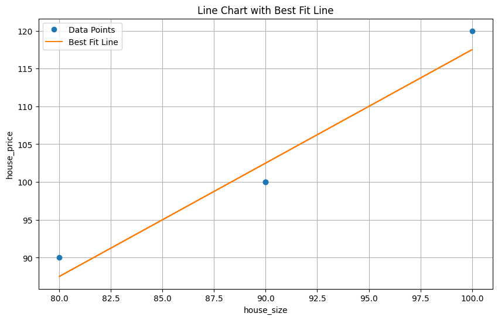

# 多 agent 系統的 Structured Outputs

> 原文：[examples/Structured_outputs_multi_agent.ipynb](https://github.com/openai/openai-cookbook/blob/main/examples/Structured_outputs_multi_agent.ipynb)


## 這篇在做什麼
用 Structured Outputs 打造一個 4 個 agent 的資料分析系統：一個負責分流，三個各自負責資料前處理、分析和視覺化。每個 agent 有自己的 prompt 和專屬 tool，輸出都被 schema 約束。

## 學完你會
- 用 `strict: true` 讓 tool call 的參數嚴格符合 schema
- 把 tool 依職責分組，拆成多個專責 agent，並用一個 triage agent 分派
- 寫出 tool 執行函式和 handler，把結果寫回對話歷史，串起整個多 agent 流程

## 開跑前
需要 OpenAI API key。

這份 cookbook 會探討怎麼用 Structured Outputs 打造多 agent 系統。

Structured Outputs 是一個新功能，建立在 JSON mode 和 function calling 之上，能強制模型輸出符合嚴格的 schema。

只要使用新參數 `strict: true`，就能保證回應遵守提供的 schema。

為了示範這個功能的威力，我們用它來打造一個多 agent 系統。

### 為什麼要建多 agent 系統？

使用 function calling 時，如果函式（或 tool）的數量變多，效能可能會下降。

為了解決這個問題，我們可以把 tool 依邏輯分組，讓專責的「agent」去解決特定任務或子任務，這樣能提升整體系統的效能。

## 環境設定

```python
from openai import OpenAI
from IPython.display import Image
import json
import pandas as pd
import matplotlib.pyplot as plt
from io import StringIO
import numpy as np
client = OpenAI()
```

```python
MODEL = "gpt-4o-2024-08-06"
```

## 設定 agent

我們要處理的使用情境是資料分析任務。

先來設定這個 4 個 agent 的系統：

1.   **Triaging agent：** 決定要呼叫哪些 agent
2.   **資料前處理 agent：** 為分析準備資料，例如清理資料
3.   **資料分析 agent：** 對資料做分析
4.   **資料視覺化 agent：** 把分析結果視覺化，從中取得洞見

先來定義每個 agent 的 system prompt。

```python
triaging_system_prompt = """You are a Triaging Agent. Your role is to assess the user's query and route it to the relevant agents. The agents available are:
- Data Processing Agent: Cleans, transforms, and aggregates data.
- Analysis Agent: Performs statistical, correlation, and regression analysis.
- Visualization Agent: Creates bar charts, line charts, and pie charts.

Use the send_query_to_agents tool to forward the user's query to the relevant agents. Also, use the speak_to_user tool to get more information from the user if needed."""

processing_system_prompt = """You are a Data Processing Agent. Your role is to clean, transform, and aggregate data using the following tools:
- clean_data
- transform_data
- aggregate_data"""

analysis_system_prompt = """You are an Analysis Agent. Your role is to perform statistical, correlation, and regression analysis using the following tools:
- stat_analysis
- correlation_analysis
- regression_analysis"""

visualization_system_prompt = """You are a Visualization Agent. Your role is to create bar charts, line charts, and pie charts using the following tools:
- create_bar_chart
- create_line_chart
- create_pie_chart"""
```

接著定義每個 agent 的 tool。

除了 triaging agent 之外，每個 agent 都配備符合自己角色的 tool：

#### 資料前處理 agent


1.   清理資料
2.   轉換資料
3.   彙總資料

#### 資料分析 agent

1.   統計分析
2.   相關性分析
3.   迴歸分析

#### 資料視覺化 agent

1.   建立長條圖
2.   建立折線圖
3.   建立圓餅圖

```python
triage_tools = [
    {
        "type": "function",
        "function": {
            "name": "send_query_to_agents",
            "description": "Sends the user query to relevant agents based on their capabilities.",
            "parameters": {
                "type": "object",
                "properties": {
                    "agents": {
                        "type": "array",
                        "items": {"type": "string"},
                        "description": "An array of agent names to send the query to."
                    },
                    "query": {
                        "type": "string",
                        "description": "The user query to send."
                    }
                },
                "required": ["agents", "query"]
            }
        },
        "strict": True
    }
]

preprocess_tools = [
    {
        "type": "function",
        "function": {
            "name": "clean_data",
            "description": "Cleans the provided data by removing duplicates and handling missing values.",
            "parameters": {
                "type": "object",
                "properties": {
                    "data": {
                        "type": "string",
                        "description": "The dataset to clean. Should be in a suitable format such as JSON or CSV."
                    }
                },
                "required": ["data"],
                "additionalProperties": False
            }
        },
        "strict": True
    },
    {
        "type": "function",
        "function": {
            "name": "transform_data",
            "description": "Transforms data based on specified rules.",
            "parameters": {
                "type": "object",
                "properties": {
                    "data": {
                        "type": "string",
                        "description": "The data to transform. Should be in a suitable format such as JSON or CSV."
                    },
                    "rules": {
                        "type": "string",
                        "description": "Transformation rules to apply, specified in a structured format."
                    }
                },
                "required": ["data", "rules"],
                "additionalProperties": False
            }
        },
        "strict": True

    },
    {
        "type": "function",
        "function": {
            "name": "aggregate_data",
            "description": "Aggregates data by specified columns and operations.",
            "parameters": {
                "type": "object",
                "properties": {
                    "data": {
                        "type": "string",
                        "description": "The data to aggregate. Should be in a suitable format such as JSON or CSV."
                    },
                    "group_by": {
                        "type": "array",
                        "items": {"type": "string"},
                        "description": "Columns to group by."
                    },
                    "operations": {
                        "type": "string",
                        "description": "Aggregation operations to perform, specified in a structured format."
                    }
                },
                "required": ["data", "group_by", "operations"],
                "additionalProperties": False
            }
        },
        "strict": True
    }
]


analysis_tools = [
    {
        "type": "function",
        "function": {
            "name": "stat_analysis",
            "description": "Performs statistical analysis on the given dataset.",
            "parameters": {
                "type": "object",
                "properties": {
                    "data": {
                        "type": "string",
                        "description": "The dataset to analyze. Should be in a suitable format such as JSON or CSV."
                    }
                },
                "required": ["data"],
                "additionalProperties": False
            }
        },
        "strict": True
    },
    {
        "type": "function",
        "function": {
            "name": "correlation_analysis",
            "description": "Calculates correlation coefficients between variables in the dataset.",
            "parameters": {
                "type": "object",
                "properties": {
                    "data": {
                        "type": "string",
                        "description": "The dataset to analyze. Should be in a suitable format such as JSON or CSV."
                    },
                    "variables": {
                        "type": "array",
                        "items": {"type": "string"},
                        "description": "List of variables to calculate correlations for."
                    }
                },
                "required": ["data", "variables"],
                "additionalProperties": False
            }
        },
        "strict": True
    },
    {
        "type": "function",
        "function": {
            "name": "regression_analysis",
            "description": "Performs regression analysis on the dataset.",
            "parameters": {
                "type": "object",
                "properties": {
                    "data": {
                        "type": "string",
                        "description": "The dataset to analyze. Should be in a suitable format such as JSON or CSV."
                    },
                    "dependent_var": {
                        "type": "string",
                        "description": "The dependent variable for regression."
                    },
                    "independent_vars": {
                        "type": "array",
                        "items": {"type": "string"},
                        "description": "List of independent variables."
                    }
                },
                "required": ["data", "dependent_var", "independent_vars"],
                "additionalProperties": False
            }
        },
        "strict": True
    }
]

visualization_tools = [
    {
        "type": "function",
        "function": {
            "name": "create_bar_chart",
            "description": "Creates a bar chart from the provided data.",
            "parameters": {
                "type": "object",
                "properties": {
                    "data": {
                        "type": "string",
                        "description": "The data for the bar chart. Should be in a suitable format such as JSON or CSV."
                    },
                    "x": {
                        "type": "string",
                        "description": "Column for the x-axis."
                    },
                    "y": {
                        "type": "string",
                        "description": "Column for the y-axis."
                    }
                },
                "required": ["data", "x", "y"],
                "additionalProperties": False
            }
        },
        "strict": True
    },
    {
        "type": "function",
        "function": {
            "name": "create_line_chart",
            "description": "Creates a line chart from the provided data.",
            "parameters": {
                "type": "object",
                "properties": {
                    "data": {
                        "type": "string",
                        "description": "The data for the line chart. Should be in a suitable format such as JSON or CSV."
                    },
                    "x": {
                        "type": "string",
                        "description": "Column for the x-axis."
                    },
                    "y": {
                        "type": "string",
                        "description": "Column for the y-axis."
                    }
                },
                "required": ["data", "x", "y"],
                "additionalProperties": False
            }
        },
        "strict": True
    },
    {
        "type": "function",
        "function": {
            "name": "create_pie_chart",
            "description": "Creates a pie chart from the provided data.",
            "parameters": {
                "type": "object",
                "properties": {
                    "data": {
                        "type": "string",
                        "description": "The data for the pie chart. Should be in a suitable format such as JSON or CSV."
                    },
                    "labels": {
                        "type": "string",
                        "description": "Column for the labels."
                    },
                    "values": {
                        "type": "string",
                        "description": "Column for the values."
                    }
                },
                "required": ["data", "labels", "values"],
                "additionalProperties": False
            }
        },
        "strict": True
    }
]
```

## Tool 執行

我們需要寫程式邏輯來：
- 處理把使用者 query 傳給多 agent 系統
- 處理多 agent 系統的內部運作
- 執行 tool call

為了簡潔，我們只定義跟使用者 query 相關的 tool 邏輯。

```python
# Example query

user_query = """
Below is some data. I want you to first remove the duplicates then analyze the statistics of the data as well as plot a line chart.

house_size (m3), house_price ($)
90, 100
80, 90
100, 120
90, 100
"""
```

從使用者 query 可以推斷，需要呼叫的 tool 是 `clean_data`、`start_analysis` 和 `use_line_chart`。

先定義負責執行 tool call 的執行函式。

它把 tool call 對應到相應的函式，再把函式的輸出附加到對話歷史。

```python
def clean_data(data):
    data_io = StringIO(data)
    df = pd.read_csv(data_io, sep=",")
    df_deduplicated = df.drop_duplicates()
    return df_deduplicated

def stat_analysis(data):
    data_io = StringIO(data)
    df = pd.read_csv(data_io, sep=",")
    return df.describe()

def plot_line_chart(data):
    data_io = StringIO(data)
    df = pd.read_csv(data_io, sep=",")
    
    x = df.iloc[:, 0]
    y = df.iloc[:, 1]
    
    coefficients = np.polyfit(x, y, 1)
    polynomial = np.poly1d(coefficients)
    y_fit = polynomial(x)
    
    plt.figure(figsize=(10, 6))
    plt.plot(x, y, 'o', label='Data Points')
    plt.plot(x, y_fit, '-', label='Best Fit Line')
    plt.title('Line Chart with Best Fit Line')
    plt.xlabel(df.columns[0])
    plt.ylabel(df.columns[1])
    plt.legend()
    plt.grid(True)
    plt.show()

# Define the function to execute the tools
def execute_tool(tool_calls, messages):
    for tool_call in tool_calls:
        tool_name = tool_call.function.name
        tool_arguments = json.loads(tool_call.function.arguments)

        if tool_name == 'clean_data':
            # Simulate data cleaning
            cleaned_df = clean_data(tool_arguments['data'])
            cleaned_data = {"cleaned_data": cleaned_df.to_dict()}
            messages.append({"role": "tool", "name": tool_name, "content": json.dumps(cleaned_data)})
            print('Cleaned data: ', cleaned_df)
        elif tool_name == 'transform_data':
            # Simulate data transformation
            transformed_data = {"transformed_data": "sample_transformed_data"}
            messages.append({"role": "tool", "name": tool_name, "content": json.dumps(transformed_data)})
        elif tool_name == 'aggregate_data':
            # Simulate data aggregation
            aggregated_data = {"aggregated_data": "sample_aggregated_data"}
            messages.append({"role": "tool", "name": tool_name, "content": json.dumps(aggregated_data)})
        elif tool_name == 'stat_analysis':
            # Simulate statistical analysis
            stats_df = stat_analysis(tool_arguments['data'])
            stats = {"stats": stats_df.to_dict()}
            messages.append({"role": "tool", "name": tool_name, "content": json.dumps(stats)})
            print('Statistical Analysis: ', stats_df)
        elif tool_name == 'correlation_analysis':
            # Simulate correlation analysis
            correlations = {"correlations": "sample_correlations"}
            messages.append({"role": "tool", "name": tool_name, "content": json.dumps(correlations)})
        elif tool_name == 'regression_analysis':
            # Simulate regression analysis
            regression_results = {"regression_results": "sample_regression_results"}
            messages.append({"role": "tool", "name": tool_name, "content": json.dumps(regression_results)})
        elif tool_name == 'create_bar_chart':
            # Simulate bar chart creation
            bar_chart = {"bar_chart": "sample_bar_chart"}
            messages.append({"role": "tool", "name": tool_name, "content": json.dumps(bar_chart)})
        elif tool_name == 'create_line_chart':
            # Simulate line chart creation
            line_chart = {"line_chart": "sample_line_chart"}
            messages.append({"role": "tool", "name": tool_name, "content": json.dumps(line_chart)})
            plot_line_chart(tool_arguments['data'])
        elif tool_name == 'create_pie_chart':
            # Simulate pie chart creation
            pie_chart = {"pie_chart": "sample_pie_chart"}
            messages.append({"role": "tool", "name": tool_name, "content": json.dumps(pie_chart)})
    return messages
```

接著，為每個子 agent 建立 tool handler。

它們各自有獨特的 prompt 和 tool 組合傳給模型。 

輸出再傳給執行函式去跑 tool call。

我們也會把訊息附加到對話歷史。

```python
# Define the functions to handle each agent's processing
def handle_data_processing_agent(query, conversation_messages):
    messages = [{"role": "system", "content": processing_system_prompt}]
    messages.append({"role": "user", "content": query})

    response = client.chat.completions.create(
        model=MODEL,
        messages=messages,
        temperature=0,
        tools=preprocess_tools,
    )

    conversation_messages.append([tool_call.function for tool_call in response.choices[0].message.tool_calls])
    execute_tool(response.choices[0].message.tool_calls, conversation_messages)

def handle_analysis_agent(query, conversation_messages):
    messages = [{"role": "system", "content": analysis_system_prompt}]
    messages.append({"role": "user", "content": query})

    response = client.chat.completions.create(
        model=MODEL,
        messages=messages,
        temperature=0,
        tools=analysis_tools,
    )

    conversation_messages.append([tool_call.function for tool_call in response.choices[0].message.tool_calls])
    execute_tool(response.choices[0].message.tool_calls, conversation_messages)

def handle_visualization_agent(query, conversation_messages):
    messages = [{"role": "system", "content": visualization_system_prompt}]
    messages.append({"role": "user", "content": query})

    response = client.chat.completions.create(
        model=MODEL,
        messages=messages,
        temperature=0,
        tools=visualization_tools,
    )

    conversation_messages.append([tool_call.function for tool_call in response.choices[0].message.tool_calls])
    execute_tool(response.choices[0].message.tool_calls, conversation_messages)
```

最後，建立總管的 tool 來處理使用者 query。

這個函式接收使用者 query，從模型取得回應，並負責把它交給其他 agent 去執行。此外，我們也會保存進行中對話的狀態。

```python
# Function to handle user input and triaging
def handle_user_message(user_query, conversation_messages=[]):
    user_message = {"role": "user", "content": user_query}
    conversation_messages.append(user_message)


    messages = [{"role": "system", "content": triaging_system_prompt}]
    messages.extend(conversation_messages)

    response = client.chat.completions.create(
        model=MODEL,
        messages=messages,
        temperature=0,
        tools=triage_tools,
    )

    conversation_messages.append([tool_call.function for tool_call in response.choices[0].message.tool_calls])

    for tool_call in response.choices[0].message.tool_calls:
        if tool_call.function.name == 'send_query_to_agents':
            agents = json.loads(tool_call.function.arguments)['agents']
            query = json.loads(tool_call.function.arguments)['query']
            for agent in agents:
                if agent == "Data Processing Agent":
                    handle_data_processing_agent(query, conversation_messages)
                elif agent == "Analysis Agent":
                    handle_analysis_agent(query, conversation_messages)
                elif agent == "Visualization Agent":
                    handle_visualization_agent(query, conversation_messages)

    return conversation_messages
```

## 多 agent 系統執行

最後，對使用者 query 執行總管的 `handle_user_message` 函式，看輸出。

```python
handle_user_message(user_query)
```

??? note "輸出"

    ```text
    Cleaned data:     house_size (m3)   house_price ($)
    0               90               100
    1               80                90
    2              100               120
    Statistical Analysis:         house_size  house_price
    count    4.000000     4.000000
    mean    90.000000   102.500000
    std      8.164966    12.583057
    min     80.000000    90.000000
    25%     87.500000    97.500000
    50%     90.000000   100.000000
    75%     92.500000   105.000000
    max    100.000000   120.000000
    ```

    

    ```text
    [{'role': 'user',
      'content': '\nBelow is some data. I want you to first remove the duplicates then analyze the statistics of the data as well as plot a line chart.\n\nhouse_size (m3), house_price ($)\n90, 100\n80, 90\n100, 120\n90, 100\n'},
     [Function(arguments='{"agents": ["Data Processing Agent"], "query": "Remove duplicates from the data: house_size (m3), house_price ($)\\n90, 100\\n80, 90\\n100, 120\\n90, 100"}', name='send_query_to_agents'),
      Function(arguments='{"agents": ["Analysis Agent"], "query": "Analyze the statistics of the data: house_size (m3), house_price ($)\\n90, 100\\n80, 90\\n100, 120\\n90, 100"}', name='send_query_to_agents'),
      Function(arguments='{"agents": ["Visualization Agent"], "query": "Plot a line chart for the data: house_size (m3), house_price ($)\\n90, 100\\n80, 90\\n100, 120\\n90, 100"}', name='send_query_to_agents')],
     [Function(arguments='{"data":"house_size (m3), house_price ($)\\n90, 100\\n80, 90\\n100, 120\\n90, 100"}', name='clean_data')],
     {'role': 'tool',
      'name': 'clean_data',
      'content': '{"cleaned_data": {"house_size (m3)": {"0": 90, "1": 80, "2": 100}, " house_price ($)": {"0": 100, "1": 90, "2": 120}}}'},
     [Function(arguments='{"data":"house_size,house_price\\n90,100\\n80,90\\n100,120\\n90,100"}', name='stat_analysis')],
     {'role': 'tool',
      'name': 'stat_analysis',
      'content': '{"stats": {"house_size": {"count": 4.0, "mean": 90.0, "std": 8.16496580927726, "min": 80.0, "25%": 87.5, "50%": 90.0, "75%": 92.5, "max": 100.0}, "house_price": {"count": 4.0, "mean": 102.5, "std": 12.583057392117917, "min": 90.0, "25%": 97.5, "50%": 100.0, "75%": 105.0, "max": 120.0}}}'},
     [Function(arguments='{"data":"house_size,house_price\\n90,100\\n80,90\\n100,120\\n90,100","x":"house_size","y":"house_price"}', name='create_line_chart')],
     {'role': 'tool',
      'name': 'create_line_chart',
      'content': '{"line_chart": "sample_line_chart"}'}]
    ```

## 結論

這份 cookbook 探討了怎麼利用 Structured Outputs 打造更穩健的多 agent 系統。

Structured Outputs 確保 tool call 遵循指定的 schema。應用程式的程式碼仍然必須驗證參數的語意和業務規則。

這個做法可以套用到更多使用情境，希望你能從中得到靈感，做出自己的應用！

## 重點整理
- tool 太多會拖垮 function calling 的效果，依職責拆成專責 agent 可以改善。
- triage agent 只負責分派，各子 agent 用自己的 prompt 和 tool 集合處理任務。
- `strict: true` 保證格式符合 schema，但參數內容對不對，仍要自己驗證。
- 整個系統的關鍵是把每次 tool 的輸出寫回對話歷史，讓後續步驟看得到。

## 練習
1. 在資料前處理 agent 的 tool 清單裡新增一個 tool（例如去除重複資料），並補上對應的執行函式。
2. 修改使用者 query，讓它改用圓餅圖，看 triage agent 是否改呼叫不同的 tool。
3. 在執行函式裡加上參數驗證（例如檢查欄位名稱是否合法），不合法時回傳錯誤訊息，驗證 schema 之外的語意檢查。
