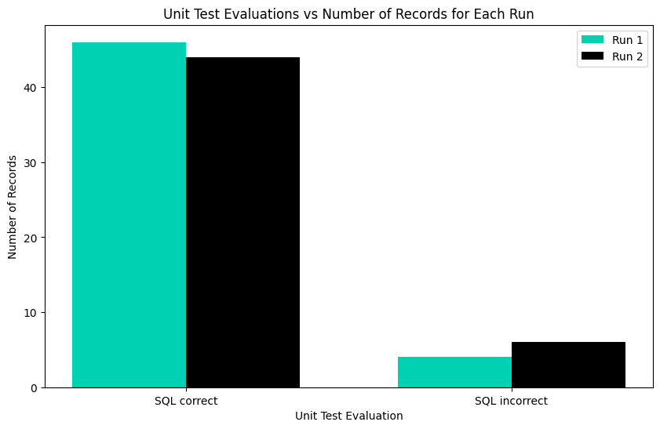
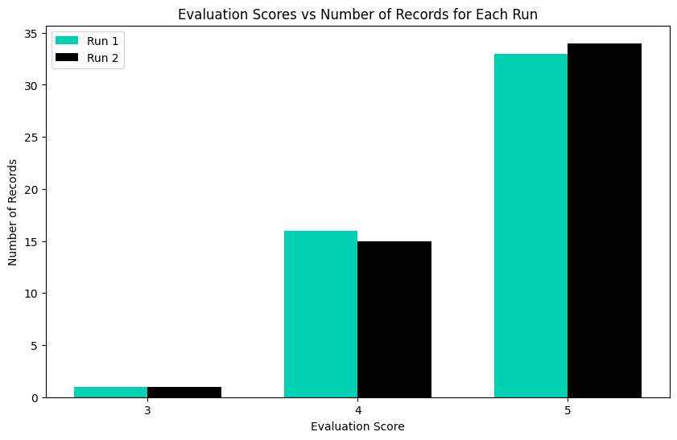

# 如何評估 LLM 的 SQL 生成

> 原文：[examples/evaluation/How_to_evaluate_LLMs_for_SQL_generation.ipynb](https://github.com/openai/openai-cookbook/blob/main/examples/evaluation/How_to_evaluate_LLMs_for_SQL_generation.ipynb)


## 這篇在做什麼

示範一套評估 LLM 輸出的框架，用 natural language 轉 SQL 當例子：先用 unit test 檢查 JSON 格式和 SQL 語法，再用 `gpt-4o-mini` 評估 SQL 有沒有切題，最後把兩個 system prompt 的結果整理成報表比較。

## 學完你會

- 用 Pydantic 和 SQLite 寫 unit test，驗證 LLM 回傳的 JSON 和 SQL 能不能解析、能不能執行。
- 寫一個 LLM 評估函式，判斷產生的 SQL 跟使用者問題的相關程度。
- 把不同 system prompt 當作不同的 run，跑同一組測試後用 dataframe 和長條圖比較差異。

## 開跑前

需要 OpenAI API Key，另外會從 HuggingFace 下載 `b-mc2/sql-create-context` 資料集。

LLM 本質上是 nondeterministic 的，所以回答有創意、有變化。但這也讓「一致性」很難達成，而一致性正是 LLM 上 production 的關鍵。

要把 LLM 用在實際應用上，關鍵是持續而有系統地評估。這樣才能找出並修正不一致的地方，也能在應用演進時追蹤進度。

## 這篇的範圍

這篇要示範一個評估 LLM 的框架，包含：

* **Unit Testing：** 評估應用裡各個獨立元件所必需。
* **Evaluation Metrics：** 量化衡量模型表現的方法。
* **Runbook Documentation：** 記錄歷次評估，追蹤進步和退步。

這個例子是 natural language 轉 SQL。code generation 類的場景很適合這種做法，只要把 **code validation** 和 **code execution** 結合，應用就能在程式碼產生的當下真的跑跑看，確保一致。

雖然這篇用 SQL 生成當例子，但這個做法是通用的，可以用在各種 LLM 應用。

我們會用兩個版本的 prompt 來做 SQL 生成，再用 unit test 和評估函式比較它們的表現。具體會評估：

1. JSON 回應的一致性。
2. 回應裡 SQL 的語法正確性。


## 目錄

1. **[Setup](#Setup)：** 安裝需要的套件，下載包含 SQL 查詢和對應自然語言描述的資料。
2. **[Test Development](#Test-development)：** 為 SQL 生成流程建立 unit test 並定義評估指標。
3. **[Evaluation](#Evaluation)：** 用不同的 prompt 跑測試，看對表現的影響。
4. **[Reporting](#Report)：** 整理報表，簡潔呈現各測試的表現差異。

## Setup

匯入套件和資料集。資料集用 HuggingFace 上的 natural language 轉 SQL 資料集 [b-mc2/sql-create-context](https://huggingface.co/datasets/b-mc2/sql-create-context)。

```python
# Uncomment this to install all necessary dependencies
# !pip install openai datasets pandas pydantic matplotlib python-dotenv numpy tqdm
```

```python
from datasets import load_dataset
from openai import OpenAI
import pandas as pd
import pydantic
import os
import sqlite3
from sqlite3 import Error
from pprint import pprint
import matplotlib.pyplot as plt
import numpy as np
from dotenv import load_dotenv
from tqdm.notebook import tqdm
from IPython.display import HTML, display

# Loads key from local .env file to setup API KEY in env variables
%reload_ext dotenv
%dotenv
    
GPT_MODEL = 'gpt-4o'
dataset = load_dataset("b-mc2/sql-create-context")

print(dataset['train'].num_rows, "rows")
```

??? note "輸出"

    ```text
    78577 rows
    ```

### 看一下資料集

我們用 Huggingface 的 datasets 套件下載 SQL create context 資料集。資料集包含：

1. Question：用自然語言寫的問題。
2. Answer：用來回答該問題的 SQL。
3. Context：一段 CREATE SQL 語句，描述回答問題可能用到的資料表。

這次示範會讓 LLM 嘗試回答（自然語言的）問題。LLM 要產生一段 CREATE SQL 語句建立適合回答問題的 context，以及一段能完整回答問題的 SELECT SQL query。

資料長這樣：

```python
sql_df = dataset['train'].to_pandas()
sql_df.head()
```

??? note "輸出"

    ```text
                                                  answer  \
    0           SELECT COUNT(*) FROM head WHERE age > 56   
    1  SELECT name, born_state, age FROM head ORDER B...   
    2  SELECT creation, name, budget_in_billions FROM...   
    3  SELECT MAX(budget_in_billions), MIN(budget_in_...   
    4  SELECT AVG(num_employees) FROM department WHER...   

                                                question  \
    0  How many heads of the departments are older th...   
    1  List the name, born state and age of the heads...   
    2  List the creation year, name and budget of eac...   
    3  What are the maximum and minimum budget of the...   
    4  What is the average number of employees of the...   

                                                 context  
    0                    CREATE TABLE head (age INTEGER)  
    1  CREATE TABLE head (name VARCHAR, born_state VA...  
    2  CREATE TABLE department (creation VARCHAR, nam...  
    3  CREATE TABLE department (budget_in_billions IN...  
    4  CREATE TABLE department (num_employees INTEGER...
    ```

## Test development

為了測試 LLM 的輸出，我們會寫兩個 unit test 和一個 evaluation，組合成一個基本的評估框架，用來給每次 LLM 迭代的品質打分。

再強調一次，目的是衡量 LLM 針對我們的問題，輸出是否正確、是否一致。

### Unit tests

Unit test 應該測 LLM 應用裡最細的元件。

這一節會寫 unit test 來測：
- `test_valid_schema` 檢查 LLM 有沒有回傳可解析的 `create` 和 `select` 語句。
- `test_llm_sql` 會在 `sqlite` 資料庫上執行 `create` 和 `select` 語句，確認語法正確。

```python
from pydantic import BaseModel


class LLMResponse(BaseModel):
    """This is the structure that we expect the LLM to respond with.

    The LLM should respond with a JSON string with `create` and `select` fields.
    """
    create: str
    select: str
```

#### 對 LLM 下 prompt

為了示範，我們用一個相當簡單的 prompt，請 GPT 產生一組 `(context, answer)`。`context` 是 `CREATE` SQL 語句，`answer` 是 `SELECT` SQL 語句。自然語言的問題放在 prompt 裡提供。我們要求回應用 JSON 格式，方便解析。

```python
system_prompt = """Translate this natural language request into a JSON
object containing two SQL queries. The first query should be a CREATE 
tatement for a table answering the user's request, while the second
should be a SELECT query answering their question."""

# Sending the message array to GPT, requesting a response (ensure that you
# have API key loaded to Env for this step)
client = OpenAI()

def get_response(system_prompt, user_message, model=GPT_MODEL):
    messages = []
    messages.append({"role": "system", "content": system_prompt})
    messages.append({"role": "user", "content": user_message})

    response = client.beta.chat.completions.parse(
        model=GPT_MODEL,
        messages=messages,
        response_format=LLMResponse,
    )
    return response.choices[0].message.content

question = sql_df.iloc[0]['question']
content = get_response(system_prompt, question)
print("Question:", question)
print("Answer:", content)
```

??? note "輸出"

    ```text
    Question: How many heads of the departments are older than 56 ?
    Answer: {"create":"CREATE TABLE DepartmentHeads (\n    id INT PRIMARY KEY,\n    name VARCHAR(100),\n    age INT,\n    department VARCHAR(100)\n);","select":"SELECT COUNT(*) AS NumberOfHeadsOlderThan56 \nFROM DepartmentHeads \nWHERE age > 56;"}
    ```

#### 檢查 JSON 格式

第一個簡單的 unit test 檢查 LLM 回應能不能解析成我們定義的 `LLMResponse` Pydantic class。

我們會先測第一個回應能通過，再造一個會失敗的例子，確認檢查真的會失敗。這段邏輯包在一個簡單的函式 `test_valid_schema` 裡。

我們預期 GPT 回傳有效的 SQL，可以用 LLMResponse base model 來驗證。`test_valid_schema` 就是用來做這件事。

```python
def test_valid_schema(content):
    """Tests whether the content provided can be parsed into our Pydantic model."""
    try:
        LLMResponse.model_validate_json(content)
        return True
    # Catch pydantic's validation errors:
    except pydantic.ValidationError as exc:
        print(f"ERROR: Invalid schema: {exc}")
        return False
```

```python
test_valid_schema(content)
```

??? note "輸出"

    ```text
    True
    ```

#### 測試負面情境

為了模擬 GPT 回傳無效 JSON 的情況，我們把一段無效 JSON 寫死當作回應。預期 `test_valid_schema` 函式會丟出 exception。

```python
failing_query = 'CREATE departments, select * from departments'
test_valid_schema(failing_query)
```

??? note "輸出"

    ```text
    ERROR: Invalid schema: 1 validation error for LLMResponse
      Invalid JSON: expected value at line 1 column 1 [type=json_invalid, input_value='CREATE departments, select * from departments', input_type=str]
        For further information visit https://errors.pydantic.dev/2.10/v/json_invalid
    ```

    ```text
    False
    ```

如預期，`test_valid_schema` 函式丟出了 exception。

### 測試 SQL query

接下來驗證 SQL 的正確性。這個測試要確認：

1. GPT 回應裡的 CREATE SQL 語法正確。
2. GPT 回應裡的 SELECT SQL 語法正確。

做法是用一個 SQLite instance。把回傳的 SQL 語句送給 SQLite，如果語句有效，SQLite 會接受並執行，否則預期會丟 exception。

下面的 `create_connection` 函式會建立 SQLite instance（預設在記憶體）並開一個連線，之後會用到。

```python
# Set up SQLite to act as our test database
def create_connection(db_file=":memory:"):
    """create a database connection to a SQLite database"""
    try:
        conn = sqlite3.connect(db_file)
        # print(sqlite3.version)
    except Error as e:
        print(e)
        return None

    return conn

def close_connection(conn):
    """close a database connection"""
    try:
        conn.close()
    except Error as e:
        print(e)


conn = create_connection()
```

接著建立下面這些函式來做語法正確性檢查。


- `test_create`：測試 CREATE SQL 語句能否成功執行。
- `test_select`：測試 SELECT SQL 語句能否成功執行。
- `test_llm_sql`：包住上面兩個測試的 wrapper 函式。

```python
def test_select(conn, cursor, select, should_log=True):
    """Tests that a SQLite select query can be executed successfully."""
    try:
        if should_log:
            print(f"Testing select query: {select}")
        cursor.execute(select)
        record = cursor.fetchall()
        if should_log:
            print(f"Result of query: {record}")

        return True

    except sqlite3.Error as error:
        if should_log:
            print("Error while executing select query:", error)
        return False


def test_create(conn, cursor, create, should_log=True):
    """Tests that a SQLite create query can be executed successfully"""
    try:
        if should_log:
            print(f"Testing create query: {create}")
        cursor.execute(create)
        conn.commit()

        return True

    except sqlite3.Error as error:
        if should_log:
            print("Error while creating the SQLite table:", error)
        return False


def test_llm_sql(llm_response, should_log=True):
    """Runs a suite of SQLite tests"""
    try:
        conn = create_connection()
        cursor = conn.cursor()

        create_response = test_create(conn, cursor, llm_response.create, should_log=should_log)

        select_response = test_select(conn, cursor, llm_response.select, should_log=should_log)

        if conn:
            close_connection(conn)

        if create_response is not True:
            return False

        elif select_response is not True:
            return False

        else:
            return True

    except sqlite3.Error as error:
        if should_log:
            print("Error while creating a sqlite table", error)
        return False
```

```python
# Viewing CREATE and SELECT sqls returned by GPT

test_query = LLMResponse.model_validate_json(content)
print(f"CREATE SQL is: {test_query.create}")
print(f"SELECT SQL is: {test_query.select}")
```

??? note "輸出"

    ```text
    CREATE SQL is: CREATE TABLE DepartmentHeads (
        id INT PRIMARY KEY,
        name VARCHAR(100),
        age INT,
        department VARCHAR(100)
    );
    SELECT SQL is: SELECT COUNT(*) AS NumberOfHeadsOlderThan56 
    FROM DepartmentHeads 
    WHERE age > 56;
    ```

```python
# Testing the CREATE and SELECT sqls are valid (we expect this to be succesful)

test_llm_sql(test_query)
```

??? note "輸出"

    ```text
    Testing create query: CREATE TABLE DepartmentHeads (
        id INT PRIMARY KEY,
        name VARCHAR(100),
        age INT,
        department VARCHAR(100)
    );
    Testing select query: SELECT COUNT(*) AS NumberOfHeadsOlderThan56 
    FROM DepartmentHeads 
    WHERE age > 56;
    Result of query: [(0,)]
    ```

    ```text
    True
    ```

```python
# Again we'll perform a negative test to confirm that a failing SELECT will return an error.

test_failure_query = '{"create": "CREATE TABLE departments (id INT, name VARCHAR(255), head_of_department VARCHAR(255))", "select": "SELECT COUNT(*) FROM departments WHERE age > 56"}'
test_failure_query = LLMResponse.model_validate_json(test_failure_query)
test_llm_sql(test_failure_query)
```

??? note "輸出"

    ```text
    Testing create query: CREATE TABLE departments (id INT, name VARCHAR(255), head_of_department VARCHAR(255))
    Testing select query: SELECT COUNT(*) FROM departments WHERE age > 56
    Error while executing select query: no such column: age
    ```

    ```text
    False
    ```

### 用 LLM 評估 relevancy

接下來要**評估**產生的 SQL 是否真的回答了使用者的問題。這個測試由 `gpt-4o-mini` 執行，評估產生的 SQL query 跟原本使用者需求的**相關**程度。

這是一個簡單的例子，改編自 [G-Eval 論文](https://arxiv.org/abs/2303.16634)的做法，並在我們另一份 [cookbook](https://github.com/openai/openai-cookbook/blob/main/examples/evaluation/How_to_eval_abstractive_summarization.ipynb) 裡測試過。

```python
EVALUATION_MODEL = "gpt-4o-mini"

EVALUATION_PROMPT_TEMPLATE = """
You will be given one summary written for an article. Your task is to rate the summary on one metric.
Please make sure you read and understand these instructions very carefully. 
Please keep this document open while reviewing, and refer to it as needed.

Evaluation Criteria:

{criteria}

Evaluation Steps:

{steps}

Example:

Request:

{request}

Queries:

{queries}

Evaluation Form (scores ONLY):

- {metric_name}
"""

# Relevance

RELEVANCY_SCORE_CRITERIA = """
Relevance(1-5) - review of how relevant the produced SQL queries are to the original question. \
The queries should contain all points highlighted in the user's request. \
Annotators were instructed to penalize queries which contained redundancies and excess information.
"""

RELEVANCY_SCORE_STEPS = """
1. Read the request and the queries carefully.
2. Compare the queries to the request document and identify the main points of the request.
3. Assess how well the queries cover the main points of the request, and how much irrelevant or redundant information it contains.
4. Assign a relevance score from 1 to 5.
"""
```

```python
def get_geval_score(
    criteria: str, steps: str, request: str, queries: str, metric_name: str
):
    """Given evaluation criteria and an observation, this function uses EVALUATION GPT to evaluate the observation against those criteria.
"""
    prompt = EVALUATION_PROMPT_TEMPLATE.format(
        criteria=criteria,
        steps=steps,
        request=request,
        queries=queries,
        metric_name=metric_name,
    )
    response = client.chat.completions.create(
        model=EVALUATION_MODEL,
        messages=[{"role": "user", "content": prompt}],
        temperature=0,
        max_tokens=5,
        top_p=1,
        frequency_penalty=0,
        presence_penalty=0,
    )
    return response.choices[0].message.content
```

```python
# Test out evaluation on a few records

evaluation_results = []

for x,y in sql_df.head(3).iterrows():
    score = get_geval_score(
        RELEVANCY_SCORE_CRITERIA,
        RELEVANCY_SCORE_STEPS,
        y['question'],
        y['context'] + '\n' + y['answer'],'relevancy'
    )
    evaluation_results.append((y['question'],y['context'] + '\n' + y['answer'],score))
```

```python
for result in evaluation_results:
    print(f"User Question \t: {result[0]}")
    print(f"CREATE SQL Returned \t: {result[1].splitlines()[0]}")
    print(f"SELECT SQL Returned \t: {result[1].splitlines()[1]}")
    print(f"{result[2]}")
    print("*" * 20)
```

??? note "輸出"

    ```text
    User Question 	: How many heads of the departments are older than 56 ?
    CREATE SQL Returned 	: CREATE TABLE head (age INTEGER)
    SELECT SQL Returned 	: SELECT COUNT(*) FROM head WHERE age > 56
    5
    ********************
    User Question 	: List the name, born state and age of the heads of departments ordered by age.
    CREATE SQL Returned 	: CREATE TABLE head (name VARCHAR, born_state VARCHAR, age VARCHAR)
    SELECT SQL Returned 	: SELECT name, born_state, age FROM head ORDER BY age
    4
    ********************
    User Question 	: List the creation year, name and budget of each department.
    CREATE SQL Returned 	: CREATE TABLE department (creation VARCHAR, name VARCHAR, budget_in_billions VARCHAR)
    SELECT SQL Returned 	: SELECT creation, name, budget_in_billions FROM department
    4
    ********************
    ```

## Evaluation

我們會把這些函式組合起來，包含 unit test 和評估，來測試兩個 system prompt。

每一次的輸入、輸出和分數，都應該存成一個 **run**。你也可以選擇在評估中加入 GPT-4 標註，或另外用一個步驟檢視整個 run，標出錯誤原因。

這個例子裡，第二個 system prompt 會多一行說明，讓我們看看它對 SQL 有效性和解法品質的影響。

### 建立測試框架

我們要寫一個函式 `test_system_prompt`，針對指定的 system prompt 跑 unit test 和評估。

```python
def execute_unit_tests(input_df, output_list, system_prompt):
    """Unit testing function that takes in a dataframe and appends test results to an output_list."""

    for x, y in tqdm(input_df.iterrows(), total=len(input_df)):
        model_response = get_response(system_prompt, y['question'])

        format_valid = test_valid_schema(model_response)

        try:
            test_query = LLMResponse.model_validate_json(model_response)
            # Avoid logging since we're executing many rows at once
            sql_valid = test_llm_sql(test_query, should_log=False)
        except:
            sql_valid = False

        output_list.append((y['question'], model_response, format_valid, sql_valid))
        
def evaluate_row(row):
    """Simple evaluation function to categorize unit testing results.
    
    If the format or SQL are flagged it returns a label, otherwise it is correct"""
    if row['format'] is False:
        return 'Format incorrect'
    elif row['sql'] is False:
        return 'SQL incorrect'
    else:
        return 'SQL correct'

def test_system_prompt(test_df, system_prompt):
    # Execute unit tests and capture results
    results = []
    execute_unit_tests(
        input_df=test_df,
        output_list=results,
        system_prompt=system_prompt
    )
    
    results_df = pd.DataFrame(results)
    results_df.columns = ['question','response','format','sql']
    
    # Use `apply` to calculate the geval score and unit test evaluation
    # for each generated response
    results_df['evaluation_score'] = results_df.apply(
        lambda x: get_geval_score(
            RELEVANCY_SCORE_CRITERIA,
            RELEVANCY_SCORE_STEPS,
            x['question'],
            x['response'],
            'relevancy'
        ),
        axis=1
    )
    results_df['unit_test_evaluation'] = results_df.apply(
        lambda x: evaluate_row(x),
        axis=1
    )
    return results_df
```

### System Prompt 1

被測的系統是下面的第一個 system prompt。這個 `run` 會用這個 system prompt 產生回應，並用我們目前寫好的函式評估回應。

```python
system_prompt = """Translate this natural language request into a JSON object
containing two SQL queries.

The first query should be a CREATE statement for a table answering the user's
request, while the second should be a SELECT query answering their question. 
"""

# Select 50 unseen queries to test this one
test_df = sql_df.tail(50)

results_df = test_system_prompt(test_df, system_prompt)
```

??? note "輸出"

    ```text
      0%|          | 0/50 [00:00<?, ?it/s]
    ```

現在可以把結果分成兩組：
* **unit test**：測試回應的結構；
* **evaluation**：檢查 SQL 語法是否正確。

```python
results_df['unit_test_evaluation'].value_counts()
```

??? note "輸出"

    ```text
    unit_test_evaluation
    SQL correct      46
    SQL incorrect     4
    Name: count, dtype: int64
    ```

```python
results_df['evaluation_score'].value_counts()
```

??? note "輸出"

    ```text
    evaluation_score
    5    33
    4    16
    3     1
    Name: count, dtype: int64
    ```

### System Prompt 2

現在換一個新的 system prompt，跑同樣的 unit test 和評估。

```python
system_prompt_2 = """Translate this natural language request into a JSON
object containing two SQL queries.

The first query should be a CREATE statement for a table answering the user's
request, while the second should be a SELECT query answering their question.

Ensure the SQL is always generated on one line, never use \\n to separate rows."""


results_2_df = test_system_prompt(test_df, system_prompt)
```

??? note "輸出"

    ```text
      0%|          | 0/50 [00:00<?, ?it/s]
    ```

跟上面一樣，把 unit test 和評估結果分組。

```python
results_2_df['unit_test_evaluation'].value_counts()
```

??? note "輸出"

    ```text
    unit_test_evaluation
    SQL correct      44
    SQL incorrect     6
    Name: count, dtype: int64
    ```

```python
results_2_df['evaluation_score'].value_counts()
```

??? note "輸出"

    ```text
    evaluation_score
    5    34
    4    15
    3     1
    Name: count, dtype: int64
    ```

## Reporting

我們做一個簡單的 dataframe 來存放並顯示各 run 的表現。這裡你可以改用 Weights & Biases Prompts 或 Gantry 這類工具，存下結果來分析不同迭代。

```python
results_df['run'] = 1
results_df['Evaluating Model'] = 'gpt-4'

results_2_df['run'] = 2
results_2_df['Evaluating Model'] = 'gpt-4'

run_df = pd.concat([results_df,results_2_df])
run_df.head()
```

??? note "輸出"

    ```text
                                                question  \
    0  What venue did the parntership of shoaib malik...   
    1  What venue did the partnership of herschelle g...   
    2  What is the number Played that has 310 Points ...   
    3     What Losing bonus has a Points against of 588?   
    4        What Tries against has a Losing bonus of 7?   

                                                response  format   sql  \
    0  {"create":"CREATE TABLE cricket_partnerships (...    True  True   
    1  {"create":"CREATE TABLE CricketPartnerships (\...    True  True   
    2  {"create":"CREATE TABLE game_stats (\n    numb...    True  True   
    3  {"create":"CREATE TABLE BonusInfo (\n    id IN...    True  True   
    4  {"create":"CREATE TABLE matches (\n    id SERI...    True  True   

      evaluation_score unit_test_evaluation  run Evaluating Model  
    0                5          SQL correct    1            gpt-4  
    1                5          SQL correct    1            gpt-4  
    2                5          SQL correct    1            gpt-4  
    3                5          SQL correct    1            gpt-4  
    4                5          SQL correct    1            gpt-4
    ```

#### 畫出 unit test 結果

我們可以畫一個簡單的長條圖，視覺化兩個 run 的 unit test 結果。

```python
unittest_df_pivot = pd.pivot_table(
    run_df,
    values='format',
    index=['run','unit_test_evaluation'],
    aggfunc='count'
)
unittest_df_pivot.columns = ['Number of records']
unittest_df_pivot
```

??? note "輸出"

    ```text
                              Number of records
    run unit_test_evaluation                   
    1   SQL correct                          46
        SQL incorrect                         4
    2   SQL correct                          44
        SQL incorrect                         6
    ```

```python
unittest_df_pivot.reset_index(inplace=True)

# Plotting
plt.figure(figsize=(10, 6))

# Set the width of each bar
bar_width = 0.35

# OpenAI brand colors
openai_colors = ['#00D1B2', '#000000']  # Green and Black

# Get unique runs and unit test evaluations
unique_runs = unittest_df_pivot['run'].unique()
unique_unit_test_evaluations = unittest_df_pivot['unit_test_evaluation'].unique()

# Ensure we have enough colors (repeating the pattern if necessary)
colors = openai_colors * (len(unique_runs) // len(openai_colors) + 1)

# Iterate over each run to plot
for i, run in enumerate(unique_runs):
    run_data = unittest_df_pivot[unittest_df_pivot['run'] == run]

    # Position of bars for this run
    positions = np.arange(len(unique_unit_test_evaluations)) + i * bar_width

    plt.bar(positions, run_data['Number of records'], width=bar_width, label=f'Run {run}', color=colors[i])

# Setting the x-axis labels to be the unit test evaluations, centered under the groups
plt.xticks(np.arange(len(unique_unit_test_evaluations)) + bar_width / 2, unique_unit_test_evaluations)

plt.xlabel('Unit Test Evaluation')
plt.ylabel('Number of Records')
plt.title('Unit Test Evaluations vs Number of Records for Each Run')
plt.legend()
plt.show()
```

??? note "輸出"

    

#### 畫出 evaluation 結果

同樣可以畫出評估結果。

```python
evaluation_df_pivot = pd.pivot_table(
    run_df,
    values='format',
    index=['run','evaluation_score'],
    aggfunc='count'
)
evaluation_df_pivot.columns = ['Number of records']
evaluation_df_pivot
```

??? note "輸出"

    ```text
                          Number of records
    run evaluation_score                   
    1   3                                 1
        4                                16
        5                                33
    2   3                                 1
        4                                15
        5                                34
    ```

```python
# Reset index without dropping the 'run' and 'evaluation_score' columns
evaluation_df_pivot.reset_index(inplace=True)

# Plotting
plt.figure(figsize=(10, 6))

bar_width = 0.35

# OpenAI brand colors
openai_colors = ['#00D1B2', '#000000']  # Green, Black

# Identify unique runs and evaluation scores
unique_runs = evaluation_df_pivot['run'].unique()
unique_evaluation_scores = evaluation_df_pivot['evaluation_score'].unique()

# Repeat colors if there are more runs than colors
colors = openai_colors * (len(unique_runs) // len(openai_colors) + 1)

for i, run in enumerate(unique_runs):
    # Select rows for this run only
    run_data = evaluation_df_pivot[evaluation_df_pivot['run'] == run].copy()
    
    # Ensure every 'evaluation_score' is present
    run_data.set_index('evaluation_score', inplace=True)
    run_data = run_data.reindex(unique_evaluation_scores, fill_value=0)
    run_data.reset_index(inplace=True)
    
    # Plot each bar
    positions = np.arange(len(unique_evaluation_scores)) + i * bar_width
    plt.bar(
        positions,
        run_data['Number of records'],
        width=bar_width,
        label=f'Run {run}',
        color=colors[i]
    )

# Configure the x-axis to show evaluation scores under the grouped bars
plt.xticks(np.arange(len(unique_evaluation_scores)) + bar_width / 2, unique_evaluation_scores)

plt.xlabel('Evaluation Score')
plt.ylabel('Number of Records')
plt.title('Evaluation Scores vs Number of Records for Each Run')
plt.legend()
plt.show()
```

??? note "輸出"

    

## 結論

現在你有一套用 LLM 測試 SQL 生成的框架，稍微調整就能延伸到很多 code generation 的場景。搭配 GPT-4 和投入的人工標註員，可以把這些測試案例的評估自動化，形成一個迭代循環：新範例加進測試集，這個結構會偵測效能有沒有退步。

希望這對你有幫助，也歡迎提供回饋。

## 重點整理

- LLM 輸出不確定，要上 production 就得有系統地評估，才抓得到不一致和退步。
- Code generation 可以結合 validation 和 execution，真的把產生的程式碼跑一遍來驗證。
- Unit test 測結構（JSON 能不能解析）和語法（SQL 能不能在 SQLite 執行），LLM 評估則測語意相關度。
- 每個 prompt 版本存成一個 run，用同一組測試比較，才知道改 prompt 到底有沒有幫助。
- 這套做法不限於 SQL，換掉驗證邏輯就能用在其他 LLM 應用。

## 練習

1. 在 `test_valid_schema` 的負面情境裡，換一種壞掉的 JSON（例如少一個欄位），確認 exception 仍會被丟出。
2. 改寫 System Prompt 2 多加的那行說明，重跑 `test_system_prompt`，比較兩個 run 的 unit test 通過率。
3. 新增一個 unit test，檢查 `select` 語句執行後回傳的結果不是空的，並加進 `test_llm_sql`。
