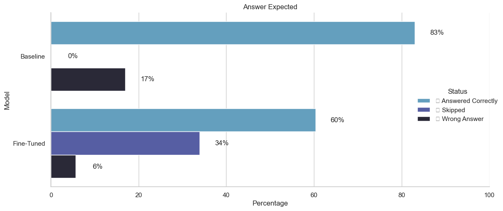
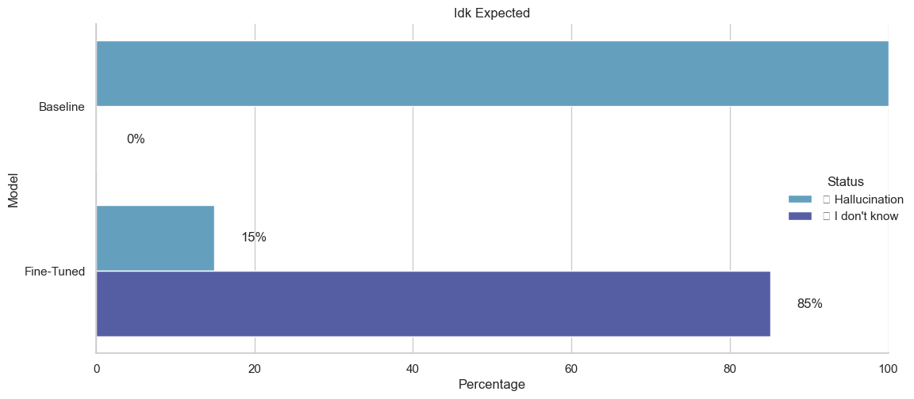
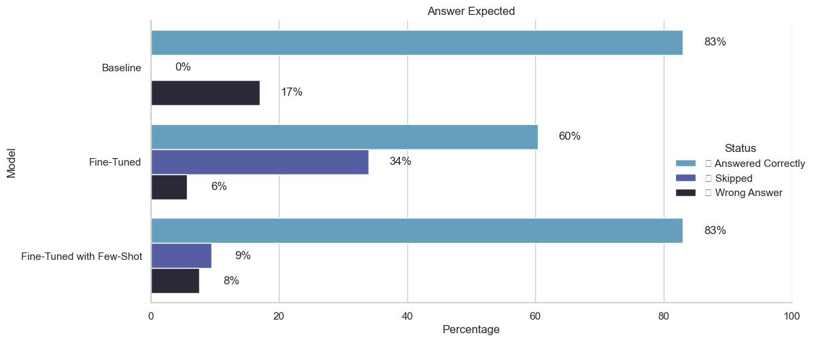
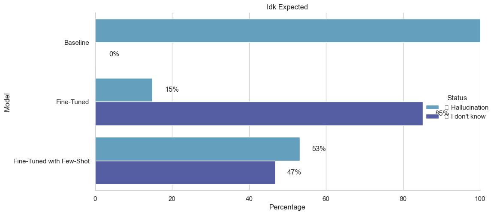

# 用 Qdrant 為 RAG 做 Fine-Tuning

> 原文：[examples/fine-tuned_qa/ft_retrieval_augmented_generation_qdrant.ipynb](https://github.com/openai/openai-cookbook/blob/main/examples/fine-tuned_qa/ft_retrieval_augmented_generation_qdrant.ipynb)

## 這篇在做什麼

拿 SQuADv2 資料集，先對 gpt-3.5-turbo 做一般 fine-tuning，再用 Qdrant 撈出相似問題當 few-shot 範例再 fine-tune 一次。最後比較三種模型在「答對、說不知道、幻覺」上的差別。

## 學完你會

- 用 SQuADv2 準備 fine-tuning 資料、跑 fine-tuning job，並呼叫微調後的模型回答問題。
- 用 embedding 加 Qdrant 找出最相似的問題，組成 few-shot prompt。
- 把回答分成答對、略過、答錯、幻覺、說不知道五類來評估 RAG，並理解怎麼用訓練資料調整「保守」和「自信」的取捨。

## 開跑前

- 需要 `OPENAI_API_KEY`。
- 需要 Qdrant 的 key 和 URL（可在 Qdrant Cloud 建免費 cluster）。
- fine-tuning 要付費且要等，embedding 全部訓練問題最久可能要 3 小時。

這份 notebook 帶你完整走一遍怎麼為 Retrieval Augmented Generation (RAG) fine-tune OpenAI 模型。

我們也會整合 Qdrant 和 Few-Shot Learning 來提升模型表現、減少 hallucination。對想用 OpenAI 模型處理特定用途的 ML 工程師、資料科學家和 AI 工程師，這可以當實作指南。🤩

注意：這份 notebook 用的是 gpt-3.5-turbo。在這個設定下對 SQuAD 資料集做 fine-tuning，對 gpt-4o 或 gpt-4.1 這類更進階的模型只有很小的提升。所以這份 notebook 主要是 fine-tuning 工作流程和 retrieval-augmented generation (RAG) 實務的指南。

## 為什麼值得讀

你會學到
- 針對特定用途 [fine-tune OpenAI 模型](https://platform.openai.com/docs/guides/fine-tuning/)
- 用 [Qdrant](https://qdrant.tech/documentation/) 提升 RAG 模型表現
- 用 fine-tuning 提高 RAG 模型的正確性並減少 hallucination

一開始我們選了一個能保證 retrieval 完美的資料集：[SQuAD](https://rajpurkar.github.io/SQuAD-explorer/) 的一個子集，內容是關於 Wikipedia 文章的問答。我們也放進了 context 裡沒有答案的樣本，來展示 RAG 怎麼處理這種情況。

## 目錄
1. 設定環境

### Section A：Zero-Shot Learning
2. 資料準備：SQuADv2 資料集
3. 用 base gpt-3.5-turbo-0613 模型回答
4. Fine-tuning 並用微調後的模型回答
5. **評估**：模型表現如何？

### Section B：Few-Shot Learning

6. 用 Qdrant 改善 RAG prompt
7. 用 Qdrant 對 OpenAI 模型做 Fine-Tuning
8. 評估

9. **結論**
    - 彙總結果
    - 觀察

## 名詞、定義與參考

**什麼是 Retrieval Augmented Generation (RAG)？**
Retrieval Augmented Generation (RAG) 這個詞來自 Facebook AI 的 Lewis 等人的[一篇論文](https://arxiv.org/abs/2005.11401)。概念是用預訓練的語言模型 (LM) 來生成文字，但另外用一個 retrieval 系統找出相關文件，讓 LM 以它們為條件。

**什麼是 Qdrant？**
Qdrant 是開源的 vector search engine，可以在大型資料集裡搜尋相似的向量。它用 Rust 寫成，這裡我們用 Python client 操作。這是 RAG 的 Retrieval 部分。

**什麼是 Few-Shot Learning？**
Few-shot learning 是一種機器學習方式，用少量資料訓練或 fine-tune 來「改善」模型。這裡我們用它在少量 SQuAD 範例上 fine-tune RAG 模型。這是 RAG 的 Augmented 部分。

**什麼是 Zero-Shot Learning？**
Zero-shot learning 是不使用任何資料集專屬資訊，就透過訓練或 fine-tuning 來「改善」模型的方式。

**什麼是 Fine-Tuning？**
Fine-tuning 是一種機器學習方式，用少量資料訓練或 fine-tune 來「改善」模型。這裡我們用它在少量 SQuAD 範例上 fine-tune RAG 模型。LLM 就是 RAG 的 Generation 部分。

## 1. 設定環境

### 安裝並匯入套件

```python
!pip install pandas openai tqdm tenacity scikit-learn tiktoken python-dotenv seaborn --upgrade --quiet
```

```python
import json
import os
import time

import pandas as pd
from openai import OpenAI
import tiktoken
import seaborn as sns
from tenacity import retry, wait_exponential
from tqdm import tqdm
from collections import defaultdict
import numpy as np
import matplotlib.pyplot as plt
import numpy as np
from sklearn.metrics import confusion_matrix

import warnings
warnings.filterwarnings('ignore')

tqdm.pandas()

client = OpenAI(api_key=os.environ.get("OPENAI_API_KEY", "<your OpenAI API key if not set as env var>"))
```

### 設定 key
到[這裡](https://platform.openai.com/account/api-keys)取得 OpenAI key，並在[這裡](https://cloud.qdrant.io/login)建立免費 cluster 後取得 Qdrant key。

```python
os.environ["QDRANT_URL"] = "https://xxx.cloud.qdrant.io:6333"
os.environ["QDRANT_API_KEY"] = "xxx"
```

## Section A

## 2. 資料準備：SQuADv2 資料子集

為了示範，我們從 [SQuADv2](https://rajpurkar.github.io/SQuAD-explorer/) 資料集的 train 和 validation split 各切一小段。這個資料集有一些問題的 context 裡沒有答案，可以用來評估 LLM 怎麼處理這種情況。

我們會從 JSON 檔讀資料，建立一個有這些欄位的 dataframe：`question`、`context`、`answer`、`is_impossible`。

### 下載資料

```python
# !mkdir -p local_cache
# !wget https://rajpurkar.github.io/SQuAD-explorer/dataset/train-v2.0.json -O local_cache/train.json
# !wget https://rajpurkar.github.io/SQuAD-explorer/dataset/dev-v2.0.json -O local_cache/dev.json
```

### 把 JSON 讀進 DataFrame

```python
def json_to_dataframe_with_titles(json_data):
    qas = []
    context = []
    is_impossible = []
    answers = []
    titles = []

    for article in json_data['data']:
        title = article['title']
        for paragraph in article['paragraphs']:
            for qa in paragraph['qas']:
                qas.append(qa['question'].strip())
                context.append(paragraph['context'])
                is_impossible.append(qa['is_impossible'])
                
                ans_list = []
                for ans in qa['answers']:
                    ans_list.append(ans['text'])
                answers.append(ans_list)
                titles.append(title)

    df = pd.DataFrame({'title': titles, 'question': qas, 'context': context, 'is_impossible': is_impossible, 'answers': answers})
    return df

def get_diverse_sample(df, sample_size=100, random_state=42):
    """
    Get a diverse sample of the dataframe by sampling from each title
    """
    sample_df = df.groupby(['title', 'is_impossible']).apply(lambda x: x.sample(min(len(x), max(1, sample_size // 50)), random_state=random_state)).reset_index(drop=True)
    
    if len(sample_df) < sample_size:
        remaining_sample_size = sample_size - len(sample_df)
        remaining_df = df.drop(sample_df.index).sample(remaining_sample_size, random_state=random_state)
        sample_df = pd.concat([sample_df, remaining_df]).sample(frac=1, random_state=random_state).reset_index(drop=True)

    return sample_df.sample(min(sample_size, len(sample_df)), random_state=random_state).reset_index(drop=True)

train_df = json_to_dataframe_with_titles(json.load(open('local_cache/train.json')))
val_df = json_to_dataframe_with_titles(json.load(open('local_cache/dev.json')))

df = get_diverse_sample(val_df, sample_size=100, random_state=42)
```

## 3. 用 Base gpt-3.5-turbo-0613 模型回答

### 3.1 Zero Shot Prompt

先用 base 的 gpt-3.5-turbo-0613 回答問題。這個 prompt 就是把問題和 context 串在一起，中間用分隔符 `\n\n`。prompt 的指令部分很簡單：

> Answer the following Question based on the Context only. Only answer from the Context. If you don't know the answer, say 'I don't know'.

也可以用其他 prompt，但這是個不錯的起點。我們會用這個 prompt 回答 validation set 的問題。

```python
# Function to get prompt messages
def get_prompt(row):
    return [
        {"role": "system", "content": "You are a helpful assistant."},
        {
            "role": "user",
            "content": f"""Answer the following Question based on the Context only. Only answer from the Context. If you don't know the answer, say 'I don't know'.
    Question: {row.question}\n\n
    Context: {row.context}\n\n
    Answer:\n""",
        },
    ]
```

### 3.2 用 Zero Shot Prompt 回答

接著需要一些可重複使用的 function，負責呼叫 OpenAI API 並回傳答案。你會用 API 的 `ChatCompletion.create` endpoint，它接收 prompt 並回傳完成的文字。

```python
# Function with tenacity for retries
@retry(wait=wait_exponential(multiplier=1, min=2, max=6))
def api_call(messages, model):
    return client.chat.completions.create(
        model=model,
        messages=messages,
        stop=["\n\n"],
        max_tokens=100,
        temperature=0.0,
    )


# Main function to answer question
def answer_question(row, prompt_func=get_prompt, model="gpt-3.5-turbo"):
    messages = prompt_func(row)
    response = api_call(messages, model)
    return response.choices[0].message.content
```

⏰ **執行時間：約 3 分鐘**，🛜 需要網路連線

```python
# Use progress_apply with tqdm for progress bar
df["generated_answer"] = df.progress_apply(answer_question, axis=1)
df.to_json("local_cache/100_val.json", orient="records", lines=True)
df = pd.read_json("local_cache/100_val.json", orient="records", lines=True)
```

```python
df
```

??? note "輸出"

    ```text
                        title                                           question  \
    0     Scottish_Parliament  What consequence of establishing the Scottish ...   
    1             Imperialism  Imperialism is less often associated with whic...   
    2     Economic_inequality  What issues can't prevent women from working o...   
    3     Southern_California  What county are Los Angeles, Orange, San Diego...   
    4   French_and_Indian_War             When was the deportation of Canadians?   
    ..                    ...                                                ...   
    95                Geology  In the layered Earth model, what is the inner ...   
    96           Prime_number  What type of value would the Basel function ha...   
    97     Fresno,_California  What does the San Joaquin Valley Railroad cros...   
    98   Victoria_(Australia)     What party rules in Melbourne's inner regions?   
    99          Immune_system  The speed of the killing response of the human...   

                                                  context  is_impossible  \
    0   A procedural consequence of the establishment ...          False   
    1   The principles of imperialism are often genera...           True   
    2   When a person’s capabilities are lowered, they...           True   
    3   Its counties of Los Angeles, Orange, San Diego...           True   
    4   Britain gained control of French Canada and Ac...           True   
    ..                                                ...            ...   
    95  Seismologists can use the arrival times of sei...           True   
    96  The zeta function is closely related to prime ...           True   
    97  Passenger rail service is provided by Amtrak S...           True   
    98  The centre-left Australian Labor Party (ALP), ...          False   
    99  In humans, this response is activated by compl...          False   

                                                  answers  
    0   [able to vote on domestic legislation that app...  
    1                                                  []  
    2                                                  []  
    3                                                  []  
    4                                                  []  
    ..                                                ...  
    95                                                 []  
    96                                                 []  
    97                                                 []  
    98            [The Greens, Australian Greens, Greens]  
    99  [signal amplification, signal amplification, s...  

    [100 rows x 5 columns]
    ```

## 4. Fine-tuning 並用微調後的模型回答

完整的 fine-tuning 流程請參考 [OpenAI Fine-Tuning 文件](https://platform.openai.com/docs/guides/fine-tuning/use-a-fine-tuned-model)。

### 4.1 準備 Fine-Tuning 資料

我們要準備 fine-tuning 用的資料。用跟前面同一個資料集 train split 的幾個樣本，但會把答案加進 context。這能幫助模型學會從 context 裡找出答案。

指令 prompt 跟前面一樣，system prompt 也一樣。

```python
def dataframe_to_jsonl(df):
    def create_jsonl_entry(row):
        answer = row["answers"][0] if row["answers"] else "I don't know"
        messages = [
            {"role": "system", "content": "You are a helpful assistant."},
            {
                "role": "user",
                "content": f"""Answer the following Question based on the Context only. Only answer from the Context. If you don't know the answer, say 'I don't know'.
            Question: {row.question}\n\n
            Context: {row.context}\n\n
            Answer:\n""",
            },
            {"role": "assistant", "content": answer},
        ]
        return json.dumps({"messages": messages})

    jsonl_output = df.apply(create_jsonl_entry, axis=1)
    return "\n".join(jsonl_output)

train_sample = get_diverse_sample(train_df, sample_size=100, random_state=42)

with open("local_cache/100_train.jsonl", "w") as f:
    f.write(dataframe_to_jsonl(train_sample))
```

**提示：💡 驗證 Fine-Tuning 資料**

準備 fine-tuning 資料的更多細節，可以看這份 [cookbook](https://github.com/openai/openai-cookbook/blob/main/examples/Chat_finetuning_data_prep.ipynb)。

### 4.2 Fine-Tune OpenAI 模型

如果你剛接觸 OpenAI 模型的 fine-tuning，請看 [How to finetune Chat models](https://github.com/openai/openai-cookbook/blob/448a0595b84ced3bebc9a1568b625e748f9c1d60/examples/How_to_finetune_chat_models.ipynb) notebook。也可以參考 [OpenAI fine-tuning 文件](https://developers.openai.com/api/docs/guides/model-optimization)了解更多。

```python
class OpenAIFineTuner:
    """
    Class to fine tune OpenAI models
    """
    def __init__(self, training_file_path, model_name, suffix):
        self.training_file_path = training_file_path
        self.model_name = model_name
        self.suffix = suffix
        self.file_object = None
        self.fine_tuning_job = None
        self.model_id = None

    def create_openai_file(self):
        self.file_object = client.files.create(
            file=open(self.training_file_path, "rb"),
            purpose="fine-tune",
        )

    def wait_for_file_processing(self, sleep_time=20):
        while self.file_object.status != 'processed':
            time.sleep(sleep_time)
            self.file_object.refresh()
            print("File Status: ", self.file_object.status)

    def create_fine_tuning_job(self):
        self.fine_tuning_job = client.fine_tuning.jobs.create(
            training_file=self.file_object.id,
            model=self.model_name,
            suffix=self.suffix,
        )

    def wait_for_fine_tuning(self, sleep_time=45):
        while True:
            # Retrieve the latest fine-tuning job status
            self.fine_tuning_job = client.fine_tuning.jobs.retrieve(self.fine_tuning_job.id)
            print("Job Status:", self.fine_tuning_job.status)
            if self.fine_tuning_job.status in {'succeeded', 'failed', 'cancelled'}:
                break
            time.sleep(sleep_time)

    def retrieve_fine_tuned_model(self):
        self.model_id = client.fine_tuning.jobs.retrieve(self.fine_tuning_job.id).fine_tuned_model
        return self.model_id

    def fine_tune_model(self):
        self.create_openai_file()
        self.wait_for_file_processing()
        self.create_fine_tuning_job()
        self.wait_for_fine_tuning()
        return self.retrieve_fine_tuned_model()

fine_tuner = OpenAIFineTuner(
        training_file_path="local_cache/100_train.jsonl",
        model_name="gpt-3.5-turbo",
        suffix="100trn20230907"
    )
```

⏰ **執行時間：約 10-20 分鐘**，🛜 需要網路連線

```python
model_id = fine_tuner.fine_tune_model()
model_id
```

#### 4.2.1 試用微調後的模型

我們在跟前面同一個 validation set 上試試微調後的模型。你會用跟前面一樣的 prompt，但改用微調後的模型而不是 base model。在這之前，可以先簡單呼叫一次，感受一下微調後的模型表現如何。

```python
completion = client.chat.completions.create(
    model=model_id,
    messages=[
        {"role": "system", "content": "You are a helpful assistant."},
        {"role": "user", "content": "Hello!"},
        {"role": "assistant", "content": "Hi, how can I help you today?"},
        {
            "role": "user",
            "content": "Can you answer the following question based on the given context? If not, say, I don't know:\n\nQuestion: What is the capital of France?\n\nContext: The capital of Mars is Gaia. Answer:",
        },
    ],
)

print(completion.choices[0].message)
```

### 4.3 用微調後的模型回答

跟前面一樣，只是改用微調後的模型而不是 base model。

⏰ **執行時間：約 5 分鐘**，🛜 需要網路連線

```python
df["ft_generated_answer"] = df.progress_apply(answer_question, model=model_id, axis=1)
```

## 5. 評估：模型表現如何？

評估模型表現的方法是把預測答案跟實際答案比對，只要任何一個實際答案出現在預測答案裡，就算吻合。我們也建立了錯誤類別，幫你了解模型卡在哪裡。

當我們知道 context 裡有正確答案時，可以衡量模型表現，有 3 種可能的結果：

1. ✅ **答對 (Answered Correctly)**：模型回答了正確答案，也可能同時包含 context 裡沒有的其他答案。
2. ❎ **略過 (Skipped)**：答案明明在 context 裡，模型卻回答「I don't know」(IDK)。這比給錯答案好，模型說「I don't know」比給錯答案好。在我們的設計裡知道正確答案存在，所以能衡量這件事，但現實不一定是這樣。*這算模型的錯誤*，但我們把它排除在整體錯誤率之外。
3. ❌ **答錯 (Wrong)**：模型回答了錯誤的答案。**這是模型的錯誤。**

當我們知道 context 裡沒有正確答案時，也能衡量模型表現，有 2 種可能的結果：

4. ❌ **幻覺 (Hallucination)**：應該回答「I don't know」，模型卻給了答案。**這是模型的錯誤。**
5. ✅ **I don't know**：答案不在 context 裡，模型回答了「I don't know」(IDK)。**這是模型的勝利。**

```python
import pandas as pd
import seaborn as sns
import matplotlib.pyplot as plt

class Evaluator:
    def __init__(self, df):
        self.df = df
        self.y_pred = pd.Series()  # Initialize as empty Series
        self.labels_answer_expected = ["✅ Answered Correctly", "❎ Skipped", "❌ Wrong Answer"]
        self.labels_idk_expected = ["❌ Hallucination", "✅ I don't know"]

    def _evaluate_answer_expected(self, row, answers_column):
        generated_answer = row[answers_column].lower()
        actual_answers = [ans.lower() for ans in row["answers"]]
        return (
            "✅ Answered Correctly" if any(ans in generated_answer for ans in actual_answers)
            else "❎ Skipped" if generated_answer == "i don't know"
            else "❌ Wrong Answer"
        )

    def _evaluate_idk_expected(self, row, answers_column):
        generated_answer = row[answers_column].lower()
        return (
            "❌ Hallucination" if generated_answer != "i don't know"
            else "✅ I don't know"
        )

    def _evaluate_single_row(self, row, answers_column):
        is_impossible = row["is_impossible"]
        return (
            self._evaluate_answer_expected(row, answers_column) if not is_impossible
            else self._evaluate_idk_expected(row, answers_column)
        )

    def evaluate_model(self, answers_column="generated_answer"):
        self.y_pred = pd.Series(self.df.apply(self._evaluate_single_row, answers_column=answers_column, axis=1))
        freq_series = self.y_pred.value_counts()
        
        # Counting rows for each scenario
        total_answer_expected = len(self.df[self.df['is_impossible'] == False])
        total_idk_expected = len(self.df[self.df['is_impossible'] == True])
        
        freq_answer_expected = (freq_series / total_answer_expected * 100).round(2).reindex(self.labels_answer_expected, fill_value=0)
        freq_idk_expected = (freq_series / total_idk_expected * 100).round(2).reindex(self.labels_idk_expected, fill_value=0)
        return freq_answer_expected.to_dict(), freq_idk_expected.to_dict()

    def print_eval(self):
        answer_columns=["generated_answer", "ft_generated_answer"]
        baseline_correctness, baseline_idk = self.evaluate_model()
        ft_correctness, ft_idk = self.evaluate_model(self.df, answer_columns[1])
        print("When the model should answer correctly:")
        eval_df = pd.merge(
            baseline_correctness.rename("Baseline"),
            ft_correctness.rename("Fine-Tuned"),
            left_index=True,
            right_index=True,
        )
        print(eval_df)
        print("\n\n\nWhen the model should say 'I don't know':")
        eval_df = pd.merge(
            baseline_idk.rename("Baseline"),
            ft_idk.rename("Fine-Tuned"),
            left_index=True,
            right_index=True,
        )
        print(eval_df)
    
    def plot_model_comparison(self, answer_columns=["generated_answer", "ft_generated_answer"], scenario="answer_expected", nice_names=["Baseline", "Fine-Tuned"]):
        
        results = []
        for col in answer_columns:
            answer_expected, idk_expected = self.evaluate_model(col)
            if scenario == "answer_expected":
                results.append(answer_expected)
            elif scenario == "idk_expected":
                results.append(idk_expected)
            else:
                raise ValueError("Invalid scenario")
        
        
        results_df = pd.DataFrame(results, index=nice_names)
        if scenario == "answer_expected":
            results_df = results_df.reindex(self.labels_answer_expected, axis=1)
        elif scenario == "idk_expected":
            results_df = results_df.reindex(self.labels_idk_expected, axis=1)
        
        melted_df = results_df.reset_index().melt(id_vars='index', var_name='Status', value_name='Frequency')
        sns.set_theme(style="whitegrid", palette="icefire")
        g = sns.catplot(data=melted_df, x='Frequency', y='index', hue='Status', kind='bar', height=5, aspect=2)

        # Annotating each bar
        for p in g.ax.patches:
            g.ax.annotate(f"{p.get_width():.0f}%", (p.get_width()+5, p.get_y() + p.get_height() / 2),
                        textcoords="offset points",
                        xytext=(0, 0),
                        ha='center', va='center')
        plt.ylabel("Model")
        plt.xlabel("Percentage")
        plt.xlim(0, 100)
        plt.tight_layout()
        plt.title(scenario.replace("_", " ").title())
        plt.show()


# Compare the results by merging into one dataframe
evaluator = Evaluator(df)
# evaluator.evaluate_model(answers_column="ft_generated_answer")
# evaluator.plot_model_comparison(["generated_answer", "ft_generated_answer"], scenario="answer_expected", nice_names=["Baseline", "Fine-Tuned"])
```

```python
# Optionally, save the results to a JSON file
df.to_json("local_cache/100_val_ft.json", orient="records", lines=True)
df = pd.read_json("local_cache/100_val_ft.json", orient="records", lines=True)
```

```python
evaluator.plot_model_comparison(["generated_answer", "ft_generated_answer"], scenario="answer_expected", nice_names=["Baseline", "Fine-Tuned"])
```

??? note "輸出"

    

注意微調後的模型更常略過問題，也更少犯錯。這是因為微調後的模型比較保守，沒把握時就會略過。

```python
evaluator.plot_model_comparison(["generated_answer", "ft_generated_answer"], scenario="idk_expected", nice_names=["Baseline", "Fine-Tuned"])
```

??? note "輸出"

    

注意微調後的模型學會說「I don't know」的能力比光靠 prompt 好很多。也可以說模型變得很會略過問題。

### 觀察

1. 微調後的模型更會說「I don't know」
2. Fine-tuning 讓幻覺從 100% 降到 15%
3. Fine-tuning 讓答錯從 17% 降到 6%

**Fine-tuning 後答對也從 83% 降到 60%**，這是因為微調後的模型**更保守**，更常說「I don't know」。這是好事，因為說「I don't know」比給錯答案好。

話雖如此，我們還是想提高模型的正確性，就算這樣會增加幻覺。我們要找的是既正確又保守的模型，在兩者之間取得平衡。接下來會用 Qdrant 和 Few-Shot Learning 來達成。

**💪 你已經完成三分之二了！繼續讀下去！**

# Section B：Few Shot Learning

我們會從資料集挑幾個範例，包含 context 裡沒有答案的情況，用這些範例組成一個 prompt 來 fine-tune 模型，然後衡量微調後模型的表現。

**接下來是什麼？**

6. 用 Qdrant 對 OpenAI 模型做 Fine-Tuning
    6.1 嵌入 Fine-Tuning 資料
    6.2 嵌入問題
7. 用 Qdrant 改善 RAG prompt
8. 評估


## 6. 用 Qdrant 對 OpenAI 模型做 Fine-Tuning

到目前為止，我們都是在不提供答案範例的情況下，用 OpenAI 模型回答問題。前一步讓它在 in-context 範例上表現更好，這一步則幫它泛化到沒看過的資料，並試著學會什麼時候該說「I don't know」、什麼時候該給答案。

這就是 few-shot learning 派上用場的地方！

Few-shot learning 是一種 transfer learning，讓我們能回答 context 裡沒有答案的問題。做法是給幾個我們要的答案範例，模型就會學會回答 context 裡沒有答案的問題。

### 5.1 嵌入訓練資料

Embedding 是把句子表示成一組浮點數的方式。我們會用 embedding 找出跟目標問題最相似的問題。

```python
import os
from qdrant_client import QdrantClient
from qdrant_client.http import models
from qdrant_client.http.models import PointStruct
from qdrant_client.http.models import Distance, VectorParams
```

現在 Qdrant 的 import 都備好了，

```python
qdrant_client = QdrantClient(
    url=os.getenv("QDRANT_URL"), api_key=os.getenv("QDRANT_API_KEY"), timeout=6000, prefer_grpc=True
)

collection_name = "squadv2-cookbook"

# # Create the collection, run this only once
# qdrant_client.recreate_collection(
#     collection_name=collection_name,
#     vectors_config=VectorParams(size=384, distance=Distance.COSINE),
# )
```

```python
from fastembed.embedding import DefaultEmbedding
from typing import List
import numpy as np
import pandas as pd
from tqdm.notebook import tqdm

tqdm.pandas()

embedding_model = DefaultEmbedding()
```

### 5.2 嵌入問題

接著你要把整個訓練集的問題做 embedding。你會用問題對問題的相似度，找出跟目標問題最相似的問題。這是 RAG 裡用來發揮 OpenAI 模型 in-context learning 能力、並提供更多範例的流程，我們在這裡稱為 Few Shot Learning。

**❗️⏰ 重要提醒：這一步最久可能要 3 小時，請耐心等候。如果看到 Out of Memory 錯誤或 Kernel 當掉，請把 batch size 降到 32，重啟 kernel 再重跑 notebook。這段程式碼只需要執行一次。**

## `generate_points_from_dataframe` 的函式拆解
1. **初始化**：`batch_size = 512` 和 `total_batches` 決定一次處理多少問題，目的是避免記憶體問題。如果你的機器扛得住更多，可以調高 batch size。如果 kernel 當掉，把它降到 32 再試一次。
2. **進度條**：`tqdm` 給你一個漂亮的進度條，免得你等到睡著。
3. **Batch 迴圈**：for 迴圈逐個 batch 跑。`start_idx` 和 `end_idx` 定義要處理的 DataFrame 切片。
4. **產生 Embedding**：`batch_embeddings = embedding_model.embed(batch, batch_size=batch_size)` 是關鍵所在，你的問題在這裡被轉成 embedding。
5. **產生 PointStruct**：用 `.progress_apply` 把每一列轉成 `PointStruct` 物件，內含 ID、embedding 向量和其他 metadata。

回傳 `PointStruct` 物件的 list，可以用來在 Qdrant 建立 collection。

```python
def generate_points_from_dataframe(df: pd.DataFrame) -> List[PointStruct]:
    batch_size = 512
    questions = df["question"].tolist()
    total_batches = len(questions) // batch_size + 1
    
    pbar = tqdm(total=len(questions), desc="Generating embeddings")
    
    # Generate embeddings in batches to improve performance
    embeddings = []
    for i in range(total_batches):
        start_idx = i * batch_size
        end_idx = min((i + 1) * batch_size, len(questions))
        batch = questions[start_idx:end_idx]
        
        batch_embeddings = embedding_model.embed(batch, batch_size=batch_size)
        embeddings.extend(batch_embeddings)
        pbar.update(len(batch))
        
    pbar.close()
    
    # Convert embeddings to list of lists
    embeddings_list = [embedding.tolist() for embedding in embeddings]
    
    # Create a temporary DataFrame to hold the embeddings and existing DataFrame columns
    temp_df = df.copy()
    temp_df["embeddings"] = embeddings_list
    temp_df["id"] = temp_df.index
    
    # Generate PointStruct objects using DataFrame apply method
    points = temp_df.progress_apply(
        lambda row: PointStruct(
            id=row["id"],
            vector=row["embeddings"],
            payload={
                "question": row["question"],
                "title": row["title"],
                "context": row["context"],
                "is_impossible": row["is_impossible"],
                "answers": row["answers"],
            },
        ),
        axis=1,
    ).tolist()

    return points

points = generate_points_from_dataframe(train_df)
```

#### 把 Embedding 上傳到 Qdrant

注意設定 Qdrant 不在這份 notebook 的範圍內，請參考 [Qdrant](https://qdrant.tech) 了解更多。上傳時我們設了 600 秒的 timeout，並用 grpc compression 加快上傳。

```python
operation_info = qdrant_client.upsert(
    collection_name=collection_name, wait=True, points=points
)
print(operation_info)
```

## 6. 用 Qdrant 改善 RAG Prompt

embedding 上傳到 Qdrant 後，就能用 Qdrant 找出跟目標問題最相似的問題。我們會取前 5 個最相似的問題，組成一個 prompt 拿來 fine-tune 模型。然後在同一個 validation set 上衡量微調後模型的表現，只是這次用 few shot prompting！

主要函式 `get_few_shot_prompt` 是產生 few-shot learning prompt 的主力。它用 embedding model 從 Qdrant（一個 vector search engine）撈出相似的問題。高階流程如下：

1. 從 Qdrant 撈出相似的問題，條件是 context 裡**有答案**
2. 從 Qdrant 撈出相似的問題，條件是答案**不可能**找到，也就是期望答案是「I don't know」
3. 用撈出來的問題組成 prompt
4. 用這個 prompt fine-tune 模型
5. 用同樣的 prompting 技巧，在 validation set 上評估微調後的模型

```python
def get_few_shot_prompt(row):

    query, row_context = row["question"], row["context"]

    embeddings = list(embedding_model.embed([query]))
    query_embedding = embeddings[0].tolist()

    num_of_qa_to_retrieve = 5

    # Query Qdrant for similar questions that have an answer
    q1 = qdrant_client.search(
        collection_name=collection_name,
        query_vector=query_embedding,
        with_payload=True,
        limit=num_of_qa_to_retrieve,
        query_filter=models.Filter(
            must=[
                models.FieldCondition(
                    key="is_impossible",
                    match=models.MatchValue(
                        value=False,
                    ),
                ),
            ],
        )
    )

    # Query Qdrant for similar questions that are IMPOSSIBLE to answer
    q2 = qdrant_client.search(
        collection_name=collection_name,
        query_vector=query_embedding,
        query_filter=models.Filter(
            must=[
                models.FieldCondition(
                    key="is_impossible",
                    match=models.MatchValue(
                        value=True,
                    ),
                ),
            ]
        ),
        with_payload=True,
        limit=num_of_qa_to_retrieve,
    )


    instruction = """Answer the following Question based on the Context only. Only answer from the Context. If you don't know the answer, say 'I don't know'.\n\n"""
    # If there is a next best question, add it to the prompt
    
    def q_to_prompt(q):
        question, context = q.payload["question"], q.payload["context"]
        answer = q.payload["answers"][0] if len(q.payload["answers"]) > 0 else "I don't know"
        return [
            {
                "role": "user", 
                "content": f"""Question: {question}\n\nContext: {context}\n\nAnswer:"""
            },
            {"role": "assistant", "content": answer},
        ]

    rag_prompt = []
    
    if len(q1) >= 1:
        rag_prompt += q_to_prompt(q1[1])
    if len(q2) >= 1:
        rag_prompt += q_to_prompt(q2[1])
    if len(q1) >= 1:
        rag_prompt += q_to_prompt(q1[2])
    
    

    rag_prompt += [
        {
            "role": "user",
            "content": f"""Question: {query}\n\nContext: {row_context}\n\nAnswer:"""
        },
    ]

    rag_prompt = [{"role": "system", "content": instruction}] + rag_prompt
    return rag_prompt
```

```python
# ⏰ Time: 2 min
train_sample["few_shot_prompt"] = train_sample.progress_apply(get_few_shot_prompt, axis=1)
```

## 7. 用 Qdrant 對 OpenAI 模型做 Fine-Tuning

### 7.1 把 Fine-Tuning 資料上傳到 OpenAI

```python
# Prepare the OpenAI File format i.e. JSONL from train_sample
def dataframe_to_jsonl(df):
    def create_jsonl_entry(row):
        messages = row["few_shot_prompt"]
        return json.dumps({"messages": messages})

    jsonl_output = df.progress_apply(create_jsonl_entry, axis=1)
    return "\n".join(jsonl_output)

with open("local_cache/100_train_few_shot.jsonl", "w") as f:
    f.write(dataframe_to_jsonl(train_sample))
```

### 7.2 Fine-Tune 模型

⏰ **執行時間：約 15-30 分鐘**

```python
fine_tuner = OpenAIFineTuner(
        training_file_path="local_cache/100_train_few_shot.jsonl",
        model_name="gpt-3.5-turbo",
        suffix="trnfewshot20230907"
    )

model_id = fine_tuner.fine_tune_model()
model_id
```

```python
# Let's try this out
completion = client.chat.completions.create(
    model=model_id,
    messages=[
        {"role": "system", "content": "You are a helpful assistant."},
        {
            "role": "user",
            "content": "Can you answer the following question based on the given context? If not, say, I don't know:\n\nQuestion: What is the capital of France?\n\nContext: The capital of Mars is Gaia. Answer:",
        },
        {
            "role": "assistant",
            "content": "I don't know",
        },
        {
            "role": "user",
            "content": "Question: Where did Maharana Pratap die?\n\nContext: Rana Pratap's defiance of the mighty Mughal empire, almost alone and unaided by the other Rajput states, constitute a glorious saga of Rajput valour and the spirit of self sacrifice for cherished principles. Rana Pratap's methods of guerrilla warfare was later elaborated further by Malik Ambar, the Deccani general, and by Emperor Shivaji.\nAnswer:",
        },
        {
            "role": "assistant",
            "content": "I don't know",
        },
        {
            "role": "user",
            "content": "Question: Who did Rana Pratap fight against?\n\nContext: In stark contrast to other Rajput rulers who accommodated and formed alliances with the various Muslim dynasties in the subcontinent, by the time Pratap ascended to the throne, Mewar was going through a long standing conflict with the Mughals which started with the defeat of his grandfather Rana Sanga in the Battle of Khanwa in 1527 and continued with the defeat of his father Udai Singh II in Siege of Chittorgarh in 1568. Pratap Singh, gained distinction for his refusal to form any political alliance with the Mughal Empire and his resistance to Muslim domination. The conflicts between Pratap Singh and Akbar led to the Battle of Haldighati. Answer:",
        },
        {
            "role": "assistant",
            "content": "Akbar",
        },
        {
            "role": "user",
            "content": "Question: Which state is Chittorgarh in?\n\nContext: Chittorgarh, located in the southern part of the state of Rajasthan, 233 km (144.8 mi) from Ajmer, midway between Delhi and Mumbai on the National Highway 8 (India) in the road network of Golden Quadrilateral. Chittorgarh is situated where National Highways No. 76 & 79 intersect. Answer:",
        },
    ],
)
print("Correct Answer: Rajasthan\nModel Answer:")
print(completion.choices[0].message)
```

⏰ **執行時間：5-15 分鐘**

```python
df["ft_generated_answer_few_shot"] = df.progress_apply(answer_question, model=model_id, prompt_func=get_few_shot_prompt, axis=1)
df.to_json("local_cache/100_val_ft_few_shot.json", orient="records", lines=True)
```

## 8. 評估

那模型表現到底如何？我們來比較目前看過的 3 個不同模型的結果：

```python
evaluator = Evaluator(df)
evaluator.plot_model_comparison(["generated_answer", "ft_generated_answer", "ft_generated_answer_few_shot"], scenario="answer_expected", nice_names=["Baseline", "Fine-Tuned", "Fine-Tuned with Few-Shot"])
```

??? note "輸出"

    

這相當驚人，我們兩邊的好處都拿到了！我們讓模型既正確又保守：

1. 模型答對 83% 的時間，跟 base model 一樣
2. 模型只有 8% 的時間答錯，比 base model 的 17% 低

接著看幻覺。我們想減少幻覺，但不能犧牲正確性，要在兩者之間取得平衡。這裡的平衡不錯：

1. 模型 53% 的時間會幻覺，比 base model 的 100% 低
2. 模型 47% 的時間說「I don't know」，base model 則是從來不說

```python
evaluator.plot_model_comparison(["generated_answer", "ft_generated_answer", "ft_generated_answer_few_shot"], scenario="idk_expected", nice_names=["Baseline", "Fine-Tuned", "Fine-Tuned with Few-Shot"])
```

??? note "輸出"

    

用 Qdrant 做 Few Shot Fine-Tuning，是控制和引導 RAG 系統表現的好方法。這裡我們用 Qdrant 找出相似的問題，讓模型比 zero shot 沒那麼保守，也更有自信。

你也可以用 Qdrant 讓模型更保守。做法是提供 context 裡沒有答案的問題範例，讓模型偏向更常說「I don't know」。

同樣地，也可以用 Qdrant 讓模型更有自信，做法是提供 context 裡有答案的問題範例，讓模型偏向更常給出答案。代價是模型也會更常幻覺。

你可以透過調整訓練資料來做這個取捨：問題和範例的分布，以及從 Qdrant 撈出的範例種類和數量。

## 9. 結論

這份 notebook 示範了怎麼針對特定用途 fine-tune OpenAI 模型，也示範了怎麼用 Qdrant 和 Few-Shot Learning 提升模型表現。

### 彙總結果

到目前為止，我們是分開看每個情境的結果，也就是每個情境加起來是 100。現在把結果彙總起來，看模型整體表現：

| Category | Base | Fine-Tuned | Fine-Tuned with Qdrant |
| --- | --- | --- | --- |
| Correct | 44% | 32% | 44% |
| Skipped | 0% | 18% | 5% |
| Wrong | 9% | 3% | 4% |
| Hallucination | 47% | 7% | 25% |
| I don't know | 0% | 40% | 22% |

### 觀察

#### 跟 base model 比
1. 用 Qdrant 做 few shot fine-tuning 的模型，在 context 有答案時回答問題的能力跟 base model 一樣好。
2. 用 Qdrant 做 few shot fine-tuning 的模型，在答案不在 context 時更會說「I don't know」。
3. 用 Qdrant 做 few shot fine-tuning 的模型更能減少幻覺。


#### 跟 fine-tuned model 比
1. 用 Qdrant 做 few shot fine-tuning 的模型比一般 fine-tuned model 答對更多：**83% 的問題答對，對比 fine-tuned model 的 60%**
2. 用 Qdrant 做 few shot fine-tuning 的模型，更能判斷答案不在 context 時該不該說「I don't know」。**一般 fine-tuning 的略過率是 34%，用 Qdrant 的 few shot fine-tuned 模型是 9%**


現在你應該能夠：

1. 注意到答對數量和幻覺之間的取捨，以及訓練資料的選擇怎麼影響這個取捨！
2. 針對特定用途 fine-tune OpenAI 模型，並用 Qdrant 提升 RAG 模型的表現
3. 開始評估 RAG 模型的表現

## 重點整理

- RAG 的三個部分各有對應：Qdrant 負責 Retrieval，few-shot 範例負責 Augmented，LLM 負責 Generation。
- 評估 RAG 不能只看答對率，要把略過、答錯、幻覺、說不知道分開看。
- 一般 fine-tuning 讓模型變保守，幻覺大降，但答對率也跟著掉。
- 用 Qdrant 撈相似問題當 few-shot 範例，可以同時拿回答對率並壓低幻覺。
- 保守與自信的取捨可以靠訓練資料調：給「沒答案」的範例偏保守，給「有答案」的範例偏自信。

## 練習

1. 把 `batch_size` 從 512 改成 32，觀察 embedding 的進度條速度和記憶體用量有什麼變化。
2. 在 `get_few_shot_prompt` 裡把撈出相似問題的數量從 5 改成 3 或 8，重跑評估，看答對率和幻覺率怎麼動。
3. 調整 `get_few_shot_prompt` 裡「答案存在」和「答案不可能」兩種範例的撈取比例（例如全部撈有答案的），重新 fine-tune 並評估，驗證模型是否變得更有自信但更常幻覺。
