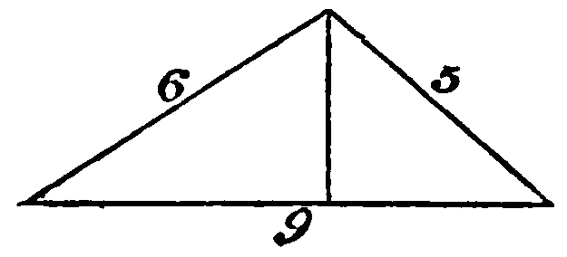

# GPT-4o 與 GPT-4o mini 入門

> 原文：[examples/gpt4o/introduction_to_gpt4o.ipynb](https://github.com/openai/openai-cookbook/blob/main/examples/gpt4o/introduction_to_gpt4o.ipynb)


## 這篇在做什麼

介紹 GPT-4o 和 GPT-4o mini 這類原生多模態模型，從純文字請求開始，再到用 Base64 或 URL 送圖片。最後示範怎麼把影片抽成 frames 加音訊，分別只用畫面、只用聲音、兩者合用來做摘要和問答，比較結果差異。

## 學完你會

- 用 Python SDK 對 `gpt-4o-mini` 送文字和圖片（Base64 與 URL 兩種）請求。
- 把影片切成 frames，再搭配 Whisper 轉出的逐字稿，餵給模型做摘要和 Q&A。
- 比較只用視覺、只用音訊、視覺加音訊三種輸入，看多模態合用為什麼比較準。

## 開跑前

- 需要 OpenAI API key，呼叫會產生費用。
- 處理影片需要安裝 [ffmpeg](https://ffmpeg.org/about.html)。

GPT-4o（"o" 代表 "omni"）和 GPT-4o mini 是原生多模態模型，可以處理文字、音訊、影片的組合輸入，輸出可以是文字、音訊和圖片。GPT-4o mini 是 GPT-4o 的輕量版。

### 背景

在 GPT-4o 之前，使用者在 ChatGPT 用 Voice Mode 互動，背後是三個獨立的模型。GPT-4o 把這些能力整合進同一個跨文字、視覺、音訊訓練的模型。這種統一的做法讓所有輸入，不論是文字、畫面還是聲音，都由同一個 neural network 一起處理。

GPT-4o mini 是 omni 模型家族的下一代，體積更小、價格更低。它的準確度比 GPT-3.5 Turbo 高，速度一樣快，也支援多模態的輸入和輸出。

### 目前 API 的能力

目前 `gpt-4o-mini` 支援 `{text, image}` 輸入和 `{text}` 輸出，跟 `gpt-4-turbo` 的模態一樣。另外會用 `gpt-4o-audio-preview` 模型作為預覽，示範透過 GPT4o 做轉錄。

## 開始使用

### 安裝 OpenAI SDK for Python


```python
%pip install --upgrade openai
```

### 設定 OpenAI client 並送出測試 request
要設定 client，需要先建立一把 API key。如果你已經有了就跳過這些步驟。

取得 API key 的步驟：
1. [建立新 project](https://help.openai.com/en/articles/9186755-managing-your-work-in-the-api-platform-with-projects)
2. [在 project 裡產生 API key](https://platform.openai.com/api-keys)
3. （建議但非必要）[把 API key 設成環境變數，讓所有 project 共用](https://platform.openai.com/docs/quickstart/step-2-set-up-your-api-key)

設定好之後，先用簡單的 {text} 輸入送第一個 request。這次會同時用 `system` 和 `user` message，回應則來自 `assistant` 角色。

```python
from openai import OpenAI 
import os

## Set the API key and model name
MODEL="gpt-4o-mini"
client = OpenAI(api_key=os.environ.get("OPENAI_API_KEY", "<your OpenAI API key if not set as an env var>"))
```

```python
completion = client.chat.completions.create(
  model=MODEL,
  messages=[
    {"role": "system", "content": "You are a helpful assistant. Help me with my math homework!"}, # <-- This is the system message that provides context to the model
    {"role": "user", "content": "Hello! Could you solve 2+2?"}  # <-- This is the user message for which the model will generate a response
  ]
)

print("Assistant: " + completion.choices[0].message.content)
```

??? note "輸出"

    ```text
    Assistant: Of course! \( 2 + 2 = 4 \).
    ```

## 圖片處理
GPT-4o mini 可以直接處理圖片，並根據圖片內容採取合理的動作。圖片可以用兩種格式提供：
1. Base64 編碼
2. URL

先看一下要用的圖片，再試著用 Base64 和 URL 兩種方式把它送給 API

```python
from IPython.display import Image, display, Audio, Markdown
import base64

IMAGE_PATH = "data/triangle.png"

# Preview image for context
display(Image(IMAGE_PATH))
```

??? note "輸出"

    

#### Base64 圖片處理

```python
# Open the image file and encode it as a base64 string
def encode_image(image_path):
    with open(image_path, "rb") as image_file:
        return base64.b64encode(image_file.read()).decode("utf-8")

base64_image = encode_image(IMAGE_PATH)

response = client.chat.completions.create(
    model=MODEL,
    messages=[
        {"role": "system", "content": "You are a helpful assistant that responds in Markdown. Help me with my math homework!"},
        {"role": "user", "content": [
            {"type": "text", "text": "What's the area of the triangle?"},
            {"type": "image_url", "image_url": {
                "url": f"data:image/png;base64,{base64_image}"}
            }
        ]}
    ],
    temperature=0.0,
)

print(response.choices[0].message.content)
```

??? note "輸出"

    ```text
    To find the area of the triangle, you can use the formula:

    \[
    \text{Area} = \frac{1}{2} \times \text{base} \times \text{height}
    \]

    In the triangle you provided:

    - The base is \(9\) (the length at the bottom).
    - The height is \(5\) (the vertical line from the top vertex to the base).

    Now, plug in the values:

    \[
    \text{Area} = \frac{1}{2} \times 9 \times 5
    \]

    Calculating this:

    \[
    \text{Area} = \frac{1}{2} \times 45 = 22.5
    \]

    Thus, the area of the triangle is **22.5 square units**.
    ```

#### URL 圖片處理

```python
response = client.chat.completions.create(
    model=MODEL,
    messages=[
        {"role": "system", "content": "You are a helpful assistant that responds in Markdown. Help me with my math homework!"},
        {"role": "user", "content": [
            {"type": "text", "text": "What's the area of the triangle?"},
            {"type": "image_url", "image_url": {
                "url": "https://upload.wikimedia.org/wikipedia/commons/e/e2/The_Algebra_of_Mohammed_Ben_Musa_-_page_82b.png"}
            }
        ]}
    ],
    temperature=0.0,
)

print(response.choices[0].message.content)
```

??? note "輸出"

    ```text
    To find the area of the triangle, you can use the formula:

    \[
    \text{Area} = \frac{1}{2} \times \text{base} \times \text{height}
    \]

    In the triangle you provided:

    - The base is \(9\) (the length at the bottom).
    - The height is \(5\) (the vertical line from the top vertex to the base).

    Now, plug in the values:

    \[
    \text{Area} = \frac{1}{2} \times 9 \times 5
    \]

    Calculating this gives:

    \[
    \text{Area} = \frac{1}{2} \times 45 = 22.5
    \]

    Thus, the area of the triangle is **22.5 square units**.
    ```

## 影片處理
API 沒辦法直接送影片，但只要對影片抽樣取 frames，再當成圖片送進去，GPT-4o 就能理解影片內容。

由於 API 裡的 GPT-4o mini 還不支援 audio-in（截至 2024 年 7 月），我們會結合 GPT-4o mini 和 Whisper，同時處理影片的音訊和畫面，並展示兩種用法：
1. 摘要
2. 問答


### 影片處理的準備
影片處理用到兩個 Python 套件：opencv-python 和 moviepy。

它們需要 [ffmpeg](https://ffmpeg.org/about.html)，請先安裝。依作業系統不同，可能要執行 `brew install ffmpeg` 或 `sudo apt install ffmpeg`

```python
%pip install opencv-python
%pip install moviepy
```

### 把影片拆成兩部分：frames 和音訊

```python
import cv2
from moviepy import *
import time
import base64

# We'll be using the OpenAI DevDay Keynote Recap video. You can review the video here: https://www.youtube.com/watch?v=h02ti0Bl6zk
VIDEO_PATH = "data/keynote_recap.mp4"
```

```python
def process_video(video_path, seconds_per_frame=2):
    base64Frames = []
    base_video_path, _ = os.path.splitext(video_path)

    video = cv2.VideoCapture(video_path)
    total_frames = int(video.get(cv2.CAP_PROP_FRAME_COUNT))
    fps = video.get(cv2.CAP_PROP_FPS)
    frames_to_skip = int(fps * seconds_per_frame)
    curr_frame=0

    # Loop through the video and extract frames at specified sampling rate
    while curr_frame < total_frames - 1:
        video.set(cv2.CAP_PROP_POS_FRAMES, curr_frame)
        success, frame = video.read()
        if not success:
            break
        _, buffer = cv2.imencode(".jpg", frame)
        base64Frames.append(base64.b64encode(buffer).decode("utf-8"))
        curr_frame += frames_to_skip
    video.release()

    # Extract audio from video
    audio_path = f"{base_video_path}.mp3"
    clip = VideoFileClip(video_path)
    clip.audio.write_audiofile(audio_path, bitrate="32k")
    clip.audio.close()
    clip.close()

    print(f"Extracted {len(base64Frames)} frames")
    print(f"Extracted audio to {audio_path}")
    return base64Frames, audio_path

# Extract 1 frame per second. You can adjust the `seconds_per_frame` parameter to change the sampling rate
base64Frames, audio_path = process_video(VIDEO_PATH, seconds_per_frame=1)
```

??? note "輸出"

    ```text
    MoviePy - Writing audio in data/keynote_recap.mp3
    ```

    ```text
    MoviePy - Done.
    Extracted 218 frames
    Extracted audio to data/keynote_recap.mp3
    ```

```python
## Display the frames and audio for context
display_handle = display(None, display_id=True)
for img in base64Frames:
    display_handle.update(Image(data=base64.b64decode(img.encode("utf-8")), width=600))
    time.sleep(0.025)

Audio(audio_path)
```

### 範例 1：摘要
現在有了影片的 frames 和音訊，我們跑幾組不同的測試，產生影片摘要，比較用不同模態的結果。預期同時用上畫面和聲音所產生的摘要最準確，因為模型可以用到整部影片的完整脈絡。

1. 視覺摘要
2. 音訊摘要
3. 視覺加音訊摘要

#### 視覺摘要
視覺摘要只把影片的 frames 送給模型。只有畫面的話，模型大概能抓到視覺上的重點，但會漏掉講者說的細節。

```python
response = client.chat.completions.create(
    model=MODEL,
    messages=[
    {"role": "system", "content": "You are generating a video summary. Please provide a summary of the video. Respond in Markdown."},
    {"role": "user", "content": [
        "These are the frames from the video.",
        *map(lambda x: {"type": "image_url", 
                        "image_url": {"url": f'data:image/jpg;base64,{x}', "detail": "low"}}, base64Frames)
        ],
    }
    ],
    temperature=0,
)
print(response.choices[0].message.content)
```

??? note "輸出"

    ```text
    # OpenAI Dev Day Summary

    ## Overview
    The video captures highlights from OpenAI's Dev Day, showcasing new advancements and features in AI technology, particularly focusing on the latest developments in the GPT-4 model and its applications.

    ## Key Highlights

    ### Event Introduction
    - The event is branded as "OpenAI Dev Day," setting the stage for discussions on AI advancements.

    ### Keynote Recap
    - The keynote features a recap of significant updates and innovations in AI, particularly around the GPT-4 model.

    ### New Features
    - **GPT-4 Turbo**: Introduction of a faster and more efficient version of GPT-4, emphasizing improved performance and reduced costs.
    - **DALL-E 3**: Updates on the image generation model, showcasing its capabilities and integration with other tools.
    - **Custom Models**: Introduction of features allowing users to create tailored AI models for specific tasks.

    ### Technical Innovations
    - **Function Calling**: Demonstration of how the model can handle complex instructions and execute functions based on user queries.
    - **JSON Mode**: A new feature that allows for structured data handling, enhancing the model's ability to process and respond to requests.

    ### User Experience Enhancements
    - **Threading and Retrieval**: New functionalities that improve how users can interact with the model, making it easier to manage conversations and retrieve information.
    - **Code Interpreter**: Introduction of a tool that allows the model to execute code, expanding its utility for developers.

    ### Community Engagement
    - The event emphasizes community involvement, encouraging developers to explore and utilize the new features in their applications.

    ### Conclusion
    - The event wraps up with a call to action for developers to engage with the new tools and features, fostering innovation in AI applications.

    ## Closing Remarks
    The OpenAI Dev Day serves as a platform for showcasing the latest advancements in AI technology, encouraging developers to leverage these innovations for enhanced applications and user experiences.
    ```

結果跟預期一樣，模型能抓到影片畫面的大方向，但漏掉了講話中提供的細節。

#### 音訊摘要
音訊摘要把音訊的逐字稿送給模型。只有聲音的話，模型會偏向語音內容，漏掉簡報和畫面提供的脈絡。

GPT-4o 的 `{audio}` 輸入目前是 preview，不久之後會併進基礎模型。所以這裡用 `gpt-4o-audio-preview` 模型處理音訊。

```python
#transcribe the audio
with open(audio_path, 'rb') as audio_file:
    audio_content = base64.b64encode(audio_file.read()).decode('utf-8')

response = client.chat.completions.create(
            model='gpt-4o-audio-preview',
            modalities=["text"],
            messages=[
                    {   "role": "system", 
                        "content":"You are generating a transcript. Create a transcript of the provided audio."
                    },
                    {
                        "role": "user",
                        "content": [
                            { 
                                "type": "text",
                                "text": "this is the audio."
                            },
                            {
                                "type": "input_audio",
                                "input_audio": {
                                    "data": audio_content,
                                    "format": "mp3"
                                }
                            }
                        ]
                    },
                ],
            temperature=0,
        )

# Extract and return the transcription
transcription = response.choices[0].message.content
print (transcription)
```

看起來不錯。接下來把它整理成 markdown 格式的摘要。

```python
#summarize the transcript
response = client.chat.completions.create(
            model=MODEL,
            modalities=["text"],
            messages=[
                {"role": "system", "content": "You are generating a transcript summary. Create a summary of the provided transcription. Respond in Markdown."},
                {"role": "user", "content": f"Summarize this text: {transcription}"},
            ],
            temperature=0,
        )
transcription_summary = response.choices[0].message.content
print (transcription_summary)
```

??? note "輸出"

    ```text
    # OpenAI Dev Day Summary

    On the inaugural OpenAI Dev Day, several significant updates and features were announced:

    - **Launch of GPT-4 Turbo**: This new model supports up to 128,000 tokens of context and is designed to follow instructions more effectively.
      
    - **JSON Mode**: A new feature that ensures the model responds with valid JSON.

    - **Function Calling**: Users can now call multiple functions simultaneously, enhancing the model's capabilities.

    - **Retrieval Feature**: This allows models to access external knowledge from documents or databases, improving their contextual understanding.

    - **Knowledge Base**: GPT-4 Turbo has knowledge up to April 2023, with plans for ongoing improvements.

    - **Dolly 3 and New Models**: The introduction of Dolly 3, GPT-4 Turbo with Vision, and a new Text-to-Speech model, all available via the API.

    - **Custom Models Program**: A new initiative where researchers collaborate with companies to create tailored models for specific use cases.

    - **Increased Rate Limits**: Established GPT-4 customers will see a doubling of tokens per minute, with options to request further changes in API settings.

    - **Cost Efficiency**: GPT-4 Turbo is significantly cheaper than its predecessor, with a 3x reduction for prompt tokens and 2x for completion tokens.

    - **Introduction of GPTs**: Tailored versions of ChatGPT designed for specific purposes, allowing users to create and share private or public GPTs easily, even without coding skills.

    - **Upcoming GPT Store**: A platform for users to share their GPT creations.

    - **Assistance API**: Features persistent threads, built-in retrieval, a code interpreter, and improved function calling to streamline user interactions.

    The event concluded with excitement about the future of AI technology and an invitation for attendees to return next year to see further advancements.
    ```

音訊摘要偏向演講中討論的內容，但結構比影片摘要差很多。

#### 音訊加視覺摘要
音訊加視覺摘要，是把影片的畫面和聲音同時送給模型。兩者一起送的話，模型能一次感知整部影片，預期摘要會更好。

```python
## Generate a summary with visual and audio
response = client.chat.completions.create(
    model=MODEL,
    messages=[
    {"role": "system", "content":"""You are generating a video summary. Create a summary of the provided video and its transcript. Respond in Markdown"""},
    {"role": "user", "content": [
        "These are the frames from the video.",
        *map(lambda x: {"type": "image_url", 
                        "image_url": {"url": f'data:image/jpg;base64,{x}', "detail": "low"}}, base64Frames),
        {"type": "text", "text": f"The audio transcription is: {transcription}"}
        ],
    }
],
    temperature=0,
)
print(response.choices[0].message.content)
```

??? note "輸出"

    ```text
    # OpenAI Dev Day Summary

    ## Overview
    The first-ever OpenAI Dev Day introduced several exciting updates and features, primarily focusing on the launch of **GPT-4 Turbo**. This new model enhances capabilities and expands the potential for developers and users alike.

    ## Key Announcements

    ### 1. **GPT-4 Turbo**
    - **Token Support**: Supports up to **128,000 tokens** of context.
    - **JSON Mode**: A new feature that ensures responses are in valid JSON format.
    - **Function Calling**: Improved ability to call multiple functions simultaneously and better adherence to instructions.

    ### 2. **Knowledge Retrieval**
    - **Enhanced Knowledge Access**: Users can now integrate external documents or databases, allowing models to access updated information beyond their training cut-off (April 2023).

    ### 3. **DALL-E 3 and Other Models**
    - Launch of **DALL-E 3**, **GPT-4 Turbo with Vision**, and a new **Text-to-Speech model** in the API.

    ### 4. **Custom Models Program**
    - Introduction of a program where OpenAI researchers collaborate with companies to create tailored models for specific use cases.

    ### 5. **Rate Limits and Pricing**
    - **Increased Rate Limits**: Doubling tokens per minute for established GPT-4 customers.
    - **Cost Efficiency**: GPT-4 Turbo is **3x cheaper** for prompt tokens and **2x cheaper** for completion tokens compared to GPT-4.

    ### 6. **Introduction of GPTs**
    - **Tailored Versions**: GPTs are customized versions of ChatGPT designed for specific tasks, combining instructions, expanded knowledge, and actions.
    - **User-Friendly Creation**: Users can create GPTs through conversation, making it accessible even for those without coding skills.
    - **GPT Store**: A new platform for sharing and discovering GPTs, launching later this month.

    ### 7. **Assistance API Enhancements**
    - Features include persistent threads, built-in retrieval, a code interpreter, and improved function calling.

    ## Conclusion
    The event highlighted OpenAI's commitment to enhancing AI capabilities and accessibility for developers. The advancements presented are expected to empower users to create innovative applications and solutions. OpenAI looks forward to future developments and encourages ongoing engagement with the community. 

    Thank you for attending!
    ```

把影片和音訊合在一起之後，我們得到一份更詳細、更完整的活動摘要，用上了影片中視覺和聽覺兩邊的資訊。

### 範例 2：問答
問答這邊沿用同樣的概念，對處理過的影片提問，同樣跑三組測試，展示結合多種輸入模態的好處：
1. 視覺 Q&A
2. 音訊 Q&A
3. 視覺加音訊 Q&A

```python
QUESTION = "Question: Why did Sam Altman have an example about raising windows and turning the radio on?"
```

```python
qa_visual_response = client.chat.completions.create(
    model=MODEL,
    messages=[
    {"role": "system", "content": "Use the video to answer the provided question. Respond in Markdown."},
    {"role": "user", "content": [
        "These are the frames from the video.",
        *map(lambda x: {"type": "image_url", "image_url": {"url": f'data:image/jpg;base64,{x}', "detail": "low"}}, base64Frames),
        QUESTION
        ],
    }
    ],
    temperature=0,
)
print("Visual QA:\n" + qa_visual_response.choices[0].message.content)
```

??? note "輸出"

    ```text
    Visual QA:
    Sam Altman used the example of raising windows and turning the radio on to illustrate the concept of function calling in AI. This example demonstrates how AI can interpret natural language commands and translate them into specific function calls, making interactions more intuitive and user-friendly. By showing a relatable scenario, he highlighted the advancements in AI's ability to understand and execute complex tasks based on simple instructions.
    ```

```python
qa_audio_response = client.chat.completions.create(
    model=MODEL,
    messages=[
    {"role": "system", "content":"""Use the transcription to answer the provided question. Respond in Markdown."""},
    {"role": "user", "content": f"The audio transcription is: {transcription}. \n\n {QUESTION}"},
    ],
    temperature=0,
)
print("Audio QA:\n" + qa_audio_response.choices[0].message.content)
```

??? note "輸出"

    ```text
    Audio QA:
    The transcription provided does not include any mention of Sam Altman discussing raising windows or turning the radio on. Therefore, I cannot provide an answer to that specific question based on the given text. If you have more context or another transcription that includes that example, please share it, and I would be happy to help!
    ```

```python
qa_both_response = client.chat.completions.create(
    model=MODEL,
    messages=[
    {"role": "system", "content":"""Use the video and transcription to answer the provided question."""},
    {"role": "user", "content": [
        "These are the frames from the video.",
        *map(lambda x: {"type": "image_url", 
                        "image_url": {"url": f'data:image/jpg;base64,{x}', "detail": "low"}}, base64Frames),
                        {"type": "text", "text": f"The audio transcription is: {transcription}"},
        QUESTION
        ],
    }
    ],
    temperature=0,
)
print("Both QA:\n" + qa_both_response.choices[0].message.content)
```

??? note "輸出"

    ```text
    Both QA:
    Sam Altman used the example of raising windows and turning the radio on to illustrate the new function calling feature in GPT-4 Turbo. This example demonstrates how the model can interpret natural language commands and translate them into specific function calls, making it easier for users to interact with the model in a more intuitive way. It highlights the model's ability to understand context and perform multiple actions based on user instructions.
    ```

比較三個答案，同時用影片音訊和畫面所產生的答案最準確。Sam Altman 在 Keynote 裡並沒有講到升起車窗或打開收音機，他提到的是模型在單一 request 中執行多個 function 的能力提升，而這些範例是在他身後的畫面上展示的。

## 結論

整合音訊、視覺、文字等多種輸入模態，能明顯提升模型在各種任務上的表現。這種多模態做法讓模型能更全面地理解和互動，也更接近人類感知和處理資訊的方式。

目前 API 中的 GPT-4o 和 GPT-4o mini 支援文字和圖片輸入，音訊功能即將推出。在那之前，音訊輸入請用 `gpt-4o-audio-preview`。

## 重點整理

- 模型不能直接收影片，要自己抽樣成 frames 當圖片送，音訊另外轉成逐字稿。
- 圖片可以用 Base64 或 URL 兩種方式送進 API。
- 只看畫面會漏掉講者的細節，只看聲音會漏掉簡報脈絡，兩者合用答案最完整。
- 多模態的價值在於輸入互補，不是單一模態做得更好。
- 音訊輸入在這篇寫成時還是 preview，需要用 `gpt-4o-audio-preview`。

## 練習

1. 換一張自己的圖片，分別用 Base64 和 URL 送出，問模型圖裡有什麼，確認兩種結果一致。
2. 改影片抽樣 frames 的間隔（取更少或更多張），觀察視覺摘要的品質和 token 用量怎麼變。
3. 換成自己的影片，自己設計三個問題，跑視覺、音訊、視覺加音訊三種 Q&A，挑一題找出只有合用才答得對的例子。
