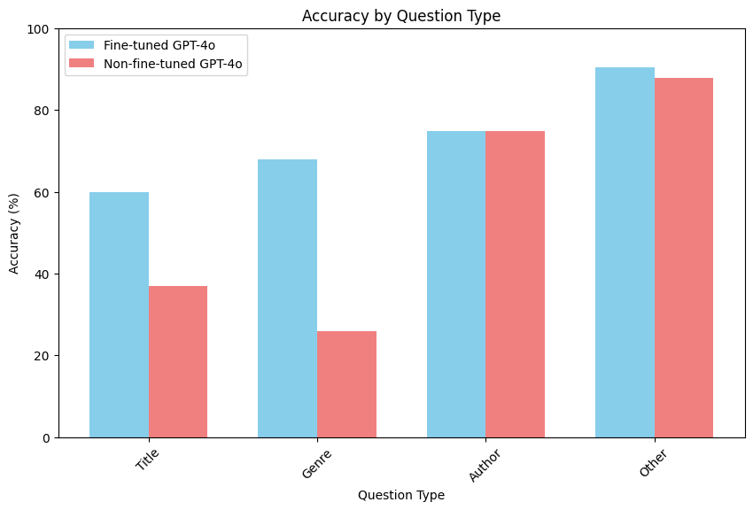
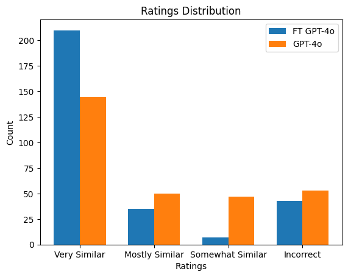

# 用 GPT-4o 做 Vision Fine-tuning：視覺問答

> 原文：[examples/multimodal/Vision_Fine_tuning_on_GPT4o_for_Visual_Question_Answering.ipynb](https://github.com/openai/openai-cookbook/blob/main/examples/multimodal/Vision_Fine_tuning_on_GPT4o_for_Visual_Question_Answering.ipynb)


## 這篇在做什麼

用 OCR-VQA 資料集裡的書籍封面圖片和問答配對，對 GPT-4o 做 vision fine-tuning，讓它更會回答「這本書的書名、作者、類型是什麼」這類問題。最後拿測試集比較 fine-tune 前後的準確度。

## 學完你會

- 把圖片加文字的問答資料整理成 vision fine-tuning 要求的 Chat Completions 訊息格式，圖片用 base64 編碼，輸出成 `.jsonl`。
- 用 Files API 上傳資料，並用 fine-tuning API 建立 GPT-4o 的 fine-tuning job。
- 用 GPT-4o 當評審，把預測答案和標準答案的相似度分級，並按問題類型比較 fine-tune 前後的差異。

## 開跑前

- 需要 OpenAI API key，fine-tuning 和推論都會產生費用。
- 資料集透過 HuggingFace 下載。

OpenAI 推出了 [GPT-4o 的 Vision Fine-Tuning](https://openai.com/index/introducing-vision-to-the-fine-tuning-api/)，這是一種多模態 fine-tuning 功能，讓開發者可以同時用**圖片**和**文字**來 fine-tune GPT-4o。有了它，你可以把模型客製得更會理解圖片，應用在各種產業和場景。

從**進階的視覺搜尋**，到自駕車或智慧城市的**物件偵測改善**，vision fine-tuning 讓你做出貼合自己需求的解法。結合文字和圖片輸入，它特別適合像**視覺問答（visual question answering）** 這種任務，也就是分析圖片後給出詳細、符合脈絡的答案。整體來說，當模型面對的問題和圖片跟訓練資料很像時效果最好，因為我們能教模型怎麼去找、怎麼辨認圖片中跟問題相關的部分。跟文字 fine-tuning 一樣，vision fine-tuning 對教模型新知識沒什麼幫助。

這篇會一步步帶你用多模態輸入 fine-tune GPT-4o。具體來說，我們會訓練一個回答**書籍圖片**相關問題的模型，不過應用範圍很廣，從**網頁設計**、**教育**到**醫療**和**研究**都可以。

不管你想做更聰明的製造業瑕疵偵測模型、強化複雜文件處理和圖表理解，還是開發其他需要更好視覺理解的應用，這篇都會讓你看到上手有多快多簡單。

更多資訊請看完整的[文件](https://platform.openai.com/docs/guides/fine-tuning/vision)。

```python
from openai import OpenAI, ChatCompletion
import json
import os

client = OpenAI()
```

### 載入資料集

我們會使用 [OCR-VQA 資料集](https://ocr-vqa.github.io/)裡書籍圖片的問答配對，可以透過 HuggingFace 取得。這個資料集有 207,572 張書籍圖片，附帶詢問書名、作者、版本、年份和類型的問答配對，總共約 100 萬組 QA。這篇只拿其中一小部分來訓練、驗證和測試模型。

我們認為這個資料集很適合用在多模態輸入的 fine-tuning，因為模型不只要正確找出關鍵資訊所在的 bounding box，還要對圖片內容做推理才能答對。

```python
from datasets import load_dataset

# load dataset
ds = load_dataset("howard-hou/OCR-VQA")
```

先抽樣 150 筆訓練資料、50 筆驗證資料和 100 筆測試資料。我們也會把 `questions` 和 `answers` 欄位展開（explode），讓每一列只有一組 QA。另外，圖片是以 byte string 儲存的，所以要先轉成圖片才能處理。

```python
import pandas as pd
from io import BytesIO
from PIL import Image

# sample 150 training examples, 50 validation examples and 100 test examples
ds_train = ds['train'].shuffle(seed=42).select(range(150))
ds_val = ds['validation'].shuffle(seed=42).select(range(50))
ds_test = ds['test'].shuffle(seed=42).select(range(100))

# convert to pandas dataframe
ds_train = ds_train.to_pandas()
ds_val = ds_val.to_pandas()
ds_test = ds_test.to_pandas()

# convert byte strings to images
ds_train['image'] = ds_train['image'].apply(lambda x: Image.open(BytesIO(x['bytes'])))
ds_val['image'] = ds_val['image'].apply(lambda x: Image.open(BytesIO(x['bytes'])))
ds_test['image'] = ds_test['image'].apply(lambda x: Image.open(BytesIO(x['bytes'])))

# explode the 'questions' and 'answers' columns
ds_train = ds_train.explode(['questions', 'answers'])
ds_val = ds_val.explode(['questions', 'answers'])
ds_test = ds_test.explode(['questions', 'answers'])

# rename columns
ds_train = ds_train.rename(columns={'questions': 'question', 'answers': 'answer'})
ds_val = ds_val.rename(columns={'questions': 'question', 'answers': 'answer'})
ds_test = ds_test.rename(columns={'questions': 'question', 'answers': 'answer'})

# create unique ids for each example
ds_train = ds_train.reset_index(drop=True)
ds_val = ds_val.reset_index(drop=True)
ds_test = ds_test.reset_index(drop=True)

# select columns
ds_train = ds_train[['question', 'answer', 'image']]
ds_val = ds_val[['question', 'answer', 'image']]
ds_test = ds_test[['question', 'answer', 'image']]
```

來看一筆隨機抽出的訓練資料。

這個例子是問書名。答案其實相當模稜兩可，因為有主標題「Patty's Patterns - Advanced Series Vol. 1 & 2」，也有副標題「100 Full-Page Patterns Value Bundle」，兩者出現在圖片的不同位置。而且這裡的作者不是個人，而是一個叫「Penny Farthing Graphics」的團體，很容易被誤認成書名的一部分。

這類任務是視覺問答的典型情況：模型必須解讀複雜的圖片，給出準確且符合脈絡的回答。用這類問題訓練，可以提升模型在各種領域做細緻圖片分析的能力。

```python
from IPython.display import display

# display a random training example
print('QUESTION:', ds_train.iloc[198]['question'])
display(ds_train.iloc[198]['image'])
print('ANSWER:', ds_train.iloc[198]['answer'])
```

??? note "輸出"

    ```text
    QUESTION: What is the title of this book?
    ```

    ```text
    ANSWER: Patty's Patterns - Advanced Series Vol. 1 & 2: 100 Full-Page Patterns Value Bundle
    ```

### 資料準備

要讓 fine-tuning 順利，訓練資料的結構一定要正確。格式正確能避免訓練時的 validation 錯誤，也讓模型能有效地同時從文字和圖片學習。好消息是這個過程很簡單。

訓練資料裡的每個範例都應該是一段對話，格式和 **Chat Completions API** 一樣。也就是把資料組成一連串**訊息**，每則訊息包含 `role`（例如 "user" 或 "assistant"）和訊息的 `content`。

因為 vision fine-tuning 同時有文字和圖片，所以訊息裡要包含兩種內容。每筆訓練樣本中，關於圖片的問題是一則 user 訊息，對應的答案則是一則 assistant 訊息。

圖片有兩種放進去的方式：
* 用 **HTTP URL**，指向圖片的位置。
* 用 **data URL**，內容是 **base64** 編碼的圖片。

訊息格式大概長這樣：

```python
{
    "messages": 
    [
        {
            "role": "system",
            "content": "Use the image to answer the question."
        },
        {
            "role": "user",
            "content": [
                {"type": "text", "text": "What is the title of this book?"},
                {"type": "image_url", "image_url": {"url": "data:image/jpeg;base64,<encoded_image>"}}
            ]
        }
    ]
}
```

先定義模型的 **system instructions**。這些指示提供重要的脈絡，引導模型處理訓練資料時該怎麼表現。清楚簡潔的 system instructions 特別有助於讓模型在文字和圖片上都推理得好。

```python
SYSTEM_PROMPT = """
Generate an answer to the question based on the image of the book provided.
Questions will include both open-ended questions and binary "yes/no" questions.
The questions will inquire about the title, author, edition, year and genre of the book in the image.

You will read the question and examine the corresponding image to provide an accurate answer.

# Steps

1. **Read the Question:** Carefully analyze the question to understand what information is being asked.
2. **Examine the Image:**
   - **Identify Relevant Bounding Boxes (if applicable):** For questions requiring specific details like the title or author, focus on the relevant areas or bounding boxes within the image to extract the necessary text. There may be multiple relevant bounding boxes in the image, so be sure to consider all relevant areas.
   - **Analyze the Whole Image:** For questions that need general reasoning (e.g., "Is this book related to Children's Books?"), consider the entire image, including title, graphics, colors, and overall design elements.
3. **Formulate a Reasoned Answer:**
   - For binary questions (yes/no), use evidence from the image to support your answer.
   - For open-ended questions, provide the exact text from the image or a concise phrase that best describes the requested information.

# Output Format

- Provide your answer in a concise and clear manner. Always return the final conclusion only, no additional text or reasoning.
- If the question is binary, answer with "Yes" or "No."
- For open-ended questions requesting specific details (e.g., title, author), return the exact text from the image.
- For questions about general attributes like "genre," return a single word or phrase that best describes it.

# Notes

- Always prioritize accuracy and clarity in your responses.
- If multiple authors are listed, return the first author listed.
- If the information is not present in the image, try to reason about the question using the information you can gather from the image e.g. if the author is not listed, use the title and genre to find the author.
- Ensure reasoning steps logically lead to the conclusions before stating your final answer.

# Examples
You will be provided with examples of questions and corresponding images of book covers, along with the reasoning and conclusion for each example. Use these examples to guide your reasoning process."""
```

為了確保圖片格式符合 vision fine-tuning 的要求，圖片必須是 **base64 格式**，而且是 **RGB 或 RGBA**。這樣模型在訓練時才能正確處理圖片。下面的函式負責編碼圖片，必要時也會轉成正確的格式。

這個函式可以控制圖片編碼的品質，想縮小檔案大小時很有用。100 是最高品質，1 是最低。一個 fine-tuning job 的檔案大小上限是 1GB，不過訓練資料量非常大時，通常也不太會有進一步的改善。如果需要符合檔案大小限制，可以用 `quality` 參數把檔案縮小。

```python
import base64

def encode_image(image, quality=100):
    if image.mode != 'RGB':
        image = image.convert('RGB')  # Convert to RGB
    buffered = BytesIO()
    image.save(buffered, format="JPEG", quality=quality) 
    return base64.b64encode(buffered.getvalue()).decode("utf-8")
```

我們也會從訓練集挑出 **Few-Shot 範例**，用 user 和 assistant 訊息的形式放進去，幫忙引導模型的推理。


```python
FEW_SHOT_EXAMPLES = [
    {
        "role": "user",
        "content": [
            {"type": "text", "text": "**Example 1:**\n\n**Question:** Who wrote this book?"},
            {"type": "image_url", "image_url": {"url": f"data:image/jpeg;base64,{encode_image(ds_train.iloc[286]['image'], quality=50)}"}}
        ]
    },
    {
        "role": "assistant",
        "content": [
            {"type": "text", "text": "**Reasoning:** The cover clearly displays two authors' names, 'Evelyn M. Thomson' and 'Orlen N. Johnson,' at the bottom of the cover, with Evelyn M. Thomson listed first. Typically, the first-listed author is considered the primary author or main contributor.\n\n**Conclusion:** Evelyn Thomson"}
        ]
    },
    {
        "role": "user",
        "content": [
            {"type": "text", "text": "**Example 2:**\n\n**Question:** What is the title of this book?"},
            {"type": "image_url", "image_url": {"url": f"data:image/jpeg;base64,{encode_image(ds_train.iloc[22]['image'], quality=50)}"}}
        ]
    },
    {
        "role": "assistant",
        "content": [
            {"type": "text", "text": "**Answer:**\n\n**Reasoning:** The cover prominently displays the title across the top and center of the image. The full title reads, 'Computer Systems: An Integrated Approach to Architecture and Operating Systems,' with each component of the title clearly separated and formatted to stand out.\n\n**Conclusion:** Computer Systems: An Integrated Approach to Architecture and Operating Systems"}
        ]
    },
    {
        "role": "user",
        "content": [
            {"type": "text", "text": "**Example 3:**\n\n**Question:** Is this book related to Children's Books?"},
            {"type": "image_url", "image_url": {"url": f"data:image/jpeg;base64,{encode_image(ds_train.iloc[492]['image'], quality=50)}"}}
        ]
    },
    {
        "role": "assistant",
        "content": [
            {"type": "text", "text": "**Answer:**\n\n**Reasoning:** The cover illustration features a whimsical mermaid holding a red shoe, with gentle, child-friendly artwork that suggests it is targeted toward a young audience. Additionally, the style and imagery are typical of children's literature.\n\n**Conclusion:** Yes"}
        ]
    },
    {
        "role": "user",
        "content": [
            {"type": "text", "text": "**Example 4:**\n\n**Question:** Is this book related to History?"},
            {"type": "image_url", "image_url": {"url": f"data:image/jpeg;base64,{encode_image(ds_train.iloc[68]['image'], quality=50)}"}}
        ]
    },
    {
        "role": "assistant",
        "content": [
            {"type": "text", "text": "**Answer:**\n\n**Reasoning:** The title 'Oliver Wendell Holmes, Jr.: Civil War Soldier, Supreme Court Justice' clearly indicates that this book focuses on the life of Oliver Wendell Holmes, Jr., providing a biographical account rather than a general historical analysis. Although it references historical elements (Civil War, Supreme Court), the primary focus is on the individual rather than historical events as a whole.\n\n**Conclusion:** No"}
        ]
    },
    {
        "role": "user",
        "content": [
            {"type": "text", "text": "**Example 5:**\n\n**Question:** What is the genre of this book?"},
            {"type": "image_url", "image_url": {"url": f"data:image/jpeg;base64,{encode_image(ds_train.iloc[42]['image'], quality=50)}"}}
        ]
    },
    {
        "role": "assistant",
        "content": [
            {"type": "text", "text": "**Answer:**\n\n**Reasoning:** The cover prominently features an image of a train station and the title 'Railway Depots, Stations & Terminals,' which directly suggests a focus on railway infrastructure. This points to the book being related to topics within Engineering & Transportation.\n\n**Conclusion:** Engineering & Transportation"}
        ]
    },
    {
        "role": "user",
        "content": [
            {"type": "text", "text": "**Example 6:**\n\n**Question:** What type of book is this?"},
            {"type": "image_url", "image_url": {"url": f"data:image/jpeg;base64,{encode_image(ds_train.iloc[334]['image'], quality=50)}"}}
        ]
    },
    {
        "role": "assistant",
        "content": [
            {"type": "text", "text": "**Answer:**\n\n**Reasoning:** The title 'Principles and Practice of Modern Chromatographic Methods' suggests a focus on chromatography, a scientific technique used in chemistry and biology. This aligns with the academic and technical nature typical of books in the 'Science & Math' category.\n\n**Conclusion:** Science & Math"}
        ]
    }
]
```

system instructions、few-shot 範例和圖片編碼函式都備好了，下一步是走過整個訓練集，組出 fine-tuning 需要的訊息。提醒一下，每個訓練範例都必須是對話格式，而且要同時包含圖片（base64 格式）和對應的問題與答案。

fine-tune GPT-4o 建議至少提供 **10 筆範例**，不過通常用 **50 到 100 筆**訓練範例就能看到明顯改善。這裡我們直接用比較大的訓練樣本：**150 張圖片、721 組 QA**。

```python
from tqdm import tqdm

# constructing the training set
json_data = []

for idx, example in tqdm(ds_train.iterrows()):
    system_message = {
        "role": "system",
        "content": [{"type": "text", "text": SYSTEM_PROMPT}]
    }
    
    user_message = {
        "role": "user",
        "content": [
            {"type": "text", "text": f"Question [{idx}]: {example['question']}"},
            {"type": "image_url", "image_url": {"url": f"data:image/jpeg;base64,{encode_image(example['image'], quality=50)}"}}
        ]
    }
    
    assistant_message = {
        "role": "assistant",
        "content": [{"type": "text", "text": example["answer"]}]
    }

    all_messages = [system_message] + FEW_SHOT_EXAMPLES + [user_message, assistant_message]
    
    json_data.append({"messages": all_messages})
```

??? note "輸出"

    ```text
    721it [00:01, 518.61it/s]
    ```

把最終的訓練集存成 `.jsonl` 檔，檔案裡每一行就是訓練資料集中的一筆範例。

```python
# save the JSON data to a file
with open("ocr-vqa-train.jsonl", "w") as f:
    for message in json_data:
        json.dump(message, f)
        f.write("\n")
```

驗證集和測試集也要整理成跟訓練集一樣的訊息格式。不過測試集有個關鍵差異：因為測試集是拿來評估的，所以不放 assistant 的訊息（也就是答案）。這樣模型才會自己產生答案，之後我們再拿它跟標準答案比較來評估表現。

```python
# constructing the validation set
json_data = []

for idx, example in tqdm(ds_val.iterrows()):
    system_message = {
        "role": "system",
        "content": [{"type": "text", "text": SYSTEM_PROMPT}]
    }
    
    user_message = {
        "role": "user",
        "content": [
            {"type": "text", "text": f"Question [{idx}]: {example['question']}"},
            {"type": "image_url", "image_url": {"url": f"data:image/jpeg;base64,{encode_image(example['image'], quality=50)}"}}
        ]
    }

    assistant_message = {
        "role": "assistant",
        "content": [{"type": "text", "text": example["answer"]}]
    }

    all_messages = [system_message] + FEW_SHOT_EXAMPLES + [user_message, assistant_message]
    
    json_data.append({"messages": all_messages})

# save the JSON data to a file
with open("ocr-vqa-validation.jsonl", "w") as f:
    for message in json_data:
        json.dump(message, f)
        f.write("\n")
```

??? note "輸出"

    ```text
    239it [00:00, 474.76it/s]
    ```

```python
# constructing the test set
json_data = []

for idx, example in tqdm(ds_test.iterrows()):
    system_message = {
        "role": "system",
        "content": [{"type": "text", "text": SYSTEM_PROMPT}]
    }
    
    user_message = {
        "role": "user",
        "content": [
            {"type": "text", "text": f"Question [{idx}]: {example['question']}"},
            {"type": "image_url", "image_url": {"url": f"data:image/jpeg;base64,{encode_image(example['image'], quality=50)}"}}
        ]
    }

    all_messages = [system_message] + FEW_SHOT_EXAMPLES + [user_message]
    
    json_data.append({"messages": all_messages})

# save the JSON data to a file
with open("ocr-vqa-test.jsonl", "w") as f:
    for message in json_data:
        json.dump(message, f)
        f.write("\n")
```

??? note "輸出"

    ```text
    485it [00:00, 490.79it/s]
    ```

### Fine-tuning

訓練和驗證資料集都整理成正確格式後，就可以用 [Files API](https://platform.openai.com/docs/api-reference/files/create) 上傳來做 fine-tuning。

```python
# upload training file
train_file = client.files.create(
  file=open("ocr-vqa-train.jsonl", "rb"),
  purpose="fine-tune"
)

# upload validation file
val_file = client.files.create(
  file=open("ocr-vqa-validation.jsonl", "rb"),
  purpose="fine-tune"
)
```

檔案上傳完成後，就能進入下一步：啟動 fine-tuning job。

要建立 fine-tuning job，我們用 fine-tuning API。這可能要花一段時間，不過你可以在 [Platform UI](https://platform.openai.com/finetune/) 追蹤 fine-tuning job 的進度。

```python
# create fine tuning job
file_train = train_file.id
file_val = val_file.id

client.fine_tuning.jobs.create(
  training_file=file_train,
  # note: validation file is optional
  validation_file=file_val,
  model="gpt-4o-2024-08-06"
)
```

??? note "輸出"

    ```text
    FineTuningJob(id='ftjob-I1GKWTvusx0900L4ggohrGCP', created_at=1730479789, error=Error(code=None, message=None, param=None), fine_tuned_model=None, finished_at=None, hyperparameters=Hyperparameters(n_epochs='auto', batch_size='auto', learning_rate_multiplier='auto'), model='gpt-4o-2024-08-06', object='fine_tuning.job', organization_id='org-l89177bnhkme4a44292n5r3j', result_files=[], seed=662273734, status='validating_files', trained_tokens=None, training_file='file-UzGnMr4kYPgcFeuq121UBifQ', validation_file='file-LoWiW0fCIa3eirRZExRU3pKB', estimated_finish=None, integrations=[], user_provided_suffix=None, method=None)
    ```

### 評估

fine-tuning job 完成後，就要用測試集跑推論來評估模型表現。這一步是用 fine-tune 好的模型回答測試集裡的問題，再把它的預測和標準答案比較。我們也會用沒有 fine-tune 的 GPT-4o 在測試集上跑推論來做對照。

```python
from concurrent.futures import ThreadPoolExecutor, as_completed
import re

# load the test data from JSONL file
test_data = []
with open("ocr-vqa-test.jsonl", "r") as f:
    for line in f:
        test_data.append(json.loads(line))

def process_example(example, model):
    response = client.chat.completions.create(
        model=model,
        messages=example["messages"],
        store=True,
        metadata={'dataset': 'ocr-vqa-test'}
    )
    predicted_answer = response.choices[0].message.content.strip()
    
    # regex to get the question ID
    match = re.search(r'\[(\d+)\]', example["messages"][-1]["content"][0]["text"])
    if match:
        example_id = int(match.group(1))
    else:
        example_id = -1
    
    actual_answer = ds_test.iloc[example_id]['answer']

    return {
        "example_id": example_id,
        "predicted_answer": predicted_answer,
        "actual_answer": actual_answer
    }

# run the prompts through the finetuned model and store the results
model = "ft:gpt-4o-2024-08-06:openai::AOY1M8VG"
results = []
with ThreadPoolExecutor() as executor:
    futures = {executor.submit(process_example, example, model): example for example in test_data}
    for future in tqdm(as_completed(futures), total=len(futures)):
        results.append(future.result())

# save the results to a file
with open("ocr-vqa-ft-results.jsonl", "w") as f:
    for result in results:
        json.dump(result, f)
        f.write("\n")

# run the prompts through the non-fine-tuned model and store the results
model = "gpt-4o"
results = []
with ThreadPoolExecutor() as executor:
    futures = {executor.submit(process_example, example, model): example for example in test_data}
    for future in tqdm(as_completed(futures), total=len(futures)):
        results.append(future.result())

# save the results to a file
with open("ocr-vqa-4o-results.jsonl", "w") as f:
    for result in results:
        json.dump(result, f)
        f.write("\n")
```

??? note "輸出"

    ```text
    100%|██████████| 485/485 [02:03<00:00,  3.93it/s]
    100%|██████████| 485/485 [01:35<00:00,  5.09it/s]
    ```

fine-tune 模型的推論跑完了，接著看幾個具體的例子，了解它跟實際答案比起來表現如何。

```python
# Q: What is the title of this book?
{"example_id": 6, "predicted_answer": "A Wrinkle in Time", "actual_answer": "A Wrinkle in Time (Time Quintet)"}
# Q: Who wrote this book?
{"example_id": 10, "predicted_answer": "DK Travel", "actual_answer": "DK Publishing"}
# Q: What is the title of this book?
{"example_id": 11, "predicted_answer": "DK Eyewitness Travel Guide: Peru", "actual_answer": "DK Eyewitness Travel Guide: Peru"}
# Q: What type of book is this?
{"example_id": 12, "predicted_answer": "Travel", "actual_answer": "Travel"}
# Q: Who wrote this book?
{"example_id": 437, "predicted_answer": "Cookshack, Inc.", "actual_answer": "Cookshack"}
# Q: What type of book is this?
{"example_id": 482, "predicted_answer": "Christian Books & Bibles", "actual_answer": "Religion & Spirituality"}
```

可以看到 fine-tune 後的模型回答得很好，很多回答都完全正確。

不過也有一些情況，模型的**預測答案**很接近**標準答案**但不完全一樣，尤其是在開放式問題上，措辭或細節可能不同。為了評估這些預測的品質，我們會用 GPT-4o 來判斷預測答案和資料集標準答案之間的相似度。

評估模型回答時，我們用 GPT-4o 判斷標準答案和預測答案的相似程度，並依下列標準替預測答案分級：
* **Very Similar**：預測答案和標準答案完全一致，沒有漏掉重要資訊，標點上可能有些微的遺漏或差異。

* **Mostly Similar**：預測答案和標準答案很接近，可能少了一些字詞。

* **Somewhat Similar**：預測答案和標準答案有明顯差異，但核心內容正確、語意相近，可能漏了一些資訊。

* **Incorrect**：預測答案完全錯誤、不相關，或是跟標準答案相比有重大錯誤或遺漏。


````python
from pydantic import BaseModel, Field

# define output schema
class Result(BaseModel):
    example_id: int = Field(description="The unique ID of the question")
    rating: str = Field(description="The assigned similarity rating. One of [Very Similar | Mostly Similar | Somewhat Similar | Incorrect]")
    type: str = Field(description="The type of question. Open if the question is binary yes/no, otherwise Closed. One of [Open | Closed]")

EVAL_PROMPT = """
Evaluate the closeness between the predicted answer and the ground truth for each provided result.
Rank the predicted answer based on the following criteria:

1. **Very Similar**: The predicted answer exactly matches the ground truth and there is no important information omitted, although there may be some minor ommissions or discrepancies in punctuation.
2. **Mostly Similar**: The predicted answer closely aligns with the ground truth, perhaps with some missing words or phrases.
3. **Somewhat Similar**: Although the predicted answer has noticeable differences to the ground truth, the core content is accurate and semantically similar, perhaps with some missing information.
4. **Incorrect**: The predicted answer is completely incorrect, irrelevant, or contains critical errors or omissions from the ground truth.

Ensure to consider both open-ended and yes/no questions.

# Steps
1. **Analyze the Answers**: Read the predicted answer, and ground truth carefully.
2. **Evaluate Similarity**:
    - Check if the predicted answer contains the same core information and correctness as the ground truth.
    - Determine if there are any important omissions or errors.
3. **Assign a Rating**: Based on your evaluation, assign the appropriate rating: Very Similar, Mostly Similar, Somewhat Similar, or Incorrect.

# Output Format
```json
[
    {
        "example_id": [example_id],
        "rating": "[Very Similar | Mostly Similar | Somewhat Similar | Incorrect]",
        "type": "[Open | Closed]
    }
]
```

# Examples

**Input:**
```json
{"example_id": 6, "predicted_answer": "A Wrinkle in Time", "actual_answer": "A Wrinkle in Time (Time Quintet)"}
```
**Reasoning:**
The predicted answer "A Wrinkle in Time" is a very close match to the ground truth "A Wrinkle in Time (Time Quintet)" with a missing tagline or subtitle.
**Output:**
```json
{ "example_id": 6, "rating": "Mostly Similar", "type": "Open" }
```

**Input:**
```json
{"example_id": 437, "predicted_answer": "Cookshack, Inc.", "actual_answer": "Cookshack"}
```
**Reasoning:**
The predicted answer "Cookshack, Inc." is exactly the same as the ground truth "Cookshack", with only a difference in punctuation.
**Output:**
```json
{ "example_id": 437, "rating": "Very Similar", "type": "Open" }
```

**Input:**
```json
{"example_id": 482, "predicted_answer": "Christian Books & Bibles", "actual_answer": "Religion & Spirituality"}
```
**Reasoning:**
The predicted answer "Christian Books & Bibles" is semantically similar to the ground truth "Religion & Spirituality", however there is a key difference in the predicted answer.
**Output:**
```json
{ "example_id": 482, "rating": "Somewhat Similar", "type": "Open" }
```

**Input:**
```json
{ "example_id": 417, "predicted_answer": "yes", "actual_answer": "no" }
```
**Reasoning:**
The predicted answer "yes" is completely incorrect compared to the actual answer "no."
**Output:**
```json
{ "example_id": 417, "rating": "Incorrect", "type": "Closed" }
```
"""

def process_result(result):
    messages = [
        {
            "role": "system",
            "content": EVAL_PROMPT
        },
        {
            "role": "user",
            "content": str(result)
        }
    ]

    response = client.beta.chat.completions.parse(
        model='gpt-4o',
        messages=messages,
        temperature=0,
        response_format=Result
    )

    return json.loads(response.choices[0].message.content)

# fine-tuned model results with scores
results = []
with open("ocr-vqa-ft-results.jsonl", "r") as f:
    for line in f:
        results.append(json.loads(line))

results_w_scores = []
with ThreadPoolExecutor() as executor:
    futures = {executor.submit(process_result, result): result for result in results}
    for future in tqdm(as_completed(futures), total=len(futures)):
        results_w_scores.append(future.result())

# Save the results to a file
with open("ocr-vqa-ft-similarity.jsonl", "w") as f:
    for score in results_w_scores:
        json.dump(score, f)
        f.write("\n")

# non-fine-tuned model results with scores
results = []
with open("ocr-vqa-4o-results.jsonl", "r") as f:
    for line in f:
        results.append(json.loads(line))

results_w_scores_4o = []
with ThreadPoolExecutor() as executor:
    futures = {executor.submit(process_result, result): result for result in results}
    for future in tqdm(as_completed(futures), total=len(futures)):
        results_w_scores_4o.append(future.result())

# Save the results to a file
with open("ocr-vqa-4o-similarity.jsonl", "w") as f:
    for score in results_w_scores_4o:
        json.dump(score, f)
        f.write("\n")
````

??? note "輸出"

    ```text
    100%|██████████| 485/485 [00:18<00:00, 25.58it/s]
    100%|██████████| 485/485 [00:17<00:00, 27.09it/s]
    ```

為了完整了解 fine-tuning 的影響，我們也用**沒有 fine-tune 的 GPT-4o** 評估同一組測試問題。

先比較 fine-tune 模型和未 fine-tune 模型在**封閉式**（是/否）問題上的表現。

注意，fine-tune 後的模型可以直接檢查預測和實際答案是否完全一致，因為模型已經學會產生一致、符合 system prompt 指定格式的答案。但未 fine-tune 的模型，我們得容許預測答案在措辭和用字上的變化。下面是一個未 fine-tune 模型輸出的例子，可以看到最終答案是對的，但回答格式不一致，還把推理過程寫在回答裡。

```python
# example of non-fine-tuned model output
{"example_id": 14, "predicted_answer": "**Answer:**\n\nNo. \n\n**Reasoning:** The cover shows \"Eyewitness Travel\" and \"Peru,\" indicating it is a travel guide focused on the country, rather than a pharmaceutical book.", "actual_answer": "No"}
```

```python
# read in results
results_ft = []
with open("ocr-vqa-ft-results.jsonl", "r") as f:
    for line in f:
        results_ft.append(json.loads(line))

results_4o = []
with open("ocr-vqa-4o-results.jsonl", "r") as f:
    for line in f:
        results_4o.append(json.loads(line))

# filter results for yes/no questions
results_ft_closed = [result for result in results_ft if result['actual_answer'] in ['Yes', 'No']]
results_4o_closed = [result for result in results_4o if result['actual_answer'] in ['Yes', 'No']]

# check for correct predictions
correct_ft_closed = [result for result in results_ft_closed if result['predicted_answer'] == result['actual_answer']]
correct_4o_closed = [
    result for result in results_4o_closed 
    if result['predicted_answer'].lower() == result['actual_answer'].lower() 
    or result['actual_answer'].lower() in result['predicted_answer'].lower()
]
print(f"Fine-tuned model accuracy: {round(100*len(correct_ft_closed) / len(results_ft_closed), 2)}%")
print(f"Non-fine-tuned model accuracy: {round(100*len(correct_4o_closed) / len(results_4o_closed), 2)}%")
```

??? note "輸出"

    ```text
    Fine-tuned model accuracy: 90.53%
    Non-fine-tuned model accuracy: 87.89%
    ```

就算對未 fine-tune 的模型給予很寬鬆的措辭和用字容許度（包括忽略大小寫、允許部分比對），fine-tune 模型在這組問題上還是領先 **2.64%**。

接著比較兩個模型在所有開放式問題上的表現。我們先檢查預測和實際答案是否完全一致，一樣對未 fine-tune 的模型容許一般的措辭用字變化，但對 fine-tune 模型維持嚴格的標準。


```python
# filter results for open-ended questions
results_ft_open = [result for result in results_ft if result['actual_answer'] not in ['Yes', 'No']]
results_4o_open = [result for result in results_4o if result['actual_answer'] not in ['Yes', 'No']]

# check for correct predictions
correct_ft_open = [result for result in results_ft_open if result['predicted_answer'] == result['actual_answer']]
correct_4o_open = [
    result for result in results_4o_open 
    if result['predicted_answer'].lower() == result['actual_answer'].lower() 
    or result['actual_answer'].lower() in result['predicted_answer'].lower()
]
print(f"Fine-tuned model accuracy: {round(100*len(correct_ft_open) / len(results_ft_open), 2)}%")
print(f"Non-fine-tuned model accuracy: {round(100*len(correct_4o_open) / len(results_4o_open), 2)}%")
```

??? note "輸出"

    ```text
    Fine-tuned model accuracy: 64.07%
    Non-fine-tuned model accuracy: 46.1%
    ```
這裡準確度的提升明顯多了：即使對未 fine-tune 的模型給予非常寬鬆的措辭用字容許度，fine-tune 模型還是大幅領先 **17.97%**！

如果對 fine-tune 模型也給同樣的寬鬆標準，準確度還會再多 4.1%，領先幅度總共達到 **22.07%**。

再深入一點，我們也可以按問題類型看準確度。

```python
import matplotlib.pyplot as plt

# seperate by question type
def get_question_type(question):
    if question in ["What is the title of this book?"]:
        return "Title"
    elif question in ["What is the genre of this book?", "What type of book is this?"]:
        return "Genre"
    elif question in ["Who wrote this book?", "Who is the author of this book?"]:
        return "Author"
    else:
        return "Other"

# get index numbers for each question type
question_type_indexes = {
    "Title": [],
    "Genre": [],
    "Author": [],
    "Other": []
}

for idx, row in ds_test.iterrows():
    question_type = get_question_type(row['question'])
    question_type_indexes[question_type].append(idx)

# plot accuracy by question type]
accuracy_by_type_ft = {}
accuracy_by_type_4o = {}

for question_type, indexes in question_type_indexes.items():
    correct_predictions_ft = [
        result for result in results_ft if result['example_id'] in indexes and (
            result['predicted_answer'].lower() == result['actual_answer'].lower() or
            result['actual_answer'].lower() in result['predicted_answer'].lower()
        )
    ]
    correct_predictions_4o = [
        result for result in results_4o if result['example_id'] in indexes and (
            result['predicted_answer'].lower() == result['actual_answer'].lower() or
            result['actual_answer'].lower() in result['predicted_answer'].lower()
        )
    ]
    accuracy_ft = len(correct_predictions_ft) / len(indexes) if indexes else 0
    accuracy_4o = len(correct_predictions_4o) / len(indexes) if indexes else 0
    accuracy_by_type_ft[question_type] = accuracy_ft * 100 
    accuracy_by_type_4o[question_type] = accuracy_4o * 100

# prepare data for plotting
question_types = list(accuracy_by_type_ft.keys())
accuracies_ft = list(accuracy_by_type_ft.values())
accuracies_4o = list(accuracy_by_type_4o.values())

# plot grouped bar chart
bar_width = 0.35
index = range(len(question_types))

plt.figure(figsize=(10, 6))
bar1 = plt.bar(index, accuracies_ft, bar_width, label='Fine-tuned GPT-4o', color='skyblue')
bar2 = plt.bar([i + bar_width for i in index], accuracies_4o, bar_width, label='Non-fine-tuned GPT-4o', color='lightcoral')

plt.xlabel('Question Type')
plt.ylabel('Accuracy (%)')
plt.title('Accuracy by Question Type')
plt.ylim(0, 100)
plt.xticks([i + bar_width / 2 for i in index], question_types, rotation=45)
plt.legend()

plt.show()
```

??? note "輸出"

    

fine-tune 模型進步最大的是 **Genre**（類型）這類問題，例如「這是什麼類型的書？」或「這本書的 genre 是什麼？」。這可能顯示了 fine-tuning 的一個好處：我們教模型依訓練資料裡的類別來分類 genre。這也顯示模型有很強的視覺理解能力，光看書封的視覺內容就能判斷類型。

另外，**Title**（書名）類別也有明顯的提升，表示 fine-tuning 加強了模型的 OCR 能力，以及理解書封版面和結構、抽出相關資訊的能力。

最後，比較 fine-tune 模型和未 fine-tune 模型的相似度評級分佈，同樣容許措辭用字上的變化。

```python
from collections import Counter

# extract ratings
ratings_ft = [result['rating'] for result in results_w_scores if result['type'] == 'Open']
ratings_4o = [result['rating'] for result in results_w_scores_4o if result['type'] == 'Open']

# count occurrences of each rating
rating_counts_ft = Counter(ratings_ft)
rating_counts_4o = Counter(ratings_4o)

# define the order of ratings
rating_order = ["Very Similar", "Mostly Similar", "Somewhat Similar", "Incorrect"]

# create bar chart
bar_width = 0.35
index = range(len(rating_order))

fig, ax = plt.subplots()
bar1 = ax.bar(index, [rating_counts_ft.get(rating, 0) for rating in rating_order], bar_width, label='FT GPT-4o')
bar2 = ax.bar([i + bar_width for i in index], [rating_counts_4o.get(rating, 0) for rating in rating_order], bar_width, label='GPT-4o')

ax.set_xlabel('Ratings')
ax.set_ylabel('Count')
ax.set_title('Ratings Distribution')
ax.set_xticks([i + bar_width / 2 for i in index])
ax.set_xticklabels(rating_order)
ax.legend()

plt.show()
```

??? note "輸出"

    

結果清楚呈現了 fine-tuning 的好處，而且沒有做其他任何修改。
比較 **fine-tune 後的 GPT-4o** 和**沒有 fine-tune 的 GPT-4o** 的評級分佈，可以看到 fine-tune 模型有多得多的回答是完全正確的，答錯的數量則差不多。
### 重點結論

* **精準度提升**：fine-tuning 讓模型產生更精準、更貼近標準答案的回答，特別是在書封 OCR 這類高度特定領域的任務上。
* **泛化更好**：未 fine-tune 的 GPT-4o 對很多問題至少能接近標準答案，但不夠穩定。fine-tune 模型因為訓練時看過多模態資料，在各種測試問題上的泛化更好。

雖然 vision fine-tuning 的結果很有希望，但還有改進空間。跟文字 fine-tuning 一樣，vision fine-tuning 的效果很大程度取決於訓練資料的**品質、多樣性和代表性**。特別是，模型針對錯誤最常出現的情況加強，可以得到有針對性的改善。

檢查答錯的結果後發現，fine-tune 模型很多「Incorrect」的回答其實是資料集標籤不一致造成的。例如有些標準答案只給作者的名和姓，但圖片上其實還有中間名縮寫。同樣地，有些書名的標準答案包含副標題和標語，有些則沒有。

另一個常見的問題是 genre 分類錯誤。雖然模型幾乎都能給出語意上跟標準答案相近的類型，但答案有時還是會偏離。這很可能是因為訓練資料裡缺少這些類型。給模型更多樣的訓練範例來涵蓋這些類型，或提供處理邊界情況的更清楚指示，可以幫助引導模型的理解。

### 下一步
* **擴充訓練資料集**：加入更多樣、涵蓋模型弱項（例如辨識 genre）的範例，可能會明顯提升表現。

* **專家提供的 prompt**：在訓練 prompt 裡加入特定領域的指示，可能進一步改善模型在複雜情況下正確解讀與回應的能力。

雖然這個任務還有進步的空間，但初步結果非常令人鼓舞。只用很少的設定和努力，我們就已經看到 vision fine-tuning 讓整體準確度大幅提升，顯示這個做法潛力很大。Vision fine-tuning 為各種視覺問答任務，以及其他仰賴強大視覺理解的任務，開啟了改善的可能。

## 重點整理

- Vision fine-tuning 的訓練資料就是 Chat Completions 格式的對話，圖片用 HTTP URL 或 base64 data URL 放進 user 訊息。
- 它適合讓模型學會在相似的問題和圖片上去找、去辨認對的區域，不適合教新知識。
- 資料量不用很大，至少 10 筆，50 到 100 筆通常就有感，品質、多樣性和代表性比數量更重要。
- 評估時 fine-tune 模型因為格式穩定可以嚴格比對，未 fine-tune 的模型則要容許措辭變化，再搭配 LLM 評審分級。
- 看錯誤案例能找出下一步：資料標籤不一致、訓練資料沒涵蓋的類別，都是可以補強的地方。

## 練習

1. 把 `quality` 參數從原本的值調低（例如 50），重新編碼圖片，比較輸出 `.jsonl` 檔案大小的變化。
2. 修改 system instructions，要求回答只輸出答案本身不附任何說明，再用同一份測試集重跑未 fine-tune 的 GPT-4o，看看格式不一致的問題有沒有改善。
3. 把 few-shot 範例的數量改成 0 和 3 兩種版本，各準備一份訓練資料，比較資料內容與後續 fine-tune 結果的差異。
