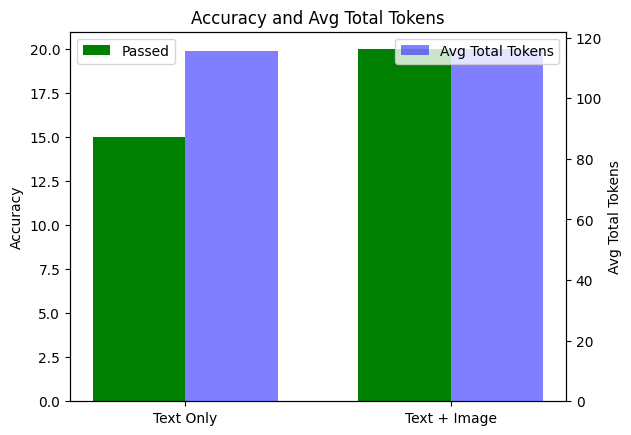

# 用 RAG 做圖像理解

> 原文：[examples/multimodal/image_understanding_with_rag.ipynb](https://github.com/openai/openai-cookbook/blob/main/examples/multimodal/image_understanding_with_rag.ipynb)


## 這篇在做什麼
用 OpenAI 的 Vision 和 Responses API 建一個多模態 RAG，分析包含照片和文字的顧客回饋。它建立有圖片理解和沒有圖片理解的兩個 vector store，用 file search 檢索，再用 Evals API 比較差異。

## 學完你會
- 用 Image API 和 Responses API 產生合成的圖片與文字資料。
- 建立兩個 vector store（純文字 vs. 文字加圖片），用 file search 搭配 attribute filter 做檢索。
- 用 Evals API 的 `string_check` 評估情感分析結果，並分析加入圖片後對準確度和 token 數的影響。

## 開跑前
- 需要 OpenAI API key，並有使用 GPT-5、圖片生成、vector store 和 Evals 的額度。
- 圖片生成、file search 和 evals 都會產生費用。


歡迎！這份 notebook 示範怎麼用 OpenAI 的 Vision 和 Responses API 建立 Retrieval-Augmented Generation (RAG) 系統。重點放在多模態資料，結合圖片和文字輸入來分析顧客體驗。系統使用 GPT-5，並把圖像理解和 file search 整合起來，提供有 context 的回應。

多模態資料集越來越常見，特別是在醫療這類領域，紀錄常同時包含視覺資料（例如放射科掃描）和附帶的文字（例如臨床筆記）。真實世界的資料集通常也很雜亂，資訊不完整或有缺漏，所以同時分析多種模態很重要。

這份指南聚焦客服情境：評估可能包含照片和文字評論的顧客回饋。你會學到怎麼合成產生圖片和文字輸入、用 file search 檢索 context，並用 Evals API 評估加入圖像理解對整體表現的影響。

---

## 概觀

---

## 目錄

1. [Setup & Dependencies](#setup-and-dependencies)
2. [Example Generations](#example-generations)
3. [Data Processing](#data-processing)
   - 載入合成資料集
   - 合併資料
4. [Populating Vector Store](#populating-vector-store)
   - 上傳資料給 file search
   - 設定 attribute filter
5. [Retrieval and Filtering](#retrieval-and-filtering)
   - 測試檢索表現
   - 套用以 attribute 為基礎的 filter
6. [Evaluation and Analysis](#evaluation-and-analysis)
   - 比較預測和 ground truth
   - 分析效能指標

## 設定與依賴

```python
%pip install openai evals pandas numpy matplotlib tqdm ipython --upgrade --quiet
```

```python
import base64
from io import BytesIO
import os
from pathlib import Path

import matplotlib.pyplot as plt
import numpy as np
import pandas as pd
from openai import OpenAI
from IPython.display import display, Image
from tqdm.notebook import tqdm

cache_dir = Path('.local_cache')
cache_dir.mkdir(parents=True, exist_ok=True)

client = OpenAI()
```

## 範例生成

為機器學習任務產生高品質的訓練和評估資料，成本高又耗時。合成資料是實用且可擴展的替代方案。在這份 notebook 裡，用 OpenAI Image API 產生合成圖片，用 Responses API 產生合成文字，讓多模態任務能有效率地做原型和實驗。

```python

prompt = ("Gourmet pasta neatly plated with garnish and sides on a white ceramic plate, "
          "photographed from above on a restaurant table. Soft shadows and vibrant colors.")
cache_path = f".local_cache/{hash(prompt)}.png"

if not os.path.exists(cache_path):
    response = client.images.generate(
        model="gpt-image-1",
        prompt=prompt,
        size="1024x1024"
    )
    
    with open(cache_path, "wb") as f:
        f.write(base64.b64decode(response.data[0].b64_json))
    print(f"Generated and cached: {cache_path}")

else:
    print(f"Loading from cache: {cache_path}")

display(Image(filename=cache_path))
```

```python
def generate_food_delivery_review(sentiment: str = 'positive') -> str:
    """
    Generate a synthetic food delivery review with the specified sentiment.
    
    Args:
        sentiment: An adjective such as 'positive' or 'negative'.
    
    Returns:
        Generated review text
    """
    prompt = "Write a very concise, realistic customer review for a recent food delivery."
    prompt += f" The review should reflect a {sentiment} experience."
    
    response = client.responses.create(
        model="gpt-5",
        reasoning={"effort": "minimal"},
        input=[{"role": "user", "content": prompt}]
    )
    return response.output_text


review = generate_food_delivery_review()
print(review)
```

??? note "輸出"

    ```text
    Order arrived 10 minutes early, food was hot and packaged securely. Tacos were fresh, well-seasoned, and the salsa tasted homemade. Driver was friendly, followed instructions, and left it at the door. Will definitely order again.
    ```

## 資料處理

在這個範例裡，我們會用預先產生好的合成顧客回饋資料集，它包含簡短的文字片段、顧客評論的圖片，以及偶爾同時有兩者的多模態項目。你也可以用上面提供的範例產生自己的合成資料集，針對你的使用情境量身訂做資料。

```python
# Download the dataset
! mkdir -p .local_cache/images
! wget https://raw.githubusercontent.com/robtinn/image_understanding_rag_dataset/main/data/df.csv -O .local_cache/df.csv


! wget https://raw.githubusercontent.com/robtinn/image_understanding_rag_dataset/main/data/images/1.png -O .local_cache/images/1.png
! wget https://raw.githubusercontent.com/robtinn/image_understanding_rag_dataset/main/data/images/2.png -O .local_cache/images/2.png
! wget https://raw.githubusercontent.com/robtinn/image_understanding_rag_dataset/main/data/images/3.png -O .local_cache/images/3.png
! wget https://raw.githubusercontent.com/robtinn/image_understanding_rag_dataset/main/data/images/4.png -O .local_cache/images/4.png
! wget https://raw.githubusercontent.com/robtinn/image_understanding_rag_dataset/main/data/images/5.png -O .local_cache/images/5.png
! wget https://raw.githubusercontent.com/robtinn/image_understanding_rag_dataset/main/data/images/6.png -O .local_cache/images/6.png
! wget https://raw.githubusercontent.com/robtinn/image_understanding_rag_dataset/main/data/images/7.png -O .local_cache/images/7.png
```

```python
def encode_image(image_path: str) -> str:
    """Encode image file to base64 string."""
    with open(image_path, "rb") as f:
        return base64.b64encode(f.read()).decode("utf-8")


def analyze_image_sentiment(image_path: str) -> str:
    """Analyze food delivery image and return sentiment analysis."""
    base64_image = encode_image(image_path)
    response = client.responses.create(
        model="gpt-5",
        reasoning={"effort": "minimal"},
        input=[{
            "role": "user",
            "content": [
                {
                    "type": "input_text",
                    "text": "Analyze this food delivery image. Respond with a brief description and sentiment (positive/negative) in one line."
                },
                {
                    "type": "input_image",
                    "image_url": f"data:image/jpeg;base64,{base64_image}",
                },
            ],
        }],
    )
    return response.output_text.strip()
```

```python
df = pd.read_csv(".local_cache/df.csv")
cache_dir = Path(".local_cache")

for idx, row in df[~df['image_path'].isna()].iterrows():
    image_path = cache_dir / 'images' / row['image_path']
    sentiment = analyze_image_sentiment(str(image_path))
    df.at[idx, 'full_sentiment'] = f"{row['text']} {sentiment}" if pd.notna(row['text']) else sentiment
    print(f"Processed {row['image_path']}")

df['full_sentiment'] = df['full_sentiment'].fillna(df['text'])

output_path = cache_dir / "df_full_sentiment.csv"
df.to_csv(output_path, index=False)
print(f"\nSaved results to {output_path}")
```

```python
pd.set_option('display.max_colwidth', 100)  # Increase from default (50) to view full sentiment
display(df.head())
```

??? note "輸出"

    ```text
       id month  \
    0   1  june   
    1   2  july   
    2   3  july   
    3   4  july   
    4   5  june   

                                                                                                      text  \
    0  Absolutely delicious! The sushi was fresh, beautifully packed, and arrived right on time. Will d...   
    1                Half my order was missing and the burger looked thrown together. Not worth the money.   
    2              Packaging was leaking sauce everywhere. Presentation was a mess. Tasted like leftovers.   
    3  Burger was hot, fries were still crispy, and the milkshake wasn’t melted at all. Fantastic deliv...   
    4                   Received the wrong items. I ordered vegetarian and got meat. Totally unacceptable.   

      image_path     label  \
    0        NaN  positive   
    1        NaN  negative   
    2        NaN  negative   
    3      3.png  positive   
    4        NaN  negative   

                                                                                            full_sentiment  
    0  Absolutely delicious! The sushi was fresh, beautifully packed, and arrived right on time. Will d...  
    1                Half my order was missing and the burger looked thrown together. Not worth the money.  
    2              Packaging was leaking sauce everywhere. Presentation was a mess. Tasted like leftovers.  
    3  Burger was hot, fries were still crispy, and the milkshake wasn’t melted at all. Fantastic deliv...  
    4                   Received the wrong items. I ordered vegetarian and got meat. Totally unacceptable.
    ```

## 填入 Vector Store

這個範例使用 OpenAI 內建的 vector store 和 file search 功能建立 RAG 系統，可以分析顧客從回饋（可能是視覺或文字）得來的體驗。我們建立兩個 vector store 做比較，一個有圖像理解，一個沒有。

```python
text_vector_store = client.vector_stores.create(
    name="food_delivery_reviews_text",
    metadata={
        "purpose": "text_understanding",
        "created_by": "notebook",
        "version": "1.0"
    }
)
text_vector_store_id = text_vector_store.id

text_image_vector_store = client.vector_stores.create(
    name="food_delivery_reviews_text_image",
    metadata={
        "purpose": "text_image_understanding",
        "created_by": "notebook",
        "version": "1.0"
    }
)
text_image_vector_store_id = text_image_vector_store.id

print("Vector Store IDs:")
print(f"  Text:       {text_vector_store_id}")
print(f"  Text+Image: {text_image_vector_store_id}")
```

```python
# upload files to vector database and set metadata

def upload_files_to_vector_store(vector_store_id, df, column_name="full_sentiment"):
    file_ids = []
    for i, row in tqdm(df.iterrows(), total=len(df), desc="Uploading context files"):
        if pd.isna(row[column_name]):
            file_stream = BytesIO('No information available.'.encode('utf-8'))
        else:
            file_stream = BytesIO(row[column_name].encode('utf-8'))
        file_stream.name = f"context_{row.get('id', i)}_{row.get('month', '')}.txt"
        
        file = client.vector_stores.files.upload(
            vector_store_id=vector_store_id,
            file=file_stream
        )
        file_ids.append(file.id)

    for i, row in tqdm(df.iterrows(), total=len(df), desc="Updating file attributes"):
        client.vector_stores.files.update(
            vector_store_id=vector_store_id,
            file_id=file_ids[i],
            attributes={"month": row["month"]}
        )
```

```python
upload_files_to_vector_store(text_image_vector_store_id, df)
upload_files_to_vector_store(text_vector_store_id, df, column_name="text")
```

# 檢索與過濾

我們可以借助 File Search，用自然語言 query 分析資料集。對純文字資料集來說，我們看到缺少了一些能幫助分析的資訊。

七月唯一一則關於 spaghetti 的正面評論只有視覺回饋，我們可以看到只有文字 context 的 RAG 系統對正面的細節不確定。但有提供圖像 context 時，第二個 RAG 系統能給出更準確的回應。


```python
# Query the vector store for spaghetti reviews in July
query = "Where there any comments about the 'spaghetti'?"
print(f"🔍 Query: {query}\n")

# Execute the search with filtering
response = client.responses.create(
    model="gpt-5",
    input=query,
    tools=[{
        "type": "file_search",
        "vector_store_ids": [text_vector_store_id],
        "filters": {
            "type": "eq",
            "key": "month",
            "value": "july"
        }
    }]
)

# Display the results
print("📝 Response:")
print("-" * 40)
print(response.output_text)
```

??? note "輸出"

    ```text
    🔍 Query: Where there any comments about the 'spaghetti'?

    📝 Response:
    ----------------------------------------
    I couldn’t find any comments that explicitly mention “spaghetti.” The closest related note says “Pasta was overcooked” in context_9_july.txt . If you have a specific date or file in mind, I can check that directly.
    ```

```python
query = "Where there any comments about the 'spaghetti'?"
print(f"🔍 Query: {query}\n")

response = client.responses.create(
    model="gpt-5",
    input=query,
    tools=[{
        "type": "file_search",
        "vector_store_ids": [text_image_vector_store_id],
        "filters": {
            "type": "eq",
            "key": "month",
            "value": "july"
        }
    }]
)

print("📝 Response:")
print("-" * 40)
print(response.output_text)
```

??? note "輸出"

    ```text
    🔍 Query: Where there any comments about the 'spaghetti'?

    📝 Response:
    ----------------------------------------
    Yes. There’s a positive note describing “a neatly plated spaghetti in tomato sauce with parsley, served alongside arugula, garlic bread, and grated cheese.”
    ```

我們可以檢查檢索到的圖片來確認這是否正確。

```python
IMAGE_ID_MAPPING = {
    f"context_{row['id']}_{row['month']}.txt": row["image_path"]
    for _, row in df[~df['image_path'].isna()].iterrows()
}

def display_retrieved_images(
    response,
    cache_dir: str = ".local_cache"
):
    """
    Display images from the retrieved search results.
    
    Args:
        response: The response object from the search query
        cache_dir: Directory where images are stored
        
    Returns:
        Dict mapping filenames to image paths for the displayed images
    """
    # Get the annotations from the response
    try:
        annotations = response.output[3].content[0].annotations
        retrieved_files = {result.filename for result in annotations}
    except (AttributeError, IndexError):
        print("No search results found in the response.")
        return {}


    # Display matching images
    displayed_images = {}
    for file in retrieved_files:
        if file in IMAGE_ID_MAPPING and IMAGE_ID_MAPPING[file]:
            image_path = Path(cache_dir) / 'images' / IMAGE_ID_MAPPING[file]
            print(f"Displaying image for {file}:")
            display(Image(str(image_path)))
            displayed_images[file] = str(image_path)
    
    return displayed_images

displayed = display_retrieved_images(response)
print(f"Displayed {len(displayed)} images")
```

同樣地，我們可以測試六月關於燒焦 pizza 的負面評論。

```python
query = "Were there any negative reviews for pizza, and if so, was the pizza burnt?"
print(f"🔍 Query: {query}\n")

response = client.responses.create(
    model="gpt-5",
    input=query,
    tools=[{
        "type": "file_search",
        "vector_store_ids": [text_image_vector_store_id],
        "filters": {
            "type": "eq",
            "key": "month",
            "value": "june"
        }
    }]
)

print("📝 Response:")
print("-" * 40)
print(response.output_text)
```

??? note "輸出"

    ```text
    🔍 Query: Were there any negative reviews for pizza, and if so, was the pizza burnt?

    📝 Response:
    ----------------------------------------
    Yes. One review explicitly describes a “burnt pepperoni pizza with charred crust and grease stains in the box” and is marked as negative sentiment .
    ```

我們可以檢查檢索到的圖片來確認這是否正確。

```python
displayed = display_retrieved_images(response)
print(f"Displayed {len(displayed)} images")
```

## 評估與分析

因為我們的資料集可能隨時間演進，也想評估新模型，所以可以用 OpenAI Evaluation API 評估系統在情感分析上的表現。在這個簡單的範例裡，我們用 string_check 準則檢查輸出是否是三個可能值之一：positive、negative 或 unclear。

```python
def prepare_evaluation_data(
    df: pd.DataFrame,
    text_col: str = "full_sentiment",
    label_col: str = "label"
) -> list:
    """
    Prepare evaluation data items from a DataFrame.
    
    Args:
        df: Input pandas DataFrame.
        text_col: Column containing the input text.
        label_col: Column containing the ground truth label.
    
    Returns:
        List of dicts formatted for evaluation.
    """
    return [
        {"item": {"input": str(row[text_col]), "ground_truth": row[label_col]}}
        for _, row in df.iterrows()
    ]

def create_eval_run(evaluation_data: list, eval_id: str) -> str:
    """
    Create and launch an evaluation run.
    
    Args:
        evaluation_data: List of evaluation items.
        eval_id: The evaluation object ID.
    
    Returns:
        The run ID as a string.
    """
    eval_config = {
        "type": "completions",
        "model": "gpt-5",
        "input_messages": {
            "type": "template",
            "template": [
                {
                    "type": "message",
                    "role": "user",
                    "content": {
                        "type": "input_text",
                        "text": (
                            "Classify the sentiment of this food delivery review: {{ item.input }}. "
                            "Categorize the request into one of \"positive\", \"negative\" or \"unclear\". "
                            "Respond with only one of those words."
                        )
                    }
                }
            ]
        },
        "source": {
            "type": "file_content",
            "content": evaluation_data
        }
    }

    run = client.evals.runs.create(
        eval_id=eval_id,
        data_source=eval_config
    )
    print("✅ Evaluation run created successfully")
    print(f"Run ID: {run.id}")
    return run.id
```

```python
eval_obj = client.evals.create(
    name="food-categorization-eval",
    data_source_config={
        "type": "custom",
        "item_schema": {
            "type": "object",
            "properties": {
                "input": {"type": "string"},
                "ground_truth": {"type": "string"}
            },
            "required": ["input", "ground_truth"]
        },
        "include_sample_schema": True
    },
    testing_criteria=[
        {
            "type": "string_check",
            "name": "Match output to human label",
            "input": "{{sample.output_text}}",
            "reference": "{{item.ground_truth}}",
            "operation": "eq"
        }
    ]
)
eval_id = eval_obj.id
eval_id
```

```python
# create evaluation runs

evaluation_data = prepare_evaluation_data(df, text_col="text")
text_only_run_id = create_eval_run(evaluation_data, eval_id)

evaluation_data = prepare_evaluation_data(df)
text_image_run_id = create_eval_run(evaluation_data, eval_id)

# retrieve both run urls

text_only_run = client.evals.runs.retrieve(eval_id=eval_id, run_id=text_only_run_id)
print(text_only_run.to_dict()['report_url'])

text_image_run = client.evals.runs.retrieve(eval_id=eval_obj.id, run_id=text_image_run_id)
print(text_image_run.to_dict()['report_url'])
```

```python
# you may need to wait a few seconds before running this cell for the eval runs to finish up

text_only_run_output_items = client.evals.runs.output_items.list(eval_id=eval_id, run_id=text_only_run_id)
text_image_run_output_items = client.evals.runs.output_items.list(eval_id=eval_id, run_id=text_image_run_id)
```

我們可以取回這些評估執行的結果並做一些本機分析。這裡我們會比較純文字和文字加圖片兩次執行的表現，並評估增加總 token 數（因為加入圖片 context）如何影響模型準確度。我們也可以分析失敗範例的模型輸入，做一些基本的錯誤分析。

```python
# Calculate passed and total for text_only_run
text_only_data = text_only_run_output_items.to_dict()['data']
text_only_passed = sum(1 for output_item in text_only_data if output_item['results'][0]['passed'])
text_only_total = len(text_only_data)

# Calculate passed and total for text_image_run
text_image_data = text_image_run_output_items.to_dict()['data']
text_image_passed = sum(1 for output_item in text_image_data if output_item['results'][0]['passed'])
text_image_total = len(text_image_data)

# Calculate average total_tokens for each run
def avg_total_tokens(data):
    tokens = [item['sample']['usage']['total_tokens'] for item in data if 'usage' in item['sample']]
    return sum(tokens) / len(tokens) if tokens else 0

text_only_avg_tokens = avg_total_tokens(text_only_data)
text_image_avg_tokens = avg_total_tokens(text_image_data)

# Plotting
labels = ['Text Only', 'Text + Image']
passed = [text_only_passed, text_image_passed]
avg_tokens = [text_only_avg_tokens, text_image_avg_tokens]

x = np.arange(len(labels))
width = 0.35

fig, ax1 = plt.subplots()

# Bar for passed only
bars1 = ax1.bar(x - width/2, passed, width, label='Passed', color='green')
ax1.set_ylabel('Accuracy')
ax1.set_xticks(x)
ax1.set_xticklabels(labels)
ax1.set_title('Accuracy and Avg Total Tokens')
ax1.legend(loc='upper left')

# Second y-axis for avg total tokens
ax2 = ax1.twinx()
bars2 = ax2.bar(x + width/2, avg_tokens, width, label='Avg Total Tokens', color='blue', alpha=0.5)
ax2.set_ylabel('Avg Total Tokens')
ax2.legend(loc='upper right')

plt.show()
```

??? note "輸出"

    

```python
failed_samples = [
    {
        "Input": sample['sample']['input'],
        "Model Output": sample['sample']['output']
    }
    for sample in text_only_run_output_items.to_dict()['data']
    if not sample['results'][0]['passed']
]

pd.set_option('display.max_colwidth', 150)  # Adjust as needed

failed_df = pd.DataFrame(failed_samples)
display(failed_df.style.set_properties(**{'text-align': 'left'}))
```

??? note "輸出"

    ```text
    <pandas.io.formats.style.Styler at 0x134997530>
    ```

最後，把我們建立的一些資源清理掉。

```python
# delete vector stores
deleted_vector_store = client.vector_stores.delete(
  vector_store_id=text_vector_store_id
)
print(deleted_vector_store)

deleted_vector_store = client.vector_stores.delete(
  vector_store_id=text_image_vector_store_id
)
print(deleted_vector_store)
```

## 重點整理
- 多模態資料常有缺漏，只靠文字 context 的 RAG 會對圖片裡的資訊不確定。
- 做 A/B 比較時建兩個 vector store，只差在有沒有圖像理解，才看得出圖像的貢獻。
- File search 搭配 attribute filter，可以用月份、類別這類條件縮小檢索範圍。
- 用 Evals API 把評估變成可重複執行的流程，新模型或新資料來時能再跑。
- 加入圖像 context 會增加 token，要看準確度提升值不值得。

## 練習
1. 把檢索的 query 改成「八月關於冷掉的湯的負面評論」，比較兩個 RAG 系統的回答。
2. 修改 `string_check` 的準則，讓它多接受一個 `mixed` 標籤，並重跑評估。
3. 統計失敗範例中有圖片和沒圖片的比例，找出哪一類錯誤最多。
